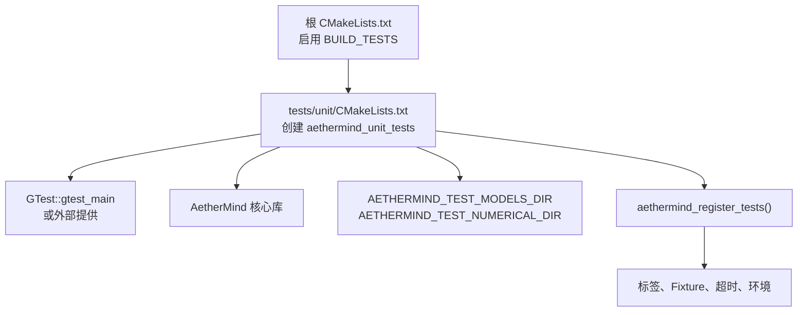
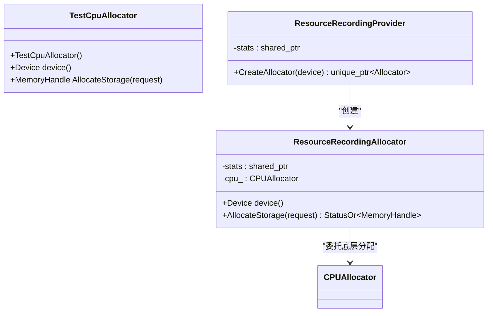
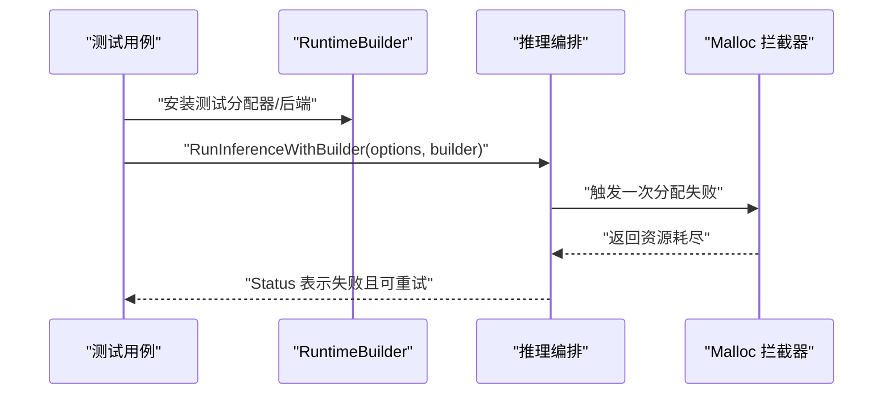
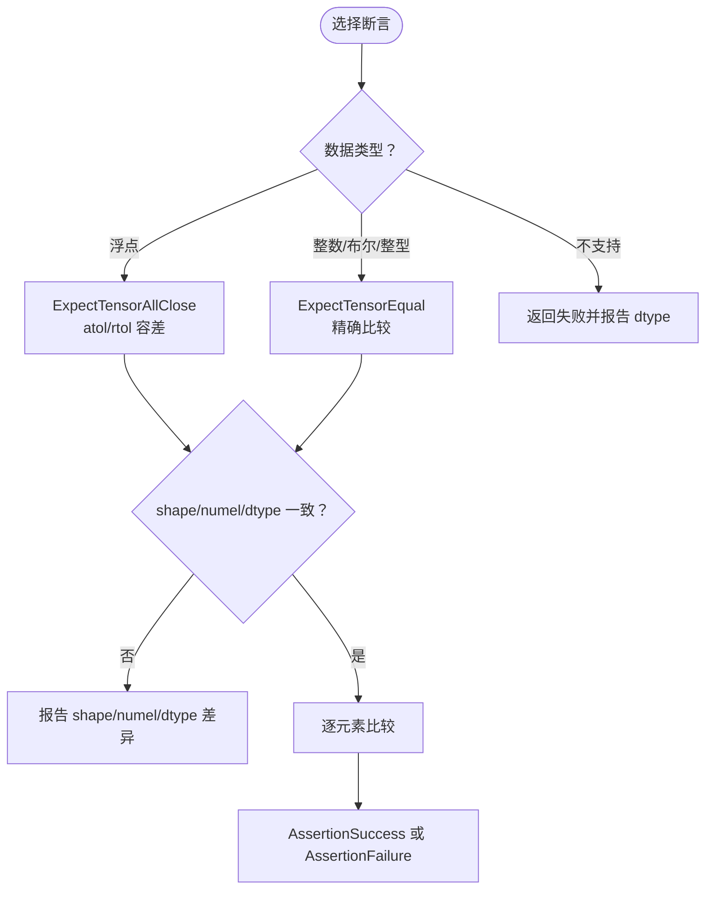
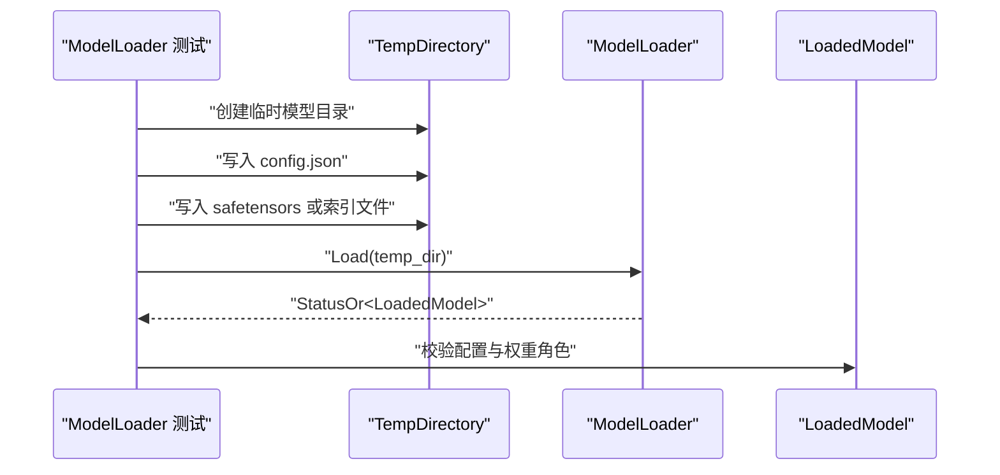
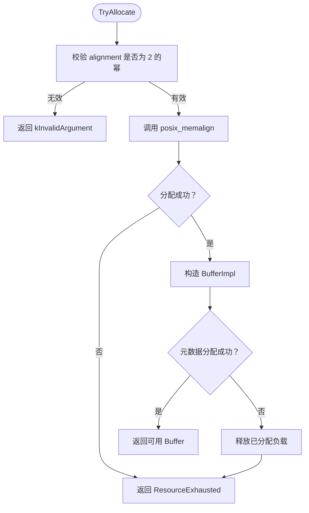
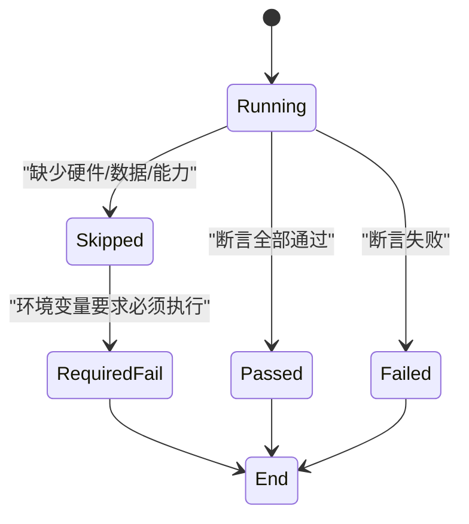
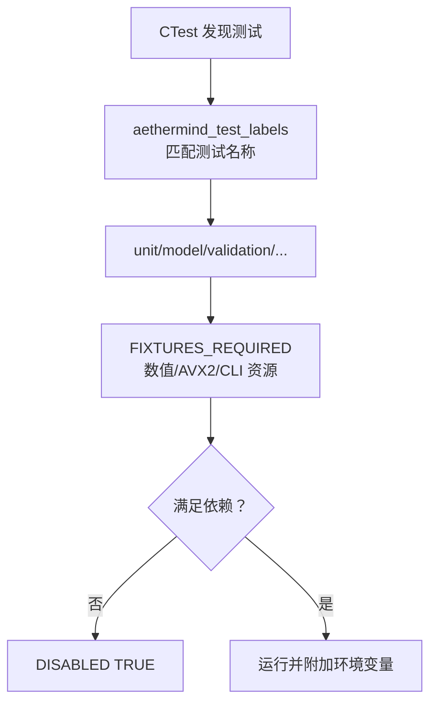

# 单元测试

**本文引用的文件**
- [AGENTS.md](../../../AGENTS.md)
- [CMakeLists.txt](../../../CMakeLists.txt)
- [cmake/AetherMindTests.cmake](../../../cmake/AetherMindTests.cmake)
- [docs/guides/test_writing_guidelines.md](../../guides/test_writing_guidelines.md)
- [tests/unit/CMakeLists.txt](../../../tests/unit/CMakeLists.txt)
- [tests/benchmark/CMakeLists.txt](../../../tests/benchmark/CMakeLists.txt)
- [apps/inference/inference_runner_test.h](../../../apps/inference/inference_runner_test.h)
- [tests/unit/test_utils/tensor_factory.h](../../../tests/unit/test_utils/tensor_factory.h)
- [tests/unit/test_utils/tensor_assert.h](../../../tests/unit/test_utils/tensor_assert.h)
- [tests/unit/test_utils/tensor_random.h](../../../tests/unit/test_utils/tensor_random.h)
- [tests/unit/test_utils/test_allocator.h](../../../tests/unit/test_utils/test_allocator.h)
- [tests/unit/test_utils/test_resource_allocator.h](../../../tests/unit/test_utils/test_resource_allocator.h)
- [tests/unit/test_utils/test_required_execution_guard.cpp](../../../tests/unit/test_utils/test_required_execution_guard.cpp)
- [tests/unit/inference/test_malloc_interposer.h](../../../tests/unit/inference/test_malloc_interposer.h)
- [tests/unit/memory/test_cpu_allocator.cpp](../../../tests/unit/memory/test_cpu_allocator.cpp)
- [tests/unit/model/test_model_loader.cpp](../../../tests/unit/model/test_model_loader.cpp)

## 目录
1. [引言](#引言)
2. [项目结构与测试入口](#项目结构与测试入口)
3. [测试命名与目录约定](#测试命名与目录约定)
4. [GoogleTest 使用规范](#googletest-使用规范)
5. [测试夹具与共享状态](#测试夹具与共享状态)
6. [模拟对象与依赖注入](#模拟对象与依赖注入)
7. [断言方法与数值比较](#断言方法与数值比较)
8. [常见测试场景示例](#常见测试场景示例)
9. [参数化、异步与高级用法](#参数化异步与高级用法)
10. [标签、过滤与持续集成](#标签过滤与持续集成)
11. [性能与可维护性建议](#性能与可维护性建议)
12. [故障排查](#故障排查)
13. [结论](#结论)

## 引言
AetherMind 的单元测试体系以 GoogleTest v1.18.0 为核心，围绕“正确性优先、可读性强、隔离良好、运行快速”的目标组织。仓库同时区分单元测试目标 `aethermind_unit_tests` 和基准测试目标 `aethermind_benchmark`；前者用于验证公共契约、错误路径、边界条件与模型加载流程，后者用于性能测量。

文档级测试指南定义了用例组织、命名、包含顺序、AAA 结构、死亡测试、跳过策略、随机数种子、全局状态隔离等规则；构建层通过 CMake 自动发现 `tests/unit/**/*.cpp`，并根据测试名称匹配标签（如 `model`、`numerical-model`、`isa-avx2`、`validation`、`lifecycle`）控制执行、超时、Fixture 依赖与 CI 行为。

**章节来源**
- [docs/guides/test_writing_guidelines.md](../../guides/test_writing_guidelines.md)
- [AGENTS.md](../../../AGENTS.md)

## 项目结构与测试入口
顶层 `CMakeLists.txt` 在启用 `BUILD_TESTS=ON` 时引入 GoogleTest：如果父工程未提供 `GTest::gtest` 与 `GTest::gtest_main`，则通过 FetchContent 拉取 `.deps/googletest` 源码并禁用其自身测试。随后进入 `tests/unit` 子目录。

`tests/unit/CMakeLists.txt` 定义测试目标：
- 目标名：`aethermind_unit_tests`
- 源文件：通过 `GLOB_RECURSE` 收集 `tests/unit/*.cpp`
- 链接库：核心库 `AetherMind` 与 `GTest::gtest_main`
- 编译宏：`AETHERMIND_TEST_MODELS_DIR`、`AETHERMIND_TEST_NUMERICAL_DIR`、`AETHERMIND_TEST_HAS_AVX2_FMA`、`BUILD_WITH_TORCH`
- 额外源：C ABI 合同文件、推理 Runner 实现（仅测试编译）、可选 AVX2 测试源
- 注册函数：调用 `aethermind_register_tests(target)` 完成 CTest/GoogleTest 注册与标签处理

**图表来源**
- [CMakeLists.txt:70-130](../../../CMakeLists.txt#L70-L130)
- [tests/unit/CMakeLists.txt:1-99](../../../tests/unit/CMakeLists.txt#L1-L99)
- [cmake/AetherMindTests.cmake:491-753](../../../cmake/AetherMindTests.cmake#L491-L753)

**章节来源**
- [CMakeLists.txt:70-130](../../../CMakeLists.txt#L70-L130)
- [tests/unit/CMakeLists.txt:1-99](../../../tests/unit/CMakeLists.txt#L1-L99)

## 测试命名与目录约定
### 目录镜像原则
测试目录应镜像被测模块位置：
- `include/aethermind/graph/` → `tests/unit/graph/`
- `src/operators/` → `tests/unit/operators/`
- `include/aethermind/kv_cache/` → `tests/unit/kv_cache/`
- `src/backend/cpu/kernels/` → `tests/unit/backend/cpu/kernels/`
- `src/container/` → `tests/unit/amstring/`

### 文件命名
新测试文件采用 `test_<单元>.cpp`，例如 `test_rmsnorm_op.cpp`、`test_tensor_view.cpp`。单个文件超过约 800 行或混合多个不相关套件时应拆分。

### 命名风格
- 套件名与测试名使用 PascalCase。
- 套件名描述被测单元，测试名描述被验证的行为。
- 死亡测试以 `Death` 结尾。
- 避免 snake_case、数字后缀和无意义前缀。

**章节来源**
- [docs/guides/test_writing_guidelines.md](../../guides/test_writing_guidelines.md)

## GoogleTest 使用规范
### 测试形式
| 形式 | 适用场景 | 说明 |
|---|---|---|
| `TEST` | 无共享初始化 | 最常见形式 |
| `TEST_F` | 多个测试共享昂贵 Setup/TearDown | 夹具类命名为 `<Unit>Test` |
| `TEST_P` | 同一逻辑、多组数据输入 | 优先于复制粘贴多个 `TEST` |

### 包含顺序
推荐先写项目头，再写第三方头，最后写标准库头；每组之间空一行，组内按字母序排列。这有助于编译器检查被测单元的自包含性。

### 命名空间
测试代码包裹在匿名命名空间中，避免跨翻译单元 ODR 冲突；可按需要 `using namespace aethermind;`。

**章节来源**
- [docs/guides/test_writing_guidelines.md](../../guides/test_writing_guidelines.md)

## 测试夹具与共享状态
当多个测试需要相同的全局资源（缓存、注册表、分配器状态）时，使用 `TEST_F` 和自定义 Fixture。Fixture 的 `SetUp`/`TearDown` 应保持最小化，只负责重置共享状态。

仓库还提供了一个进程级 CPU 分配器辅助函数，供只需要受管存储但不关心释放后语义的测试复用：

**图表来源**
- [tests/unit/test_utils/test_allocator.h:1-24](../../../tests/unit/test_utils/test_allocator.h#L1-L24)
- [tests/unit/test_utils/test_resource_allocator.h:1-54](../../../tests/unit/test_utils/test_resource_allocator.h#L1-L54)

**章节来源**
- [docs/guides/test_writing_guidelines.md](../../guides/test_writing_guidelines.md)
- [tests/unit/test_utils/test_allocator.h:1-24](../../../tests/unit/test_utils/test_allocator.h#L1-L24)
- [tests/unit/test_utils/test_resource_allocator.h:1-54](../../../tests/unit/test_utils/test_resource_allocator.h#L1-L54)

## 模拟对象与依赖注入
AetherMind 的测试更偏向“轻量替换”而非重度 Mock。常见模式包括：

1. **分配器替换**：通过 `ResourceRecordingAllocator` 记录分配请求，并在指定调用次数后返回 `ResourceExhausted`，从而验证 OOM 恢复路径。
2. **运行时构建器注入**：仅在测试编译中启用的 `RunInferenceWithBuilder`，允许测试传入预配置的 `RuntimeBuilder`，从而控制后端与分配器。
3. **系统分配拦截**：通过 `MallocInterposer` 注入一次 `malloc`/`posix_memalign` 失败，验证内存不足时的清理与重试。

**图表来源**
- [apps/inference/inference_runner_test.h:1-31](../../../apps/inference/inference_runner_test.h#L1-L31)
- [tests/unit/inference/test_malloc_interposer.h:1-88](../../../tests/unit/inference/test_malloc_interposer.h#L1-L88)
- [tests/unit/test_utils/test_resource_allocator.h:1-54](../../../tests/unit/test_utils/test_resource_allocator.h#L1-L54)

**章节来源**
- [apps/inference/inference_runner_test.h:1-31](../../../apps/inference/inference_runner_test.h#L1-L31)
- [tests/unit/inference/test_malloc_interposer.h:1-88](../../../tests/unit/inference/test_malloc_interposer.h#L1-L88)
- [tests/unit/test_utils/test_resource_allocator.h:1-54](../../../tests/unit/test_utils/test_resource_allocator.h#L1-L54)

## 断言方法与数值比较
### EXPECT 与 ASSERT
- 默认使用 `EXPECT_*`，失败后继续执行，便于一次发现多个问题。
- 仅在继续执行会导致崩溃时使用 `ASSERT_*`，例如校验 `Status`/`Expected` 后再访问指针或引用。

### 浮点数比较
- 简单位容差比较使用 `EXPECT_FLOAT_EQ` / `EXPECT_DOUBLE_EQ`。
- 归约结果建议使用相对误差辅助函数，并在失败时输出期望值、实际值与绝对/相对误差。
- 张量比较工具提供了：
  - `ExpectTensorAllClose`：按 dtype 分派，支持 float32、double、half、bfloat16。
  - `ExpectTensorEqual`：支持多种整数、布尔、浮点类型及半精度比特比较。

### 张量构造与随机数据
- `tensor_factory.h` 提供对齐缓冲区、连续张量、任意 shape/stride 张量的构造工具。
- `tensor_random.h` 提供确定性随机张量生成，默认种子为固定值，便于复现。

**图表来源**
- [tests/unit/test_utils/tensor_assert.h:1-302](../../../tests/unit/test_utils/tensor_assert.h#L1-L302)
- [tests/unit/test_utils/tensor_factory.h:1-103](../../../tests/unit/test_utils/tensor_factory.h#L1-L103)
- [tests/unit/test_utils/tensor_random.h:1-125](../../../tests/unit/test_utils/tensor_random.h#L1-L125)

**章节来源**
- [docs/guides/test_writing_guidelines.md](../../guides/test_writing_guidelines.md)
- [tests/unit/test_utils/tensor_assert.h:1-302](../../../tests/unit/test_utils/tensor_assert.h#L1-L302)
- [tests/unit/test_utils/tensor_factory.h:1-103](../../../tests/unit/test_utils/tensor_factory.h#L1-L103)
- [tests/unit/test_utils/tensor_random.h:1-125](../../../tests/unit/test_utils/tensor_random.h#L1-L125)

## 常见测试场景示例
### 算子测试
算子测试应覆盖：
- 静态形状推导
- dtype 校验
- 广播与边界尺寸
- 错误输入拒绝
- 等价性或数值参考对比

推荐使用 `ExpectTensorAllClose` 与 `RandomUniformTensor`/`RandomNormalTensor` 生成可复现实验数据。

### 模型加载测试
模型加载测试通常构造临时目录、写入 `config.json` 与 safetensors 文件，然后调用 `ModelLoader::Load`，验证：
- 配置字段
- 权重角色解析
- 单文件与分片目录两种路径
- 滑动窗口等特殊配置

**图表来源**
- [tests/unit/model/test_model_loader.cpp:1-200](../../../tests/unit/model/test_model_loader.cpp#L1-L200)

**章节来源**
- [tests/unit/model/test_model_loader.cpp:1-200](../../../tests/unit/model/test_model_loader.cpp#L1-L200)

### 内存分配器测试
CPU 分配器测试覆盖：
- 请求的对齐保持
- 零字节分配
- 非 2 次幂对齐拒绝
- 默认对齐提升
- 系统分配失败返回 `ResourceExhausted` 并可重试
- 元数据失败释放已分配负载

其中部分用例依赖 glibc malloc 拦截器，不可用时使用 `GTEST_SKIP()`。

**图表来源**
- [tests/unit/memory/test_cpu_allocator.cpp:1-200](../../../tests/unit/memory/test_cpu_allocator.cpp#L1-L200)

**章节来源**
- [tests/unit/memory/test_cpu_allocator.cpp:1-200](../../../tests/unit/memory/test_cpu_allocator.cpp#L1-L200)

## 参数化、异步与高级用法
### 参数化测试
使用 `TEST_P` 与 `INSTANTIATE_TEST_SUITE_P` 表达“同一逻辑、多组输入”。仓库中 CPU 分配器参数化测试通过结构化参数传递名称、大小和对齐要求，并使用 `SCOPED_TRACE` 增强失败定位。

### 死亡测试
对触发 `AM_CHECK` 的路径使用 `EXPECT_DEATH`，匹配 `"Check failed"` 前缀；调试专属死亡测试用 `#ifndef NDEBUG` 保护。仓库中 HugePage 告警 OOM 场景使用线程安全死亡测试风格。

### 全局环境与强制校验
测试框架注册了一个全局监听器：当环境变量 `AETHERMIND_REQUIRED_VALIDATION=1` 设置且测试被跳过时，会报告“必需验证用例被跳过”，防止 CI 把跳过误判为通过。

**图表来源**
- [tests/unit/test_utils/test_required_execution_guard.cpp:1-33](../../../tests/unit/test_utils/test_required_execution_guard.cpp#L1-L33)
- [cmake/AetherMindTests.cmake:491-753](../../../cmake/AetherMindTests.cmake#L491-L753)

**章节来源**
- [tests/unit/memory/test_cpu_allocator.cpp:1-200](../../../tests/unit/memory/test_cpu_allocator.cpp#L1-L200)
- [tests/unit/test_utils/test_required_execution_guard.cpp:1-33](../../../tests/unit/test_utils/test_required_execution_guard.cpp#L1-L33)
- [docs/guides/test_writing_guidelines.md](../../guides/test_writing_guidelines.md)

## 标签、过滤与持续集成
### 测试标签
CMake 根据测试名称匹配以下标签：
- `unit`：默认标签
- `interposer`：需要 glibc 分配拦截器
- `model`：涉及真实模型文件或完整加载链路
- `cli`：CLI 集成测试
- `smoke`：轻量冒烟测试
- `numerical`：数值内核或 FP32 兼容测试
- `numerical-model`：数值+模型组合
- `kv16-model`、`a16-model`、`p4b-model`：不同量化参考集
- `long-context`：长上下文数值测试
- `validation`：验证类测试
- `lifecycle`：生命周期相关测试
- `context_boundary`：容量/上下文边界测试
- `isa-avx2`、`isa-policy`：ISA 能力相关测试
- `thread-smoke`：线程冒烟测试

### Fixture 与跳过策略
- 缺失数值参考数据时，对应测试会被标记并禁用。
- 主机不具备 AVX2/FMA 时，`isa-avx2` 测试被禁用。
- 未启用 sanitizer 或缺少 interposer 时，`interposer` 测试被禁用。
- 数值模型测试可能关联 `aethermind_numerical_assets`、`aethermind_kv16_reference_assets`、`aethermind_a16_reference_assets`、`aethermind_p4b_reference_assets`。
- 长上下文数值测试超时设为 600 秒，普通测试超时为 60 秒。

### CTest 与 GoogleTest 集成
`aethermind_register_tests` 调用 `enable_testing()` 与 GoogleTest CMake 集成，将每个测试作为 CTest 用例注册，并附加 LABELS、TIMEOUT、WORKING_DIRECTORY、ENVIRONMENT 和 FIXTURES_REQUIRED。

**图表来源**
- [cmake/AetherMindTests.cmake:1-490](../../../cmake/AetherMindTests.cmake#L1-L490)

**章节来源**
- [cmake/AetherMindTests.cmake:1-490](../../../cmake/AetherMindTests.cmake#L1-L490)
- [cmake/AetherMindTests.cmake:491-753](../../../cmake/AetherMindTests.cmake#L491-L753)
- [tests/unit/CMakeLists.txt:1-99](../../../tests/unit/CMakeLists.txt#L1-L99)

## 性能与可维护性建议
- 单元测试应快速运行；慢场景放入 benchmark 或 integration test。
- 每个测试只验证一个行为，遵循 Arrange-Act-Assert。
- 不要测试标准库实现细节、私有无观察行为的内部实现或 trivial getter/setter。
- 随机数据使用显式种子，确保失败可复现。
- 全局状态必须在 `SetUp`/`TearDown` 中恢复。
- 使用本地匿名命名空间中的辅助函数；跨文件共享的辅助函数放在 `tests/unit/test_utils/` 下，并用 `inline` 声明。
- 文件名过长或职责过多时主动拆分。

**章节来源**
- [docs/guides/test_writing_guidelines.md](../../guides/test_writing_guidelines.md)
- [docs/guides/test_writing_guidelines.md](../../guides/test_writing_guidelines.md)

## 故障排查
| 现象 | 可能原因 | 处理方法 |
|---|---|---|
| 测试被跳过 | 缺少 HF 数值参考、AVX2 主机能力、glibc interposer 或 CLI | 查看 CTest LABELS 中的 `missing_numerical_assets`、`not_compiled_avx2`、`unavailable_interposer`、`missing_cli` |
| 数值测试失败 | 参考数据不一致或 fixture 未准备 | 使用 Python 工具校验 `manifest.json` 与 checksums |
| 内存测试不稳定 | 使用了进程级全局分配器或全局状态 | 改为每测试构造独立 `CPUAllocator`，或使用 `ResourceRecordingAllocator` |
| 死亡测试在 release 构建异常 | 调试专属 `AM_CHECK` 未被 `NDEBUG` 保护 | 用 `#ifndef NDEBUG` 包裹 |
| 构建找不到 GTest | 父工程未提供 `GTest::gtest` 与 `GTest::gtest_main` | 检查 FetchContent 是否成功，或手动提供两个 target |
| 推理集成测试失败 | 未设置 `AETHERMIND_INFER_BINARY` 或 fixture 缺失 | 按 AGENTS.md 准备 HF fixtures 并构建独立 CLI |

**章节来源**
- [cmake/AetherMindTests.cmake:1-490](../../../cmake/AetherMindTests.cmake#L1-L490)
- [tests/unit/CMakeLists.txt:1-99](../../../tests/unit/CMakeLists.txt#L1-L99)
- [AGENTS.md](../../../AGENTS.md)

## 结论
AetherMind 的单元测试体系强调“面向契约、面向行为、面向可维护性”。编写高质量测试时，应优先选择正确的 GoogleTest 形式、清晰的命名、严格的 AAA 结构、合适的断言方法和稳定的随机种子；通过分配器替换、构建器注入和 malloc 拦截器进行轻量依赖控制；借助 CMake 标签与 Fixture 机制管理数值、ISA、CLI 和资源依赖。对于覆盖率统计，当前仓库未内置覆盖率开关；建议在 CI 中结合编译器覆盖率选项（如 GCC/Clang 的 `-fprofile-arcs -ftest-coverage` 与 `gcov`/`llvm-cov`）对 `aethermind_unit_tests` 执行，并将覆盖率阈值纳入 PR 检查。
