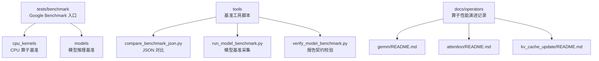
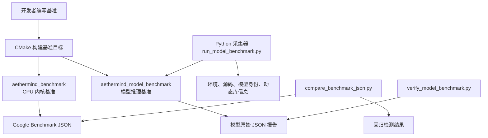
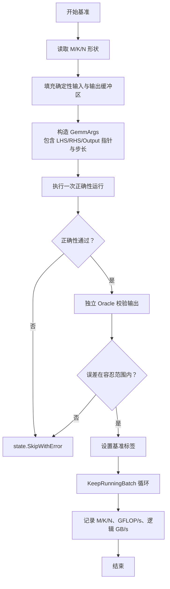
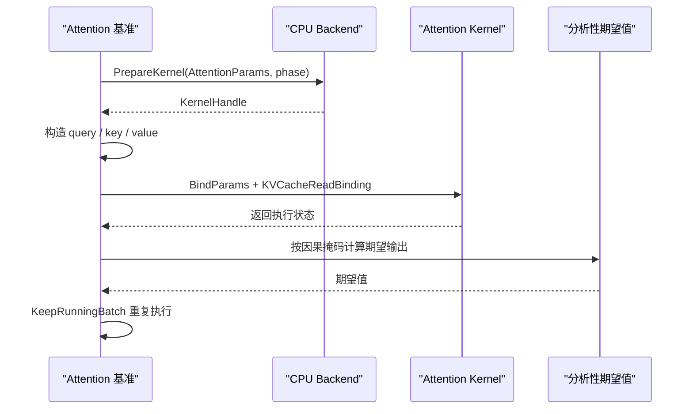
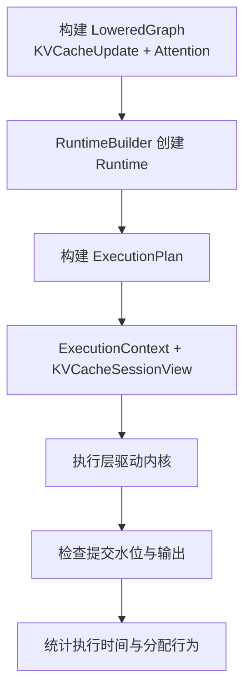
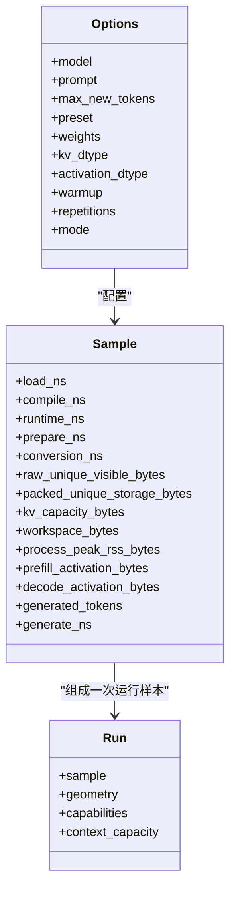
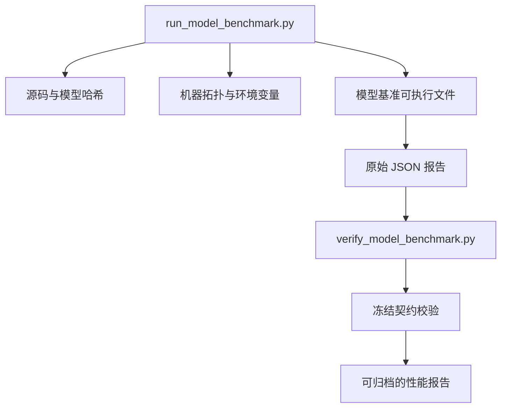
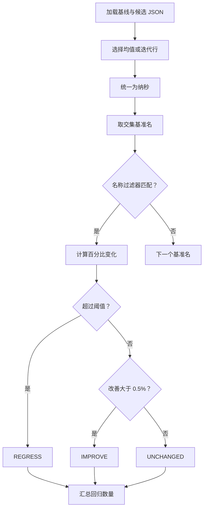
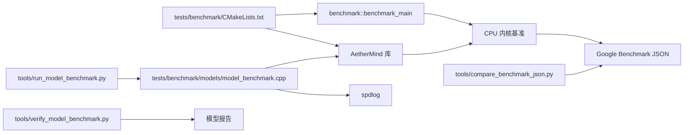

# 基准测试

**本文引用的文件**
- [tests/benchmark/CMakeLists.txt](../../../tests/benchmark/CMakeLists.txt)
- [tools/compare_benchmark_json.py](../../../tools/compare_benchmark_json.py)
- [tools/run_model_benchmark.py](../../../tools/run_model_benchmark.py)
- [tests/benchmark/models/model_benchmark.cpp](../../../tests/benchmark/models/model_benchmark.cpp)
- [tools/verify_model_benchmark.py](../../../tools/verify_model_benchmark.py)
- [tests/benchmark/cpu_kernels/benchmark_cpu_gemm_microkernel.cpp](../../../tests/benchmark/cpu_kernels/benchmark_cpu_gemm_microkernel.cpp)
- [tests/benchmark/cpu_kernels/benchmark_cpu_attention.cpp](../../../tests/benchmark/cpu_kernels/benchmark_cpu_attention.cpp)
- [tests/benchmark/cpu_kernels/benchmark_cpu_kv16_execution.cpp](../../../tests/benchmark/cpu_kernels/benchmark_cpu_kv16_execution.cpp)
- [docs/operators/gemm/README.md](../../operators/gemm/README.md)
- [docs/operators/attention/README.md](../../operators/attention/README.md)
- [docs/operators/kv_cache_update/README.md](../../operators/kv_cache_update/README.md)
- [src/kv_cache/](../../../src/kv_cache)

## 目录
1. [引言](#引言)
2. [项目结构](#项目结构)
3. [核心组件](#核心组件)
4. [架构总览](#架构总览)
5. [详细组件分析](#详细组件分析)
6. [依赖关系分析](#依赖关系分析)
7. [性能考量](#性能考量)
8. [故障排查指南](#故障排查指南)
9. [结论](#结论)

## 引言
本指南面向 AetherMind 的基准测试体系，目标是帮助开发者编写、运行、解读并持续维护 CPU 内核与模型推理的 Google Benchmark。文档覆盖以下方面：

- Google Benchmark 框架在仓库中的使用方式：基准函数定义、计时边界、指标计数器、跳过机制。
- 三类基准设计模式：CPU 内核基准、模型推理基准、内存与 KV Cache 基准。
- 核心算子基准示例：GEMM、注意力机制、KV Cache 更新与执行。
- 基准数据管理、结果比较工具与回归检测。
- 结果解读方法与性能优化建议。

## 项目结构
AetherMind 的基准测试主要位于 `tests/benchmark`，并按“内核”和“模型”分层组织；工具脚本位于 `tools`；算子层面的性能演进记录位于 `docs/operators`。

**图表来源**
- [tests/benchmark/CMakeLists.txt:1-79](../../../tests/benchmark/CMakeLists.txt#L1-L79)
- [tools/compare_benchmark_json.py:1-161](../../../tools/compare_benchmark_json.py#L1-L161)
- [tools/run_model_benchmark.py:1-200](../../../tools/run_model_benchmark.py#L1-L200)
- [tools/verify_model_benchmark.py:1-200](../../../tools/verify_model_benchmark.py#L1-L200)
- [docs/operators/gemm/README.md](../../operators/gemm/README.md)
- [docs/operators/attention/README.md](../../operators/attention/README.md)
- [docs/operators/kv_cache_update/README.md](../../operators/kv_cache_update/README.md)

**章节来源**
- [tests/benchmark/CMakeLists.txt:1-79](../../../tests/benchmark/CMakeLists.txt#L1-L79)

## 核心组件
AetherMind 基准测试由以下核心部分构成：

| 组件 | 职责 | 关键实现位置 |
|---|---|---|
| Google Benchmark 可执行目标 | 聚合 CPU 内核基准，链接 `benchmark::benchmark_main`，排除模型基准主程序 | [tests/benchmark/CMakeLists.txt:1-30](../../../tests/benchmark/CMakeLists.txt#L1-L30) |
| 模型基准可执行目标 | 独立构建，注入编译器、构建类型、AVX2/FMA 等构建信息 | [tests/benchmark/CMakeLists.txt:31-79](../../../tests/benchmark/CMakeLists.txt#L31-L79) |
| 模型基准 C++ 实现 | 加载模型、编译、准备执行、测量 Load/Compile/Runtime/Prepare/Gemerate 等阶段 | [tests/benchmark/models/model_benchmark.cpp:1-200](../../../tests/benchmark/models/model_benchmark.cpp#L1-L200) |
| Python 采集器 | 收集机器环境、源码快照、模型身份、动态库路径，并调用模型基准可执行文件 | [tools/run_model_benchmark.py:1-200](../../../tools/run_model_benchmark.py#L1-L200) |
| 报告验证器 | 校验 JSON 报告的字段、几何约束、生成 token 语义、模式与构建信息 | [tools/verify_model_benchmark.py:1-200](../../../tools/verify_model_benchmark.py#L1-L200) |
| JSON 对比工具 | 解析两个 Google Benchmark JSON，计算单核/多线程阈值回归 | [tools/compare_benchmark_json.py:1-161](../../../tools/compare_benchmark_json.py#L1-L161) |

**章节来源**
- [tests/benchmark/CMakeLists.txt:1-79](../../../tests/benchmark/CMakeLists.txt#L1-L79)
- [tests/benchmark/models/model_benchmark.cpp:1-200](../../../tests/benchmark/models/model_benchmark.cpp#L1-L200)
- [tools/run_model_benchmark.py:1-200](../../../tools/run_model_benchmark.py#L1-L200)
- [tools/verify_model_benchmark.py:1-200](../../../tools/verify_model_benchmark.py#L1-L200)
- [tools/compare_benchmark_json.py:1-161](../../../tools/compare_benchmark_json.py#L1-L161)

## 架构总览
下图展示基准测试从代码到结果的完整流程：开发者编写 Google Benchmark，CMake 构建出内核基准与模型基准两个可执行目标；Python 采集器负责环境隔离与产物溯源；C++ 基准输出 Google Benchmark JSON；对比工具用于回归检测；验证器保证模型报告符合冻结契约。

**图表来源**
- [tests/benchmark/CMakeLists.txt:1-79](../../../tests/benchmark/CMakeLists.txt#L1-L79)
- [tools/run_model_benchmark.py:1-200](../../../tools/run_model_benchmark.py#L1-L200)
- [tools/verify_model_benchmark.py:1-200](../../../tools/verify_model_benchmark.py#L1-L200)
- [tools/compare_benchmark_json.py:1-161](../../../tools/compare_benchmark_json.py#L1-L161)

**章节来源**
- [tests/benchmark/CMakeLists.txt:1-79](../../../tests/benchmark/CMakeLists.txt#L1-L79)

## 详细组件分析

### Google Benchmark 使用方法
仓库中的基准函数遵循以下约定：

- 使用 `BENCHMARK_CAPTURE` 或标准基准宏注册基准。
- 通过 `state.range()` 传入形状参数，如 M/K/N、上下文长度、head_dim、组数等。
- 使用 `state.SetItemsProcessed` 与 `state.SetBytesProcessed` 表达操作规模。
- 使用 `benchmark::Counter` 记录 GFLOP/s、逻辑带宽等吞吐指标。
- 使用 `benchmark::DoNotOptimize` 或 `benchmark::ClobberMemory` 防止编译器优化掉输出访问。
- 对不支持硬件或缺少 kernel 的情况使用 `state.SkipWithError` 跳过而非断言失败。
- 先做一次正确性运行，再进入 `KeepRunningBatch` 或循环计时。

#### GEMM 微内核基准
GEMM 基准同时评估参考实现、标量优化实现与 AVX2+FMA 实现，并通过独立 oracle 检查数值正确性。

**图表来源**
- [tests/benchmark/cpu_kernels/benchmark_cpu_gemm_microkernel.cpp:1-200](../../../tests/benchmark/cpu_kernels/benchmark_cpu_gemm_microkernel.cpp#L1-L200)

**章节来源**
- [tests/benchmark/cpu_kernels/benchmark_cpu_gemm_microkernel.cpp:1-200](../../../tests/benchmark/cpu_kernels/benchmark_cpu_gemm_microkernel.cpp#L1-L200)
- [docs/operators/gemm/README.md](../../operators/gemm/README.md)

#### 注意力机制基准
注意力基准按 Prefill 与 Decode 两种执行阶段准备 kernel，并使用固定 KV 模式构造可分析的期望值。

**图表来源**
- [tests/benchmark/cpu_kernels/benchmark_cpu_attention.cpp:1-158](../../../tests/benchmark/cpu_kernels/benchmark_cpu_attention.cpp#L1-L158)
- [docs/operators/attention/README.md](../../operators/attention/README.md)

**章节来源**
- [tests/benchmark/cpu_kernels/benchmark_cpu_attention.cpp:1-158](../../../tests/benchmark/cpu_kernels/benchmark_cpu_attention.cpp#L1-L158)
- [docs/operators/attention/README.md](../../operators/attention/README.md)

#### KV Cache 更新与执行基准
KV Cache 基准不仅测试单个 update kernel，还构建 LoweredGraph，组装 Runtime、ExecutionPlan 与 ExecutionContext，验证 KV 提交水位与 Attention 输出。

**图表来源**
- [tests/benchmark/cpu_kernels/benchmark_cpu_kv16_execution.cpp:1-200](../../../tests/benchmark/cpu_kernels/benchmark_cpu_kv16_execution.cpp#L1-L200)
- [src/kv_cache/](../../../src/kv_cache)

**章节来源**
- [tests/benchmark/cpu_kernels/benchmark_cpu_kv16_execution.cpp:1-200](../../../tests/benchmark/cpu_kernels/benchmark_cpu_kv16_execution.cpp#L1-L200)
- [src/kv_cache/](../../../src/kv_cache)
- [docs/operators/kv_cache_update/README.md](../../operators/kv_cache_update/README.md)

### 模型推理基准
模型基准的目标不是简单测量单次推理，而是记录完整的 Load、Compile、Prepare、Prefill、Decode、Generate、内存占用与进程峰值 RSS。

**图表来源**
- [tests/benchmark/models/model_benchmark.cpp:1-200](../../../tests/benchmark/models/model_benchmark.cpp#L1-L200)

模型基准还通过自定义 `Timer` 控制是否启用计时，并通过 `CountingAllocator` 与 `CountingProvider` 包装底层 allocator，统计 Runtime 分配请求次数，而不是统计任意 malloc。

**章节来源**
- [tests/benchmark/models/model_benchmark.cpp:1-200](../../../tests/benchmark/models/model_benchmark.cpp#L1-L200)

### 基准数据管理与报告契约
模型基准报告由 Python 采集器生成，并由验证器严格校验。

| 数据类别 | 采集或校验内容 |
|---|---|
| 环境 | OMP/MKL/OpenBLAS 线程数、LD_* 变量、虚拟化信息、CPU 型号、内存总量 |
| 源码 | Git commit、dirty 标记、受控路径 diff |
| 模型 | config.json、safetensors、index weight_map 中每个 shard 的 sha256 |
| 动态库 | 解析运行时 `ldd`，要求恰好一个 `libAetherMind.so` |
| 构建信息 | 编译器、构建类型、sanitizer、AVX2/FMA 标志、CXX_FLAGS |
| 几何 | hidden_size、num_attention_heads、num_key_value_heads、head_dim 等一致性约束 |
| 生成序列 | stop reason、eos token、最大生成长度 |

**图表来源**
- [tools/run_model_benchmark.py:1-200](../../../tools/run_model_benchmark.py#L1-L200)
- [tools/verify_model_benchmark.py:1-200](../../../tools/verify_model_benchmark.py#L1-L200)

**章节来源**
- [tools/run_model_benchmark.py:1-200](../../../tools/run_model_benchmark.py#L1-L200)
- [tools/verify_model_benchmark.py:1-200](../../../tools/verify_model_benchmark.py#L1-L200)

### 结果比较与回归检测
`compare_benchmark_json.py` 直接读取 Google Benchmark JSON，优先选取 `aggregate_name == mean` 的行，否则回退到 iteration 行，并将不同时间单位统一换算为纳秒。它区分带 `/threads:` 的多线程基准与非多线程基准，分别应用单线程与多线程阈值。

**图表来源**
- [tools/compare_benchmark_json.py:1-161](../../../tools/compare_benchmark_json.py#L1-L161)

**章节来源**
- [tools/compare_benchmark_json.py:1-161](../../../tools/compare_benchmark_json.py#L1-L161)

## 依赖关系分析
基准测试的依赖方向如下：

**图表来源**
- [tests/benchmark/CMakeLists.txt:1-79](../../../tests/benchmark/CMakeLists.txt#L1-L79)
- [tests/benchmark/models/model_benchmark.cpp:1-200](../../../tests/benchmark/models/model_benchmark.cpp#L1-L200)
- [tools/run_model_benchmark.py:1-200](../../../tools/run_model_benchmark.py#L1-L200)
- [tools/verify_model_benchmark.py:1-200](../../../tools/verify_model_benchmark.py#L1-L200)
- [tools/compare_benchmark_json.py:1-161](../../../tools/compare_benchmark_json.py#L1-L161)

**章节来源**
- [tests/benchmark/CMakeLists.txt:1-79](../../../tests/benchmark/CMakeLists.txt#L1-L79)

## 性能考量
结合仓库中的基准设计与文档，性能评估应关注以下维度：

| 维度 | 推荐实践 |
|---|---|
| 计时边界 | 只在真正可重复的执行路径上计时；避免把模型加载、权重转换、文件系统冷启动混入推理计时 |
| 正确性优先 | 先执行一次正确性检查，再通过 `SkipWithError` 处理异常，不掩盖错误 |
| 热路径稳定 | 预热 warmup 轮次后进入正式测量；保持工作集大小与 KV 容量稳定 |
| 指标完整 | 至少记录元素数、字节数、GFLOP/s、逻辑带宽；模型基准还应记录 load、compile、prepare、runtime、generate 等阶段 |
| 资源观测 | 使用 `CountingAllocator` 统计分配请求；记录 KV capacity、workspace、peak RSS |
| 硬件特征 | 明确 usable_features 与 effective_features；AVX2/FMA 不可用时跳过相关基准 |
| 多核对比 | 对比工具对含 `/threads:` 的名称使用更高阈值；基准本身应避免隐式并行干扰单核结论 |
| 证据粒度 | 一机一文件；不跨机器排名；优化必须对照 reference 与生产路径 |

**章节来源**
- [docs/operators/gemm/README.md](../../operators/gemm/README.md)
- [docs/operators/attention/README.md](../../operators/attention/README.md)
- [docs/operators/kv_cache_update/README.md](../../operators/kv_cache_update/README.md)

## 故障排查指南

### 基准被跳过
常见原因包括：

- CPU 缺少 AVX2 或 FMA，导致 GEMM AVX2 分支被跳过。
- backend 无法 prepare kernel，例如 dtype、shape 或 phase 不兼容。
- 模型路径缺失 `config.json` 或 safetensors 权重。
- 动态库解析失败，未找到 `libAetherMind.so`。

排查步骤：

1. 查看 `state.SkipWithError` 的消息，确认是硬件能力、kernel 绑定还是数据问题。
2. 检查 `effective_features` 与 `usable_features`，确认预期 ISA 是否生效。
3. 对模型基准，确认 model 目录下存在 `config.json` 与至少一个 `.safetensors` 文件。
4. 在 Linux 上使用 `ldd` 确认动态库路径。

**章节来源**
- [tests/benchmark/cpu_kernels/benchmark_cpu_gemm_microkernel.cpp:150-200](../../../tests/benchmark/cpu_kernels/benchmark_cpu_gemm_microkernel.cpp#L150-L200)
- [tests/benchmark/cpu_kernels/benchmark_cpu_attention.cpp:1-100](../../../tests/benchmark/cpu_kernels/benchmark_cpu_attention.cpp#L1-L100)
- [tools/run_model_benchmark.py:120-200](../../../tools/run_model_benchmark.py#L120-L200)

### 数值不正确
GEMM 与 Attention 基准都包含独立 oracle：

- GEMM 基准按朴素乘加计算期望值，并检查绝对误差与相对误差。
- Attention 基准根据交替 logits 与因果掩码推导期望 softmax 输出。
- KV Cache 执行基准检查 `current_pos()` 是否与预期 committed 一致。

如果基准失败，优先缩小到最小 shape，确认 reference 路径是否正确，再判断优化路径是否引入近似或布局问题。

**章节来源**
- [tests/benchmark/cpu_kernels/benchmark_cpu_gemm_microkernel.cpp:40-120](../../../tests/benchmark/cpu_kernels/benchmark_cpu_gemm_microkernel.cpp#L40-L120)
- [tests/benchmark/cpu_kernels/benchmark_cpu_attention.cpp:80-140](../../../tests/benchmark/cpu_kernels/benchmark_cpu_attention.cpp#L80-L140)
- [tests/benchmark/cpu_kernels/benchmark_cpu_kv16_execution.cpp:150-200](../../../tests/benchmark/cpu_kernels/benchmark_cpu_kv16_execution.cpp#L150-L200)

### 模型报告不符合契约
`verify_model_benchmark.py` 会拒绝非有限常数、非法 mode、非法 geometry、非法 token 范围或不一致的 stop reason。

常见问题：

- timing 模式使用了 sanitizer 或 Release 以外的 build_type。
- geometry 中 `hidden_size != num_attention_heads * head_dim`。
- `num_attention_heads % num_key_value_heads != 0`。
- 生成的 token 超出 vocab 范围或 EOS 出现在中间位置。

**章节来源**
- [tools/verify_model_benchmark.py:1-200](../../../tools/verify_model_benchmark.py#L1-L200)

## 结论
AetherMind 的基准测试体系以 Google Benchmark 为核心，围绕 CPU 内核、注意力机制、KV Cache 与模型推理形成分层证据链。其关键优势在于：

- 内核基准强调正确性与可复现指标。
- 模型基准提供完整的构建、环境与模型身份溯源。
- Python 工具将 JSON 对比与契约校验分离，便于 CI 集成。
- 文档与实现共同约束算子优化边界，避免只测名字而不测生产路径。

写基准时，请始终遵循“先正确、再性能；先单一内核、再完整计划；先本机证据、不跨机器排名”的原则。遇到退化时，优先检查硬件能力、dtype/shape 合同、KV layout 与执行边界，而不是仅调整 warmup 或 iteration 次数。
