# 测试工具与辅助

**本文引用的文件**
- [tensor_factory.h](../../../tests/unit/test_utils/tensor_factory.h)
- [tensor_random.h](../../../tests/unit/test_utils/tensor_random.h)
- [test_allocator.h](../../../tests/unit/test_utils/test_allocator.h)
- [test_resource_allocator.h](../../../tests/unit/test_utils/test_resource_allocator.h)
- [tensor_assert.h](../../../tests/unit/test_utils/tensor_assert.h)
- [test_required_execution_guard.cpp](../../../tests/unit/test_utils/test_required_execution_guard.cpp)
- [test_writing_guidelines.md](../../guides/test_writing_guidelines.md)
- [prepare_validation_assets.py](../../../tools/prepare_validation_assets.py)
- [generate_fp32_admission_hf_fixtures.py](../../../tools/generate_fp32_admission_hf_fixtures.py)
- [generate_llama_numerical_reference.py](../../../tools/generate_llama_numerical_reference.py)
- [verify_llama_numerical_reference.py](../../../tools/verify_llama_numerical_reference.py)
- [run_model_benchmark.py](../../../tools/run_model_benchmark.py)
- [run_final_validation.py](../../../tools/run_final_validation.py)
- [test_prepare_validation_assets.py](../../../tests/unit/inference/test_prepare_validation_assets.py)

## 目录

1. [简介](#简介)
2. [项目结构](#项目结构)
3. [核心测试辅助组件](#核心测试辅助组件)
4. [架构总览](#架构总览)
5. [详细组件分析](#详细组件分析)
6. [依赖关系分析](#依赖关系分析)
7. [性能与内存特性](#性能与内存特性)
8. [故障排查指南](#故障排查指南)
9. [结论](#结论)
10. [附录：常见用法参考](#附录常见用法参考)

## 简介

AetherMind 的测试工具与辅助库围绕五个目标组织：

1. **构造张量数据**：提供连续或任意形状的 Tensor、对齐缓冲区和基础缓冲区工厂。
2. **生成随机测试数据**：支持浮点均匀分布、正态分布和整数区间分布，并固定默认随机种子以保证可重复性。
3. **模拟内存分配行为**：提供进程级 CPU 分配器、可记录分配请求的 Allocator 以及可在特定调用后返回资源耗尽状态的提供者。
4. **比较和断言张量结果**：提供近似相等、精确相等、位模式比较等 GoogleTest 断言。
5. **准备验证资产与基准数据**：通过 Python 脚本安全地校验、生成或发布推理验证集、数值参考数据和模型基准运行记录。

这些工具既服务于单元测试中的快速验证，也支撑端到端的最终验证流程。

## 项目结构

测试相关代码主要分布在两个位置：

| 路径 | 职责 |
|---|---|
| `tests/unit/test_utils/` | C++ 测试辅助头文件和少量基础设施实现 |
| `tools/` | Python 数据准备、基准运行、最终验证编排脚本 |
| `tests/unit/inference/` | 对验证资产准备脚本的契约测试 |
| `docs/guides/test_writing_guidelines.md` | 测试编写规范、命名约定和构建约定 |

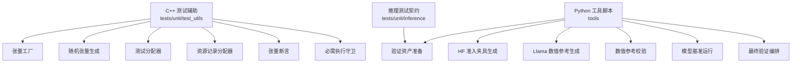

**图表来源**
- [tensor_factory.h:1-103](../../../tests/unit/test_utils/tensor_factory.h#L1-L103)
- [tensor_random.h:1-125](../../../tests/unit/test_utils/tensor_random.h#L1-L125)
- [test_allocator.h:1-24](../../../tests/unit/test_utils/test_allocator.h#L1-L24)
- [test_resource_allocator.h:1-54](../../../tests/unit/test_utils/test_resource_allocator.h#L1-L54)
- [tensor_assert.h:1-302](../../../tests/unit/test_utils/tensor_assert.h#L1-L302)
- [test_required_execution_guard.cpp:1-33](../../../tests/unit/test_utils/test_required_execution_guard.cpp#L1-L33)
- [prepare_validation_assets.py:1-277](../../../tools/prepare_validation_assets.py#L1-L277)
- [generate_fp32_admission_hf_fixtures.py:1-200](../../../tools/generate_fp32_admission_hf_fixtures.py#L1-L200)
- [generate_llama_numerical_reference.py:1-200](../../../tools/generate_llama_numerical_reference.py#L1-L200)
- [verify_llama_numerical_reference.py:1-200](../../../tools/verify_llama_numerical_reference.py#L1-L200)
- [run_model_benchmark.py:1-200](../../../tools/run_model_benchmark.py#L1-L200)
- [run_final_validation.py:1-200](../../../tools/run_final_validation.py#L1-L200)

**章节来源**
- [test_writing_guidelines.md](../../guides/test_writing_guidelines.md)

## 核心测试辅助组件

### 张量工厂

张量工厂负责创建符合 AetherMind `Tensor` 语义的测试数据，核心能力包括：

- 创建空张量。
- 创建连续形状张量。
- 根据显式形状和步长创建非连续张量。
- 按字节偏移构造共享底层缓冲区的张量。
- 计算所需缓冲区大小，并对溢出进行防御性检查。

内部使用 `posix_memalign` 分配对齐内存，并通过 `MemoryHandle` 管理生命周期；当传入字节数为零时，仍会分配至少一个字节，以避免完全无缓冲情况。

典型使用场景：

| 需求 | 推荐入口 |
|---|---|
| 创建零元素张量 | `MakeEmptyTensor` |
| 创建连续张量 | `MakeContiguousTensor` |
| 创建带步长的张量 | `MakeTensor` |
| 计算张量所需字节数 | `ComputeRequiredBytes` |

**章节来源**
- [tensor_factory.h:1-103](../../../tests/unit/test_utils/tensor_factory.h#L1-L103)

### 随机数生成

随机张量生成器基于 C++ 标准库的 Mersenne Twister 和分布类型，为测试提供确定性输入。默认随机种子常量用于保证多次运行结果一致。

支持的类型：

| 函数 | 支持的数据类型 | 说明 |
|---|---|---|
| `RandomUniformTensor` | `Float32`、`Double`、`Int(32)`、`Int(64)` | 均匀分布；整型范围取 `[low, high)` |
| `RandomNormalTensor` | `Float32`、`Double` | 正态分布；要求标准差大于零 |
| `RandomIntTensor` | `Int(32)`、`Int(64)` | 区间整数分布；要求上界严格大于下界 |

关键约束：

- 浮点均匀分布要求上界大于下界。
- 正态分布要求标准差为正数。
- 整型边界检查防止超出对应类型的取值范围。
- 未支持的数据类型会抛出运行时异常。

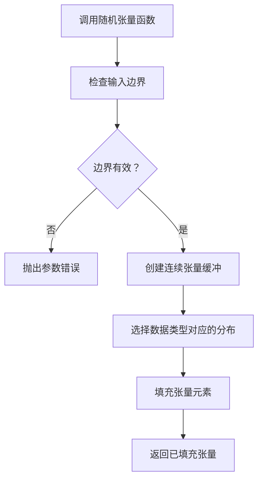

**图表来源**
- [tensor_random.h:1-125](../../../tests/unit/test_utils/tensor_random.h#L1-L125)
- [tensor_factory.h:1-103](../../../tests/unit/test_utils/tensor_factory.h#L1-L103)

**章节来源**
- [tensor_random.h:1-125](../../../tests/unit/test_utils/tensor_random.h#L1-L125)

### 内存分配器模拟

#### 进程级 CPU 分配器

`TestCpuAllocator()` 返回一个进程内静态的 `CPUAllocator` 引用。它适合只需要托管存储、不关心释放时机或分配策略细节的测试。

注意事项：

- 该分配器是进程级的单例。
- 从它取得的 Buffer 会在分配器销毁前释放。
- 需要观察析构后释放行为或控制 `CPUAllocatorPolicy` 的测试应自行构造 `CPUAllocator`。

#### 资源记录分配器

`ResourceRecordingAllocator` 是一个真正的 `Allocator` 实现，会将每次分配请求追加到外部统计对象中，并可配置在某次调用后返回 `ResourceExhausted`。

配套 `ResourceRecordingProvider` 可通过 `AllocatorProvider` 接口注入，便于替换真实分配器以验证 OOM、资源限制和失败路径。

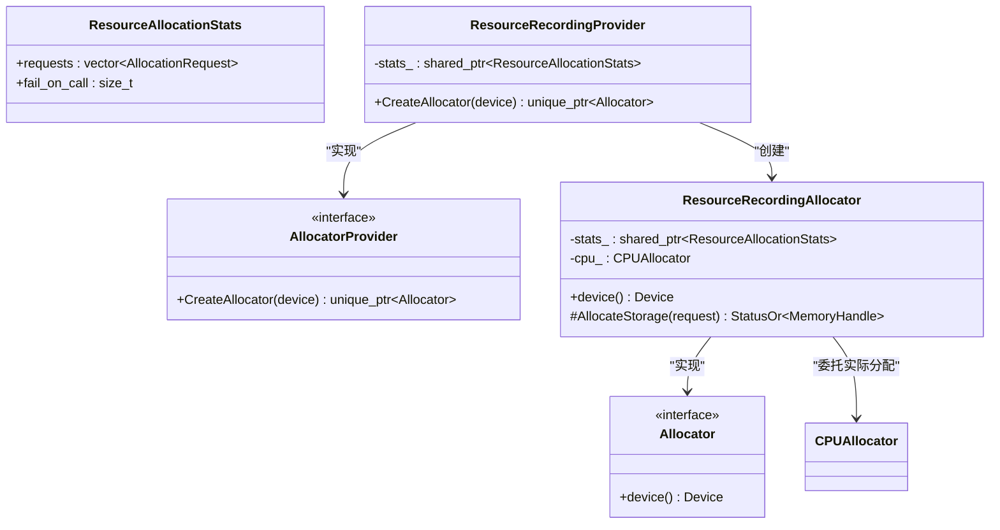

**图表来源**
- [test_resource_allocator.h:1-54](../../../tests/unit/test_utils/test_resource_allocator.h#L1-L54)
- [test_allocator.h:1-24](../../../tests/unit/test_utils/test_allocator.h#L1-L24)

**章节来源**
- [test_allocator.h:1-24](../../../tests/unit/test_utils/test_allocator.h#L1-L24)
- [test_resource_allocator.h:1-54](../../../tests/unit/test_utils/test_resource_allocator.h#L1-L54)

### 张量断言

张量断言封装了 GoogleTest 的 `AssertionResult`，避免在测试中手动遍历元素。

主要断言：

| 断言 | 用途 |
|---|---|
| `ExpectTensorAllClose` | 浮点张量的相对容差与绝对容差比较 |
| `ExpectTensorEqual` | 多类型精确比较 |
| 内部比较器 | 按数据类型分发到逐元素比较、位模式比较或布尔比较 |

支持的浮点类型包括 `Float32`、`Double`、`Half`、`BFloat16`；整型和布尔类型走精确比较路径。

对于半精度和 BFloat16，精确比较采用位模式对比，有助于验证量化、转换或打包算子是否产生预期比特表示。

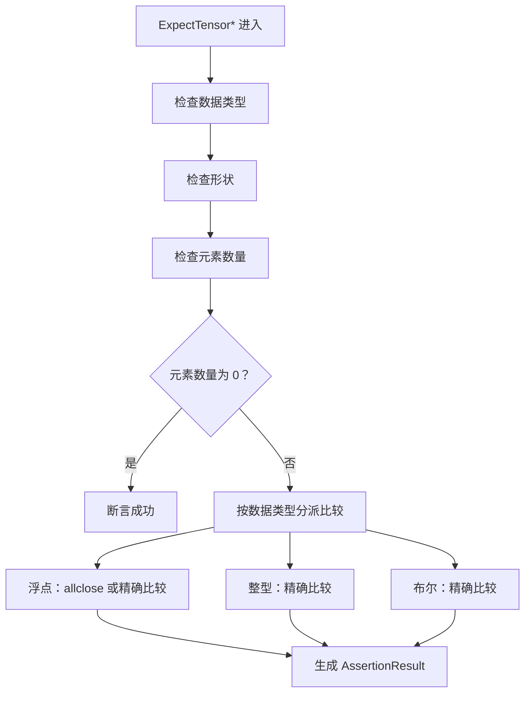

**图表来源**
- [tensor_assert.h:1-302](../../../tests/unit/test_utils/tensor_assert.h#L1-L302)

**章节来源**
- [tensor_assert.h:1-302](../../../tests/unit/test_utils/tensor_assert.h#L1-L302)

### 必需执行守卫

`RequiredExecutionGuard` 监听 GoogleTest 事件。当环境变量 `AETHERMIND_REQUIRED_VALIDATION` 被设置为 `"1"` 且某个测试被跳过时，它会报告失败。

这个机制用于强制 CI 环境不得静默跳过某些必需用例。

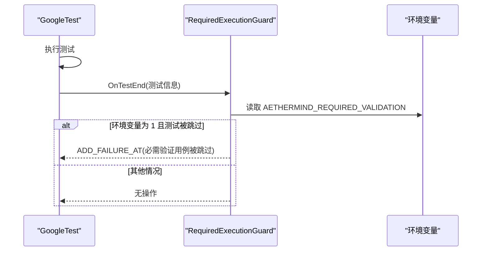

**图表来源**
- [test_required_execution_guard.cpp:1-33](../../../tests/unit/test_utils/test_required_execution_guard.cpp#L1-L33)

**章节来源**
- [test_required_execution_guard.cpp:1-33](../../../tests/unit/test_utils/test_required_execution_guard.cpp#L1-L33)

## 架构总览

测试工具的整体协作关系如下：

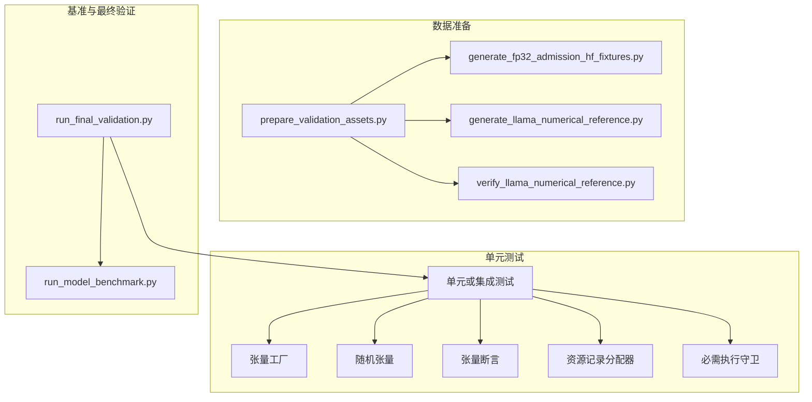

**图表来源**
- [tensor_factory.h:1-103](../../../tests/unit/test_utils/tensor_factory.h#L1-L103)
- [tensor_random.h:1-125](../../../tests/unit/test_utils/tensor_random.h#L1-L125)
- [tensor_assert.h:1-302](../../../tests/unit/test_utils/tensor_assert.h#L1-L302)
- [test_resource_allocator.h:1-54](../../../tests/unit/test_utils/test_resource_allocator.h#L1-L54)
- [test_required_execution_guard.cpp:1-33](../../../tests/unit/test_utils/test_required_execution_guard.cpp#L1-L33)
- [prepare_validation_assets.py:1-277](../../../tools/prepare_validation_assets.py#L1-L277)
- [generate_fp32_admission_hf_fixtures.py:1-200](../../../tools/generate_fp32_admission_hf_fixtures.py#L1-L200)
- [generate_llama_numerical_reference.py:1-200](../../../tools/generate_llama_numerical_reference.py#L1-L200)
- [verify_llama_numerical_reference.py:1-200](../../../tools/verify_llama_numerical_reference.py#L1-L200)
- [run_model_benchmark.py:1-200](../../../tools/run_model_benchmark.py#L1-L200)
- [run_final_validation.py:1-200](../../../tools/run_final_validation.py#L1-L200)

## 详细组件分析

### 张量构造与形状推导

`ComputeRequiredBytes` 的核心逻辑是：

1. 将输入形状和步长转换为 `ShapeAndStride`。
2. 若元素数量为 0，直接返回起始字节偏移。
3. 计算最大元素偏移。
4. 将“最大偏移加一”乘以每个元素字节数得到跨度。
5. 对跨度和起始偏移分别做乘法与加法溢出检查。
6. 返回所需字节数。

这意味着测试可以安全地为任意形状和步长组合计算缓冲大小，而不必手工推导最后访问位置。

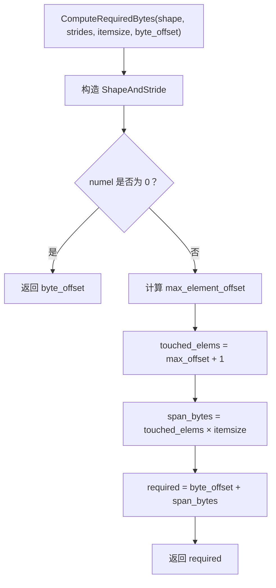

**图表来源**
- [tensor_factory.h:1-103](../../../tests/unit/test_utils/tensor_factory.h#L1-L103)

**章节来源**
- [tensor_factory.h:1-103](../../../tests/unit/test_utils/tensor_factory.h#L1-L103)

### 内存泄漏检测与资源观察

仓库没有提供全局内存泄漏检测器本身，但提供了可用于配合外部检测工具（如 AddressSanitizer、Valgrind）的观察方式：

1. 使用 `ResourceRecordingAllocator` 记录所有分配请求。
2. 通过 `fail_on_call` 模拟资源耗尽，验证错误路径。
3. 使用 `ResourceRecordingProvider` 注入到需要 `AllocatorProvider` 的位置。
4. 在测试结束时检查 `stats.requests` 是否满足预期数量、大小和对齐方式。

这种方式更适合“验证分配计划”而非自动发现内存泄漏。真正的全局泄漏检测通常由构建系统启用的 Sanitizer 或外部工具完成。

**章节来源**
- [test_resource_allocator.h:1-54](../../../tests/unit/test_utils/test_resource_allocator.h#L1-L54)

### 测试数据准备脚本

`prepare_validation_assets.py` 是验证资产的统一入口。它的核心原则是：

- 不覆盖现有资产。
- 不下载未经审阅的数据。
- 始终校验 SHA256。
- 拒绝符号链接路径。
- 使用临时目录生成候选产物，仅在验证通过后原子替换。

关键参数：

| 参数 | 含义 |
|---|---|
| `--models-dir` | 模型和验证资产根目录 |
| `--source` | HF 源模型目录 |
| `--reference-python` | 受控 Python 解释器路径 |
| `--numerical-bundle` | 已审阅的数值参考包 |
| `--download-source` | 允许按配方下载源数据 |

状态输出包含 `schema_version`、总体状态、模型目录、源状态、准入状态和数值状态。

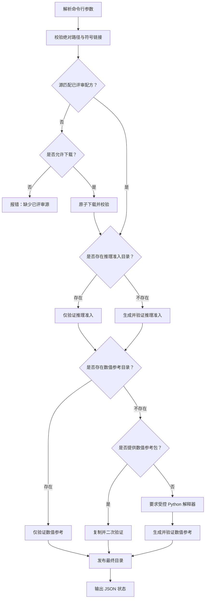

**图表来源**
- [prepare_validation_assets.py:1-277](../../../tools/prepare_validation_assets.py#L1-L277)

**章节来源**
- [prepare_validation_assets.py:1-277](../../../tools/prepare_validation_assets.py#L1-L277)

### 基准数据生成工具

#### HF 准入夹具生成

`generate_fp32_admission_hf_fixtures.py` 使用 Python 标准库解析和重写 Safetensors 文件，支持：

- F32 原始位保留。
- F16 转半精度。
- BF16 转 BFloat16。
- 非有限值拒绝。
- 多种 dtype 提示变体。
- 排序键、紧凑头部和小端载荷。

该工具不是生产权重归一化器，而是离线测试数据转换器，并提供 `--check` 模式用于只校验已有输出。

#### Llama 数值参考生成

`generate_llama_numerical_reference.py` 在隔离环境中运行 Hugging Face Llama 模型，生成 CPU FP32 数值参考包。它固定：

- PyTorch、Transformers、NumPy、Safetensors 版本。
- 线程数为 1。
- 确定性算法。
- 小端主机。
- 推理模式。

生成的产物包含模型、参考张量和元数据清单，供 C++ 测试在不导入 PyTorch 的情况下消费。

#### 数值参考校验

`verify_llama_numerical_reference.py` 是纯标准库校验器，只读已审阅清单，不会重新生成黄金数据。它验证：

- 清单结构。
- 生成器版本。
- 参考环境元数据。
- 模型和参考文件。
- Safetensors 头部和数据段。
- 浮点值有限性。
- 文件尺寸和元素数量上限。

**章节来源**
- [generate_fp32_admission_hf_fixtures.py:1-200](../../../tools/generate_fp32_admission_hf_fixtures.py#L1-L200)
- [generate_llama_numerical_reference.py:1-200](../../../tools/generate_llama_numerical_reference.py#L1-L200)
- [verify_llama_numerical_reference.py:1-200](../../../tools/verify_llama_numerical_reference.py#L1-L200)

### 验证资产准备流程

验证资产准备流程由 `prepare_validation_assets.py` 协调，并由 `tests/unit/inference/test_prepare_validation_assets.py` 对其契约进行测试。

关键契约：

| 场景 | 期望行为 |
|---|---|
| 已存在准入和数值目录 | 仅验证，不再生成 |
| 缺少源数据 | 要求显式 `--download-source` |
| 已有但不匹配的源 | 不覆盖，报错 |
| 缺少推理准入目录 | 先调用生成器，再验证 |
| 已有推理准入目录 | 绝不再生成 |
| 缺少数值参考目录 | 要求 `--numerical-bundle` 或 `--reference-python` |
| 提供数值参考包 | 在临时目录中拷贝并再次验证 |
| 目标目录已存在 | 不覆盖 |
| 源目录与目标重叠 | 拒绝 |
| Python 解释器不可执行 | 报错 |

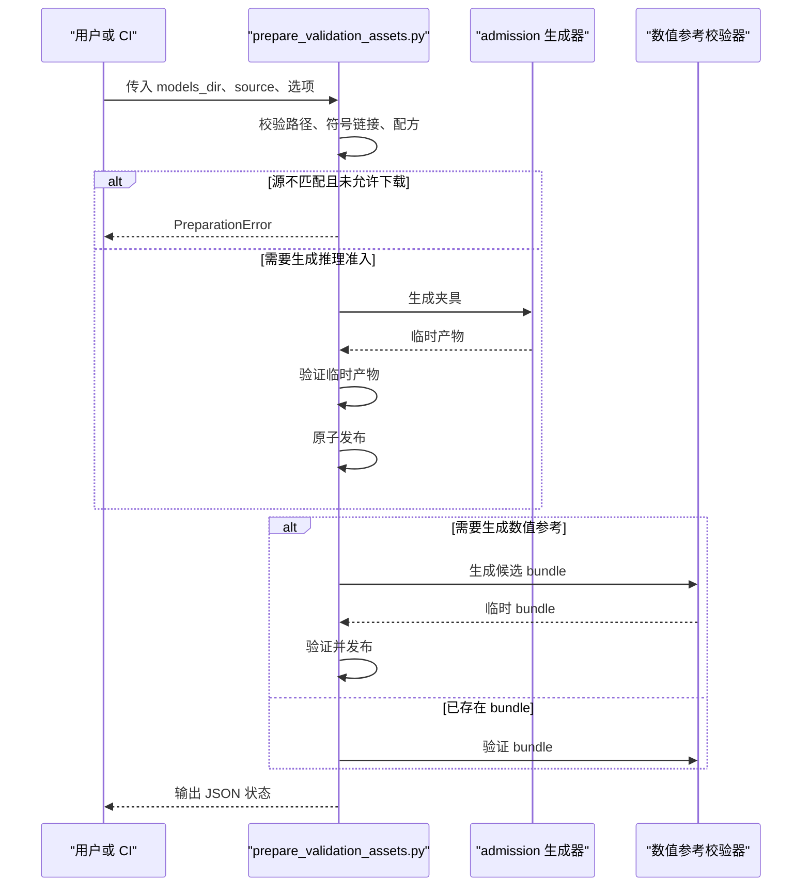

**图表来源**
- [prepare_validation_assets.py:1-277](../../../tools/prepare_validation_assets.py#L1-L277)
- [test_prepare_validation_assets.py:1-200](../../../tests/unit/inference/test_prepare_validation_assets.py#L1-L200)

**章节来源**
- [prepare_validation_assets.py:1-277](../../../tools/prepare_validation_assets.py#L1-L277)
- [test_prepare_validation_assets.py:1-200](../../../tests/unit/inference/test_prepare_validation_assets.py#L1-L200)

### 基准运行与最终验证

#### 模型基准运行

`run_model_benchmark.py` 运行单个隔离模型基准，并收集完整溯源信息：

- 源码提交、工作树状态和指定路径的二进制差异。
- 模型目录的文件身份。
- 动态链接库解析。
- 机器拓扑、操作系统、虚拟化和内存信息。
- 基准二进制与 AetherMind 库的哈希。

它强调计时区间内不执行 Python 工作，以便测量更贴近引擎侧表现。

#### 最终验证

`run_final_validation.py` 是编排脚本，不是第二个测试框架。它：

- 执行预定义配置文件矩阵。
- 调用 CMake preset、CTest 和黑盒探针。
- 验证测试清单和报告完整性。
- 不下载资产。
- 不生成新黄金数据。
- 不将基准观测值作为性能门禁。

它还会保存源代码快照、命令日志、环境选择和中断状态，使失败后可回溯。

**章节来源**
- [run_model_benchmark.py:1-200](../../../tools/run_model_benchmark.py#L1-L200)
- [run_final_validation.py:1-200](../../../tools/run_final_validation.py#L1-L200)

## 依赖关系分析

### C++ 测试辅助依赖

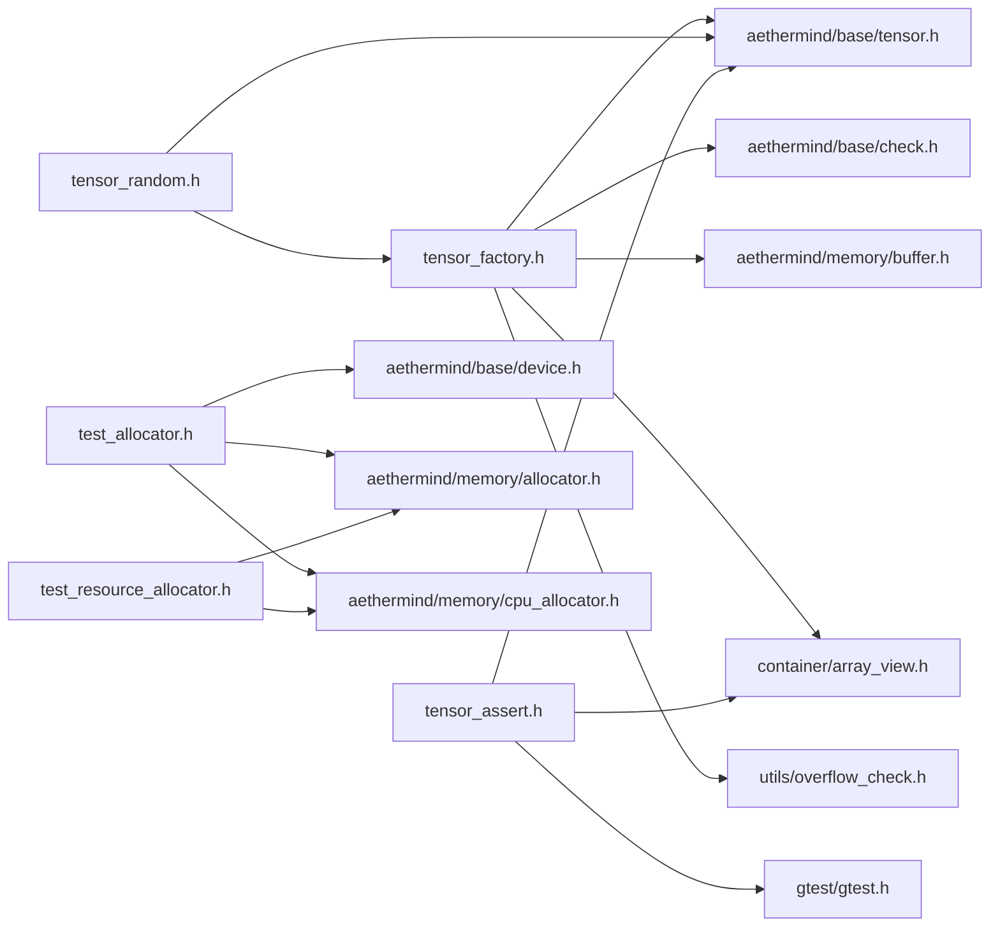

**图表来源**
- [tensor_factory.h:1-103](../../../tests/unit/test_utils/tensor_factory.h#L1-L103)
- [tensor_random.h:1-125](../../../tests/unit/test_utils/tensor_random.h#L1-L125)
- [tensor_assert.h:1-302](../../../tests/unit/test_utils/tensor_assert.h#L1-L302)
- [test_allocator.h:1-24](../../../tests/unit/test_utils/test_allocator.h#L1-L24)
- [test_resource_allocator.h:1-54](../../../tests/unit/test_utils/test_resource_allocator.h#L1-L54)

### Python 工具依赖

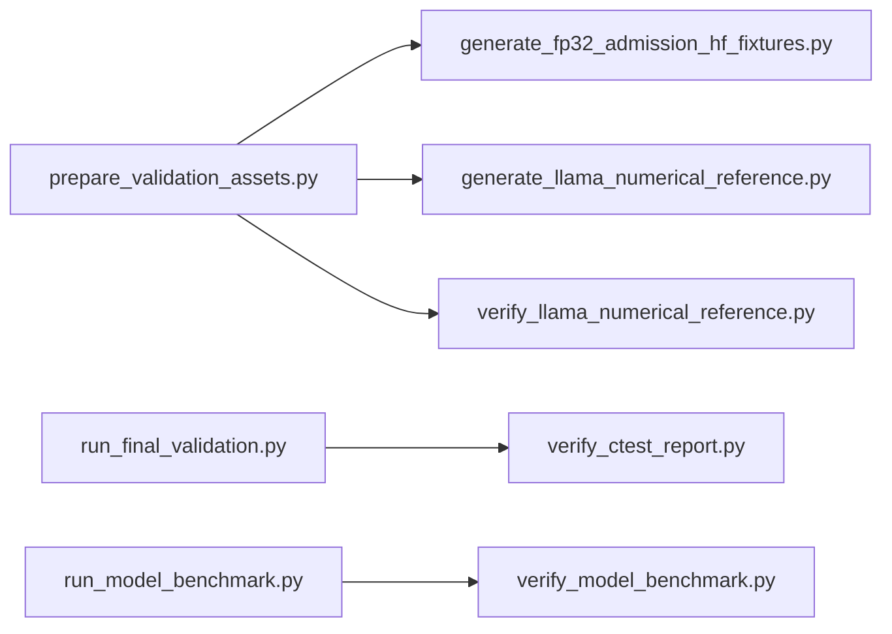

**图表来源**
- [prepare_validation_assets.py:1-277](../../../tools/prepare_validation_assets.py#L1-L277)
- [run_model_benchmark.py:1-200](../../../tools/run_model_benchmark.py#L1-L200)
- [run_final_validation.py:1-200](../../../tools/run_final_validation.py#L1-L200)

**章节来源**
- [tensor_factory.h:1-103](../../../tests/unit/test_utils/tensor_factory.h#L1-L103)
- [tensor_random.h:1-125](../../../tests/unit/test_utils/tensor_random.h#L1-L125)
- [tensor_assert.h:1-302](../../../tests/unit/test_utils/tensor_assert.h#L1-L302)
- [test_allocator.h:1-24](../../../tests/unit/test_utils/test_allocator.h#L1-L24)
- [test_resource_allocator.h:1-54](../../../tests/unit/test_utils/test_resource_allocator.h#L1-L54)
- [prepare_validation_assets.py:1-277](../../../tools/prepare_validation_assets.py#L1-L277)
- [run_model_benchmark.py:1-200](../../../tools/run_model_benchmark.py#L1-L200)
- [run_final_validation.py:1-200](../../../tools/run_final_validation.py#L1-L200)

## 性能与内存特性

### 张量构造性能

- `MakeContiguousTensor` 一次性计算所需字节数并分配连续内存。
- `MakeTensor` 支持非连续布局，但底层仍是单一连续缓冲。
- 缓冲区分配使用对齐分配，有利于 SIMD 算子测试。
- 空张量仍然有最小缓冲，避免空指针语义歧义。

### 随机数据生成性能

- 随机填充按元素顺序遍历，时间复杂度为 O(n)。
- 每次调用都创建新的 `mt19937_64` 实例，默认种子相同。
- 大数据张量可能成为测试瓶颈，应优先使用较小形状进行正确性测试。

### 内存分配模拟

- `ResourceRecordingAllocator` 会记录每次分配请求，因此有额外容器写入开销。
- 不适合高性能内核基准，但适合验证分配计划、OOM 处理和资源限制。
- 真正的大规模内存泄漏检测建议结合构建系统启用的 Sanitizer。

**章节来源**
- [tensor_factory.h:1-103](../../../tests/unit/test_utils/tensor_factory.h#L1-L103)
- [tensor_random.h:1-125](../../../tests/unit/test_utils/tensor_random.h#L1-L125)
- [test_resource_allocator.h:1-54](../../../tests/unit/test_utils/test_resource_allocator.h#L1-L54)

## 故障排查指南

### 常见问题与定位方法

| 现象 | 可能原因 | 排查步骤 |
|---|---|---|
| 随机张量生成崩溃 | 上界小于等于下界 | 检查 `RandomUniformTensor`、`RandomIntTensor` 的参数 |
| 正态分布随机张量崩溃 | 标准差为零或负数 | 检查 `RandomNormalTensor` 的 stddev |
| 不支持的数据类型 | 传入了未实现的 dtype | 查看对应函数的 dtype 分支 |
| 张量断言失败但消息过长 | 不匹配元素过多 | 调整 `max_report` |
| 近似比较误报 | 容差太小 | 调整 `atol` 和 `rtol` |
| 验证资产准备失败 | 源不匹配或未允许下载 | 检查 `--download-source` 和 SHA256 |
| 数值参考生成失败 | 依赖版本不一致 | 检查 Python 环境版本锁定 |
| 必需测试被跳过 | 设置了必需环境变量 | 检查 `AETHERMIND_REQUIRED_VALIDATION` |

### 调试信息输出

- 张量断言会输出不匹配索引、实际值、期望值和误差限制。
- 验证脚本通常以结构化 JSON 输出状态。
- 最终验证会保存命令日志、环境选择和源码补丁摘要。
- 随机张量建议使用固定种子，确保失败时可复现。

**章节来源**
- [tensor_assert.h:1-302](../../../tests/unit/test_utils/tensor_assert.h#L1-L302)
- [prepare_validation_assets.py:201-277](../../../tools/prepare_validation_assets.py#L201-L277)
- [run_final_validation.py:1-200](../../../tools/run_final_validation.py#L1-L200)
- [test_required_execution_guard.cpp:1-33](../../../tests/unit/test_utils/test_required_execution_guard.cpp#L1-L33)

## 结论

AetherMind 的测试工具与辅助库形成了清晰分层：

- C++ 层提供轻量、确定性强、面向张量的测试原语。
- Python 层提供安全、可审计、可复现的数据准备和基准编排。
- 两者共同支撑正确性测试、数值参考比对、资源行为验证和端到端最终验证。

推荐实践：

- 用 `MakeContiguousTensor` 和 `RandomUniformTensor` 构造简单输入。
- 用 `ExpectTensorAllClose` 处理浮点容差，用 `ExpectTensorEqual` 处理精确结果。
- 用 `ResourceRecordingAllocator` 验证分配计划，而不是用它替代真实分配器做性能测试。
- 用 `AETHERMIND_REQUIRED_VALIDATION=1` 强制必需用例执行。
- 用 `prepare_validation_assets.py` 管理外部验证资产，不要手动覆盖已审阅数据。
- 扩展自定义测试工具时，遵循现有命名、断言风格和错误报告格式。

## 附录：常见用法参考

以下示例描述如何使用测试辅助库，但不直接粘贴实现代码。

### 构造连续张量

1. 选择目标形状和数据类型。
2. 调用 `MakeContiguousTensor`。
3. 获取可写指针进行填充。
4. 如需验证，调用 `ExpectTensorEqual` 或 `ExpectTensorAllClose`。

适用场景：线性算子输入、掩码张量、标量广播形状。

**章节来源**
- [tensor_factory.h:1-103](../../../tests/unit/test_utils/tensor_factory.h#L1-L103)
- [tensor_assert.h:1-302](../../../tests/unit/test_utils/tensor_assert.h#L1-L302)

### 构造非连续张量

1. 同时指定形状和步长。
2. 调用 `MakeTensor`。
3. 注意底层缓冲仍是连续内存，只是视图为非连续。
4. 使用 `ExpectTensorEqual` 验证逻辑结果，而不是假设物理布局。

适用场景：切片、转置、重排后的视图。

**章节来源**
- [tensor_factory.h:1-103](../../../tests/unit/test_utils/tensor_factory.h#L1-L103)

### 生成随机张量

1. 选择 `RandomUniformTensor`、`RandomNormalTensor` 或 `RandomIntTensor`。
2. 保持默认种子以获得稳定结果。
3. 对浮点结果使用 `ExpectTensorAllClose`。
4. 对整型或位模式敏感结果使用 `ExpectTensorEqual`。

适用场景：权重初始化、噪声输入、注意力掩码、KV Cache 初始状态。

**章节来源**
- [tensor_random.h:1-125](../../../tests/unit/test_utils/tensor_random.h#L1-L125)

### 验证形状推导

1. 构造不同秩、不同步长和张量大小。
2. 计算预期字节数并与实际缓冲容量比较。
3. 对边界情况测试零元素、超大形状和溢出路径。
4. 对数值溢出使用 `AM_CHECK` 或测试死亡用例。

适用场景：shape inference、stride 推导、packed weight 布局验证。

**章节来源**
- [tensor_factory.h:1-103](../../../tests/unit/test_utils/tensor_factory.h#L1-L103)

### 检测内存泄漏与资源耗尽

1. 使用 `ResourceRecordingAllocator` 包装真实分配。
2. 设置 `fail_on_call` 模拟 OOM。
3. 验证算子在资源耗尽时返回正确状态。
4. 在测试结束时检查分配次数和请求总量。
5. 如需全局泄漏检测，启用构建系统的 Sanitizer 或使用 Valgrind。

适用场景：KV Cache、workspace arena、推理会话资源限制。

**章节来源**
- [test_resource_allocator.h:1-54](../../../tests/unit/test_utils/test_resource_allocator.h#L1-L54)

### 配置测试环境

| 变量或配置 | 作用 |
|---|---|
| `AETHERMIND_REQUIRED_VALIDATION=1` | 跳过必需测试时报错 |
| `ASAN_OPTIONS` | 控制 AddressSanitizer 行为 |
| `UBSAN_OPTIONS` | 控制 UndefinedBehaviorSanitizer 行为 |
| `TSAN_OPTIONS` | 控制 ThreadSanitizer 行为 |
| `LD_PRELOAD` / `LD_AUDIT` | 控制动态加载前置行为 |
| `OMP_NUM_THREADS` | 控制 OpenMP 线程数 |
| `MKL_NUM_THREADS` | 控制 MKL 线程数 |
| `OPENBLAS_NUM_THREADS` | 控制 OpenBLAS 线程数 |

**章节来源**
- [test_required_execution_guard.cpp:1-33](../../../tests/unit/test_utils/test_required_execution_guard.cpp#L1-L33)
- [run_final_validation.py:1-200](../../../tools/run_final_validation.py#L1-L200)
- [generate_llama_numerical_reference.py:1-200](../../../tools/generate_llama_numerical_reference.py#L1-L200)

### 扩展自定义测试工具

建议遵循以下规则：

1. 将 C++ 测试辅助放在 `tests/unit/test_utils/` 下。
2. 将 Python 工具放在 `tools/` 下。
3. 为新工具编写契约测试，尤其是涉及文件、JSON、SHA256 和路径安全的部分。
4. 对外部数据一律使用白名单、版本号和哈希校验。
5. 对测试失败输出可读的错误消息，避免隐藏上下文。
6. 对慢速或平台相关逻辑使用条件跳过，并附带原因。
7. 对必需行为使用 `AETHERMIND_REQUIRED_VALIDATION` 或等价机制保护。

**章节来源**
- [test_writing_guidelines.md](../../guides/test_writing_guidelines.md)
- [test_prepare_validation_assets.py:1-200](../../../tests/unit/inference/test_prepare_validation_assets.py#L1-L200)
