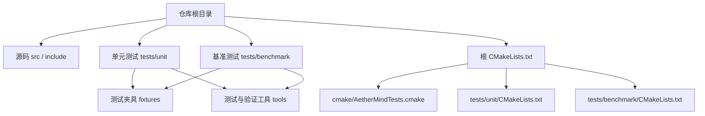
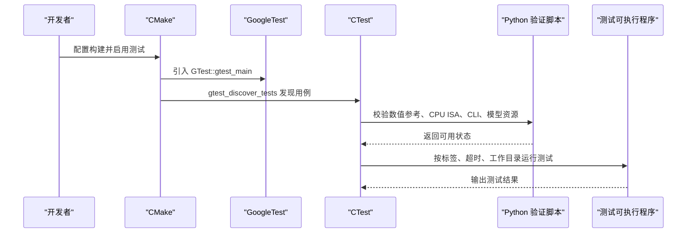
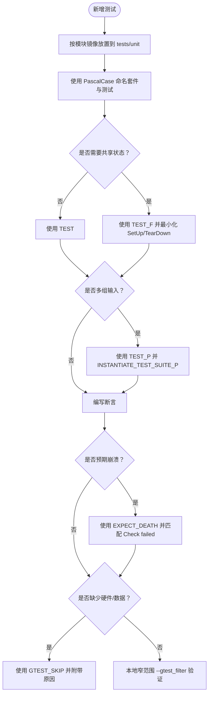
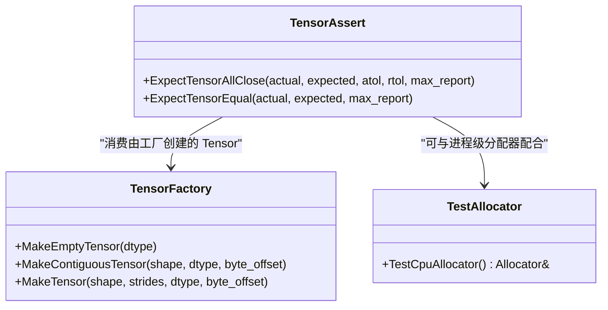
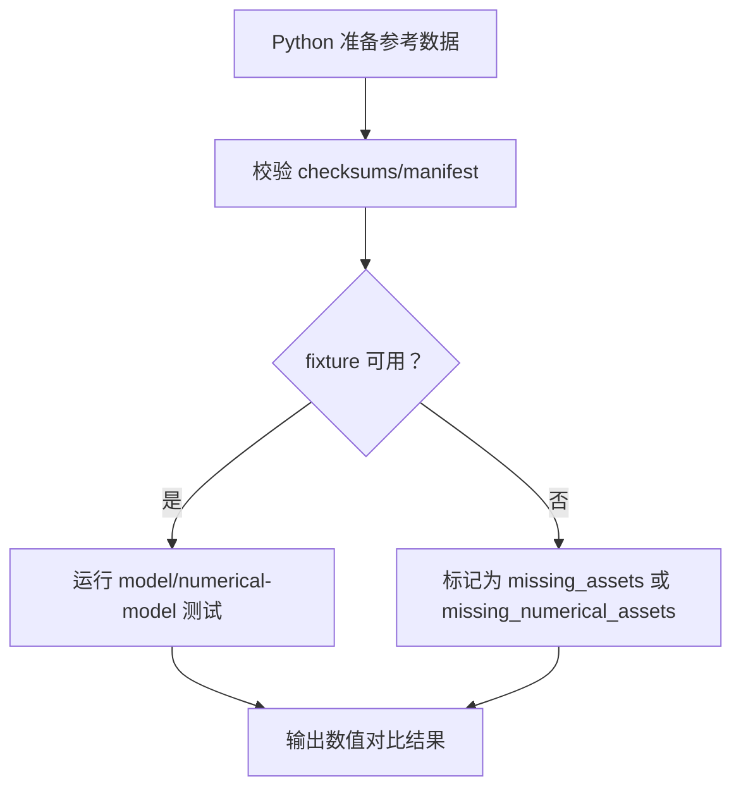
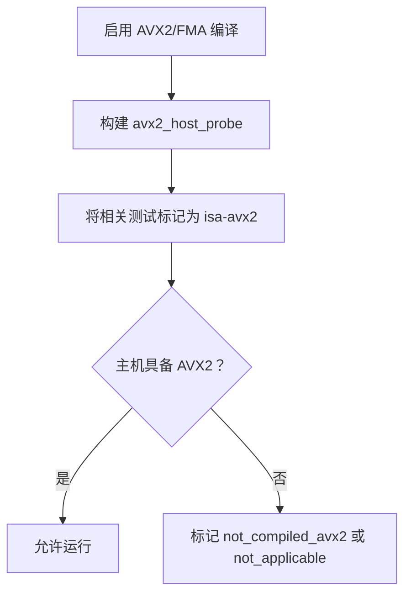
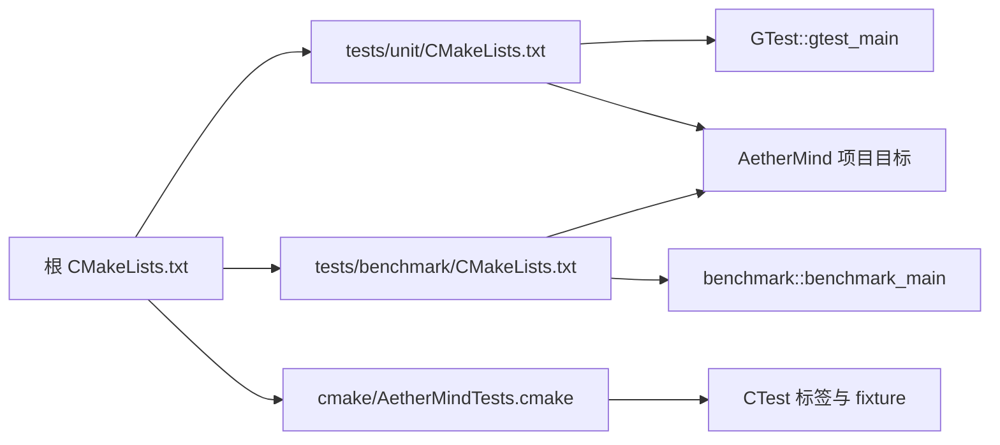
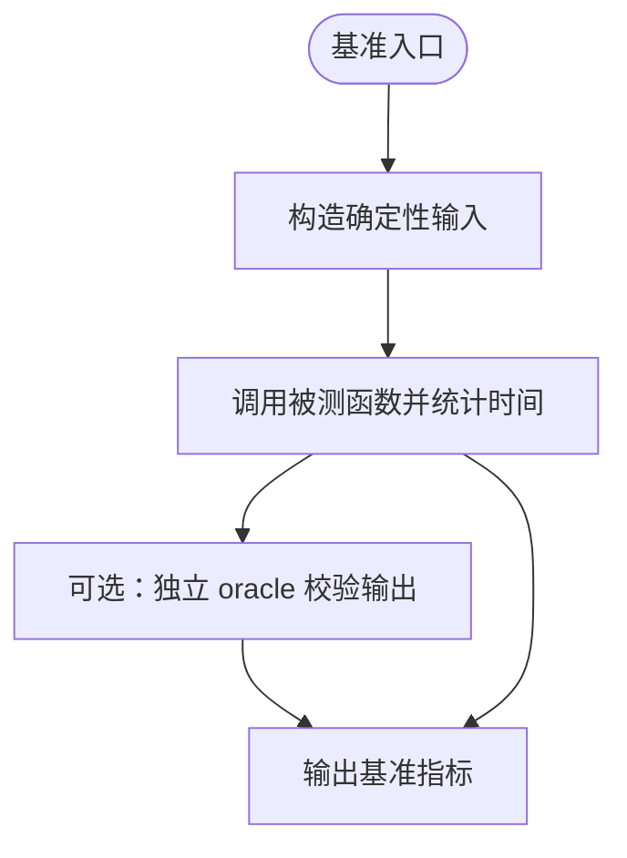
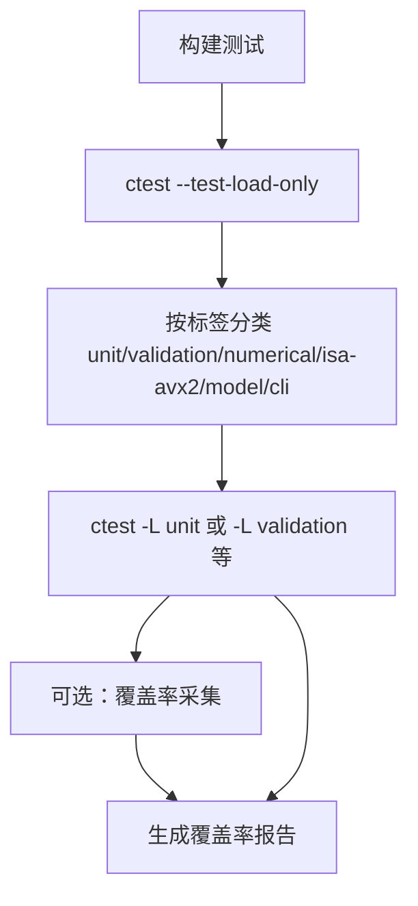

# 测试指南

**本文引用的文件**
- [CMakeLists.txt](../../../CMakeLists.txt)
- [AetherMindTests.cmake](../../../cmake/AetherMindTests.cmake)
- [test_writing_guidelines.md](../../guides/test_writing_guidelines.md)
- [tests/unit/CMakeLists.txt](../../../tests/unit/CMakeLists.txt)
- [tests/benchmark/CMakeLists.txt](../../../tests/benchmark/CMakeLists.txt)
- [tensor_assert.h](../../../tests/unit/test_utils/tensor_assert.h)
- [tensor_factory.h](../../../tests/unit/test_utils/tensor_factory.h)
- [test_allocator.h](../../../tests/unit/test_utils/test_allocator.h)
- [benchmark_cpu_gemm_microkernel.cpp](../../../tests/benchmark/cpu_kernels/benchmark_cpu_gemm_microkernel.cpp)
- [test_avx_learning_avx2.cpp](../../../tests/unit/backend/cpu/kernels/avx_learning/test_avx_learning_avx2.cpp)

## 目录
1. [引言](#引言)
2. [项目结构](#项目结构)
3. [核心组件](#核心组件)
4. [架构总览](#架构总览)
5. [详细组件分析](#详细组件分析)
6. [依赖关系分析](#依赖关系分析)
7. [性能与基准测试](#性能与基准测试)
8. [覆盖率与持续集成](#覆盖率与持续集成)
9. [故障排查指南](#故障排查指南)
10. [结论](#结论)

## 引言
本指南面向 AetherMind 的 C++ 测试开发者，说明单元测试、基准测试和集成测试的组织方式、编写规范、夹具与辅助工具使用方式，并给出可操作的构建、运行、标签筛选、失败诊断和回归检测建议。仓库已明确采用 GoogleTest 作为单元测试框架、Google Benchmark 作为基准测试框架，并通过 CMake + CTest 完成测试发现、标记、依赖检查与环境约束。

## 项目结构
测试代码按“功能模块镜像”原则组织：

- 单元测试位于 `tests/unit`，目录结构与 `include/aethermind/*` 和 `src/*` 对应。
- 基准测试位于 `tests/benchmark`，包含算子级基准、字符串基准和模型级基准。
- CMake 配置集中在根目录与 `cmake/AetherMindTests.cmake`，负责依赖引入、测试发现、标签分类、资源校验和 CTest 注册。

**图示来源**
- [CMakeLists.txt:112-171](../../../CMakeLists.txt#L112-L171)
- [AetherMindTests.cmake:1-30](../../../cmake/AetherMindTests.cmake#L1-L30)
- [tests/unit/CMakeLists.txt:1-20](../../../tests/unit/CMakeLists.txt#L1-L20)
- [tests/benchmark/CMakeLists.txt:1-15](../../../tests/benchmark/CMakeLists.txt#L1-L15)

**章节来源**
- [CMakeLists.txt:112-171](../../../CMakeLists.txt#L112-L171)
- [tests/unit/CMakeLists.txt:1-20](../../../tests/unit/CMakeLists.txt#L1-L20)
- [tests/benchmark/CMakeLists.txt:1-15](../../../tests/benchmark/CMakeLists.txt#L1-L15)

## 核心组件
- **GoogleTest 单元测试目标**：`aethermind_unit_tests`，通过 `GLOB_RECURSE` 自动收集 `tests/unit/**/*.cpp`。
- **Google Benchmark 基准目标**：`aethermind_benchmark`，排除模型基准入口；另有 `aethermind_model_benchmark` 用于模型级测量。
- **测试分类器**：根据测试名匹配规则生成 `unit`、`validation`、`numerical`、`model`、`cli`、`isa-avx2`、`lifecycle`、`context_boundary` 等标签。
- **测试夹具与辅助库**：张量断言、张量构造、进程级 CPU 分配器等。
- **资源与数据驱动**：通过 Python 脚本准备数值参考、HF 模型、KV16/A16/P4B 参考数据，并由 CTest fixture 控制依赖顺序。

**章节来源**
- [tests/unit/CMakeLists.txt:1-35](../../../tests/unit/CMakeLists.txt#L1-L35)
- [tests/benchmark/CMakeLists.txt:1-25](../../../tests/benchmark/CMakeLists.txt#L1-L25)
- [AetherMindTests.cmake:30-120](../../../cmake/AetherMindTests.cmake#L30-L120)
- [tensor_assert.h:1-60](../../../tests/unit/test_utils/tensor_assert.h#L1-L60)

## 架构总览
测试执行从 CMake 开始，经由 GTest 发现、CTest 注册，再结合 Python 脚本和外部模型路径完成环境校验，最终在 CI 或本地环境中运行。

**图示来源**
- [CMakeLists.txt:130-171](../../../CMakeLists.txt#L130-L171)
- [AetherMindTests.cmake:401-560](../../../cmake/AetherMindTests.cmake#L401-L560)
- [tests/unit/CMakeLists.txt:36-99](../../../tests/unit/CMakeLists.txt#L36-L99)

**章节来源**
- [CMakeLists.txt:130-171](../../../CMakeLists.txt#L130-L171)
- [AetherMindTests.cmake:401-560](../../../cmake/AetherMindTests.cmake#L401-L560)

## 详细组件分析

### 单元测试框架与命名规范
- 框架：GoogleTest，目标名称 `aethermind_unit_tests`。
- 文件放置：按源码镜像放在 `tests/unit/<module>`。
- 命名风格：测试套件和测试名使用 PascalCase；行为描述优先于实现细节。
- 测试形式：
  - `TEST`：无共享状态的简单测试。
  - `TEST_F`：需要共享设置/清理的全局状态测试。
  - `TEST_P`：相同逻辑、多组输入的参数化测试。
- 死亡测试：对 `AM_CHECK` 触发 `Check failed` 的路径使用 `EXPECT_DEATH`，并建议用 `#ifndef NDEBUG` 保护调试期死亡测试。
- 跳过策略：禁用测试不得留在树中；仅允许带原因的环境性跳过。

**图示来源**
- [test_writing_guidelines.md](../../guides/test_writing_guidelines.md)
- [test_writing_guidelines.md](../../guides/test_writing_guidelines.md)
- [test_writing_guidelines.md](../../guides/test_writing_guidelines.md)

**章节来源**
- [test_writing_guidelines.md](../../guides/test_writing_guidelines.md)
- [test_writing_guidelines.md](../../guides/test_writing_guidelines.md)
- [test_writing_guidelines.md](../../guides/test_writing_guidelines.md)

### 测试夹具、模拟对象与断言方法
- 夹具：
  - 对于全局缓存、注册表、分配器状态，使用 `TEST_F`，并在 `SetUp`/`TearDown` 中做最小重置。
  - 对于随机数据，固定随机种子以保证可复现。
- 模拟对象：
  - 仓库更强调隔离性和真实接口契约，而非大量 Mock；当需要注入分配器时，应显式构造所需分配器，而不是依赖隐式全局状态。
- 断言方法：
  - 默认使用 `EXPECT_*`，仅在继续会崩溃时使用 `ASSERT_*`。
  - 浮点比较优先相对误差，并打印实际值、期望值和误差。
  - 张量断言提供 `ExpectTensorAllClose` 和 `ExpectTensorEqual`，支持多种数据类型，并在不匹配时报告索引、差异和限制。

**图示来源**
- [tensor_assert.h:1-120](../../../tests/unit/test_utils/tensor_assert.h#L1-L120)
- [tensor_assert.h:201-302](../../../tests/unit/test_utils/tensor_assert.h#L201-L302)
- [tensor_factory.h:1-103](../../../tests/unit/test_utils/tensor_factory.h#L1-L103)
- [test_allocator.h:1-24](../../../tests/unit/test_utils/test_allocator.h#L1-L24)

**章节来源**
- [tensor_assert.h:1-120](../../../tests/unit/test_utils/tensor_assert.h#L1-L120)
- [tensor_assert.h:201-302](../../../tests/unit/test_utils/tensor_assert.h#L201-L302)
- [tensor_factory.h:1-103](../../../tests/unit/test_utils/tensor_factory.h#L1-L103)
- [test_allocator.h:1-24](../../../tests/unit/test_utils/test_allocator.h#L1-L24)

### 集成测试与模型相关测试组织
- 模型加载、推理准入、数值参考、KV16/A16/P4B 校准数据由 Python 脚本生成与校验。
- CTest fixture 确保在运行模型相关测试前，先完成参考数据校验和可用状态确认。
- 模型相关测试通过标签 `model`、`numerical-model`、`kv16-model`、`a16-model`、`p4b-model` 区分，并结合 `FIXTURES_REQUIRED` 控制依赖。
- CLI 集成测试依赖 `aethermind_infer` 目标或外部 `AETHERMIND_INFER_BINARY`。

**图示来源**
- [AetherMindTests.cmake:401-520](../../../cmake/AetherMindTests.cmake#L401-L520)
- [tests/unit/CMakeLists.txt:60-99](../../../tests/unit/CMakeLists.txt#L60-L99)

**章节来源**
- [AetherMindTests.cmake:401-520](../../../cmake/AetherMindTests.cmake#L401-L520)
- [tests/unit/CMakeLists.txt:60-99](../../../tests/unit/CMakeLists.txt#L60-L99)

### CPU ISA 与 AVX2 相关测试
- 针对 AVX2/FMA 的测试通过标签 `isa-avx2` 标记，并根据主机能力与编译开关决定是否禁用。
- AVX2 学习辅助代码要求编译时开启相应指令集，并通过运行时探测与 CTest fixture 组合验证。
- 某些测试需要 `ENABLE_EXPORTS` 以导出 glibc malloc 包装器，供内存拦截场景使用。

**图示来源**
- [AetherMindTests.cmake:201-280](../../../cmake/AetherMindTests.cmake#L201-L280)
- [AetherMindTests.cmake:480-540](../../../cmake/AetherMindTests.cmake#L480-L540)
- [tests/unit/CMakeLists.txt:10-25](../../../tests/unit/CMakeLists.txt#L10-L25)
- [test_avx_learning_avx2.cpp:1-20](../../../tests/unit/backend/cpu/kernels/avx_learning/test_avx_learning_avx2.cpp#L1-L20)

**章节来源**
- [AetherMindTests.cmake:201-280](../../../cmake/AetherMindTests.cmake#L201-L280)
- [AetherMindTests.cmake:480-540](../../../cmake/AetherMindTests.cmake#L480-L540)
- [tests/unit/CMakeLists.txt:10-25](../../../tests/unit/CMakeLists.txt#L10-L25)
- [test_avx_learning_avx2.cpp:1-20](../../../tests/unit/backend/cpu/kernels/avx_learning/test_avx_learning_avx2.cpp#L1-L20)

## 依赖关系分析
- 根 CMake 负责引入 GoogleTest 与 Google Benchmark，并添加 `tests/unit` 与 `tests/benchmark` 子目录。
- `tests/unit/CMakeLists.txt` 定义 `aethermind_unit_tests`，链接 `GTest::gtest_main` 和项目目标。
- `tests/benchmark/CMakeLists.txt` 定义 `aethermind_benchmark` 与 `aethermind_model_benchmark`，分别链接 `benchmark::benchmark_main` 和项目目标。
- `cmake/AetherMindTests.cmake` 集中测试选项、标签分类、CTest 注册和 fixture 管理。

**图示来源**
- [CMakeLists.txt:130-171](../../../CMakeLists.txt#L130-L171)
- [tests/unit/CMakeLists.txt:1-35](../../../tests/unit/CMakeLists.txt#L1-L35)
- [tests/benchmark/CMakeLists.txt:1-25](../../../tests/benchmark/CMakeLists.txt#L1-L25)
- [AetherMindTests.cmake:1-30](../../../cmake/AetherMindTests.cmake#L1-L30)

**章节来源**
- [CMakeLists.txt:130-171](../../../CMakeLists.txt#L130-L171)
- [tests/unit/CMakeLists.txt:1-35](../../../tests/unit/CMakeLists.txt#L1-L35)
- [tests/benchmark/CMakeLists.txt:1-25](../../../tests/benchmark/CMakeLists.txt#L1-L25)
- [AetherMindTests.cmake:1-30](../../../cmake/AetherMindTests.cmake#L1-L30)

## 性能与基准测试
- 基准目标：
  - `aethermind_benchmark`：算子级与内核级基准，不包含模型基准入口。
  - `aethermind_model_benchmark`：模型级基准，单独生成构建信息头，记录编译器、优化选项、AVX2 支持等信息。
- 设计原则：
  - 使用确定性输入，避免随机噪声。
  - 基准内部可包含独立 oracle 进行正确性守卫，防止性能回归同时掩盖数值错误。
  - 基准应与单元测试职责分离：单元测试验证语义，基准验证性能特征。

**图示来源**
- [tests/benchmark/CMakeLists.txt:1-40](../../../tests/benchmark/CMakeLists.txt#L1-L40)
- [benchmark_cpu_gemm_microkernel.cpp:1-80](../../../tests/benchmark/cpu_kernels/benchmark_cpu_gemm_microkernel.cpp#L1-L80)

**章节来源**
- [tests/benchmark/CMakeLists.txt:1-40](../../../tests/benchmark/CMakeLists.txt#L1-L40)
- [benchmark_cpu_gemm_microkernel.cpp:1-80](../../../tests/benchmark/cpu_kernels/benchmark_cpu_gemm_microkernel.cpp#L1-L80)

## 覆盖率与持续集成
- 覆盖率统计：
  - 当前仓库未直接内置覆盖率目标；推荐在本地使用 clang/gcc 的覆盖率标志编译测试目标后，再运行 `aethermind_unit_tests`，并使用 `llvm-cov` 或 `gcov` 生成报告。
  - 若需要在 CI 中加入覆盖率，可在构建阶段追加覆盖率编译选项，并在测试阶段聚合结果。
- 持续集成建议：
  - 使用 CTest 运行不同标签集合，例如 `unit`、`validation`、`numerical`、`isa-avx2`、`model`、`cli`。
  - 对缺失资源、缺失 Python、缺失 AVX2、缺失 CLI 的场景，使用 CTest 的 `DISABLED` 与标签组合表达“不适用”，避免误报。
  - 使用 `WORKING_DIRECTORY` 和 `ENVIRONMENT` 确保测试从稳定目录运行，并携带外部 CLI 路径。

**图示来源**
- [AetherMindTests.cmake:300-420](../../../cmake/AetherMindTests.cmake#L300-L420)
- [AetherMindTests.cmake:520-600](../../../cmake/AetherMindTests.cmake#L520-L600)

**章节来源**
- [AetherMindTests.cmake:300-420](../../../cmake/AetherMindTests.cmake#L300-L420)
- [AetherMindTests.cmake:520-600](../../../cmake/AetherMindTests.cmake#L520-L600)

## 故障排查指南
- 测试被禁用：
  - 检查标签是否为 `missing_assets`、`missing_numerical_assets`、`not_compiled_avx2`、`unavailable_interposer`、`missing_cli`。
  - 确认 `AETHERMIND_TEST_MODELS_DIR`、`AETHERMIND_TEST_NUMERICAL_DIR`、`AETHERMIND_INFER_BINARY` 是否为绝对路径且存在。
- 数值测试失败：
  - 优先查看 `ExpectTensorAllClose` 或 `ExpectTensorEqual` 的错误消息中的 dtype、shape、numel、索引和误差。
  - 检查是否使用了合适的相对误差和绝对误差。
- AVX2 测试不可用：
  - 确认编译启用了 AVX2/FMA，且主机支持该能力；必要时检查 `fixture.cpu_isa_build` 与 `fixture.avx2_host`。
- 内存分配与 OOM 测试：
  - 注意 `interposer` 标签测试需要 glibc 包装器和特定 sanitizer 环境；CI 中会根据条件禁用。
- 随机失败：
  - 固定随机种子；避免跨测试共享可变全局状态；在 `SetUp`/`TearDown` 中恢复状态。

**章节来源**
- [AetherMindTests.cmake:60-180](../../../cmake/AetherMindTests.cmake#L60-L180)
- [AetherMindTests.cmake:280-420](../../../cmake/AetherMindTests.cmake#L280-L420)
- [tensor_assert.h:1-120](../../../tests/unit/test_utils/tensor_assert.h#L1-L120)

## 结论
AetherMind 的测试体系以 GoogleTest 为中心，以 CMake 和 CTest 为编排层，辅以 Python 工具链管理模型与数值参考数据。单元测试强调可读性、隔离性和契约验证；基准测试与单元测试职责分离，并通过独立 oracle 保证性能与正确性同时受控；集成测试通过标签、fixture 和环境变量精细控制运行条件。遵循本指南的命名、结构、断言、夹具和资源管理实践，有助于保持测试稳定、可维护且适合持续集成。
