# 集成测试

**本文引用的文件**
- [AetherMindTests.cmake](../../../cmake/AetherMindTests.cmake)
- [test_writing_guidelines.md](../../guides/test_writing_guidelines.md)
- [README.md](../../../tests/fixtures/inference_numerical/README.md)
- [generate_fp32_admission_hf_fixtures.py](../../../tools/generate_fp32_admission_hf_fixtures.py)
- [generate_llama_numerical_reference.py](../../../tools/generate_llama_numerical_reference.py)
- [verify_llama_numerical_reference.py](../../../tools/verify_llama_numerical_reference.py)
- [calibrate_kv16_reference.py](../../../tools/calibrate_kv16_reference.py)
- [test_inference_cli.py](../../../tests/unit/apps/inference/test_inference_cli.py)
- [fail_logger_allocation.c](../../../tests/unit/apps/inference/fixtures/fail_logger_allocation.c)
- [fail_hugepage_advice.c](../../../tests/unit/apps/inference/fixtures/fail_hugepage_advice.c)
- [test_inference_cli_process_helpers.h](../../../tests/unit/apps/inference/test_inference_cli_process_helpers.h)
- [test_inference_cli_integration.cpp](../../../tests/unit/apps/inference/test_inference_cli_integration.cpp)
- [test_inference_runner.cpp](../../../tests/unit/apps/inference/test_inference_runner.cpp)
- [test_inference_runner_success.cpp](../../../tests/unit/apps/inference/test_inference_runner_success.cpp)
- [test_c_api_runtime_consumer.h](../../../tests/unit/c_api/test_c_api_runtime_consumer.h)
- [test_c_api_runtime_consumer.c](../../../tests/unit/c_api/test_c_api_runtime_consumer.c)
- [test_c_api_runtime_integration.cpp](../../../tests/unit/c_api/test_c_api_runtime_integration.cpp)
- [test_hf_real_model_integration.cpp](../../../tests/unit/model/test_hf_real_model_integration.cpp)

## 目录
1. [引言](#引言)
2. [项目结构与测试分类](#项目结构与测试分类)
3. [端到端测试设计总览](#端到端测试设计总览)
4. [CLI 工具集成测试](#cli-工具集成测试)
5. [C ABI 接口集成测试](#c-abi-接口集成测试)
6. [HF 模型加载与数值参考测试](#hf-模型加载与数值参考测试)
7. [推理流程与多后端兼容性测试](#推理流程与多后端兼容性测试)
8. [资源限制与故障注入测试](#资源限制与故障注入测试)
9. [测试夹具、固定数据与生成工具](#测试夹具固定数据与生成工具)
10. [数值精度验证方法](#数值精度验证方法)
11. [执行策略与并行配置](#执行策略与并行配置)
12. [故障排查指南](#故障排查指南)
13. [结论](#结论)

## 引言
AetherMind 的集成测试体系围绕“公共契约”构建：不直接复制被测实现，而是通过 CLI 进程、C ABI、高层 C++ API 和真实 HF 模型目录，分别验证外部调用方看到的可观察行为。其核心思想是分层隔离：

- **黑盒契约层**：Python 脚本仅验证 CLI 命令行参数、退出码、标准输出 JSON 格式和错误诊断语义。
- **跨进程等价性层**：C++ 集成测试启动已构建的 `aethermind_infer` 二进制程序，并与独立构造的 `InferenceSession::Generate` 结果比对。
- **ABI 等价性层**：C 侧消费者调用 C ABI，验证返回阶段、状态码、输出长度、诊断信息和重复推理一致性。
- **模型契约层**：HF 目录解析、权重表校验、配置校验和完整 Load → Compile → Runtime → Prepare → Generate 流程。
- **数值参考层**：使用固定版本的 Hugging Face Llama 与 PyTorch CPU 路径生成离线参考张量，再用 AetherMind 实际推理路径进行误差容忍对比。

该文档重点说明如何编写和维护这些集成测试，包括夹具管理、固定数据组织、数值误差设置、执行策略和故障排查。

## 项目结构与测试分类
测试代码主要位于 `tests/unit/`，按源码模块镜像组织；应用相关集成测试集中在 `tests/unit/apps/inference/`，C ABI 测试在 `tests/unit/c_api/`，HF 模型集成测试在 `tests/unit/model/`，通用测试约定在 `docs/guides/test_writing_guidelines.md` 中定义。

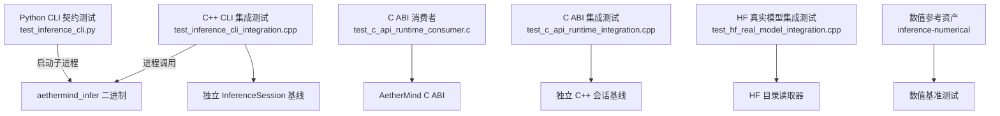

**图表来源**
- [test_inference_cli.py:1-381](../../../tests/unit/apps/inference/test_inference_cli.py#L1-L381)
- [test_inference_cli_integration.cpp:1-295](../../../tests/unit/apps/inference/test_inference_cli_integration.cpp#L1-L295)
- [test_c_api_runtime_consumer.c:1-102](../../../tests/unit/c_api/test_c_api_runtime_consumer.c#L1-L102)
- [test_c_api_runtime_integration.cpp:1-226](../../../tests/unit/c_api/test_c_api_runtime_integration.cpp#L1-L226)
- [test_hf_real_model_integration.cpp:1-155](../../../tests/unit/model/test_hf_real_model_integration.cpp#L1-L155)

构建系统通过 `cmake/AetherMindTests.cmake` 将测试标记为 `unit`、`model`、`cli`、`numerical`、`lifecycle`、`context_boundary`、`long-context`、`validation` 等类别，并强制要求测试模型目录为绝对路径。

**章节来源**
- [AetherMindTests.cmake:1-753](../../../cmake/AetherMindTests.cmake#L1-L753)
- [test_writing_guidelines.md](../../guides/test_writing_guidelines.md)

## 端到端测试设计总览
AetherMind 的端到端测试遵循“单一行为、清晰断言、可复现环境”的原则：

1. **入口选择**
   - 命令参数、错误消息、JSON 输出格式由 Python 测试覆盖。
   - 推理结果一致性由 C++ 集成测试覆盖。
   - ABI 生命周期、所有权释放和诊断字段由 C 测试覆盖。
   - HF 模型结构、权重表和最终数值一致性由模型与数值测试覆盖。

2. **基线对比**
   多数集成测试并不依赖“魔法期望值”，而是用同一输入在另一条可信路径上计算期望结果：
   - CLI 测试：Python 子进程输出 vs 独立 `InferenceSession::Generate`。
   - C ABI 测试：C 调用输出 vs 独立 C++ 会话输出。
   - Runner 测试：`RunInference` vs 独立会话构造。
   - 数值测试：AetherMind 推理 vs HF + PyTorch CPU 生成的离线参考张量。

3. **失败定位**
   测试会记录失败阶段、退出码、标准输出是否污染、诊断信息是否包含预期关键词，从而区分参数校验、模型加载、编译、运行时或推理阶段的错误。

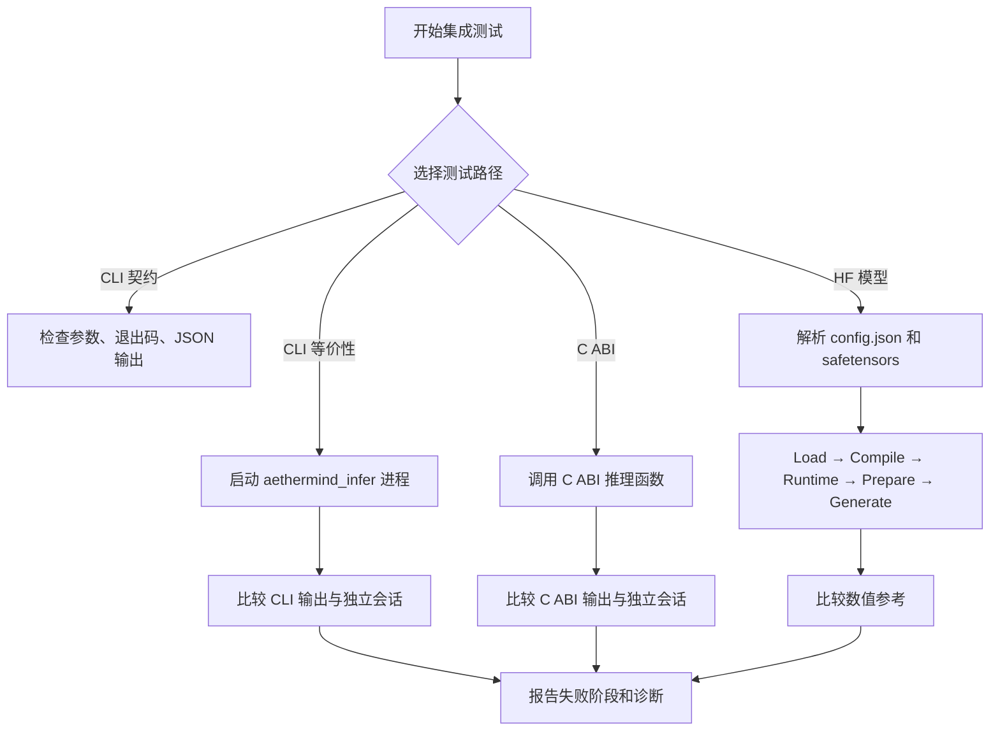

**图表来源**
- [test_inference_cli_integration.cpp:1-295](../../../tests/unit/apps/inference/test_inference_cli_integration.cpp#L1-L295)
- [test_c_api_runtime_integration.cpp:1-226](../../../tests/unit/c_api/test_c_api_runtime_integration.cpp#L1-L226)
- [test_hf_real_model_integration.cpp:1-155](../../../tests/unit/model/test_hf_real_model_integration.cpp#L1-L155)

## CLI 工具集成测试
CLI 集成测试分为两层：

### 黑盒契约测试
`tests/unit/apps/inference/test_inference_cli.py` 是一个纯 Python 测试，只依赖标准库和已构建的二进制程序。它负责：

- 通过 `--infer` 或环境变量 `AETHERMIND_INFER_BINARY` 定位 CLI 二进制。
- 校验推理成功时标准输出恰好是一行 JSON 数组。
- 校验每个 token 是非负整数且小于词表大小。
- 校验失败时标准输出为空、标准错误非空，并可指定阶段关键字（如 `load`、`compile`、`parameters`）。
- 校验帮助输出、缺失参数、重复参数、未知选项、位置参数、非法 preset、空格路径、SIGPIPE、日志初始化分配失败和 THP hugepage 警告等行为。

典型断言模式包括：

- 成功调用后解析 JSON 并断言 token 类型与范围。
- 使用 `subTest` 枚举多个非法 token 字符串。
- 通过临时模型目录修改 `config.json`，验证不支持的模型族、RoPE 类型或激活函数被拒绝。
- 使用 `LD_PRELOAD` 注入 C 共享库，模拟底层分配失败，验证诊断信息不含污染的标准输出。

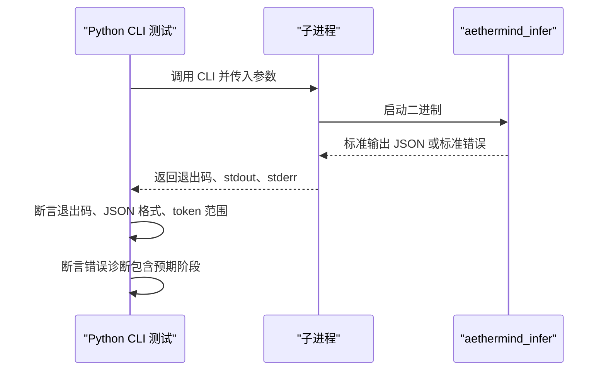

**图表来源**
- [test_inference_cli.py:1-381](../../../tests/unit/apps/inference/test_inference_cli.py#L1-L381)

### 跨进程等价性测试
`tests/unit/apps/inference/test_inference_cli_integration.cpp` 是 Linux 专属的 C++ 集成测试，需要环境变量 `AETHERMIND_INFER_BINARY` 指向已构建的正式 CLI 程序。它的关键职责是：

- 使用 `test::cli_process::Run` 启动 CLI 进程，捕获 stdout/stderr，避免 shell 和管道背压问题。
- 校验 CLI 成功时必须输出一个以换行符结尾的单行 JSON 数组。
- 手动解析 JSON token 数组，而不是依赖应用内部解析器。
- 对每种 HF 适配夹具（`f32-missing`、`f32-auto`、`f32-explicit`、`f32-tied`）和两种优化预设（`o1-plain`、`o2-packed`）运行参数化测试。
- 将 CLI 输出与独立会话基线比对，并验证 EOS token 停止行为、零推理、物理 KV 容量边界和参数越界错误。

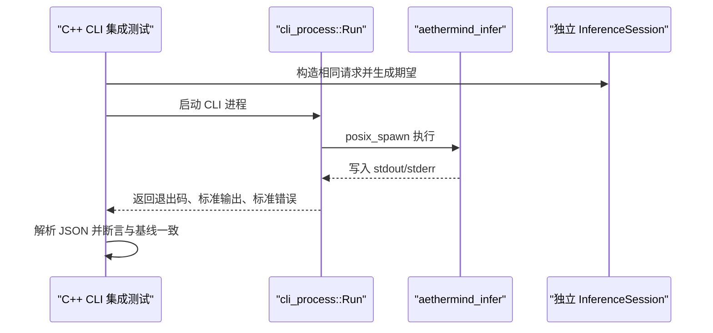

**图表来源**
- [test_inference_cli_integration.cpp:1-295](../../../tests/unit/apps/inference/test_inference_cli_integration.cpp#L1-L295)
- [test_inference_cli_process_helpers.h:1-172](../../../tests/unit/apps/inference/test_inference_cli_process_helpers.h#L1-L172)

**章节来源**
- [test_inference_cli.py:1-381](../../../tests/unit/apps/inference/test_inference_cli.py#L1-L381)
- [test_inference_cli_integration.cpp:1-295](../../../tests/unit/apps/inference/test_inference_cli_integration.cpp#L1-L295)
- [test_inference_cli_process_helpers.h:1-172](../../../tests/unit/apps/inference/test_inference_cli_process_helpers.h#L1-L172)
- [fail_logger_allocation.c:1-47](../../../tests/unit/apps/inference/fixtures/fail_logger_allocation.c#L1-L47)
- [fail_hugepage_advice.c:1-15](../../../tests/unit/apps/inference/fixtures/fail_hugepage_advice.c#L1-L15)

## C ABI 接口集成测试
C ABI 集成测试的核心是“C 消费者 + C++ 基线”。

### C 消费者实现
`tests/unit/c_api/test_c_api_runtime_consumer.c` 是一个 C 语言测试辅助程序，模拟外部 C 应用调用 AetherMind C ABI 的完整流程：

- 创建 runtime。
- 加载 model。
- 创建 session。
- 支持可选地提前释放 runtime 或 model 所有权。
- 调用 `am_session_generate` 一次或两次。
- 将失败阶段、状态码、诊断码、诊断消息、输出长度和意外成功错误写入 `AetherMindCInferenceResult`。

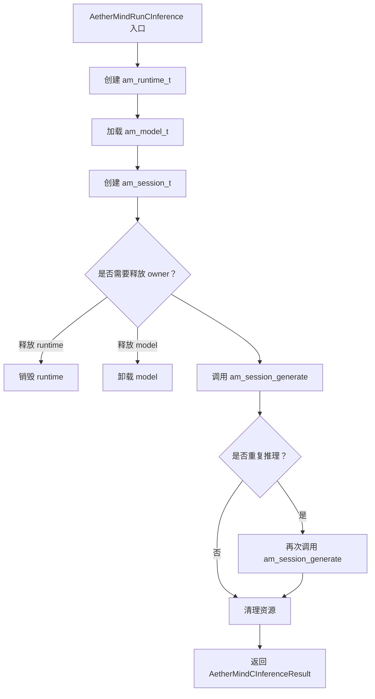

**图表来源**
- [test_c_api_runtime_consumer.c:1-102](../../../tests/unit/c_api/test_c_api_runtime_consumer.c#L1-L102)

### C ABI 断言与等价性
`tests/unit/c_api/test_c_api_runtime_integration.cpp` 使用参数化测试矩阵覆盖相同的 HF 适配夹具和优化预设组合。它同时验证：

- 三次新 token 推理结果与独立会话一致。
- 重复推理结果与第一次一致。
- 精确 KV 容量下行为一致。
- 零推理允许 prompt 超出物理 KV 容量。
- EOS token 被包含并停止推理。
- 外部释放 runtime 和 model 后，保留的所有者仍能完成推理。

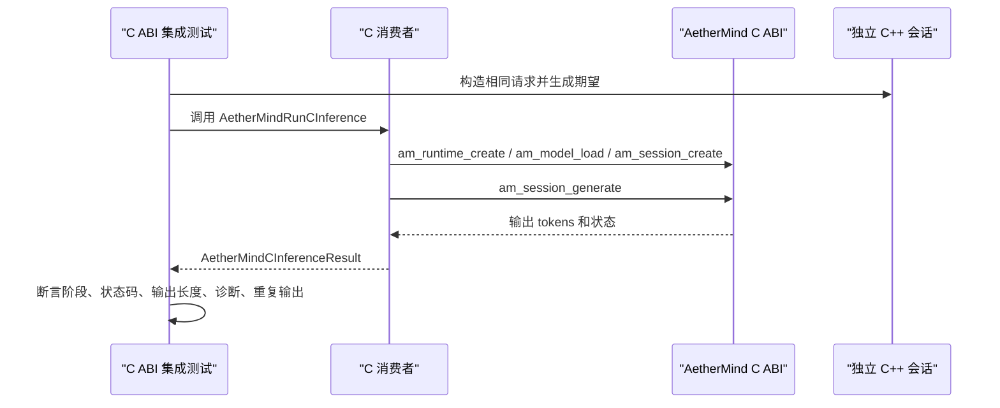

**图表来源**
- [test_c_api_runtime_integration.cpp:1-226](../../../tests/unit/c_api/test_c_api_runtime_integration.cpp#L1-L226)
- [test_c_api_runtime_consumer.h:1-51](../../../tests/unit/c_api/test_c_api_runtime_consumer.h#L1-L51)

**章节来源**
- [test_c_api_runtime_consumer.h:1-51](../../../tests/unit/c_api/test_c_api_runtime_consumer.h#L1-L51)
- [test_c_api_runtime_consumer.c:1-102](../../../tests/unit/c_api/test_c_api_runtime_consumer.c#L1-L102)
- [test_c_api_runtime_integration.cpp:1-226](../../../tests/unit/c_api/test_c_api_runtime_integration.cpp#L1-L226)

## HF 模型加载与数值参考测试
HF 模型加载集成测试直接操作真实模型目录，覆盖从目录结构到完整权重表的端到端路径。

### 真实模型集成测试
`tests/unit/model/test_hf_real_model_integration.cpp` 使用 `tiny-random-LlamaForCausalLM` 示例模型，验证：

- 目录布局识别为单个 safetensors。
- `config.json` 解析出正确的架构、几何参数、激活函数、RoPE 和 dtype hint。
- `model.safetensors` 能加载为原始权重表，包含 embedding、attention、MLP、norm 等关键张量。
- 配置和权重集能通过模型校验器。
- 权重解析后的结构化模型形状正确，并能再次通过校验。

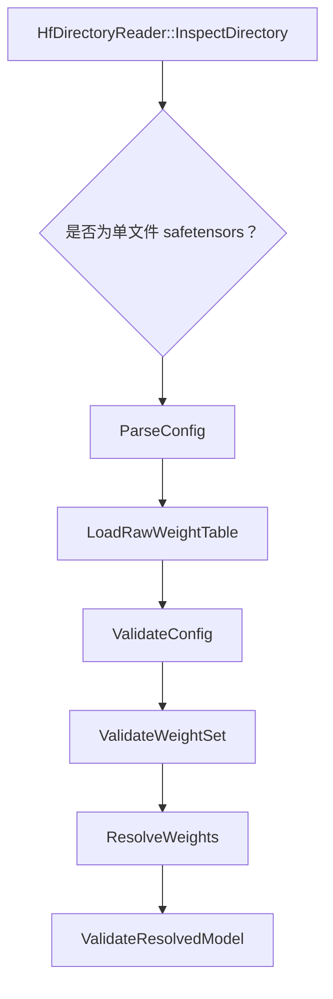

**图表来源**
- [test_hf_real_model_integration.cpp:1-155](../../../tests/unit/model/test_hf_real_model_integration.cpp#L1-L155)

### 数值参考资产
数值参考资产不是运行时依赖，而是离线生成的权威基线。其 README 明确说明：

- 生成环境使用固定版本的 PyTorch、transformers、numpy 和 safetensors。
- 参考执行使用 CPU FP32、eager attention、确定性算法和单线程。
- 参考结果包含 logits、KV 缓存、argmax token 和水位等信息。
- C++ 测试通过实际 Load → Compile → Runtime → Prepare → Generate 路径消费这些资产。
- 默认资产路径为 `.models/inference-numerical`，可通过 `AETHERMIND_TEST_NUMERICAL_DIR` 切换候选目录。

**章节来源**
- [test_hf_real_model_integration.cpp:1-155](../../../tests/unit/model/test_hf_real_model_integration.cpp#L1-L155)
- [README.md](../../../tests/fixtures/inference_numerical/README.md)

## 推理流程与多后端兼容性测试
推理流程测试重点验证 `RunInference` 与独立会话构造的一致性，以及不同优化预设下的行为。

### Runner 等价性测试
`tests/unit/apps/inference/test_inference_runner_success.cpp` 定义了独立会话构造函数，完全绕过应用配置助手，直接构造 `ModelLoader`、`RuntimeOptions`、`ModelCompiler`、`RuntimeBuilder`、`ExecutableModel` 和 `InferenceSession`。它验证：

- 默认 preset 为 `o1-plain`。
- `RunInference` 输出与独立会话输出相等。
- 多次请求返回相同新 token。
- 精确 KV 容量下生成数量正确。
- 零推理允许 prompt 超出物理 KV 容量。
- EOS token 被包含并立即停止。
- `o1-plain` 与 `o2-packed` 两种预设都通过等价性断言。

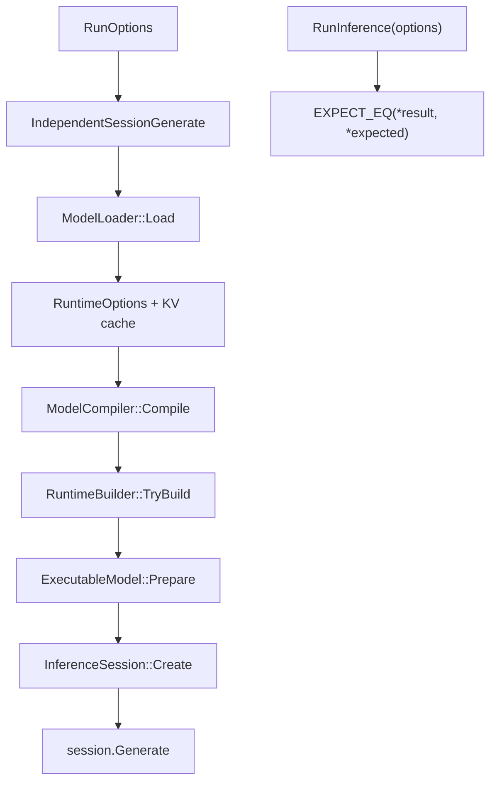

**图表来源**
- [test_inference_runner_success.cpp:1-197](../../../tests/unit/apps/inference/test_inference_runner_success.cpp#L1-L197)

### 多后端兼容性
虽然当前等价性测试聚焦 CPU 路径，但测试夹具矩阵覆盖了：

- `f32-missing`、`f32-auto`、`f32-explicit`、`f32-tied` 四种 HF 适配变体。
- `o1-plain` 与 `o2-packed` 两种优化预设。
- packed weight 开关影响 `opt_level` 和 `enable_packed_weights`。
- C ABI 测试同样使用 `AM_CPU_PRESET_O1_PLAIN` 和 `AM_CPU_PRESET_O2_PACKED`。

若要扩展到其他后端，应复用相同夹具矩阵，并确保独立基线和被测路径启用相同的 backend、allocator 和 kv_cache 配置。

**章节来源**
- [test_inference_runner_success.cpp:1-197](../../../tests/unit/apps/inference/test_inference_runner_success.cpp#L1-L197)
- [test_inference_cli_integration.cpp:1-295](../../../tests/unit/apps/inference/test_inference_cli_integration.cpp#L1-L295)
- [test_c_api_runtime_integration.cpp:1-226](../../../tests/unit/c_api/test_c_api_runtime_integration.cpp#L1-L226)

## 资源限制与故障注入测试
资源限制测试不仅验证“返回 ResourceExhausted”，还验证内存分配计数、对象生命周期、后端工厂行为和内核准备路径。

### 自定义分配器与生命周期记录
`tests/unit/apps/inference/test_inference_runner.cpp` 实现了 `RecordingAllocator` 和 `RecordingAllocatorProvider`，用于统计：

- 分配尝试次数。
- 实际分配次数。
- 活跃分配数。
- 释放次数。
- 分配器创建/销毁次数。
- 后端创建/销毁次数。
- 工厂销毁次数。
- 内核准备次数。
- 注入失败点。

它还提供了代理后端，用于模拟后端工厂失败、内核准备抛出异常、特定算子执行返回失败等场景。

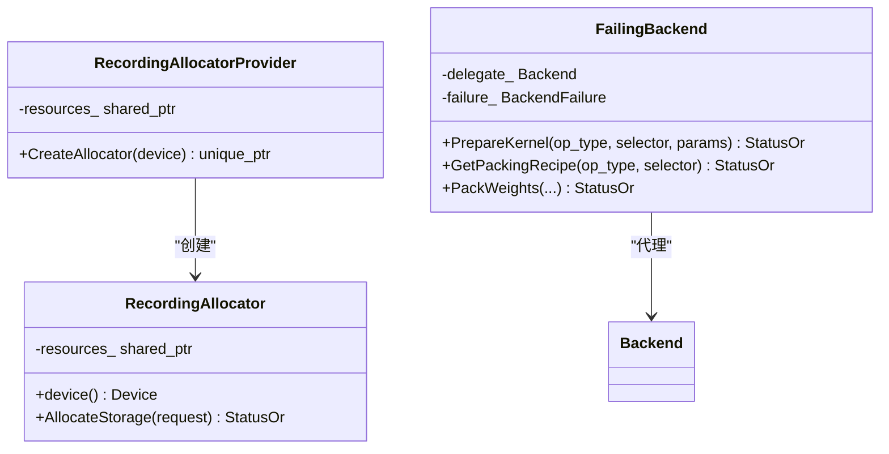

**图表来源**
- [test_inference_runner.cpp:1-200](../../../tests/unit/apps/inference/test_inference_runner.cpp#L1-L200)

### 资源限制测试标签
构建系统对资源相关测试有专门标记逻辑，例如 `InferenceResourceLimits`、`ModelResourceLimits`、`RawWeightStorageUsage.HfMappingCountsCompleteFileOnce` 会被标记为 `model` 或资源相关类别，便于在 CI 中选择性运行。

**章节来源**
- [test_inference_runner.cpp:1-200](../../../tests/unit/apps/inference/test_inference_runner.cpp#L1-L200)
- [AetherMindTests.cmake:1-753](../../../cmake/AetherMindTests.cmake#L1-L753)

## 测试夹具、固定数据与生成工具
AetherMind 的固定数据分为三类：

1. **HF 适配夹具**：用于验证模型加载、dtype hint、归一化作用域和 tied embedding 等适配逻辑。
2. **数值参考夹具**：用于 HF Llama FP32 推理的离线参考张量和元数据。
3. **KV16/W16 校准夹具**：用于 16-bit KV 缓存的独立数值预算。

### HF 适配夹具生成
`tools/generate_fp32_admission_hf_fixtures.py` 使用 Python 标准库生成受控的 HF 适配夹具，支持：

- F32、F16、BF16 变体。
- missing、auto、explicit hint。
- mixed/single norm scope。
- tied embedding。
- Safetensors 头排序、小端 payload、字节级转换规则。
- `--check` 模式仅校验现有输出，不修改文件或期望清单。

### 数值参考生成
`tools/generate_llama_numerical_reference.py` 基于固定版本的 Hugging Face Llama 和 PyTorch CPU 路径生成参考张量，并记录：

- 版本信息。
- 执行环境。
- 源文件哈希。
- 每个 tensor 的 payload sha256。
- 几何字段、轨迹、stage 标识。

### 数值参考校验
`tools/verify_llama_numerical_reference.py` 是只读校验工具，要求：

- 严格 JSON/Safetensors 结构。
- provenance 完整。
- 模型身份不变。
- 文件和 payload hash 匹配。
- tensor 集合、形状、有限值、轨迹一致。
- 即使数值差异在容忍度内，也需要人工审查。

### KV16 校准
`tools/calibrate_kv16_reference.py` 提供独立的整数舍入最近偶数 oracle，用于验证 F32 到 F16/BF16 的转换预算，并定义 impl、quality 等不同场景的 `(atol, rtol)` 预算。

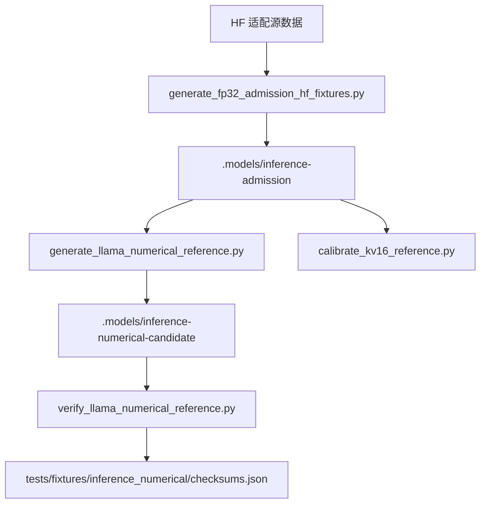

**图表来源**
- [generate_fp32_admission_hf_fixtures.py:1-200](../../../tools/generate_fp32_admission_hf_fixtures.py#L1-L200)
- [generate_llama_numerical_reference.py:1-200](../../../tools/generate_llama_numerical_reference.py#L1-L200)
- [verify_llama_numerical_reference.py:1-200](../../../tools/verify_llama_numerical_reference.py#L1-L200)
- [calibrate_kv16_reference.py:1-120](../../../tools/calibrate_kv16_reference.py#L1-L120)

**章节来源**
- [generate_fp32_admission_hf_fixtures.py:1-200](../../../tools/generate_fp32_admission_hf_fixtures.py#L1-L200)
- [generate_llama_numerical_reference.py:1-200](../../../tools/generate_llama_numerical_reference.py#L1-L200)
- [verify_llama_numerical_reference.py:1-200](../../../tools/verify_llama_numerical_reference.py#L1-L200)
- [calibrate_kv16_reference.py:1-120](../../../tools/calibrate_kv16_reference.py#L1-L120)
- [README.md](../../../tests/fixtures/inference_numerical/README.md)

## 数值精度验证方法
AetherMind 的数值验证采用“离线参考 + 在线执行 + 容忍度对比”的模式。

### 容忍度定义
根据数值参考 README 和校验工具：

- **logits**：`abs(actual - expected) <= atol + rtol * abs(expected)`，其中 `atol=2e-5`，`rtol=2e-4`。
- **KV 缓存**：`atol=2e-6`，`rtol=2e-4`。
- KV 布局为 `[layer, position, kv_head, dim]`，K 为 post-RoPE，V 为 unrotated。
- 形状、选中行、token ID、水位必须精确匹配。
- 非有限值直接失败。

KV16 校准工具进一步定义更细粒度的预算，区分实现质量与量化类型。

### 验证流程
1. 使用固定版本的 HF + PyTorch CPU 生成参考张量。
2. 校验工具确认 manifest、provenance、文件 hash、tensor payload、几何字段和轨迹有效。
3. C++ 测试通过实际 AetherMind 路径执行推理。
4. 比较 logits 和 KV 缓存，使用对应容忍度。
5. 即使结果在容忍度内，也需人工审查变更。

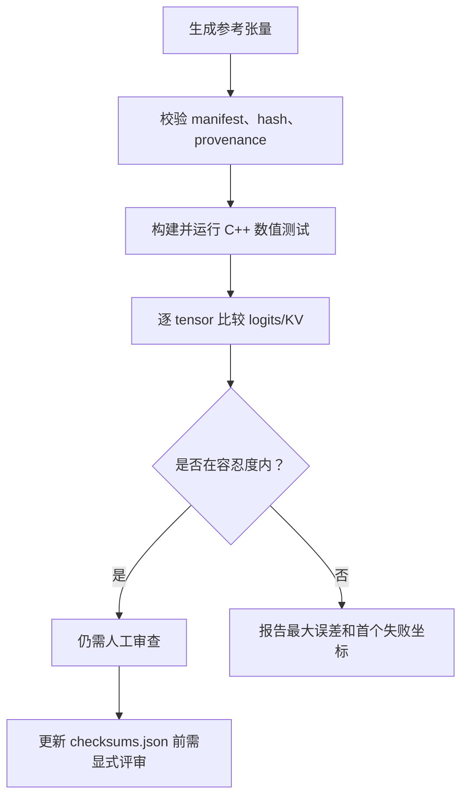

**图表来源**
- [README.md](../../../tests/fixtures/inference_numerical/README.md)
- [verify_llama_numerical_reference.py:1-200](../../../tools/verify_llama_numerical_reference.py#L1-L200)
- [calibrate_kv16_reference.py:1-120](../../../tools/calibrate_kv16_reference.py#L1-L120)

**章节来源**
- [README.md](../../../tests/fixtures/inference_numerical/README.md)
- [verify_llama_numerical_reference.py:1-200](../../../tools/verify_llama_numerical_reference.py#L1-L200)
- [calibrate_kv16_reference.py:1-120](../../../tools/calibrate_kv16_reference.py#L1-L120)

## 执行策略与并行配置
测试执行由 CMake 和 CTest 控制，关键策略如下：

### 测试分类标签
`cmake/AetherMindTests.cmake` 根据测试名称和路径自动打标：

- `unit`：默认单元测试。
- `interposer`：需要 glibc 包装器或分配插桩的关键 OOM 用例。
- `model`：涉及真实模型加载、HF 适配、资源限制和模型相关测试。
- `cli`：CLI 集成测试。
- `smoke`：轻量冒烟测试。
- `numerical`：数值内核和 FP32 兼容路径。
- `lifecycle`：生命周期、KV cache、runtime、CAbi、execution 等长生命周期测试。
- `context_boundary`：容量、上下文限制、预留、上下文 token 相关测试。
- `long-context`：近 2048 上下文长上下文测试。
- `validation`：短期模型校准和约束校验。

### 必需与可选资产
- `AETHERMIND_TEST_MODELS_DIR` 必须是绝对路径。
- `AETHERMIND_TEST_NUMERICAL_DIR` 默认指向 `.models/inference-numerical`。
- `AETHERMIND_INFER_BINARY` 可用于指定外部 CLI 二进制。
- 缺少数值资产时，相关测试可能标记为 disabled 或直接失败，取决于构建预设。

### 并行测试建议
- 普通单元测试可使用 CTest 默认并行执行。
- 模型加载、数值参考、CLI 进程测试通常较重，适合放在专用 preset 中。
- 若 CI 资源紧张，优先运行 `unit` 和 `smoke`，再运行 `model`、`numerical-model`、`long-context`。
- 对于 CLI 进程测试，应避免在同一进程中并发启动大量外部二进制，防止端口、临时目录或进程回收竞争。

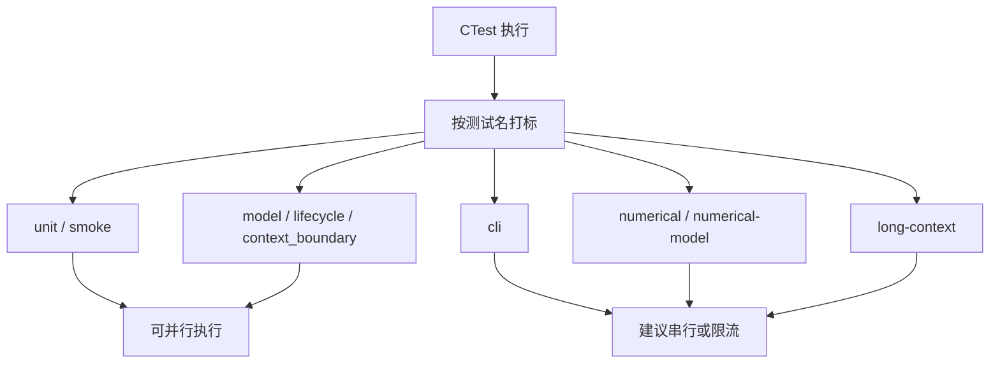

**图表来源**
- [AetherMindTests.cmake:1-753](../../../cmake/AetherMindTests.cmake#L1-L753)

**章节来源**
- [AetherMindTests.cmake:1-753](../../../cmake/AetherMindTests.cmake#L1-L753)

## 故障排查指南
### CLI 测试失败
1. 确认 `AETHERMIND_INFER_BINARY` 或 `--infer` 指向有效且可执行的二进制。
2. 检查 CLI 标准输出是否仍为单行 JSON，错误诊断是否进入标准错误。
3. 如果参数校验失败，检查 stage 是否为 `parameters`。
4. 如果模型加载失败，检查 stage 是否为 `load`。
5. 如果模型族、RoPE 或激活函数不被支持，检查 stage 是否为 `compile` 或 `load`。
6. 如果涉及日志分配失败，确认 Linux/glibc 环境和 `LD_PRELOAD` 注入共享库。

### C ABI 测试失败
1. 检查 `failure_stage` 是 `runtime`、`model`、`session`、`generate` 还是 `repeat`。
2. 检查 `code` 和 `diagnostic_code` 是否一致。
3. 检查 `output_len` 是否不超过输出缓冲区容量。
4. 检查 `unexpected_success_error` 是否为零。
5. 如果涉及 owner 释放，确认 retained owners 能在外部 runtime/model 释放后继续工作。

### HF 模型加载失败
1. 确认 `AETHERMIND_TEST_MODELS_DIR` 指向有效的模型目录。
2. 确认 `config.json` 存在且可解析。
3. 确认 `model.safetensors` 存在且布局正确。
4. 确认模型校验器未拒绝配置或权重集。
5. 如果使用数值参考，确认 `AETHERMIND_TEST_NUMERICAL_DIR` 指向已通过校验工具的候选目录。

### 数值参考不一致
1. 不要直接覆盖 `checksums.json`。
2. 先运行 `verify_llama_numerical_reference.py` 查看具体差异。
3. 检查 generator、recipe、requirements、HF 源、PyTorch 版本、libtorch_cpu.so 是否变化。
4. 即使差异在容忍度内，也需要人工审查。
5. 更新权威资产前，应运行 C++ 数值测试并通过。

### 性能与稳定性问题
- 单元测试应保持快速，慢场景放入 benchmark 或 integration。
- 随机数据应使用固定种子。
- 全局状态应在 `SetUp`/`TearDown` 中重置。
- 避免测试依赖执行顺序。
- 只在确实无法运行时使用 `GTEST_SKIP()`，并附带原因。

**章节来源**
- [test_writing_guidelines.md](../../guides/test_writing_guidelines.md)
- [test_inference_cli.py:1-381](../../../tests/unit/apps/inference/test_inference_cli.py#L1-L381)
- [test_c_api_runtime_integration.cpp:1-226](../../../tests/unit/c_api/test_c_api_runtime_integration.cpp#L1-L226)
- [test_hf_real_model_integration.cpp:1-155](../../../tests/unit/model/test_hf_real_model_integration.cpp#L1-L155)
- [README.md](../../../tests/fixtures/inference_numerical/README.md)

## 结论
AetherMind 的集成测试体系以契约为中心、以等价性为核心、以固定数据和离线参考为锚点。CLI 测试保证外部命令契约稳定，C ABI 测试保证跨语言边界安全，HF 模型测试保证模型加载与图构建正确，数值参考测试保证推理结果与独立 HF + PyTorch CPU 路径一致。

编写新的集成测试时，应优先回答以下问题：

- 被测契约是什么？
- 期望结果来自哪条独立路径？
- 夹具是否固定、可校验、可复现？
- 失败时能否精确定位阶段？
- 数值差异是否在明确容忍度内？
- 是否覆盖了正常路径、零推理、EOS 停止、容量边界和资源限制？
- 是否能通过 CTest 标签选择性执行？

遵循这些原则，可以在保持测试速度的同时，持续增强 AetherMind 推理系统的可靠性、可移植性和可维护性。
