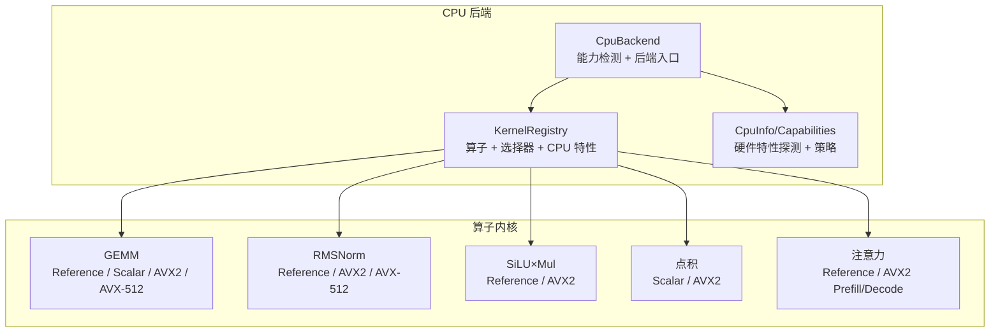
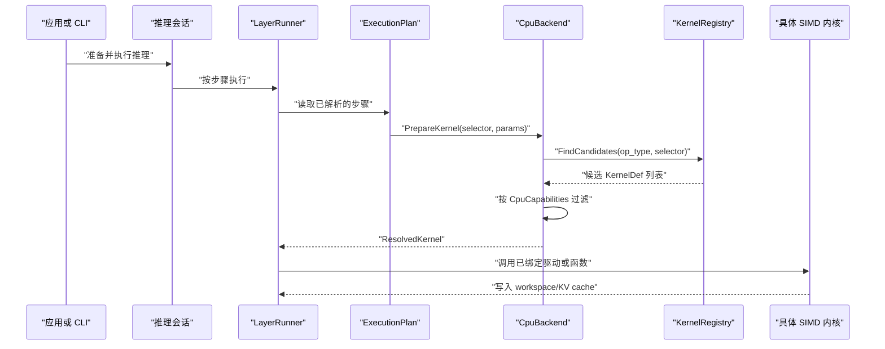
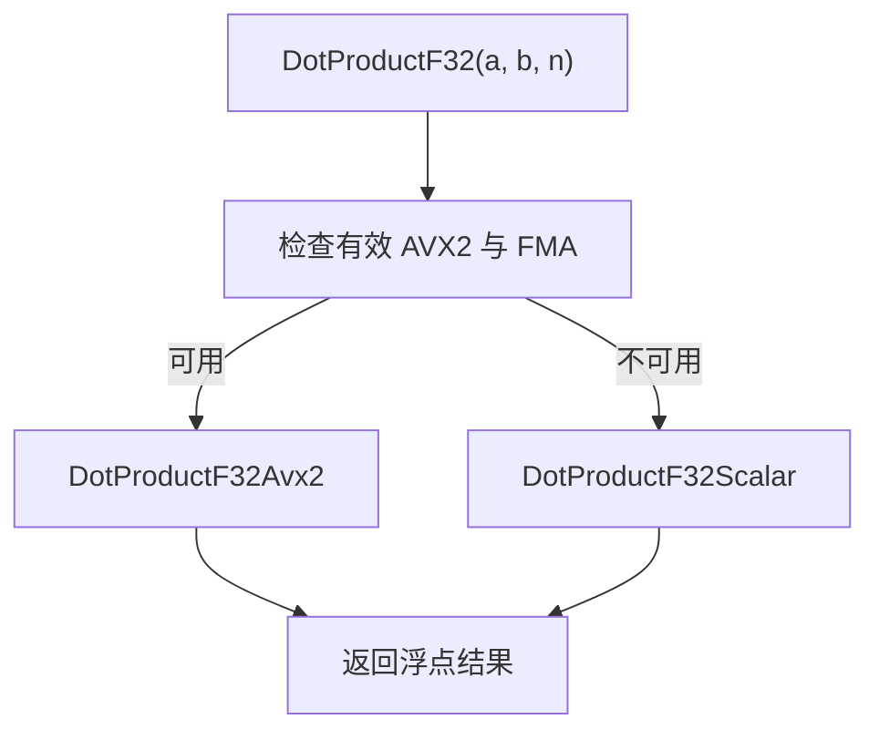
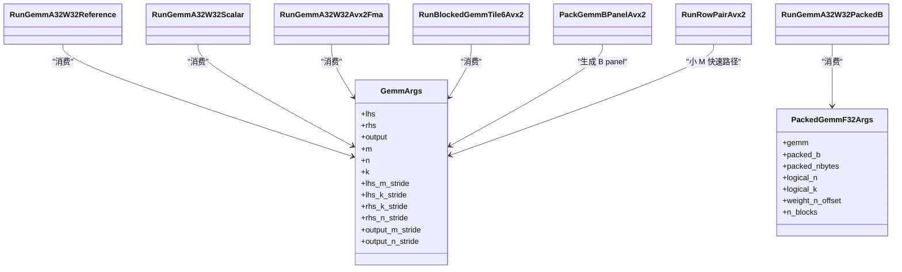
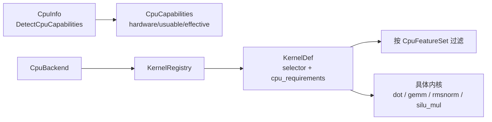

# SIMD 优化内核

**本文引用的文件**
- [README.md](../../../README.md)
- [cmake/AetherMindCpuIsa.cmake](../../../cmake/AetherMindCpuIsa.cmake)
- [docs/architecture.md](../../architecture.md)
- [include/aethermind/base/kernel_selector.h](../../../include/aethermind/base/kernel_selector.h)
- [include/aethermind/backend/cpu/cpu_capabilities.h](../../../include/aethermind/backend/cpu/cpu_capabilities.h)
- [include/aethermind/backend/cpu/cpu_info.h](../../../include/aethermind/backend/cpu/cpu_info.h)
- [src/backend/cpu/cpu_capabilities.cpp](../../../src/backend/cpu/cpu_capabilities.cpp)
- [src/backend/cpu/cpu_info.cpp](../../../src/backend/cpu/cpu_info.cpp)
- [src/backend/cpu/kernels/dot_product/dot_product_dispatch.cpp](../../../src/backend/cpu/kernels/dot_product/dot_product_dispatch.cpp)
- [src/backend/cpu/kernels/dot_product/dot_product_f32_avx2.cpp](../../../src/backend/cpu/kernels/dot_product/dot_product_f32_avx2.cpp)
- [src/backend/cpu/kernels/gemm/gemm_internal.h](../../../src/backend/cpu/kernels/gemm/gemm_internal.h)
- [src/backend/cpu/kernels/gemm/gemm_a32_w32_avx2.cpp](../../../src/backend/cpu/kernels/gemm/gemm_a32_w32_avx2.cpp)
- [GEMM 内核](算子实现详解/GEMM%20内核.md)
- [src/backend/cpu/kernels/rmsnorm/rmsnorm_entry.cpp](../../../src/backend/cpu/kernels/rmsnorm/rmsnorm_entry.cpp)
- [src/backend/cpu/kernels/silu_mul/silu_mul_avx2.cpp](../../../src/backend/cpu/kernels/silu_mul/silu_mul_avx2.cpp)
- [tests/benchmark/cpu_kernels/benchmark_cpu_gemm_microkernel.cpp](../../../tests/benchmark/cpu_kernels/benchmark_cpu_gemm_microkernel.cpp)
- [docs/operators/gemm/cpu-gemm-optimization.md](../../operators/gemm/cpu-gemm-optimization.md)

## 目录
1. [引言](#引言)
2. [项目结构](#项目结构)
3. [核心组件](#核心组件)
4. [架构总览](#架构总览)
5. [详细组件分析](#详细组件分析)
6. [依赖关系分析](#依赖关系分析)
7. [性能考虑](#性能考虑)
8. [故障排查指南](#故障排查指南)
9. [结论](#结论)
10. [附录：SIMD 内核开发指南](#附录simd-内核开发指南)

## 引言
本文面向 AetherMind 的 CPU 后端 SIMD 优化内核，重点解释以下主题：
- CPU 后端内核的架构设计。
- AVX2、F16C、通用标量路径以及 AVX-512 BF16/FP16 的构建期检测与运行时分发机制。
- GEMM、RMSNorm、SiLU-Mul、点积等关键内核的向量化策略、数据对齐要求、寄存器使用、循环展开和缓存分块。
- KernelSelector、CpuCapabilities、KernelRegistry 的选择契约。
- 基准测试方法、数值正确性守卫与性能回归检测思路。
- 内存访问模式、并行度控制、缓存友好性设计、回退策略与最佳实践。

AetherMind 当前产品明确以 Linux/x86_64 CPU 推理为主，公开 API 保持 FP32 源输入语义；CPU 算子层包含参考实现与 SIMD 优化实现，并通过静态注册和运行时能力检测进行调度。

**章节来源**
- [README.md](../../../README.md)
- [docs/architecture.md](../../architecture.md)

## 项目结构
CPU SIMD 内核主要集中在 `src/backend/cpu/kernels` 下，每个算子目录通常包含：
- `_entry.cpp`：参数校验、布局验证、参数构建、静态注册。
- `_reference.cpp`：数值参考实现或标量兼容实现。
- `_avx2.cpp` / `_avx512bf16.cpp` / `_avx512fp16.cpp`：指令集专用实现。
- `_internal.h`：内部参数、元数据、微内核接口。

**图示来源**
- [docs/architecture.md](../../architecture.md)
- [src/backend/cpu/kernels/gemm/gemm_internal.h:1-190](../../../src/backend/cpu/kernels/gemm/gemm_internal.h#L1-L190)

**章节来源**
- [docs/architecture.md](../../architecture.md)
- [README.md](../../../README.md)

## 核心组件
### 构建期 ISA 支持检测
CMake 模块在配置阶段通过编译器内联源码编译探测工具链是否支持以下指令集：
- AVX2/FMA。
- F16C。
- AVX512-BF16。
- AVX512-FP16。

这些标志用于决定哪些翻译单元需要 `-mavx2 -mfma`、`-mavx -mf16c`、`-mavx512f -mavx512bf16` 或 `-mavx512f -mavx512fp16` 编译选项，并强制禁用统一构建合并，确保指令集相关代码不被跨单元折叠。

关键点：
- 构建期检测的是“编译器能否发出目标指令”，不是宿主 CPU 实际能力。
- 运行时能力由 `CpuCapabilities` 快照决定，避免在不支持指令的机器上执行错误分支。
- 如果启用某个 ISA 但工具链不支持，会直接报错终止配置。

**章节来源**
- [cmake/AetherMindCpuIsa.cmake:1-156](../../../cmake/AetherMindCpuIsa.cmake#L1-L156)

### 运行时 CPU 能力模型
`CpuFeatureSet` 是固定大小的位集合，按架构划分特征，不隐式推导其他特征。它提供无堆分配、基本无抛出的查询、交集、差集和哈希操作。

`CpuCapabilities` 快照保存：
- 硬件能力。
- OS 可使用的能力。
- 应用策略后的有效能力。
- 架构类型（x86_64 / AArch64）。

`cpu::DetectCpuCapabilities` 在 x86_64 上读取 CPUID 和 XCR0，必要时请求 AMX XTILEDATA 权限；AArch64 上则基于平台辅助向量或系统调用探测。

**章节来源**
- [include/aethermind/backend/cpu/cpu_capabilities.h:1-200](../../../include/aethermind/backend/cpu/cpu_capabilities.h#L1-L200)
- [src/backend/cpu/cpu_capabilities.cpp:1-75](../../../src/backend/cpu/cpu_capabilities.cpp#L1-L75)
- [include/aethermind/backend/cpu/cpu_info.h:1-55](../../../include/aethermind/backend/cpu/cpu_info.h#L1-L55)
- [src/backend/cpu/cpu_info.cpp:1-200](../../../src/backend/cpu/cpu_info.cpp#L1-L200)

### 内核选择契约
`KernelSelector` 描述结构化执行需求：设备、激活 dtype、权重 dtype、状态 dtype、输出 dtype、权重格式和执行阶段。匹配时不使用“输出跟随激活”这类推断规则作为选择条件，而是严格相等。

`KernelRegistry` 将 `OpType`、`KernelSelector`、`CpuFeatureSet` 和 `PackingRecipe` 组合为注册键，并提供候选查找、冻结、调试转储等能力。CPU 后端会在结构匹配后，再根据 `CpuCapabilities` 过滤指令集相关候选。

**章节来源**
- [include/aethermind/base/kernel_selector.h:1-107](../../../include/aethermind/base/kernel_selector.h#L1-L107)
- [include/aethermind/backend/kernel_registry.h:1-90](../../../include/aethermind/backend/kernel_registry.h#L1-L90)
- [include/aethermind/backend/kernel_def.h:1-133](../../../include/aethermind/backend/kernel_def.h#L1-L133)

## 架构总览
AetherMind 的 CPU SIMD 内核位于硬件执行层。上层负责图构建、编译、执行计划和会话编排；底层只负责在已冻结的执行计划中高效执行算子 kernel。

**图示来源**
- [docs/architecture.md](../../architecture.md)
- [include/aethermind/base/kernel_selector.h:40-107](../../../include/aethermind/base/kernel_selector.h#L40-L107)
- [include/aethermind/backend/kernel_registry.h:30-90](../../../include/aethermind/backend/kernel_registry.h#L30-L90)

## 详细组件分析

### 点积内核的分发机制
FP32 点积微内核位于 CPU 后端私有目录 `src/backend/cpu/kernels/dot_product/`。FP32 AVX2 GEMM 直接调用同 ISA 实现来计算尾列或单行多目标点积。独立入口在 AVX2/FMA 实现已编译且运行时检测可用时选择 SIMD，否则使用标量实现。

**图示来源**
- [src/backend/cpu/kernels/dot_product/dot_product_dispatch.cpp:1-45](../../../src/backend/cpu/kernels/dot_product/dot_product_dispatch.cpp#L1-L45)

AVX2 实现使用 8 个独立累加器链，主循环每次处理 64 个元素，尾部按 32、16、8 分段处理，最后用标量收尾。多目标版本同时计算多个输出通道，使两个 LHS 向量被多次复用，八个累加器加上两个 LHS 寄存器恰好占用 16 个 YMM 寄存器，避免溢出到栈。

**章节来源**
- [src/backend/cpu/kernels/dot_product/dot_product_dispatch.cpp:1-45](../../../src/backend/cpu/kernels/dot_product/dot_product_dispatch.cpp#L1-L45)
- [src/backend/cpu/kernels/dot_product/dot_product_f32_avx2.cpp:1-153](../../../src/backend/cpu/kernels/dot_product/dot_product_f32_avx2.cpp#L1-L153)

### GEMM 内核架构
GEMM 是 CPU 后端最复杂的 SIMD 内核之一，覆盖：
- Reference：双精度累加的数值基线。
- Scalar optimized：纯标量优化 driver，支持 N 连续和 K 连续的 RHS。
- AVX2/FMA：`M=1..8` 的 2×4 行对、`M>=9` 的 6×16 blocked、B panel 打包与 6/4/2 行分解。
- packed-B：消费 `[K-panel][N-block][K-row][N-lane]` artifact 的 scan 与 blocked driver。
- A32/W16 与 A16/W16：F16/BF16 widening、幅值安全域与同型 FP32 累加。
- AVX-512 BF16/FP16：同型半精度或混合精度的原生点积扩展路径。

逐文件调用链、参数合同、性能数据与 trade-off 见 [GEMM 内核](算子实现详解/GEMM%20内核.md)。

**图示来源**
- [src/backend/cpu/kernels/gemm/gemm_internal.h:20-190](../../../src/backend/cpu/kernels/gemm/gemm_internal.h#L20-L190)
- [src/backend/cpu/kernels/gemm/gemm_avx2_internal.h:1-194](../../../src/backend/cpu/kernels/gemm/gemm_avx2_internal.h#L1-L194)
- [src/backend/cpu/kernels/gemm/gemm_a32_w32_avx2.cpp:1-389](../../../src/backend/cpu/kernels/gemm/gemm_a32_w32_avx2.cpp#L1-L389)

#### 数据对齐与输入合同
- `GemmArgs` 使用字节指针，不放宽 dtype、对齐或对象访问规则。
- F32 AVX2/FMA 路径要求 K 非零、LHS K 步长为 1、RHS K 步长为 1、输出 N 步长为 1；RHS 的 N 步长可以非 1。
- scalar 路径要求 LHS K 与输出 N 为单位 stride，并进一步要求 RHS 的 K 或 N 至少一个连续；两者都不连续时委托 reference。
- W16/A16 的 16-bit 操作数按 byte 读取，可不对齐；任何被访问的 F32 地址仍须满足 `alignof(float)`。
- packed-B 要求 artifact 按 64 字节对齐，且 `packed_nbytes`、`n_blocks`、slice offset 与布局公式精确一致。
- 所有形状、步长、别名和越界访问由上层或 driver 校验；SIMD 内核本身不做完整高层合法性检查。

#### 寄存器使用与循环展开
- 小 M 行对路径每 8 宽 K 步复用两个 LHS 向量，四个列权重流式读取，峰值约 10 个 YMM 寄存器。
- Blocked GEMM 使用 6×16 micro-kernel，12 个独立累加器链覆盖 96 个输出 lane，K 展开 4，饱和两个 FMA 端口；4×16/2×16 变体按 6/4/2 行分解复用同一 B panel。
- F32 blocked 直接读 A（`broadcast_ss`）；W16 长 Prefill 直接读 A，短 K 打包 A；packed-B 与 A16 按 48 行块打包 A。
- 主循环按 KC=512、NR=16、M block 分块：F32 direct-A 优先让 B panel 跨全部 M 复用；packed-B 优先让 A panel 跨全部 N 复用。
- 尾部通过行对、多目标 dot product 或标量回退处理未对齐边界。

#### 缓存友好性设计
- B panel 预打包成 k-major 布局，使同一 K 面板内的多个 N 列共享一次内存加载；8 行一组的打包降低 L1 set 冲突。
- 行对路径的 K-panel cache blocking 曾经测量并移除，因为面板级归约/累加器重建成本超过缓存复用收益；这不是 blocked 路径的 KC=512。
- 32 KiB B panel（512×16×4B）是当前 F32 blocked 的固定预算；W16 packed-A 为 128 KiB，A16 为 152 KiB。
- KC=256、更宽 N 分块或更大 M block 尚未完成对照，不能宣称当前常量是跨平台最优值。

**章节来源**
- [src/backend/cpu/kernels/gemm/gemm_internal.h:20-190](../../../src/backend/cpu/kernels/gemm/gemm_internal.h#L20-L190)
- [src/backend/cpu/kernels/gemm/gemm_a32_w32_avx2.cpp:1-389](../../../src/backend/cpu/kernels/gemm/gemm_a32_w32_avx2.cpp#L1-L389)
- [docs/operators/gemm/cpu-gemm-optimization.md](../../operators/gemm/cpu-gemm-optimization.md)

### RMSNorm 内核
RMSNorm 入口负责：
- 校验 epsilon、张量秩、shape、dtype、stride。
- 校验 weight 是否为 float 自然对齐。
- 分析 row-wise view 并验证 input/output/weight 的别名关系。
- 构建内部参数，供 reference 或 AVX2/AVX-512 实现使用。

对齐要求包括：
- 权重必须按 float 自然对齐，因为内核会将权重视为 typed float 指针重复读取。
- output 必须 injective。
- in-place 仅允许 input 与 output 完全映射相同；否则 output 必须与 input 和 weight 不相交。

**章节来源**
- [src/backend/cpu/kernels/rmsnorm/rmsnorm_entry.cpp:1-200](../../../src/backend/cpu/kernels/rmsnorm/rmsnorm_entry.cpp#L1-L200)

### SiLU × Mul 内核
SiLU × Mul 的 AVX2 实现展示了一个更细粒度的安全回退策略：
- 仅在舍入模式为最近舍入时走 SIMD。
- 对每 8 个元素尝试 SIMD 计算。
- 若输入超出安全幅值范围，或写回 BF16 时存在舍入模糊，则回退到参考实现。
- 使用七次泰勒多项式近似负指数，并通过位操作判断符号和幅度，保证中间值和乘积保持在正常范围内。

这体现了 SIMD 内核的一个重要原则：**SIMD 路径应尽可能快，但不能破坏数值语义或异常行为**。

**章节来源**
- [src/backend/cpu/kernels/silu_mul/silu_mul_avx2.cpp:1-129](../../../src/backend/cpu/kernels/silu_mul/silu_mul_avx2.cpp#L1-L129)

### 注意力内核
Attention 入口展示了 CPU 后端典型的高层参数构建流程：
- 从 `KernelContext.attrs` 读取冻结的 head geometry 和 scale。
- 校验 query、output 的 shape、dtype、stride 和对齐。
- 通过 KV cache binding 构建 key/value 缓存视图。
- 验证 output 注入性和 stride 不相交性。
- 构造 `AttentionA32KernelArgs` 供后续 AVX2 Prefill/Decode 内核使用。

**章节来源**
- [src/backend/cpu/kernels/attention/attention_entry.cpp:1-200](../../../src/backend/cpu/kernels/attention/attention_entry.cpp#L1-L200)

## 依赖关系分析

**图示来源**
- [include/aethermind/backend/cpu/cpu_capabilities.h:1-200](../../../include/aethermind/backend/cpu/cpu_capabilities.h#L1-L200)
- [include/aethermind/backend/kernel_registry.h:1-90](../../../include/aethermind/backend/kernel_registry.h#L1-L90)
- [include/aethermind/backend/kernel_def.h:1-133](../../../include/aethermind/backend/kernel_def.h#L1-L133)

### 耦合与内聚
- `CpuCapabilities` 与 `CpuFeaturePolicy` 是低层基础设施，被后端、dispatch 和 benchmark 引用。
- `KernelSelector` 是跨模块契约，graph lowering、execution planning、backend registry 都依赖它，但不依赖具体 backend 实现。
- 每个算子目录内聚度高：entry、reference、ISA-specific 实现和 internal header共同描述一个算子。
- 潜在风险在于 ISA 特定头文件可能被不同编译单元间接引用，因此 CMake 通过 `SKIP_UNITY_BUILD_INCLUSION` 隔离指令集翻译单元。

### 外部依赖
- 编译器 intrinsics：`immintrin.h`。
- 平台 API：x86_64 的 CPUID/XGETBV/Linux `arch_prctl`，AArch64 的 hwcap/syscall。
- Google Benchmark：用于内核和模型级基准。
- spdlog：日志（不在本文件分析范围内）。

**章节来源**
- [cmake/AetherMindCpuIsa.cmake:1-156](../../../cmake/AetherMindCpuIsa.cmake#L1-L156)
- [src/backend/cpu/cpu_info.cpp:1-200](../../../src/backend/cpu/cpu_info.cpp#L1-L200)
- [include/aethermind/base/kernel_selector.h:1-107](../../../include/aethermind/base/kernel_selector.h#L1-L107)

## 性能考虑

### 向量化策略总结
| 内核 | 主要策略 | 关键约束 |
|---|---|---|
| 点积 | 8 条独立累加链，主循环 64 元素，尾部 32/16/8 分段 | 有效 AVX2/FMA 检测 |
| GEMM 小 M | 2 行 × 4 列 × K8 行对复用 LHS | LHS K=1、RHS K=1、输出 N=1 |
| GEMM blocked | 6/4/2 × 16 micro-kernel，B panel 预打包；F32 用 direct A | KC=512、NR=16、MR=6；M≥9 |
| GEMM scalar | 4 列 K-contiguous、32×128 panel、NC/KC=128 | LHS K=1、输出 N=1，RHS K 或 N 连续 |
| GEMM W16/A16 | widening + 同一 6×16 tile；A16 用 48×128 FP32 输出块 | 幅值安全域；A16 另需 K≥8、N≥16 |
| RMSNorm | row-wise 归一化，按 hidden_size 向量吞吐 | weight float 对齐，output injective |
| SiLU×Mul | 向量 exp 近似 + 安全域判断 + BF16 写回容差 | 最近舍入模式，幅值安全域 |

### 内存访问模式
- 优先顺序加载连续内存，避免随机访问。
- GEMM 中通过 B panel 预打包改善访存局部性。
- Multi-target dot product 复用 LHS 向量，减少重复加载。
- RMSNorm 按行遍历，权重在每个 row 重复读取，因此不能把 output 放在 weight 区域。

### 并行度控制
- 当前产品边界为单请求、单线程。
- SIMD 并行主要体现在向量寄存器并行和数据并行，而非线程并行。
- 未来多线程属于 runtime 级扩展，不应在单个 kernel 内随意引入全局线程池。

### 缓存友好性
- 使用 MC/NC/KC 分块降低 L1/L2 压力；F32 blocked 固定 KC=512、NR=16，W16/A16 另用 48 行 M block。
- 避免过大的 panel 导致容量不足；行对路径的 K-panel 分块已移除，blocked 路径的 KC=512 不在同一结论内。
- 对 small-M 路径保持短路径和低分支成本；M=1 主要受权重流带宽限制。

### 回退策略
- 构建期检测工具链能力。
- 运行期检测有效 CPU 特性。
- 内核内部对异常幅值、舍入模式、尾部分段做安全回退。
- 不适合 SIMD fast path 的合法输入应委托 scalar 或 reference，而不是缩小 operator 合同。

**章节来源**
- [src/backend/cpu/kernels/dot_product/dot_product_f32_avx2.cpp:1-153](../../../src/backend/cpu/kernels/dot_product/dot_product_f32_avx2.cpp#L1-L153)
- [src/backend/cpu/kernels/gemm/gemm_a32_w32_avx2.cpp:1-389](../../../src/backend/cpu/kernels/gemm/gemm_a32_w32_avx2.cpp#L1-L389)
- [src/backend/cpu/kernels/rmsnorm/rmsnorm_entry.cpp:1-200](../../../src/backend/cpu/kernels/rmsnorm/rmsnorm_entry.cpp#L1-L200)
- [src/backend/cpu/kernels/silu_mul/silu_mul_avx2.cpp:1-129](../../../src/backend/cpu/kernels/silu_mul/silu_mul_avx2.cpp#L1-L129)
- [docs/operators/gemm/cpu-gemm-optimization.md](../../operators/gemm/cpu-gemm-optimization.md)

## 故障排查指南

### 构建失败：工具链不支持启用的 ISA
现象：
- CMake 配置时报错，提示 AVX2、F16C、AVX512BF16 或 AVX512FP16 需要支持的编译器。

排查要点：
- 确认编译器能编译对应 intrinsics 源码。
- 检查是否显式关闭了相应开关。
- 注意这是工具链检测，不是宿主 CPU 检测。

**章节来源**
- [cmake/AetherMindCpuIsa.cmake:1-156](../../../cmake/AetherMindCpuIsa.cmake#L1-L156)

### 运行时缺失 CPU 特性
现象：
- 某些 benchmark 或 dispatch 无法使用 AVX2/FMA。
- 有效特性集中缺少 AVX2、FMA、AVX-512 或 AMX。

排查要点：
- 检查 `CpuCapabilities` 的 hardware、usable、effective 三套集合。
- 检查是否通过 `CpuFeaturePolicy` 禁用了某些特性。
- 在 x86_64 Linux 上，AMX 需要 XTILEDATA 权限。

**章节来源**
- [include/aethermind/backend/cpu/cpu_capabilities.h:1-200](../../../include/aethermind/backend/cpu/cpu_capabilities.h#L1-L200)
- [src/backend/cpu/cpu_info.cpp:1-200](../../../src/backend/cpu/cpu_info.cpp#L1-L200)

### 数值不正确或出现 NaN/Inf
现象：
- GEMM 输出与 oracle 不一致。
- SiLU×Mul 在非最近舍入模式下不走 SIMD。
- RMSNorm 因 weight 不对齐或 alias 非法而失败。

排查要点：
- 先用 reference 验证数值基线。
- 检查舍入模式、幅值安全域和 tail 处理。
- 核对 dtype、stride、alignment、alias 约束。
- 使用 microbenchmark 中的正确性守卫报告绝对误差和相对误差。

**章节来源**
- [tests/benchmark/cpu_kernels/benchmark_cpu_gemm_microkernel.cpp:1-200](../../../tests/benchmark/cpu_kernels/benchmark_cpu_gemm_microkernel.cpp#L1-L200)
- [src/backend/cpu/kernels/silu_mul/silu_mul_avx2.cpp:1-129](../../../src/backend/cpu/kernels/silu_mul/silu_mul_avx2.cpp#L1-L129)
- [src/backend/cpu/kernels/rmsnorm/rmsnorm_entry.cpp:1-200](../../../src/backend/cpu/kernels/rmsnorm/rmsnorm_entry.cpp#L1-L200)

### 性能回归
现象：
- 某次改动后 GEMM、Linear、RMSNorm 或 attention 吞吐下降。

建议方法：
- 使用 Google Benchmark 比较 reference、scalar optimized、AVX2、AVX-512 路径。
- 固定 M/K/N 矩阵规模、RHS 布局、padding 和误差容忍度。
- 记录 GFLOP/s 和逻辑 GB/s，并对比历史基线。
- 区分 prepare/cold path 与 Execute/hot path。

**章节来源**
- [tests/benchmark/cpu_kernels/benchmark_cpu_gemm_microkernel.cpp:1-200](../../../tests/benchmark/cpu_kernels/benchmark_cpu_gemm_microkernel.cpp#L1-L200)
- [docs/operators/gemm/cpu-gemm-optimization.md](../../operators/gemm/cpu-gemm-optimization.md)

## 结论
AetherMind 的 CPU SIMD 内核采用“构建期工具链检测 + 运行期 CPU 能力检测 + 内核注册与选择”的分层架构。内核实现遵循明确的 contract：
- 结构化执行需求由 `KernelSelector` 表达。
- CPU 指令能力由 `CpuCapabilities` 管理。
- 候选内核由 `KernelRegistry` 维护并按优先级和特性过滤。
- 每个算子内核保持清晰的 reference、scalar optimized、SIMD 和 fallback 层次。

这种设计既保证了跨平台可移植性，又允许在 AVX2、F16C、AVX-512 BF16/FP16 等指令集上实现高性能路径。GEMM、RMSNorm、SiLU×Mul 和注意力等内核进一步体现了向量化、缓存分块、寄存器展开和安全回退的综合优化思路。

[本节不直接分析具体代码文件]

## 附录：SIMD 内核开发指南

### 新建内核的基本步骤
1. 定义内部参数结构体，如 `GemmArgs`、`SiluMulA32KernelArgs`、`RmsNormA32W32KernelArgs`。
2. 实现 reference 实现，保证数值正确性。
3. 实现标量优化 driver，避免过早依赖 intrinsics。
4. 实现 AVX2/FMA 或 AVX-512 实现，并使用构建期宏保护。
5. 编写 entry：校验 dtype、shape、stride、alignment、alias。
6. 注册到 `KernelRegistry`，声明 `KernelSelector`、`CpuFeatureSet`、priority 和 name。
7. 添加 unit test 和 benchmark，覆盖 reference、optimized、SIMD 和 edge case。

### 数据对齐最佳实践
- 明确声明哪些指针必须是 float、half、bf16 或任意字节对齐。
- 不要假设 TensorView 的对齐等于数据类型自然对齐。
- 对于 packed weight，使用 `PackingRecipe.alignment` 和 layout 描述物理存储。
- 对 RMSNorm 等反复读取权重的内核，weight 对齐尤其重要。

**章节来源**
- [src/backend/cpu/kernels/rmsnorm/rmsnorm_entry.cpp:1-200](../../../src/backend/cpu/kernels/rmsnorm/rmsnorm_entry.cpp#L1-L200)
- [include/aethermind/backend/kernel_def.h:1-133](../../../include/aethermind/backend/kernel_def.h#L1-L133)

### 循环展开与寄存器压力控制
- 主循环尽量按向量宽度倍数展开。
- 使用多个独立累加器打断依赖链，提高 FMA 端口利用率。
- 避免寄存器过多导致 spill。
- 对 tail 使用分段处理，而不是在热点路径中做复杂判断。

**章节来源**
- [src/backend/cpu/kernels/dot_product/dot_product_f32_avx2.cpp:1-153](../../../src/backend/cpu/kernels/dot_product/dot_product_f32_avx2.cpp#L1-L153)
- [src/backend/cpu/kernels/gemm/gemm_a32_w32_avx2.cpp:1-389](../../../src/backend/cpu/kernels/gemm/gemm_a32_w32_avx2.cpp#L1-L389)

### 缓存分块与临时面板
- 对大矩阵乘法使用 MC/NC/KC 分块。
- 预打包 B panel 提升空间局部性。
- 谨慎评估 panel 大小，避免容量不足或打包开销过大。
- 行对路径的 K-panel 分块因面板级归约开销大于复用收益被移除；blocked 路径保留 KC=512，但 KC=256 尚未完成对照。

**章节来源**
- [src/backend/cpu/kernels/gemm/gemm_a32_w32_avx2.cpp:1-389](../../../src/backend/cpu/kernels/gemm/gemm_a32_w32_avx2.cpp#L1-L389)
- [docs/operators/gemm/cpu-gemm-optimization.md](../../operators/gemm/cpu-gemm-optimization.md)

### 安全回退与数值稳健性
- 对异常幅值、NaN、Inf、舍入模式、尾部分段使用安全回退。
- SIMD 路径可以更快，但不能改变 operator 的数值语义。
- 对 BF16/Half 写回前检查舍入容差。
- 使用 double accumulation reference 作为数值基线。

**章节来源**
- [src/backend/cpu/kernels/silu_mul/silu_mul_avx2.cpp:1-129](../../../src/backend/cpu/kernels/silu_mul/silu_mul_avx2.cpp#L1-L129)
- [docs/operators/gemm/cpu-gemm-optimization.md](../../operators/gemm/cpu-gemm-optimization.md)

### 性能基准与回归检测
- 使用 Google Benchmark 覆盖多种 M/K/N 和布局。
- 同时报告 items、bytes、GFLOP/s、GB/s。
- 加入正确性守卫，避免性能数字掩盖数值退化。
- 对 prepared-path、packing-cold-path、decode/prefill-hot/streaming 分别测量。

**章节来源**
- [tests/benchmark/cpu_kernels/benchmark_cpu_gemm_microkernel.cpp:1-200](../../../tests/benchmark/cpu_kernels/benchmark_cpu_gemm_microkernel.cpp#L1-L200)
- [docs/operators/gemm/cpu-gemm-optimization.md](../../operators/gemm/cpu-gemm-optimization.md)
