# 算子契约设计

**本文引用的文件**
- [operator_schema.h](../../../include/aethermind/operators/operator_schema.h)
- [operator_schema.cpp](../../../src/operators/operator_schema.cpp)
- [op_params.h](../../../include/aethermind/operators/op_params.h)
- [op_params_serde.h](../../../include/aethermind/operators/op_params_serde.h)
- [op_params_serde.cpp](../../../src/operators/op_params_serde.cpp)
- [op_type.h](../../../include/aethermind/operators/op_type.h)
- [op_type.cpp](../../../src/operators/op_type.cpp)
- [operator_name.h](../../../include/aethermind/operators/operator_name.h)
- [operator_name.cpp](../../../src/operators/operator_name.cpp)
- [rope_frequency_resolver.h](../../../include/aethermind/operators/rope_frequency_resolver.h)
- [rope_frequency_resolver.cpp](../../../src/operators/rope_frequency_resolver.cpp)
- [rmsnorm_op.cpp](../../../src/operators/ops/rmsnorm_op.cpp)
- [cast_op.cpp](../../../src/operators/ops/cast_op.cpp)
- [add_rmsnorm_op.cpp](../../../src/operators/ops/add_rmsnorm_op.cpp)
- [test_operator_schema.cpp](../../../tests/unit/operators/test_operator_schema.cpp)

## 目录
1. [引言](#引言)
2. [项目结构](#项目结构)
3. [核心组件](#核心组件)
4. [架构总览](#架构总览)
5. [详细组件分析](#详细组件分析)
6. [依赖关系分析](#依赖关系分析)
7. [性能考虑](#性能考虑)
8. [故障排查指南](#故障排查指南)
9. [结论](#结论)
10. [附录：新增算子契约步骤](#附录新增算子契约步骤)

## 引言
本文件面向 AetherMind 的算子契约子系统，系统性解释以下主题：
- OperatorSchema 的设计原理、算子类型定义、参数结构与形状推导规则。
- 算子的注册机制、名称解析与参数验证流程。
- OpParams 基类与其派生类的继承关系、参数序列化与反序列化机制。
- RopeFrequencyResolver 的职责与频率计算算法。
- 新算子契约从枚举到 Schema 注册的完整步骤。
- 参数验证最佳实践与错误处理策略。

## 项目结构
算子契约相关代码主要分布在以下位置：
- 头文件位于 include/aethermind/operators/，提供公共接口与类型定义。
- 实现位于 src/operators/，包含注册表、名称解析、序列化等逻辑。
- 各算子实现位于 src/operators/ops/，每个算子通常提供一个 .cpp 文件。
- 测试位于 tests/unit/operators/，覆盖 Schema、名称、序列化、频率解析等。

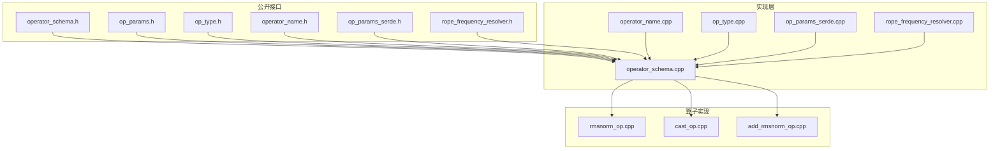

**图示来源**
- [operator_schema.h](../../../include/aethermind/operators/operator_schema.h)
- [operator_schema.cpp:1-200](../../../src/operators/operator_schema.cpp#L1-L200)
- [op_params.h:1-200](../../../include/aethermind/operators/op_params.h#L1-L200)
- [op_type.h](../../../include/aethermind/operators/op_type.h)
- [operator_name.h](../../../include/aethermind/operators/operator_name.h)
- [rope_frequency_resolver.h](../../../include/aethermind/operators/rope_frequency_resolver.h)
- [op_params_serde.h](../../../include/aethermind/operators/op_params_serde.h)

**章节来源**
- [operator_schema.h](../../../include/aethermind/operators/operator_schema.h)
- [operator_schema.cpp:1-200](../../../src/operators/operator_schema.cpp#L1-L200)
- [op_params.h:1-200](../../../include/aethermind/operators/op_params.h#L1-L200)
- [op_type.h](../../../include/aethermind/operators/op_type.h)
- [operator_name.h](../../../include/aethermind/operators/operator_name.h)
- [rope_frequency_resolver.h](../../../include/aethermind/operators/rope_frequency_resolver.h)
- [op_params_serde.h](../../../include/aethermind/operators/op_params_serde.h)

## 核心组件
本节聚焦算子契约的核心抽象与职责边界：
- OperatorSchema：描述算子的元信息、输入输出规格、参数类型、形状推导函数与执行器选择。
- OpParams：所有算子参数的基类，提供序列化、反序列化与校验钩子。
- OpType：算子类型的枚举与转换工具。
- operator_name：算子名称与字符串的双向解析。
- op_params_serde：基于键值对的结构化参数序列化工具。
- rope_frequency_resolver：RoPE 频率表的解析与计算。

这些组件共同构成“声明式算子契约”，将算子的语义、约束与可执行后端解耦。

**章节来源**
- [operator_schema.h](../../../include/aethermind/operators/operator_schema.h)
- [op_params.h:1-200](../../../include/aethermind/operators/op_params.h#L1-L200)
- [op_type.h](../../../include/aethermind/operators/op_type.h)
- [operator_name.h](../../../include/aethermind/operators/operator_name.h)
- [op_params_serde.h](../../../include/aethermind/operators/op_params_serde.h)
- [rope_frequency_resolver.h](../../../include/aethermind/operators/rope_frequency_resolver.h)

## 架构总览
OperatorSchema 作为算子契约中心，承担以下职责：
- 维护算子类型到 Schema 的注册表。
- 根据算子名称解析具体 Schema。
- 将用户提供的参数对象反序列化为运行时可用形式。
- 调用参数对象的校验方法，完成维度、数据类型、取值范围等约束检查。
- 通过形状推导函数推断输出形状，为图优化和编译阶段提供静态信息。
- 在运行时或内核调度阶段协助选择后端内核。

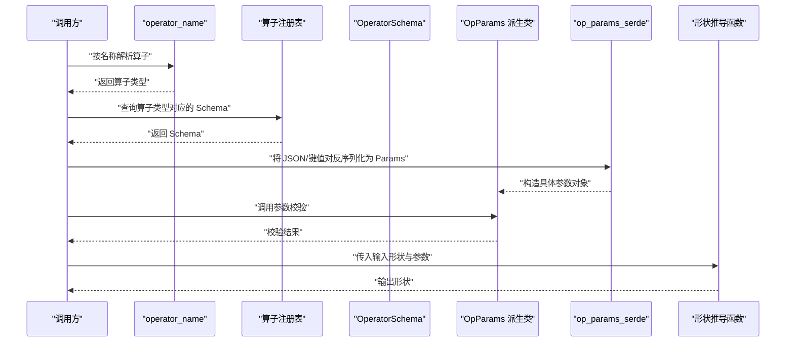

**图示来源**
- [operator_name.cpp](../../../src/operators/operator_name.cpp)
- [operator_schema.cpp:1-200](../../../src/operators/operator_schema.cpp#L1-L200)
- [op_params_serde.cpp:1-200](../../../src/operators/op_params_serde.cpp#L1-L200)

**章节来源**
- [operator_schema.cpp:1-200](../../../src/operators/operator_schema.cpp#L1-L200)
- [operator_name.cpp](../../../src/operators/operator_name.cpp)
- [op_params_serde.cpp:1-200](../../../src/operators/op_params_serde.cpp#L1-L200)

## 详细组件分析

### OperatorSchema 设计与算子类型
OperatorSchema 是算子契约的核心数据结构，用于描述一个算子的：
- 算子类型标识。
- 输入张量的数量与可选性。
- 输出张量的数量。
- 参数类型（OpParams 派生类）。
- 形状推导函数指针。
- 可选的执行器选择或后端绑定。

它通过全局注册表进行集中管理，支持按类型或名称查找。

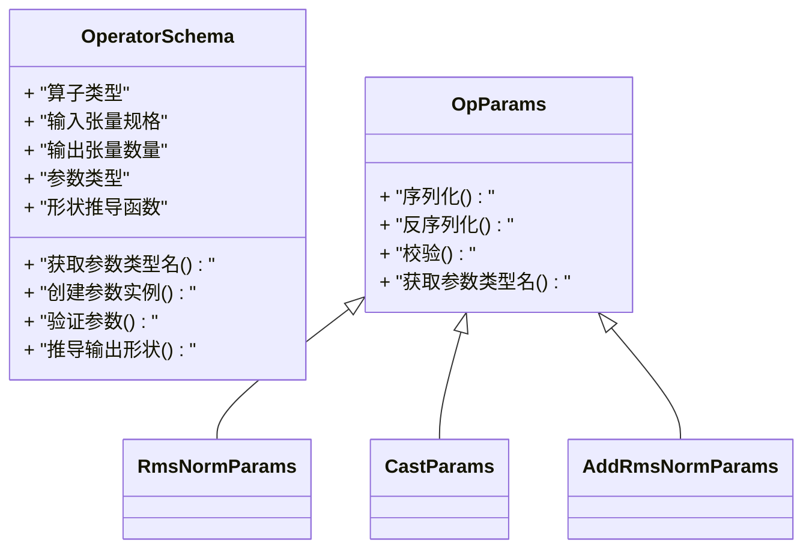

**图示来源**
- [operator_schema.h](../../../include/aethermind/operators/operator_schema.h)
- [op_params.h:1-200](../../../include/aethermind/operators/op_params.h#L1-L200)
- [rmsnorm_op.cpp](../../../src/operators/ops/rmsnorm_op.cpp)
- [cast_op.cpp](../../../src/operators/ops/cast_op.cpp)
- [add_rmsnorm_op.cpp](../../../src/operators/ops/add_rmsnorm_op.cpp)

**章节来源**
- [operator_schema.h](../../../include/aethermind/operators/operator_schema.h)
- [operator_schema.cpp:1-200](../../../src/operators/operator_schema.cpp#L1-L200)

### 算子类型定义与注册机制
- 算子类型以枚举形式集中定义，避免魔法字符串。
- 注册机制将算子类型映射到 OperatorSchema。
- 名称解析将字符串形式的算子名转换为枚举类型，再查表得到 Schema。
- 这种设计将“名称—类型—Schema”三层解耦，便于扩展与维护。

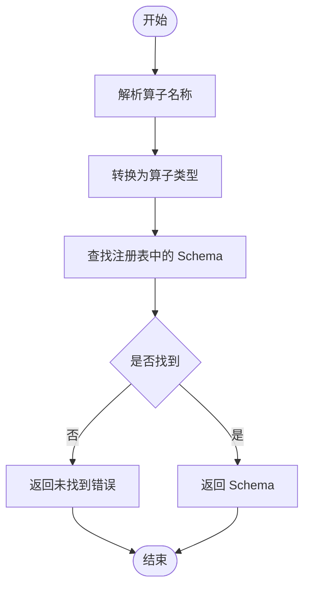

**图示来源**
- [op_type.cpp](../../../src/operators/op_type.cpp)
- [operator_name.cpp](../../../src/operators/operator_name.cpp)
- [operator_schema.cpp:1-200](../../../src/operators/operator_schema.cpp#L1-L200)

**章节来源**
- [op_type.h](../../../include/aethermind/operators/op_type.h)
- [op_type.cpp](../../../src/operators/op_type.cpp)
- [operator_name.h](../../../include/aethermind/operators/operator_name.h)
- [operator_name.cpp](../../../src/operators/operator_name.cpp)
- [operator_schema.cpp:1-200](../../../src/operators/operator_schema.cpp#L1-L200)

### 参数结构与 OpParams 继承体系
OpParams 是所有算子参数的抽象基类，约定了统一接口：
- 序列化：将参数对象转换为键值对或文本表示。
- 反序列化：从外部数据构造具体参数对象。
- 校验：检查参数合法性，例如维度对齐、数据类型兼容、取值范围。
- 类型名：提供可读的参数类型名，便于调试与日志。

典型派生类包括：
- RmsNormParams：归一化相关参数。
- CastParams：类型转换参数。
- AddRmsNormParams：融合算子参数。

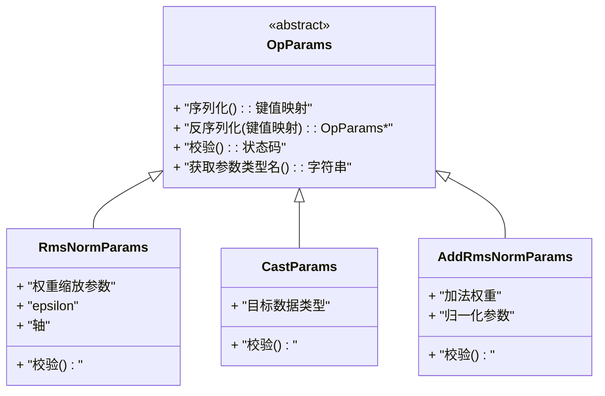

**图示来源**
- [op_params.h:1-200](../../../include/aethermind/operators/op_params.h#L1-L200)
- [rmsnorm_op.cpp](../../../src/operators/ops/rmsnorm_op.cpp)
- [cast_op.cpp](../../../src/operators/ops/cast_op.cpp)
- [add_rmsnorm_op.cpp](../../../src/operators/ops/add_rmsnorm_op.cpp)

**章节来源**
- [op_params.h:1-200](../../../include/aethermind/operators/op_params.h#L1-L200)
- [rmsnorm_op.cpp](../../../src/operators/ops/rmsnorm_op.cpp)
- [cast_op.cpp](../../../src/operators/ops/cast_op.cpp)
- [add_rmsnorm_op.cpp](../../../src/operators/ops/add_rmsnorm_op.cpp)

### 参数序列化与反序列化机制
op_params_serde 提供统一的参数序列化与反序列化能力：
- 使用键值对作为中间表示，避免直接耦合具体格式。
- 支持常见基础类型与容器类型的序列化。
- 反序列化时通过类型名匹配具体参数类。
- 校验失败时返回明确的状态码，便于上层错误处理。

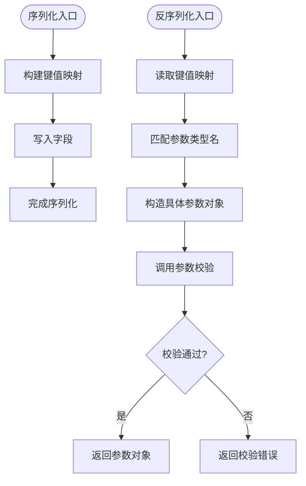

**图示来源**
- [op_params_serde.h](../../../include/aethermind/operators/op_params_serde.h)
- [op_params_serde.cpp:1-200](../../../src/operators/op_params_serde.cpp#L1-L200)

**章节来源**
- [op_params_serde.h](../../../include/aethermind/operators/op_params_serde.h)
- [op_params_serde.cpp:1-200](../../../src/operators/op_params_serde.cpp#L1-L200)

### 形状推导规则
OperatorSchema 允许为每个算子提供形状推导函数，其输入包括：
- 输入张量的形状与数据类型。
- 已校验的参数对象。
- 可选的设备或布局上下文。

形状推导函数的目标是：
- 根据广播规则、线性代数约束、注意力或 RoPE 等算子语义，计算输出形状。
- 在编译期或图优化阶段提供静态形状信息，减少运行时开销。
- 若无法静态确定形状，应返回明确的错误状态，而非模糊断言。

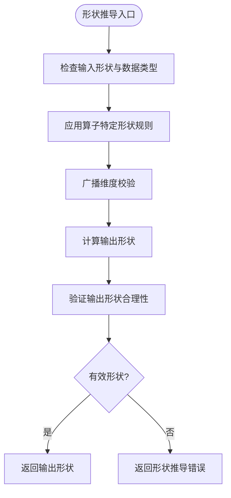

**图示来源**
- [operator_schema.h](../../../include/aethermind/operators/operator_schema.h)
- [operator_schema.cpp:1-200](../../../src/operators/operator_schema.cpp#L1-L200)

**章节来源**
- [operator_schema.h](../../../include/aethermind/operators/operator_schema.h)
- [operator_schema.cpp:1-200](../../../src/operators/operator_schema.cpp#L1-L200)

### RopeFrequencyResolver 的作用与频率计算算法
RopeFrequencyResolver 负责 RoPE（旋转位置编码）所需的频率表或频率因子计算。其典型职责包括：
- 根据模型配置确定频率基数、最大长度、维度划分等参数。
- 生成或缓存频率表，供 RoPE 算子在推理过程中复用。
- 提供稳定的数值计算方法，保证不同设备与后端的一致性。

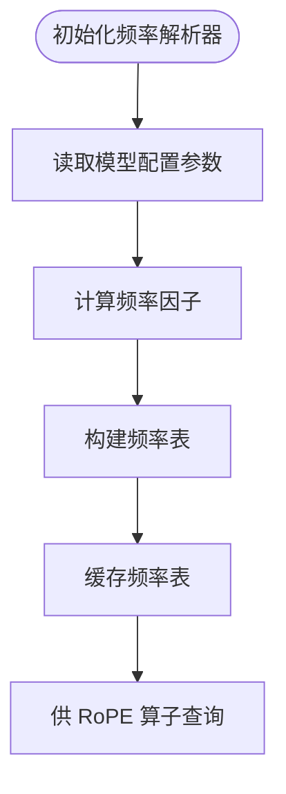

**图示来源**
- [rope_frequency_resolver.h](../../../include/aethermind/operators/rope_frequency_resolver.h)
- [rope_frequency_resolver.cpp:1-200](../../../src/operators/rope_frequency_resolver.cpp#L1-L200)

**章节来源**
- [rope_frequency_resolver.h](../../../include/aethermind/operators/rope_frequency_resolver.h)
- [rope_frequency_resolver.cpp:1-200](../../../src/operators/rope_frequency_resolver.cpp#L1-L200)

### 算子实现示例：RMSNorm、Cast、AddRmsNorm
这三个算子体现了契约与实现的典型协作方式：
- 每个算子定义自己的参数类并继承 OpParams。
- 每个算子提供形状推导函数，用于静态推断输出形状。
- 每个算子参与 Schema 注册，使名称解析与参数序列化能够正常工作。

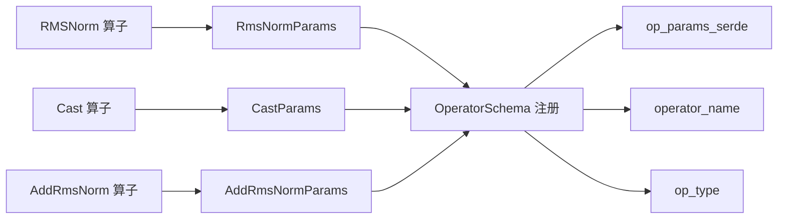

**图示来源**
- [rmsnorm_op.cpp](../../../src/operators/ops/rmsnorm_op.cpp)
- [cast_op.cpp](../../../src/operators/ops/cast_op.cpp)
- [add_rmsnorm_op.cpp](../../../src/operators/ops/add_rmsnorm_op.cpp)
- [operator_schema.cpp:1-200](../../../src/operators/operator_schema.cpp#L1-L200)
- [op_params_serde.cpp:1-200](../../../src/operators/op_params_serde.cpp#L1-L200)
- [operator_name.cpp](../../../src/operators/operator_name.cpp)
- [op_type.cpp](../../../src/operators/op_type.cpp)

**章节来源**
- [rmsnorm_op.cpp](../../../src/operators/ops/rmsnorm_op.cpp)
- [cast_op.cpp](../../../src/operators/ops/cast_op.cpp)
- [add_rmsnorm_op.cpp](../../../src/operators/ops/add_rmsnorm_op.cpp)

## 依赖关系分析
算子契约子系统内部依赖如下：
- OperatorSchema 依赖 OpParams 抽象、OpType 枚举、operator_name 名称解析、op_params_serde 序列化。
- 具体算子实现依赖自身参数类与形状推导函数。
- RopeFrequencyResolver 独立于通用算子契约，但被 RoPE 相关算子使用。

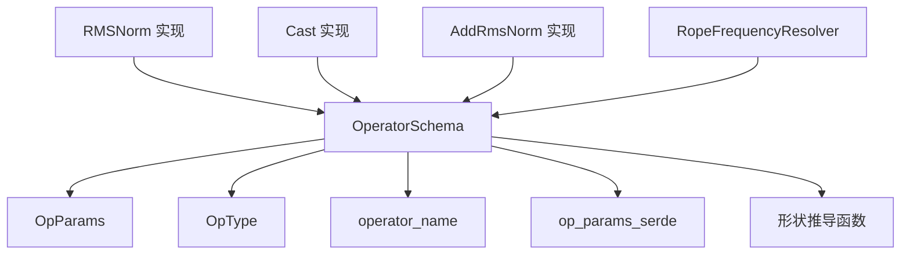

**图示来源**
- [operator_schema.h](../../../include/aethermind/operators/operator_schema.h)
- [op_params.h:1-200](../../../include/aethermind/operators/op_params.h#L1-L200)
- [op_type.h](../../../include/aethermind/operators/op_type.h)
- [operator_name.h](../../../include/aethermind/operators/operator_name.h)
- [op_params_serde.h](../../../include/aethermind/operators/op_params_serde.h)
- [rope_frequency_resolver.h](../../../include/aethermind/operators/rope_frequency_resolver.h)

**章节来源**
- [operator_schema.cpp:1-200](../../../src/operators/operator_schema.cpp#L1-L200)
- [op_params_serde.cpp:1-200](../../../src/operators/op_params_serde.cpp#L1-L200)
- [operator_name.cpp](../../../src/operators/operator_name.cpp)
- [op_type.cpp](../../../src/operators/op_type.cpp)

## 性能考虑
- 形状推导应在编译期或图优化阶段尽可能完成，以减少运行时分支。
- RopeFrequencyResolver 的频率表应缓存并复用，避免重复计算。
- 参数序列化应尽量避免频繁分配，可使用预分配缓冲区或视图。
- 校验逻辑应尽量早失败，避免进入昂贵的内核执行路径。

[本节为通用指导，不直接分析具体文件]

## 故障排查指南
常见问题与定位建议：
- 算子名称解析失败：检查 operator_name 的名称映射与拼写一致性。
- 参数反序列化失败：检查键名、类型名与参数类字段是否一致。
- 参数校验失败：检查 OpParams::校验 的实现，关注维度、数据类型与取值范围。
- 形状推导失败：检查输入形状与算子语义是否满足约束，尤其是广播与矩阵运算。
- RoPE 频率异常：检查频率基数、最大长度、维度划分是否与模型配置一致。

**章节来源**
- [test_operator_schema.cpp:1-200](../../../tests/unit/operators/test_operator_schema.cpp#L1-L200)

## 结论
AetherMind 的算子契约通过 OperatorSchema、OpParams、OpType、operator_name 与 op_params_serde 形成清晰的层次：
- 契约层声明算子语义与约束。
- 实现层提供参数、形状推导与具体算子逻辑。
- 工具层提供名称解析、类型转换与序列化。
- RopeFrequencyResolver 为 RoPE 相关算子提供稳定频率计算。

该设计使新算子可以以低耦合方式接入系统，同时保持编译期可优化性与运行时可诊断性。

[本节为总结，不直接分析具体文件]

## 附录：新增算子契约步骤
从零开始添加一个新算子契约，建议遵循以下步骤：

1. 定义算子类型
   - 在 op_type 中为新算子增加枚举值。
   - 确保枚举值与后续名称映射一致。

2. 定义参数结构体
   - 新建参数类并继承 OpParams。
   - 实现序列化、反序列化与校验方法。
   - 提供合理的默认值与边界检查。

3. 编写形状推导函数
   - 根据算子语义推导输出形状。
   - 处理广播、数据类型兼容与非法输入。
   - 返回明确的状态码或错误信息。

4. 注册 OperatorSchema
   - 将算子类型、参数类型、输入输出规格与形状推导函数注册到 Schema。
   - 确保名称解析能正确映射到新算子。

5. 实现算子
   - 在 src/operators/ops 下创建算子实现文件。
   - 将算子与 Schema 关联，使其可被运行管线发现。

6. 添加测试
   - 覆盖参数序列化与反序列化。
   - 覆盖参数校验的合法与非法路径。
   - 覆盖形状推导的典型与边缘情况。

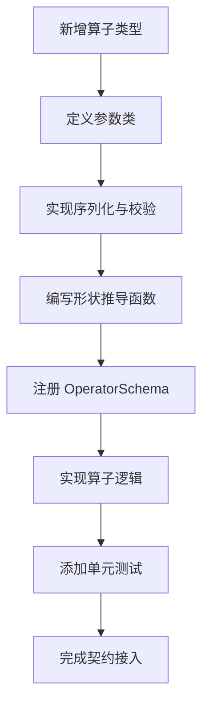

[本节为流程说明，不直接分析具体文件]
