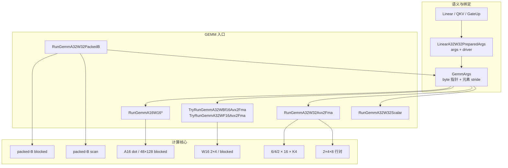
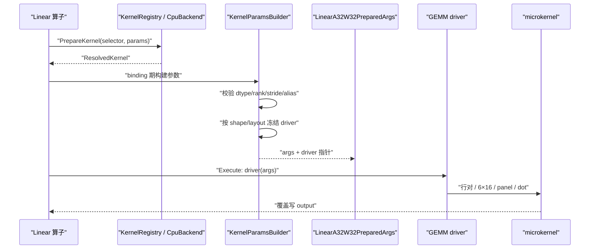
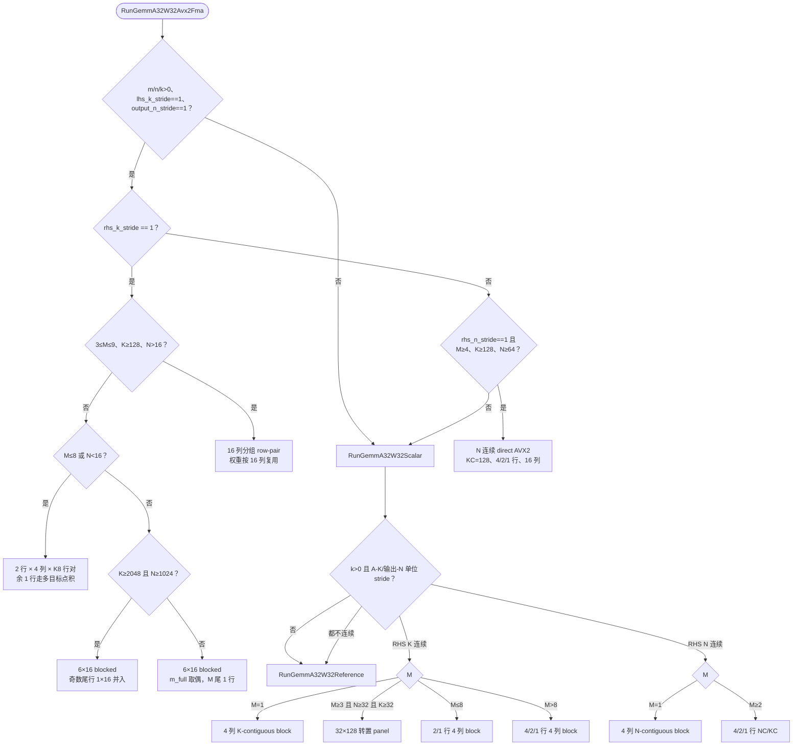
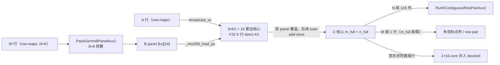
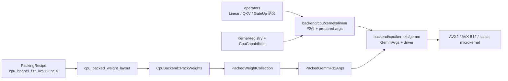

# GEMM 内核

**本文引用的文件**
- [gemm_internal.h](../../../../src/backend/cpu/kernels/gemm/gemm_internal.h)
- [gemm_avx2_internal.h](../../../../src/backend/cpu/kernels/gemm/gemm_avx2_internal.h)
- [gemm_a32_w32_reference.cpp](../../../../src/backend/cpu/kernels/gemm/gemm_a32_w32_reference.cpp)
- [gemm_a32_w32_scalar.cpp](../../../../src/backend/cpu/kernels/gemm/gemm_a32_w32_scalar.cpp)
- [gemm_a32_w32_avx2.cpp](../../../../src/backend/cpu/kernels/gemm/gemm_a32_w32_avx2.cpp)
- [gemm_a32_w32_packed_b_reference.cpp](../../../../src/backend/cpu/kernels/gemm/gemm_a32_w32_packed_b_reference.cpp)
- [gemm_a32_w32_packed_b_avx2.cpp](../../../../src/backend/cpu/kernels/gemm/gemm_a32_w32_packed_b_avx2.cpp)
- [gemm_w16_avx2_internal.h](../../../../src/backend/cpu/kernels/gemm/gemm_w16_avx2_internal.h)
- [gemm_a32_w16_avx2_internal.h](../../../../src/backend/cpu/kernels/gemm/gemm_a32_w16_avx2_internal.h)
- [gemm_a16_w16_reference.cpp](../../../../src/backend/cpu/kernels/gemm/gemm_a16_w16_reference.cpp)
- [gemm_a16_w16_avx2.cpp](../../../../src/backend/cpu/kernels/gemm/gemm_a16_w16_avx2.cpp)
- [gemm_abf16_wbf16_avx512bf16.cpp](../../../../src/backend/cpu/kernels/gemm/gemm_abf16_wbf16_avx512bf16.cpp)
- [gemm_af16_wf16_avx512fp16.cpp](../../../../src/backend/cpu/kernels/gemm/gemm_af16_wf16_avx512fp16.cpp)
- [linear_internal.h](../../../../src/backend/cpu/kernels/linear/linear_internal.h)
- [linear_a32_optimized.cpp](../../../../src/backend/cpu/kernels/linear/linear_a32_optimized.cpp)
- [linear_entry.cpp](../../../../src/backend/cpu/kernels/linear/linear_entry.cpp)
- [cpu_packed_weight_layout.h](../../../../include/aethermind/backend/cpu/cpu_packed_weight_layout.h)
- [cpu_packed_weight_layout.cpp](../../../../src/backend/cpu/cpu_packed_weight_layout.cpp)
- [test_cpu_gemm_tile6.cpp](../../../../tests/unit/backend/cpu/kernels/test_cpu_gemm_tile6.cpp)
- [test_cpu_gemm_scalar.cpp](../../../../tests/unit/backend/cpu/kernels/test_cpu_gemm_scalar.cpp)
- [test_cpu_gemm_avx2.cpp](../../../../tests/unit/backend/cpu/kernels/test_cpu_gemm_avx2.cpp)
- [test_cpu_gemm_packed_b.cpp](../../../../tests/unit/backend/cpu/kernels/test_cpu_gemm_packed_b.cpp)
- [benchmark_cpu_gemm_microkernel.cpp](../../../../tests/benchmark/cpu_kernels/benchmark_cpu_gemm_microkernel.cpp)
- [benchmark_cpu_linear.cpp](../../../../tests/benchmark/cpu_kernels/benchmark_cpu_linear.cpp)
- [cpu-gemm-optimization.md](../../../operators/gemm/cpu-gemm-optimization.md)
- [cpu-gemm-packed-weight.md](../../../operators/gemm/cpu-gemm-packed-weight.md)
- [54h5mmi-gemm.md](../../../operators/gemm/benchmarks/54h5mmi-gemm.md)

## 目录

1. [引言](#引言)
2. [文件与职责](#文件与职责)
3. [接口、参数与数值合同](#接口参数与数值合同)
4. [执行路径与数据流](#执行路径与数据流)
5. [核心计算流程](#核心计算流程)
6. [优化手段与取舍](#优化手段与取舍)
7. [性能基准与验证结果](#性能基准与验证结果)
8. [依赖关系与模块边界](#依赖关系与模块边界)
9. [故障排查](#故障排查)
10. [后续优化方向](#后续优化方向)
11. [结论](#结论)
12. [附录](#附录)

## 引言

本文描述 AetherMind CPU 后端内部的 GEMM primitive。它不是图 IR 中的独立算子：`Linear`、`QkvLinear`、`GateUpLinear` 各自保留语义、shape、stride、alias 与 packed artifact 校验，然后把已冻结的矩阵参数交给这里的 driver。

逻辑合同是：

```text
output[m, n] = sum(k = 0..K-1) lhs[m, k] * rhs[k, n]
```

`Linear` 的权重按 `[N, K]` 行主序存储，因此实际调用等价于 `C = A × W^T`。GEMM 内部只看到 `rhs[k, n]` 与两个元素 stride，不区分“权重”和普通右操作数。

当前实现覆盖四条产品路径：

| 家族 | 入口 | 权重/操作数布局 | 累加与输出 | 主要消费者 |
|---|---|---|---|---|
| F32 × F32 | `RunGemmA32W32Avx2Fma`、`RunGemmA32W32Scalar` | plain/identity `[N, K]` 行主序 | F32 累加、F32 输出 | Linear、QKV、GateUp |
| F32 × packed B | `RunGemmA32W32PackedB` | `[K-panel][N-block][K-row][N-lane]` | F32 累加、F32 输出 | packed candidate 消费者 |
| F32 × W16 | `TryRunGemmA32WBf16Avx2Fma`、`TryRunGemmA32WF16Avx2Fma` | F16/BF16 `[N, K]` 行主序 | F32 累加、F32 输出 | Linear、LM head、QKV、GateUp |
| A16 × W16 | `RunGemmA16W16Avx2Fma`、AVX-512 BF16/FP16 | F16/BF16 同型 | F32 累加、同型或 F32 输出 | 同型 A16 Linear |

本文覆盖实现结构、参数合同、分块与微内核、所有已采用的优化及其 trade-off、当前机器上的验证结果，以及后续方向。线程池、CUDA、INT8/INT4 与 `MatMul` 的 optimized 路径不在范围内；当前产品边界仍是单请求、单线程，热路径零堆分配。

**章节来源**
- [gemm_internal.h:24-194](../../../../src/backend/cpu/kernels/gemm/gemm_internal.h#L24-L194)
- [gemm_a32_w32_avx2.cpp:332-408](../../../../src/backend/cpu/kernels/gemm/gemm_a32_w32_avx2.cpp#L332-L408)
- [cpu-gemm-optimization.md](../../../operators/gemm/cpu-gemm-optimization.md)

## 文件与职责

GEMM 代码集中在 `src/backend/cpu/kernels/gemm/`，按“ISA 中立头文件 + 每 ISA 翻译单元 + reference”组织。

| 文件 | 职责 | 关键约束 |
|---|---|---|
| `gemm_internal.h` | `GemmArgs`、`PackedGemmF32Args`、`GemmA16W16Args` 与所有入口声明 | 必须保持 ISA 中立，不能包含 intrinsics；byte 指针不放宽对齐/对象访问规则 |
| `gemm_a32_w32_policy.h` | A32W32 AVX2 的 `F32Avx2Plan`、`PlanF32Avx2`、`PlanPackedB` 与 N 连续谓词 | 纯函数、ISA 中立；分派阈值只在此处维护 |
| `gemm_avx2_internal.h` | AVX2/FMA 常量、F32 weight adapter、B panel 打包、Nx16 累加核心、1/2/4/6 行 tile | 只能被 `-mavx2 -mfma` 翻译单元包含；函数为 inline，会编译进每个消费者 |
| `gemm_a32_w32_reference.cpp` | 双精度累加 oracle | 不参与性能结论；是所有 fallback 的最终语义基线 |
| `gemm_a32_w32_scalar.cpp` | 可移植标量优化 driver | 无 intrinsics、零堆分配；允许编译器 auto-vectorization |
| `gemm_a32_w32_avx2.cpp` | F32 AVX2 小 M 行对、K 连续 16 列复用、N 连续 direct、6×16 blocked/direct | 仅 F32 plain/identity；不处理 packed artifact |
| `gemm_a32_w32_packed_b_reference.cpp` | packed-B 共享参数校验与双精度 oracle | 按 B-panel 逻辑索引逐元素求和；校验规则与 checked 入口一致 |
| `gemm_a32_w32_packed_b_avx2.cpp` | packed-B checked 入口、scan 与 blocked 消费者 | 消费 exact `cpu_bpanel_f32_kc512_nr16` 字节 |
| `gemm_w16_avx2_internal.h` | F16/BF16 widening policy 与 W16 B panel 打包 | F16 需要 F16C；BF16 用整数移位 widening |
| `gemm_a32_w16_avx2_internal.h` | F32 activation × 16-bit weight 的 direct/blocked driver | 幅值安全域失败时返回 false，由调用方全量重算 |
| `gemm_a16_w16_reference.cpp` | 同型 A16/W16 的 F32 累加 oracle | 逐元素 byte-safe widening；零 K 写正零 |
| `gemm_a16_w16_avx2.cpp` | 同型 A16/W16 AVX2 widening 与 blocked | 48×128 FP32 输出块跨 K 面板保留 |
| `gemm_abf16_wbf16_avx512bf16.cpp` | AVX-512 BF16 原生点积 | 仅通过 `IsBf16NativeDotProductSafe` 的域走原生指令 |
| `gemm_af16_wf16_avx512fp16.cpp` | AVX-512 FP16 widening + F32 FMA | FP16 乘积在 F32 中精确，无额外域检查 |
| `linear_a32_optimized.cpp` | Linear 参数到 `GemmArgs` 的适配 | 只做字段映射，不做形状分类 |
| `linear_entry.cpp` | binding 期冻结 driver、注册 descriptor | 热路径不查 registry、不做 shape 分类 |
| `tests/benchmark/cpu_kernels/gemm_avx2_candidates.cpp` | DupA 候选 pack/tile/driver/入口 | 仅编译进单测/benchmark，不进入 AetherMind |

F32 direct-A 的 6 行主循环是 `gemm_a32_w32_avx2.cpp` 内的 `AccumulateDirectF32Tile6x16Avx2`，K 逐 1 推进；它的 4/2/1 行尾，以及 packed-B、W16、A16 的 6/4/2 行块，使用 `gemm_avx2_internal.h` 的共享 `AccumulateF32TileNx16CoreAvx2`（由 6×16/4×16/2×16 包装或直接实例化 `<1>` 调用），K 展开 4。两者共享 tile 形状，但不是同一实现，性能结论不能互相替代。



**图示来源**
- [gemm_internal.h:24-194](../../../../src/backend/cpu/kernels/gemm/gemm_internal.h#L24-L194)
- [gemm_avx2_internal.h:20-210](../../../../src/backend/cpu/kernels/gemm/gemm_avx2_internal.h#L20-L210)
- [linear_a32_optimized.cpp:26-50](../../../../src/backend/cpu/kernels/linear/linear_a32_optimized.cpp#L26-L50)

**章节来源**
- [gemm_internal.h:1-194](../../../../src/backend/cpu/kernels/gemm/gemm_internal.h#L1-L194)
- [src/CMakeLists.txt:21-57](../../../../src/CMakeLists.txt#L21-L57)
- [src/CMakeLists.txt:150-193](../../../../src/CMakeLists.txt#L150-L193)

## 接口、参数与数值合同

### GemmArgs

`GemmArgs` 是 backend-private、已由调用方验证的借用参数。所有 stride 以元素为单位，而不是字节。

| 字段 | 含义 |
|---|---|
| `lhs`、`rhs`、`output` | `std::byte*` 借用指针；不隐含 dtype、对齐或对象生命周期 |
| `m`、`n`、`k` | 逻辑矩阵维度 |
| `lhs_m_stride` | A 的行步长 |
| `lhs_k_stride` | A 的 K 步长 |
| `rhs_k_stride` | B 的 K 步长 |
| `rhs_n_stride` | B 的 N 步长 |
| `output_m_stride` | C 的行步长 |
| `output_n_stride` | C 的列步长 |

合同要点：

- 对外语义是覆盖写 `C = A × B`。K 面板之间的累加是 driver 内部状态，不扩展成公共 `alpha/beta` API。
- `m == 0` 或 `n == 0` 是 no-op。
- `k == 0` 时向每个输出元素写正零（F32 为 `+0.0F`，A16 为同宽位零），不读取 `lhs` 或 `rhs`。
- 每个入口自行解释存储格式。F32 入口把被访问的地址视为自然对齐的 `float`；`std::byte*` 不构成放宽 F16/BF16 或非对齐标量访问的许可。W16/A16 入口明确按 byte 读取 16-bit 元素。
- 调用方负责 dtype、shape、stride、alias、地址范围与整数溢出校验；微内核不做高层合法性检查。
- 输出必须 injective，且与输入/权重可证明不重叠。fallback 可能重算并覆盖已经写出的部分结果，因此这条约束是安全前提。

**章节来源**
- [gemm_internal.h:24-48](../../../../src/backend/cpu/kernels/gemm/gemm_internal.h#L24-L48)

### PackedGemmF32Args

packed-B 参数在 `GemmArgs` 之上增加 artifact 描述：

| 字段 | 含义 |
|---|---|
| `packed_b` | exact `cpu_bpanel_f32_kc512_nr16` 字节，64 字节对齐 |
| `packed_nbytes` | 必须等于布局公式算出的完整字节数 |
| `logical_n`、`logical_k` | 完整权重的逻辑形状 |
| `weight_n_offset` | 当前输出 slice 在逻辑 N 上的起点 |
| `n_blocks` | `ceil(logical_n / 16)` |
| `gemm.n` | 当前输出 slice 宽度，必须满足 `n <= logical_n - weight_n_offset` |

`gemm.rhs` 与 rhs stride 在 packed 路径中不使用。校验失败返回 `InvalidArgument`，不会尝试把 packed 字节当作 plain RHS。

**章节来源**
- [gemm_internal.h:50-64](../../../../src/backend/cpu/kernels/gemm/gemm_internal.h#L50-L64)
- [gemm_a32_w32_packed_b_reference.cpp:11-41](../../../../src/backend/cpu/kernels/gemm/gemm_a32_w32_packed_b_reference.cpp#L11-L41)

### GemmA16W16Args

同型 A16/W16 在 `GemmArgs` 之外记录 `operand_dtype` 与 `output_dtype`。两个输入共享同一 16-bit dtype，输出可以是同型或 F32。所有 driver 都用 F32 累加，写回时一次性转换。

**章节来源**
- [gemm_internal.h:66-76](../../../../src/backend/cpu/kernels/gemm/gemm_internal.h#L66-L76)

### 数值门与 fallback

| 设施 | 作用 | 失败行为 |
|---|---|---|
| `GemmInputMagnitude` | 求一行 A 的最大有限绝对值；非有限输入返回 `+inf` | 归约门拒绝该 tile |
| `GemmReductionMagnitudeIsSafe` | 用 `|a|·|w|·k <= FLT_MAX/2` 证明所有部分和不可能溢出 | 返回 false，调用方全量重算 |
| `IsBf16NativeDotProductSafe` | 逐元素检查 BF16 指数，排除非有限、subnormal 与接近 F32 溢出的乘积 | 返回 false，回退 reference |

这些门只覆盖 optimized 路径无法保持 IEEE 语义的输入。合法但不能走 fast path 的布局直接走 compatible scalar/reference，而不是缩窄 operator 合同。

**章节来源**
- [gemm_internal.h:78-108](../../../../src/backend/cpu/kernels/gemm/gemm_internal.h#L78-L108)
- [gemm_a16_w16_reference.cpp:8-40](../../../../src/backend/cpu/kernels/gemm/gemm_a16_w16_reference.cpp#L8-L40)
- [gemm_abf16_wbf16_avx512bf16.cpp:44-78](../../../../src/backend/cpu/kernels/gemm/gemm_abf16_wbf16_avx512bf16.cpp#L44-L78)

### 入口与前置条件

| 入口 | 前置条件 | 不满足时 |
|---|---|---|
| `RunGemmA32W32Reference` | 任意 reference-legal stride | 无 fallback；自身是 oracle |
| `RunGemmA32W32Scalar` | `k > 0`、`lhs_k_stride == 1`、`output_n_stride == 1`，且 RHS K 或 N 连续 | 委托 reference |
| `RunGemmA32W32Avx2Fma` | `m/n/k > 0`、`lhs_k_stride == 1`、`output_n_stride == 1`；RHS K 连续，或 RHS N 连续且 `M>=4/K>=128/N>=64` | 委托 scalar |
| `RunGemmA32W32PackedB` | artifact 校验通过；`M>=9` 且 slice 对齐时走 blocked | 降级 scan；scan 再降级 reference |
| `TryRunGemmA32WBf16Avx2Fma` | `k > 0`、`lhs_k_stride == 1`、`rhs_k_stride == 1`、`output_n_stride == 1` | 返回 false，调用方调用 W16 reference |
| `RunGemmA16W16Avx2Fma` | 两个操作数 `k_stride == 1`；blocked 另需 `M>8`、`K>=8`、`N>=16`、`output_n_stride == 1` | 委托 A16 reference |

注意：`RunGemmA32W32Avx2Fma` 自己不做 CPU 能力检测；descriptor 的 `cpu_requirements` 和 `CpuCapabilities` 已在 resolve 阶段保证 AVX2/FMA 可用。

K 连续内部再分三条：

- `3 <= M <= 9 && K >= 128 && N > 16`：按 16 列分组复用原始权重，走 row-pair；M=9 不再默认进入 blocked。
- `M <= 8` 或 `N < 16`：按 full-N 的 row-pair。
- 其余：6×16 blocked；`K >= 2048 && N >= 1024` 时奇数尾行也并入 blocked，否则 `m_full` 取偶、M 尾最多 1 行。

N 连续路径要求 `rhs_n_stride == 1` 且满足 `CanUseF32NContiguousAvx2`，内部使用 KC=128、4/2/1 行和 16 列；N 尾不足 16 列时委托 scalar。

**章节来源**
- [gemm_internal.h:110-192](../../../../src/backend/cpu/kernels/gemm/gemm_internal.h#L110-L192)
- [gemm_a32_w32_scalar.cpp:332-367](../../../../src/backend/cpu/kernels/gemm/gemm_a32_w32_scalar.cpp#L332-L367)
- [gemm_a32_w32_avx2.cpp:358-408](../../../../src/backend/cpu/kernels/gemm/gemm_a32_w32_avx2.cpp#L358-L408)
- [gemm_a16_w16_avx2.cpp:153-190](../../../../src/backend/cpu/kernels/gemm/gemm_a16_w16_avx2.cpp#L153-L190)

## 执行路径与数据流

### 从 Linear 到 GEMM



Linear 参数到 GEMM 参数的字段映射由 `MakeLinearGemmArgs` 完成，不做任何重排或拷贝：

| `LinearA32W32KernelArgs` | `GemmArgs` |
|---|---|
| `input` | `lhs` |
| `weight` | `rhs` |
| `output` | `output` |
| `row_count` | `m` |
| `out_features` | `n` |
| `in_features` | `k` |
| `input_row_stride` | `lhs_m_stride` |
| `input_col_stride` | `lhs_k_stride` |
| `weight_col_stride` | `rhs_k_stride` |
| `weight_row_stride` | `rhs_n_stride` |
| `output_row_stride` | `output_m_stride` |
| `output_col_stride` | `output_n_stride` |

`BuildLinearF32OptimizedArgs<Packed, Native>` 的选择顺序是：

1. 默认 `RunLinearF32Scalar`；
2. 若编译期有 AVX2/FMA，且 `weight_col_stride == 1` 或（`weight_row_stride == 1` 且 `CanUseF32NContiguousAvx2(row_count, in_features, out_features)`），改为 `RunLinearF32Avx2Fma`；
3. 若 `row_count == 0 || out_features == 0 || in_features == 0`、K 很小且 M/N 也小、输入或输出列 stride 非 1、或权重两个 stride 都不是 1，则冻结为 `RunLinearF32Reference`。

这里的“K 很小”条件是 `in_features < 8 && (row_count <= 8 || out_features < 16)`；N 连续 AVX2 的条件是 `M >= 4 && K >= 128 && N >= 64`。原因是极短 K 没有足够的向量主体，prepared A/B 证据显示 SIMD 路径会出现显著的 small-M 回退。

**章节来源**
- [linear_entry.cpp:820-849](../../../../src/backend/cpu/kernels/linear/linear_entry.cpp#L820-L849)
- [linear_a32_optimized.cpp:26-50](../../../../src/backend/cpu/kernels/linear/linear_a32_optimized.cpp#L26-L50)
- [linear_internal.h:19-39](../../../../src/backend/cpu/kernels/linear/linear_internal.h#L19-L39)

### descriptor 与优先级

| descriptor 名称 | 优先级 | ISA 要求 | 说明 |
|---|---:|---|---|
| `cpu::linear_f32_w32_scalar` | 10 | 无 | plain F32 scalar optimized |
| `cpu::linear_f32_w32_packed_identity_scalar` | 10 | 无 | identity packed 的 scalar 路径 |
| `cpu::linear_f32_w32_packed_bpanel_candidate` | 10 | AVX2 + FMA | bpanel candidate，exact recipe |
| `cpu::linear_f32_w32_avx2_fma` | 20 | AVX2 + FMA | plain F32 生产主路径 |
| `cpu::linear_f32_w32_packed_identity_avx2_fma` | 20 | AVX2 + FMA | identity packed 生产主路径 |
| `cpu::linear_f32_wbf16_avx2_fma` | 20 | AVX2 + FMA | F32 × BF16；另有 `_packed_identity_` 变体 |
| `cpu::linear_f32_wf16_avx2_fma` | 20 | AVX2 + FMA + F16C | F32 × F16；另有 `_packed_identity_` 变体 |
| `cpu::linear_f16_wf16_avx2_fma` / `cpu::linear_bf16_wbf16_avx2_fma` | 20 | AVX2 + FMA（F16 另需 F16C） | 同型 A16 plain；各有 `_out32_`、`_packed_identity_`、`_out32_packed_identity_` 变体 |
| `cpu::linear_f16_wf16_avx512_fp16` / `cpu::linear_bf16_wbf16_avx512_bf16` | 30 | AVX-512F + FP16/BF16 | 同型 A16 原生点积；各有 `_out32_`、`_packed_identity_`、`_out32_packed_identity_` 变体 |

identity optimized 的优先级高于 bpanel candidate，所以默认生产路径不会因为 packed artifact 存在就切换到 B-panel。B-panel 需要显式实验入口或后续 promotion 决策。

**章节来源**
- [linear_entry.cpp:904-1039](../../../../src/backend/cpu/kernels/linear/linear_entry.cpp#L904-L1039)
- [linear_entry.cpp:1205-1400](../../../../src/backend/cpu/kernels/linear/linear_entry.cpp#L1205-L1400)
- [linear_entry.cpp:1360-1400](../../../../src/backend/cpu/kernels/linear/linear_entry.cpp#L1360-L1400)

### F32 分派树



K 连续 16 列路径只覆盖 `M=3..9`；M=9 在 `K>=128,N>16` 时不再进入 blocked。RHS 两个 stride 都非 1 时 scalar 最终委托 reference。

**图示来源**
- [gemm_a32_w32_avx2.cpp:332-410](../../../../src/backend/cpu/kernels/gemm/gemm_a32_w32_avx2.cpp#L332-L410)
- [gemm_a32_w32_avx2.cpp:290-330](../../../../src/backend/cpu/kernels/gemm/gemm_a32_w32_avx2.cpp#L290-L330)
- [gemm_a32_w32_scalar.cpp:332-367](../../../../src/backend/cpu/kernels/gemm/gemm_a32_w32_scalar.cpp#L332-L367)

### 数据布局变换

```text
A (row-major, M×K) ───────────────► microkernel 直接广播
W (row-major, N×K) ──8 行一组──► B panel [kc][16] ──► microkernel 连续加载
C (row-major, M×N) ◄────────────── 覆盖写 / K 面板内累加
```

- F32 K-contiguous 16 列复用：A 直接读；每组 16 个权重行在所有 row pair 之间复用，不生成 B panel。
- F32 blocked：A 不打包；B 按 `(kb, nb)` 打包成 k-major panel，F32 的 6 行主循环使用 direct K1。
- F32 N-contiguous：B 按 `[K, N]` 行主序直接读；每次取 16 列，沿 N 用两个 8-wide load，A 行广播；按 KC=128 的 K panel 保留部分和，首 panel 覆盖写。
- packed-B：B 在准备期已经按 `[k_panel][n_block][k][n_lane]` 固化；运行期只打包 A，blocked 主循环使用共享 K4。
- W16：权重在打包时做 widening；A 可以直接读，或按短/长 Prefill 规则打包；共享 6×16 内核 K 展开 4。
- A16：A 与 B 都在运行期按 48×512 / 512×16 转成 F32，输出块 48×128 跨 K 面板保留；共享 6×16 内核 K 展开 4。

**章节来源**
- [gemm_avx2_internal.h:46-130](../../../../src/backend/cpu/kernels/gemm/gemm_avx2_internal.h#L46-L130)
- [gemm_a32_w32_avx2.cpp:44-251](../../../../src/backend/cpu/kernels/gemm/gemm_a32_w32_avx2.cpp#L44-L251)
- [gemm_a32_w32_avx2.cpp:290-330](../../../../src/backend/cpu/kernels/gemm/gemm_a32_w32_avx2.cpp#L290-L330)
- [gemm_a32_w32_packed_b_avx2.cpp:126-196](../../../../src/backend/cpu/kernels/gemm/gemm_a32_w32_packed_b_avx2.cpp#L126-L196)
- [gemm_a16_w16_avx2.cpp:80-151](../../../../src/backend/cpu/kernels/gemm/gemm_a16_w16_avx2.cpp#L80-L151)

## 核心计算流程

### F32 reference

`RunGemmA32W32Reference` 是三重循环：行 → 列 → K。每个点积先用 `double` 保存，最后一次窄化为 F32。零 `m/n` 直接返回；零 `k` 写 `+0.0F`。它同时是所有 layout 的最终 fallback，不能作为性能基线。

**章节来源**
- [gemm_a32_w32_reference.cpp:5-25](../../../../src/backend/cpu/kernels/gemm/gemm_a32_w32_reference.cpp#L5-L25)

### F32 scalar optimized

scalar driver 的目标不是替代 AVX2，而是在无 SIMD 或 SIMD 不适用时提供可移植的快路径。

**K-contiguous 4 列 block**（`RunRhsKContiguousOutputBlock<Rows>`）：

- 外层按 4 个输出列分块；4 个权重行指针只计算一次。
- 内层 K 每步处理 2 个元素，`Rows × 4` 个标量累加器。
- `Rows ∈ {1,2,4}`：M=1、M=2、generic M 的行分解分别是 `1`、`2`、`4/2/1`。
- 列循环边界是常量，`-O3` 会完全展开并把 `std::array` 标量替换；Release 反汇编中该函数只剩 4 个 `shufps`。
- 剩余 `N % 4` 列走逐列点积。

**32×128 转置 panel**（`RunRhsKContiguousPanelRows`）：

- 仅当 `M>=3 && N>=32 && K>=32` 时使用。
- 对每个 32 列块，把 B 的 `32 × 128` 切片转置到 `alignas(64) float panel[128][32]`（16 KiB）。
- 每个 K 面板内，每一行持有 32 个 sum；`kb != 0` 时先从输出读回部分和，继续按升序 K 累加。
- N 尾（`<32` 列）改走 4 列 generic 路径。
- 面板的转置成本由 M 行共同摊薄，所以 M=2 被明确排除；M=2 只有一次 B 遍历，panel 反而更慢。

**N-contiguous 路径**（`RunRhsNContiguousRowBlock<Rows>`）：

- 适用于 B 的 N 方向连续（`rhs_n_stride == 1`）、K 方向有跨度（例如 `[K, N]` 行主序）。
- `NC=128`、`KC=128`；若 `N<=128`，单个 N 块覆盖全部输出，直接跑完整 K，避免部分和往返。
- 遍历顺序是 K panel → N block → row → K；同一小块 B 页在推进 K 前被相邻 N tile 复用。
- 最多 4 行的 sum 暂存为 `4 × 128` floats（2 KiB），不分配堆内存。
- `N<=64 && K<=128 && rhs_k_stride<=64` 的 tiny 多行形状走 4 列轻量路径，避免宽暂存设置开销。

`kScalarSmallMMax = 8` 是保守分界，不是实测阈值；在 K-contiguous 下它只决定 panel 不适用的形状（M=2、K 太小、N 太窄）。

**章节来源**
- [gemm_a32_w32_scalar.cpp:10-28](../../../../src/backend/cpu/kernels/gemm/gemm_a32_w32_scalar.cpp#L10-L28)
- [gemm_a32_w32_scalar.cpp:154-239](../../../../src/backend/cpu/kernels/gemm/gemm_a32_w32_scalar.cpp#L154-L239)
- [gemm_a32_w32_scalar.cpp:281-328](../../../../src/backend/cpu/kernels/gemm/gemm_a32_w32_scalar.cpp#L281-L328)
- [gemm_a32_w32_scalar.cpp:30-152](../../../../src/backend/cpu/kernels/gemm/gemm_a32_w32_scalar.cpp#L30-L152)

### F32 AVX2 小 M 与 K 连续 16 列复用

`ComputeF32RowPairAvx2` 按 2 行 A、4 列 B、8 个 K 计算并覆盖输出。K 连续 driver 在它之上分三层：

- `3 <= M <= 9 && K >= 128 && N > 16`：外层按 16 列分组调用 `RunKContiguousRowPairAvx2`，每组权重行服务全部 row pair 和最后的奇数行；M=9 长形状走这里，不再进 blocked。
- `M <= 8` 或 `N < 16`：按 full-N 的 row-pair。
- 其余：进入 6×16 blocked（见下一节）。

基本行对的行为：

- 每次处理 2 行 A、4 列 B、8 个 K。
- 两个 A 向量 `x0/x1` 常驻寄存器，4 个权重行流式读取；每个 K 步发 8 条 FMA。
- 8 个独立累加器 + 2 个 A 向量 = 10 个 YMM，给 `loadu` 和循环控制留出余量。
- K 主循环结束后做 8 次水平归约，剩余 K 用标量补齐。
- N 尾列逐列调用 `DotProductF32Avx2`；M 为奇数时最后一行走多目标点积。
- 代码注释明确记录：K-panel cache blocking 曾经实现并测量，但面板级归约/累加器重建成本超过缓存复用收益，已移除。

**章节来源**
- [gemm_a32_w32_avx2.cpp:44-193](../../../../src/backend/cpu/kernels/gemm/gemm_a32_w32_avx2.cpp#L44-L193)
- [gemm_a32_w32_avx2.cpp:263-287](../../../../src/backend/cpu/kernels/gemm/gemm_a32_w32_avx2.cpp#L263-L287)
- [gemm_a32_w32_avx2.cpp:358-410](../../../../src/backend/cpu/kernels/gemm/gemm_a32_w32_avx2.cpp#L358-L410)

### F32 AVX2 blocked 6×16（F32 direct K1）

blocked 路径在 K 连续分派落到最后一行时处理 `M>=10`，或 `M=9` 且 `N==16`，或 `M=9` 且 `K<128 && N>16` 的形状；同时要求 A 的 K stride、RHS 的 K stride 与输出 N stride 均为 1。`M=9` 且 `N<16` 仍走 full-N row pair。

1. 通常 `m_full = m - m % 2`，`n_full = n - n % 16`；`K>=2048 && N>=1024` 时 `m_full = m`，把奇数尾行也交给 blocked。
2. `RunBlockedWithRowPairTailsAvx2<RunCore>` 直接调用编译期指定的核心内核；核心自行覆盖写完整的 `m_full × n_full` 矩形（首个 K panel 覆盖，后续 panel 累加）。
3. 外层 `kb` 以 512 切 K；中层 `nb` 以 16 切 N。每个 `(kb, nb)` 调用 `PackGemmBPanelAvx2`，把 16 个权重行的 `kc_len` 个 K 元素转成 `[kc][16]` 面板。
4. 行循环先对 `paired_rows = m_full - m_full % 2` 做 6/4/2 贪心分解：6 行走 F32 专用的 `AccumulateDirectF32Tile6x16Avx2`（K 展开 1），4/2 行走共享的 `AccumulateF32Tile4x16Avx2` / `AccumulateF32Tile2x16Avx2`（K 展开 4）。若 `m_full` 为奇数（宽形状的奇数尾行），最后一行用 `AccumulateF32TileNx16CoreAvx2<1>`。
5. K 面板之间的部分和通过输出读改写传递：首个 panel 直接 store 覆盖核心，后续 panel load-add-store。外部语义仍是覆盖写，不再预清零。
6. N 尾（最多 15 列）对 `m_full` 行走 `RunKContiguousRowPairAvx2`；当 `m_full` 取偶时，M 尾（最多 1 行）也用 row pair/多目标点积覆盖写全 N。尾块都不使用 blocked 内核。



**图示来源**
- [gemm_a32_w32_avx2.cpp:51-87](../../../../src/backend/cpu/kernels/gemm/gemm_a32_w32_avx2.cpp#L51-L87)
- [gemm_a32_w32_avx2.cpp:199-260](../../../../src/backend/cpu/kernels/gemm/gemm_a32_w32_avx2.cpp#L199-L260)
- [gemm_avx2_internal.h:25-210](../../../../src/backend/cpu/kernels/gemm/gemm_avx2_internal.h#L25-L210)

微内核结构：

F32 6 行 direct（K 展开 1）：

```text
acc[6][2] = 0
for k in 0..kc-1:
    b0 = panel[k][0..7]; b1 = panel[k][8..15]
    for r in 0..5:
        x = broadcast(A[row r][k])
        acc[r][0] = fma(x, b0, acc[r][0])
        acc[r][1] = fma(x, b1, acc[r][1])
for r:
    if accumulate:
        out[row r][0..7]  += acc[r][0]
        out[row r][8..15] += acc[r][1]
    else:
        out[row r][0..7]  = acc[r][0]
        out[row r][8..15] = acc[r][1]
```

共享 Nx16 核心（N∈{1,2,4,6}；W16/A16/packed-B、以及 F32 的 4/2/1 行尾；K 展开 4）：

```text
acc[Rows][2] = 0
for kk in steps of 4:
    for s in 0..3:
        b0 = panel[kk+s][0..7]; b1 = panel[kk+s][8..15]
        for r in 0..Rows-1:
            x = broadcast(A[row r][kk+s])
            acc[r][0] = fma(x, b0, acc[r][0])
            acc[r][1] = fma(x, b1, acc[r][1])
for r:
    if accumulate:
        out[row r][0..7]  += acc[r][0]
        out[row r][8..15] += acc[r][1]
    else:
        out[row r][0..7]  = acc[r][0]
        out[row r][8..15] = acc[r][1]
```

F32 direct-A 与 packed-B 的首个 K panel 传 `accumulate=false`，直接覆盖 tile；后续 panel 读回部分和再累加。W16/A16 仍先清零输出或 scratch，使用默认 `accumulate=true`。寄存器预算：

| tile | 累加器 | B 向量 | A 广播 | 合计 YMM |
|---|---:|---:|---:|---:|
| 6×16 | 12 | 2 | 1 | 15 |
| 4×16 | 8 | 2 | 1 | 11 |
| 2×16 | 4 | 2 | 1 | 7 |

6 行是 16 个 YMM 下能容纳的最大满 tile；8 行需要 16 个累加器 + 2 个 B + 1 个 A，会溢出。`M=16` 的分解是 6+6+4，`M=64` 是 10×6+4，`M=128` 是 21×6+2，`M=48` 是 8×6。

N 尾和 M 尾的语义：

- 若 `N < 16`，生产入口直接用行对覆盖全部输出。
- 默认 `m_full` 取偶，M 尾最多 1 行，用多目标点积覆盖写全 N。
- `K>=2048 && N>=1024` 时 `m_full = m`，奇数尾行由 blocked 内的 1×16 core 处理，不再走 M 尾。
- 若同时有 N 尾和 M 尾，先对 `m_full` 行做 row pair，再对底部一行做多目标点积，互不重叠。
- M=9 是否进入本路径取决于 K/N：`K>=128 && N>16` 时走 16 列 row-pair，不进入 blocked。

直接 A 的测量使用生产入口 `RunGemmA32W32Avx2Fma`。要测 blocked，可选 `M=16/64, K=N=4096`。`RunGemmA32W32Avx2FmaTile6DupA` 是独立的 A 广播面板候选，实现在 `tests/benchmark/cpu_kernels/gemm_avx2_candidates.cpp`，供测试和 benchmark 使用。

**章节来源**
- [gemm_a32_w32_avx2.cpp:44-251](../../../../src/backend/cpu/kernels/gemm/gemm_a32_w32_avx2.cpp#L44-L251)
- [gemm_a32_w32_avx2.cpp:378-410](../../../../src/backend/cpu/kernels/gemm/gemm_a32_w32_avx2.cpp#L378-L410)
- [gemm_a32_w32_avx2.cpp:397-410](../../../../src/backend/cpu/kernels/gemm/gemm_a32_w32_avx2.cpp#L397-L410)
- [gemm_avx2_internal.h:124-218](../../../../src/backend/cpu/kernels/gemm/gemm_avx2_internal.h#L124-L218)

### F32 AVX2 N 连续 direct

当 RHS 是 `[K, N]` 行主序（`rhs_n_stride == 1`，`rhs_k_stride` 可大于 1），且 `M>=4、K>=128、N>=64` 时，`RunGemmA32W32Avx2Fma` 走 `RunNContiguousPlanAvx2`：核心 `RunNContiguousDriverAvx2` 只覆盖 16 列对齐区，入口负责 N 尾。

- N 方向按 16 列切块；每个 K panel 深度 128。
- 每列块内用两个 8-wide load 读取 16 个权重，A 行广播，按 4/2/1 行累加。
- `kb == 0` 的首个 K panel 覆盖写输出；后续 panel 从输出读回部分和，继续按升序 K 累加。
- 不足 16 列的 N 尾调整 RHS/output 指针后委托 scalar；不生成 B panel，也没有额外栈 scratch。
- 不满足阈值或 `rhs_k_stride`/`rhs_n_stride` 都不连续时，回退到 scalar；scalar 再按自己的布局规则决定是否委托 reference。

**章节来源**
- [gemm_a32_w32_avx2.cpp:290-330](../../../../src/backend/cpu/kernels/gemm/gemm_a32_w32_avx2.cpp#L290-L330)
- [gemm_a32_w32_avx2.cpp:378-410](../../../../src/backend/cpu/kernels/gemm/gemm_a32_w32_avx2.cpp#L378-L410)
- [gemm_a32_w32_policy.h:40-107](../../../../src/backend/cpu/kernels/gemm/gemm_a32_w32_policy.h#L40-L107)
- [linear_entry.cpp:820-849](../../../../src/backend/cpu/kernels/linear/linear_entry.cpp#L820-L849)

### F32 packed-B

packed artifact 的物理轴顺序是 `[K-panel][N-block][K-row][N-lane]`，形状为 `[ceil(K/512), ceil(N/16), 512, 16]`。N lane 连续；超出逻辑 K/N 的槽位填 `+0.0F`；每个 panel block 64 字节对齐。

三个 packed-B 入口共用 `RunPackedBChecked`。入口先校验一次 artifact，再按 `PlanPackedB` 选择已校验的 scan、blocked 或 reference。K 为零及非单位输出 N stride 走 reference。校验函数 `ValidatePackedBArgs` 为 ISA 中立共享实现，checked 入口与 `RunGemmA32W32PackedBReference` 使用同一份规则。

`RunPackedBScanValidated`：

- 处理可沿 N 向量化、但形状、输入 stride 或切片起点属于 scan 的调用。显式 scan 入口也使用此 driver。
- 每行先处理直到下一处 16 列对齐前的有效列，再处理完整 16 列块，最后处理尾部。
- 前导/尾部列不是完整的 16 lane 块，走逐元素 `double` 路径；完整块才用 AVX2。
- 完整 16 列块用两个 YMM 累加器沿 K 面板推进。

`RunPackedBBlockedValidated`：

- `PlanPackedB` 在 `M>=9`、`N>=16`、`lhs_k_stride==1`、`output_n_stride==1` 且 `weight_n_offset%16==0` 时选择 blocked。
- `m_full = m - m%2`，`n_full = n - n%16`；首个 K panel 覆盖写核心，后续 panel 累加。
- 循环顺序是 `kb → mb(48 行) → nb(16 列)`：A 面板 48×512（96 KiB）每个 `(kb, mb)` 打包一次，然后在 `nb` 方向复用；B 直接读 artifact。
- 行循环使用共享 K4 内核的 6/4/2 行块。N 尾和 M 尾直接调用已校验的 scan，子切片继承父调用的 artifact。
- 与 F32 direct-A 相反：direct-A 让 B panel 跨全部 M 复用，packed-B 让 A panel 跨全部 N 复用，因为 B 已经是不可变 artifact，重复读它比重复打包 A 便宜。

packed-B 目前是 candidate。CPU-03 的全局 promotion 被拒绝：compute-only Prefill 的局部收益不能抵消 Decode 回退、准备期打包成本和常驻内存放大。

**章节来源**
- [cpu_packed_weight_layout.h:26-55](../../../../include/aethermind/backend/cpu/cpu_packed_weight_layout.h#L26-L55)
- [gemm_a32_w32_packed_b_avx2.cpp:60-196](../../../../src/backend/cpu/kernels/gemm/gemm_a32_w32_packed_b_avx2.cpp#L60-L196)
- [gemm_a32_w32_packed_b_avx2.cpp:200-242](../../../../src/backend/cpu/kernels/gemm/gemm_a32_w32_packed_b_avx2.cpp#L200-L242)
- [cpu-gemm-packed-weight.md](../../../operators/gemm/cpu-gemm-packed-weight.md)

### F32 × W16（A32/W16）

W16 权重通过 byte 指针读取，按 dtype widening 到 F32：

- BF16：`_mm256_cvtepu16_epi32` 后左移 16 位，保留 BF16 subnormal 的位模式。
- F16：`_mm256_cvtph_ps`，需要 F16C。

**小 M（`M<=8`）direct 路径**：

- 行对：2 行共享 4 列权重；2 × 4 = 8 个 sum，另用 1 条 magnitude chain 合并两行的最大幅值。
- 单行：4 列各自一个累加器，共 4 个 sum；另用 4 条独立 magnitude chain 记录每列最大幅值，避免一条串行 max 链。
- K 每步 8 个元素；尾部标量读取并继续累积。
- 每个 4 列 tile 结束后用 `GemmReductionMagnitudeIsSafe(max_input, max_weight, k)` 检查；不安全或结果非有限时返回 false，由上层调用 reference 全量重算。

**blocked 路径（`M>8`）**：

- `m_full` 取偶数，`n_full` 取 16 的倍数；先清零核心。
- `reuse_b = m_full > 48 && k >= 512`：长 Prefill 直接读 A，每个 B panel 服务最多 252 行；252 是 512 KiB A 足迹上限内最大的 6 的倍数。
- 否则打包 A（48 × 512，96 KiB），降低短 K/窄 K 的 C 工作集。
- 每个 `(kb, mb, nb)` 都重新打包 B panel 并做幅值门；完整核心计算后扫描所有输出是否有限。
- N 尾和 M 尾用 direct 路径覆盖写。
- 任意 gate 失败 → 返回 false → full reference。原因是已经写出的部分结果必须由一次完整覆盖重算替换。

W16 blocked 的 6/4/2 主循环调用共享 `AccumulateF32TileNx16CoreAvx2` 的 6×16/4×16/2×16 包装（K 展开 4）；它不经过 F32 的 direct K1 内核。

栈预算：direct-A 只需 32 KiB B panel；packed-A 需要 96 KiB A + 32 KiB B = 128 KiB。

**章节来源**
- [gemm_w16_avx2_internal.h:20-55](../../../../src/backend/cpu/kernels/gemm/gemm_w16_avx2_internal.h#L20-L55)
- [gemm_a32_w16_avx2_internal.h:23-138](../../../../src/backend/cpu/kernels/gemm/gemm_a32_w16_avx2_internal.h#L23-L138)
- [gemm_a32_w16_avx2_internal.h:140-269](../../../../src/backend/cpu/kernels/gemm/gemm_a32_w16_avx2_internal.h#L140-L269)

### 同型 A16/W16

reference 逐元素 byte-safe widening，按升序 K 做 F32 独立乘加；零 K 按输出 dtype 写正零（16-bit 位零或 F32 `+0.0F`）。

AVX2 driver：

- 若 `lhs_k_stride != 1`、`rhs_k_stride != 1` 或任一维为 0，直接委托 A16 reference。
- `M<=8`、`K<8`、`N<16` 或 `output_n_stride != 1` 时，按输出元素逐个调用 8-lane widening 点积。
- 否则进入 blocked：`MB=48`、`NC=128`、`KC=512`。
- 对每个 `(mb, nb)` 输出块，先把 `48 × 128` FP32 sums 清零；然后在 K 面板循环里打包 A（48×512，96 KiB）、打包 B（512×16，32 KiB，N 尾补零）、做幅值门，并用 6/4/2 tile 累加到 sums。
- 全部 K 面板结束后才把 sums 一次性舍入到输出 dtype。这是与其它路径最关键的差异：A16 不允许每个 K 面板都读写输出，否则 16-bit 舍入会累积。
- 行数向上补齐到偶数，列数向上补齐到 16；`PackActivationRows` 把补齐行清零。
- A 按每个 N 块重新打包，B 按每个 M 块重新打包；这是用重复打包换取 24 KiB sums 驻留和单次舍入。
- 非有限结果或幅值门失败 → reference 全量重算。

A16 blocked 同样使用共享 K4 内核；48×128 sums 跨 K 面板保留，与 F32 direct K1 的逐 K 推进不同。

AVX-512：

- BF16：`_mm512_dpbf16_ps` 每次处理 32 个 BF16 元素（16 对）；调用前对每个输出行/列做 `IsBf16NativeDotProductSafe` 扫描，失败则整体 reference。
- FP16：`_mm512_cvtph_ps` widening 后 F32 FMA，每次 16 个元素；FP16 乘积在 F32 中精确，因此不需要 BF16 的指数门。
- 两者都是逐输出点积，不做 panel blocking；priority 30，只有 effective feature set 同时包含 AVX-512F 与对应扩展时才参与选择。

**章节来源**
- [gemm_a16_w16_reference.cpp:42-96](../../../../src/backend/cpu/kernels/gemm/gemm_a16_w16_reference.cpp#L42-L96)
- [gemm_a16_w16_avx2.cpp:17-151](../../../../src/backend/cpu/kernels/gemm/gemm_a16_w16_avx2.cpp#L17-L151)
- [gemm_abf16_wbf16_avx512bf16.cpp:17-78](../../../../src/backend/cpu/kernels/gemm/gemm_abf16_wbf16_avx512bf16.cpp#L17-L78)
- [gemm_af16_wf16_avx512fp16.cpp:18-73](../../../../src/backend/cpu/kernels/gemm/gemm_af16_wf16_avx512fp16.cpp#L18-L73)

## 优化手段与取舍

### 总表

| # | 优化 | 机制 | 适用场景 | 已测收益 | Trade-off | 状态 |
|---|---|---|---|---|---|---|
| 1 | 6×16 微内核（F32 direct K1 / 共享 K4） | F32 6 行逐 K 推进；W16/A16/packed-B 及 F32 4/2/1 尾共享 K4 | F32 Prefill；W16/A16 blocked | F32 长 Prefill prepared Linear M=128/4096/4096 47.702→41.613 ms；W16/A16 以正确性门禁为主 | 12 acc + 2 B + 1 A = 15 YMM；K1 与 K4 是两套实现，性能不可互推 | 生产 |
| 2 | 4×16 / 2×16 变体 + 6/4/2 贪心 | 同一 panel 流覆盖偶数行 | M 尾、M=16/48/64/128 | M=16 1.01×、M=64 1.04×，8 个 Prefill 形状 ≥1.00× | 多两个模板实例，代码体积增加；仅尾部受益 | 生产 |
| 3 | `m_full` 取偶 + N 尾 row pair（宽形状奇数尾行并入） | 默认偶数行/整 16 列进入 6×16；`K>=2048,N>=1024` 时 `m_full=m` | 任意 M/N | 消除越界写；宽投影避免重新读完整 RHS | N 尾最多 15 列走较慢 row pair | 生产 |
| 4 | direct-A blocked | A 不打包，`broadcast_ss` 直接读行；F32 6 行使用 direct K1 | F32 Prefill | 省一次 A 打包遍历；不需要 A panel（对比 DupA 的 384 KiB） | 每个 K 每行一条 broadcast，占用 shuffle 端口；A 行按 N 块重复读 | 生产 |
| 5 | B panel k-major 打包 | 8×8 寄存器转置，`[kc][16]` 连续 N lane | 所有 blocked | B 加载变成两条连续 32B load | 每个 `(kb,nb)` 一次完整 B 遍历；32 KiB 栈 | 生产 |
| 6 | 8 行一组打包 | 限制同时活跃的源 cache line | 2 的幂 row stride | 降低同一 L1 set 冲突 | 组内仍有 8 行流式读取；组间不能复用 | 生产 |
| 7 | 2×4×8 行对 + K 连续 16 列复用 | 两行共享权重流；`3<=M<=9,K>=128,N>16` 时每组 16 列权重服务全部 row pair | Decode / `M<=9` | prepared Linear 4096³ M=4/8/9：5.705→3.854 / 11.623→5.876 / 9.621→6.889 ms | 16 列路径只适用于 K 连续；N 尾/短 K 仍走 full-N row pair | 生产 |
| 8 | 多目标点积 | 一个 A 行广播给多个输出列 | 奇数行、N 尾 | 避免单行回退到逐列 dot | 8 个累加器 + 2 个 A 向量，N 尾宽度受限 | 生产 |
| 9 | scalar 4 列 K-contiguous | 4 列权重行指针复用，K 展开 2 | M=1/2、N 尾、panel 不适用 | M=1 6.78 GF（约 AVX2 的 56%） | 标量乘加，无 FMA；每块 4 个 `shufps`；ILP 有限 | 生产 |
| 10 | scalar 32×128 转置 panel | 一次转置，全部 M 行复用 | `M>=3,N>=32,K>=32` | M=4/8/16 分别 1.62×/2.31×/2.76× | 16 KiB 栈；一次额外 B 遍历；M=2 反而更慢 | 生产 |
| 11 | scalar N-contiguous NC=128/KC=128 | 相邻 N tile 在 K 推进前复用 B 页 | B 的 N 连续 | M=1/4/8/16 约 6.8/11.0/11.4/18.4 GF | 4×128 sums = 2 KiB；大 stride 不能走 tiny 路径 | 生产 |
| 12 | packed-B artifact | 准备期固化 k-major panel | 大 N/K、重复调用 | 对 reference 大幅领先，cold packing 66.8 ms/64 MiB | Decode 回退、常驻内存、K=768 放大 1.33×；未通过全局 promotion | candidate |
| 13 | W16 widening + 幅值分链 | F16C / 整数移位；单行多链 max | A32×W16 | 正确性门禁通过；未单独采集 6×16 前后对照 | 幅值扫描增加工作；不安全域全量回退 | 生产 |
| 14 | W16 direct-A 252 / packed-A 48 | 长 Prefill 复用 B panel，短 K 缩小 C 工作集 | W16 Prefill | 机器记录中的 direct-A 相对 panel 版本为方向性收益 | 252×512×4B = 504 KiB A 足迹；packed-A 占 128 KiB 栈 | 生产 |
| 15 | A16 48×128 FP32 输出块 | sums 跨 K 面板保留，最后一次性舍入 | 同型 A16 Prefill | 逻辑上避免每面板舍入误差累积 | 152 KiB 栈；A/B 按输出块重复打包 | 生产 |
| 16 | AVX-512 原生 A16 点积 | `VDPBF16PS` / FP16 widening FMA | 支持 AVX-512 的同型 A16 | 未在本机采集（285H 无 AVX-512） | 逐输出点积，无 panel 复用；BF16 安全扫描可能成为主成本 | 条件启用 |
| 17 | binding 期冻结 driver | cold path 选 scalar / AVX2 K 连续 / AVX2 N 连续 / reference | 所有 Linear | 热路径无 registry 查找、无 shape 分类 | 不在运行期 autotune；分类规则是静态的 | 生产 |
| 18 | 统一数值门 + reference fallback | 幅值、非有限、BF16 域检查 | W16/A16/AVX-512 | 保持 IEEE 语义与异常传播 | 失败时全量重算，最坏情况做两次工作 | 生产 |
| 19 | 固定栈 scratch + 零堆 | 编译期常量 panel | 所有路径 | 热路径无 malloc；容量可预测 | 大模型线程栈需 ≥152 KiB；不能按 shape 动态扩展 | 生产 |
| 20 | A 广播面板（DupA） | 每个 A 标量复制 8 份 | F32 Prefill | 相对 6×16 慢 5.5%–31.5% | 384 KiB A + 128 KiB B 栈；A 打包放大 8× | 否决 |
| 21 | 8/16 列窄 panel | 缩小 scalar 转置 panel | M=1/2 | M=1 −44.7%/−51.9%；M=2 −38.7%/−46.2% | 转置是完整 B 遍历，M 太小无法摊薄 | 否决 |
| 22 | 全局 `-fno-tree-slp-vectorize` | 禁止 SLP 生成 shuffle 网络 | scalar TU | K-contiguous +13%–16% | N-contiguous M=8 −18.6%，全局 flag 不可接受 | 否决 |
| 23 | 行对 K-panel 分块 | 在行对内切 K 面板 | `M<=8` | 无稳定收益 | 面板级归约/累加器重建成本大于缓存收益 | 已移除 |
| 24 | B-panel 全局 promotion | 用 packed-B 替代 identity | 全模型 | Prefill 局部收益 | Decode 回退与准备成本未通过门禁 | 拒绝 |
| 25 | F32 N 连续 direct AVX2 | RHS `[K,N]` 行主序，16 列 × 4/2/1 行，KC=128 | `M>=4,K>=128,N>=64`；Linear weight N 连续 | prepared Linear N 连续 64/4096/4096 88.646→46.441 ms（仅观察）；M=8/512/512 0.10672→0.04369 ms | 仅 N 连续；N 尾 scalar；每 K panel 读改写 C | 生产 |
| 26 | 宽投影奇数尾行并入 blocked | `K>=2048,N>=1024` 时 odd row 用 1×16 core | 长 Prefill 奇数 M | prepared Linear M=13/4096/4096 11.425→9.100 ms 等方向性结果 | 窄形状仍走 M 尾 row pair；部分结果混合 | 生产 |

表内 F32 的 11-26 数字来自 prepared Linear 对照，不是 direct microbench；11-24 的旧 M sweep 数字只作历史基线。

### 指令级并行与寄存器分块

GEMM 的吞吐首先取决于“同时有多少条独立 FMA 链”。AVX2 只有 16 个 YMM，因此 tile 形状不是越大越好：

- 行对：8 条链，K 展开 8；每条链在每个 K 步只做一次 FMA，靠 8 个累加器打满两个 FMA 端口。
- 6×16：12 条链；F32 direct 逐 K 推进（K 展开 1），W16/A16/packed-B 及 F32 的 4/2/1 行尾使用共享 K4；每个 K 步每行 2 条 FMA，6 行共 12 条。
- 4×16 / 2×16：8 / 4 条链，只用于 M 尾；用同一份 B panel，不再单独打包。
- 多目标点积：4 个 target × 2 条 8 宽 K 链，K 展开 16；8 个累加器 + 2 个 A 向量，用于奇数行和 N 尾。
- scalar 4 列：`Rows × 4` 个标量链，K 展开 2；编译器可以把它 SLP 成 128-bit 向量，但不会生成 256-bit FMA。

6 行而不是 8 行的原因：8 行需要 16 个累加器，加上 2 个 B 向量和 1 个 A 广播就是 19 个 YMM，必然 spill。6 行用 15 个 YMM，留 1 个给循环/地址计算。若未来有 32 个向量寄存器的 AVX-512F，8×32 或 12×16 才有意义。

**章节来源**
- [gemm_avx2_internal.h:124-218](../../../../src/backend/cpu/kernels/gemm/gemm_avx2_internal.h#L124-L218)
- [gemm_a32_w32_avx2.cpp:44-193](../../../../src/backend/cpu/kernels/gemm/gemm_a32_w32_avx2.cpp#L44-L193)
- [gemm_a32_w32_avx2.cpp:51-87](../../../../src/backend/cpu/kernels/gemm/gemm_a32_w32_avx2.cpp#L51-L87)

### 分块与缓存

| 参数 | 值 | 作用 | 代价 |
|---|---:|---|---|
| `kGemmAvx2KC` | 512 | K panel 深度；B panel 32 KiB | 每个 K panel 一次输出读改写 |
| `kGemmAvx2NR` | 16 | 微内核 N 宽；两个 8 宽向量 | N 尾最多 15 列走慢路径 |
| `kGemmAvx2MR6` | 6 | 满 tile 行数 | 需要 4/2 尾变体 |
| `kGemmAvx2MB` | 48 | W16 packed-A / A16 的 M block；packed-B 另有同值 `kPackedBMB` | B 按 M block 重复读 |
| W16 direct rows | 252 | 长 Prefill 的 B 复用范围 | 每 K panel 最多 504 KiB A 足迹 |
| A16 NC | 128 | 48×128 FP32 sums 块 | A/B 按输出块重复打包 |
| scalar panel | 32×128 | 16 KiB 转置 panel | 一次额外 B 遍历 |
| scalar NC/KC | 128/128 | N-contiguous 的 B 页复用 | 4×128 sums = 2 KiB |
| F32 N 连续 KC | 128 | N 连续 direct 的 K panel | 每 panel 读改写 C；N 尾 scalar |
| K 连续 16 列组 | 16 | `3<=M<=9` 的权重复用宽度 | 短 K/窄 N 不走；组循环增加调用开销 |

KC=512 是 blocked layout 常量，不是跨平台最优值。把 KC 减半会让 panel 从 32 KiB 降到 16 KiB，但 K panel 数翻倍，输出读改写次数和微内核调用次数也翻倍；KC=256 尚未在本机做正式对照，因此文档不宣称 KC=512 最优。F32 N 连续路径使用独立的 KC=128，不共享该布局常量。

**章节来源**
- [gemm_avx2_internal.h:20-23](../../../../src/backend/cpu/kernels/gemm/gemm_avx2_internal.h#L20-L23)
- [gemm_a32_w16_avx2_internal.h:140-160](../../../../src/backend/cpu/kernels/gemm/gemm_a32_w16_avx2_internal.h#L140-L160)
- [cpu-gemm-packed-weight.md](../../../operators/gemm/cpu-gemm-packed-weight.md)

### 数据重排

B panel 的转置不是“为了好看”，而是把 N 方向变成连续 16 lane，使微内核每个 K 步只需两条对齐的 32B load。`StoreGemmBTile8x8Avx2` 用 8 条 `unpack`、8 条 `shuffle`、8 条 `permute2f128` 把 8 行 × 8 K 的源块变成 8 个 K 行 × 8 N lane，再顺序写出。

打包按 8 个权重行一组，而不是一次 16 行：当权重 row stride 是 2 的幂时，16 行容易映射到相同的 L1 set；8 行一组可以降低同时活跃的源 line 数。K 尾部不足 8 时走标量，仍然写满 `[kc][16]` 的有效区域。

scalar 的 32×128 panel 是同一思想的标量版本：把 32 个输出列转成连续行，使内层列循环可以 SLP 成 128-bit 乘加。16 列 panel 曾实测触发更慢的 shuffle-heavy lowering，因此固定为 32 列。

**章节来源**
- [gemm_avx2_internal.h:27-130](../../../../src/backend/cpu/kernels/gemm/gemm_avx2_internal.h#L27-L130)
- [gemm_a32_w32_scalar.cpp:10-22](../../../../src/backend/cpu/kernels/gemm/gemm_a32_w32_scalar.cpp#L10-L22)

### 内存访问模式

| 访问 | 指令/模式 | 原因 | 代价 |
|---|---|---|---|
| A 行 | `_mm256_loadu_ps`（行对）或 `broadcast_ss`（blocked） | A 的 row stride 可能不是 32B 对齐 | blocked 每 K 每行一次广播 |
| B panel | `_mm256_load_ps`，两条 32B load | panel 32B 对齐、N 连续 | panel 本身需要一次打包遍历 |
| 输出 C | 首 panel `storeu` 覆盖；后续 panel `loadu` → add → `storeu` | 跨 K 面板保留 FP32 部分和 | C 的读改写流量随 K panel 数增加；首 panel 省一次读 |
| 权重流 | 顺序读取，M=1 时每个权重只读一次 | 充分利用硬件预取 | M=1 受 DRAM 带宽限制 |
| W16/A16 转换 | 打包时 widening，panel 内已是 F32 | 内层只做 FMA | 增加一次 widening/转置遍历 |
| packed-B | 直接顺序消费 artifact | 准备期已完成重排 | 常驻内存与准备延迟 |

当前没有使用 non-temporal store：输出可能是小张量、可能被后续层立即读取，且 alias 合同要求覆盖写语义；NT store 需要额外的可见性/顺序论证。也没有手工 prefetch：AVX2 只有 16 个 YMM，prefetch distance 尚未在目标机上测量，贸然加入会增加前端压力。

**章节来源**
- [gemm_avx2_internal.h:46-130](../../../../src/backend/cpu/kernels/gemm/gemm_avx2_internal.h#L46-L130)
- [gemm_a32_w32_avx2.cpp:44-251](../../../../src/backend/cpu/kernels/gemm/gemm_a32_w32_avx2.cpp#L44-L251)
- [cpu-gemm-optimization.md](../../../operators/gemm/cpu-gemm-optimization.md)

### 指令集利用与门控

| ISA | 使用位置 | 编译期门控 | 运行期门控 |
|---|---|---|---|
| AVX2 + FMA | 行对、K 连续 16 列复用、N 连续 direct、6×16 blocked、W16 blocked | `-mavx2 -mfma` 翻译单元；`GEMM_HAS_AVX2_FMA_KERNEL` | descriptor 要求 `kAvx2 + kFma` |
| F16C | F16 widening | `-mf16c`；`GEMM_HAS_A32_F16_AVX2_FMA_KERNEL` / `A16_HAS_AVX2_FMA_KERNEL` | descriptor 追加 `kF16c` |
| AVX-512 BF16 | 同型 BF16 原生点积 | `-mavx512f -mavx512bf16`；`A16_HAS_AVX512BF16_KERNEL` | descriptor 要求 `kAvx512F + kAvx512Bf16`，priority 30 |
| AVX-512 FP16 | 同型 FP16 widening + FMA | `-mavx512f -mavx512fp16`；`A16_HAS_AVX512FP16_KERNEL` | descriptor 要求 `kAvx512F + kAvx512Fp16`，priority 30 |

构建期检测的是“工具链能否生成该指令”，不是宿主 CPU 是否支持；运行期由 `CpuCapabilities` 的 effective feature set 决定 descriptor 是否参与选择。AVX-512F 的 32 个向量寄存器目前只用于 A16 原生点积，尚未用于 F32 blocked 的更大 tile。F32 N 连续 direct 只需要 AVX2+FMA，不要求 F16C。

**章节来源**
- [src/CMakeLists.txt:150-193](../../../../src/CMakeLists.txt#L150-L193)
- [gemm_internal.h:138-192](../../../../src/backend/cpu/kernels/gemm/gemm_internal.h#L138-L192)
- [linear_entry.cpp:1205-1400](../../../../src/backend/cpu/kernels/linear/linear_entry.cpp#L1205-L1400)

### 循环顺序与并行调度

当前产品边界是单请求、单线程，GEMM 内部不创建线程，也不使用 OpenMP。并行只发生在指令级（SIMD lane / FMA port）和数据复用层面。循环顺序就是“调度策略”：

| 路径 | 循环顺序 | 优先复用 | 代价 |
|---|---|---|---|
| F32 K 连续 16 列复用 | `col(16) → row pair → K` | 每组 16 个权重行跨全部 row pair | 无 B panel；短 K/窄 N 不走 |
| F32 N 连续 direct | `kb(128) → col(16) → row(4/2/1) → K` | 同一 16 列权重在 4/2/1 行间复用 | 每个 K panel 读改写 C；N 尾 scalar |
| F32 direct-A blocked | `kb → nb → 6/4/2 行（宽形状含 1×16 奇数尾行）` | B panel 跨全部 M | A 行按 N 块重复读 |
| F32 packed-B blocked | `kb → mb(48) → nb(16)` | A panel 跨全部 N | B artifact 按 M 块重复读 |
| W16 direct-A | `kb → mb(252) → nb` | B panel 跨 252 行 | A 足迹最多 504 KiB |
| W16 packed-A | `kb → mb(48) → nb` | B panel 跨 48 行 | A 打包 + C 工作集 |
| A16 blocked | `mb → nb → kb` | 48×128 sums 跨 K 常驻 | A/B 按输出块重复打包 |
| scalar panel | `col → kb → row` | 32 列 panel 跨全部 M | 一次 B 转置 |
| scalar N-contig | `kb → col → row → K` | 相邻 N 块复用 B 页 | 2 KiB sums |

未来引入 runtime-owned thread pool 时：Decode `M=1` 优先按 N 输出 tile 切分；Prefill 按 M/N 输出 tile 切分；默认不做 K-split，除非极端 skinny 形状的 reduction 成本有测量收益。一个 output tile 只由一个 worker 写，避免 false sharing；kernel 内不得创建线程或进入嵌套并行区。

**章节来源**
- [cpu-gemm-optimization.md](../../../operators/gemm/cpu-gemm-optimization.md)
- [gemm_a32_w32_avx2.cpp:44-251](../../../../src/backend/cpu/kernels/gemm/gemm_a32_w32_avx2.cpp#L44-L251)
- [gemm_a32_w32_avx2.cpp:290-330](../../../../src/backend/cpu/kernels/gemm/gemm_a32_w32_avx2.cpp#L290-L330)
- [gemm_a32_w32_packed_b_avx2.cpp:200-242](../../../../src/backend/cpu/kernels/gemm/gemm_a32_w32_packed_b_avx2.cpp#L200-L242)

### 尾部分解

GEMM 的性能回归通常发生在尾块，而不是主块：

- 默认 `m_full = m - m%2`，保证 6/4/2 覆盖所有 blocked 行；最多只剩 1 行给多目标点积。
- `K>=2048 && N>=1024` 时 `m_full = m`，奇数尾行由 blocked 内的 1×16 core 处理；这是为了避免重新读取完整 RHS。
- `n_full = n - n%16` 保证 blocked 内核不会写越界；最多 15 列给 row pair。
- M=9 在 `K>=128,N>16` 时走 16 列 row-pair，不进入 blocked；只有 `N==16`，或 `N>16 && K<128` 的 M=9 才按 8 行 blocked + 1 行尾处理；`M=9,N<16` 仍走 full-N row pair。
- 当 `N=17` 时，16 列走 blocked，1 列走 row pair；此时 row pair 占比虽小，但仍会拉低总吞吐。
- F32 N 连续路径的 N 尾不足 16 列时委托 scalar；它不使用 blocked 的 `n_full` 语义。
- A16 把行补齐到偶数、列补齐到 16，只对 scratch 的无效 lane 补零，写回限制在实际 shape。

**章节来源**
- [gemm_a32_w32_avx2.cpp:378-410](../../../../src/backend/cpu/kernels/gemm/gemm_a32_w32_avx2.cpp#L378-L410)
- [gemm_a32_w32_avx2.cpp:290-330](../../../../src/backend/cpu/kernels/gemm/gemm_a32_w32_avx2.cpp#L290-L330)
- [gemm_a16_w16_avx2.cpp:94-149](../../../../src/backend/cpu/kernels/gemm/gemm_a16_w16_avx2.cpp#L94-L149)

### 调度与绑定期特化

CPU 后端在 `PrepareKernel` 时只能看到 dtype、weight format、phase 和 CPU feature，看不到 concrete `M/N/K`。因此 GEMM 的选择分成两层：

- registry 层：按 dtype/format/ISA 选 descriptor；
- binding 层：`params_builder` 看到 concrete shape 后冻结 driver 与参数。

热路径 `Execute` 直接调用 `LinearA32W32PreparedArgs::driver`，不查 registry、不做 shape 分类、不分配内存。代价是不能在运行期 autotune；所有阈值都必须在 binding 或编译期确定。

**章节来源**
- [linear_entry.cpp:820-849](../../../../src/backend/cpu/kernels/linear/linear_entry.cpp#L820-L849)
- [cpu-gemm-optimization.md](../../../operators/gemm/cpu-gemm-optimization.md)

### 数值安全与回退

optimized 路径只在能证明数值语义不受损的域内运行：

- F32：没有幅值门，依赖 FP32 FMA 的正常溢出/NaN 语义。
- W16：先算 `max|A|` 与 `max|W|`，再用 `|A|·|W|·K <= FLT_MAX/2` 证明部分和不会溢出；结果非有限也回退。
- A16：每个 K panel 都做同样的幅值门；最后检查输出块是否有限。
- AVX-512 BF16：逐元素检查指数，排除非有限、subnormal 和接近 F32 上界的乘积；FP16 不需要，因为 FP16 乘积在 F32 中精确。
- 所有 fallback 都是“完整 reference 重算”，不是“只补尾块”。这要求 output 与 input/weight 可证明 disjoint，否则重算会破坏调用方数据。

**章节来源**
- [gemm_internal.h:78-108](../../../../src/backend/cpu/kernels/gemm/gemm_internal.h#L78-L108)
- [gemm_a16_w16_reference.cpp:8-40](../../../../src/backend/cpu/kernels/gemm/gemm_a16_w16_reference.cpp#L8-L40)

### 栈预算与零堆

| 路径 | scratch | 说明 |
|---|---:|---|
| F32 blocked | 32 KiB | B panel `[512][16]` |
| F32 packed-B blocked | 96 KiB | A panel `[48][512]` |
| scalar K-contiguous panel | 16 KiB | `[128][32]`；`-fstack-usage` 实测 TU 栈帧 16,832 B |
| scalar N-contiguous | 2 KiB | `4 × 128` sums |
| W16 direct-A | 32 KiB | B panel |
| W16 packed-A | 128 KiB | A 96 KiB + B 32 KiB |
| A16 AVX2 blocked | 152 KiB | A 96 + B 32 + sums 24 |
| Tile6DupA candidate | 512 KiB | A 384 + B 128；已否决 |

这些缓冲都在栈上，容量由编译期常量决定。热路径没有 heap allocation，也没有 workspace 依赖。代价是线程栈必须足够大；在把 GEMM 放进自定义线程池前，必须先确认 worker 栈预算。

**章节来源**
- [gemm_a32_w32_avx2.cpp:44-251](../../../../src/backend/cpu/kernels/gemm/gemm_a32_w32_avx2.cpp#L44-L251)
- [gemm_a32_w32_packed_b_avx2.cpp:200-242](../../../../src/backend/cpu/kernels/gemm/gemm_a32_w32_packed_b_avx2.cpp#L200-L242)
- [gemm_a32_w16_avx2_internal.h:148-154](../../../../src/backend/cpu/kernels/gemm/gemm_a32_w16_avx2_internal.h#L148-L154)
- [gemm_a16_w16_avx2.cpp:84-90](../../../../src/backend/cpu/kernels/gemm/gemm_a16_w16_avx2.cpp#L84-L90)

### 被否决或被移除的优化

**A 广播面板（Tile6DupA）**：把 A 的每个标量复制 8 份，内层循环只做对齐 load + FMA，理论上消除 broadcast/shuffle 端口压力。实测 KC=256、MC=48、NC=128 下，A 面板 384 KiB、B 面板 128 KiB，M=16..2048 全部慢于 direct-A 6×16：

| M | DupA / 6×16 |
|---:|---:|
| 16 | 1.055 |
| 48 | 1.135 |
| 64 | 1.233 |
| 96 | 1.199 |
| 128 | 1.294 |
| 192 | 1.274 |
| 512 | 1.315 |
| 2048 | 1.122 |

原因是 8× A 放大和额外打包遍历的成本超过了消除 shuffle 的收益，且 A 面板增大了 L2 压力。

**窄 scalar panel（8/16 列）**：M=1/2 时转置是完整 B 遍历，无法摊薄。8 列 panel 让 M=1 慢 44.7%、M=2 慢 38.7%；16 列 panel 让 M=1 慢 51.9%、M=2 慢 46.2%。已完全回退。

**全局 `-fno-tree-slp-vectorize`**：scalar TU 的 SLP 会生成 4×4 transpose 网络（141 `shufps` + 102 `unpcklps`）。关闭 SLP 后 K-contiguous 提升 13%–16%，但 N-contiguous M=8 回退 18.6%，说明瓶颈因布局而异，不能用全局编译选项解决。

**行对 K-panel 分块**：在 `M<=8` 的行对内切 K 面板，曾被实现并测量；面板级归约和累加器重建成本超过缓存复用收益，已移除。注意这与 blocked 路径的 KC=512 不是同一件事。

**B-panel 全局 promotion**：CPU-03 已拒绝。compute-only Prefill 的局部收益不能抵消 Decode 回退、准备期打包和常驻内存放大；identity descriptor 保持默认，bpanel 保留 candidate 身份。

**旧 4×16 主内核**：6×16 晋升后，原 4×16 blocked 主循环 `RunBlockedGemmAvx2` 已删除；`AccumulateF32Tile4x16Avx2` 仅作为共享 core 的 4 行 M 尾包装保留（2 行/1 行同理）。生产 FP32/W16/A16 三条 blocked 路径统一消费 6/4/2 tile；F32 6 行是 direct K1，W16/A16 及 F32 4/2/1 尾使用共享 K4。

**章节来源**
- [tests/benchmark/cpu_kernels/gemm_avx2_candidates.cpp:1-160](../../../../tests/benchmark/cpu_kernels/gemm_avx2_candidates.cpp#L1-L160)
- [cpu-gemm-optimization.md](../../../operators/gemm/cpu-gemm-optimization.md)

## 性能基准与验证结果

> 2026-11-24 的 M sweep、Tile6 等价性和 Linear prepared 表采集于旧 F32 AVX2 分派（M=9 进 blocked，尚无 16 列复用/N 连续 direct/奇数尾行并入）。2026-11-26 的 `8fddeb87` 改变了这些路径；下列旧表只作为该时点的历史基线，不能当作当前分派结论。11-26 的本机 prepared Linear 对照见 [54h5mmi-gemm.md 的对应小节](../../../operators/gemm/benchmarks/54h5mmi-gemm.md#fp32-avx2-权重复用与-n-连续路径)。

### 测量环境与方法

机器记录中的采集机为 Intel Core Ultra 9 285H（Arrow Lake-H，16 核，SMT off，AVX2+FMA+AVX-VNNI，无 AVX-512/AMX），WSL2，GCC 14.2.0，Release `-O3`。同机 `cpufp` FMA f32 实测上限为 123.74 GFLOP/s，STREAM 单线程 Triad 为 22.11 GB/s。

WSL2 下 `taskset` 只是咨询性绑定，且 CPU 频率会在持续负载下从约 2.92 GHz 爬升到约 3.3 GHz。因此：

- 同一实现的顺序 A/B 会伪造出“后跑者更快”；
- 必须使用 `--benchmark_enable_random_interleaving=true` 或独立进程交错；
- 候选 vs 基线优先引用交错结果；scalar 与 Linear 的顺序前后对照已明确标注为方向性证据，不作为 promotion 结论。

**章节来源**
- [54h5mmi-gemm.md](../../../operators/gemm/benchmarks/54h5mmi-gemm.md)
- [cpu-gemm-optimization.md](../../../operators/gemm/cpu-gemm-optimization.md)

### F32 AVX2 生产路径 M sweep（2026-11-24 旧分派，历史基线）

`N=K=4096`，单线程，median of 10。旧分派中 `M<=8` 来自一轮 M sweep，`M>=9` 来自交错 A/B 的 production 列；两组都在同一会话、同一构建配置下采集。

| M | 路径 | GFLOP/s | 相对 123.74 GF 上限 |
|---:|---|---:|---:|
| 1 | 2×4 行对 | 12.1 | 9.8% |
| 2 | 2×4 行对 | 23.8 | 19.2% |
| 4 | 2 个行对 | 23.6 | 19.1% |
| 7 | 3 个行对 + 1 行点积 | 20.7 | 16.7% |
| 8 | 4 个行对 | 24.0 | 19.4% |
| 9 | 6+2 blocked + 1 行点积 | 30.3 | 24.5% |
| 16 | 6+6+4 | 57.8 | 46.7% |
| 48 | 8×6 | 87.3 | 70.6% |
| 64 | 10×6+4 | 91.4 | 73.8% |
| 96 | 16×6 | 96.6 | 78.1% |
| 128 | 21×6+2 | 98.0 | 79.2% |
| 192 | 32×6 | 99.8 | 80.7% |
| 512 | 85×6+2 | 97.3 | 78.6% |
| 2048 | 341×6+2 | 89.2 | 72.1% |

该表是旧分派快照：M=9 长形状的“6+2 blocked + 1 行点积”、M=4/8 的 full-N row pair 都已不是当前路径；当前 M=3..9 在 K>=128/N>16 时走 16 列复用。表中 GF 只用于说明旧内核的上限，不应与 11-26 结果混用。

旧分派下的解读：

- `M=1` 主要受权重流带宽限制。每次调用读 64 MiB 权重，12.1 GF 对应约 2.8 ms，折算约 24 GB/s，已达到本机 STREAM Triad 22.1 GB/s 的量级；继续优化算力没有意义，应该减少权重字节或提高复用。
- `M=2` 仍走 full-N row pair；`M=3..8` 在 K>=128/N>16 时改走 16 列复用，旧 23–24 GF 不再代表当前路径。
- `M=9` 旧 30.3 GF 来自 8+1 blocked；当前同形状走 16 列 row pair，旧解释失效。prepared Linear 的 M=9/4096/4096 从 9.621 ms 降到 6.889 ms，但那是不同 harness，不能直接替换本表 GF。
- `M=16..2048` 的旧 blocked 数值只作历史基线；F32 direct K1 后没有完整重做同一 M sweep，不能作为当前结论。

**章节来源**
- [benchmark_cpu_gemm_microkernel.cpp:160-245](../../../../tests/benchmark/cpu_kernels/benchmark_cpu_gemm_microkernel.cpp#L160-L245)
- [54h5mmi-gemm.md](../../../operators/gemm/benchmarks/54h5mmi-gemm.md)

### 2026-11-26 权重复用与 N 连续路径（prepared Linear）

`8fddeb87` 之后，生产路径增加了 K 连续 16 列复用、N 连续 direct 和宽投影奇数尾行并入。下表摘录同机 prepared Linear 的 AB/BA 交错结果（候选 vs 基线，ms；完整表、A/A 对照与原始证据见 operator 文档）：

| 权重布局 | M / K / N | 原实现 ms | 候选 ms |
|---|---|---:|---:|
| K 连续 plain | 4 / 4096 / 4096 | 5.705 | 3.854 |
| K 连续 plain | 8 / 4096 / 4096 | 11.623 | 5.876 |
| K 连续 plain | 9 / 4096 / 4096 | 9.621 | 6.889 |
| K 连续 plain | 13 / 4096 / 4096 | 11.425 | 9.100 |
| N 连续 plain | 8 / 512 / 512 | 0.10672 | 0.04369 |
| N 连续 plain | 9 / 512 / 513，K 行距 526 | 0.13997 | 0.06126 |

这些数字来自 prepared Linear、单线程、285H WSL2，不是 direct GEMM microbench；M=13 行还包含奇数尾行并入 blocked，N 连续行覆盖 direct AVX2。偶数大形状（如 M=64/4096/4096）的 A/A 波动较大，未列入本表结论；扩大适用范围前仍需裸机 AB/BA。

**章节来源**
- [54h5mmi-gemm.md:433-473](../../../operators/gemm/benchmarks/54h5mmi-gemm.md#fp32-avx2-权重复用与-n-连续路径)
- [gemm_a32_w32_avx2.cpp:358-408](../../../../src/backend/cpu/kernels/gemm/gemm_a32_w32_avx2.cpp#L358-L408)
- [linear_entry.cpp:820-849](../../../../src/backend/cpu/kernels/linear/linear_entry.cpp#L820-L849)

### scalar 优化前后

同一 `N=K=4096`、K-contiguous，before/after 为同一会话的两次采集（顺序执行，存在频率爬升，比值仅作方向性证据）。

| M | before GF | after GF | 倍数 | after / AVX2 |
|---:|---:|---:|---:|---:|
| 1 | 6.93 | 6.78 | 0.98× | 56.0% |
| 4 | 7.68 | 12.44 | 1.62× | 52.7% |
| 8 | 7.65 | 17.71 | 2.31× | 73.9% |
| 16 | 8.01 | 22.09 | 2.76× | 38.2% |

`M=16, K=512, N=512` 达到 23.50 GF。scalar 的收益来自 32×128 panel：一次转置让 32 个输出列在每一行内连续累加，编译器把列循环 SLP 成 128-bit 乘加；代价是 16 KiB 栈和一次额外 B 遍历。M=1/2 不适用 panel，所以仍停留在 4 列块，约 6.8 GF。

把 22.09 GF 折算到约 3.3 GHz，约为 6.7 FLOP/cycle，达到 128-bit 乘加端口（4 lane × 2 端口，8 FLOP/cycle）上限的约 84%。要进一步需要 FMA 或更宽的向量，这已属于 AVX2 路径。

**章节来源**
- [gemm_a32_w32_scalar.cpp:281-328](../../../../src/backend/cpu/kernels/gemm/gemm_a32_w32_scalar.cpp#L281-L328)
- [benchmark_cpu_gemm_microkernel.cpp:160-190](../../../../tests/benchmark/cpu_kernels/benchmark_cpu_gemm_microkernel.cpp#L160-L190)

### 生产入口与已移除 Tile6 钩子的历史交错等价性（仅仍走 blocked 的形状）

`RunGemmA32W32Avx2FmaTile6` 已随测量入口清理移除；下表为 2026-11-24 历史基线，不再由当前代码复现，删除影响见 [54h5mmi-gemm.md 的移除记录](../../../operators/gemm/benchmarks/54h5mmi-gemm.md#移除-fp32-avx2-的强制-tile6-测量入口)。

6×16 晋升后的等价性只对仍进入 blocked 的形状成立：`M>=10`，或 `M=9` 且 `N==16`，或 `M=9` 且 `K<128 && N>16`。M=9 的 `K>=128,N>16` 形状现在走 16 列 row-pair，`N<16` 走 full-N row pair，旧 Tile6 钩子仍走 blocked，两者不是同一内核。下表是 2026-11-24 旧分派对仍走 blocked 的形状的测量：

| shape | 旧 Tile6 / production |
|---|---:|
| M=9, K=32, N=33（短 K，仍 blocked） | 0.986 |
| M=15, K=33, N=31 | 0.988 |
| M=16, K=4096, N=4096 | 1.009 |
| M=48, K=4096, N=4096 | 1.002 |
| M=64, K=4096, N=4096 | 0.996 |
| M=96, K=4096, N=4096 | 1.004 |
| M=128, K=4096, N=4096 | 1.017 |
| M=192, K=4096, N=4096 | 0.994 |
| M=512, K=4096, N=4096 | 0.997 |
| M=2048, K=4096, N=4096 | 1.003 |

这些值只说明旧分派下仍走 blocked 的形状；旧 Tile6 钩子已移除，M=9 长形状的 row-pair vs 固定 blocked 对拍需要另行建立基准，不能引用本表。顺序 A/B 曾经显示的“12% 提升”主要是频率漂移，不能作为收益证据。

**章节来源**
- [gemm_a32_w32_avx2.cpp:397-410](../../../../src/backend/cpu/kernels/gemm/gemm_a32_w32_avx2.cpp#L397-L410)
- [54h5mmi-gemm.md:501-506](../../../operators/gemm/benchmarks/54h5mmi-gemm.md#移除-fp32-avx2-的强制-tile6-测量入口)

### Linear prepared 前后（2026-11-24 旧分派）

`BM_LinearPreparedHot`，同一构建配置，before/after 为顺序采集。该表早于 16 列复用，不能用于推断当前 F32 路径收益：

| shape | before | after | 倍数 |
|---|---:|---:|---:|
| M=1, K=4096, N=4096 | 2.736 ms | 2.768 ms | 0.99× |
| M=16, K=4096, N=4096 | 9.294 ms | 9.000 ms | 1.03× |
| M=64, K=4096, N=4096 | 24.514 ms | 22.615 ms | 1.08× |
| M=128, K=512, N=512 | 0.624 ms | 0.570 ms | 1.10× |
| M=512, K=512, N=512 | 2.458 ms | 2.236 ms | 1.10× |
| M=8, K=512, N=512 | 52.20 µs | 46.38 µs | 1.13× |

在旧分派中 `M=8` 不走 6×16，却显示 13% 提升，说明该轮顺序采集存在系统漂移；该结论只适用于旧分派。11-26 后 `M=8` 在 K>=128/N>16 时走 16 列复用，必须用新的 AB/BA 数据判断，不能再用这张表解释当前收益。

**章节来源**
- [linear_entry.cpp:1360-1400](../../../../src/backend/cpu/kernels/linear/linear_entry.cpp#L1360-L1400)
- [benchmark_cpu_linear.cpp:1-200](../../../../tests/benchmark/cpu_kernels/benchmark_cpu_linear.cpp#L1-L200)

### 测试与门禁

2026-11-28 在当前构建上重新运行（Release，`build-release/tests/unit/aethermind_unit_tests`）：

| 门禁 | 结果 |
|---|---|
| `--gtest_filter='*Gemm*'` | 167/167 |
| `--gtest_filter='*Gemm*:*Linear*'` | 672/672 |
| `--gtest_filter='*CpuLinearOptimized*'` | 269/269 |
| `--gtest_filter='*LinearA16Kernel*'` | 16/16 |
| `--gtest_filter='*GemmScalar*'` | 70/70 |
| `--gtest_filter='*PackedB*'` | 21/21 |
| ASan+UBSan `*CpuGemmPackedB*:*CPUKernelGemmTile6*:*LinearA16Kernel*` | 52/52 |
| Debug 全量可用单测（排除环境/资产门禁） | 5211/5211 |
| `tools/check_docs_links.py` | 158 文件，0 broken links |

覆盖重点：

- `test_cpu_gemm_tile6.cpp` 20 例：参数化覆盖 direct 与 DupA 两套入口的 M=9..129、K/N 边界（含 K=255/256/257、N=127/128/129），NaN 预填输出覆盖，跨 K 面板抵消（M=12/N=16，交替 ±1 必须得到精确 `+0.0`），小 M/非单位 stride 回退，零维与 overwrite 语义。
- W16 边界：M=15/17/47/48/63/65/255。
- A16 blocked 边界：M=9/15/17/47/48/49/63/65。
- packed-B blocked 边界：M=9/15/17/47/48/49/63/65，`weight_n_offset=16`。
- packed-B reference 入口：`CpuGemmPackedB.ReferenceEntryMatchesUnpackedReference` 直接对比未打包 reference（M=9、N=16、K=513，`weight_n_offset=16`）。
- scalar：NC/KC 边界、guard、NaN 原输出、跨 panel 抵消、稳态零 malloc。
- F32 16 列复用/N 连续/宽奇数尾行：由 `test_cpu_gemm_avx2.cpp` 与 `test_cpu_linear_kernel.cpp` 覆盖；包含带 padding 的奇数尾行/尾列、NaN 覆盖、空输出和 scalar 回退。

ASan+UBSan 本轮聚焦 packed-B、Tile6 与 A16 blocked 路径，未覆盖 `CPUKernelGemmScalar.NContiguousBlockedSteadyStateDoesNotAllocate`：ASan 的 allocator interposition 会使“零分配”计数不成立。当前结论基于上述 Release 门禁、Debug 全量可用单测与 ASan 聚焦回归。

**章节来源**
- [test_cpu_gemm_tile6.cpp:1-376](../../../../tests/unit/backend/cpu/kernels/test_cpu_gemm_tile6.cpp#L1-L376)
- [test_cpu_gemm_avx2.cpp](../../../../tests/unit/backend/cpu/kernels/test_cpu_gemm_avx2.cpp)
- [test_cpu_linear_kernel.cpp](../../../../tests/unit/backend/cpu/kernels/test_cpu_linear_kernel.cpp)
- [test_cpu_gemm_packed_b.cpp](../../../../tests/unit/backend/cpu/kernels/test_cpu_gemm_packed_b.cpp)
- [test_cpu_gemm_scalar.cpp:280-570](../../../../tests/unit/backend/cpu/kernels/test_cpu_gemm_scalar.cpp#L280-L570)

## 依赖关系与模块边界



边界规则：

- `operators/` 不出现 ISA、tile、packing 或 workspace 细节。
- `gemm/` 拥有 GEMM problem、driver、packing layout 和微内核；`linear/` 只做语义适配与 binding。
- `PackingLayout` 是 producer 与 consumer 共享的不可变布局身份；改变 tile、panel 顺序或 padding 必须新增 ID。
- `CpuBackend::PrepareKernel` 按 selector、feature 和 priority 选 descriptor；具体 M/N/K 的选择在 `params_builder` 里完成。
- `Execute` 只消费已冻结的 driver、参数和 workspace，不做 registry 查找或形状分类。

**章节来源**
- [cpu_packed_weight_layout.h:1-66](../../../../include/aethermind/backend/cpu/cpu_packed_weight_layout.h#L1-L66)
- [linear_entry.cpp:780-849](../../../../src/backend/cpu/kernels/linear/linear_entry.cpp#L780-L849)
- [cpu-gemm-optimization.md](../../../operators/gemm/cpu-gemm-optimization.md)

## 故障排查

| 现象 | 可能原因 | 处理 |
|---|---|---|
| `K=0` 输出全零 | 这是合同：写 `+0.0F`，不读 A/B | 不需要处理 |
| M=1 的 GFLOP/s 只有峰值的约一成 | 权重流带宽限制：每次调用读 64 MiB 权重 | 这是 M=1 的主要上限；优先减少权重字节或提高 batch |
| M=8/M=9 性能关系变化 | K 连续且 `K>=128,N>16` 时 M=3..9 都走 16 列 row-pair，M=9 不再默认进 blocked；只有 `N==16`，或 `N>16 && K<128` 的 M=9 才走 blocked；`M=9,N<16` 仍走 row pair | 先看 K/N 条件，再用 M=10/16 作为 blocked 起点评估 |
| M=7 比 M=4/8 慢 | 奇数行由多目标点积处理 | 若业务固定为奇数 M，考虑补齐到偶数 |
| N=17 时吞吐明显下降 | 16 列 blocked + 1 列 row pair | 这是 N 尾成本；关注真实 N 分布 |
| N 连续形状没有命中 AVX2 | 需要 `rhs_n_stride==1` 且 `M>=4,K>=128,N>=64`；否则 scalar | 检查 Linear 权重布局与阈值；scalar 可能仍走 N 连续路径 |
| W16 结果走 reference | 幅值门失败、非有限输出、非单位 stride | 检查输入幅值、stride 与 dtype；参考实现是安全结果 |
| A16 结果走 reference | 幅值门失败、输出非有限、形状不满足 blocked | 检查 K>=8、N>=16、output_n_stride==1 |
| packed-B 返回 `InvalidArgument` | `n_blocks`、字节数、对齐或 slice 越界不匹配 | 用 `CpuBPanelF32Kc512Nr16PackedByteSize` 与 recipe 核对 |
| 线程栈溢出 | A16 需要约 152 KiB，W16 packed-A 需要 128 KiB | 增大 worker 栈或改回 direct-A/较小 tile |
| 性能数字与文档不符 | 机器不同、频率漂移、未交错 | 按目标机、同构建、随机交错重新采集 |
| ASan 下零分配测试被跳过 | sanitizer allocator interposition | 预期行为；在 Release 下单独验证 |

**章节来源**
- [gemm_internal.h:110-192](../../../../src/backend/cpu/kernels/gemm/gemm_internal.h#L110-L192)
- [gemm_a32_w32_avx2.cpp:358-408](../../../../src/backend/cpu/kernels/gemm/gemm_a32_w32_avx2.cpp#L358-L408)
- [gemm_a32_w32_packed_b_reference.cpp:11-41](../../../../src/backend/cpu/kernels/gemm/gemm_a32_w32_packed_b_reference.cpp#L11-L41)
- [gemm_a16_w16_avx2.cpp:153-190](../../../../src/backend/cpu/kernels/gemm/gemm_a16_w16_avx2.cpp#L153-L190)

## 后续优化方向

| 优先级 | 方向 | 依据 | 退出条件 |
|---|---|---|---|
| P0 | 在 285H 裸机上重测 F32 direct K1、16 列复用、N 连续 direct、宽奇数尾行、W16/A16 follow 与 Linear prepared | 当前数据来自 WSL2，频率漂移和 `taskset` 咨询性绑定使百分比不可跨机复用；11-26 新路径的完整 M sweep 尚未重做 | 交错 A/B 的置信区间稳定；同实现自比不误判；raw artifact 归档 |
| P1 | KC=256 vs KC=512 对照 | packed layout 常量尚未做过性能选择；KC 减半会翻倍 C 读写 | 至少覆盖 Decode/Prefill、hot/streaming、packing-inclusive |
| P1 | N 连续 direct 的 KC 与行组合对照 | 当前固定 KC=128、4/2/1 行；阈值来自本机 prepared 证据 | 覆盖 Decode/Prefill、N 尾、与 scalar 回退边界 |
| P1 | packed-B 重新评估 promotion | CPU-03 的拒绝基于 Decode 回退与准备成本；若 Decode 路径改善可重开 | 全边界比较通过；常驻内存与 break-even 可接受 |
| P2 | M=1/M=2 scalar 非转置 8 列直接块 | 窄 panel 已否决，但 8 列直接块不需要额外 B 遍历 | 相对当前 4 列块稳定 > 噪声；不劣化 N-contiguous |
| P2 | AVX-512F F32 8×32 / 12×16 blocked | 32 个向量寄存器可容纳更大的 tile | 目标机实测；与 AVX2 同合同对拍 |
| P3 | runtime 线程池下的 M/N 分片 | 当前产品边界是单线程；kernel 内不建线程 | 单线程不回退；无 false sharing；worker 栈预算满足 |
| P3 | QKV/GateUp 跨 projection 共享 A panel | 目前逐 projection 调用，A 被重复读取 | fused/unfused 与 streaming 证据；输出 split 不变 |
| P3 | MatMul optimized | 当前 MatMul 仍为 reference | 真实 consumer 出现后再复用同一 engine |
| P3 | W16/A16 的 6×16 专项 benchmark，以及 F32 direct K1 vs 共享 K4 | W16/A16 目前只有正确性门禁；F32 K1 与 W16/A16 K4 是两套实现 | 与 F32 相同的 shape 矩阵和噪声门禁 |

优先级原则：先补齐裸机证据，再做布局/ISA 变更；没有 production-path 证据的 microbenchmark 不作为 promotion 依据。

**章节来源**
- [cpu-gemm-optimization.md](../../../operators/gemm/cpu-gemm-optimization.md)
- [54h5mmi-gemm.md](../../../operators/gemm/benchmarks/54h5mmi-gemm.md)

## 结论

AetherMind 的 GEMM 内核以 `GemmArgs` 为统一边界，把 F32 plain/identity、packed-B、A32/W16 与同型 A16/W16 收敛到同一套参数合同和 reference fallback。生产路径的核心是：

- K 连续时，M=1..2 用 2×4×8 row pair；M=3..9 且 K>=128/N>16 用 16 列复用；M>=10，以及 M=9 的 `N==16` 或 `K<128,N>16`，用 6/4/2 × 16 blocked；M=9 且 N<16 仍走 row pair；
- F32 blocked 的 6 行是 direct K1；W16/A16 及 F32 4/2/1 尾共享 K4；K>=2048/N>=1024 时奇数尾行并入 blocked；
- RHS N 连续且 M>=4/K>=128/N>=64 时走 direct N AVX2：KC=128、4/2/1 行、16 列，N 尾委托 scalar；
- 所有尾块都有显式的 6/4/2、row pair 或多目标覆盖，不依赖越界写；
- W16/A16 跟随同一 tile 结构，但按各自数值合同保留 widening、幅值门和 FP32 输出块；
- packed-B 是 candidate，不改变 identity 默认路径。

2026-11-24 旧分派在 285H/WSL2 上，F32 blocked 在 M=128..512 达到约 97–100 GF，约为同机 cpufp FMA 上限的 79%–81%；M=1 约 12.1 GF，已接近权重流带宽上限。该快照早于 11-26 的 16 列复用/N 连续 direct/direct K1，不能作为当前分派结论。11-26 prepared Linear 对照中，M=9/4096/4096 从 9.621 ms 降到 6.889 ms，N 连续 64/4096/4096 从 88.646 ms 降到 46.441 ms（该组 A/A 波动较大，仅作观察）；完整数据见 [54h5mmi-gemm.md](../../../operators/gemm/benchmarks/54h5mmi-gemm.md#fp32-avx2-权重复用与-n-连续路径)。scalar 优化在 M=4/8/16 提升 1.62×/2.31×/2.76×，M=1 基本持平。所有 promotion 结论都需要在裸机上用交错 A/B 复测后才能跨机引用。

**章节来源**
- [gemm_a32_w32_avx2.cpp:332-408](../../../../src/backend/cpu/kernels/gemm/gemm_a32_w32_avx2.cpp#L332-L408)
- [gemm_a32_w32_avx2.cpp:44-251](../../../../src/backend/cpu/kernels/gemm/gemm_a32_w32_avx2.cpp#L44-L251)
- [gemm_a32_w32_scalar.cpp:332-367](../../../../src/backend/cpu/kernels/gemm/gemm_a32_w32_scalar.cpp#L332-L367)
- [54h5mmi-gemm.md](../../../operators/gemm/benchmarks/54h5mmi-gemm.md)

## 附录

### A. 常量

| 常量 | 值 | 所属 |
|---|---:|---|
| `kGemmAvx2KC` | 512 | 所有 AVX2 F32/W16/A16 blocked 的 K panel |
| `kGemmAvx2NR` | 16 | 微内核 N 宽、B panel 行宽 |
| `kGemmAvx2MR6` | 6 | 满 tile 行数 |
| `kGemmAvx2MB` | 48 | W16 packed-A / A16 的 M block；packed-B 另有同值 `kPackedBMB` |
| `kPackedBMB` | 48 | packed-B blocked 的 A block |
| `kPackedBNR` | 16 | packed-B 的 N block |
| `kPackedBKC` | 512 | packed-B 的 K panel |
| packed-B blocked 最小 M | 9 | `PlanPackedB` |
| F32 N 连续 KC | 128 | `RunNContiguousDriverAvx2` 的 K panel |
| F32 N 连续阈值 | `M>=4,K>=128,N>=64` | `CanUseF32NContiguousAvx2` |
| K 连续 16 列组 | `3<=M<=9,K>=128,N>16` | `PlanF32Avx2` 的 `kColumnBlockedRowPairs` |
| 宽奇数尾行阈值 | `K>=2048,N>=1024` | `PlanF32Avx2` 的 `include_odd_row` |
| W16 `kDirectRows` | 252 | direct-A 的行 block 上限 |
| A16 `kOutputColumns` | 128 | FP32 sums 的 N block |
| scalar `kScalarKContiguousOutputBlock` | 4 | K-contiguous 列块 |
| scalar `kScalarKContiguousPanelColumns` | 32 | 转置 panel 列数 |
| scalar `kScalarKContiguousPanelDepth` | 128 | 转置 panel K 深度 |
| scalar `kScalarKContiguousPanelMinK` | 32 | panel 最小 K |
| scalar `kScalarKContiguousPanelMinM` | 3 | panel 最小 M |
| scalar `kScalarNContiguousBlock` | 128 | N 遍历块 |
| scalar `kScalarNContiguousKBlock` | 128 | N-contiguous 的 K panel |
| scalar `kScalarSmallMMax` | 8 | 保守 small-M 分界 |
| `kTile6KC/MC/NC` | 256/48/128 | 已否决的 DupA 候选 |

**章节来源**
- [gemm_avx2_internal.h:20-23](../../../../src/backend/cpu/kernels/gemm/gemm_avx2_internal.h#L20-L23)
- [gemm_a32_w32_policy.h:20-53](../../../../src/backend/cpu/kernels/gemm/gemm_a32_w32_policy.h#L20-L53)
- [gemm_a32_w32_policy.h:109-127](../../../../src/backend/cpu/kernels/gemm/gemm_a32_w32_policy.h#L109-L127)
- [gemm_a32_w32_avx2.cpp:34-38](../../../../src/backend/cpu/kernels/gemm/gemm_a32_w32_avx2.cpp#L34-L38)
- [tests/benchmark/cpu_kernels/gemm_avx2_candidates.cpp:29-33](../../../../tests/benchmark/cpu_kernels/gemm_avx2_candidates.cpp#L29-L33)
- [gemm_a32_w32_scalar.cpp:10-28](../../../../src/backend/cpu/kernels/gemm/gemm_a32_w32_scalar.cpp#L10-L28)
- [gemm_a32_w32_packed_b_avx2.cpp:26-28](../../../../src/backend/cpu/kernels/gemm/gemm_a32_w32_packed_b_avx2.cpp#L26-L28)

### B. 分派矩阵

| 形状/布局 | F32 plain | F32 packed-B | A32/W16 | A16/W16 |
|---|---|---|---|---|
| `M=0` 或 `N=0` | no-op | no-op | reference | reference |
| `K=0` | reference `+0` | reference `+0` | reference `+0` | reference `+0` |
| F32：`M=1..2`，K 连续 | 2×4 row pair | scan | — | — |
| F32：`M=3..9`，K 连续，`K>=128,N>16` | 16 列分组 row pair | scan | — | — |
| F32：`M=3..9`，`N<16` | full-N row pair | scan | — | — |
| F32：`M=9`（`N==16`，或 `K<128 && N>16`）或 `M>=10`，K/N 单位 stride | 6/4/2 blocked；宽形状含 1×16 奇数尾行 | blocked（对齐时），否则 scan | — | — |
| F32：RHS N 连续，`M>=4,K>=128,N>=64` | N 连续 direct AVX2 | 不适用 | — | — |
| RHS N 连续但 K 不连续 | N 连续 direct（仅 F32 阈值内） | 不适用 | reference | reference |
| A32/W16：`M<=8` | — | — | direct 2×4 | — |
| A32/W16：`M>8` | — | — | blocked 6/4/2 | — |
| A16/W16：`M>8,K>=8,N>=16,output_n_stride==1` | — | — | — | blocked 6/4/2 |
| A16/W16：其余单位 stride 形状 | — | — | — | 逐输出 dot |
| 非单位 lhs K / output N | scalar/reference | reference | reference | reference |
| 非单位 rhs K/N 且都非连续 | reference | 不适用 | reference | reference |
| 安全域失败 | 不适用 | 不适用 | reference | reference |

### C. 复现命令

```bash
# 构建
cmake -S . -B build-release -DCMAKE_BUILD_TYPE=Release -DBUILD_TESTS=ON -DBUILD_BENCHMARKS=ON
cmake --build build-release --target aethermind_unit_tests aethermind_benchmark -j

# GEMM 正确性
./build-release/tests/unit/aethermind_unit_tests --gtest_filter='*Gemm*'

# 生产路径性能（必须交错）
taskset -c 2 ./build-release/tests/benchmark/aethermind_benchmark \
  --benchmark_filter='BM_(GemmF32|LinearPrepared)' \
  --benchmark_min_time=1s \
  --benchmark_repetitions=10 \
  --benchmark_enable_random_interleaving=true \
  --benchmark_out=/tmp/gemm.json \
  --benchmark_out_format=json

# 文档链接
python3 tools/check_docs_links.py
```

**章节来源**
- [benchmark_cpu_gemm_microkernel.cpp:160-245](../../../../tests/benchmark/cpu_kernels/benchmark_cpu_gemm_microkernel.cpp#L160-L245)
- [benchmark_cpu_linear.cpp:1-200](../../../../tests/benchmark/cpu_kernels/benchmark_cpu_linear.cpp#L1-L200)
