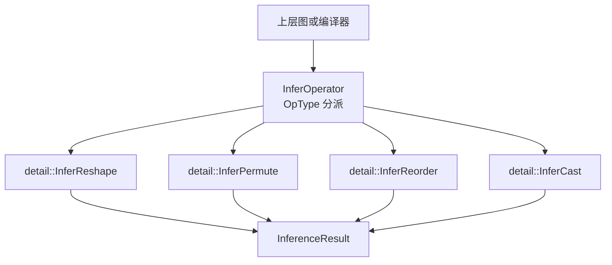
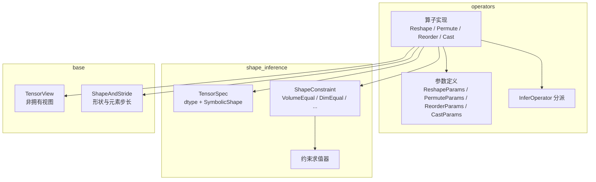
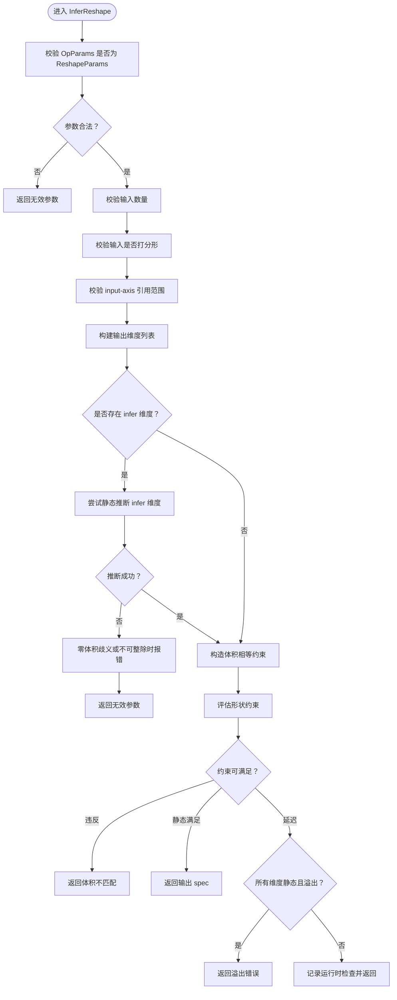
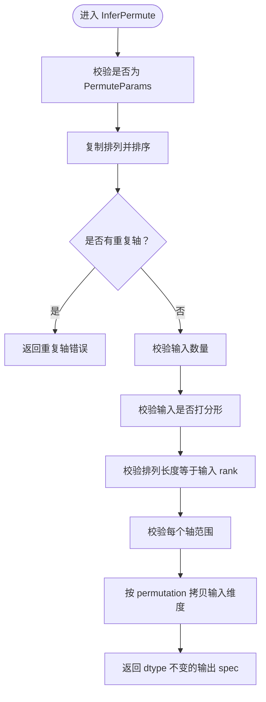
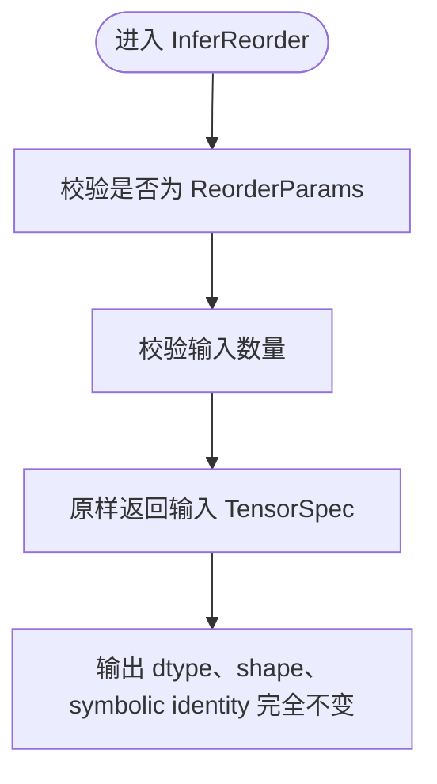
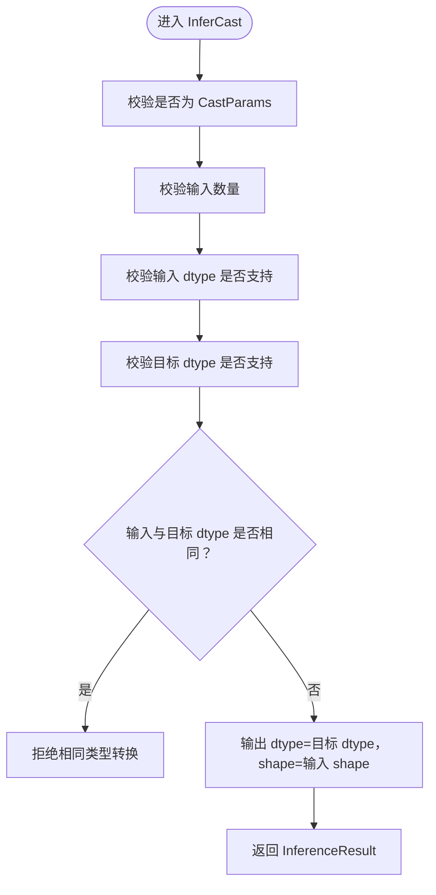

# 变换算子

**本文引用的文件**
- [reshape_op.cpp](../../../../src/operators/ops/reshape_op.cpp)
- [permute_op.cpp](../../../../src/operators/ops/permute_op.cpp)
- [reorder_op.cpp](../../../../src/operators/ops/reorder_op.cpp)
- [cast_op.cpp](../../../../src/operators/ops/cast_op.cpp)
- [cast_op.h](../../../../include/aethermind/operators/ops/cast_op.h)
- [op_params.h](../../../../include/aethermind/operators/op_params.h)
- [operator_inference.h](../../../../include/aethermind/operators/operator_inference.h)
- [operator_inference.cpp](../../../../src/operators/operator_inference.cpp)
- [tensor_view.h](../../../../include/aethermind/base/tensor_view.h)
- [shape_and_stride.h](../../../../include/aethermind/base/shape_and_stride.h)
- [include/aethermind/shape_inference/](../../../../include/aethermind/shape_inference)
- [test_reshape_inference.cpp](../../../../tests/unit/operators/ops/test_reshape_inference.cpp)
- [test_permute_inference.cpp](../../../../tests/unit/operators/ops/test_permute_inference.cpp)
- [test_reorder_inference.cpp](../../../../tests/unit/operators/ops/test_reorder_inference.cpp)
- [test_cast_inference.cpp](../../../../tests/unit/operators/ops/test_cast_inference.cpp)

## 目录

1. [引言](#引言)
2. [项目结构定位](#项目结构定位)
3. [核心组件总览](#核心组件总览)
4. [架构总览](#架构总览)
5. [Reshape 算子详解](#reshape-算子详解)
6. [Permute 算子详解](#permute-算子详解)
7. [Reorder 算子详解](#reorder-算子详解)
8. [Cast 算子详解](#cast-算子详解)
9. [ShapeInference 与约束推导](#shapeinference-与约束推导)
10. [内存布局与访问效率分析](#内存布局与访问效率分析)
11. [使用示例](#使用示例)
12. [错误处理与边界检查](#错误处理与边界检查)
13. [性能调优建议](#性能调优建议)
14. [结论](#结论)

## 引言

AetherMind 的变换算子负责在张量语义层定义“形状如何变化、数据类型如何转换、物理存储意图如何调整”。本次文档聚焦四个基础变换算子：

- **Reshape**：保持元素顺序不变，改变逻辑形状。
- **Permute**：按维度排列规则重排逻辑维度，保留 dtype。
- **Reorder**：仅表达物理存储到规范行主存的意图，不改变逻辑语义。
- **Cast**：在 FP32、FP16、BFloat16 之间做有明确精度契约的数据类型转换。

这四个算子的实现遵循统一的语义推理模型：先校验参数和输入规格，再推导输出 `TensorSpec`，最后通过 `ShapeConstraint` 把无法静态证明的体积相等、维度关系推迟到运行期验证。

## 项目结构定位

| 层级 | 文件 | 职责 |
|---|---|---|
| 算子实现 | [reshape_op.cpp](../../../../src/operators/ops/reshape_op.cpp) | Reshape 的参数校验、infer 维解析、体积约束 |
| 算子实现 | [permute_op.cpp](../../../../src/operators/ops/permute_op.cpp) | Permute 的排列合法性与输出形状推导 |
| 算子实现 | [reorder_op.cpp](../../../../src/operators/ops/reorder_op.cpp) | Reorder 的无变化语义推断 |
| 算子实现 | [cast_op.cpp](../../../../src/operators/ops/cast_op.cpp) | Cast 的类型支持与输出形状推导 |
| 公共接口 | [operator_inference.h](../../../../include/aethermind/operators/operator_inference.h) | 各 `Infer*` 函数声明、调度入口说明 |
| 调度实现 | [operator_inference.cpp](../../../../src/operators/operator_inference.cpp) | `InferOperator` 分派、输入数量校验、selector dtype 推导 |
| 参数定义 | [op_params.h](../../../../include/aethermind/operators/op_params.h) | `ReshapeParams`、`PermuteParams`、`ReorderParams`、`CastParams` |
| Cast 支持集 | [cast_op.h](../../../../include/aethermind/operators/ops/cast_op.h) | 支持的 dtype 集合与诊断信息构造 |
| 视图与元数据 | [tensor_view.h](../../../../include/aethermind/base/tensor_view.h) | 热路径非拥有张量视图、步长与连续性 |
| 形状与步长容器 | [shape_and_stride.h](../../../../include/aethermind/base/shape_and_stride.h) | 固定最大秩、元素步长、行主存连续判断 |
| ShapeInference 文档 | [include/aethermind/shape_inference/](../../../../include/aethermind/shape_inference) | 符号维度、约束、求值结果的设计说明 |
| 单元测试 | [test_reshape_inference.cpp](../../../../tests/unit/operators/ops/test_reshape_inference.cpp) | Reshape 参数、静态推断、溢出、符号推断测试 |
| 单元测试 | [test_permute_inference.cpp](../../../../tests/unit/operators/ops/test_permute_inference.cpp) | Permute 排列合法性与输入秩校验测试 |
| 单元测试 | [test_reorder_inference.cpp](../../../../tests/unit/operators/ops/test_reorder_inference.cpp) | Reorder 原样转发、未打分形等测试 |
| 单元测试 | [test_cast_inference.cpp](../../../../tests/unit/operators/ops/test_cast_inference.cpp) | Cast 支持方向、相同类型拒绝、不支持类型测试 |

**章节来源**
- [reshape_op.cpp:1-226](../../../../src/operators/ops/reshape_op.cpp#L1-L226)
- [permute_op.cpp:1-61](../../../../src/operators/ops/permute_op.cpp#L1-L61)
- [reorder_op.cpp:1-22](../../../../src/operators/ops/reorder_op.cpp#L1-L22)
- [cast_op.cpp:1-38](../../../../src/operators/ops/cast_op.cpp#L1-L38)
- [operator_inference.h:1-138](../../../../include/aethermind/operators/operator_inference.h#L1-L138)
- [operator_inference.cpp:1-197](../../../../src/operators/operator_inference.cpp#L1-L197)

## 核心组件总览

四个变换算子在 AetherMind 中共享相同的调用形态：

**图表来源**
- [operator_inference.cpp:18-110](../../../../src/operators/operator_inference.cpp#L18-L110)
- [operator_inference.h:103-138](../../../../include/aethermind/operators/operator_inference.h#L103-L138)

每个算子都遵循以下阶段：

1. 将 `OpParams` 转换为强类型参数对象；如果类型错误，立即返回无效参数状态。
2. 调用 `ValidateInferenceInputCount` 校验输入数量是否符合算子 schema。
3. 校验输入 rank、dtype、axis、permutation 等业务参数。
4. 推导输出 dtype 与 `SymbolicShape`。
5. 对可静态证明的形状约束直接接受；否则生成 `runtime_checks`。
6. 返回 `InferenceResult`，包含输出 spec 和延迟运行时检查。

**章节来源**
- [operator_inference.cpp:18-110](../../../../src/operators/operator_inference.cpp#L18-L110)
- [operator_inference.cpp:169-197](../../../../src/operators/operator_inference.cpp#L169-L197)

## 架构总览

下图展示变换算子在 AetherMind 中的分层位置：

**图表来源**
- [operator_inference.cpp:18-110](../../../../src/operators/operator_inference.cpp#L18-L110)
- [include/aethermind/shape_inference/](../../../../include/aethermind/shape_inference)
- [tensor_view.h:1-200](../../../../include/aethermind/base/tensor_view.h#L1-L200)
- [shape_and_stride.h:1-167](../../../../include/aethermind/base/shape_and_stride.h#L1-L167)

## Reshape 算子详解

### 数学语义

Reshape 的数学语义是：**保持线性内存顺序不变，只改变张量的逻辑形状**。也就是说，若把输入张量按行主序展平为一维序列，则输出张量在该序列上的第 i 个元素必须等于输入张量对应位置的元素。

形式化地，设输入形状为 \(d_0, d_1, \dots, d_{n-1}\)，输出形状为 \(e_0, e_1, \dots, e_{m-1}\)，则必须满足：

\[
\prod_i d_i = \prod_j e_j
\]

并且输出坐标映射到展平索引后，必须与输入坐标映射到的索引一致。这是 Reshape 区别于 Permute 的核心：Permute 可以交换维度，但 Reshape 不能打乱元素顺序。

### 参数表示

Reshape 的目标维度不是简单整数数组，而是强类型变体：

| 维度类型 | 含义 |
|---|---|
| `ReshapeLiteralDim` | 显式非负维度值 |
| `ReshapeInputDim` | 引用输入张量的某个轴 |
| `ReshapeInferDim` | “自动推断”占位符，最多一个 |

目标形状为空向量时，语义是 rank-zero 标量。

**章节来源**
- [op_params.h:240-317](../../../../include/aethermind/operators/op_params.h#L240-L317)

### 推断流程

**图表来源**
- [reshape_op.cpp:1-226](../../../../src/operators/ops/reshape_op.cpp#L1-L226)

关键行为包括：

- 只允许最多一个 `ReshapeInferDim`。
- 不允许负数字面量维度。
- `ReshapeInputDim` 引用的轴必须在输入 rank 范围内。
- 当存在 infer 维度时，先用输入体积除以其他已知维度乘积；如果乘积为零，则认为 zero-volume 歧义，拒绝推断。
- 使用 `VolumeEqualConstraint` 表达输入维度乘积与输出维度乘积相等。
- 如果约束静态可证，则不需要运行时检查；否则把约束放入 `runtime_checks`。
- 如果所有维度都是静态的，但符号体积计算发生溢出，则直接返回溢出错误，而不是保留一个必然失败的延迟检查。

**章节来源**
- [reshape_op.cpp:1-226](../../../../src/operators/ops/reshape_op.cpp#L1-L226)

### 典型场景

| 场景 | 输入形状 | 目标形状 | 输出形状 |
|---|---|---|---|
| 展平 | `[2, 3, 4]` | `[24]` | `[24]` |
| 二维重塑 | `[6]` | `[2, 3]` | `[2, 3]` |
| 引用输入轴 | `[N, C, H, W]` | `[@0, C, -1]` | `[N, C, ?]` |
| 标量重塑 | `[1]` | `[]` | `[]` |
| 零体积 | `[0, 10]` | `[0, *]` | 拒绝 |

这些场景在 Reshape 单元测试中有对应覆盖，包括参数优先级、零体积歧义、静态溢出、符号维度身份保留、重复推断确定性等。

**章节来源**
- [test_reshape_inference.cpp:10-231](../../../../tests/unit/operators/ops/test_reshape_inference.cpp#L10-L231)

## Permute 算子详解

### 数学语义

Permute 的语义是对张量维度进行重新排列。若输入形状为 \(d_0, d_1, \dots, d_{n-1}\)，排列参数为 \(p_0, p_1, \dots, p_{n-1}\)，则输出形状为：

\[
(d_{p_0}, d_{p_1}, \dots, d_{p_{n-1}})
\]

其中 `permutation[j]` 表示输出轴 j 对应输入轴的编号。因此，Permute 是一个从输入轴到输出轴的完整双射。

### 参数与合法性

Permute 使用 `std::vector<uint32_t>` 表示排列。推断过程要求：

- 排列长度等于输入 rank。
- 排列中的每个轴都在 `[0, input_rank)` 范围内。
- 排列没有重复轴，即它是一个双射。
- 输入必须是打分形。

**图表来源**
- [permute_op.cpp:1-61](../../../../src/operators/ops/permute_op.cpp#L1-L61)

### 符号维度身份

Permute 不会仅仅复制静态数值，而是直接拷贝输入形状的 `ShapeSymbol`。这样下游的相等性推理可以保留维度 identity，例如 batch 轴、seq_len 轴在不同操作之间保持一致。

**章节来源**
- [permute_op.cpp:1-61](../../../../src/operators/ops/permute_op.cpp#L1-L61)

### 典型场景

| 场景 | 输入形状 | 排列 | 输出形状 |
|---|---|---|---|
| NCHW 转 NHWC | `[B, C, H, W]` | `[0, 2, 3, 1]` | `[B, H, W, C]` |
| 转置两维 | `[H, W]` | `[1, 0]` | `[W, H]` |
| 标量 | `[]` | `[]` | `[]` |

**章节来源**
- [test_permute_inference.cpp:10-60](../../../../tests/unit/operators/ops/test_permute_inference.cpp#L10-L60)

## Reorder 算子详解

### 语义定位

Reorder 与其他三个变换算子不同：它不改变逻辑张量语义，也不改变 dtype、rank 或维度大小。它的目的是表达“希望该张量以规范行主连续格式存储”的物理意图。

代码注释明确指出：Reorder 只改变物理存储意图，因此语义推断会原样转发完整的 `TensorSpec`，不检查 dtype、rank 或维度。

**图表来源**
- [reorder_op.cpp:1-22](../../../../src/operators/ops/reorder_op.cpp#L1-L22)

### 与 Permute 的区别

| 特性 | Permute | Reorder |
|---|---|---|
| 改变逻辑形状 | 是 | 否 |
| 改变 dtype | 否 | 否 |
| 改变内存布局语义 | 间接，通过维度重排影响坐标映射 | 明确表达物理存储到行主连续 |
| 需要排列参数 | 是 | 否 |
| 推断复杂度 | 需要校验双射和维度拷贝 | 直接转发输入 spec |
| 典型用途 | 模型结构需要的维度重排 | 确保后续 kernel 能消费连续内存 |

**章节来源**
- [op_params.h:319-350](../../../../include/aethermind/operators/op_params.h#L319-L350)
- [reorder_op.cpp:1-22](../../../../src/operators/ops/reorder_op.cpp#L1-L22)

### 典型场景

| 场景 | 输入 spec | 输出 spec |
|---|---|---|
| 已连续张量 | dtype=FP32，shape=`[B, C, H, W]` | 完全相同 |
| 非连续视图 | dtype=FP16，symbolic shape=`[N, D]` | 完全相同 |
| 标量 | dtype=BFloat16，shape=`[]` | 完全相同 |
| 零维形状 | dtype=FP32，shape=`[0, 10]` | 完全相同 |

**章节来源**
- [test_reorder_inference.cpp:12-119](../../../../tests/unit/operators/ops/test_reorder_inference.cpp#L12-L119)

## Cast 算子详解

### 语义定位

Cast 不是通用数值转换器。它是 AetherMind 中用于在 FP32、FP16、BFloat16 之间做存储格式转换的算子。其关键约束是：

- 输入 dtype 必须是受支持的浮点标量类型。
- 目标 dtype 必须是受支持的浮点标量类型。
- 输入 dtype 和目标 dtype 必须不同。
- 输出形状与输入形状完全相同。

受支持的 dtype 集合由 `kCastSupportedDTypes` 定义，包括 Float32、Float16、BFloat16。

**章节来源**
- [cast_op.h:1-44](../../../../include/aethermind/operators/ops/cast_op.h#L1-L44)

### 推断流程

**图表来源**
- [cast_op.cpp:1-38](../../../../src/operators/ops/cast_op.cpp#L1-L38)
- [cast_op.h:1-44](../../../../include/aethermind/operators/ops/cast_op.h#L1-L44)

### 为什么禁止同类型 Cast

代码注释说明：同 dtype 的 Cast 不应出现在图中。图的类型过渡必须显式表达，发出 no-op 节点只会增加常量折叠和图优化的复杂性。

因此，即使输入和目标是同一个 dtype，也会返回无效参数错误。

**章节来源**
- [cast_op.cpp:20-38](../../../../src/operators/ops/cast_op.cpp#L20-L38)

### 典型场景

| 场景 | 输入 dtype | 目标 dtype | 是否允许 |
|---|---|---|---|
| FP32 转 FP16 | FP32 | FP16 | 是 |
| FP16 转 BFloat16 | FP16 | BFloat16 | 是 |
| BFloat16 转 FP32 | BFloat16 | FP32 | 是 |
| FP32 转 FP32 | FP32 | FP32 | 否 |
| Int32 转 FP32 | Int32 | FP32 | 否 |
| Double 转 FP32 | Double | FP32 | 否 |

**章节来源**
- [test_cast_inference.cpp:10-89](../../../../tests/unit/operators/ops/test_cast_inference.cpp#L10-L89)

## ShapeInference 与约束推导

### 统一推理框架

AetherMind 的形状推理基础设施将“算子语义”和“形状约束求解”解耦：

- 算子只负责描述自己的形状语义，并产出 `InferenceResult`。
- `ShapeConstraint` 表达待验证的形状条件。
- `EvaluateShapeConstraint` 负责静态求值、concrete 求值和延迟求值。
- `InferenceResult.runtime_checks` 保存需要执行期验证的条件。

**章节来源**
- [include/aethermind/shape_inference/](../../../../include/aethermind/shape_inference)

### 三种求值结果

| 结果 | 含义 | 处理方式 |
|---|---|---|
| `kSatisfied` | 形状约束静态成立 | 不需要运行时检查 |
| `kViolated` | 形状约束静态矛盾 | 返回无效参数错误 |
| `kDeferred` | 需要运行期 concrete 维度才能判定 | 加入 `runtime_checks` |

对于 Reshape，最重要的约束是 `VolumeEqualConstraint`：输入维度乘积必须等于输出维度乘积。

### 符号维度与未知维度

- 静态维度：已知具体数值。
- `Unknown()`：无 identity 的未知维度，用于 infer 标记。
- 命名符号：由 `ShapeSymbol::Create()` 生成的负值符号，用于跨算子维度相等推理。

Reshape 的 `ReshapeInferDim` 在静态可解时会被替换为商；否则保留为 `Unknown()`，并通过 `VolumeEqualConstraint` 让执行期验证体积一致性。

**章节来源**
- [include/aethermind/shape_inference/](../../../../include/aethermind/shape_inference)
- [reshape_op.cpp:1-226](../../../../src/operators/ops/reshape_op.cpp#L1-L226)

## 内存布局与访问效率分析

### TensorView 与 ShapeAndStride

AetherMind 的底层张量元数据有两个关键层次：

1. **`ShapeAndStride`**：拥有形状和步长，最大秩固定为 8，步长单位为元素而非字节。
2. **`TensorView`**：非拥有的热路径视图，借用 data 指针、dtype、shape、stride 和对齐信息。

这意味着变换算子在语义层不直接持有内存地址，而是在执行层通过 `TensorView` 访问实际数据。

**章节来源**
- [shape_and_stride.h:1-167](../../../../include/aethermind/base/shape_and_stride.h#L1-L167)
- [tensor_view.h:1-200](../../../../include/aethermind/base/tensor_view.h#L1-L200)

### Reshape 的内存模式

Reshape 不移动元素，只改变逻辑形状。因此：

- 最佳情况：输入已经是行主连续，输出可直接复用同一块内存。
- 最坏情况：虽然逻辑上可 reshape，但下游 kernel 可能要求连续布局，此时需要 Reorder 或内核内部处理。
- 时间复杂度：语义层 O(1)，因为不需要复制元素。
- 空间复杂度：O(1)，只产生新的形状和 stride 元数据。

### Permute 的内存模式

Permute 重排维度，通常意味着逻辑坐标映射发生变化。常见实现策略包括：

- 如果是相邻维度交换且原始布局允许，某些后端可能通过修改 stride 避免复制。
- 一般多轴 Permute 往往需要元素复制，除非后端提供专门的内核。
- 时间复杂度：通常为 O(n)。
- 空间复杂度：通常需要 O(n) 临时输出缓冲。

### Reorder 的内存模式

Reorder 明确表示“目标物理布局是规范行主连续存储”。语义层不做任何检查，但执行层或后端应据此决定：

- 如果输入已经连续，则可原地重用。
- 如果输入非连续，则需要复制并重排到连续内存。
- 优势：把“逻辑语义”和“物理布局意图”分开，使 Permute 保持纯逻辑变换。

### 对比总结

| 算子 | 是否复制元素 | 是否改变逻辑坐标映射 | 是否改变 dtype | 主要开销来源 |
|---|---:|---:|---:|---|
| Reshape | 通常不复制 | 否 | 否 | 形状元数据 |
| Permute | 经常需要复制 | 是 | 否 | 元素重排 |
| Reorder | 可能复制 | 否 | 否 | 物理布局整理 |
| Cast | 通常复制元素 | 否 | 是 | 类型转换 + 可能的布局整理 |

**章节来源**
- [permute_op.cpp:1-61](../../../../src/operators/ops/permute_op.cpp#L1-L61)
- [reorder_op.cpp:1-22](../../../../src/operators/ops/reorder_op.cpp#L1-L22)
- [tensor_view.h:1-200](../../../../include/aethermind/base/tensor_view.h#L1-L200)
- [shape_and_stride.h:1-167](../../../../include/aethermind/base/shape_and_stride.h#L1-L167)

## 使用示例

### 示例一：Transformer 解码头的形状变换

假设 QKV 线性层输出为 `[batch, seq, head_dim]`，Attention 需要 `[batch, heads, seq, head_per_head]`。常见变换链如下：

1. Reshape：将最后一个特征维度拆分为 head 数和 head 内维度。
2. Permute：把 head 轴移到正确位置。
3. Reorder：确保 Attention kernel 能高效读取连续内存。
4. Cast：如果需要，将注意力 logits 或投影结果转换为目标 dtype。

这种组合体现了四个算子的分工：

- Reshape 负责维度拆分。
- Permute 负责维度顺序。
- Reorder 负责物理布局。
- Cast 负责数据类型过渡。

### 示例二：批归一化前的准备

假设模型中间激活为 `[B, C, H, W]`，而下游算子期望 `[B, H, W, C]`：

1. Permute：`[0, 2, 3, 1]`。
2. Reorder：保证通道在后且内存连续。
3. Cast：如果需要从 FP32 转到 FP16/BF16。

### 示例三：动态 batch 下的安全 Reshape

当 batch 是动态符号时，不要硬编码展开后的总元素数。推荐做法：

- 使用 `ReshapeInputDim` 引用 batch 轴。
- 只在确定可静态整除时使用 `ReshapeInferDim`。
- 让 `VolumeEqualConstraint` 在运行期兜底验证体积一致性。

**章节来源**
- [reshape_op.cpp:1-226](../../../../src/operators/ops/reshape_op.cpp#L1-L226)
- [permute_op.cpp:1-61](../../../../src/operators/ops/permute_op.cpp#L1-L61)
- [reorder_op.cpp:1-22](../../../../src/operators/ops/reorder_op.cpp#L1-L22)
- [cast_op.cpp:1-38](../../../../src/operators/ops/cast_op.cpp#L1-L38)

## 错误处理与边界检查

### 参数校验优先于输入校验

四个算子都遵循“先校验参数变体，再校验输入数量”的顺序。这样当用户传入错误的 `OpParams` 时，错误信息更准确，不会被输入数量不匹配掩盖。

**章节来源**
- [operator_inference.cpp:18-110](../../../../src/operators/operator_inference.cpp#L18-L110)

### 各算子关键错误

| 算子 | 错误类型 | 触发条件 |
|---|---|---|
| Reshape | 无效参数 | 负数维度、多个 infer、input-axis 越界、体积不匹配 |
| Reshape | 溢出 | 静态体积乘积溢出、infer 商溢出 |
| Reshape | 零体积歧义 | 非 infer 维度乘积为零且无法唯一确定 infer |
| Permute | 无效参数 | 排列重复、排列长度不等于 rank、轴越界 |
| Reorder | 无效参数 | 参数变体错误或输入数量不为 1 |
| Cast | 无效参数 | 输入或目标 dtype 不受支持、目标 dtype 与输入相同 |

### 运行时检查机制

当形状约束无法静态证明时，算子会把 `ShapeConstraint` 放入 `InferenceResult.runtime_checks`。执行期通过约束求值器再次验证。Reshape 还特别处理了“所有维度静态但符号体积溢出”的情况：它直接返回溢出错误，而不是留下一个必然失败的延迟检查。

**章节来源**
- [reshape_op.cpp:201-226](../../../../src/operators/ops/reshape_op.cpp#L201-L226)
- [include/aethermind/shape_inference/](../../../../include/aethermind/shape_inference)

## 性能调优建议

### 优先减少不必要的 Cast

Cast 会触发类型转换，可能伴随内存读写。建议：

- 尽量在模型入口处完成一次 dtype 规范化。
- 避免在热点路径反复 FP32 ↔ FP16 ↔ BFloat16。
- 如果只需要形状变化，优先用 Reshape 和 Permute。

### 优先使用 Reorder 消除非连续访问

如果下游 kernel 依赖连续内存，应在 Permute 之后插入 Reorder，而不是依赖 kernel 内部隐式处理。这样可以：

- 让后端清楚知道布局意图。
- 避免多次隐式复制。
- 提高缓存局部性。

### 谨慎使用 Reshape 的 infer 维度

infer 维度会增加形状约束的延迟分支。推荐：

- 如果 batch 或 seq_len 已知，尽量显式写出目标形状。
- 仅在确实需要自动推导剩余维度时使用 `ReshapeInferDim`。
- 避免在零体积张量上使用 infer。

### 利用符号维度身份减少运行时冲突

Reshape 和 Permute 都会保留 `ShapeSymbol` 的 identity。这有助于：

- 在编译期发现维度不一致。
- 减少运行期符号绑定冲突。
- 让优化器理解维度之间的等价关系。

### 注意最大秩限制

`ShapeAndStride` 的最大秩为 8。超过这个秩的张量在底层元数据层面需要特别注意。变换算子应尽量控制输出 rank，避免无意义的超高维张量。

**章节来源**
- [shape_and_stride.h:120-167](../../../../include/aethermind/base/shape_and_stride.h#L120-L167)
- [cast_op.h:1-44](../../../../include/aethermind/operators/ops/cast_op.h#L1-L44)
- [reshape_op.cpp:1-226](../../../../src/operators/ops/reshape_op.cpp#L1-L226)

## 结论

AetherMind 的四个基础变换算子形成了清晰的能力分层：

- **Reshape** 负责保持元素顺序的形状变换，并通过体积约束保障语义正确性。
- **Permute** 负责维度重排，保留 dtype 并维护符号维度身份。
- **Reorder** 负责表达物理存储到规范行主连续的意图，不改变逻辑语义。
- **Cast** 负责在 FP32、FP16、BFloat16 之间进行受控的类型转换。

它们的共同设计原则是：

1. 参数校验优先于输入校验。
2. 形状推导基于 `TensorSpec` 和 `SymbolicShape`。
3. 静态可证明的约束直接接受，延迟约束交给运行期。
4. 语义层与物理布局解耦，便于后端优化。
5. 错误信息精确到算子语义，便于调试。

在实际工程中，推荐的组合方式是：**先 Reshape 拆分维度，再 Permute 调整维度顺序，再 Reorder 确保连续布局，最后在必要处进行 Cast**。这种顺序既能保持语义清晰，又能减少不必要的内存复制和类型转换。
