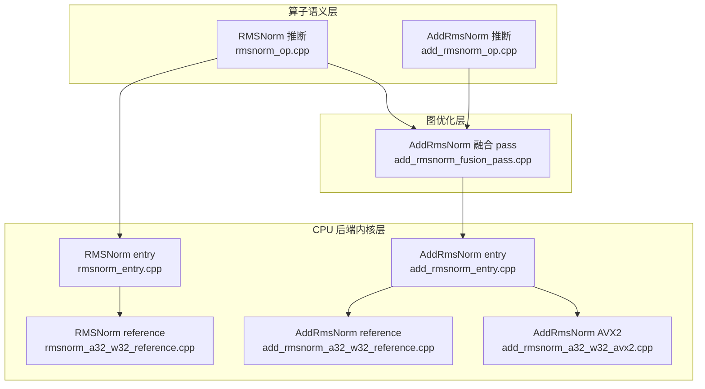
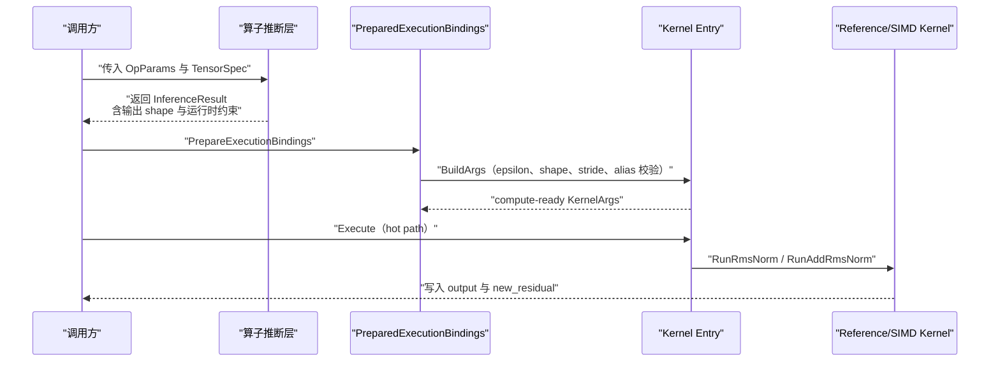
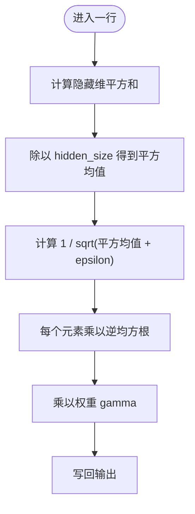
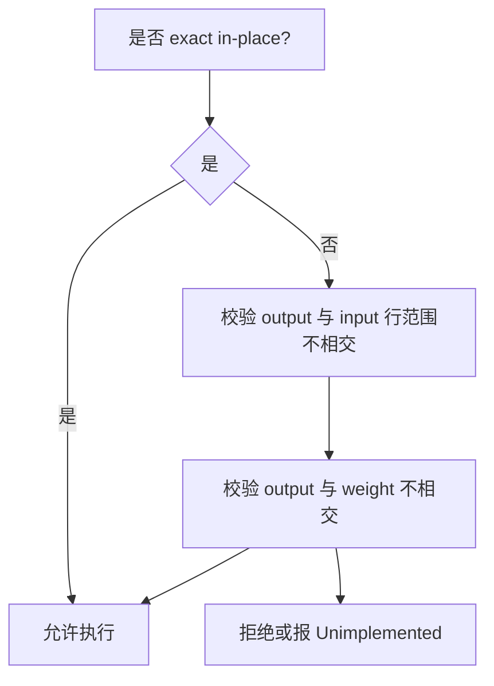
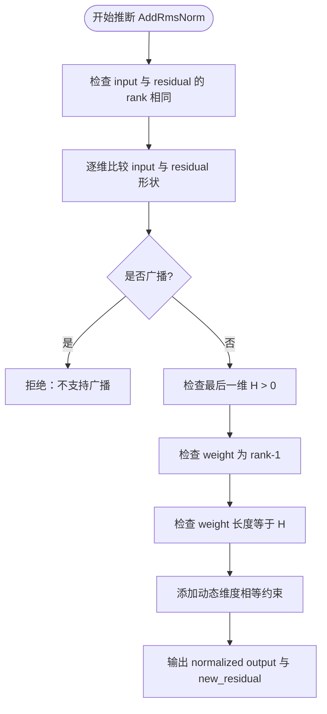
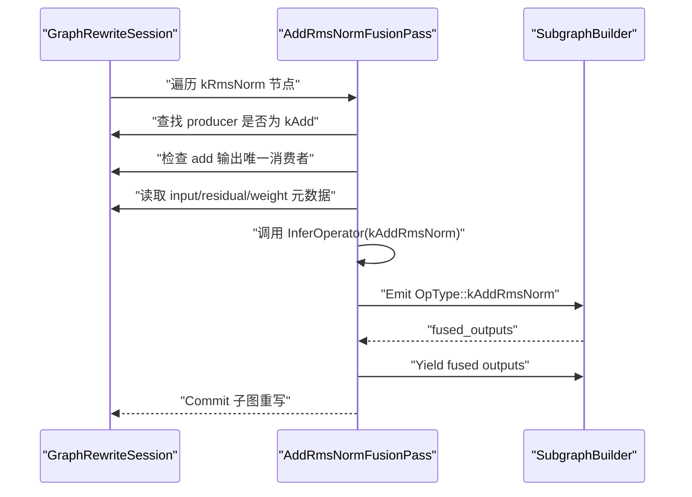
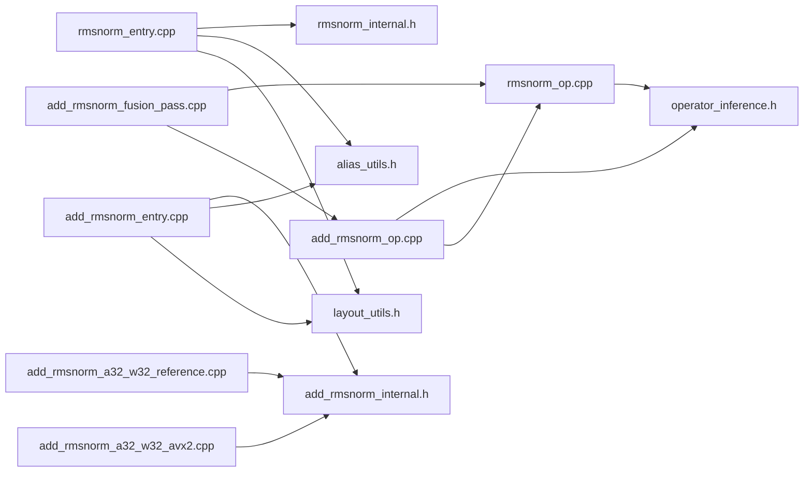

# 归一化算子

**本文引用的文件**
- [RMSNorm 算子契约.md](../../../operators/rmsnorm/RMSNorm算子契约.md)
- [rmsnorm_op.cpp](../../../../src/operators/ops/rmsnorm_op.cpp)
- [add_rmsnorm_op.cpp](../../../../src/operators/ops/add_rmsnorm_op.cpp)
- [add-rmsnorm-optimization.md](../../../operators/add_rmsnorm/add-rmsnorm-optimization.md)
- [README.md（AddRmsNorm）](../../../operators/add_rmsnorm/README.md)
- [add_rmsnorm_fusion_pass.cpp](../../../../src/graph/optimization/add_rmsnorm_fusion_pass.cpp)
- [rmsnorm_entry.cpp](../../../../src/backend/cpu/kernels/rmsnorm/rmsnorm_entry.cpp)
- [rmsnorm_a32_w32_reference.cpp](../../../../src/backend/cpu/kernels/rmsnorm/rmsnorm_a32_w32_reference.cpp)
- [add_rmsnorm_entry.cpp](../../../../src/backend/cpu/kernels/add_rmsnorm/add_rmsnorm_entry.cpp)
- [add_rmsnorm_a32_w32_reference.cpp](../../../../src/backend/cpu/kernels/add_rmsnorm/add_rmsnorm_a32_w32_reference.cpp)
- [add_rmsnorm_a32_w32_avx2.cpp](../../../../src/backend/cpu/kernels/add_rmsnorm/add_rmsnorm_a32_w32_avx2.cpp)

## 目录
1. [引言](#引言)
2. [项目结构](#项目结构)
3. [核心组件](#核心组件)
4. [架构总览](#架构总览)
5. [详细组件分析](#详细组件分析)
6. [依赖关系分析](#依赖关系分析)
7. [性能与数值特性](#性能与数值特性)
8. [使用示例与最佳实践](#使用示例与最佳实践)
9. [故障排查指南](#故障排查指南)
10. [结论](#结论)

## 引言
本文件为 AetherMind 中 RMSNorm 及其融合变体 AddRmsNorm 的归一化算子实现文档。内容覆盖：
- RMSNorm 的数学定义、行级语义、形状约束和内存布局要求；
- AddRmsNorm 融合算子的设计动机、输入输出行为及与残差连接的维度匹配规则；
- CPU 参考路径与 AVX2 SIMD 路径的数值精度策略；
- 图优化阶段将 `Add` + `RmsNorm` 合并为单一融合算子的过程；
- 参数构建、别名检查、零行处理等关键实现细节；
- 面向推理场景的使用示例、对齐要求和性能优化建议。

## 项目结构
归一化相关代码横跨“算子语义层”“后端内核层”“图优化层”三个层次：
- 算子语义层负责推理期 shape/dtype 推断和运行时约束；
- 后端内核层提供 CPU FP32 reference 与 AVX2 SIMD 实现，并负责 epsilon、shape、stride、alias 等执行期校验；
- 图优化层在编译/准备阶段识别可融合模式，把相邻的逐元素加法与 RMSNorm 替换成 AddRmsNorm。

**图示来源**
- [rmsnorm_op.cpp:1-95](../../../../src/operators/ops/rmsnorm_op.cpp#L1-L95)
- [add_rmsnorm_op.cpp:1-134](../../../../src/operators/ops/add_rmsnorm_op.cpp#L1-L134)
- [add_rmsnorm_fusion_pass.cpp:1-242](../../../../src/graph/optimization/add_rmsnorm_fusion_pass.cpp#L1-L242)
- [rmsnorm_entry.cpp:1-200](../../../../src/backend/cpu/kernels/rmsnorm/rmsnorm_entry.cpp#L1-L200)
- [rmsnorm_a32_w32_reference.cpp:1-49](../../../../src/backend/cpu/kernels/rmsnorm/rmsnorm_a32_w32_reference.cpp#L1-L49)
- [add_rmsnorm_entry.cpp:1-200](../../../../src/backend/cpu/kernels/add_rmsnorm/add_rmsnorm_entry.cpp#L1-L200)
- [add_rmsnorm_a32_w32_reference.cpp:1-43](../../../../src/backend/cpu/kernels/add_rmsnorm/add_rmsnorm_a32_w32_reference.cpp#L1-L43)
- [add_rmsnorm_a32_w32_avx2.cpp:1-60](../../../../src/backend/cpu/kernels/add_rmsnorm/add_rmsnorm_a32_w32_avx2.cpp#L1-L60)

**章节来源**
- [RMSNorm 算子契约.md](../../../operators/rmsnorm/RMSNorm算子契约.md)
- [add-rmsnorm-optimization.md](../../../operators/add_rmsnorm/add-rmsnorm-optimization.md)

## 核心组件
本节聚焦两个算子及其相关模块的职责边界。

| 组件 | 主要职责 | 关键约束 |
|---|---|---|
| RMSNorm 算子推断 | 验证 epsilon、dtype、rank、hidden 维正数、weight 长度与 input 最后一维一致，产出单输出 spec | 支持 rank ≥ 1，最后一维必须为正；leading 维可为零 |
| AddRmsNorm 算子推断 | 验证 input 与 residual 完全同形同 dtype，weight 长度与 hidden 维一致，产出 normalized output 和 new_residual | 不支持广播；两输出与所有输入互斥 |
| RMSNorm CPU entry | 解析 epsilon、TensorView、row_count、layout、stride、alias，构造 compute-ready args | CPU FP32；weight 需自然对齐；output row 物理不重叠 |
| AddRmsNorm CPU entry | 校验 activation 视图、两输出互斥、与输入/权重互斥，构造融合 kernel args | 全部 activation/output 均为 FP32；支持行 padding 和单位列 stride |
| AddRmsNorm 融合 pass | 识别 `Add(input, residual)` → `RmsNorm(add_output, weight)` 模式，替换为 AddRmsNorm | 要求 rmsnorm 输出有可见使用、add 输出唯一消费者 |

**章节来源**
- [rmsnorm_op.cpp:1-95](../../../../src/operators/ops/rmsnorm_op.cpp#L1-L95)
- [add_rmsnorm_op.cpp:1-134](../../../../src/operators/ops/add_rmsnorm_op.cpp#L1-L134)
- [rmsnorm_entry.cpp:1-200](../../../../src/backend/cpu/kernels/rmsnorm/rmsnorm_entry.cpp#L1-L200)
- [add_rmsnorm_entry.cpp:1-200](../../../../src/backend/cpu/kernels/add_rmsnorm/add_rmsnorm_entry.cpp#L1-L200)
- [add_rmsnorm_fusion_pass.cpp:1-242](../../../../src/graph/optimization/add_rmsnorm_fusion_pass.cpp#L1-L242)

## 架构总览
RMSNorm 与 AddRmsNorm 的执行链路如下：

**图示来源**
- [RMSNorm 算子契约.md](../../../operators/rmsnorm/RMSNorm算子契约.md)
- [rmsnorm_entry.cpp:1-200](../../../../src/backend/cpu/kernels/rmsnorm/rmsnorm_entry.cpp#L1-L200)
- [add_rmsnorm_entry.cpp:1-200](../../../../src/backend/cpu/kernels/add_rmsnorm/add_rmsnorm_entry.cpp#L1-L200)

## 详细组件分析

### RMSNorm 算子

#### 数学定义与语义
RMSNorm 对输入的最后一维进行均方根归一化，并按该维权重缩放。其逻辑等价于：

- 先按行展平所有 leading 维度；
- 对每行计算平方均值；
- 用逆均方根乘以输入元素；
- 再乘以对应位置权重。

官方契约明确：不包含 bias/beta、不含残差融合、不做量化或 layout 变换。

**图示来源**
- [RMSNorm 算子契约.md](../../../operators/rmsnorm/RMSNorm算子契约.md)
- [rmsnorm_a32_w32_reference.cpp:1-49](../../../../src/backend/cpu/kernels/rmsnorm/rmsnorm_a32_w32_reference.cpp#L1-L49)

#### 输入输出形状约束
| 输入/输出 | 语义约束 |
|---|---|
| input | 浮点 dtype，rank ≥ 1，shape 为 `[..., H]` |
| weight | 浮点 dtype，rank = 1，shape 为 `[H]` |
| output | dtype 与 shape 与 input 相同 |

其中 `H` 必须为正；静态不匹配立即拒绝，符号表达式不匹配延迟到运行时约束检查。leading 维度可以为零，此时输出为空 tensor，RMSNorm 成功完成且不执行 reduction。

**章节来源**
- [RMSNorm 算子契约.md](../../../operators/rmsnorm/RMSNorm算子契约.md)
- [rmsnorm_op.cpp:1-95](../../../../src/operators/ops/rmsnorm_op.cpp#L1-L95)

#### 内存布局与别名
- CPU FP32 kernel 将 input 的 leading 维度乘积作为 `row_count`，最后一维作为 `hidden_size`；
- 引用实现支持任意正 inner stride，AVX2+FMA 实现要求三者的 inner stride 均为 1；
- output 的逻辑行必须物理不重叠；exact in-place 允许 input 与 output 指针、dtype、shape、stride 完全一致；
- weight 每行重复读取，因此 output 与 weight 的任何可证明重叠都拒绝；
- alias 判定基于元素 stride 换算出的字节区间，same-base 不同 mapping 会被拒绝。

**图示来源**
- [RMSNorm 算子契约.md](../../../operators/rmsnorm/RMSNorm算子契约.md)
- [rmsnorm_entry.cpp:1-200](../../../../src/backend/cpu/kernels/rmsnorm/rmsnorm_entry.cpp#L1-L200)

**章节来源**
- [RMSNorm 算子契约.md](../../../operators/rmsnorm/RMSNorm算子契约.md)
- [rmsnorm_entry.cpp:1-200](../../../../src/backend/cpu/kernels/rmsnorm/rmsnorm_entry.cpp#L1-L200)

### AddRmsNorm 融合算子

#### 设计动机
AddRmsNorm 的目标是把 Transformer 残差连接中的逐元素加法与 RMSNorm 合并为一次 kernel 调用，从而：
- 减少一次完整 activation 的显存读写；
- 避免中间结果落回主存；
- 保留 identity-packed 的 prepared params，复用现有校验流程；
- 在 AVX2/FMA 可用时使用 SIMD 路径，否则回退标量 reference。

官方优化说明强调：融合后仍保留 FP32 residual 给后续 consumer，同时输出归一化结果。

**章节来源**
- [README.md（AddRmsNorm）](../../../operators/add_rmsnorm/README.md)
- [add-rmsnorm-optimization.md](../../../operators/add_rmsnorm/add-rmsnorm-optimization.md)

#### 输入输出行为
AddRmsNorm 接受三个输入：
1. `input`：激活值；
2. `residual`：待相加的残差；
3. `weight`：RMSNorm 权重。

输出两个张量：
1. `output`：归一化后的激活值；
2. `new_residual`：逐元素加法的结果，供后续网络继续消费。

这意味着融合不会丢弃残差，而是显式写出新的残差副本。

**章节来源**
- [add_rmsnorm_op.cpp:1-134](../../../../src/operators/ops/add_rmsnorm_op.cpp#L1-L134)
- [README.md（AddRmsNorm）](../../../operators/add_rmsnorm/README.md)

#### 维度匹配规则
- `input` 与 `residual` 必须具有完全相同的 rank 和每一维的大小；
- 不支持广播；
- `input` 的最后一维 `H` 必须为正；
- `weight` 必须是 rank-1，且长度等于 `H`；
- 如果维度无法静态证明相等，则生成 `DimEqualConstraint` 推迟到 executor 阶段检查；
- output 与 `new_residual` 都与 input_spec 同形。

**图示来源**
- [add_rmsnorm_op.cpp:1-134](../../../../src/operators/ops/add_rmsnorm_op.cpp#L1-L134)

**章节来源**
- [add_rmsnorm_op.cpp:1-134](../../../../src/operators/ops/add_rmsnorm_op.cpp#L1-L134)

#### 图融合过程
AddRmsNormFusionPass 在 graph rewrite session 中查找如下模式：
- 一个 `kAdd` 节点有两个输入、一个输出；
- 该 add 输出被恰好一个 `kRmsNorm` 节点消费；
- rmsnorm 的输出仍有可见使用；
- input、residual、weight、add_output、rmsnorm_output 都符合 activation/weight 元数据；
- 通过 `InferOperator(OpType::kAddRmsNorm, ...)` 验证 fused inputs 与 outputs 的推断结果；
- 成功后用 `SubgraphBuilder` 替换子图，并 yield 两个融合输出。

**图示来源**
- [add_rmsnorm_fusion_pass.cpp:1-242](../../../../src/graph/optimization/add_rmsnorm_fusion_pass.cpp#L1-L242)

**章节来源**
- [add_rmsnorm_fusion_pass.cpp:1-242](../../../../src/graph/optimization/add_rmsnorm_fusion_pass.cpp#L1-L242)

### CPU 内核实现

#### RMSNorm 内核
reference 实现按行循环：
- 使用 double 累加平方和；
- 计算 `inv_rms = 1 / sqrt(mean_square + epsilon)`；
- 第二次扫描将输入元素乘以 `inv_rms * weight`，再转回 float 写入 output。

AVX2+FMA 路径由独立的 translation unit 注册，并在运行期根据 CPU capability 决定是否启用；当前契约说明 reference 与 AVX2 路径的数值合同允许 tolerance equal，不要求 bitwise equal。

**章节来源**
- [rmsnorm_a32_w32_reference.cpp:1-49](../../../../src/backend/cpu/kernels/rmsnorm/rmsnorm_a32_w32_reference.cpp#L1-L49)
- [RMSNorm 算子契约.md](../../../operators/rmsnorm/RMSNorm算子契约.md)

#### AddRmsNorm reference 内核
AddRmsNorm reference 在同一行内完成：
1. 逐元素相加并写入 `new_residual`；
2. 将相加结果转为 double 后平方并累加；
3. 计算逆均方根；
4. 再次从 `new_residual` 读取，乘以 `inv_rms * weight`，写回 `output`。

这与普通 RMSNorm 的区别在于：归一化的对象不是原始 input，而是 `input + residual`。

**章节来源**
- [add_rmsnorm_a32_w32_reference.cpp:1-43](../../../../src/backend/cpu/kernels/add_rmsnorm/add_rmsnorm_a32_w32_reference.cpp#L1-L43)

#### AddRmsNorm AVX2 内核
AVX2 实现以 8 个 float 为一组做向量化加法，并写入 `new_residual`；随后将每组 4 个 float 转换为 double 并平方，按原列顺序累加到 double 累加器。第二遍以 4 个 double 为一组，从 `new_residual` 读取、乘以 `inv_rms` 和 weight，再转回 float 写入 output。尾部不足向量宽度时退回标量循环。

该实现明确保留参考实现的升序 FP64 归约顺序，便于与 reference 对拍。

**章节来源**
- [add_rmsnorm_a32_w32_avx2.cpp:1-60](../../../../src/backend/cpu/kernels/add_rmsnorm/add_rmsnorm_a32_w32_avx2.cpp#L1-L60)
- [add-rmsnorm-optimization.md](../../../operators/add_rmsnorm/add-rmsnorm-optimization.md)

## 依赖关系分析

**图示来源**
- [rmsnorm_op.cpp:1-95](../../../../src/operators/ops/rmsnorm_op.cpp#L1-L95)
- [add_rmsnorm_op.cpp:1-134](../../../../src/operators/ops/add_rmsnorm_op.cpp#L1-L134)
- [add_rmsnorm_fusion_pass.cpp:1-242](../../../../src/graph/optimization/add_rmsnorm_fusion_pass.cpp#L1-L242)
- [rmsnorm_entry.cpp:1-200](../../../../src/backend/cpu/kernels/rmsnorm/rmsnorm_entry.cpp#L1-L200)
- [add_rmsnorm_entry.cpp:1-200](../../../../src/backend/cpu/kernels/add_rmsnorm/add_rmsnorm_entry.cpp#L1-L200)

**耦合与内聚评估**
- 算子推断层只关心 dtype、rank、shape 和运行时约束，不直接访问内存布局；
- CPU entry 集中承担 epsilon、TensorView、row_count、stride、alias 等执行期校验；
- reference 与 SIMD 内核共享 kernel args，并通过内部头文件暴露行级处理函数；
- 融合 pass 仅依赖图操作类型、infer API 和 value metadata，不修改具体 kernel 实现。

潜在风险点：
- AVX2 与 reference 路径的数值合同不完全一致：reference 使用 double 累加，SIMD 在注释中保留参考顺序但仍可能因 FMA contraction 或不同归约顺序导致微小差异；
- fusion pass 对 broadcast 语义较保守，直接拒绝带广播的 Add，避免融合后缩小原始语义。

**章节来源**
- [add_rmsnorm_fusion_pass.cpp:120-200](../../../../src/graph/optimization/add_rmsnorm_fusion_pass.cpp#L120-L200)
- [add-rmsnorm-optimization.md](../../../operators/add_rmsnorm/add-rmsnorm-optimization.md)

## 性能与数值特性

### 内存访问优化
- 普通 RMSNorm 需要一次 read input、一次 write output；
- AddRmsNorm 融合后，input 与 residual 在一次 scan 中相加并写出 `new_residual`，然后同一 buffer 上完成归一化；
- 通过保留 `new_residual`，模型可以继续消费残差分支，而无需额外保存原始 residual；
- AVX2 路径避免为中间加法结果分配 heap memory，workspace requirement 为空。

### 数值精度策略
| 路径 | 平方和累加 | 缩放与加权 | 最终写入 |
|---|---|---|---|
| RMSNorm reference | double | double | float |
| AddRmsNorm reference | double | double | float |
| AddRmsNorm AVX2 | 先 FP32 加法，再按原列顺序 FP64 平方累加 | FP64 计算后转 FP32 | float |
| 普通 RMSNorm AVX2 | 契约说明允许 FP32 reduction | 由 backend kernel 决定 | float |

注意：AddRmsNorm AVX2 刻意保留 reference 的升序 double 归约顺序，以方便数值回归测试；但文档也指出它与普通 RMSNorm AVX2 的数值合同不同，基准时应分别记录未融合、融合 scalar 和融合 SIMD 的结果。

### 溢出保护机制
- epsilon 必须为有限正值；
- hidden_size 必须为正；
- non-empty tensor 的数据指针不能为 null；
- weight 需自然对齐；
- output 与 input、weight、new_residual 之间进行严格的行级 footprint 不相交校验；
- 非法 binding 在 `PrepareExecutionBindings` / params builder 阶段拒绝，而不是在 hot path Execute 时才失败。

**章节来源**
- [add-rmsnorm-optimization.md](../../../operators/add_rmsnorm/add-rmsnorm-optimization.md)
- [rmsnorm_entry.cpp:1-200](../../../../src/backend/cpu/kernels/rmsnorm/rmsnorm_entry.cpp#L1-L200)
- [add_rmsnorm_entry.cpp:1-200](../../../../src/backend/cpu/kernels/add_rmsnorm/add_rmsnorm_entry.cpp#L1-L200)

## 使用示例与最佳实践

### 典型使用场景

| 场景 | 推荐算子 | 原因 |
|---|---|---|
| 标准 Transformer FFN 或 attention 输出后接 RMSNorm | AddRmsNorm | 可直接融合前一层残差加法，减少一次 activation 写入 |
| 单独对某激活张量做 RMSNorm，无相邻 Add | RMSNorm | 保持语义简单，避免引入多余 new_residual |
| 需要调试或对比 reference 数值 | 优先使用 reference kernel | 使用 double 累加，数值更稳定 |
| 短 hidden 或非单位列 stride | reference kernel | AVX2 路径要求 hidden ≥ 8 且列 stride 为 1 |
| 需要保留原始 residual 用于其他分支 | AddRmsNorm | 显式输出 `new_residual`，不必自行复制残差 |

### 输入形状示例
假设 hidden 维为 `H`：

| 输入形状 | 含义 | RMSNorm 输出 | AddRmsNorm 输出 |
|---|---|---|---|
| `[H]` | 单行 | `[H]` | `[H]`, `[H]` |
| `[S, H]` | 序列长度 S | `[S, H]` | `[S, H]`, `[S, H]` |
| `[B, S, H]` | batch × sequence | `[B, S, H]` | `[B, S, H]`, `[B, S, H]` |
| `[D0, ..., Dn, H]` | 多 leading 维 | 与 input 同形 | 与 input 同形，另加 one residual copy |

### 精度选择建议
- 训练或高精度调试时使用 reference kernel；
- 推理性能路径优先使用 AVX2 融合 kernel；
- 若发现融合路径与非融合路径存在不可接受的数值偏差，应分别记录融合与未融合结果，并检查是否启用了 fast-math 或 FMA contraction；
- 对于 FP16/BF16 A16 推理，AetherMind 文档说明融合准入由专门的精度专题管理，不应绕过该控制。

### 性能优化最佳实践
- 尽量让图优化阶段触发 AddRmsNorm 融合，避免手动拼接 Add 与 RMSNorm；
- 保证 activation 使用行主序且列 stride 为 1，以便 AVX2 kernel 充分向量化；
- 避免 output 与 input、residual、weight 或彼此 alias，除非确实满足 exact in-place 条件；
- 使用 PreparedExecutionBindings 缓存 kernel params，避免每次推理重复解析 shape、stride 和 alias；
- benchmark 应在计时循环外 prepare kernel 并构造 compute-ready args，循环内只执行 entry。

**章节来源**
- [RMSNorm 算子契约.md](../../../operators/rmsnorm/RMSNorm算子契约.md)
- [README.md（AddRmsNorm）](../../../operators/add_rmsnorm/README.md)
- [add-rmsnorm-optimization.md](../../../operators/add_rmsnorm/add-rmsnorm-optimization.md)

## 故障排查指南

| 现象 | 可能原因 | 排查建议 |
|---|---|---|
| 推断阶段报错 hidden 维非正 | input 最后一维为 0 或负数 | 检查模型配置或 reshape 后的 last dim |
| weight 长度与 hidden 不匹配 | model weight 与 activation shape 不一致 | 核对 embedding/linear 输出通道数与 RMSNorm weight |
| PrepareExecutionBindings 报 alias 错误 | output 与 input、weight 或 new_residual 重叠 | 检查 TensorView 映射、in-place 策略和 packed weight layout |
| AVX2 路径报 inner stride 不合法 | 列 stride 不为 1 | 确认 activation 布局是否连续或已 packing |
| 融合未生效 | Add 输出有多个消费者、rmsnorm 输出无可见使用、或 fusion pass 被禁用 | 检查 `enable_fused_add_rms_norm` 和 graph 使用关系 |
| 数值与 reference 不符 | SIMD 归约顺序或 FMA contraction 差异 | 分别比较未融合、融合 scalar、融合 SIMD 结果 |
| 空 tensor 执行异常 | 非空 tensor 的 data pointer 为 null | 确认 zero-row 情况下是否仍传入了有效指针 |

**章节来源**
- [rmsnorm_op.cpp:1-95](../../../../src/operators/ops/rmsnorm_op.cpp#L1-L95)
- [add_rmsnorm_op.cpp:1-134](../../../../src/operators/ops/add_rmsnorm_op.cpp#L1-L134)
- [rmsnorm_entry.cpp:1-200](../../../../src/backend/cpu/kernels/rmsnorm/rmsnorm_entry.cpp#L1-L200)
- [add_rmsnorm_entry.cpp:1-200](../../../../src/backend/cpu/kernels/add_rmsnorm/add_rmsnorm_entry.cpp#L1-L200)
- [add_rmsnorm_fusion_pass.cpp:1-242](../../../../src/graph/optimization/add_rmsnorm_fusion_pass.cpp#L1-L242)

## 结论
AetherMind 的 RMSNorm 与 AddRmsNorm 实现了清晰的三层分工：语义推断层负责形状与 dtype 契约，CPU entry 负责执行期安全校验，reference 与 SIMD kernel 负责高性能数值计算。RMSNorm 提供了标准的行级均方根归一化语义，AddRmsNorm 则在保留残差副本的前提下，把逐元素加法与归一化合并为一次访存密集型操作。两者共同遵循 epsilon 正数、hidden 维为正、weight 长度匹配、输出与输入互斥等约束，并通过 PreparedExecutionBindings 将昂贵的参数构建移出 hot path。

在实际推理系统中，应优先依赖 AddRmsNorm 融合 pass 自动优化常见残差结构，同时确保 activation 布局、ISA 能力和数值比对策略与目标硬件一致。当出现数值漂移或性能退化时，应优先检查融合是否生效、SIMD 路径是否被正确启用，以及 reference 与 SIMD 路径的数值合同差异是否在可接受范围内。
