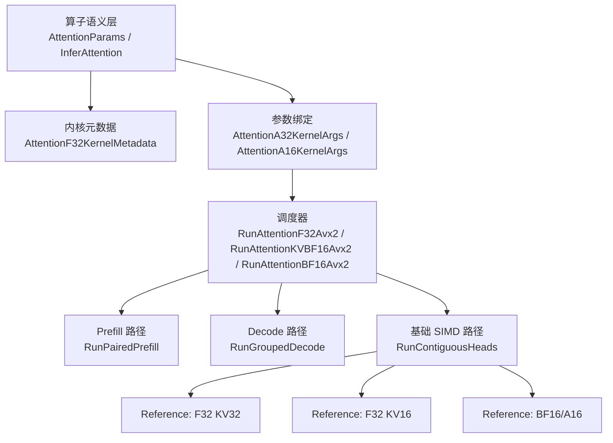
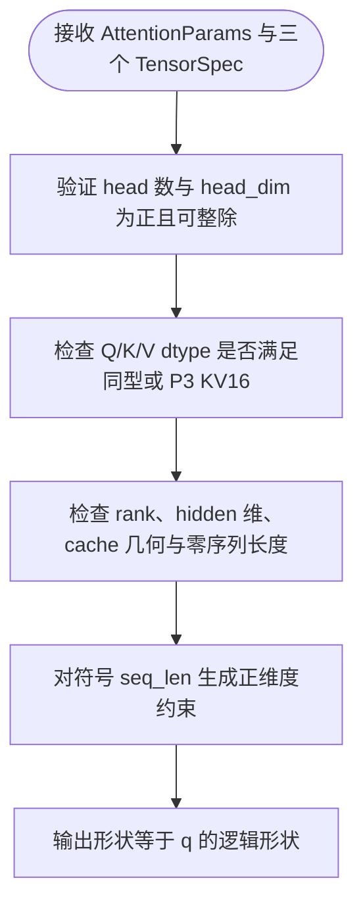
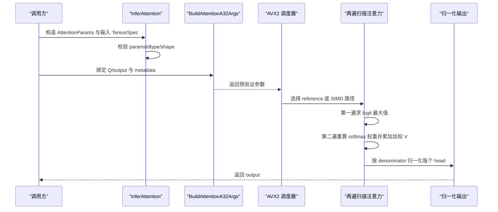
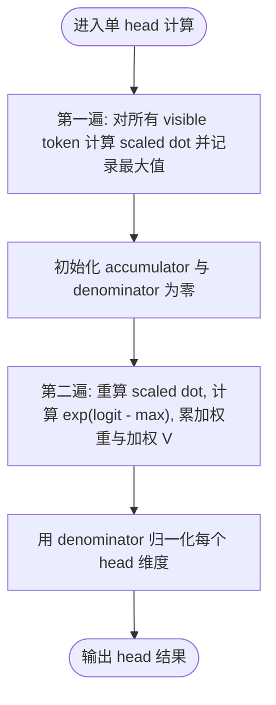
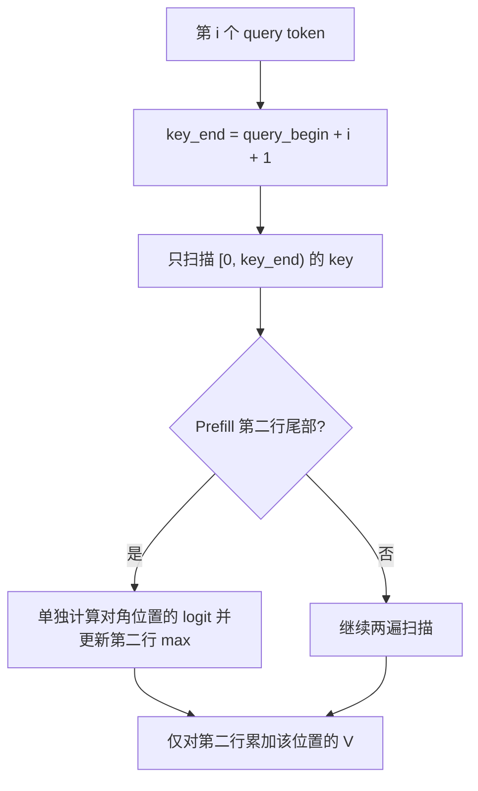
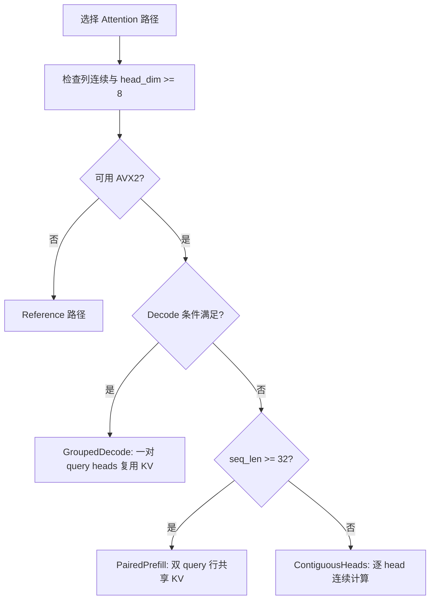
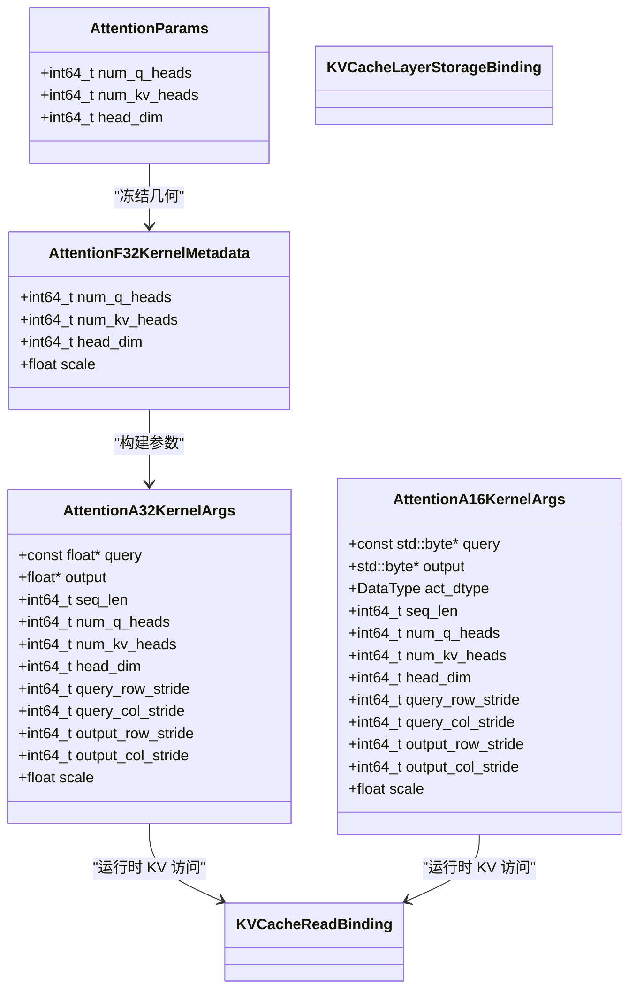

# 注意力算子

**本文引用的文件**
- [attention_op.cpp](../../../../src/operators/ops/attention_op.cpp)
- [op_params.h](../../../../include/aethermind/operators/op_params.h)
- [README.md](../../../operators/attention/README.md)
- [attention-optimization.md](../../../operators/attention/attention-optimization.md)
- [attention_internal.h](../../../../src/backend/cpu/kernels/attention/attention_internal.h)
- [attention_entry.cpp](../../../../src/backend/cpu/kernels/attention/attention_entry.cpp)
- [attention_avx2.cpp](../../../../src/backend/cpu/kernels/attention/attention_avx2.cpp)
- [attention_avx2_internal.h](../../../../src/backend/cpu/kernels/attention/attention_avx2_internal.h)
- [attention_decode_avx2_internal.h](../../../../src/backend/cpu/kernels/attention/attention_decode_avx2_internal.h)
- [attention_prefill_avx2_internal.h](../../../../src/backend/cpu/kernels/attention/attention_prefill_avx2_internal.h)
- [attention_pair_avx2_internal.h](../../../../src/backend/cpu/kernels/attention/attention_pair_avx2_internal.h)
- [attention_a32_kv32_reference.cpp](../../../../src/backend/cpu/kernels/attention/attention_a32_kv32_reference.cpp)
- [attention_a32_kv16_reference.cpp](../../../../src/backend/cpu/kernels/attention/attention_a32_kv16_reference.cpp)
- [attention_a16_kv16_reference.cpp](../../../../src/backend/cpu/kernels/attention/attention_a16_kv16_reference.cpp)
- [benchmark_cpu_attention.cpp](../../../../tests/benchmark/cpu_kernels/benchmark_cpu_attention.cpp)

## 目录
1. [简介](#简介)
2. [项目结构与定位](#项目结构与定位)
3. [核心组件与契约](#核心组件与契约)
4. [架构总览](#架构总览)
5. [详细组件分析](#详细组件分析)
6. [依赖关系分析](#依赖关系分析)
7. [性能与内存布局](#性能与内存布局)
8. [使用示例与基准测试](#使用示例与基准测试)
9. [故障排查](#故障排查)
10. [结论](#结论)

## 简介
本文面向 AetherMind 的 CPU Attention 算子，系统化说明多头注意力的实现契约、数学计算流程、输入张量形状约定、掩码处理、KV Cache 集成方式、内存布局要求、SIMD 优化策略，以及参考实现与基准测试的定位。Attention 在 AetherMind 中不是独立 ONNX 风格的矩阵乘 + Softmax 调用链，而是将缩放点积注意力、因果掩码、KV Cache 可见性、数据类型 widening、AVX2 分块路径和 Decode/GQA 复用统一为一个内核入口。

## 项目结构与定位
Attention 算子由三层组成：
- 算子语义层：定义 `AttentionParams`、dtype 与 shape 推断、运行时约束。
- 后端调度层：根据 dtype、head_dim、列连续性和执行阶段选择 reference 或 AVX2 路径。
- 内核实现层：提供 F32 KV32、F32 KV16、BF16 A16 等参考实现，以及 AVX2 连续 head、Decode 配对、Prefill 双行等优化路径。

**图示来源**
- [attention_op.cpp:1-189](../../../../src/operators/ops/attention_op.cpp#L1-L189)
- [attention_internal.h:1-100](../../../../src/backend/cpu/kernels/attention/attention_internal.h#L1-L100)
- [attention_avx2.cpp:1-45](../../../../src/backend/cpu/kernels/attention/attention_avx2.cpp#L1-L45)
- [attention_prefill_avx2_internal.h:1-65](../../../../src/backend/cpu/kernels/attention/attention_prefill_avx2_internal.h#L1-L65)
- [attention_decode_avx2_internal.h:1-68](../../../../src/backend/cpu/kernels/attention/attention_decode_avx2_internal.h#L1-L68)

**章节来源**
- [attention_op.cpp:1-189](../../../../src/operators/ops/attention_op.cpp#L1-L189)
- [attention_internal.h:1-100](../../../../src/backend/cpu/kernels/attention/attention_internal.h#L1-L100)
- [attention_avx2.cpp:1-45](../../../../src/backend/cpu/kernels/attention/attention_avx2.cpp#L1-L45)

## 核心组件与契约
### 算子参数与形状契约
- `AttentionParams` 声明查询头数、键值头数和每头维度，且要求所有维度为正，`num_q_heads` 必须是 `num_kv_heads` 的整数倍。
- 算子推断接受三类输入：`q`、`k_cache`、`v_cache`，输出逻辑形状与 `q` 一致。
- dtype 支持两种家族：
  - 同型：Q、K cache、V cache 共享同一受支持 dtype。
  - P3 混合 KV16：Q 为 Float32，K/V cache 同为 Float16 或 BFloat16。
- K/V cache 必须具有相同 dtype；输出 dtype 跟随 Q。

**图示来源**
- [attention_op.cpp:1-189](../../../../src/operators/ops/attention_op.cpp#L1-L189)
- [op_params.h:200-260](../../../../include/aethermind/operators/op_params.h#L200-L260)

**章节来源**
- [attention_op.cpp:1-189](../../../../src/operators/ops/attention_op.cpp#L1-L189)
- [op_params.h:200-260](../../../../include/aethermind/operators/op_params.h#L200-L260)

### 内核参数结构
- `AttentionF32KernelMetadata` 冻结 num_q_heads、num_kv_heads、head_dim 和 scale。
- `AttentionA32KernelArgs` 描述 F32 Q/output 指针、步长、seq_len、head geometry 和缩放因子。
- `AttentionA16KernelArgs` 描述 16-bit Q/output、act_dtype、步长与 head geometry。
- KV 缓存读取通过 `KVCacheReadBinding` 传入，不放入 prepared args。

**章节来源**
- [attention_internal.h:1-100](../../../../src/backend/cpu/kernels/attention/attention_internal.h#L1-L100)

## 架构总览
Attention 的计算遵循标准缩放点积注意力公式，但被嵌入到因果掩码与 KV Cache 可见性之中：
\[
\text{logits} = \frac{Q K^T}{\sqrt{d}}
\]
\[
\text{weights} = \operatorname{softmax}(\text{logits})
\]
\[
\text{output} = \text{weights} V
\]

其中 `d` 为 `head_dim`，scale 为 `1.0 / sqrt(head_dim)`。

**图示来源**
- [attention_op.cpp:1-189](../../../../src/operators/ops/attention_op.cpp#L1-L189)
- [attention_entry.cpp:1-200](../../../../src/backend/cpu/kernels/attention/attention_entry.cpp#L1-L200)
- [attention_avx2.cpp:1-45](../../../../src/backend/cpu/kernels/attention/attention_avx2.cpp#L1-L45)
- [attention_a32_kv32_reference.cpp:1-85](../../../../src/backend/cpu/kernels/attention/attention_a32_kv32_reference.cpp#L1-L85)

## 详细组件分析

### 数学计算流程与数值合同
Attention 的数值行为由文档与 reference 共同约束：
1. 对每个 query row/head，按 visible token 升序计算 QK 点积，乘以 scale。
2. 第一遍扫描 score 得到稳定最大值。
3. 第二遍重新计算 QK，使用 `exp(score - max)` 得到 softmax 权重，累加 denominator 与加权 V。
4. 每个输出元素除以 denominator。
5. 归约顺序固定：head_dim 升序、visible token 升序；禁止 FMA contraction 与 fast-math。
6. 特殊值传播：含 +Inf 或全 -Inf 的 score 可能产生 NaN，不保证有限 output；不主动 clamp、不替换为零向量。

**图示来源**
- [README.md](../../../operators/attention/README.md)
- [attention_a32_kv32_reference.cpp:1-85](../../../../src/backend/cpu/kernels/attention/attention_a32_kv32_reference.cpp#L1-L85)
- [attention_a32_kv16_reference.cpp:1-111](../../../../src/backend/cpu/kernels/attention/attention_a32_kv16_reference.cpp#L1-L111)
- [attention_a16_kv16_reference.cpp:1-148](../../../../src/backend/cpu/kernels/attention/attention_a16_kv16_reference.cpp#L1-L148)

**章节来源**
- [README.md](../../../operators/attention/README.md)
- [attention_a32_kv32_reference.cpp:1-85](../../../../src/backend/cpu/kernels/attention/attention_a32_kv32_reference.cpp#L1-L85)
- [attention_a32_kv16_reference.cpp:1-111](../../../../src/backend/cpu/kernels/attention/attention_a32_kv16_reference.cpp#L1-L111)
- [attention_a16_kv16_reference.cpp:1-148](../../../../src/backend/cpu/kernels/attention/attention_a16_kv16_reference.cpp#L1-L148)

### 输入张量形状约定
- Q 的逻辑形状为 `[seq_len, hidden]`，其中 `hidden == num_q_heads * head_dim`。
- K/V cache 的逻辑形状为 `[num_kv_heads, cache_len, head_dim]`。
- 输出形状与 Q 完全一致。
- 实际存储采用 strided layout：Q 与 output 支持合法正 stride，output 行不得重叠，且地址需满足 float 自然对齐。
- KV cache 使用 byte pointer 与 byte stride；head 内 logical elements 连续，token/head stride 必须覆盖实际几何且是元素大小的整数倍。

**章节来源**
- [attention_op.cpp:60-160](../../../../src/operators/ops/attention_op.cpp#L60-L160)
- [README.md](../../../operators/attention/README.md)
- [attention_entry.cpp:1-200](../../../../src/backend/cpu/kernels/attention/attention_entry.cpp#L1-L200)

### 注意力掩码与可见性
Attention 不使用显式布尔 mask 矩阵，而是通过 `query_begin`、`query_end`、`committed_end` 与 `visible_end` 控制因果范围：
- 第 i 个 query token 的 key 访问区间为 `[0, query_begin + i + 1)`。
- 只读 committed history；同一 plan 中 append window 只有在本层 KVUpdate 完成后可读。
- invocation read binding 的 visible/query bounds 必须满足。
- Prefill 双行路径会额外考虑对角位置，避免被 mask 的值参与计算。

**图示来源**
- [attention_prefill_avx2_internal.h:15-65](../../../../src/backend/cpu/kernels/attention/attention_prefill_avx2_internal.h#L15-L65)
- [attention_pair_avx2_internal.h:20-133](../../../../src/backend/cpu/kernels/attention/attention_pair_avx2_internal.h#L20-L133)
- [README.md](../../../operators/attention/README.md)

**章节来源**
- [attention_prefill_avx2_internal.h:15-65](../../../../src/backend/cpu/kernels/attention/attention_prefill_avx2_internal.h#L15-L65)
- [attention_pair_avx2_internal.h:20-133](../../../../src/backend/cpu/kernels/attention/attention_pair_avx2_internal.h#L20-L133)
- [README.md](../../../operators/attention/README.md)

### KV Cache 集成方式
KV Cache 以 `KVCacheLayerStorageBinding` 形式传入：
- `key_data`、`value_data` 指向物理存储。
- `dtype` 必须与 kernel 选择的 KV dtype 一致。
- `num_kv_heads`、`head_dim`、`token_capacity`、`token_stride_bytes`、`head_stride_bytes` 描述 KV 几何。
- `KVCacheReadBinding` 还携带 `committed_end`、`visible_end`、`query_begin`、`query_end`，用于限制每次调用的有效上下文窗口。
- 生产 KV storage 遵守 `KVCacheLayout` 的对齐；byte-safe 读取不要求 float 对齐。

**章节来源**
- [attention_entry.cpp:1-200](../../../../src/backend/cpu/kernels/attention/attention_entry.cpp#L1-L200)
- [README.md](../../../operators/attention/README.md)

### SIMD 优化策略
#### 基础连续 head 路径
- 当 Q 与 output 的列连续且 `head_dim >= 8` 时，使用 AVX2 每 8 个元素并行计算 QK 乘积、累加 weighted-V 和输出除法。
- KV16/BF16 在 FP 计算前做 widening，FP16 需要 F16C。
- 非连续列、head_dim < 8 或 ISA 不可用时回退到 reference。

#### Decode GQA/KV 复用
- 条件：单 token decode（`seq_len == 1`）、`query_end >= 16`、`query_begin == committed_end`、`num_q_heads > num_kv_heads`。
- 按 KV head 分组，每次处理相邻两个 query heads，共享 K/V load 与 widening。
- 奇数组尾留给 per-head driver；共享 K/V 值仍按原语义参与两条独立计算链。

#### Prefill 双 query 行
- 条件：沿用 AVX2 精度路径、连续列、head_dim 约束，且至少 32 个 query rows。
- 每次取相邻两行作为 tile，共享公共 K/V 前缀，按行处理 causal 对角。
- 第一行不读取对角尾部 V，避免被 mask 的 NaN/Inf 参与运算。

**图示来源**
- [attention_avx2.cpp:1-45](../../../../src/backend/cpu/kernels/attention/attention_avx2.cpp#L1-L45)
- [attention_decode_avx2_internal.h:10-68](../../../../src/backend/cpu/kernels/attention/attention_decode_avx2_internal.h#L10-L68)
- [attention_prefill_avx2_internal.h:10-65](../../../../src/backend/cpu/kernels/attention/attention_prefill_avx2_internal.h#L10-L65)
- [attention_avx2_internal.h:100-183](../../../../src/backend/cpu/kernels/attention/attention_avx2_internal.h#L100-L183)

**章节来源**
- [attention-optimization.md](../../../operators/attention/attention-optimization.md)
- [attention_avx2.cpp:1-45](../../../../src/backend/cpu/kernels/attention/attention_avx2.cpp#L1-L45)
- [attention_avx2_internal.h:1-183](../../../../src/backend/cpu/kernels/attention/attention_avx2_internal.h#L1-L183)

### 内存布局与临时缓冲区
- Q 与 output 使用 float 自然对齐，且 output 行不得重叠。
- KV cache 使用 byte stride，允许 padding；只读 logical head_dim。
- A16 路径在短 head_dim 时使用栈上 widened Q 与 accumulator；BF16 A16 在 Pair/Decode/Prefill 中最多使用固定大小的局部数组，不引入 planner workspace。
- 不缓存 KV 地址、不改变 KV 事务或 commit；scratch 由 workspace planner 提供。

**章节来源**
- [attention_avx2_internal.h:100-183](../../../../src/backend/cpu/kernels/attention/attention_avx2_internal.h#L100-L183)
- [attention_pair_avx2_internal.h:20-133](../../../../src/backend/cpu/kernels/attention/attention_pair_avx2_internal.h#L20-L133)
- [attention_prefill_avx2_internal.h:15-65](../../../../src/backend/cpu/kernels/attention/attention_prefill_avx2_internal.h#L15-L65)
- [attention_a16_kv16_reference.cpp:1-148](../../../../src/backend/cpu/kernels/attention/attention_a16_kv16_reference.cpp#L1-L148)

## 依赖关系分析
Attention 的依赖从高层到低层如下：
- `AttentionParams` 由 operator schema 使用。
- `InferAttention` 负责 dtype、shape 与运行时约束。
- `AttentionF32KernelMetadata`、`AttentionA32KernelArgs`、`AttentionA16KernelArgs` 是内核参数载体。
- `KVCacheReadBinding` 提供 KV 缓存与可见性边界。
- AVX2 调度器依赖 CPU feature policy、ISA 能力检测和内部 template 路径。

**图示来源**
- [op_params.h:200-260](../../../../include/aethermind/operators/op_params.h#L200-L260)
- [attention_internal.h:1-100](../../../../src/backend/cpu/kernels/attention/attention_internal.h#L1-L100)
- [attention_entry.cpp:1-200](../../../../src/backend/cpu/kernels/attention/attention_entry.cpp#L1-L200)

**章节来源**
- [op_params.h:200-260](../../../../include/aethermind/operators/op_params.h#L200-L260)
- [attention_internal.h:1-100](../../../../src/backend/cpu/kernels/attention/attention_internal.h#L1-L100)
- [attention_entry.cpp:1-200](../../../../src/backend/cpu/kernels/attention/attention_entry.cpp#L1-L200)

## 性能与内存布局
### 计算复杂度
- 单 head 的单 token attention 时间复杂度约为 \(O(\text{key\_len} \times d)\)。
- 整体 Attention 复杂度约为 \(O(\text{seq\_len} \times \text{num\_q\_heads} \times \text{key\_len} \times d)\)。
- Decode 配对与 Prefill 双行主要减少 KV load/widening 与重复 QK 计算，但不改变大 O 渐近复杂度。

### 内存访问模式
- Q 与 output 通常按行主序逻辑访问，column stride 决定 head 内元素布局。
- KV cache 通过 token_stride 和 head_stride 访问，避免跨 head 跳跃。
- AVX2 路径优先按 8 元素组加载 K/V，尾部分 scalar 处理。
- A16 路径对短 head_dim 使用栈上 accumulator，避免 heap allocation。

### 性能特征
- F32 KV32 路径直接进行 FP32 乘加。
- KV16/BF16 路径在 widening 后复用 FP32 循环。
- BF16 A16 路径在 SIMD 下使用固定大小局部数组，减少 narrowing 次数。
- Decode GQA 复用减少 load/widening 工作，但不能据此断言 DRAM traffic 降低。

[本节为通用性能讨论，未直接分析具体代码片段，故无“章节来源”]

## 使用示例与基准测试
### 使用示例要点
- 构造 `AttentionParams`，设置 `num_q_heads`、`num_kv_heads`、`head_dim`。
- 准备 Q tensor：形状 `[seq_len, num_q_heads * head_dim]`，dtype 符合 contract。
- 准备 K/V cache：形状 `[num_kv_heads, cache_len, head_dim]`，dtype 与 Q 同型或满足 P3 KV16。
- 构造 `KVCacheReadBinding`，设置 storage、committed_end、visible_end、query_begin、query_end。
- 通过 backend PrepareKernel 获取 kernel，再绑定 inputs/outputs/attrs 并调用 kernel function。
- benchmark 中交替填充 K/V 的两行，以便解析 oracle 验证因果注意力。

**章节来源**
- [benchmark_cpu_attention.cpp:1-158](../../../../tests/benchmark/cpu_kernels/benchmark_cpu_attention.cpp#L1-L158)

### 基准测试场景
benchmark 覆盖以下关键 shape tuple：
- 单 token decode：不同 context 长度。
- 多 set 旋转 KV：评估 working set 遍历。
- Prefill：不同 rows 与 context，包括 2048、4096 长上下文。
- dtype 组合：F32、KV16、KVBF16、BF16A16。
- group 配置：GQA/MHA/MQA 通过 `q_heads = kv_heads * group` 表达。

**章节来源**
- [benchmark_cpu_attention.cpp:100-158](../../../../tests/benchmark/cpu_kernels/benchmark_cpu_attention.cpp#L100-L158)

## 故障排查
### 常见参数错误
- `num_q_heads`、`num_kv_heads`、`head_dim` 非正。
- `num_q_heads % num_kv_heads != 0`。
- Q hidden 维不等于 `num_q_heads * head_dim`。
- K/V cache dtype 不一致。
- Q/K/V dtype 不符合同型或 P3 KV16。
- Q rank 不为 2，或 K/V cache rank 不为 3。
- static zero seq_len 或 static zero cache_len。

### 常见绑定错误
- KV storage dtype 不是 Float32，或 key/value 指针为空。
- num_kv_heads、head_dim、token_capacity 为零。
- token_stride_bytes、head_stride_bytes 溢出 int64。
- output 与 Q 或可见 K/V 存在 alias 无法证明不相交。
- Q/output 不是 float 对齐。

### 数值异常
- softmax 可能产生 NaN，特别是 score 包含 +Inf 或全 -Inf。
- 算术非有限结果不转换为 metadata 错误。
- 模型准入与校准资产必须使用量化后的 cache，不能用未量化 K/V。

**章节来源**
- [attention_op.cpp:1-189](../../../../src/operators/ops/attention_op.cpp#L1-L189)
- [attention_entry.cpp:1-200](../../../../src/backend/cpu/kernels/attention/attention_entry.cpp#L1-L200)
- [README.md](../../../operators/attention/README.md)

## 结论
AetherMind 的 Attention 算子在语义层严格定义了多头注意力的 dtype、shape 与 KV 可见性契约；在内核层提供了 F32 KV32、F32 KV16、BF16 A16 参考实现，并在 AVX2 上实现了连续 head、Decode GQA/KV 复用与 Prefill 双行优化。其核心数学仍然是 `QK^T / sqrt(d)` 加上因果掩码下的 softmax 与加权 V 求和，但实现细节强调固定归约顺序、避免 FMA contraction、精确控制 KV cache 可见性与类型 widening。对于工程实践，应优先关注 input dtype 匹配、KV cache stride 正确性、visible/query bounds 合理性，以及在长 context 与多 head 场景下选择合适的 AVX2 路径。
