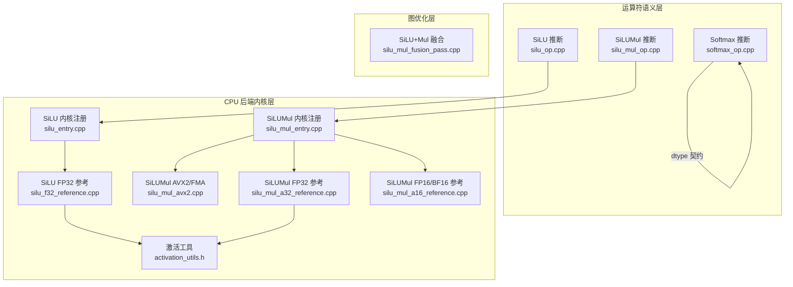
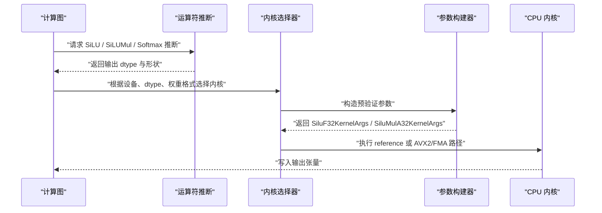
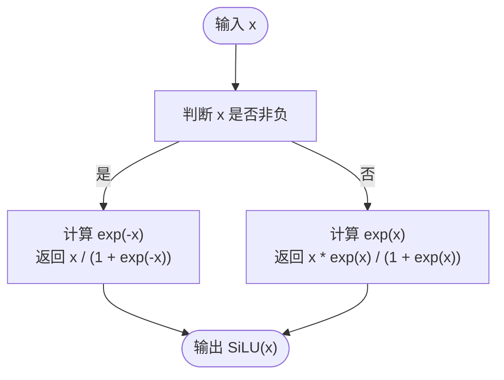
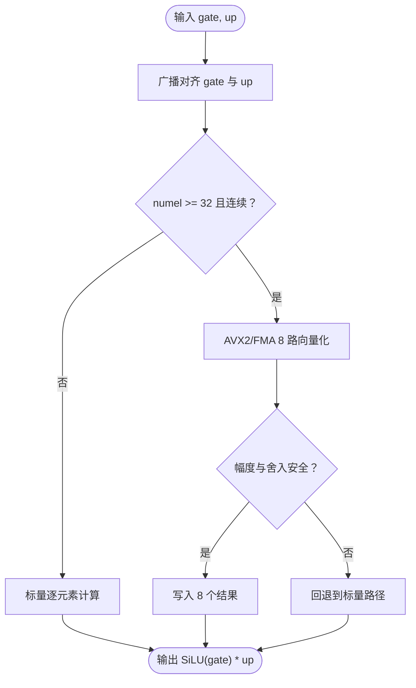
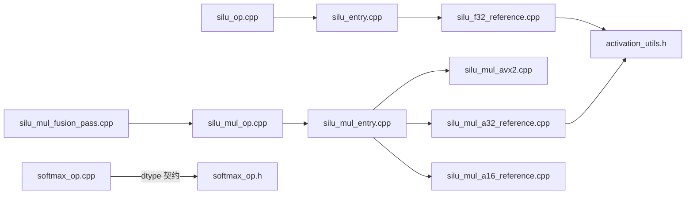

# 激活函数算子

**本文引用的文件**
- [silu_op.cpp](../../../../src/operators/ops/silu_op.cpp)
- [silu_op.h](../../../../include/aethermind/operators/ops/silu_op.h)
- [silu_mul_op.cpp](../../../../src/operators/ops/silu_mul_op.cpp)
- [silu_mul_op.h](../../../../include/aethermind/operators/ops/silu_mul_op.h)
- [softmax_op.cpp](../../../../src/operators/ops/softmax_op.cpp)
- [softmax_op.h](../../../../include/aethermind/operators/ops/softmax_op.h)
- [activation_utils.h](../../../../include/aethermind/backend/cpu/kernels/common/activation_utils.h)
- [silu_internal.h](../../../../src/backend/cpu/kernels/silu/silu_internal.h)
- [silu_entry.cpp](../../../../src/backend/cpu/kernels/silu/silu_entry.cpp)
- [silu_f32_reference.cpp](../../../../src/backend/cpu/kernels/silu/silu_f32_reference.cpp)
- [silu_mul_internal.h](../../../../src/backend/cpu/kernels/silu_mul/silu_mul_internal.h)
- [silu_mul_entry.cpp](../../../../src/backend/cpu/kernels/silu_mul/silu_mul_entry.cpp)
- [silu_mul_a32_reference.cpp](../../../../src/backend/cpu/kernels/silu_mul/silu_mul_a32_reference.cpp)
- [silu_mul_a16_reference.cpp](../../../../src/backend/cpu/kernels/silu_mul/silu_mul_a16_reference.cpp)
- [silu_mul_avx2.cpp](../../../../src/backend/cpu/kernels/silu_mul/silu_mul_avx2.cpp)
- [silu_mul_fusion_pass.cpp](../../../../src/graph/optimization/silu_mul_fusion_pass.cpp)
- [README.md](../../../operators/silu_mul/README.md)

## 目录
1. [引言](#引言)
2. [项目结构](#项目结构)
3. [核心组件](#核心组件)
4. [架构总览](#架构总览)
5. [详细组件分析](#详细组件分析)
6. [依赖关系分析](#依赖关系分析)
7. [性能与数值特性](#性能与数值特性)
8. [故障排查指南](#故障排查指南)
9. [结论](#结论)

## 引言
本文面向 AetherMind 的 CPU 端激活函数算子，聚焦以下三个实现：
- SiLU：逐元素激活，数学定义为 SiLU(x) = x · sigmoid(x)。
- SiLUMul：将 SiLU(gate) 与 up 逐元素相乘融合为单一算子。
- Softmax：当前仓库提供语义契约与输入校验，但未见完整内核实现；本文说明其 dtype 支持范围、推断行为及可扩展方向。

重点覆盖：
- 数学定义与数值稳定实现。
- 内存访问模式、广播语义和别名安全。
- 并行化策略、SIMD 向量化（AVX2/FMA）以及分支回退机制。
- 图优化中的 SiLU → SiLUMul 融合规则。
- 使用示例路径、基准文档位置与调优建议。

## 项目结构
与激活函数相关的代码分布在运算符语义层、CPU 后端内核层和图优化层：
- 运算符语义层负责类型检查、形状推断和运行时契约。
- CPU 后端内核层提供 FP32、FP16/BF16 参考实现与 AVX2/FMA 优化路径。
- 图优化层在编译期将 SiLU + ElementwiseMul 合并为 SiLUMul。

**图表来源**
- [silu_op.cpp:1-27](../../../../src/operators/ops/silu_op.cpp#L1-L27)
- [silu_mul_op.cpp:1-52](../../../../src/operators/ops/silu_mul_op.cpp#L1-L52)
- [softmax_op.cpp:1-23](../../../../src/operators/ops/softmax_op.cpp#L1-L23)
- [silu_entry.cpp:1-124](../../../../src/backend/cpu/kernels/silu/silu_entry.cpp#L1-L124)
- [silu_f32_reference.cpp:1-44](../../../../src/backend/cpu/kernels/silu/silu_f32_reference.cpp#L1-L44)
- [silu_mul_entry.cpp:1-208](../../../../src/backend/cpu/kernels/silu_mul/silu_mul_entry.cpp#L1-L208)
- [silu_mul_avx2.cpp:1-129](../../../../src/backend/cpu/kernels/silu_mul/silu_mul_avx2.cpp#L1-L129)
- [silu_mul_a32_reference.cpp:1-60](../../../../src/backend/cpu/kernels/silu_mul/silu_mul_a32_reference.cpp#L1-L60)
- [silu_mul_a16_reference.cpp:1-81](../../../../src/backend/cpu/kernels/silu_mul/silu_mul_a16_reference.cpp#L1-L81)
- [activation_utils.h:1-23](../../../../include/aethermind/backend/cpu/kernels/common/activation_utils.h#L1-L23)
- [silu_mul_fusion_pass.cpp:1-158](../../../../src/graph/optimization/silu_mul_fusion_pass.cpp#L1-L158)

**章节来源**
- [silu_op.cpp:1-27](../../../../src/operators/ops/silu_op.cpp#L1-L27)
- [silu_mul_op.cpp:1-52](../../../../src/operators/ops/silu_mul_op.cpp#L1-L52)
- [softmax_op.cpp:1-23](../../../../src/operators/ops/softmax_op.cpp#L1-L23)
- [silu_entry.cpp:1-124](../../../../src/backend/cpu/kernels/silu/silu_entry.cpp#L1-L124)
- [silu_mul_entry.cpp:1-208](../../../../src/backend/cpu/kernels/silu_mul/silu_mul_entry.cpp#L1-L208)
- [silu_mul_fusion_pass.cpp:1-158](../../../../src/graph/optimization/silu_mul_fusion_pass.cpp#L1-L158)

## 核心组件
本节从“算子语义”和“CPU 内核实现”两个层面说明 SiLU、SiLUMul、Softmax。

### SiLU
- 语义契约
  - 支持数据类型：Float32、Float16、BFloat16、Float8E4M3FN、Float8E5M2。
  - 推断逻辑要求输入数量为一，且 dtype 属于允许集合；输出形状与输入一致。
- CPU 内核
  - 仅注册了 FP32 reference 内核。
  - 参数构建阶段校验 rank、shape、contiguous、空张量、指针有效性、输出映射单射性和别名安全。
  - 参考实现按 flat 或逐坐标遍历，调用公共激活工具计算 SiLU。
- 数值实现
  - 公共工具中，对非负输入使用 exp(-x)，对负输入使用 exp(x)，避免对正数直接求大指数导致溢出。

**章节来源**
- [silu_op.h:1-52](../../../../include/aethermind/operators/ops/silu_op.h#L1-L52)
- [silu_op.cpp:1-27](../../../../src/operators/ops/silu_op.cpp#L1-L27)
- [silu_internal.h:1-35](../../../../src/backend/cpu/kernels/silu/silu_internal.h#L1-L35)
- [silu_entry.cpp:1-124](../../../../src/backend/cpu/kernels/silu/silu_entry.cpp#L1-L124)
- [silu_f32_reference.cpp:1-44](../../../../src/backend/cpu/kernels/silu/silu_f32_reference.cpp#L1-L44)
- [activation_utils.h:1-23](../../../../include/aethermind/backend/cpu/kernels/common/activation_utils.h#L1-L23)

### SiLUMul
- 语义契约
  - gate 与 up 必须同 dtype，且属于允许集合。
  - 输出形状由 NumPy 风格广播决定；延迟维度约束被记录为运行时广播检查。
- CPU 内核
  - 支持 FP32、FP16/BF16。
  - FP32 有 reference 与 AVX2/FMA 优化路径；BF16 有 reference 与 AVX2/FMA 路径。
  - 参数构建阶段统一走广播准备流程，产出 lhs/rhs/output 的形状、步长与 numel。
- 融合优势
  - 只读一次 gate，一次 SiLU，一次乘法，一次写 output，减少中间张量与访存。
  - 图优化可将 SiLU 后接 ElementwiseMul 替换为 SiLUMul。

**章节来源**
- [silu_mul_op.h:1-52](../../../../include/aethermind/operators/ops/silu_mul_op.h#L1-L52)
- [silu_mul_op.cpp:1-52](../../../../src/operators/ops/silu_mul_op.cpp#L1-L52)
- [silu_mul_internal.h:1-86](../../../../src/backend/cpu/kernels/silu_mul/silu_mul_internal.h#L1-L86)
- [silu_mul_entry.cpp:1-208](../../../../src/backend/cpu/kernels/silu_mul/silu_mul_entry.cpp#L1-L208)
- [silu_mul_a32_reference.cpp:1-60](../../../../src/backend/cpu/kernels/silu_mul/silu_mul_a32_reference.cpp#L1-L60)
- [silu_mul_a16_reference.cpp:1-81](../../../../src/backend/cpu/kernels/silu_mul/silu_mul_a16_reference.cpp#L1-L81)
- [silu_mul_avx2.cpp:1-129](../../../../src/backend/cpu/kernels/silu_mul/silu_mul_avx2.cpp#L1-L129)
- [silu_mul_fusion_pass.cpp:1-158](../../../../src/graph/optimization/silu_mul_fusion_pass.cpp#L1-L158)

### Softmax
- 语义契约
  - 支持数据类型：Float32、Float16、BFloat16。
  - 推断逻辑要求输入数量为一，且 dtype 属于允许集合；输出形状与输入一致。
- 实现现状
  - 当前仓库仅提供推断实现，未见 Softmax 内核注册或具体数值实现。
  - 扩展时需新增 dtype 选择、axis 配置、数值稳定实现与内核注册。

**章节来源**
- [softmax_op.h:1-49](../../../../include/aethermind/operators/ops/softmax_op.h#L1-L49)
- [softmax_op.cpp:1-23](../../../../src/operators/ops/softmax_op.cpp#L1-L23)

## 架构总览
下图展示从图到内核的执行路径：

**图表来源**
- [silu_op.cpp:1-27](../../../../src/operators/ops/silu_op.cpp#L1-L27)
- [silu_mul_op.cpp:1-52](../../../../src/operators/ops/silu_mul_op.cpp#L1-L52)
- [softmax_op.cpp:1-23](../../../../src/operators/ops/softmax_op.cpp#L1-L23)
- [silu_entry.cpp:1-124](../../../../src/backend/cpu/kernels/silu/silu_entry.cpp#L1-L124)
- [silu_mul_entry.cpp:1-208](../../../../src/backend/cpu/kernels/silu_mul/silu_mul_entry.cpp#L1-L208)

## 详细组件分析

### SiLU 算子
#### 数学定义与数值实现
- 定义：SiLU(x) = x · sigmoid(x)。
- 数值稳定实现：
  - 当 x ≥ 0 时，采用 x / (1 + exp(-x))，避免计算大 exp(x)。
  - 当 x < 0 时，采用 x · exp(x) / (1 + exp(x))，避免 exp(-x) 溢出。
- 复杂度：每个元素 O(1)，整体 O(n)。
- 内存访问：顺序读写一个输入和一个输出，无额外分配。

**图表来源**
- [activation_utils.h:11-20](../../../../include/aethermind/backend/cpu/kernels/common/activation_utils.h#L11-L20)

#### 内存访问与并行化
- Reference 内核按 flat index 迭代；若 is_flat 则线性扫描；否则按坐标反推偏移。
- 别名安全：
  - 若 input 与 output 视图映射相同，则允许原地更新。
  - 否则要求输入与输出地址区间不相交，防止读取未刷新数据。
- 并行化：
  - 当前 reference 实现为标量循环；可通过 OpenMP 或线程分块进行粗粒度并行。
  - 因访存局部性好，适合 SIMD 向量化；当前仓库未提供 SiLU 的 AVX2 专用内核，但可复用该内存模型。

**章节来源**
- [silu_f32_reference.cpp:1-44](../../../../src/backend/cpu/kernels/silu/silu_f32_reference.cpp#L1-L44)
- [silu_entry.cpp:29-106](../../../../src/backend/cpu/kernels/silu/silu_entry.cpp#L29-L106)
- [activation_utils.h:11-20](../../../../include/aethermind/backend/cpu/kernels/common/activation_utils.h#L11-L20)

### SiLUMul 算子
#### 融合语义
- 输入语义固定：gate 先经过 SiLU，再与 up 逐元素相乘。
- 广播语义：遵循 NumPy 风格广播；延迟轴信息以运行时检查形式保存。
- 数据类型：gate 与 up 必须同 dtype，且属于允许集合。

#### 数值实现
- FP32 参考：直接调用 ComputeSiluF32(gate[i]) * up[i]。
- FP16/BF16 参考：先将元素拓宽到 FP32，计算 SiLU 与乘积，再一次性窄化回原 dtype。
- AVX2/FMA 优化：
  - 仅在默认舍入、连续布局且元素数至少为 32 时启用。
  - 每次处理 8 个元素：向量加载、幅度检查、分段稳定 exp 近似、向量除法与乘法。
  - 若遇到不安全幅度的元素或 BF16 舍入边界模糊，则回退到标量参考路径。

**图表来源**
- [silu_mul_entry.cpp:65-129](../../../../src/backend/cpu/kernels/silu_mul/silu_mul_entry.cpp#L65-L129)
- [silu_mul_avx2.cpp:1-129](../../../../src/backend/cpu/kernels/silu_mul/silu_mul_avx2.cpp#L1-L129)
- [silu_mul_a32_reference.cpp:1-60](../../../../src/backend/cpu/kernels/silu_mul/silu_mul_a32_reference.cpp#L1-L60)
- [silu_mul_a16_reference.cpp:1-81](../../../../src/backend/cpu/kernels/silu_mul/silu_mul_a16_reference.cpp#L1-L81)

#### 内存访问模式
- 参数构建阶段通过广播准备得到统一的 numel、is_flat、rank 与各操作数的 shape/stride。
- Reference 路径：
  - is_flat 时为连续内存顺序访问。
  - 非 flat 时按输出坐标计算 gate/up/output 的偏移，保证广播正确性。
- 别名安全：
  - 广播准备会检查输出注入性与地址冲突，确保同一输出不被重复写入。

**章节来源**
- [silu_mul_entry.cpp:21-64](../../../../src/backend/cpu/kernels/silu_mul/silu_mul_entry.cpp#L21-L64)
- [silu_mul_internal.h:14-86](../../../../src/backend/cpu/kernels/silu_mul/silu_mul_internal.h#L14-L86)
- [silu_mul_a32_reference.cpp:15-60](../../../../src/backend/cpu/kernels/silu_mul/silu_mul_a32_reference.cpp#L15-L60)
- [silu_mul_a16_reference.cpp:24-81](../../../../src/backend/cpu/kernels/silu_mul/silu_mul_a16_reference.cpp#L24-L81)

#### 并行化策略
- 当前参考实现为串行循环；可在外层按线程分片，每片内保持连续访存。
- AVX2/FMA 路径已实现 8 路向量化，充分利用寄存器与流水线。
- 对 BF16 路径，向量化前先提升为 FP32，最后一次性窄化，减少多次转换开销。

**章节来源**
- [silu_mul_avx2.cpp:1-129](../../../../src/backend/cpu/kernels/silu_mul/silu_mul_avx2.cpp#L1-L129)
- [silu_mul_a16_reference.cpp:1-81](../../../../src/backend/cpu/kernels/silu_mul/silu_mul_a16_reference.cpp#L1-L81)

### Softmax 算子
#### 当前状态
- 已定义支持的 dtype：Float32、Float16、BFloat16。
- 推断逻辑仅做 dtype 校验与输入计数校验，输出形状与输入相同。
- 仓库中未发现 Softmax 内核注册或数值实现，因此不能据此评估其内存访问与并行化细节。

#### 可扩展设计建议
- 增加 axis 参数以指定归一化维度。
- 数值稳定实现应减去每行的最大值，再进行 exp 与归一化，防止上溢与下溢。
- 针对连续行优先布局，可实现按行向量化；对于广播或非连续布局，需先规划 stride 映射。
- 可参照 SiLUMul 的参数构建与广播工具，统一输出注入性与别名安全检查。

**章节来源**
- [softmax_op.h:1-49](../../../../include/aethermind/operators/ops/softmax_op.h#L1-L49)
- [softmax_op.cpp:1-23](../../../../src/operators/ops/softmax_op.cpp#L1-L23)

## 依赖关系分析
SiLU 与 SiLUMul 的核心依赖如下：
- 运算符推断依赖 dtype 支持与输入计数校验。
- CPU 内核依赖广播工具、别名工具与激活工具。
- 图优化依赖 OpType 语义，将 SiLU + ElementwiseMul 重写为 SiLUMul。

**图表来源**
- [silu_op.cpp:1-27](../../../../src/operators/ops/silu_op.cpp#L1-L27)
- [silu_mul_op.cpp:1-52](../../../../src/operators/ops/silu_mul_op.cpp#L1-L52)
- [softmax_op.cpp:1-23](../../../../src/operators/ops/softmax_op.cpp#L1-L23)
- [silu_entry.cpp:1-124](../../../../src/backend/cpu/kernels/silu/silu_entry.cpp#L1-L124)
- [silu_mul_entry.cpp:1-208](../../../../src/backend/cpu/kernels/silu_mul/silu_mul_entry.cpp#L1-L208)
- [silu_mul_avx2.cpp:1-129](../../../../src/backend/cpu/kernels/silu_mul/silu_mul_avx2.cpp#L1-L129)
- [silu_mul_a32_reference.cpp:1-60](../../../../src/backend/cpu/kernels/silu_mul/silu_mul_a32_reference.cpp#L1-L60)
- [silu_mul_a16_reference.cpp:1-81](../../../../src/backend/cpu/kernels/silu_mul/silu_mul_a16_reference.cpp#L1-L81)
- [activation_utils.h:1-23](../../../../include/aethermind/backend/cpu/kernels/common/activation_utils.h#L1-L23)
- [silu_mul_fusion_pass.cpp:1-158](../../../../src/graph/optimization/silu_mul_fusion_pass.cpp#L1-L158)

**章节来源**
- [silu_op.cpp:1-27](../../../../src/operators/ops/silu_op.cpp#L1-L27)
- [silu_mul_op.cpp:1-52](../../../../src/operators/ops/silu_mul_op.cpp#L1-L52)
- [softmax_op.cpp:1-23](../../../../src/operators/ops/softmax_op.cpp#L1-L23)
- [silu_mul_fusion_pass.cpp:1-158](../../../../src/graph/optimization/silu_mul_fusion_pass.cpp#L1-L158)

## 性能与数值特性

### 数值稳定性
- SiLU：
  - 通过正负分支分别计算 exp，避免对正数直接计算 exp(x) 导致的溢出。
  - 对极小值，sigmoid 接近 0，SiLU 接近 0；对极大值，sigmoid 接近 1，SiLU 接近 x。
- SiLUMul AVX2：
  - 对负输入使用分段稳定的 exp 近似，并在安全幅度范围内进行向量化计算。
  - 对超出安全范围的元素或 BF16 舍入边界模糊的元素，回退标量路径以保证精度。
- Softmax：
  - 当前未见实现；建议在扩展时使用“减最大值”技巧，再计算 exp 与归一化。

**章节来源**
- [activation_utils.h:11-20](../../../../include/aethermind/backend/cpu/kernels/common/activation_utils.h#L11-L20)
- [silu_mul_avx2.cpp:1-129](../../../../src/backend/cpu/kernels/silu_mul/silu_mul_avx2.cpp#L1-L129)
- [softmax_op.cpp:1-23](../../../../src/operators/ops/softmax_op.cpp#L1-L23)

### 内存访问与带宽特征
- SiLU：单读单写，局部性好，适合向量化与缓存友好遍历。
- SiLUMul：双读单写；广播场景下可能产生非连续访问，Reference 通过坐标映射保证正确性。
- 连续布局与较大 numel 有利于触发 AVX2 路径。

**章节来源**
- [silu_f32_reference.cpp:12-44](../../../../src/backend/cpu/kernels/silu/silu_f32_reference.cpp#L12-L44)
- [silu_mul_a32_reference.cpp:15-60](../../../../src/backend/cpu/kernels/silu_mul/silu_mul_a32_reference.cpp#L15-L60)
- [silu_mul_a16_reference.cpp:24-81](../../../../src/backend/cpu/kernels/silu_mul/silu_mul_a16_reference.cpp#L24-L81)

### 并行化与 SIMD
- 参考实现为标量循环；可按线程分片实现多核并行。
- SiLUMul AVX2/FMA 提供 8 路向量化，减少函数调用与分支，提高吞吐。
- BF16 路径通过 FP32 中间计算与一次窄化，平衡精度与性能。

**章节来源**
- [silu_mul_avx2.cpp:1-129](../../../../src/backend/cpu/kernels/silu_mul/silu_mul_avx2.cpp#L1-L129)
- [silu_mul_a16_reference.cpp:1-81](../../../../src/backend/cpu/kernels/silu_mul/silu_mul_a16_reference.cpp#L1-L81)

### 使用示例路径
- Llama Dense 前向图中可直接生成 SiLUMul；通用图也可通过 SiLU + Mul 融合成 SiLUMul。
- 在推理脚本或测试中，可通过 SiLU、ElementwiseMul、SiLUMul 三种方式表达相同计算；融合后可减少中间张量。
- 相关文档位于 docs/operators/silu_mul/README.md，其中说明 CPU-05 提供的 FP32/BF16 AVX2/FMA prepared kernel 及广播、零元素等边界行为。

**章节来源**
- [silu_mul_fusion_pass.cpp:117-158](../../../../src/graph/optimization/silu_mul_fusion_pass.cpp#L117-L158)
- [README.md](../../../operators/silu_mul/README.md)

### 基准测试结果与调优建议
- 基准结果不在本文件中直接给出；可查阅 docs/operators/silu_mul/benchmarks 下的基准报告。
- 调优建议：
  - 尽量让 gate 与 up 连续且 numel ≥ 32，以进入 AVX2/FMA 路径。
  - 使用默认舍入模式；非默认舍入会回退 reference。
  - 避免在热点路径上频繁切换 dtype；BF16 路径应在批处理级别复用。
  - 控制广播维度，减少非连续访问；必要时在预处理阶段 reshape 为连续布局。
  - 对大规模批次，考虑线程分片与 cache-friendly 的数据组织。

**章节来源**
- [README.md](../../../operators/silu_mul/README.md)
- [silu_mul_entry.cpp:65-129](../../../../src/backend/cpu/kernels/silu_mul/silu_mul_entry.cpp#L65-L129)
- [silu_mul_avx2.cpp:93-129](../../../../src/backend/cpu/kernels/silu_mul/silu_mul_avx2.cpp#L93-L129)

## 故障排查指南

### 常见错误与原因
- “节点需要特定参数类型”
  - SiLU/SiLUMul/Softmax 推断均要求传入对应参数对象。
- “不支持的数据类型”
  - SiLU 支持 Float32/Float16/BFloat16/Float8E4M3FN/Float8E5M2。
  - SiLUMul 要求 gate 与 up 同 dtype，且属于上述集合。
  - Softmax 支持 Float32/Float16/BFloat16。
- “SiLUMul 的 gate 与 up dtype 不同”
  - 融合算子不声明隐式转换策略，需在输入侧统一 dtype。
- “广播维度不兼容”
  - SiLUMul 推断失败时会返回广播失败的 status；请检查两输入形状是否能广播。

**章节来源**
- [silu_op.cpp:8-25](../../../../src/operators/ops/silu_op.cpp#L8-L25)
- [silu_mul_op.cpp:8-50](../../../../src/operators/ops/silu_mul_op.cpp#L8-L50)
- [softmax_op.cpp:8-21](../../../../src/operators/ops/softmax_op.cpp#L8-L21)

### 内核参数构建失败
- 输入输出数量不正确。
- dtype 不匹配预期。
- rank 超过最大限制。
- 空张量与非空张量的指针为空。
- 输出映射非单射或输入输出地址重叠。

**章节来源**
- [silu_entry.cpp:18-106](../../../../src/backend/cpu/kernels/silu/silu_entry.cpp#L18-L106)
- [silu_mul_entry.cpp:21-64](../../../../src/backend/cpu/kernels/silu_mul/silu_mul_entry.cpp#L21-L64)

### 性能退化定位
- 非连续布局或 numel < 32：无法进入 AVX2/FMA。
- 非默认舍入模式：AVX2 路径回退 reference。
- 广播导致非连续访问：参考路径仍正确，但向量化收益下降。
- BF16 舍入边界模糊：AVX2 存储路径回退标量。

**章节来源**
- [silu_mul_avx2.cpp:93-129](../../../../src/backend/cpu/kernels/silu_mul/silu_mul_avx2.cpp#L93-L129)
- [silu_mul_entry.cpp:65-129](../../../../src/backend/cpu/kernels/silu_mul/silu_mul_entry.cpp#L65-L129)

## 结论
- SiLU 在当前仓库中以 FP32 reference 形式实现，具备数值稳定分支，适合后续扩展 AVX2/FMA 内核。
- SiLUMul 提供了完整的语义契约、广播语义、reference 与 AVX2/FMA 优化路径，并支持 FP32 与 FP16/BF16；它是 SiLU + Mul 的高效融合实现。
- Softmax 目前仅有 dtype 契约与推断入口，尚未实现内核；如需使用，应补充 axis 参数、数值稳定实现与内核注册。
- 在实际工程中，推荐优先使用 SiLUMul 融合算子，并通过连续布局、合理批大小与默认舍入模式获得最佳性能。
