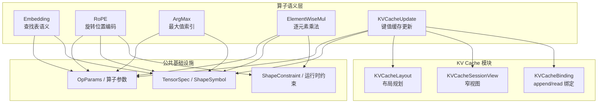
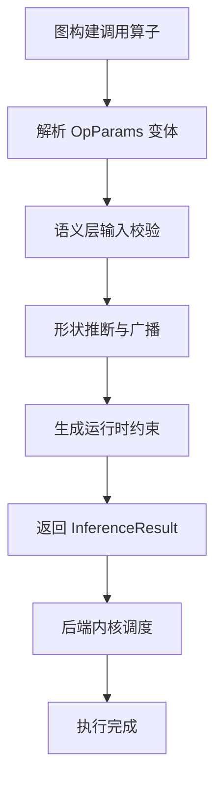
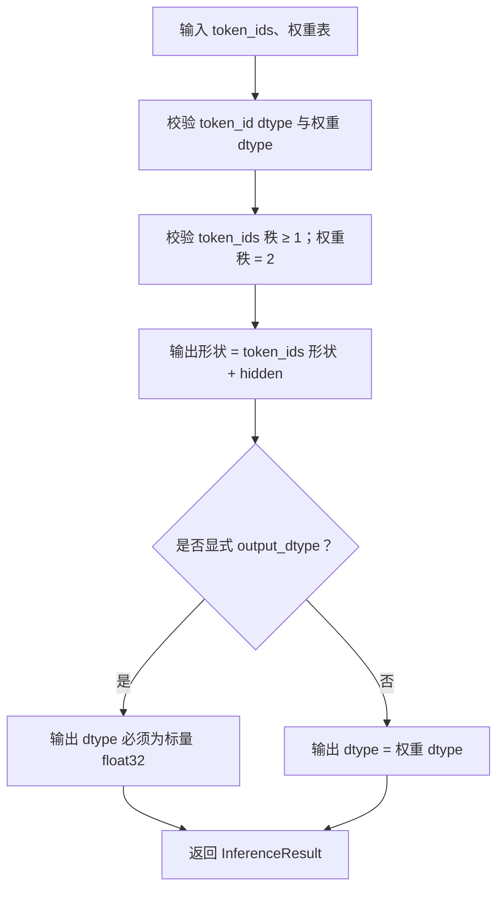
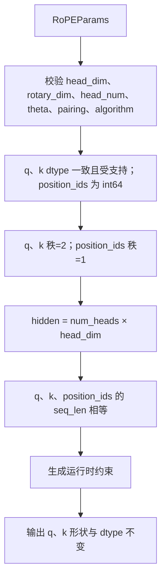
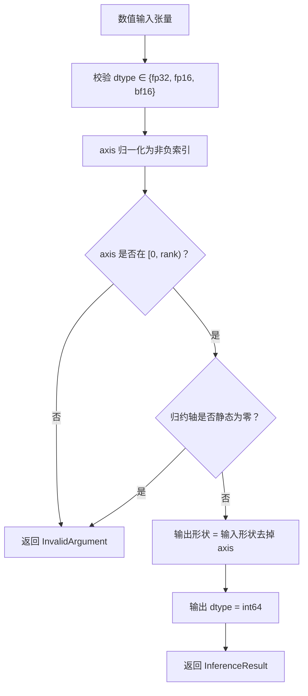
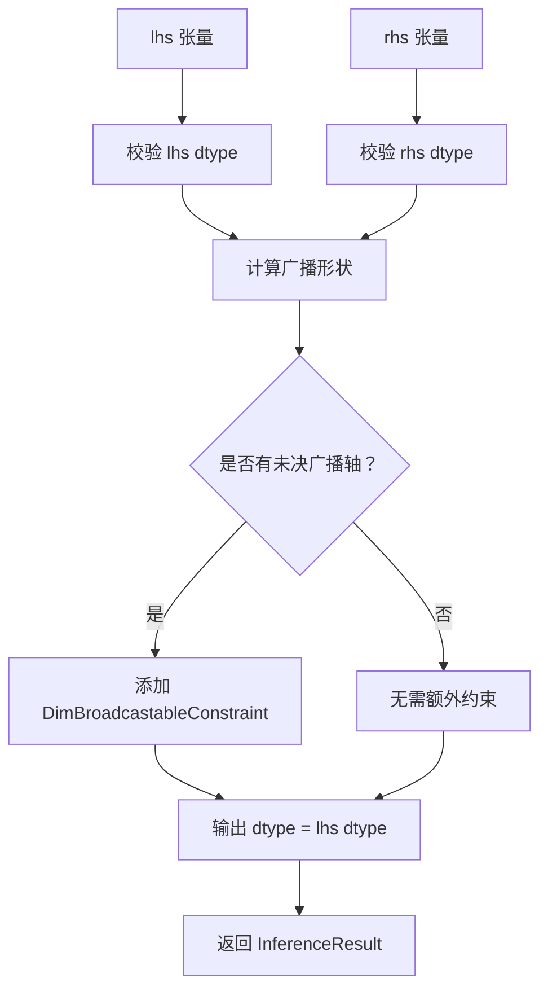
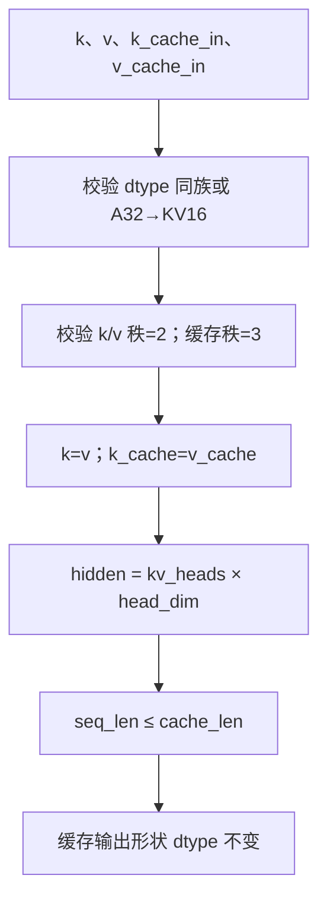
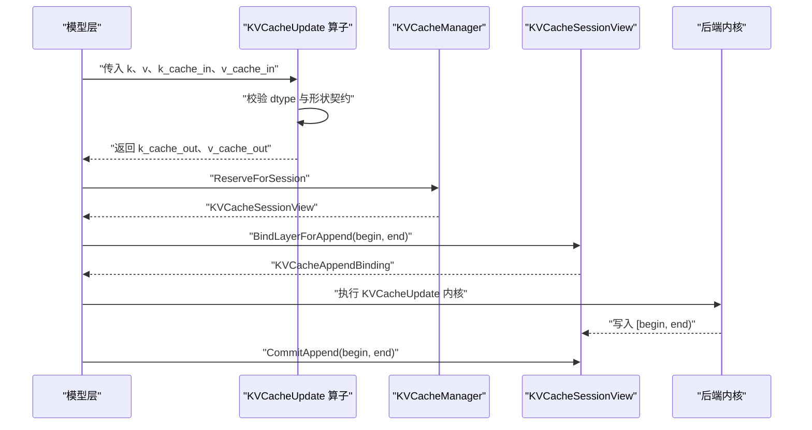
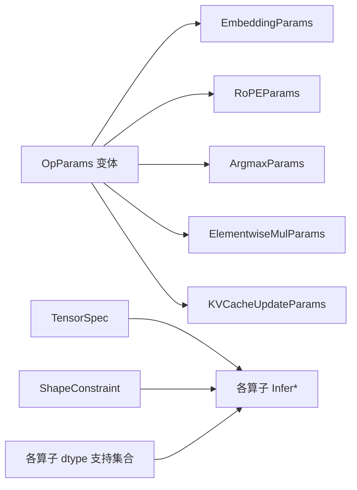

# 特殊算子

**本文引用的文件**
- [embedding_op.cpp](../../../../src/operators/ops/embedding_op.cpp)
- [embedding_op.h](../../../../include/aethermind/operators/ops/embedding_op.h)
- [rope_op.cpp](../../../../src/operators/ops/rope_op.cpp)
- [rope_op.h](../../../../include/aethermind/operators/ops/rope_op.h)
- [argmax_op.cpp](../../../../src/operators/ops/argmax_op.cpp)
- [argmax_op.h](../../../../include/aethermind/operators/ops/argmax_op.h)
- [elementwise_mul_op.cpp](../../../../src/operators/ops/elementwise_mul_op.cpp)
- [elementwise_mul_op.h](../../../../include/aethermind/operators/ops/elementwise_mul_op.h)
- [kvcache_update_op.cpp](../../../../src/operators/ops/kvcache_update_op.cpp)
- [kvcache_update_op.h](../../../../include/aethermind/operators/ops/kvcache_update_op.h)
- [op_params.h](../../../../include/aethermind/operators/op_params.h)
- [src/kv_cache/](../../../../src/kv_cache)

## 目录
1. [引言](#引言)
2. [项目结构](#项目结构)
3. [核心组件](#核心组件)
4. [架构总览](#架构总览)
5. [详细组件分析](#详细组件分析)
6. [依赖关系分析](#依赖关系分析)
7. [性能与内存特征](#性能与内存特征)
8. [故障排查指南](#故障排查指南)
9. [结论](#结论)

## 引言
本文聚焦 AetherMind 中的五个特殊用途算子：Embedding、RoPE、ArgMax、ElementWiseMul、KVCacheUpdate。这些算子分别承担词表查找、旋转位置编码、最大索引选择、逐元素乘法和键值缓存写入等关键任务，是 Transformer 推理链路中频繁出现且对数值正确性、内存访问模式及吞吐有重要影响的实现单元。

文档目标：
- 解释每个算子的输入输出约束、数据类型支持、形状与内存布局要求。
- 说明语义层推断逻辑与运行时检查策略。
- 结合 KV Cache 模块设计，梳理 KVCacheUpdate 的更新边界和内存管理职责。
- 给出使用示例与实际模型场景说明。
- 提供常见错误与调优建议。

## 项目结构
这五个算子位于 `src/operators/ops`，对应头文件在 `include/aethermind/operators/ops`，共享参数类型定义位于 `include/aethermind/operators/op_params.h`。KV Cache 相关的设计与契约由 [KV Cache 系统](../../核心模块设计/KV%20Cache%20系统.md) 描述。

**图示来源**
- [embedding_op.cpp:1-89](../../../../src/operators/ops/embedding_op.cpp#L1-L89)
- [rope_op.cpp:1-202](../../../../src/operators/ops/rope_op.cpp#L1-L202)
- [argmax_op.cpp:1-55](../../../../src/operators/ops/argmax_op.cpp#L1-L55)
- [elementwise_mul_op.cpp:1-51](../../../../src/operators/ops/elementwise_mul_op.cpp#L1-L51)
- [kvcache_update_op.cpp:1-191](../../../../src/operators/ops/kvcache_update_op.cpp#L1-L191)
- [op_params.h:1-391](../../../../include/aethermind/operators/op_params.h#L1-L391)
- [src/kv_cache/](../../../../src/kv_cache)

**章节来源**
- [embedding_op.cpp:1-89](../../../../src/operators/ops/embedding_op.cpp#L1-L89)
- [rope_op.cpp:1-202](../../../../src/operators/ops/rope_op.cpp#L1-L202)
- [argmax_op.cpp:1-55](../../../../src/operators/ops/argmax_op.cpp#L1-L55)
- [elementwise_mul_op.cpp:1-51](../../../../src/operators/ops/elementwise_mul_op.cpp#L1-L51)
- [kvcache_update_op.cpp:1-191](../../../../src/operators/ops/kvcache_update_op.cpp#L1-L191)
- [op_params.h:1-391](../../../../include/aethermind/operators/op_params.h#L1-L391)
- [src/kv_cache/](../../../../src/kv_cache)

## 核心组件
| 算子 | 主要职责 | 输入 | 输出 | 关键约束 |
|---|---|---|---|---|
| Embedding | 从权重表中按 token ID 查向量 | `token_ids`、权重表 | 嵌入向量 | `token_ids` 为 int32/int64/uint32；权重为二维浮点；输出保留 token 维度并追加 hidden |
| RoPE | 对 q、k 应用旋转位置编码 | q、k、position_ids | 修改后的 q、k | q/k dtype 一致；position_ids 为 int64；q/k 序列长度需一致 |
| ArgMax | 沿指定轴找最大值索引 | 数值张量 | 索引张量 | axis 合法；归约轴非空；NaN 规则由后端实现，但语义约定“首个 NaN 胜出” |
| ElementWiseMul | 两输入逐元素相乘 | lhs、rhs | 结果 | dtype 支持集合相同；形状广播；返回 lhs dtype |
| KVCacheUpdate | 将新 k/v 写入 KV 缓存 | k、v、k_cache_in、v_cache_in | k_cache_out、v_cache_out | 激活 dtype 一致；缓存 dtype 一致；支持全同或 F32 激活 + F16/BF16 缓存 |

这些算子在语义层主要负责输入校验、形状推断、dtype 检查与运行时约束生成；实际内核执行由后端根据 OpType、dtype 和形状选择。

**章节来源**
- [embedding_op.h:1-99](../../../../include/aethermind/operators/ops/embedding_op.h#L1-L99)
- [rope_op.h:1-53](../../../../include/aethermind/operators/ops/rope_op.h#L1-L53)
- [argmax_op.h:1-50](../../../../include/aethermind/operators/ops/argmax_op.h#L1-L50)
- [elementwise_mul_op.h:1-52](../../../../include/aethermind/operators/ops/elementwise_mul_op.h#L1-L52)
- [kvcache_update_op.h:1-53](../../../../include/aethermind/operators/ops/kvcache_update_op.h#L1-L53)
- [op_params.h:1-391](../../../../include/aethermind/operators/op_params.h#L1-L391)

## 架构总览
下图展示五个算子在 AetherMind 算子系统中的定位：它们都通过统一的 `OpParams` 变体进入图构建与执行阶段，并通过 `InferenceResult` 表达输出形状与运行时约束。

该流程适用于 Embedding、RoPE、ArgMax、ElementWiseMul、KVCacheUpdate。不同算子在 `Validate`、`Shapes`、`RuntimeChecks` 阶段的细节差异很大，下文逐项展开。

**图示来源**
- [op_params.h:1-391](../../../../include/aethermind/operators/op_params.h#L1-L391)
- [embedding_op.cpp:1-89](../../../../src/operators/ops/embedding_op.cpp#L1-L89)
- [rope_op.cpp:1-202](../../../../src/operators/ops/rope_op.cpp#L1-L202)
- [argmax_op.cpp:1-55](../../../../src/operators/ops/argmax_op.cpp#L1-L55)
- [elementwise_mul_op.cpp:1-51](../../../../src/operators/ops/elementwise_mul_op.cpp#L1-L51)
- [kvcache_update_op.cpp:1-191](../../../../src/operators/ops/kvcache_update_op.cpp#L1-L191)

## 详细组件分析

### Embedding 算子
#### 语义与查找表机制
Embedding 是典型的稀疏访问算子：输入 token IDs 通常远小于词表大小，因此内核应优先利用稀疏访问特性，避免遍历整个权重表。AetherMind 当前语义层定义了：
- token ID 支持 int32、int64、uint32。
- 权重支持 float32、float16、bfloat16。
- 输出 dtype 默认跟随权重 dtype；若显式指定，则必须是标量 float32。
- 权重必须是二维 `[vocab_size, hidden_size]`。
- 输出形状保留 `token_ids` 的所有维度，并在末尾追加 `hidden_size`。

这意味着实现上，内核应按 token 读取权重行，并按目标 dtype 进行可能的转换。由于输出可能为 float32 而权重为 float16/bfloat16，语义层允许这种 W16→A32 的混合输出语义。

**图示来源**
- [embedding_op.cpp:1-89](../../../../src/operators/ops/embedding_op.cpp#L1-L89)
- [embedding_op.h:1-99](../../../../include/aethermind/operators/ops/embedding_op.h#L1-L99)

#### 输入输出约束
- token_ids：至少一维，dtype ∈ {int32, int64, uint32}。
- 权重：二维，dtype ∈ {float32, float16, bfloat16}。
- 权重静态维度必须为正；动态维度以运行时约束保证。
- 输出：秩比 token_ids 高一，最后一维等于权重的第二维。
- 如果 token_ids 为空序列，输出也为空，不产生非法访问。

#### 内存布局与稀疏优化
- 权重通常为列主序或行主序的二维数组，具体取决于模型加载与打包策略。
- 稀疏访问优化方向包括：
  - 按 token 顺序连续读取权重行，提高缓存局部性。
  - 批量化多个 token 的查找，减少函数调用与分支开销。
  - 若输出 dtype 与权重不同，应在内核内做批量类型转换，避免中间临时张量。
  - 对超大词表可考虑分块查找或分层缓存，但这属于后端优化范畴。

#### 使用示例与模型场景
- 典型用于词嵌入层、输出头前的词表投影。
- 输入可以是 `[batch, seq_len]`，输出为 `[batch, seq_len, hidden]`。
- 在解码阶段，token_ids 常为 `[1]`，此时内核应高效处理单 token 查找。

**章节来源**
- [embedding_op.cpp:1-89](../../../../src/operators/ops/embedding_op.cpp#L1-L89)
- [embedding_op.h:1-99](../../../../include/aethermind/operators/ops/embedding_op.h#L1-L99)

### RoPE 算子
#### 数学公式与参数语义
RoPE 对查询向量 q 和键向量 k 施加旋转位置编码。AetherMind 的参数结构包含以下关键信息：
- `head_dim`：每头维度。
- `rotary_dim`：参与旋转的维度数；零表示使用完整 head_dim。
- `num_q_heads`、`num_kv_heads`：q、k 的头数。
- `max_pos_embeddings`：最大位置编码长度。
- `theta`：缩放基数。
- `pairing`：配对方式，支持 split-half 或 interleaved。
- `algorithm`：频率计算策略，包括 standard、linear、dynamic_ntk、yarn、llama3、long_rope。

语义层并不执行旋转，而是验证：
- scalar 参数正负性与合法性。
- rotary_dim 为正、偶数且不大于 head_dim。
- q、k dtype 一致且在 {float32, float16, bfloat16} 中。
- position_ids 为 int64。
- q、k 为二维 `[seq_len, hidden]`，其中 hidden 必须等于对应头数乘以 head_dim（当静态可知）。
- position_ids 为一维 `[seq_len]`。
- q、k、position_ids 的 seq_len 必须一致；符号维度时以 `DimPositiveConstraint` 和 `DimEqualConstraint` 延迟到运行时检查。

**图示来源**
- [rope_op.cpp:1-202](../../../../src/operators/ops/rope_op.cpp#L1-L202)
- [rope_op.h:1-53](../../../../include/aethermind/operators/ops/rope_op.h#L1-L53)
- [op_params.h:1-391](../../../../include/aethermind/operators/op_params.h#L1-L391)

#### 并行计算策略
虽然语义层不包含内核实现，但从约束可以推断合理的并行策略：
- 外层循环按 head 或 token 划分，适合多线程或 SIMD 向量化。
- 内层循环按 rotary_dim 的元素对计算旋转，适合向量化。
- pairing 影响元素配对方式：split-half 先旋转前半再旋转后半；interleaved 交错相邻元素。
- frequency resolver 会根据 algorithm 计算频率，语义层通过 `ValidateRoPEFreqParams` 统一校验频率参数合法性。

#### 使用示例与模型场景
- 常用于 Transformer decoder 的 attention 前，对 Q、K 加入位置信息。
- Prefill 阶段 seq_len 较大，decode 阶段 seq_len 通常为 1。
- 长上下文场景下，algorithm 可能切换为 dynamic_ntk、yarn 或 llama3，由模型配置决定。

**章节来源**
- [rope_op.cpp:1-202](../../../../src/operators/ops/rope_op.cpp#L1-L202)
- [rope_op.h:1-53](../../../../include/aethermind/operators/ops/rope_op.h#L1-L53)
- [op_params.h:1-391](../../../../include/aethermind/operators/op_params.h#L1-L391)

### ArgMax 算子
#### 最大值查找与索引返回机制
ArgMax 的语义层负责：
- 校验输入 dtype ∈ {float32, float16, bfloat16}。
- 规范化 axis：支持负轴索引，最终映射到 `[0, rank)`。
- 拒绝空归约轴：如果归约轴静态大小为 0，直接报错。
- 输出 dtype 为 int64。
- 输出形状去掉归约轴，其他轴保持不变。

语义注释还明确了一个后端无关的数值语义：相等最大值选择最低索引；若归约切片含 NaN，则第一个 NaN 胜出。该语义应由所有后端 ArgMax 内核保持一致。

**图示来源**
- [argmax_op.cpp:1-55](../../../../src/operators/ops/argmax_op.cpp#L1-L55)
- [argmax_op.h:1-50](../../../../include/aethermind/operators/ops/argmax_op.h#L1-L50)
- [op_params.h:1-391](../../../../include/aethermind/operators/op_params.h#L1-L391)

#### 算法复杂度
- 时间复杂度：O(N)，N 为归约轴上的元素总数。
- 空间复杂度：O(1) 额外空间用于记录当前最大值及其索引。
- 对于 softmax 后 logits 取 top-k 的场景，ArgMax 常作为 top-1 的特例。

#### 使用示例与模型场景
- 解码阶段从 logits 中选择下一个 token。
- 输入通常是 `[vocab_size]` 或 `[batch, vocab_size]`。
- 输出是 `[1]` 或 `[batch]`，dtype 为 int64。

**章节来源**
- [argmax_op.cpp:1-55](../../../../src/operators/ops/argmax_op.cpp#L1-L55)
- [argmax_op.h:1-50](../../../../include/aethermind/operators/ops/argmax_op.h#L1-L50)
- [op_params.h:1-391](../../../../include/aethermind/operators/op_params.h#L1-L391)

### ElementWiseMul 算子
#### 逐元素乘法优化
ElementWiseMul 的语义层职责相对简单：
- 两个输入 dtype 都必须属于 {float32, float16, bfloat16}。
- 使用广播规则计算输出形状。
- 输出 dtype 与 lhs 相同。
- 对无法静态证明的形状兼容关系，生成 `DimBroadcastableConstraint` 延迟到运行时检查。

**图示来源**
- [elementwise_mul_op.cpp:1-51](../../../../src/operators/ops/elementwise_mul_op.cpp#L1-L51)
- [elementwise_mul_op.h:1-52](../../../../include/aethermind/operators/ops/elementwise_mul_op.h#L1-L52)

#### 性能特征
- 这是访存密集型、计算简单的算子，理想情况下应为 O(N)。
- 优化重点在于：
  - 避免不必要的类型转换。
  - 利用 SIMD 向量化逐元素乘。
  - 对广播情况尽量合并为一次线性扫描。
  - 尽量避免创建中间张量。

#### 使用示例与模型场景
- MLP 中的 gate/up 路径与残差或缩放因子相乘。
- RMSNorm 前或后的缩放。
- 多路激活融合时的逐元素加权。

**章节来源**
- [elementwise_mul_op.cpp:1-51](../../../../src/operators/ops/elementwise_mul_op.cpp#L1-L51)
- [elementwise_mul_op.h:1-52](../../../../include/aethermind/operators/ops/elementwise_mul_op.h#L1-L52)

### KVCacheUpdate 算子
#### 更新逻辑与内存管理
KVCacheUpdate 不是普通张量运算，而是将新的 k、v 激活写入 KV 缓存。其语义层约束如下：
- 输入：k、v 为二维 `[seq_len, hidden]`；k_cache_in、v_cache_in 为三维 `[kv_heads, cache_len, head_dim]`。
- dtype 契约：
  - 四输入全部同 dtype 是一种合法情况。
  - 另一种合法情况是 k、v 为 float32，k_cache_in、v_cache_in 同为 float16 或 bfloat16，形成 A32→KV16 的窄化边界。
  - k 与 v dtype 必须一致；k_cache_in 与 v_cache_in dtype 必须一致。
- 形状契约：
  - k、v 形状必须相等。
  - k_cache_in、v_cache_in 形状必须相等。
  - 如果 kv_heads 与 head_dim 静态已知，则 hidden 必须等于 kv_heads × head_dim。
  - seq_len、hidden、kv_heads、head_dim、cache_len 静态时必须为正。
  - 静态情况下，seq_len 不能超过 cache_len。
- 输出：k_cache_out、v_cache_out 与输入缓存形状和 dtype 完全一致。

**图示来源**
- [kvcache_update_op.cpp:1-191](../../../../src/operators/ops/kvcache_update_op.cpp#L1-L191)
- [kvcache_update_op.h:1-53](../../../../include/aethermind/operators/ops/kvcache_update_op.h#L1-L53)
- [src/kv_cache/](../../../../src/kv_cache)

#### KV Cache 模块协作
KV Cache 模块的职责是静态 KV 物理状态域，不负责 Attention 数值计算，也不感知模型语义。它提供：
- `KVCacheLayout`：规划 KV plane 的 stride、padding、offset。
- `KVCacheManager`：分配、预约、提交水位、生命周期管理。
- `KVCacheSessionView`：借出层级 append/read binding。
- `KVCacheBinding`：精确限定 kernel 写范围 `[begin, end)` 和读可见范围。

KVCacheUpdate 算子语义层只负责“哪些输入可以接受”，真正的写入边界由 execution 层的 layer runner 与 KV Cache session view 共同保证。

**图示来源**
- [kvcache_update_op.cpp:1-191](../../../../src/operators/ops/kvcache_update_op.cpp#L1-L191)
- [src/kv_cache/](../../../../src/kv_cache)

#### 内存布局要求
- KV 缓存按层、头、token、维度组织，stride 由 `KVCacheLayout` 冻结。
- 对齐以字节为单位，`padded_head_dim` 可能大于 `head_dim`。
- offset 计算公式为层偏移 + 头偏移 + token 偏移 + 维度偏移。
- 写操作必须落在已预约容量内，并由 `KVCacheSessionView::ValidateWrite` 与 `BindLayerForAppend` 双重保护。

#### 使用示例与模型场景
- Prefill 阶段一次性写入 prompt 对应的 K/V。
- Decode 阶段每次写入一个 token 的 K/V。
- 长上下文场景中，cache_len 需要足够大，否则会在 graph 或 runtime 阶段被拒绝。

**章节来源**
- [kvcache_update_op.cpp:1-191](../../../../src/operators/ops/kvcache_update_op.cpp#L1-L191)
- [src/kv_cache/](../../../../src/kv_cache)

## 依赖关系分析
这五个算子共享以下依赖：
- `OpParams`：统一的参数变体，确保 schema 层能区分不同算子。
- `TensorSpec` 与 `ShapeSymbol`：表达张量 dtype、rank、静态与动态维度。
- `ShapeConstraint`：表达运行时才能判断的形状约束，例如广播兼容性、序列长度一致性、维度正数性。
- dtype 支持集合：每个算子都有独立的 supported dtype 列表和错误消息构造器。

**图示来源**
- [op_params.h:1-391](../../../../include/aethermind/operators/op_params.h#L1-L391)
- [embedding_op.cpp:1-89](../../../../src/operators/ops/embedding_op.cpp#L1-L89)
- [rope_op.cpp:1-202](../../../../src/operators/ops/rope_op.cpp#L1-L202)
- [argmax_op.cpp:1-55](../../../../src/operators/ops/argmax_op.cpp#L1-L55)
- [elementwise_mul_op.cpp:1-51](../../../../src/operators/ops/elementwise_mul_op.cpp#L1-L51)
- [kvcache_update_op.cpp:1-191](../../../../src/operators/ops/kvcache_update_op.cpp#L1-L191)

**章节来源**
- [op_params.h:1-391](../../../../include/aethermind/operators/op_params.h#L1-L391)

## 性能与内存特征
| 算子 | 时间复杂度 | 主要瓶颈 | 优化建议 |
|---|---:|---|---|
| Embedding | O(T×H) | 随机访问权重表 | 批量化 token；SIMD 转换；避免多余拷贝 |
| RoPE | O(S×H) | 三角函数与内存访问 | 预计算频率；按头并行；pairing 向量化 |
| ArgMax | O(N) | 比较与索引维护 | 单次扫描；SIMD 求最大值；减少分支 |
| ElementWiseMul | O(N) | 访存带宽 | 广播合并；SIMD 乘法；无中间张量 |
| KVCacheUpdate | O(S×H) | 缓存写入对齐与 stride | 按 stride 连续写；对齐 padded_head_dim；批量 commit |

注意：上述复杂度基于语义层定义的输入规模，不代表后端内核的具体实现。后端可使用线程池、SIMD、流水线、缓存友好布局等方式进一步优化。

[本节为通用性能讨论，不直接分析具体代码行]

## 故障排查指南
| 现象 | 可能原因 | 排查建议 |
|---|---|---|
| Embedding 报不支持的权重 dtype | 权重 dtype 不在 {float32, float16, bfloat16} | 检查模型加载是否做了 dtype 转换 |
| Embedding 报输出 dtype 非法 | 显式 output_dtype 不是标量 float32 | 移除显式设置或改为 float32 |
| RoPE 报 q/k dtype 不一致 | q、k 来自不同路径，dtype 不同 | 检查上游 cast 或 linear 输出 dtype |
| RoPE 报 seq_len 不相等 | q、k、position_ids 序列长度不一致 | 检查 position_ids 是否与当前步对齐 |
| ArgMax 报 axis 越界 | axis 超出 rank 范围 | 检查 reduction 轴是否正确 |
| ArgMax 报归约轴为空 | 归约轴静态大小为 0 | 检查 reshape 或 broadcast 是否意外消掉维度 |
| ElementWiseMul 报不可广播 | lhs、rhs 形状不兼容 | 检查 broadcast 规则与中间 reshape |
| KVCacheUpdate 报 dtype 不匹配 | 激活与缓存 dtype 不符合全同或 A32→KV16 | 检查 KV dtype 配置与 narrow/widen 策略 |
| KVCacheUpdate 报 seq_len 超过容量 | 静态 seq_len > cache_len | 增大 KV cache capacity 或减少 prompt 长度 |

**章节来源**
- [embedding_op.cpp:1-89](../../../../src/operators/ops/embedding_op.cpp#L1-L89)
- [rope_op.cpp:1-202](../../../../src/operators/ops/rope_op.cpp#L1-L202)
- [argmax_op.cpp:1-55](../../../../src/operators/ops/argmax_op.cpp#L1-L55)
- [elementwise_mul_op.cpp:1-51](../../../../src/operators/ops/elementwise_mul_op.cpp#L1-L51)
- [kvcache_update_op.cpp:1-191](../../../../src/operators/ops/kvcache_update_op.cpp#L1-L191)

## 结论
AetherMind 的五个特殊算子在语义层保持了清晰、严格且可扩展的契约：
- Embedding 明确了词表查找的 dtype 与形状语义，并为 W16→A32 等混合精度留出空间。
- RoPE 将复杂的位置编码参数抽象为 `RoPEParams`，把数值公式交给后端，同时保证 graph-time 参数的合法性。
- ArgMax 定义了稳定的最大值与 NaN 语义，确保不同后端行为一致。
- ElementWiseMul 复用广播基础设施，保持逐元素操作的简洁性。
- KVCacheUpdate 与 KV Cache 模块分工明确：算子负责输入契约，KV Cache 负责物理布局、预约、提交与生命周期。

在实际模型中，这些算子共同支撑了词嵌入、注意力位置编码、logits 采样、激活融合以及长上下文 KV 缓存的关键路径。开发者在扩展或替换后端内核时，应优先遵守这些语义契约，再针对硬件特性做性能优化。
