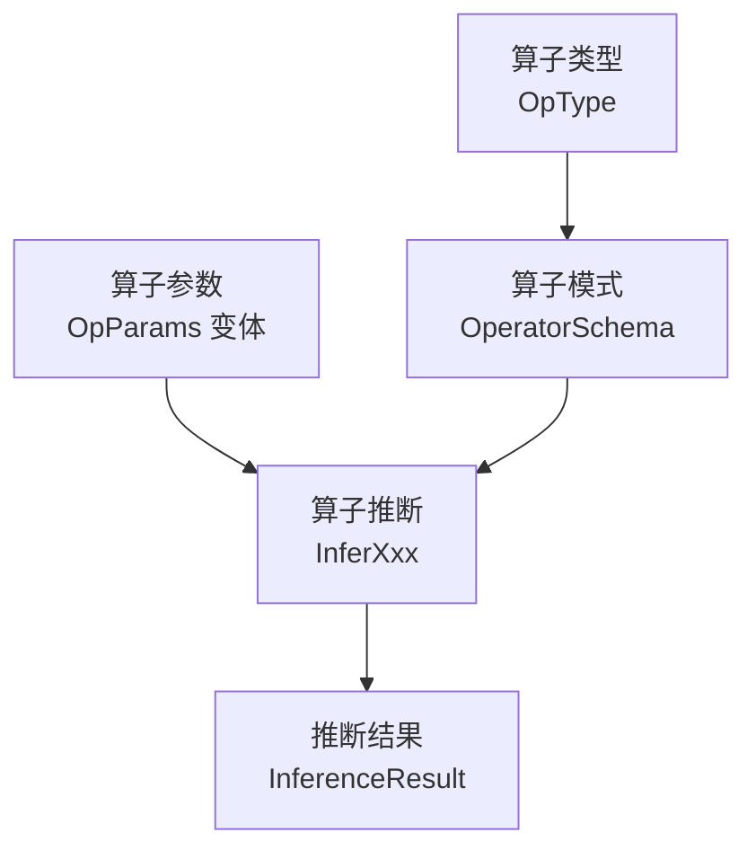
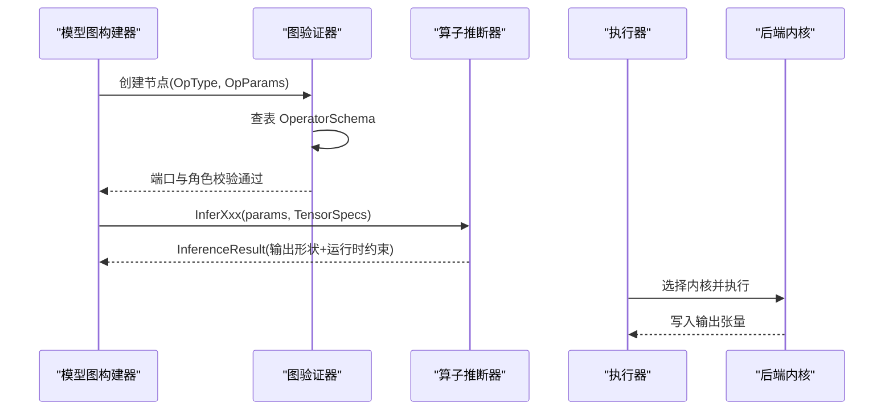
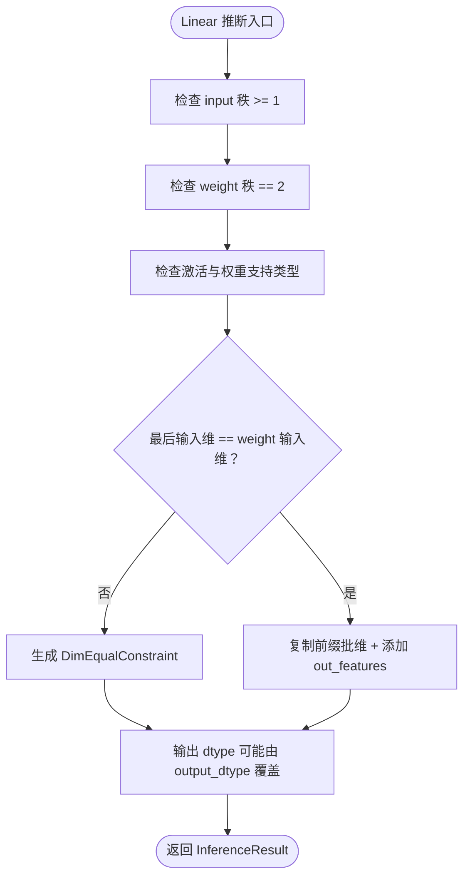
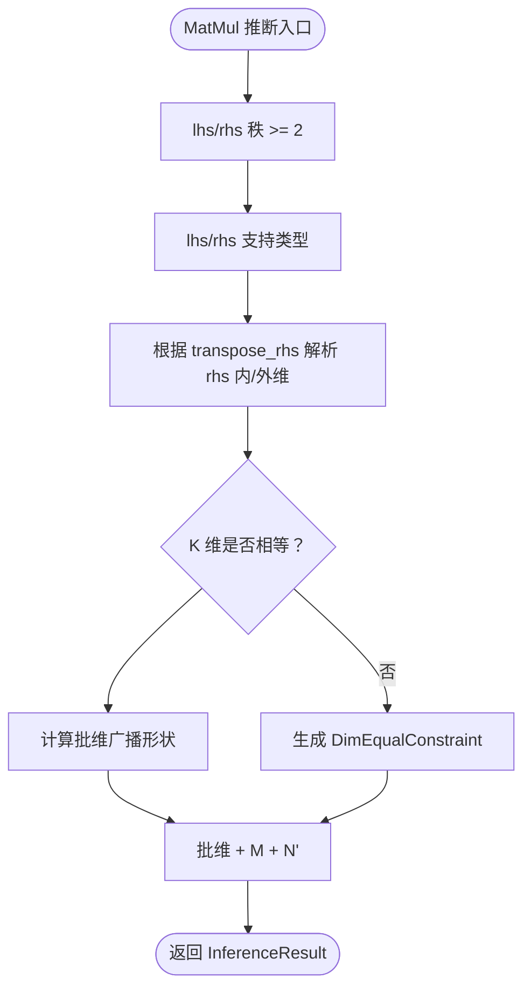
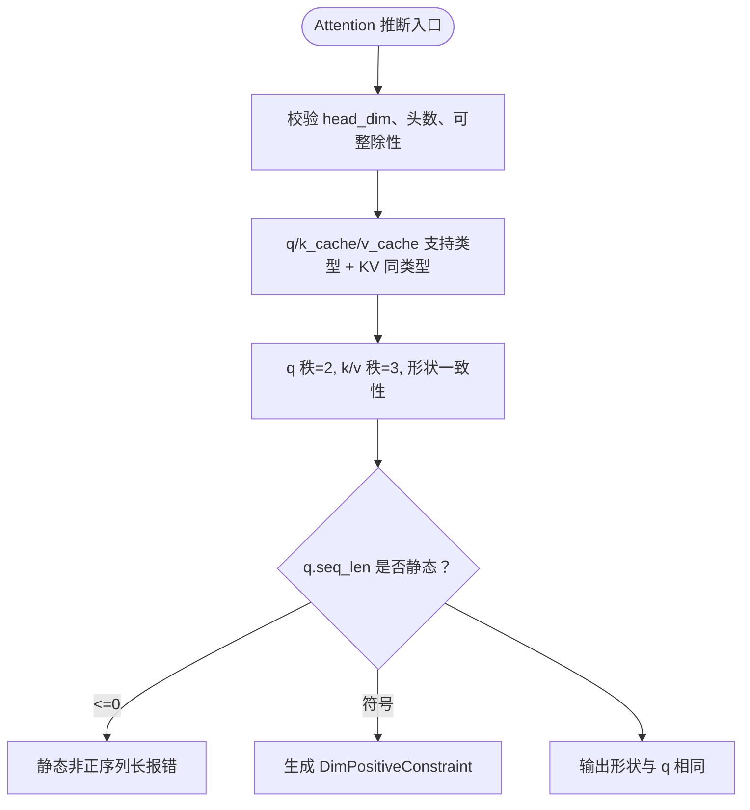
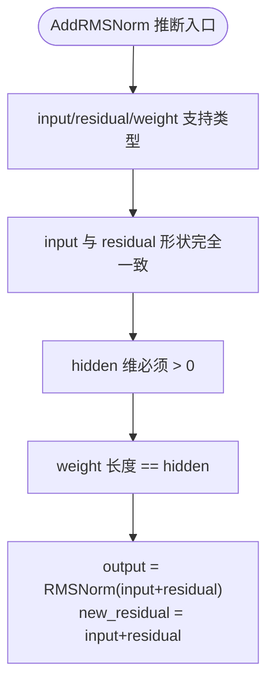
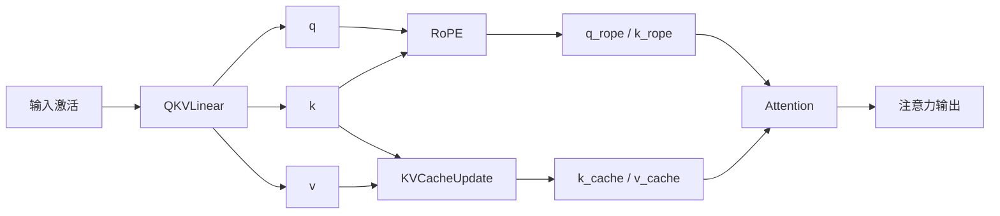

# 算子实现详解

**本文引用的文件**
- [op_type.h](../../../../include/aethermind/operators/op_type.h)
- [operator_schema.h](../../../../include/aethermind/operators/operator_schema.h)
- [op_params.h](../../../../include/aethermind/operators/op_params.h)
- [operator_schema.cpp](../../../../src/operators/operator_schema.cpp)
- [linear_op.cpp](../../../../src/operators/ops/linear_op.cpp)
- [matmul_op.cpp](../../../../src/operators/ops/matmul_op.cpp)
- [gate_up_linear_op.cpp](../../../../src/operators/ops/gate_up_linear_op.cpp)
- [qkv_linear_op.cpp](../../../../src/operators/ops/qkv_linear_op.cpp)
- [attention_op.cpp](../../../../src/operators/ops/attention_op.cpp)
- [rmsnorm_op.cpp](../../../../src/operators/ops/rmsnorm_op.cpp)
- [add_rmsnorm_op.cpp](../../../../src/operators/ops/add_rmsnorm_op.cpp)
- [reshape_op.cpp](../../../../src/operators/ops/reshape_op.cpp)
- [permute_op.cpp](../../../../src/operators/ops/permute_op.cpp)
- [reorder_op.cpp](../../../../src/operators/ops/reorder_op.cpp)
- [silu_op.cpp](../../../../src/operators/ops/silu_op.cpp)
- [silu_mul_op.cpp](../../../../src/operators/ops/silu_mul_op.cpp)
- [softmax_op.cpp](../../../../src/operators/ops/softmax_op.cpp)
- [embedding_op.cpp](../../../../src/operators/ops/embedding_op.cpp)
- [rope_op.cpp](../../../../src/operators/ops/rope_op.cpp)
- [argmax_op.cpp](../../../../src/operators/ops/argmax_op.cpp)
- [elementwise_mul_op.cpp](../../../../src/operators/ops/elementwise_mul_op.cpp)
- [kvcache_update_op.cpp](../../../../src/operators/ops/kvcache_update_op.cpp)

## 目录
1. [引言](#引言)
2. [项目结构](#项目结构)
3. [核心组件](#核心组件)
4. [架构总览](#架构总览)
5. [详细算子分类与语义契约](#详细算子分类与语义契约)
6. [依赖关系与执行顺序约束](#依赖关系与执行顺序约束)
7. [性能与内存布局要点](#性能与内存布局要点)
8. [故障排查指南](#故障排查指南)
9. [结论](#结论)

## 引言
本文面向 AetherMind 的算子层，按功能分组整理并解释以下算子的数学定义、输入输出形状、内存布局要求、数值精度特性以及算子间的依赖和执行顺序约束：线性代数类、注意力类、归一化类、张量变换类、激活函数类、特殊用途类。文档依据算子类型枚举、算子参数变体、静态算子模式、各算子推断实现中的断言和运行时约束进行归纳，帮助读者在构建模型图、编写后端内核或集成推理流程时准确理解每个算子的语义边界。

## 项目结构
AetherMind 的算子体系由三层构成：
- 算子类型与模式层：`OpType` 枚举定义所有算子种类；`OperatorSchema` 描述每个算子的端口顺序、端口角色（模型输入、激活、权重、常量、状态）及算子特性（是否有副作用、是否纯函数、是否可编译期求值）。
- 算子参数层：`OpParams` 是一个强类型变体，每个算子拥有自己的参数结构体，例如 `LinearParams`、`RoPEParams`、`AttentionParams` 等。
- 算子推断层：每个算子提供 `InferXxx` 函数，对输入 `TensorSpec`、参数和形状进行静态校验，返回 `InferenceResult`，并可附带运行时形状约束。

**图示来源**
- [op_type.h:1-64](../../../../include/aethermind/operators/op_type.h#L1-L64)
- [operator_schema.h:1-167](../../../../include/aethermind/operators/operator_schema.h#L1-L167)
- [op_params.h:1-200](../../../../include/aethermind/operators/op_params.h#L1-L200)
- [operator_schema.cpp:1-200](../../../../src/operators/operator_schema.cpp#L1-L200)

**章节来源**
- [op_type.h:1-64](../../../../include/aethermind/operators/op_type.h#L1-L64)
- [operator_schema.h:1-167](../../../../include/aethermind/operators/operator_schema.h#L1-L167)
- [op_params.h:1-200](../../../../include/aethermind/operators/op_params.h#L1-L200)
- [operator_schema.cpp:1-200](../../../../src/operators/operator_schema.cpp#L1-L200)

## 核心组件
- **算子类型**：以 `OpType` 枚举标识，包括嵌入、RMSNorm、线性、QKV 线性、矩阵乘、旋转位置编码、注意力、SiLU、SiLUMul、元素乘、KV Cache 更新、Add、AddRMSNorm、Softmax、ArgMax、Reshape、Permute、Reorder、Cast、GateUpLinear。
- **算子模式**：通过 `OperatorSchema` 声明每个算子的输入端口、输出端口、端口角色及算子特性。例如：
  - `Embedding`：输入为 `tokens`（模型输入）、`weight`（权重），输出为 `output`。
  - `Linear`：输入为 `input`（激活）、`weight`（权重），输出为 `output`。
  - `QkvLinear`：输入为 `input`、`qkv_weight`，输出为 `q`、`k`、`v`。
  - `GateUpLinear`：输入为 `input`、`gate_up_weight`，输出为 `gate`、`up`。
  - `RoPE`：输入为 `q`、`k`、`position_ids`，输出为 `q_rope`、`k_rope`。
  - `MatMul`：输入为 `lhs`、`rhs`，输出为 `output`。
  - `AddRMSNorm`：输入为 `input`、`residual`、`weight`，输出为 `output`、`new_residual`。
- **算子参数**：如 `EmbeddingParams::output_dtype`、`LinearParams::output_dtype`、`RoPEParams`（含 head_dim、rotary_dim、num_q_heads、num_kv_heads、max_pos_embeddings、theta 及多种 RoPE 算法变体）、`AttentionParams`（num_q_heads、num_kv_heads、head_dim）等。
- **算子推断**：每个算子实现 `InferXxx(params, inputs)`，负责参数合法性、数据类型支持、秩检查、维度相等性、广播规则、正数约束、溢出检查和运行时约束生成。

**章节来源**
- [op_type.h:1-64](../../../../include/aethermind/operators/op_type.h#L1-L64)
- [operator_schema.cpp:1-200](../../../../src/operators/operator_schema.cpp#L1-L200)
- [op_params.h:1-200](../../../../include/aethermind/operators/op_params.h#L1-L200)

## 架构总览
算子层的整体调用链如下：
1. 模型图构建阶段根据模型语义选择 `OpType`，绑定具体 `OpParams`。
2. 图验证读取 `OperatorSchema`，检查端口数量、名称和角色是否与图节点一致。
3. 算子推断阶段调用对应 `InferXxx`，完成形状推导、静态错误快速失败，并在符号形状下注入运行时约束。
4. 执行阶段将算子调度到后端内核，此时再结合实际张量布局、数据精度和设备能力执行计算。

**图示来源**
- [operator_schema.cpp:1-200](../../../../src/operators/operator_schema.cpp#L1-L200)
- [linear_op.cpp:1-92](../../../../src/operators/ops/linear_op.cpp#L1-L92)
- [attention_op.cpp:1-189](../../../../src/operators/ops/attention_op.cpp#L1-L189)

## 详细算子分类与语义契约

### 线性代数算子

#### Linear
- **数学定义**：对最后一个特征维做线性投影，等价于矩阵乘法形式；可选指定输出数据类型。
- **输入**：
  - `input`：秩至少为 1，最后一个维度表示输入特征长度。
  - `weight`：秩为 2，第一维是输出特征，第二维必须等于 `input` 最后一个维度。
- **输出**：
  - `output`：保留 `input` 的前面所有批维，最后一维替换为 weight 的第一维；数据类型可为输入类型或显式指定的标量 Float32、Float16、BFloat16。
- **内存布局要求**：
  - 作为通用线性算子，其形状语义与 MatMul 对齐；后端核通常期望输入按行主序或约定布局访问最后两个维度。
- **数值精度特性**：
  - 输入激活和权重分别使用各自的“支持类型”检测；输出 dtype 默认跟随输入，也可显式指定为支持的标量浮点类型。
- **关键推断行为**：
  - 若输入最后维与 weight 输入维不可证明相等，则生成运行时 `DimEqualConstraint`。
  - 显式输出 dtype 必须是标量且属于支持集合。

**图示来源**
- [linear_op.cpp:1-92](../../../../src/operators/ops/linear_op.cpp#L1-L92)

**章节来源**
- [linear_op.cpp:1-92](../../../../src/operators/ops/linear_op.cpp#L1-L92)
- [operator_schema.cpp:1-200](../../../../src/operators/operator_schema.cpp#L1-L200)
- [op_params.h:1-200](../../../../include/aethermind/operators/op_params.h#L1-L200)

#### MatMul
- **数学定义**：广义矩阵乘法，支持右操作数转置开关和批量广播。
- **输入**：
  - `lhs`：秩至少为 2，倒数第二个维度为 M，最后一个维度为 K。
  - `rhs`：秩至少为 2，根据 `transpose_rhs` 决定内维和外维；内维必须等于 lhs 的 K。
- **输出**：
  - `output`：批维为 lhs 和 rhs 批维的广播结果，后两维为 `(M, N')`，其中 `N'` 是 rhs 的外维；数据类型与 lhs 相同。
- **内存布局要求**：
  - 需要遵循 NumPy/PyTorch 的批量广播语义；后端 GEMM 核通常要求 K 维连续、M/N 维按策略分块。
- **数值精度特性**：
  - lhs 和 rhs 均须属于 MatMul 支持的数据类型集合。
- **关键推断行为**：
  - 若内维不可证明相等，则生成运行时 `DimEqualConstraint`。
  - 批维广播失败会直接报错；广播延迟轴会被记录为运行时约束。

**图示来源**
- [matmul_op.cpp:1-120](../../../../src/operators/ops/matmul_op.cpp#L1-L120)

**章节来源**
- [matmul_op.cpp:1-120](../../../../src/operators/ops/matmul_op.cpp#L1-L120)

#### GateUpLinear
- **数学定义**：一次合并线性投影，将输入同时映射到 gate 分支和 up 分支，权重行数为 `gate_out_features + up_out_features`。
- **输入**：
  - `input`：秩至少为 1。
  - `gate_up_weight`：秩为 2，第一维必须等于 `gate_out_features + up_out_features`，第二维必须等于 `input` 最后一个维度。
- **输出**：
  - `gate`：形状与 input 相同但最后一维为 `gate_out_features`。
  - `up`：形状与 input 相同但最后一维为 `up_out_features`。
- **内存布局要求**：
  - 权重按门控与上采样通道拼接排列；后端常配合后续 SiLUMul 融合。
- **数值精度特性**：
  - 激活和权重分别受各自支持类型限制；当前不支持 bias。
- **关键推断行为**：
  - 对 `gate_out_features` 与 `up_out_features` 的和做 int64 溢出检查。
  - 若输入最后维与权重输入维不可证明相等，则生成运行时 `DimEqualConstraint`。

**章节来源**
- [gate_up_linear_op.cpp:1-107](../../../../src/operators/ops/gate_up_linear_op.cpp#L1-L107)
- [operator_schema.cpp:1-200](../../../../src/operators/operator_schema.cpp#L1-L200)

#### QKVLinear
- **数学定义**：一次合并线性投影，将输入同时映射到 q、k、v 三个分支，权重行数为 `q_out_features + k_out_features + v_out_features`。
- **输入**：
  - `input`：秩至少为 1。
  - `qkv_weight`：秩为 2，第一维必须等于三者输出特征之和，第二维必须等于 `input` 最后一个维度。
- **输出**：
  - `q`、`k`、`v`：形状均保留 input 的前缀批维，最后一维分别为对应输出特征。
- **内存布局要求**：
  - 权重按 q、k、v 三段拼接；常用于注意力头切分前的统一投影。
- **数值精度特性**：
  - 激活和权重分别受各自支持类型限制；当前不支持 bias。
- **关键推断行为**：
  - 对 `q_out_features + k_out_features + v_out_features` 做 int64 溢出检查。
  - 若输入最后维与权重输入维不可证明相等，则生成运行时 `DimEqualConstraint`。

**章节来源**
- [qkv_linear_op.cpp:1-120](../../../../src/operators/ops/qkv_linear_op.cpp#L1-L120)
- [operator_schema.cpp:1-200](../../../../src/operators/operator_schema.cpp#L1-L200)

### 注意力算子

#### Attention
- **数学定义**：多头自注意力或跨头注意力查询步骤，接收 q 和 KV cache，输出与 q 同形状的注意力聚合结果。
- **输入**：
  - `q`：秩为 2，形状 `[seq_len, num_q_heads * head_dim]`。
  - `k_cache`：秩为 3，形状 `[num_kv_heads, cache_len, head_dim]`。
  - `v_cache`：秩为 3，形状与 `k_cache` 完全一致。
- **输出**：
  - 与 `q` 相同的 `TensorSpec`，即形状 `[seq_len, num_q_heads * head_dim]`。
- **内存布局要求**：
  - q 为序列×隐藏维；KV cache 为头×缓存长度×头维。
- **数值精度特性**：
  - 允许两种元组：
    - 同精度：q、k_cache、v_cache 共享同一支持类型。
    - P3 混合 KV16：q 为 Float32，k_cache 与 v_cache 同为 Float16 或 BFloat16。
  - k_cache 与 v_cache 数据类型必须一致；输出 dtype 跟随 q。
- **关键推断行为**：
  - 校验 head_dim、num_q_heads、num_kv_heads 为正且 num_q_heads 能被 num_kv_heads 整除。
  - 静态检查 q 隐藏维等于 `num_q_heads * head_dim`，KV 缓存头数和 head_dim 匹配参数。
  - 若 q 的 seq_len 是符号维度，则生成一个 `DimPositiveConstraint`。

**图示来源**
- [attention_op.cpp:1-189](../../../../src/operators/ops/attention_op.cpp#L1-L189)

**章节来源**
- [attention_op.cpp:1-189](../../../../src/operators/ops/attention_op.cpp#L1-L189)

### 归一化算子

#### RMSNorm
- **数学定义**：均方根归一化，对最后一个隐藏维进行归一化，并使用可学习缩放参数。
- **输入**：
  - `input`：秩至少为 1，最后一个维度为隐藏维。
  - `weight`：秩为 1，长度必须等于 input 最后一个维度。
- **输出**：
  - `output`：形状与 input 完全相同。
- **内存布局要求**：
  - 归一化沿最后一个维度进行，weight 通常按隐藏维连续存储。
- **数值精度特性**：
  - input 和 weight 分别属于 RMSNorm 支持的数据类型集合。
- **关键推断行为**：
  - `eps` 必须为有限正值。
  - 若 hidden_size 是符号维度，则生成 `DimPositiveConstraint`。
  - 若 hidden_size 与 weight 长度不可证明相等，则生成 `DimEqualConstraint`。

**章节来源**
- [rmsnorm_op.cpp:1-95](../../../../src/operators/ops/rmsnorm_op.cpp#L1-L95)

#### AddRMSNorm
- **数学定义**：先对 `input + residual` 做 RMSNorm，并同时输出归一化结果与新的残差值。
- **输入**：
  - `input`、`residual`：必须具有完全相同的形状，不支持广播。
  - `weight`：秩为 1，长度必须等于 input 最后一个维度。
- **输出**：
  - `output`：RMSNorm(input + residual)。
  - `new_residual`：`input + residual`，供下一层残差连接使用。
- **内存布局要求**：
  - input 与 residual 形状完全一致，便于逐元素相加。
- **数值精度特性**：
  - input 与 residual 数据类型必须相同且属于 RMSNorm 支持集合；weight 也需属于支持集合。
- **关键推断行为**：
  - 对每个维度比较 input 与 residual，不同则生成运行时 `DimEqualConstraint`。
  - 若 hidden_size 是符号维度，则生成 `DimPositiveConstraint`。
  - 若 hidden_size 与 weight 长度不可证明相等，则生成 `DimEqualConstraint`。

**图示来源**
- [add_rmsnorm_op.cpp:1-134](../../../../src/operators/ops/add_rmsnorm_op.cpp#L1-L134)

**章节来源**
- [add_rmsnorm_op.cpp:1-134](../../../../src/operators/ops/add_rmsnorm_op.cpp#L1-L134)

### 变换算子

#### Reshape
- **数学定义**：在不改变元素总量和内存顺序的前提下改变张量的逻辑形状；支持从输入维度引用和唯一 infer 标记。
- **输入**：
  - 单个张量，形状必须有秩。
- **输出**：
  - 单张量，形状由目标 shape 确定，支持 literal、引用输入轴、最多一个 infer。
- **内存布局要求**：
  - Reorder 仅改变物理存储意图，而 Reshape 不重新排布内存；因此体积必须相等。
- **数值精度特性**：
  - 不改变数据类型。
- **关键推断行为**：
  - target_shape 中最多一个 infer；literal 维度必须非负。
  - 引用输入轴的 axis 必须在输入秩范围内。
  - 若存在 infer，尝试静态求解商；零体积场景拒绝 infer。
  - 生成 `VolumeEqualConstraint`，确保输入所有维度乘积等于输出所有维度乘积。

**章节来源**
- [reshape_op.cpp:1-200](../../../../src/operators/ops/reshape_op.cpp#L1-L200)

#### Permute
- **数学定义**：按给定置换重排张量逻辑轴，不改变元素总数和内存顺序。
- **输入**：
  - 单个张量，形状必须有秩。
- **输出**：
  - 单张量，输出维度顺序由 permutation 决定。
- **内存布局要求**：
  - 仅重排视图，不移动数据；permutation 必须是秩长度的双射。
- **数值精度特性**：
  - 不改变数据类型。
- **关键推断行为**：
  - permutation 不得有重复轴；每个轴必须在输入秩范围内。
  - 输出维度符号保持原维度符号身份，有利于下游相等性推理。

**章节来源**
- [permute_op.cpp:1-61](../../../../src/operators/ops/permute_op.cpp#L1-L61)

#### Reorder
- **数学定义**：仅改变物理存储意图，不改变语义形状、数据类型或元素集合。
- **输入**：
  - 单个张量。
- **输出**：
  - 完整转发输入的 `TensorSpec`。
- **内存布局要求**：
  - 用于表达底层缓冲区的存储格式变化，例如从行主序转为打包布局。
- **数值精度特性**：
  - 不改变数据类型。

**章节来源**
- [reorder_op.cpp:1-22](../../../../src/operators/ops/reorder_op.cpp#L1-L22)

### 激活函数算子

#### SiLU
- **数学定义**：对输入逐元素应用 Sigmoid(x) × x。
- **输入**：
  - 单张量，数据类型必须属于 SiLU 支持集合。
- **输出**：
  - 与输入形状和数据类型完全相同。
- **数值精度特性**：
  - 不改变数据类型，也不引入额外数值契约。

**章节来源**
- [silu_op.cpp:1-27](../../../../src/operators/ops/silu_op.cpp#L1-L27)

#### SiLUMul
- **数学定义**：对 gate 分支先应用 SiLU，再与 up 分支逐元素相乘；常用于 MoE 或 SwiGLU 风格结构。
- **输入**：
  - `gate`、`up`：数据类型必须相同且属于 SiLUMul 支持集合。
- **输出**：
  - 形状为 gate 与 up 的广播结果；数据类型与 gate/up 相同。
- **数值精度特性**：
  - 当前不支持 gate 与 up 之间隐式类型转换。
- **关键推断行为**：
  - 使用广播推断；广播延迟轴生成 `DimBroadcastableConstraint`。

**章节来源**
- [silu_mul_op.cpp:1-52](../../../../src/operators/ops/silu_mul_op.cpp#L1-L52)

#### Softmax
- **数学定义**：对输入最后一个维度或指定轴做 softmax（具体轴由后端参数决定）；推断层只保证形状不变。
- **输入**：
  - 单张量，数据类型必须属于 Softmax 支持集合。
- **输出**：
  - 与输入形状和数据类型完全相同。
- **数值精度特性**：
  - 不改变数据类型。

**章节来源**
- [softmax_op.cpp:1-23](../../../../src/operators/ops/softmax_op.cpp#L1-L23)

### 特殊算子

#### Embedding
- **数学定义**：根据 token id 查找嵌入表，输出在每个 token 位置上附加隐藏维。
- **输入**：
  - `tokens`：秩至少为 1，数据类型必须为 int32、int64 或 uint32。
  - `weight`：秩为 2，形状为 `(vocab_size, hidden_size)`，两个维度都必须为正。
- **输出**：
  - 保留 tokens 的所有轴，并在末尾追加 `hidden_size`；输出 dtype 默认跟随 weight，也可显式指定为标量 Float32。
- **内存布局要求**：
  - weight 为词表×隐藏维；tokens 通常为离散索引。
- **数值精度特性**：
  - 支持 W16 → A32 的混合输出语义：当显式指定 output_dtype 时，必须为标量 Float32。
- **关键推断行为**：
  - 若 weight 维度是符号维度，则生成 `DimPositiveConstraint`。

**章节来源**
- [embedding_op.cpp:1-89](../../../../src/operators/ops/embedding_op.cpp#L1-L89)
- [op_params.h:1-200](../../../../include/aethermind/operators/op_params.h#L1-L200)

#### Rope
- **数学定义**：旋转位置编码，对 q 和 k 的隐藏维按 head 分组施加旋转变换。
- **输入**：
  - `q`：秩为 2，形状 `[seq_len, num_q_heads * head_dim]`。
  - `k`：秩为 2，形状 `[seq_len, num_kv_heads * head_dim]`。
  - `position_ids`：秩为 1，形状 `[seq_len]`，数据类型必须为 int64。
- **输出**：
  - `q_rope`、`k_rope`：形状和数据类型分别与 q、k 相同。
- **内存布局要求**：
  - q 和 k 按序列×隐藏维组织；pairing 支持 split_half 或 interleaved。
- **数值精度特性**：
  - q 和 k 必须共享同一支持数据类型；position_ids 固定为 int64。
- **关键推断行为**：
  - 校验 head_dim、num_q_heads、num_kv_heads、max_pos_embeddings、theta 及 rotary_dim 的正偶性约束。
  - 若 q 的 seq_len 是符号维度，则生成 `DimPositiveConstraint`。
  - 若 q 与 k 的 seq_len 或 position_ids 的 seq_len 不可证明相等，则生成 `DimEqualConstraint`。

**章节来源**
- [rope_op.cpp:1-200](../../../../src/operators/ops/rope_op.cpp#L1-L200)
- [op_params.h:1-200](../../../../include/aethermind/operators/op_params.h#L1-L200)

#### ArgMax
- **数学定义**：沿指定轴取最大值索引。
- **输入**：
  - 单张量，数据类型必须属于 ArgMax 支持集合。
- **输出**：
  - 数据类型为 int64；若输入形状无秩，输出形状也为无秩；否则去掉 reduction axis。
- **数值精度特性**：
  - 不改变索引数据类型，始终为 int64。
- **关键推断行为**：
  - 支持负轴归一化。
  - 若 reduction axis 静态大小为 0，则报错。

**章节来源**
- [argmax_op.cpp:1-55](../../../../src/operators/ops/argmax_op.cpp#L1-L55)

#### ElementWiseMul
- **数学定义**：逐元素乘法，支持广播。
- **输入**：
  - `lhs`、`rhs`：数据类型必须属于 ElementWiseMul 支持集合。
- **输出**：
  - 形状为 lhs 与 rhs 的广播结果；数据类型与 lhs 相同。
- **数值精度特性**：
  - 不自动提升 dtype；广播延迟轴生成 `DimBroadcastableConstraint`。

**章节来源**
- [elementwise_mul_op.cpp:1-51](../../../../src/operators/ops/elementwise_mul_op.cpp#L1-L51)

#### KVCacheUpdate
- **数学定义**：将新计算的 k、v 写入 KV cache 缓冲区，常用于增量解码。
- **输入**：
  - `k`、`v`：秩为 2，形状 `[seq_len, hidden]`，二者形状必须相同。
  - `k_cache_in`、`v_cache_in`：秩为 3，形状 `[kv_heads, cache_len, head_dim]`，二者形状必须相同。
- **输出**：
  - `k_cache_out`、`v_cache_out`：形状和数据类型与 `k_cache_in`、`v_cache_in` 完全相同。
- **内存布局要求**：
  - hidden 维应等于 `kv_heads * head_dim`；cache_len 表示容量上限。
- **数值精度特性**：
  - 允许两种元组：
    - 同精度：k、v、k_cache_in、v_cache_in 共享同一支持类型。
    - P3 混合 KV16：k、v 为 Float32，k_cache_in、v_cache_in 同为 Float16 或 BFloat16。
  - k 与 v 数据类型必须一致；k_cache_in 与 v_cache_in 数据类型必须一致。
- **关键推断行为**：
  - 校验 seq_len、hidden、kv_heads、head_dim、cache_len 的正性与容量约束。
  - 若 static 情况下 seq_len > cache_len，则报错。

**章节来源**
- [kvcache_update_op.cpp:1-191](../../../../src/operators/ops/kvcache_update_op.cpp#L1-L191)

## 依赖关系与执行顺序约束

### 算子间依赖关系
- **GateUpLinear → SiLUMul**：GateUpLinear 输出 gate 和 up，SiLUMul 对 gate 做 SiLU 后再与 up 相乘。
- **QKVLinear → Rope → Attention**：QKVLinear 输出 q、k、v；Rope 对 q、k 施加旋转位置编码；Attention 使用 q 和 KV cache 计算注意力。
- **KVCacheUpdate ↔ Attention/RoPE/QKVLinear**：KVCacheUpdate 写入 k_cache 和 v_cache，Attention 读取这些缓存。
- **AddRMSNorm**：同时输出归一化结果和新残差，残差通常进入下一层。

**图示来源**
- [qkv_linear_op.cpp:1-120](../../../../src/operators/ops/qkv_linear_op.cpp#L1-L120)
- [rope_op.cpp:1-200](../../../../src/operators/ops/rope_op.cpp#L1-L200)
- [attention_op.cpp:1-189](../../../../src/operators/ops/attention_op.cpp#L1-L189)
- [kvcache_update_op.cpp:1-191](../../../../src/operators/ops/kvcache_update_op.cpp#L1-L191)

### 执行顺序约束
- **QKVLinear 必须在 Rope 之前**：Rope 的 q、k 来自 QKVLinear 的输出。
- **KVCacheUpdate 必须在 Attention 之前写入缓存**：Attention 读取的是已更新的 KV cache。
- **GateUpLinear 必须在 SiLUMul 之前**：SiLUMul 消费 GateUpLinear 的 gate 和 up。
- **AddRMSNorm 必须先于下一层残差消费**：它同时输出 new_residual，供后续模块使用。
- **Permute/Reshape/Reorder 通常在 Attention、Linear、MatMul 等核之前调整布局**：以便满足内核所需的形状或存储意图。

**章节来源**
- [gate_up_linear_op.cpp:1-107](../../../../src/operators/ops/gate_up_linear_op.cpp#L1-L107)
- [silu_mul_op.cpp:1-52](../../../../src/operators/ops/silu_mul_op.cpp#L1-L52)
- [qkv_linear_op.cpp:1-120](../../../../src/operators/ops/qkv_linear_op.cpp#L1-L120)
- [rope_op.cpp:1-200](../../../../src/operators/ops/rope_op.cpp#L1-L200)
- [attention_op.cpp:1-189](../../../../src/operators/ops/attention_op.cpp#L1-L189)
- [kvcache_update_op.cpp:1-191](../../../../src/operators/ops/kvcache_update_op.cpp#L1-L191)
- [add_rmsnorm_op.cpp:1-134](../../../../src/operators/ops/add_rmsnorm_op.cpp#L1-L134)

## 性能与内存布局要点
- **批量与广播**：MatMul、ElementWiseMul、SiLUMul 都使用统一的广播推断工具；广播延迟轴会生成运行时约束，避免在推断阶段误判动态形状。
- **零尺寸语义**：MatMul 和 Embedding 明确允许某些维度为零，符合 NumPy/PyTorch 语义；但归一化和注意力对关键维度（如 hidden、seq_len、head_dim、cache_len）有更严格的正数要求。
- **混合精度边界**：
  - Attention 与 KVCacheUpdate 都支持“激活为 Float32、KV 缓存为 Float16/BF16”的混合 KV16 元组。
  - Embedding 支持 W16 → A32 的输出语义，当显式指定 output_dtype 时必须为标量 Float32。
- **状态与副作用**：
  - KVCacheUpdate 是典型状态型算子，修改持久状态；RMSNorm、Linear、MatMul、注意力等通常是纯计算算子。
  - AddRMSNorm 的 schema 表明它同时输出归一化结果和新残差，体现融合后的双重产出。

[本节为通用性能指导，不直接分析具体代码文件]

## 故障排查指南
- **算子参数类型错误**：每个 `InferXxx` 首先检查 `params` 是否为预期类型，否则返回无效参数错误。
- **输入数量不匹配**：所有推断函数都会调用输入数量校验，错误信息包含算子名称。
- **数据类型不支持**：多数算子通过专用检测函数判断支持类型，错误消息指明是哪个输入不被接受。
- **形状秩错误**：Linear、GateUpLinear、QKVLinear、Embedding 要求权重秩为 2；RMSNorm、AddRMSNorm 要求 weight 秩为 1；Attention、KVCacheUpdate 要求 cache 秩为 3；Permute/Reshape 要求输入有秩。
- **维度不相等**：Linear、GateUpLinear、QKVLinear、RMSNorm、AddRMSNorm 在输入最后维与权重长度不一致时会生成 `DimEqualConstraint`。
- **广播失败**：MatMul、ElementWiseMul、SiLUMul 在批维或元素维广播失败时返回广播推断状态。
- **正数约束缺失**：RMSNorm、AddRMSNorm、Attention、RoPE、KVCacheUpdate 对 hidden、seq_len、head_dim、cache_len、kv_heads 等关键维度要求严格正数。
- **容量不足**：KVCacheUpdate 在静态情况下拒绝 `seq_len > cache_len`。
- **infer 歧义**：Reshape 在零体积时拒绝 infer，在非全静态时无法静态求解商。

**章节来源**
- [linear_op.cpp:1-92](../../../../src/operators/ops/linear_op.cpp#L1-L92)
- [matmul_op.cpp:1-120](../../../../src/operators/ops/matmul_op.cpp#L1-L120)
- [gate_up_linear_op.cpp:1-107](../../../../src/operators/ops/gate_up_linear_op.cpp#L1-L107)
- [qkv_linear_op.cpp:1-120](../../../../src/operators/ops/qkv_linear_op.cpp#L1-L120)
- [rmsnorm_op.cpp:1-95](../../../../src/operators/ops/rmsnorm_op.cpp#L1-L95)
- [add_rmsnorm_op.cpp:1-134](../../../../src/operators/ops/add_rmsnorm_op.cpp#L1-L134)
- [attention_op.cpp:1-189](../../../../src/operators/ops/attention_op.cpp#L1-L189)
- [rope_op.cpp:1-200](../../../../src/operators/ops/rope_op.cpp#L1-L200)
- [kvcache_update_op.cpp:1-191](../../../../src/operators/ops/kvcache_update_op.cpp#L1-L191)
- [reshape_op.cpp:1-200](../../../../src/operators/ops/reshape_op.cpp#L1-L200)
- [silu_mul_op.cpp:1-52](../../../../src/operators/ops/silu_mul_op.cpp#L1-L52)
- [elementwise_mul_op.cpp:1-51](../../../../src/operators/ops/elementwise_mul_op.cpp#L1-L51)

## 结论
AetherMind 的算子层以强类型参数、静态算子模式和精确的形状推断为基础，为线性代数、注意力、归一化、张量变换、激活函数和特殊用途算子提供了清晰一致的语义契约。对于开发者和集成者而言，最重要的实践原则是：
- 在模型图构建阶段正确选择 `OpType` 和 `OpParams`。
- 严格遵守各算子的数据类型、秩、形状、正数、溢出和广播约束。
- 利用运行时形状约束处理符号维度，而不是在推断阶段过度假设静态值。
- 按照 GateUpLinear→SiLUMul、QKVLinear→RoPE→Attention、KVCacheUpdate→Attention 的顺序组织依赖。
- 在混合精度路径中区分激活与缓存的数据类型，并确保后端内核在写边界正确处理窄化。

[本节为总结性内容，不直接分析具体代码文件]
