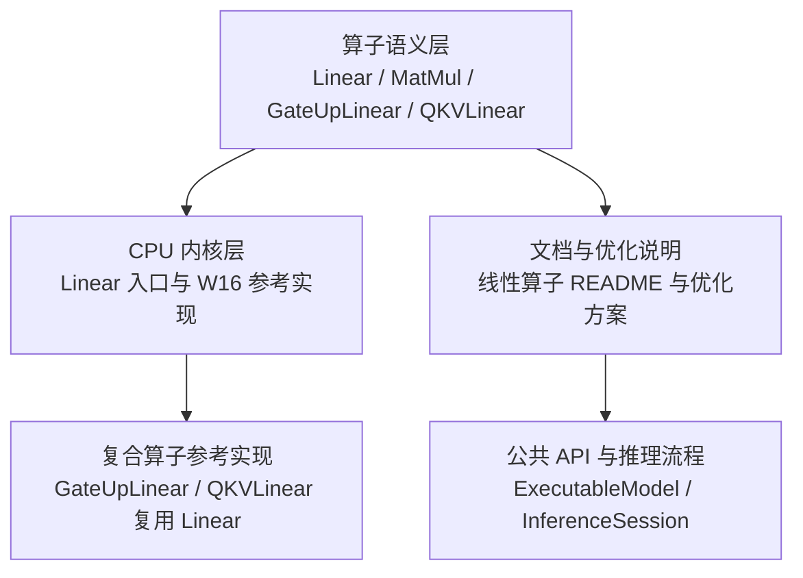
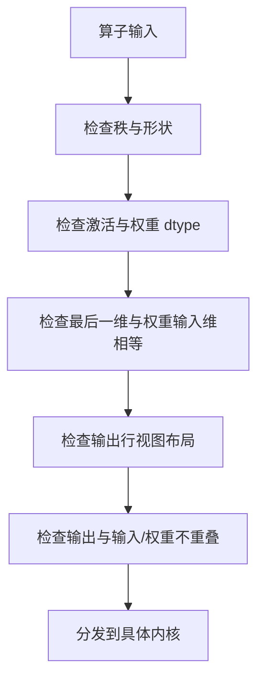
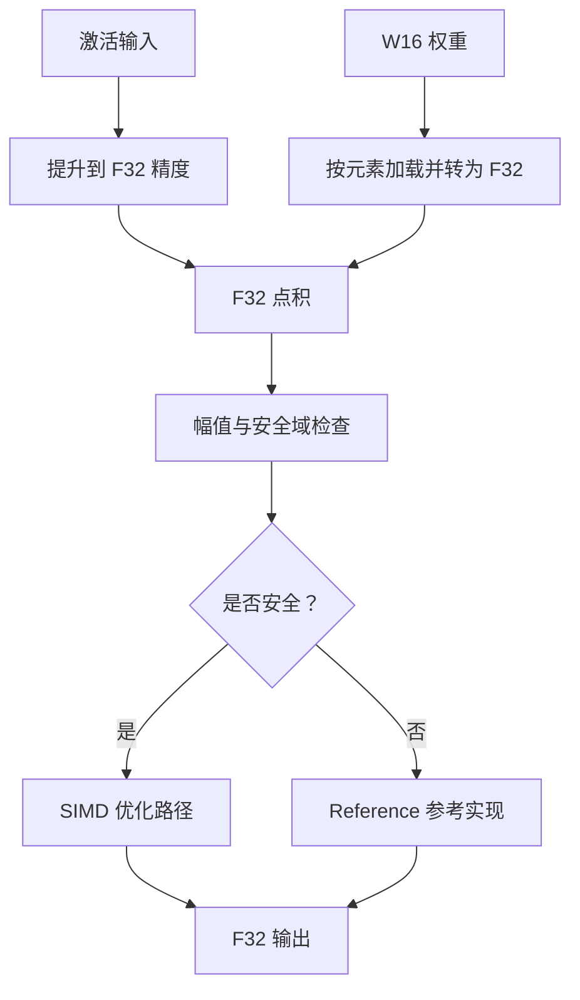
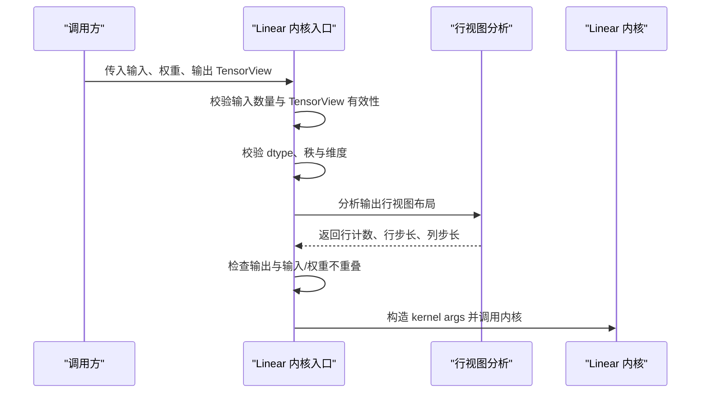
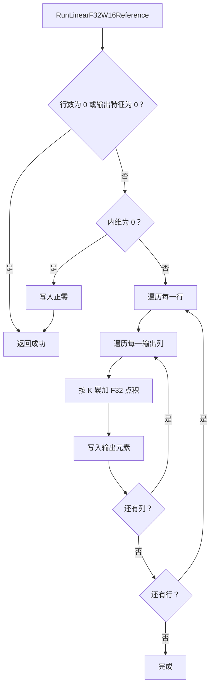
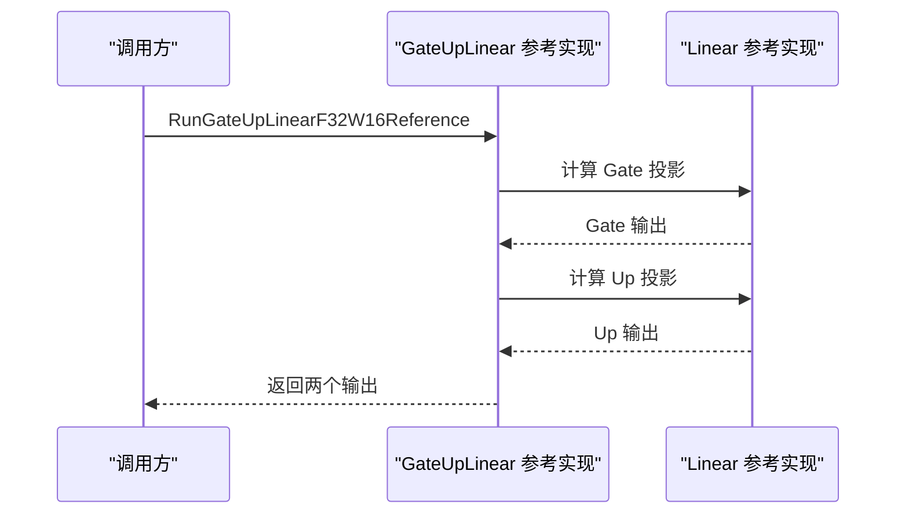
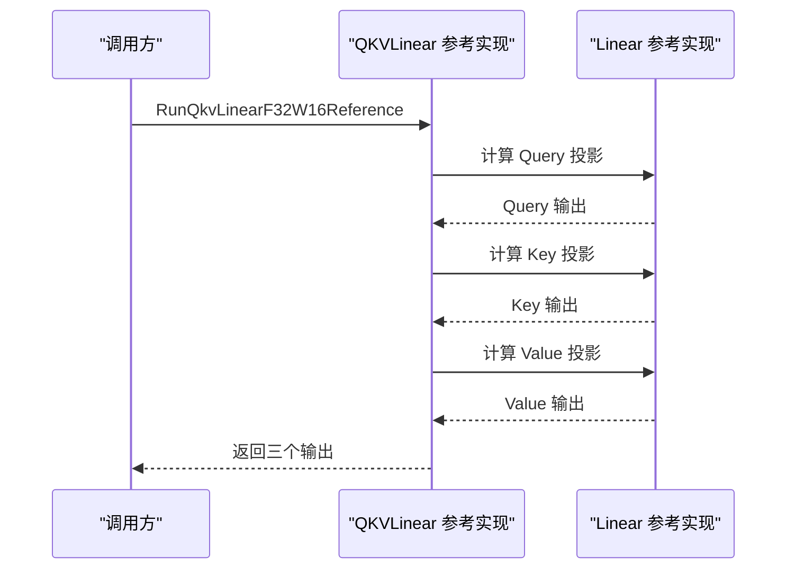
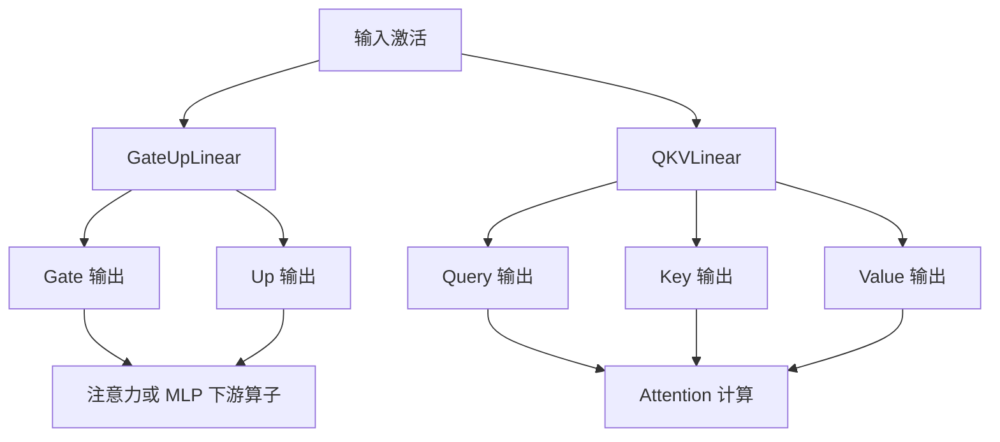
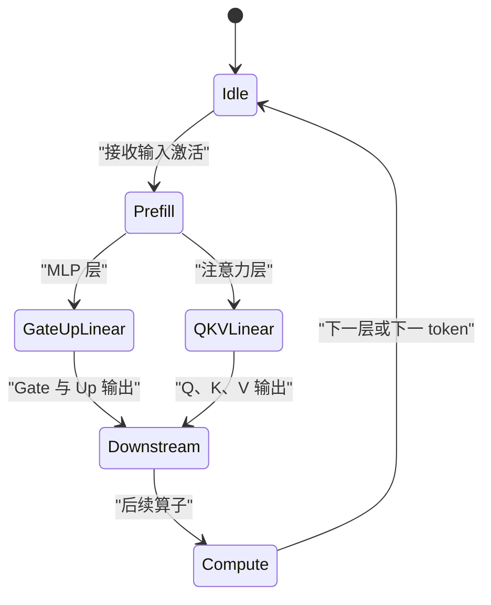

# 线性算子

**本文引用的文件**
- [linear_op.h](../../../../include/aethermind/operators/ops/linear_op.h)
- [matmul_op.h](../../../../include/aethermind/operators/ops/matmul_op.h)
- [op_params.h](../../../../include/aethermind/operators/op_params.h)
- [linear_op.cpp](../../../../src/operators/ops/linear_op.cpp)
- [matmul_op.cpp](../../../../src/operators/ops/matmul_op.cpp)
- [gate_up_linear_op.cpp](../../../../src/operators/ops/gate_up_linear_op.cpp)
- [qkv_linear_op.cpp](../../../../src/operators/ops/qkv_linear_op.cpp)
- [public-api.md](../../../api/public-api.md)
- [README.md](../../../operators/linear/README.md)
- [linear-optimization.md](../../../operators/linear/linear-optimization.md)
- [linear_a32_w16_reference.cpp](../../../../src/backend/cpu/kernels/linear/linear_a32_w16_reference.cpp)
- [gate_up_linear_a32_w16_reference.cpp](../../../../src/backend/cpu/kernels/gate_up_linear/gate_up_linear_a32_w16_reference.cpp)
- [qkv_linear_a32_w16_reference.cpp](../../../../src/backend/cpu/kernels/qkv_linear/qkv_linear_a32_w16_reference.cpp)
- [linear_entry.cpp](../../../../src/backend/cpu/kernels/linear/linear_entry.cpp)

## 目录

1. [引言](#引言)
2. [项目结构中的线性算子位置](#项目结构中的线性算子位置)
3. [核心算子与数学定义](#核心算子与数学定义)
4. [输入输出形状与内存布局约束](#输入输出形状与内存布局约束)
5. [数值精度处理策略](#数值精度处理策略)
6. [内核实现细节](#内核实现细节)
7. [复合算子：GateUpLinear 与 QKVLinear](#复合算子-gateuplinear-与-qkvlinear)
8. [执行顺序与依赖关系](#执行顺序与依赖关系)
9. [使用示例](#使用示例)
10. [性能调优建议](#性能调优建议)
11. [故障排查](#故障排查)
12. [结论](#结论)

## 引言

AetherMind 的线性算子系统围绕四个语义层核心算子组织：**Linear**、**MatMul**、**GateUpLinear** 和 **QKVLinear**。它们分别承担通用线性变换、批量矩阵乘法、Llama MLP Gate/Up 融合投影，以及注意力 Q/K/V 融合投影的职责。

从架构上看，这四个算子不是孤立实现：

- **Linear** 是 Llama Dense 层的基础线性算子，语义等价于 MatMul。
- **MatMul** 提供广播语义的批量矩阵乘法接口。
- **GateUpLinear** 把 Gate 分支与 Up 分支打包在同一个权重张量中，按行顺序输出两个结果。
- **QKVLinear** 把 Query、Key、Value 三个投影合并为一个权重张量，按行顺序输出三个结果。

文档重点覆盖以下方面：

- 每个算子的数学定义与形状约束。
- 激活、权重、输出的数据类型合同。
- CPU 后端 W16/A32 实现的内存布局、SIMD 路径选择、并行化策略和回退机制。
- GateUpLinear 与 QKVLinear 在 Llama 模型中的作用和执行顺序。
- 如何构造参数、调用推断逻辑，以及如何结合 AetherMind 公共 API 构建推理流程。

## 项目结构中的线性算子位置

线性算子在仓库中分为三层：

| 层次 | 职责 | 关键文件 |
|---|---|---|
| 算子语义层 | 定义支持的 dtype、参数结构、形状推断和运行时检查 | `linear_op.h`、`matmul_op.h`、`op_params.h`、`linear_op.cpp`、`matmul_op.cpp`、`gate_up_linear_op.cpp`、`qkv_linear_op.cpp` |
| CPU 内核层 | 实现 F32/W16 参考路径、入口参数构建和优化调度 | `linear_entry.cpp`、`linear_a32_w16_reference.cpp`、`gate_up_linear_a32_w16_reference.cpp`、`qkv_linear_a32_w16_reference.cpp` |
| 用户与指南层 | 描述 CPU Linear 生产路径、优化方案、W16/F16/BF16 行为 | `docs/operators/linear/README.md`、`docs/operators/linear/linear-optimization.md`、`docs/api/public-api.md` |

**图示来源**
- [linear_op.cpp:1-92](../../../../src/operators/ops/linear_op.cpp#L1-L92)
- [matmul_op.cpp:1-120](../../../../src/operators/ops/matmul_op.cpp#L1-L120)
- [gate_up_linear_op.cpp:1-107](../../../../src/operators/ops/gate_up_linear_op.cpp#L1-L107)
- [qkv_linear_op.cpp:1-120](../../../../src/operators/ops/qkv_linear_op.cpp#L1-L120)
- [linear_a32_w16_reference.cpp:1-57](../../../../src/backend/cpu/kernels/linear/linear_a32_w16_reference.cpp#L1-L57)
- [gate_up_linear_a32_w16_reference.cpp:1-45](../../../../src/backend/cpu/kernels/gate_up_linear/gate_up_linear_a32_w16_reference.cpp#L1-L45)
- [qkv_linear_a32_w16_reference.cpp:1-48](../../../../src/backend/cpu/kernels/qkv_linear/qkv_linear_a32_w16_reference.cpp#L1-L48)

**章节来源**
- [linear_op.cpp:1-92](../../../../src/operators/ops/linear_op.cpp#L1-L92)
- [matmul_op.cpp:1-120](../../../../src/operators/ops/matmul_op.cpp#L1-L120)
- [gate_up_linear_op.cpp:1-107](../../../../src/operators/ops/gate_up_linear_op.cpp#L1-L107)
- [qkv_linear_op.cpp:1-120](../../../../src/operators/ops/qkv_linear_op.cpp#L1-L120)
- [linear_a32_w16_reference.cpp:1-57](../../../../src/backend/cpu/kernels/linear/linear_a32_w16_reference.cpp#L1-L57)
- [README.md](../../../operators/linear/README.md)

## 核心算子与数学定义

### Linear

Linear 是一个通用的线性变换算子。其数学定义为：

> 对输入张量 \(X\) 和权重张量 \(W\)，计算
> \(Y = X W^T + b\)（当前实现不包含 bias 输入）

其中：

- \(X\) 的形状为 \([*, K]\)，最后一个维度是特征维。
- \(W\) 的形状为 \([N, K]\)。
- \(Y\) 的形状为 \([*, N]\)。
- 前导维度与输入保持一致，只有最后一个维度被替换为输出特征数 \(N\)。

Linear 的语义等价于 MatMul；权重正性由图构建层保证，而算子推断允许零维形状以兼容 NumPy/PyTorch 语义。

**章节来源**
- [linear_op.cpp:10-92](../../../../src/operators/ops/linear_op.cpp#L10-L92)
- [linear_op.h:23-61](../../../../include/aethermind/operators/ops/linear_op.h#L23-L61)

### MatMul

MatMul 支持批量矩阵乘法，并包含右侧转置开关。其数学定义为：

> 当 `transpose_rhs == false` 时：
> \(Y = \text{lhs} @ \text{rhs}\)
> 当 `transpose_rhs == true` 时：
> \(Y = \text{lhs} @ \text{rhs}^T\)

形状规则如下：

| 输入 | 形状要求 | 含义 |
|---|---|---|
| lhs | \([*, M, K]\) | 至少二维，最后两维为矩阵维 |
| rhs | \([*, K, N]\) 或 \([*, N, K]\) | 由 `transpose_rhs` 决定内维和外维 |
| output | broadcast(batch_lhs, batch_rhs) + \([M, N]\) | 前导批维广播，末尾两维为矩阵乘结果 |

MatMul 的输出 dtype 跟随 lhs dtype。它允许零值维度，并把权重正性等模型级约束交给上层图构建阶段。

**章节来源**
- [matmul_op.h:22-66](../../../../include/aethermind/operators/ops/matmul_op.h#L22-L66)
- [matmul_op.cpp:1-120](../../../../src/operators/ops/matmul_op.cpp#L1-L120)

### GateUpLinear

GateUpLinear 是 Llama MLP 层的融合投影算子。它将 Gate 分支与 Up 分支合并为一个权重张量，并按行顺序切分输出：

\[
\begin{aligned}
G &= X W_{\text{gate}}^T \\
U &= X W_{\text{up}}^T
\end{aligned}
\]

其中：

- 输入形状为 \([*, K]\)。
- 打包权重形状为 \([G_{\text{out}} + U_{\text{out}}, K]\)。
- 第一个输出形状为 \([*, G_{\text{out}}]\)。
- 第二个输出形状为 \([*, U_{\text{out}}]\)。
- 权重行顺序固定为 Gate，然后是 Up。

该算子目前不支持 bias 输入。

**章节来源**
- [op_params.h:339-347](../../../../include/aethermind/operators/op_params.h#L339-L347)
- [gate_up_linear_op.cpp:1-107](../../../../src/operators/ops/gate_up_linear_op.cpp#L1-L107)

### QKVLinear

QKVLinear 是注意力层的融合投影算子。它将 Query、Key、Value 三个投影合并为一个权重张量：

\[
\begin{aligned}
Q &= X W_Q^T \\
K &= X W_K^T \\
V &= X W_V^T
\end{aligned}
\]

其中：

- 输入形状为 \([*, K]\)。
- 打包权重形状为 \([Q_{\text{out}} + K_{\text{out}} + V_{\text{out}}, K]\)。
- 三个输出形状分别为 \([*, Q_{\text{out}}]\)、\([*, K_{\text{out}}]\)、\([*, V_{\text{out}}]\)。
- 权重行顺序固定为 Q、K、V。

该算子当前也不支持 bias 输入。

**章节来源**
- [op_params.h:332-337](../../../../include/aethermind/operators/op_params.h#L332-L337)
- [qkv_linear_op.cpp:1-120](../../../../src/operators/ops/qkv_linear_op.cpp#L1-L120)

## 输入输出形状与内存布局约束

### 形状约束总表

| 算子 | 输入 | 权重 | 输出 |
|---|---|---|---|
| Linear | \([*, K]\) | \([N, K]\) | \([*, N]\) |
| MatMul | \([*, M, K]\) | \([*, K, N]\) 或 \([*, N, K]\) | broadcast(batch) + \([M, N]\) |
| GateUpLinear | \([*, K]\) | \([G_{\text{out}} + U_{\text{out}}, K]\) | \([*, G_{\text{out}}]\)、\([*, U_{\text{out}}]\) |
| QKVLinear | \([*, K]\) | \([Q_{\text{out}} + K_{\text{out}} + V_{\text{out}}, K]\) | \([*, Q_{\text{out}}]\)、\([*, K_{\text{out}}]\)、\([*, V_{\text{out}}]\) |

### 行视图布局

Linear 内核使用“行视图”分析来统一处理不同 stride 的张量。每个 TensorView 会提取：

- 行数。
- 行步长。
- 列步长。
- 数据足迹。

这种设计让算子能够支持非单位列 stride，同时避免非法重叠。

### 内存布局要求

对于 CPU Linear 内核：

- 输入、权重、输出必须为有效的 TensorView。
- 输出不能与输入或权重原地写入重叠。
- 行式布局通过统一的 row-wise 验证函数校验。
- W16 权重使用字节安全读取，不要求自然对齐；但 F32 地址在准备期需要满足 `alignof(float)` 的对齐约束。
- 零行、零输出、零内维属于合法边界情况，不会触发越界访问。

**图示来源**
- [linear_entry.cpp:20-200](../../../../src/backend/cpu/kernels/linear/linear_entry.cpp#L20-L200)
- [linear_op.cpp:10-92](../../../../src/operators/ops/linear_op.cpp#L10-L92)

**章节来源**
- [linear_entry.cpp:20-200](../../../../src/backend/cpu/kernels/linear/linear_entry.cpp#L20-L200)
- [README.md](../../../operators/linear/README.md)

## 数值精度处理策略

### 支持的 dtype

| 类别 | 支持类型 |
|---|---|
| Linear 激活输入 | Float32、Float16、BFloat16、Float8E4M3FN、Float8E5M2 |
| Linear 权重 | Float32、Float16、BFloat16、Float8E4M3FN、Float8E5M2、Int8、Int4 |
| MatMul 输入 | Float32、Float16、BFloat16、Float8E4M3FN、Float8E5M2、Int8 |
| Linear 输出 | 默认跟随激活 dtype；可通过 `LinearParams::output_dtype` 显式指定标量 Float32、Float16 或 BFloat16 |

### 精度提升与累加策略

当前 CPU 生产路径强调：

- 激活参与计算的精度保持为 F32。
- W16 权重按元素加载后转换为 F32 再参与点积。
- 累加过程采用 F32，防止低精度累积误差主导结果。
- 参考实现使用逐元素 `memcpy` 读取 W16，然后按 K 升序执行独立 F32 乘加。
- optimized 路径允许 FMA、lane reduction 与 blocking 重排，但不承诺与 reference 逐位等同。

### 溢出与非有限值保护

optimized 路径使用输入/权重的幅值上界约束 F32 overflow 安全域。如果幅值超出安全范围，或出现非有限输出，系统会完整回退到 reference 实现，以避免 fast path 丢失 NaN、Inf 等分类语义。

**图示来源**
- [linear_a32_w16_reference.cpp:1-57](../../../../src/backend/cpu/kernels/linear/linear_a32_w16_reference.cpp#L1-L57)
- [linear-optimization.md](../../../operators/linear/linear-optimization.md)

**章节来源**
- [linear_op.h:23-61](../../../../include/aethermind/operators/ops/linear_op.h#L23-L61)
- [matmul_op.h:22-48](../../../../include/aethermind/operators/ops/matmul_op.h#L22-L48)
- [linear_a32_w16_reference.cpp:1-57](../../../../src/backend/cpu/kernels/linear/linear_a32_w16_reference.cpp#L1-L57)
- [linear-optimization.md](../../../operators/linear/linear-optimization.md)

## 内核实现细节

### Linear 内核入口与参数构建

Linear 的内核入口负责将高层 TensorView 转换为底层 kernel args。主要步骤包括：

1. 校验输入数量为 2，输出数量为 1。
2. 校验输入、权重、输出 TensorView 有效。
3. 根据变体选择 dtype 约束：
   - F32 plain/identity：输入、权重、输出均为 F32。
   - W16：输入与输出为 F32，权重为 F16 或 BF16。
4. 校验输入秩、权重秩和输出秩。
5. 解析行列维度，并计算展平后的行数。
6. 对输出进行行视图分析，确保可写布局。
7. 检查输出与输入、权重不重叠。
8. 构造 `LinearA32W32KernelArgs` 或 `LinearA32W16KernelArgs`。

**图示来源**
- [linear_entry.cpp:20-200](../../../../src/backend/cpu/kernels/linear/linear_entry.cpp#L20-L200)

**章节来源**
- [linear_entry.cpp:20-200](../../../../src/backend/cpu/kernels/linear/linear_entry.cpp#L20-L200)

### Reference 实现

W16 reference 实现的核心逻辑如下：

- 若行数为 0 或输出特征数为 0，直接返回。
- 若内维为 0，按输出形状写入正零。
- 外层遍历行，内层遍历输出列，最内层遍历 K 维。
- 权重元素通过 `std::memcpy` 读取 16 位字，并根据 dtype 解释为 F16 或 BF16。
- 点积结果累加为 F32。

这保证了即使 SIMD 优化路径发生重排，reference 仍可作为数值基准。

**图示来源**
- [linear_a32_w16_reference.cpp:10-57](../../../../src/backend/cpu/kernels/linear/linear_a32_w16_reference.cpp#L10-L57)

**章节来源**
- [linear_a32_w16_reference.cpp:1-57](../../../../src/backend/cpu/kernels/linear/linear_a32_w16_reference.cpp#L1-L57)

### SIMD 优化路径选择

根据优化方案文档，CPU Linear 的 optimized 路径遵循以下原则：

- Decode 与 small-M 场景使用 K 维 8-lane SIMD。
- 寄存器 block 采用两行与四个输出。
- F16 使用 F16C。
- BF16 使用整数 widening。
- Prefill 使用共享 F32 microkernel，KC=512。
- W16 按 8×8 小块 widening 并转置到连续 N lanes。
- 短 blocked 路径使用最多 128 KiB 栈存储。
- direct-A 路径使用 32 KiB 固定栈 scratch。
- BF16 不依赖 F16C；F16 需要 AVX2、FMA 和 F16C。
- 不满足 ISA 条件或特殊值时回退 reference。

**章节来源**
- [linear-optimization.md](../../../operators/linear/linear-optimization.md)
- [README.md](../../../operators/linear/README.md)

## 复合算子 GateUpLinear 与 QKVLinear

### GateUpLinear 的实现方式

GateUpLinear 的 reference 实现并不重新实现点积，而是复用 Linear 的 W16 reference：

1. 先调用 `RunProjection` 计算 Gate 分支。
2. 再调用 `RunProjection` 计算 Up 分支。
3. 每次调用都构造一个只覆盖对应投影段的 `LinearA32W16KernelArgs`。
4. 权重偏移由 caller 控制，因此两个分支共享同一份 packed weight buffer。

**图示来源**
- [gate_up_linear_a32_w16_reference.cpp:1-45](../../../../src/backend/cpu/kernels/gate_up_linear/gate_up_linear_a32_w16_reference.cpp#L1-L45)
- [linear_a32_w16_reference.cpp:10-57](../../../../src/backend/cpu/kernels/linear/linear_a32_w16_reference.cpp#L10-L57)

### QKVLinear 的实现方式

QKVLinear 的实现模式与 GateUpLinear 相同：

1. 依次计算 Query、Key、Value 三个投影。
2. 每个投影通过 `RunProjection` 复用 `RunLinearF32W16Reference`。
3. 权重指针按 Q、K、V 的分段偏移定位。
4. 当前仍逐 projection 调用，没有跨 projection 的 input-tile 复用。

**图示来源**
- [qkv_linear_a32_w16_reference.cpp:1-48](../../../../src/backend/cpu/kernels/qkv_linear/qkv_linear_a32_w16_reference.cpp#L1-L48)
- [linear_a32_w16_reference.cpp:10-57](../../../../src/backend/cpu/kernels/linear/linear_a32_w16_reference.cpp#L10-L57)

### 在 Llama 模型中的作用

- **GateUpLinear** 对应 Llama MLP 层中的 Gate 分支与 Up 分支。通常后续会接 SiLU 与逐元素乘法，形成 gated activation MLP。
- **QKVLinear** 对应注意力层中的 Query、Key、Value 投影。这三个输出随后进入 attention score 计算、softmax、value 加权等流程。

这两个算子都是“复合算子”，目的是减少一次矩阵乘的启动开销，并让权重打包格式更紧凑。

**章节来源**
- [gate_up_linear_op.cpp:1-107](../../../../src/operators/ops/gate_up_linear_op.cpp#L1-L107)
- [qkv_linear_op.cpp:1-120](../../../../src/operators/ops/qkv_linear_op.cpp#L1-L120)
- [gate_up_linear_a32_w16_reference.cpp:1-45](../../../../src/backend/cpu/kernels/gate_up_linear/gate_up_linear_a32_w16_reference.cpp#L1-L45)
- [qkv_linear_a32_w16_reference.cpp:1-48](../../../../src/backend/cpu/kernels/qkv_linear/qkv_linear_a32_w16_reference.cpp#L1-L48)

## 执行顺序与依赖关系

### 算子依赖图

### 执行顺序

典型 Llama 层执行顺序如下：

1. 输入激活进入 Linear 或复合算子。
2. 如果是 MLP 层，优先执行 GateUpLinear。
3. 如果是注意力层，优先执行 QKVLinear。
4. 复合算子内部按固定行顺序拆分权重，并依次调用底层 Linear。
5. 输出继续传递给后续算子，例如 RMSNorm、SiLU、Mul、Attention、RMSNorm 等。

**图示来源**
- [gate_up_linear_op.cpp:1-107](../../../../src/operators/ops/gate_up_linear_op.cpp#L1-L107)
- [qkv_linear_op.cpp:1-120](../../../../src/operators/ops/qkv_linear_op.cpp#L1-L120)
- [gate_up_linear_a32_w16_reference.cpp:1-45](../../../../src/backend/cpu/kernels/gate_up_linear/gate_up_linear_a32_w16_reference.cpp#L1-L45)
- [qkv_linear_a32_w16_reference.cpp:1-48](../../../../src/backend/cpu/kernels/qkv_linear/qkv_linear_a32_w16_reference.cpp#L1-L48)

**章节来源**
- [gate_up_linear_op.cpp:1-107](../../../../src/operators/ops/gate_up_linear_op.cpp#L1-L107)
- [qkv_linear_op.cpp:1-120](../../../../src/operators/ops/qkv_linear_op.cpp#L1-L120)

## 使用示例

以下示例展示如何在 AetherMind 中使用这些算子。为避免暴露具体代码内容，示例以步骤形式给出，并附带相关源码路径。

### 使用 Linear 算子

1. 构造输入张量，形状为 \([*, K]\)，dtype 为支持的激活类型。
2. 构造权重张量，形状为 \([N, K]\)，dtype 为支持的权重类型。
3. 可选设置 `LinearParams::output_dtype`，指定输出为标量 Float32、Float16 或 BFloat16。
4. 调用 Linear 推断逻辑，得到输出形状和运行时检查。
5. 在 CPU 后端，Linear 入口会进一步校验 TensorView、stride、alias 和 dtype。

**参考路径**
- [linear_op.cpp:10-92](../../../../src/operators/ops/linear_op.cpp#L10-L92)
- [linear_op.h:23-61](../../../../include/aethermind/operators/ops/linear_op.h#L23-L61)
- [op_params.h:38-42](../../../../include/aethermind/operators/op_params.h#L38-L42)
- [linear_entry.cpp:20-200](../../../../src/backend/cpu/kernels/linear/linear_entry.cpp#L20-L200)

### 使用 MatMul 算子

1. 构造 lhs，形状为 \([*, M, K]\)。
2. 构造 rhs，形状为 \([*, K, N]\) 或 \([*, N, K]\)。
3. 设置 `MatMulParams::transpose_rhs`。
4. 调用 MatMul 推断逻辑，得到广播后的批维与 \([M, N]\) 矩阵维。
5. 输出 dtype 跟随 lhs。

**参考路径**
- [matmul_op.cpp:1-120](../../../../src/operators/ops/matmul_op.cpp#L1-L120)
- [matmul_op.h:22-66](../../../../include/aethermind/operators/ops/matmul_op.h#L22-L66)
- [op_params.h:212-214](../../../../include/aethermind/operators/op_params.h#L212-L214)

### 使用 GateUpLinear 算子

1. 构造输入形状 \([*, K]\)。
2. 构造 packed 权重形状 \([G_{\text{out}} + U_{\text{out}}, K]\)。
3. 设置 `GateUpLinearParams::gate_out_features` 与 `up_out_features`。
4. 保持 `has_bias=false`，因为当前 schema 不支持 bias。
5. 推断得到两个输出形状：\([*, G_{\text{out}}]\) 和 \([*, U_{\text{out}}]\)。

**参考路径**
- [gate_up_linear_op.cpp:1-107](../../../../src/operators/ops/gate_up_linear_op.cpp#L1-L107)
- [op_params.h:339-347](../../../../include/aethermind/operators/op_params.h#L339-L347)

### 使用 QKVLinear 算子

1. 构造输入形状 \([*, K]\)。
2. 构造 packed 权重形状 \([Q_{\text{out}} + K_{\text{out}} + V_{\text{out}}, K]\)。
3. 设置 `QkvLinearParams::q_out_features`、`k_out_features`、`v_out_features`。
4. 保持 `has_bias=false`。
5. 推断得到三个输出形状：\([*, Q_{\text{out}}]\)、\([*, K_{\text{out}}]\)、\([*, V_{\text{out}}]\)。

**参考路径**
- [qkv_linear_op.cpp:1-120](../../../../src/operators/ops/qkv_linear_op.cpp#L1-L120)
- [op_params.h:332-337](../../../../include/aethermind/operators/op_params.h#L332-L337)

### 在公共 API 中使用

AetherMind 的公共 API 通过 `ModelLoader`、`ModelCompiler`、`ExecutableModel` 和 `InferenceSession` 组织端到端推理。线性算子作为模型图中的节点参与编译和执行，而不是由应用直接手动调度每一个 kernel。

**参考路径**
- [public-api.md](../../../api/public-api.md)

**章节来源**
- [linear_op.cpp:10-92](../../../../src/operators/ops/linear_op.cpp#L10-L92)
- [matmul_op.cpp:1-120](../../../../src/operators/ops/matmul_op.cpp#L1-L120)
- [gate_up_linear_op.cpp:1-107](../../../../src/operators/ops/gate_up_linear_op.cpp#L1-L107)
- [qkv_linear_op.cpp:1-120](../../../../src/operators/ops/qkv_linear_op.cpp#L1-L120)
- [op_params.h:38-42](../../../../include/aethermind/operators/op_params.h#L38-L42)
- [op_params.h:212-214](../../../../include/aethermind/operators/op_params.h#L212-L214)
- [op_params.h:332-347](../../../../include/aethermind/operators/op_params.h#L332-L347)
- [public-api.md](../../../api/public-api.md)

## 性能调优建议

### 选择合适的优化级别

- O1/plain 适合简单部署路径，便于验证 correctness。
- O2/packed 更适合 Llama Dense 模型，因为 QKV 与 GateUp 权重采用 identity-packed 布局。

**参考路径**
- [public-api.md](../../../api/public-api.md)

### 关注 Prefill 与 Decode 的工作负载差异

- Prefill 阶段通常 M 较大，适合共享 microkernel 和 KC=512 的 blocked 路径。
- Decode 阶段通常 M 较小，适合 K 维 8-lane SIMD 与 register block 优化。

**参考路径**
- [linear-optimization.md](../../../operators/linear/linear-optimization.md)

### 合理设置 dtype

- 激活建议使用 F32 参与计算，以保证数值稳定性。
- 权重可使用 F16 或 BF16，减少内存带宽压力。
- 输出可通过 `LinearParams::output_dtype` 控制为 FP32、FP16 或 BF16。

**参考路径**
- [linear_op.h:23-61](../../../../include/aethermind/operators/ops/linear_op.h#L23-L61)
- [linear-optimization.md](../../../operators/linear/linear-optimization.md)

### 避免不必要的中间分配

- Linear 热路径不分配、不查 registry、不 pack 全模型权重。
- GateUpLinear 与 QKVLinear 复用 Linear engine，但仍按 projection 顺序调用，未宣称跨 projection 的 input-tile 复用。

**参考路径**
- [linear-optimization.md](../../../operators/linear/linear-optimization.md)

### 关注内存对齐与 stride

- 非单位列 stride 应尽量避免极端碎片化布局。
- W16 权重虽然支持字节安全读取，但 F32 地址仍需满足 float 对齐。
- 输出布局必须通过行视图验证。

**参考路径**
- [README.md](../../../operators/linear/README.md)
- [linear_entry.cpp:20-200](../../../../src/backend/cpu/kernels/linear/linear_entry.cpp#L20-L200)

**章节来源**
- [linear-optimization.md](../../../operators/linear/linear-optimization.md)
- [README.md](../../../operators/linear/README.md)
- [linear_entry.cpp:20-200](../../../../src/backend/cpu/kernels/linear/linear_entry.cpp#L20-L200)

## 故障排查

### 常见错误类型

| 错误场景 | 原因 | 处理方式 |
|---|---|---|
| 输入秩小于 1 | Linear、GateUpLinear、QKVLinear 要求输入至少一维 | 修正输入形状 |
| 权重秩不为 2 | Linear、GateUpLinear、QKVLinear 要求二维权重 | 修正权重形状 |
| 最后一维与权重输入维不匹配 | 形状推断阶段检测到不等 | 调整 K 维或权重形状 |
| 输出 dtype 不受支持 | Linear 输出必须是标量 Float32、Float16 或 BFloat16 | 修正 `output_dtype` |
| 复合算子 has_bias=true | 当前 schema 不支持 bias 输入 | 关闭 bias 或等待 schema 扩展 |
| 输出与输入/权重重叠 | Linear 不允许 in-place 写入 | 使用独立输出 buffer |
| 非有限输出或溢出 | optimized 路径幅值上界检查失败 | 回退 reference |

### 调试建议

1. 先确认 shape inference 是否正确。
2. 再确认 TensorView 的 dtype、rank 和 stride。
3. 检查是否启用了受支持的 ISA。
4. 对比 reference 与 optimized 输出，判断是数值问题还是布局问题。
5. 对小形状单独测试，排除 blocked path 与 cache 行为干扰。

**章节来源**
- [linear_op.cpp:10-92](../../../../src/operators/ops/linear_op.cpp#L10-L92)
- [matmul_op.cpp:1-120](../../../../src/operators/ops/matmul_op.cpp#L1-L120)
- [gate_up_linear_op.cpp:1-107](../../../../src/operators/ops/gate_up_linear_op.cpp#L1-L107)
- [qkv_linear_op.cpp:1-120](../../../../src/operators/ops/qkv_linear_op.cpp#L1-L120)
- [linear_entry.cpp:20-200](../../../../src/backend/cpu/kernels/linear/linear_entry.cpp#L20-L200)
- [linear-optimization.md](../../../operators/linear/linear-optimization.md)

## 结论

AetherMind 的线性算子体系以 Linear 为基础，向上扩展出 MatMul、GateUpLinear 和 QKVLinear。它们的共同特点是：

- 数学定义清晰，形状约束由推断逻辑和内核入口双重保障。
- 激活使用 F32 精度参与计算，W16 权重按需加载并转换为 F32。
- CPU 内核支持 portable scalar、AVX2/FMA 驱动、SIMD widening、Prefill/Decode blocking 和 reference fallback。
- GateUpLinear 与 QKVLinear 是 Llama 模型的关键复合算子，通过 packed weight 减少启动开销，同时复用 Linear 内核实现。
- 当前实现按 projection 顺序调用 Linear，尚未声明跨 projection 的 input-tile 复用。

在实际工程中，应优先保证形状与 dtype 正确，再根据 Prefill/Decode 工作负载选择合适的优化路径，并通过 reference 与 optimized 双轨验证数值稳定性。
