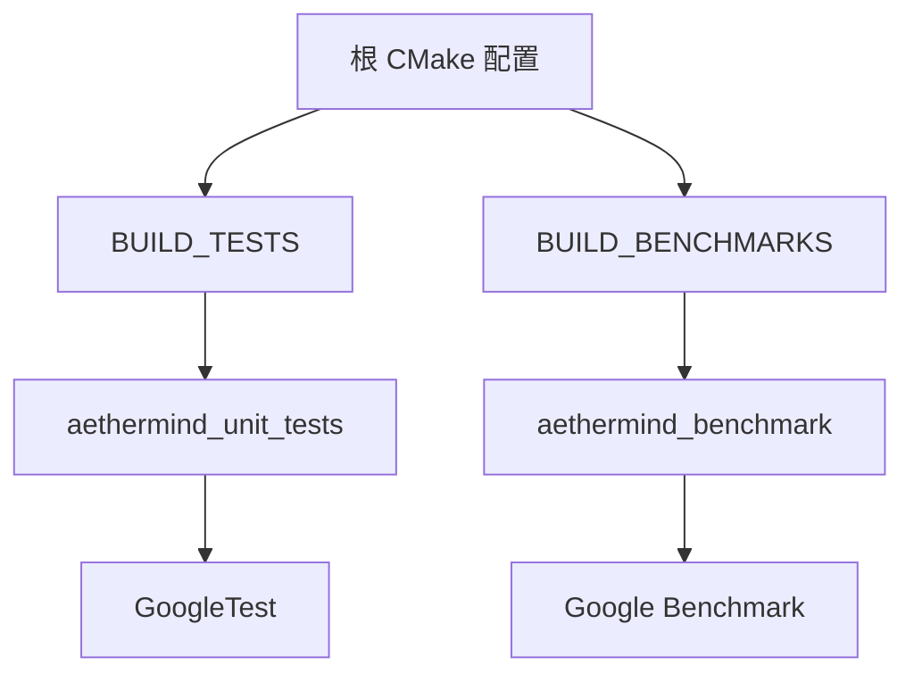
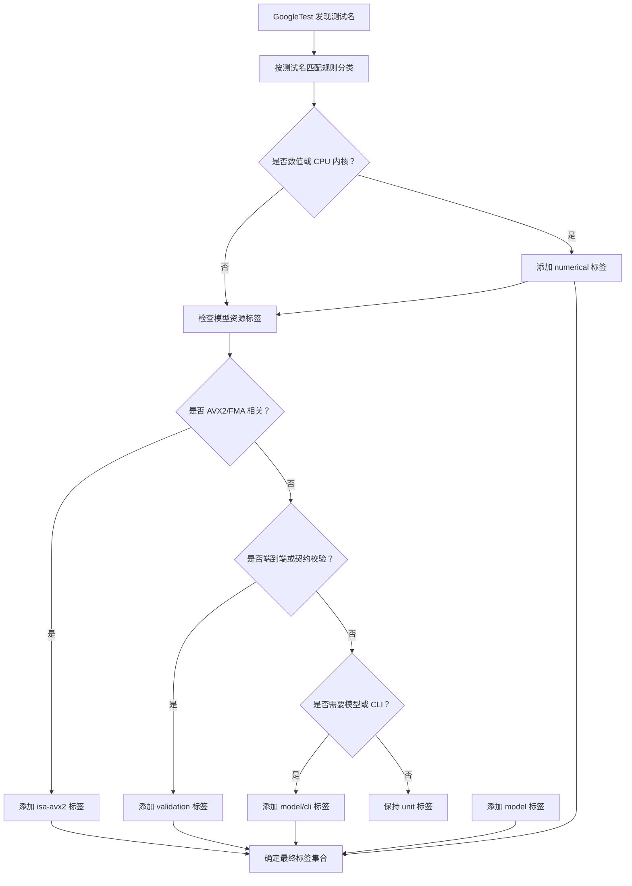
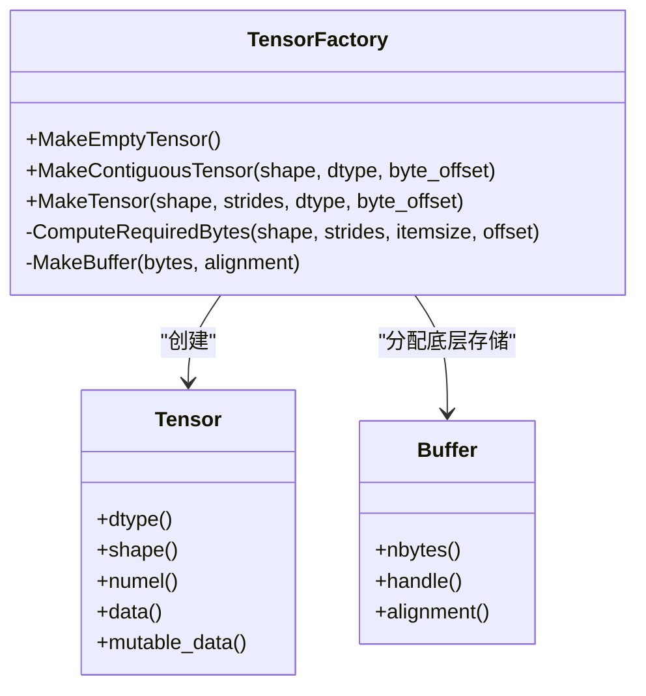
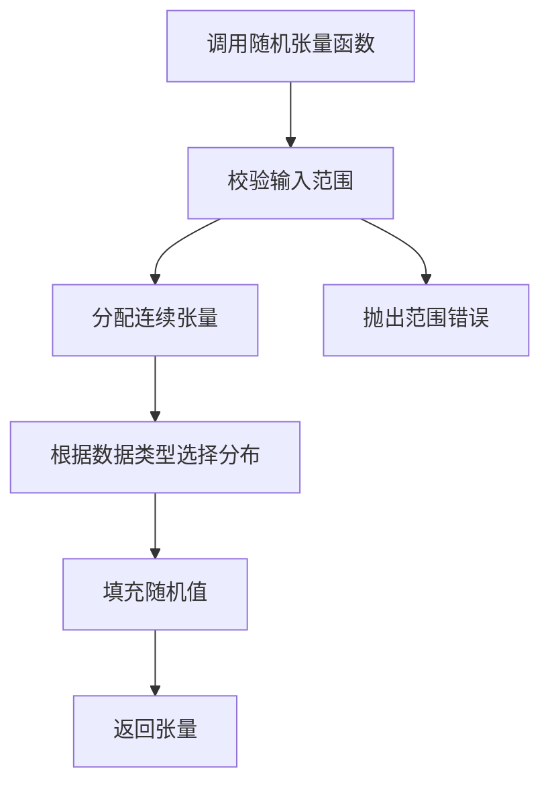
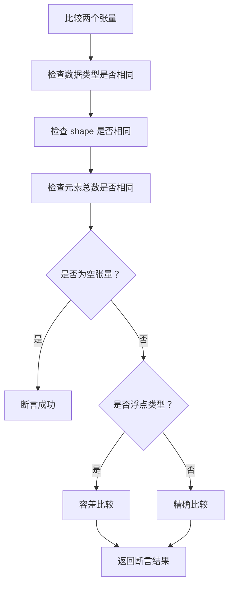
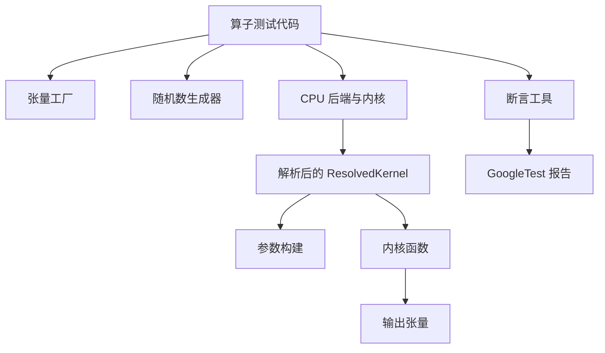
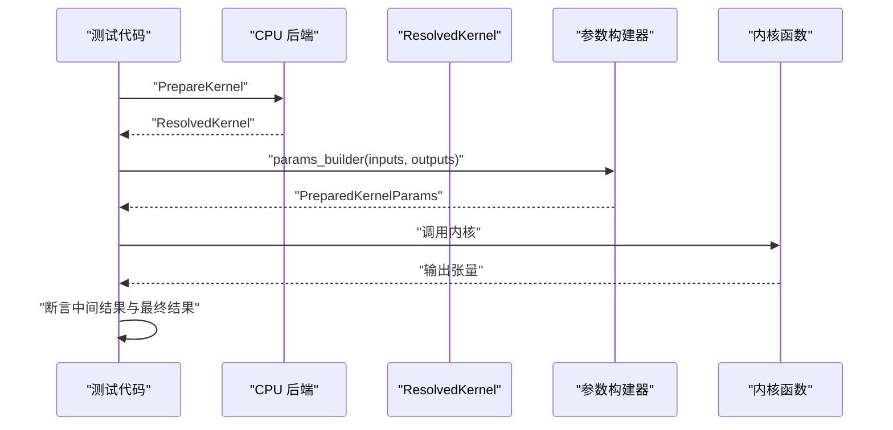
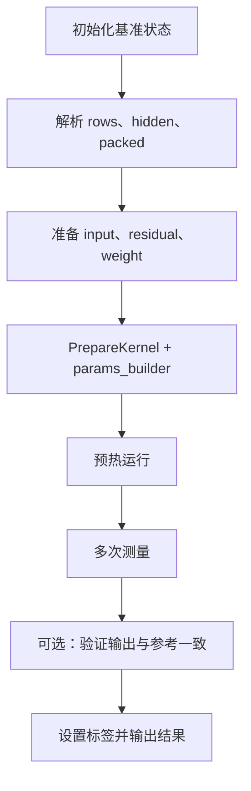

# 算子测试框架

**本文引用的文件**
- [CMakeLists.txt](../../../CMakeLists.txt)
- [AetherMindTests.cmake](../../../cmake/AetherMindTests.cmake)
- [test_writing_guidelines.md](../../guides/test_writing_guidelines.md)
- [tensor_factory.h](../../../tests/unit/test_utils/tensor_factory.h)
- [tensor_random.h](../../../tests/unit/test_utils/tensor_random.h)
- [tensor_assert.h](../../../tests/unit/test_utils/tensor_assert.h)
- [test_cpu_add_rmsnorm_kernel.cpp](../../../tests/unit/backend/cpu/kernels/test_cpu_add_rmsnorm_kernel.cpp)
- [benchmark_cpu_add_rmsnorm.cpp](../../../tests/benchmark/cpu_kernels/benchmark_cpu_add_rmsnorm.cpp)

## 目录

1. [引言](#引言)
2. [项目结构与测试入口](#项目结构与测试入口)
3. [测试分类与标签体系](#测试分类与标签体系)
4. [核心组件：测试夹具](#核心组件测试夹具)
5. [架构总览](#架构总览)
6. [算子语义正确性测试模式](#算子语义正确性测试模式)
7. [数值精度验证模式](#数值精度验证模式)
8. [边界条件与错误路径测试](#边界条件与错误路径测试)
9. [基准测试设计模式](#基准测试设计模式)
10. [跨平台与指令集兼容性测试策略](#跨平台与指令集兼容性测试策略)
11. [新算子测试编写指南](#新算子测试编写指南)
12. [故障排查与常见问题](#故障排查与常见问题)
13. [结论](#结论)

## 引言

AetherMind 的算子测试框架围绕三个目标组织：

- **语义正确性**：验证算子输入输出契约、形状广播、数据类型转换和内核选择行为。
- **数值精度**：在浮点运算中通过容差比较或比特级断言，保证实现与参考结果一致。
- **性能回归检测**：使用 Google Benchmark 建立基线，覆盖不同形状、权重打包模式和后端特性。

测试代码主要位于 `tests/unit`，基准测试位于 `tests/benchmark`；构建、发现、标签化、资源依赖和 CTest 集成由顶层 CMake 配置驱动。

**章节来源**
- [CMakeLists.txt:1-171](../../../CMakeLists.txt#L1-L171)
- [test_writing_guidelines.md](../../guides/test_writing_guidelines.md)

## 项目结构与测试入口

### 测试目录布局

| 源目录 | 单元测试目录 | 职责 |
|---|---|---|
| `include/aethermind/operators/` | `tests/unit/operators/` | 算子定义、类型、参数、名称等基础设施 |
| `src/operators/ops/` | `tests/unit/operators/ops/` | 具体算子实现的语义测试 |
| `src/backend/cpu/kernels/` | `tests/unit/backend/cpu/kernels/` | CPU 后端内核、融合算子和执行流程测试 |
| `tests/unit/test_utils/` | 测试工具库 | 张量工厂、随机数生成器、断言工具 |
| `tests/benchmark/` | 基准测试 | Google Benchmark 性能测量用例 |

### 构建入口

根 `CMakeLists.txt` 启用以下关键选项：

- `BUILD_TESTS`：启用 GoogleTest 单元测试目标 `aethermind_unit_tests`。
- `BUILD_BENCHMARKS`：启用 Google Benchmark 基准目标 `aethermind_benchmark`。
- `AETHERMIND_VALIDATION_REQUIRED_ASSETS`：控制是否要求模型校验资源存在。

GoogleTest 和 Google Benchmark 优先复用外部提供的 target；否则通过共享依赖机制拉取源码并构建。



**图表来源**
- [CMakeLists.txt:43-155](../../../CMakeLists.txt#L43-L155)

**章节来源**
- [CMakeLists.txt:1-171](../../../CMakeLists.txt#L1-L171)
- [test_writing_guidelines.md](../../guides/test_writing_guidelines.md)

## 测试分类与标签体系

AetherMind 不依赖单一文件名约定完成所有测试调度，而是通过 CMake 脚本对已发现的 GoogleTest 用例进行二次标注。

### 主要标签含义

| 标签 | 含义 | 典型场景 |
|---|---|---|
| `unit` | 普通单元测试 | 大多数算子、容器、类型、状态机测试 |
| `numerical` | 数值相关测试 | 标量 Oracle、CPU 线性/RMSNorm/Attention/RoPE/Argmax 内核 |
| `model` | 需要模型资源的测试 | HF 模型加载、推理会话、资源限制 |
| `numerical-model` | 数值 + 模型资源 | HF 固定轨迹、数值比较、校准接受测试 |
| `isa-avx2` | 需要 AVX2/FMA 能力 | 直接调用 AVX2 内核的实现验证 |
| `validation` | 端到端或契约校验 | 运行时装配、权重打包、资源规划、CTest 报告 |
| `smoke` | 快速冒烟测试 | CPU 信息、后端工厂、注册表基础行为 |
| `interposer` | 需要分配拦截器 | OOM、诊断分配失败、内存泄漏路径 |
| `cli` | 命令行接口测试 | 推理 CLI 集成测试 |
| `long-context` | 长上下文测试 | KV16/A16/P4B 近上下文上限场景 |

### 标签决策流程



**图表来源**
- [AetherMindTests.cmake:1-199](../../../cmake/AetherMindTests.cmake#L1-L199)
- [AetherMindTests.cmake:200-289](../../../cmake/AetherMindTests.cmake#L200-L289)

### 跳过与禁用逻辑

当测试需要的资源不可用时，测试会被标记为禁用，而不是静默失败：

- 缺少数值参考资源时，`numerical-model` 测试被标记为 `missing_numerical_assets`。
- 未编译 AVX2 时，`isa-avx2` 测试被标记为 `not_compiled_avx2` 和 `not_applicable`。
- 分配拦截器仅在特定 sanitizer 环境下可用。
- 模型资源缺失时，`model` 测试被标记为 `missing_assets`。
- CLI 缺失时，`cli` 测试被标记为 `missing_cli`。

**章节来源**
- [AetherMindTests.cmake:1-289](../../../cmake/AetherMindTests.cmake#L1-L289)

## 核心组件：测试夹具

### 张量工厂

`tensor_factory.h` 提供面向测试的张量构造函数，避免测试直接管理底层缓冲区生命周期。

| 函数 | 用途 | 关键点 |
|---|---|---|
| `MakeEmptyTensor` | 创建零元素张量 | 用于空输入、零维、广播边界测试 |
| `MakeContiguousTensor` | 创建连续布局张量 | 自动计算 shape/stride/字节数 |
| `MakeTensor` | 创建自定义 shape 和 stride 张量 | 支持非连续视图测试 |
| `ComputeRequiredBytes` | 根据 shape/strides/itemsize 计算所需字节数 | 包含溢出检查和最大偏移校验 |
| `MakeBuffer` | 分配对齐内存并封装为 Buffer | 默认 64 字节对齐，适合 SIMD 测试 |

#### 复杂度分析

- `ComputeRequiredBytes`：时间复杂度 O(1)，空间复杂度 O(1)。
- 张量构造：分配时间为 O(n)，n 为元素数量；形状和步幅计算为常量时间。



**图表来源**
- [tensor_factory.h:1-103](../../../tests/unit/test_utils/tensor_factory.h#L1-L103)

**章节来源**
- [tensor_factory.h:1-103](../../../tests/unit/test_utils/tensor_factory.h#L1-L103)

### 随机数生成器

`tensor_random.h` 提供确定性随机张量生成工具，确保测试结果可复现。

| 函数 | 支持类型 | 说明 |
|---|---|---|
| `RandomUniformTensor` | float32、double、int32、int64 | 均匀分布，带上下界溢出保护 |
| `RandomNormalTensor` | float32、double | 正态分布，要求标准差大于 0 |
| `RandomIntTensor` | int32、int64 | 整数均匀分布，含范围边界检查 |

#### 设计要点

- 默认种子为 `kDefaultTensorRandomSeed`，但测试应显式传入种子以保证可重复性。
- 整数分布区间为左闭右开 `[low, high)`，因此内部使用 `high - 1`。
- 超出类型表示范围时会抛出运行时错误，而不是静默截断。



**图表来源**
- [tensor_random.h:1-125](../../../tests/unit/test_utils/tensor_random.h#L1-L125)

**章节来源**
- [tensor_random.h:1-125](../../../tests/unit/test_utils/tensor_random.h#L1-L125)

### 断言工具

`tensor_assert.h` 提供两种核心断言：

| 断言 | 适用场景 | 行为 |
|---|---|---|
| `EXPECT_TENSOR_ALL_CLOSE` | 浮点容差比较 | 使用绝对误差和相对误差组合判断 |
| `EXPECT_TENSOR_EQUAL` | 精确比较 | 浮点按位或量化后位比较；整型/布尔逐元素相等 |

#### 浮点容差比较

断言内部对每个元素计算：

`diff = |actual - expected|`

`limit = atol + rtol × max(|actual|, |expected|)`

若 `diff > limit`，则记录不匹配位置，最多报告指定数量的样本。

#### 精确比较分支

- float32/double：逐元素精确相等。
- Half/BFloat16：比较压缩后的二进制位。
- 整型和无符号整型：逐元素相等。
- bool：专用布尔比较，避免隐式提升歧义。



**图表来源**
- [tensor_assert.h:1-302](../../../tests/unit/test_utils/tensor_assert.h#L1-L302)

**章节来源**
- [tensor_assert.h:1-302](../../../tests/unit/test_utils/tensor_assert.h#L1-L302)

## 架构总览

算子测试框架的整体数据流如下：



**图表来源**
- [test_cpu_add_rmsnorm_kernel.cpp:1-120](../../../tests/unit/backend/cpu/kernels/test_cpu_add_rmsnorm_kernel.cpp#L1-L120)
- [tensor_factory.h:1-103](../../../tests/unit/test_utils/tensor_factory.h#L1-L103)
- [tensor_random.h:1-125](../../../tests/unit/test_utils/tensor_random.h#L1-L125)
- [tensor_assert.h:1-302](../../../tests/unit/test_utils/tensor_assert.h#L1-L302)

## 算子语义正确性测试模式

以 AddRmsNorm 内核测试为例，语义测试通常遵循以下步骤：

1. 构造 `KernelSelector`，指定设备、激活数据类型、输出数据类型、权重类型和阶段。
2. 通过 `CpuBackend.PrepareKernel` 获取 `ResolvedKernel`。
3. 分别构造 plain 和 packed 权重的 `PackedWeightView`。
4. 使用 `params_builder` 构建 `PreparedKernelParams`。
5. 调用 `kernel.fn` 执行内核。
6. 用行级期望公式验证中间累加结果、RMS 归一化输出和新残差。



**图表来源**
- [test_cpu_add_rmsnorm_kernel.cpp:1-120](../../../tests/unit/backend/cpu/kernels/test_cpu_add_rmsnorm_kernel.cpp#L1-L120)

### 关键设计原则

- **按行为拆分测试**：每个 `TEST` 只验证一个契约，例如形状不变、权重格式、epsilon 行为、批量维度。
- **AAA 结构**：Arrange（准备输入）、Act（调用算子）、Assert（验证输出）。
- **命名规范**：测试套件使用 PascalCase，测试名描述行为而非实现细节。
- **避免过度枚举**：优先覆盖代表性形状和边界，而不是穷举所有合法输入。

**章节来源**
- [test_writing_guidelines.md](../../guides/test_writing_guidelines.md)
- [test_cpu_add_rmsnorm_kernel.cpp:1-120](../../../tests/unit/backend/cpu/kernels/test_cpu_add_rmsnorm_kernel.cpp#L1-L120)

## 数值精度验证模式

### 容差断言

对于浮点算子，推荐使用 `EXPECT_TENSOR_ALL_CLOSE`：

- 默认绝对误差 `atol = 1e-6`。
- 默认相对误差 `rtol = 1e-6`。
- 支持 float32、double、Half、BFloat16。
- 失败时输出索引、实际值、期望值、差值和阈值。

### 精确断言

对于确定性变换、编码、形状操作、量化位表示，使用 `EXPECT_TENSOR_EQUAL`：

- float32/double 逐元素相等。
- Half/BFloat16 比较压缩位。
- 整型和无符号整型逐元素相等。
- bool 使用专用比较函数。

### 数值测试标签

CMake 将以下模式归类为数值测试：

- 标量 Oracle。
- CPU 线性、RMSNorm、Attention、RoPE、Argmax。
- 对应内核实现。
- FP16/BF16 转换相关测试。

**章节来源**
- [tensor_assert.h:1-302](../../../tests/unit/test_utils/tensor_assert.h#L1-L302)
- [AetherMindTests.cmake:120-170](../../../cmake/AetherMindTests.cmake#L120-L170)

## 边界条件与错误路径测试

### 必须覆盖的边界

测试指南明确要求至少覆盖：

- 空输入：空字符串、零大小张量、空向量。
- 边界大小：小对象存储容量边界、最大值可表示边界。
- 无效输入：非法数据类型、不应存在的指针、违反契约的参数。
- 幂等操作：对同一输入应用两次操作应保持结果稳定。

### 随机性与隔离性

- 随机数据必须显式设置种子。
- 测试不得依赖全局状态顺序。
- 修改全局单例应在 `SetUp`/`TearDown` 中恢复。
- 每份测试尽量独立，避免共享可变状态。

### 死亡测试

当实现通过 `AM_CHECK` 触发中止时，测试应使用死亡测试匹配 `"Check failed"`。调试专属死亡测试应受 `#ifndef NDEBUG` 保护。

**章节来源**
- [test_writing_guidelines.md](../../guides/test_writing_guidelines.md)

## 基准测试设计模式

### 基准目标

基准测试使用 Google Benchmark，并通过 `tests/benchmark/CMakeLists.txt` 聚合到 `aethermind_benchmark`。

### AddRmsNorm 基准示例

该基准覆盖三种模式：

| 模式 | 含义 |
|---|---|
| Unfused | 先执行 Add，再执行 RMSNorm |
| FusedReference | 使用 fused AddRmsNorm，但禁用 AVX2，作为参考路径 |
| FusedSelected | 使用 fused AddRmsNorm，允许后端选择优化内核 |

#### 基准流程



**图表来源**
- [benchmark_cpu_add_rmsnorm.cpp:1-166](../../../tests/benchmark/cpu_kernels/benchmark_cpu_add_rmsnorm.cpp#L1-L166)

### 性能回归检测建议

1. **固定形状矩阵**：为关键形状维护一组固定参数，例如 `(1, hidden)`、`(32, 4096)`、`(256, 4096)`。
2. **区分路径**：同时测量 plain 和 packed 权重路径。
3. **对比参考实现**：基准中可保留轻量参考计算，用于跳过明显错误的运行。
4. **标签化结果**：使用 `SetLabel` 记录选择的内核名称，便于后续 JSON 对比。
5. **结果对比工具**：仓库提供 Python 工具对比基准 JSON，用于 CI 中的回归检测。

**章节来源**
- [benchmark_cpu_add_rmsnorm.cpp:1-166](../../../tests/benchmark/cpu_kernels/benchmark_cpu_add_rmsnorm.cpp#L1-L166)

## 跨平台与指令集兼容性测试策略

### CPU 指令集探测

CMake 配置会探测以下特性：

- AVX2/FMA。
- F16C。
- AVX512BF16。
- AVX512FP16。

这些值传递给 ISA 构建验证测试，确保二进制编译预期与实际能力一致。

### AVX2 宿主探针

系统创建一个排除于默认构建之外的可执行文件 `aethermind_avx2_host_probe`，它基于运行时能力决定是否启用 AVX2 相关测试。

### 标签驱动的启用与跳过

- `isa-avx2` 测试依赖 `fixture.avx2_host`。
- 如果未编译 AVX2，该 fixture 会被禁用，并附加 `not_applicable;not_compiled_avx2`。
- 数值模型测试依赖 `fixture.numerical_assets`、`fixture.kv16_reference_assets`、`fixture.a16_reference_assets`、`fixture.p4b_reference_assets`。
- 模型资源测试依赖 `fixture.model_assets`。
- CLI 测试依赖可用的推理二进制文件或构建出的 `aethermind_infer`。

```mermaid
stateDiagram-v2
    [*] --> Discovered
    Discovered --> Classified["按测试名打标签"]
    Classified --> ResourceCheck["检查资源可用性"]
    ResourceCheck --> Enabled{"满足运行条件？"}
    Enabled -->|是| Run["加入 CTest 并运行"]
    Enabled -->|否| Disabled["禁用并添加原因标签"]
    Disabled --> NotApplicable{"是否不适用？"}
    NotApplicable -->|是| MarkNotApplicable["添加 not_applicable"]
    NotApplicable -->|否| End["结束"]
    Run --> End
```

**图表来源**
- [AetherMindTests.cmake:290-489](../../../cmake/AetherMindTests.cmake#L290-L489)
- [AetherMindTests.cmake:490-520](../../../cmake/AetherMindTests.cmake#L490-L520)

**章节来源**
- [AetherMindTests.cmake:290-753](../../../cmake/AetherMindTests.cmake#L290-L753)

## 新算子测试编写指南

### 第一步：放置测试文件

按照源码镜像结构放置测试：

- 算子实现位于 `src/operators/ops/`，测试放在 `tests/unit/operators/ops/`。
- 测试文件名建议为 `test_<op>_cpp`，例如新增算子可命名为 `test_my_op.cpp`。
- 测试套件名应描述被测单元，测试名应描述行为。

### 第二步：设计测试用例

建议覆盖以下类别：

| 类别 | 用例建议 |
|---|---|
| 基本语义 | 输入形状与输出形状、数据类型、常量属性 |
| 形状广播 | 标量、向量、矩阵广播 |
| 数据类型 | 输入 dtype、输出 dtype、强制转换 |
| 边界条件 | 空张量、单元素、最大可表示值、非法 stride |
| 内核选择 | plain 与 packed 权重、不同 phase |
| 数值精度 | 容差断言或比特级断言 |
| 错误路径 | 非法参数、OOM、资源不足 |

### 第三步：生成预期结果

推荐优先级：

1. **解析式期望**：对小张量直接手写数学期望。
2. **参考实现**：使用纯 C++ 慢实现生成 golden result。
3. **参考模型输出**：对复杂算子使用离线生成的 reference tensor。
4. **比特级断言**：对确定性编码、量化、形状操作使用精确比较。

### 第四步：建立性能基准

为新算子添加基准时，建议：

1. 在 `tests/benchmark` 下创建 `benchmark_cpu_<op>.cpp`。
2. 覆盖常见 shape 矩阵。
3. 区分 plain/packed 权重路径。
4. 如存在融合变体，分别测量 unfused 与 fused。
5. 使用 `SetLabel` 记录所选内核。
6. 如需回归检测，配合 `tools/compare_benchmark_json.py` 或其他基准对比工具。

### 第五步：验证构建与运行

- 使用最小过滤器运行单个测试套件，确认本地绿色。
- 检查标签是否正确：`unit`、`numerical`、`model`、`isa-avx2`、`validation`。
- 确保没有遗留 `DISABLED_` 测试或注释掉的 `GTEST_SKIP()`。
- 随机数据使用显式种子。
- 全局状态在 `SetUp`/`TearDown` 中恢复。

**章节来源**
- [test_writing_guidelines.md](../../guides/test_writing_guidelines.md)
- [test_writing_guidelines.md](../../guides/test_writing_guidelines.md)

## 故障排查与常见问题

### 测试被跳过或缺失

| 现象 | 可能原因 | 处理方式 |
|---|---|---|
| `numerical-model` 测试被禁用 | 缺少数值参考资源 | 准备 `AETHERMIND_TEST_NUMERICAL_DIR` 下的 manifest 和 reference |
| `isa-avx2` 测试被禁用 | 未编译 AVX2 或主机不支持 | 确认编译器开启 AVX2/FMA，或使用不含 AVX2 的 baseline 构建 |
| `model` 测试被禁用 | 缺少 HF 模型资源 | 准备 `AETHERMIND_TEST_MODELS_DIR/tiny-random-LlamaForCausalLM` |
| `cli` 测试被禁用 | 未构建推理工具或未提供二进制 | 开启 `BUILD_INFERENCE_TOOL=ON` 或设置 `AETHERMIND_INFER_BINARY` |
| `interposer` 测试被禁用 | 当前 sanitizer 环境不支持分配拦截器 | 切换到 `none` sanitizer 或具备 glibc 的环境 |

### 数值测试不稳定

- 检查是否使用了固定随机种子。
- 检查是否误用 `EXPECT_FLOAT_EQ` 对大规模归约结果进行比较。
- 对关联敏感运算使用相对误差或 `EXPECT_TENSOR_ALL_CLOSE`。
- 检查不同后端路径是否产生可接受的数值差异。

### 基准结果波动大

- 关闭后台任务，减少系统噪声。
- 增加基准轮次。
- 使用 `benchmark::DoNotOptimize` 或 `ClobberMemory` 防止编译器优化掉测量内容。
- 固定输入数据，避免每次迭代重新生成随机张量。

**章节来源**
- [AetherMindTests.cmake:290-753](../../../cmake/AetherMindTests.cmake#L290-L753)
- [test_writing_guidelines.md](../../guides/test_writing_guidelines.md)

## 结论

AetherMind 的算子测试框架是一个分层清晰的工程化系统：

- **单元测试层**负责算子契约、形状、数据类型和错误路径。
- **数值层**通过容差断言和比特级断言约束浮点行为。
- **基准层**通过 Google Benchmark 建立性能基线和回归检测。
- **构建与调度层**通过 CMake 标签、fixture 和资源探针，确保测试在不同平台和指令集上正确启用或跳过。

对新算子而言，最重要的不是写出“能运行的测试”，而是写出“能解释失败的测试”：明确契约、覆盖边界、固定随机性、分离语义与性能，并在 CI 中通过标签和资源依赖形成稳定闭环。
