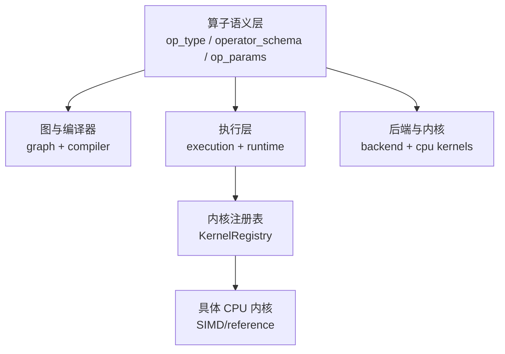
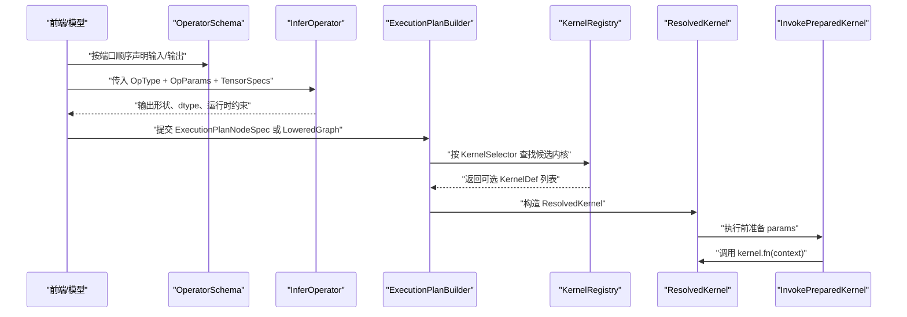
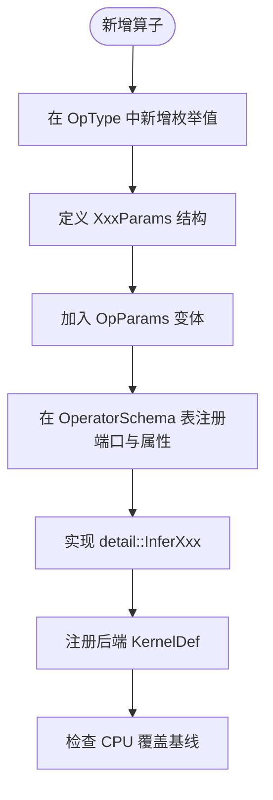
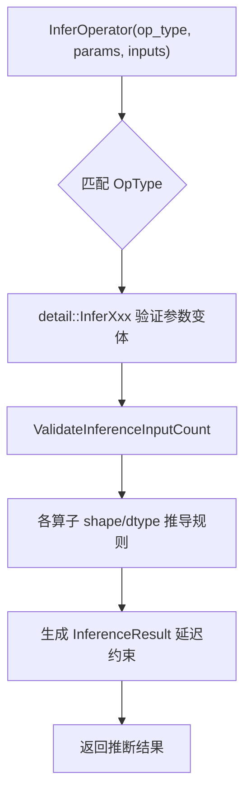
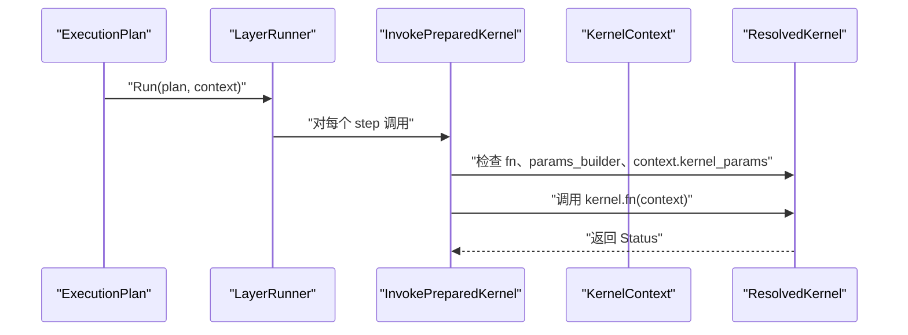
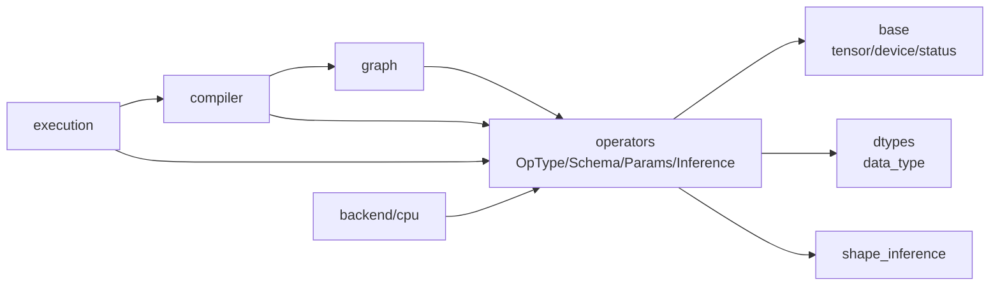

# 算子系统

**本文引用的文件**
- [算子契约设计文档](../../operators/operator_contract_design.md)
- [CPU 算子覆盖与生产基线台账](../../operators/cpu-coverage-baseline.md)
- [CPU 算子覆盖与性能演进路线图](../../operators/cpu-operator-evolution.md)
- [OpType 定义](../../../include/aethermind/operators/op_type.h)
- [OpType 名称实现](../../../src/operators/op_type.cpp)
- [算子语义模式定义](../../../include/aethermind/operators/operator_schema.h)
- [算子静态模式注册表](../../../src/operators/operator_schema.cpp)
- [算子参数变体定义](../../../include/aethermind/operators/op_params.h)
- [算子推断调度入口](../../../include/aethermind/operators/operator_inference.h)
- [算子推断实现](../../../src/operators/operator_inference.cpp)
- [后端内核定义](../../../include/aethermind/backend/kernel_def.h)
- [后端内核类型与参数构建器](../../../include/aethermind/backend/kernel_types.h)
- [内核选择器](../../../include/aethermind/base/kernel_selector.h)
- [内核注册表接口](../../../include/aethermind/backend/kernel_registry.h)
- [内核注册表实现](../../../src/backend/kernel_registry.cpp)
- [内核调用器接口](../../../include/aethermind/execution/kernel_invoker.h)
- [内核调用器实现](../../../src/execution/kernel_invoker.cpp)
- [执行计划构建器](../../../include/aethermind/execution/execution_plan_builder.h)
- [执行器实现](../../../src/execution/executor.cpp)
- [不可变张量视图](../../../include/aethermind/base/tensor_view.h)
- [形状与步长元数据容器](../../../include/aethermind/base/shape_and_stride.h)

## 目录
1. [简介](#简介)
2. [项目结构](#项目结构)
3. [核心组件](#核心组件)
4. [架构总览](#架构总览)
5. [详细组件分析](#详细组件分析)
6. [依赖关系分析](#依赖关系分析)
7. [性能与优化](#性能与优化)
8. [故障排查指南](#故障排查指南)
9. [结论](#结论)
10. [附录：新算子开发流程](#附录新算子开发流程)

## 简介
AetherMind 的算子系统分为两层：
- **算子语义层**：定义 OpType、算子端口顺序、输入输出角色、参数结构、形状推导和 dtype 规则。它是 Executor、Loaded Model 与各种 kernel 之间的稳定契约。
- **后端执行层**：通过 KernelDef、KernelRegistry、KernelSelector 把语义算子映射到 CPU 具体内核，并在执行期由 ResolvedKernel 和 KernelContext 驱动真实计算。

Phase 1 面向桌面/服务器 CPU 推理、decoder-only Transformer、单请求同步执行、静态 KV Cache，并遵循“Reference-first, Optimized-second”原则。算子语义层不得引用图 IR、模型或后端；后端只能消费算子的 OpParams、OpType 及 dtype 契约头。

## 项目结构
算子系统主要分布在以下位置：
- `include/aethermind/operators/`：算子类型、参数、模式、推断公共头文件。
- `src/operators/`：算子类型名称、静态模式表、推断调度实现。
- `include/aethermind/backend/`：内核定义、类型、注册表、选择器等执行契约。
- `src/backend/`：内核注册表实现。
- `include/aethermind/execution/`：内核调用器与执行计划构建器。
- `include/aethermind/base/`：TensorView、ShapeAndStride、设备与选择器等基础类型。
- `docs/operators/`：算子契约、CPU 覆盖率、演进路线与各算子 README/benchmark。

**图表来源**
- [OpType 定义:1-64](../../../include/aethermind/operators/op_type.h#L1-L64)
- [算子静态模式注册表:1-324](../../../src/operators/operator_schema.cpp#L1-L324)
- [后端内核定义:1-133](../../../include/aethermind/backend/kernel_def.h#L1-L133)
- [内核注册表实现:1-138](../../../src/backend/kernel_registry.cpp#L1-L138)

**章节来源**
- [算子契约设计文档](../../operators/operator_contract_design.md)
- [OpType 定义:1-64](../../../include/aethermind/operators/op_type.h#L1-L64)
- [算子静态模式注册表:1-324](../../../src/operators/operator_schema.cpp#L1-L324)

## 核心组件
本节聚焦算子系统最关键的五个构件：**算子类型**、**算子模式**、**算子参数**、**内核定义与注册表**、**内核调用与执行**。

| 组件 | 职责 | 关键类型/函数 |
|---|---|---|
| 算子类型 | 为每个算子提供稳定枚举值与字符串名称 | `OpType`、`ToString` |
| 算子模式 | 描述端口顺序、端口角色、纯函数属性、状态别名 | `OperatorSchema`、`GetOperatorSchema` |
| 算子参数 | 用强类型变体承载每类算子语义参数 | `OpParams` 及各 `XxxParams` |
| 内核定义与注册表 | 把 OpType+Selector 绑定到具体内核函数 | `KernelDef`、`KernelRegistry` |
| 内核调用与执行 | 在已准备的内核上执行一步计算 | `InvokePreparedKernel`、`ExecutionPlanBuilder` |

**章节来源**
- [OpType 定义:1-64](../../../include/aethermind/operators/op_type.h#L1-L64)
- [算子语义模式定义:1-167](../../../include/aethermind/operators/operator_schema.h#L1-L167)
- [算子参数变体定义:1-391](../../../include/aethermind/operators/op_params.h#L1-L391)
- [后端内核定义:1-133](../../../include/aethermind/backend/kernel_def.h#L1-L133)
- [内核调用器接口:1-55](../../../include/aethermind/execution/kernel_invoker.h#L1-L55)

## 架构总览
算子系统的数据与控制流可划分为四个阶段：

1. **建模与语义图构建**：前端把模型转换为算子图，使用 `OperatorSchema` 声明端口顺序和角色。
2. **形状与 dtype 推断**：通过 `InferOperator` 校验参数、输入数量、dtype、shape，并产出延迟运行时约束。
3. **编译与准备**：编译器生成 LoweredGraph，执行层根据 `KernelSelector` 查询后端候选内核，构造 `ResolvedKernel`。
4. **执行**：`Executor` 调用 `LayerRunner`，内核调用器调用已冻结内核函数。

**图表来源**
- [算子推断调度入口:1-138](../../../include/aethermind/operators/operator_inference.h#L1-L138)
- [算子推断实现:1-197](../../../src/operators/operator_inference.cpp#L1-L197)
- [执行计划构建器:1-95](../../../include/aethermind/execution/execution_plan_builder.h#L1-L95)
- [内核注册表接口:1-90](../../../include/aethermind/backend/kernel_registry.h#L1-L90)
- [内核调用器接口:1-55](../../../include/aethermind/execution/kernel_invoker.h#L1-L55)

**章节来源**
- [算子契约设计文档](../../operators/operator_contract_design.md)
- [执行计划构建器:1-95](../../../include/aethermind/execution/execution_plan_builder.h#L1-L95)
- [执行器实现:1-12](../../../src/execution/executor.cpp#L1-L12)

## 详细组件分析

### 算子类型与语义

`OpType` 是算子语义分派的核心枚举。下表按阅读顺序概括各算子的用途，枚举值与完整清单以 [op_type.h](../../../include/aethermind/operators/op_type.h) 为准。端口与参数见 [算子契约与元数据](../核心模块设计/算子系统%20%28Operators%29/算子契约与元数据.md)，具体数值、布局合同与执行证据见 [算子文档](../../operators/README.md)。

| 序号 | OpType | 典型语义 |
|---|---|---|
| 1 | `kEmbedding` | 查表嵌入，支持输出 dtype 策略 |
| 2 | `kRmsNorm` | RMS 归一化，带 eps |
| 3 | `kLinear` | 稠密投影，可指定输出 dtype |
| 4 | `kQkvLinear` | Q/K/V 融合线性投影 |
| 5 | `kGateUpLinear` | Gate/Up 融合线性投影 |
| 6 | `kMatMul` | 矩阵乘法 |
| 7 | `kRoPE` | 旋转位置编码，支持多种频率算法 |
| 8 | `kAttention` | Attention，含 KV 状态语义 |
| 9 | `kSilu` | SiLU 激活 |
| 10 | `kSiluMul` | Gate × SiLU(up) 融合 |
| 11 | `kElementwiseMul` | 逐元素乘法 |
| 12 | `kKVCacheUpdate` | KV Cache 写入更新 |
| 13 | `kAdd` | 逐元素加法 |
| 14 | `kAddRmsNorm` | 残差加 RMSNorm 融合 |
| 15 | `kSoftmax` | Softmax |
| 16 | `kArgmax` | 沿轴取最大索引 |
| 17 | `kReshape` | 逻辑形状重排 |
| 18 | `kPermute` | 维度置换 |
| 19 | `kReorder` | 物理布局整理意图 |
| 20 | `kCast` | 存储格式类型转换 |

`kUnknown` 是无效哨兵值。`ToString` 对哨兵和越界值均返回 `"Unknown"`。

**图表来源**
- [OpType 定义:1-64](../../../include/aethermind/operators/op_type.h#L1-L64)
- [算子参数变体定义:1-391](../../../include/aethermind/operators/op_params.h#L1-L391)
- [算子静态模式注册表:1-324](../../../src/operators/operator_schema.cpp#L1-L324)
- [算子推断实现:1-197](../../../src/operators/operator_inference.cpp#L1-L197)

**章节来源**
- [OpType 定义:1-64](../../../include/aethermind/operators/op_type.h#L1-L64)
- [OpType 名称实现:1-56](../../../src/operators/op_type.cpp#L1-L56)

### 算子契约与端口模式
`OperatorSchema` 是算子的**语义 ABI**：端口向量中的位置就是索引，没有独立 index 字段。因此，添加或调整端口顺序会直接影响图构建、infer 和序列化。

每个算子模式包括：
- `op_type`：关联的算子类型。
- `input_ports`：输入端口列表，每个端口有 `kind`、`contributes_tensor_spec`、`name`。
- `output_ports`：输出端口列表。
- `traits`：是否有副作用、是否确定性、是否可编译期求值。
- `state_alias_ports`：状态输入输出必须绑定到同一物理缓冲区的命名对。

端口角色分类：
- `kModelInput`：由模型入口提供，如 token ids、position ids。
- `kActivation`：图中其他算子产生并消费的激活张量。
- `kWeight`：加载时绑定的静态权重。
- `kConstant`：可编译期折叠的常量。
- `kState`：跨 step 持久状态，如 KV cache。

`contributes_tensor_spec = false` 的端口不参与输出张量规格推导。例如 KV Cache 的状态端口由算子自身决定布局，不传播 shape。

**章节来源**
- [算子语义模式定义:1-167](../../../include/aethermind/operators/operator_schema.h#L1-L167)
- [算子静态模式注册表:1-324](../../../src/operators/operator_schema.cpp#L1-L324)

### 参数验证机制
算子参数使用强类型 `std::variant<std::monostate, ...>`，每个算子对应一个 `XxxParams` 结构。参数验证发生在每个 `detail::Infer*` 函数的开头，而不是在通用入口里统一处理。

典型验证内容包括：
- `OpParams` 变体是否与 `OpType` 匹配。
- 输入数量是否等于 schema 的 `input_ports.size()`。
- RoPE 的 head_dim、rotary_dim、num_q_heads、num_kv_heads、max_pos_embeddings、theta、algorithm 等数值前提。
- Argmax axis 的负数归一化与 reduction axis 非空。
- Reshape target_shape 的非负字面量、唯一 infer 标记、输入轴引用合法性。
- Permutation 必须是完整双射。
- Cast 的目标 dtype 必须是 Float32、Float16 或 BFloat16，且与输入不同。
- QkvLinear/GateUpLinear 的 out_features、bias 语义。

**图表来源**
- [算子推断调度入口:1-138](../../../include/aethermind/operators/operator_inference.h#L1-L138)
- [算子推断实现:1-197](../../../src/operators/operator_inference.cpp#L1-L197)

**章节来源**
- [算子参数变体定义:1-391](../../../include/aethermind/operators/op_params.h#L1-L391)
- [算子推断实现:1-197](../../../src/operators/operator_inference.cpp#L1-L197)

### 形状推导与 dtype 规则
`InferOperator` 负责分发到每个算子的 `detail::Infer*`。它先完成参数变体验证，再检查输入数量，最后由各算子实现完成形状与 dtype 推导。

更通用的 dtype 推导由 `DeriveSelectorDTypes` 完成：
- `act_dtype`：来自贡献 tensor spec 的 activation 输入；若无，则回退到 activation 输出。
- `weight_dtype`：来自 weight 输入；若无，回退到 act_dtype。
- `state_dtype`：来自所有 kState 输入/输出，独立于 `contributes_tensor_spec`。
- `output_dtype`：来自所有 activation 输出；若只有 state 输出则为未定义。

这保证了 graph lowering 与 untrusted ExecutionPlanNodeSpec 路径使用相同的 selector dtype 语义。

**章节来源**
- [算子推断调度入口:1-138](../../../include/aethermind/operators/operator_inference.h#L1-L138)
- [算子推断实现:1-197](../../../src/operators/operator_inference.cpp#L1-L197)

### 算子注册机制
后端内核通过 `KernelDef` 注册：
- `op_type`：处理的算子类型。
- `selector`：设备、dtype、weight_format、phase 等能力描述。
- `packing_recipe`：仅当 `selector.weight_format == kPacked` 时合法。
- `cpu_requirements`：CPU 指令集要求。
- `kernel_func`：类型擦除的内核函数指针。
- `priority`：优先级越高越优先；同优先级先注册者胜出。
- `params_size`、`params_builder`、`metadata_builder`：参数与元数据构建。
- `name`：诊断名称。

`KernelRegistry` 提供：
- `Register`：校验并插入内核定义。
- `Freeze`：构建按 `op_type` 分桶的索引，之后禁止注册。
- `FindCandidates`：按 `op_type` 和 `KernelSelector` 筛选候选内核。
- `FindByOpType`：调试用途，不按 selector 过滤。

注册过程还会去重 `RegistrationKey`，重复注册返回 `AlreadyExists`。

**章节来源**
- [后端内核定义:1-133](../../../include/aethermind/backend/kernel_def.h#L1-L133)
- [内核注册表接口:1-90](../../../include/aethermind/backend/kernel_registry.h#L1-L90)
- [内核注册表实现:1-138](../../../src/backend/kernel_registry.cpp#L1-L138)

### 调度流程
调度从执行层开始：
1. `ExecutionPlanBuilder` 接收外部节点或 LoweredGraph。
2. 针对每个 node/spec，调用后端 `PrepareKernel`，得到 `ResolvedKernel`。
3. `ResolvedKernel` 包含已选择的 `KernelFunc`、参数大小、元数据和 builder。
4. 执行期 `Executor::Execute` 委托给 `LayerRunner`。
5. 内核调用器 `InvokePreparedKernel` 调用 `kernel.fn(context)`。
6. 测试路径可使用 `BuildAndInvokeKernelForTesting`，在栈上构造 params 并调用。

**图表来源**
- [执行计划构建器:1-95](../../../include/aethermind/execution/execution_plan_builder.h#L1-L95)
- [执行器实现:1-12](../../../src/execution/executor.cpp#L1-L12)
- [内核调用器接口:1-55](../../../include/aethermind/execution/kernel_invoker.h#L1-L55)
- [内核调用器实现:1-54](../../../src/execution/kernel_invoker.cpp#L1-L54)

**章节来源**
- [执行计划构建器:1-95](../../../include/aethermind/execution/execution_plan_builder.h#L1-L95)
- [内核调用器实现:1-54](../../../src/execution/kernel_invoker.cpp#L1-L54)

### SIMD 优化实现
CPU 后端通过多个层次实现 SIMD 优化：
- **KernelSelector**：区分 device、act_dtype、weight_dtype、state_dtype、output_dtype、weight_format、phase。
- **CpuFeatureSet**：描述 AVX2、FMA、F16C、AVXVNNI 等指令集需求。
- **PackingRecipe**：描述 packed weight 的 layout 与 alignment，仅用于 packed 内核。
- **Entry/Descriptor 层**：每个算子有多个 descriptor，例如 reference、scalar、AVX2、F16C、packed identity、B-panel candidate 等。
- **Priority**：optimized descriptor 通常比 reference/candidate 更高，但需满足 ISA、layout、dtype、phase 条件。

当前 CPU 覆盖基线记录了代表性机器 `desktop-54h5mmi` 上的实际选核身份，包括 Linear、QkvLinear、GateUpLinear、Embedding、RmsNorm、AddRmsNorm、Attention、KVCacheUpdate、RoPE、SiluMul 等算子在 plain/packed 下的默认内核名称。

**章节来源**
- [CPU 算子覆盖与生产基线台账](../../operators/cpu-coverage-baseline.md)
- [CPU 算子覆盖与性能演进路线图](../../operators/cpu-operator-evolution.md)
- [内核选择器:1-107](../../../include/aethermind/base/kernel_selector.h#L1-L107)
- [后端内核定义:1-133](../../../include/aethermind/backend/kernel_def.h#L1-L133)

### 内存布局、对齐与向量化策略
- **TensorView/MutableTensorView**：热路径只借用 data pointer、dtype、rank、shape、stride、alignment，不拥有 buffer。
- **ShapeAndStride**：固定最大 rank 8，inline 存储，零堆分配；shape/stride 原子更新，stride 以元素为单位。
- **Alignment**：
  - TensorView 的 `alignment == 0` 表示未知或未指定。
  - Packed weight 的 packing recipe 要求 power-of-two alignment，且不小于 `alignof(void*)`。
  - 内核参数构建缓冲区对齐到 `std::max_align_t`。
- **向量化策略**：
  - Linear/QkvLinear/GateUpLinear 支持 W16/A32 widening、AVX2/FMA、blocking。
  - Embedding 支持 F16C/AVX2 行级 widening。
  - RmsNorm、SiluMul、Add 等小算子按 dtype 选择 scalar/reference/SIMD。
  - Attention 支持 QK dot、weighted-V、KV16 widening、GQA 复用。
  - 对于不适合 fast path 的形状/stride，允许回退到 reference 或 scalar。

**章节来源**
- [不可变张量视图:1-200](../../../include/aethermind/base/tensor_view.h#L1-L200)
- [形状与步长元数据容器:1-167](../../../include/aethermind/base/shape_and_stride.h#L1-L167)
- [后端内核类型与参数构建器:1-120](../../../include/aethermind/backend/kernel_types.h#L1-L120)
- [后端内核定义:1-133](../../../include/aethermind/backend/kernel_def.h#L1-L133)

## 依赖关系分析
算子系统的模块依赖方向是严格冻结的：

关键约束：
- operators 不得引用 graph、model、compiler、execution、backend。
- backend/kernels 可通过 OpParams/OpType 访问算子语义，但不能反向依赖 graph/model。
- execution public headers 不依赖 compiler。
- graph 不依赖 execution/backend/model。

**图表来源**
- [算子契约设计文档](../../operators/operator_contract_design.md)
- [算子语义模式定义:1-167](../../../include/aethermind/operators/operator_schema.h#L1-L167)
- [执行计划构建器:1-95](../../../include/aethermind/execution/execution_plan_builder.h#L1-L95)

**章节来源**
- [算子契约设计文档](../../operators/operator_contract_design.md)

## 性能与优化
CPU 算子优化的优先级建议如下：
1. **矩阵计算**：Linear、MatMul、QkvLinear、GateUpLinear 共享 GEMM primitive，优先打通 production path。
2. **Attention**：SIMD → Decode GQA 复用 → Prefill blocking。
3. **小算子**：AddRmsNorm、SiluMul、Embedding、RoPE、KVCacheUpdate 按真实 profile 优化。
4. **精度覆盖**：FP32、W16/A32、BF16 A16、FP16 分别对 oracle 验收。
5. **并行与量化**：后续引入 worker pool 和 INT8/INT4 合同。

基准与证据组织方式：
- 每个算子保留独立 README 与 benchmark。
- 跨算子覆盖台账记录机器身份、实际选中内核名称、plain/packed、recipe、alignment。
- 避免把“reference 存在”误认为“production optimized”。
- 避免跨机器直接比较性能，除非使用相同机器与构建配置。

**章节来源**
- [CPU 算子覆盖与性能演进路线图](../../operators/cpu-operator-evolution.md)
- [CPU 算子覆盖与生产基线台账](../../operators/cpu-coverage-baseline.md)

## 故障排查指南
常见错误来源与定位方法：

| 现象 | 可能原因 | 定位点 |
|---|---|---|
| `Unknown op type cannot have validated graph params` | 传入的 `OpType` 为 `kUnknown` | `InferOperator` |
| 输入数量不匹配 | schema 端口数量与实际 inputs 不一致 | `ValidateInferenceInputCount` |
| undefined activation/weight dtype | 端口 dtype 缺失或不一致 | `DeriveSelectorDTypes` |
| 无法找到算子 schema | OpType 未注册或 unknown | `GetOperatorSchema` |
| 注册失败：重复内核 | 同一 registration key 重复注册 | `KernelRegistry::Register` |
| 冻结后注册失败 | 注册表已 Freeze | `KernelRegistry::Register` |
| 查找候选内核失败 | 注册表未 Freeze 或 selector 不匹配 | `KernelRegistry::FindCandidates` |
| 调用 null kernel | 测试路径构造参数失败或内核未正确 prepare | `BuildAndInvokeKernelForTesting` |
| packed kernel 定义非法 | packing recipe layout 或 alignment 不符合要求 | `ValidateKernelDef` |

建议排查步骤：
1. 先用 `GetOperatorSchema` 确认算子 schema 是否存在。
2. 用 `ValidateInferenceInputCount` 核对输入数量。
3. 检查 `OpParams` 变体是否与 `OpType` 一致。
4. 检查 selector 的 dtype、weight_format、phase 是否与实际数据一致。
5. 使用 `KernelRegistry::DebugDump` 查看已注册内核及其 selector。
6. 对 packed kernel，检查 packing recipe layout、alignment、byte size。

**章节来源**
- [算子推断实现:1-197](../../../src/operators/operator_inference.cpp#L1-L197)
- [内核注册表实现:1-138](../../../src/backend/kernel_registry.cpp#L1-L138)
- [后端内核定义:1-133](../../../include/aethermind/backend/kernel_def.h#L1-L133)
- [内核调用器实现:1-54](../../../src/execution/kernel_invoker.cpp#L1-L54)

## 结论
AetherMind 的算子系统通过“稳定的算子语义层 + 灵活的后端执行层”分离了正确性契约与性能实现。`OpType`、`OperatorSchema`、`OpParams`、`InferOperator` 构成算子语义核心；`KernelDef`、`KernelSelector`、`KernelRegistry`、`ResolvedKernel`、`KernelContext` 构成执行核心。

算子语义由类型、参数和推断入口共同描述。CPU reference、SIMD 内核与已验证组合可查 [CPU 覆盖台账](../../operators/cpu-coverage-baseline.md)。后续优化应以真实 consumer 驱动，保持 reference 可审计，并按 plan、prepare、execute 三层分别验证。

## 附录：新算子开发流程

### 第一步：定义算子类型
在 `OpType` 中新增枚举值，并确保 `ToString` 返回可读名称。

**章节来源**
- [OpType 定义:1-64](../../../include/aethermind/operators/op_type.h#L1-L64)
- [OpType 名称实现:1-56](../../../src/operators/op_type.cpp#L1-L56)

### 第二步：定义算子参数
创建 `XxxParams` 结构，放入 `OpParams` 变体。参数应是强类型值对象，不使用 stringly-typed 字段。

**章节来源**
- [算子参数变体定义:1-391](../../../include/aethermind/operators/op_params.h#L1-L391)

### 第三步：注册算子模式
在 `operator_schema.cpp` 的静态 `kOperatorSchemas` 中添加条目，明确：
- 输入端口名称、角色、是否参与 tensor spec 推导。
- 输出端口名称、角色。
- traits：是否有副作用、是否确定性、是否可编译期求值。
- 如有 KV 或 persistent state，声明 `state_alias_ports`。

**章节来源**
- [算子静态模式注册表:1-324](../../../src/operators/operator_schema.cpp#L1-L324)

### 第四步：实现形状推导
在 `operator_inference.cpp` 中新增 `detail::InferXxx`，并在 `InferOperator` 的 switch 中分发。验证：
- 参数变体。
- 输入数量。
- dtype 一致性。
- shape 约束。
- 生成 `InferenceResult` 中的延迟运行时约束。

**章节来源**
- [算子推断调度入口:1-138](../../../include/aethermind/operators/operator_inference.h#L1-L138)
- [算子推断实现:1-197](../../../src/operators/operator_inference.cpp#L1-L197)

### 第五步：注册后端内核
在 CPU backend 中注册 `KernelDef`，至少包含：
- `op_type`。
- `selector`：device、act_dtype、weight_dtype、state_dtype、output_dtype、weight_format、phase。
- `kernel_func`：reference 或 optimized kernel。
- `cpu_requirements`：如 AVX2/FMA/F16C。
- `priority`：optimized > reference/candidate。
- 如需要 packed weight，填写 `packing_recipe` 与 `params_builder`。

**章节来源**
- [后端内核定义:1-133](../../../include/aethermind/backend/kernel_def.h#L1-L133)

### 第六步：编写测试与基准
- 单元测试：验证参数、shape、dtype、边界条件。
- 数值测试：reference vs optimized。
- 性能基准：记录 machine、ISA、shape、dtype、phase、kernel name。
- 覆盖台账：对照 `cpu-coverage-baseline.md`，标注 reference/optimized/candidate/unsupported。

**章节来源**
- [CPU 算子覆盖与生产基线台账](../../operators/cpu-coverage-baseline.md)
- [CPU 算子覆盖与性能演进路线图](../../operators/cpu-operator-evolution.md)
