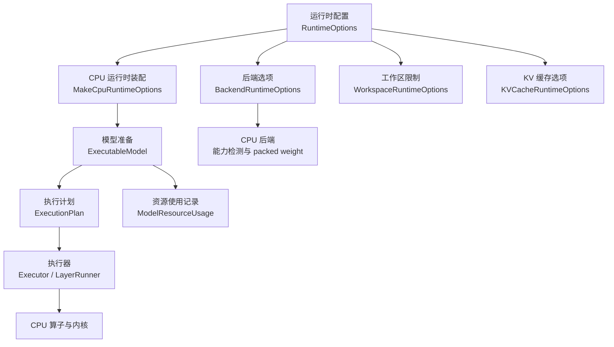
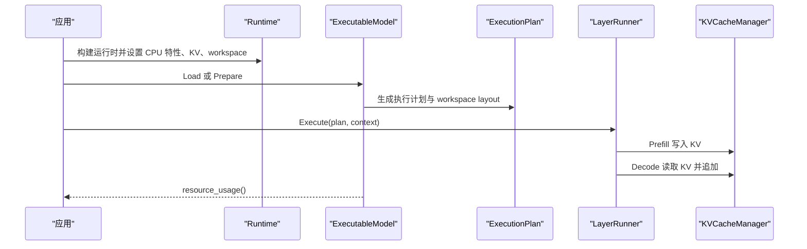
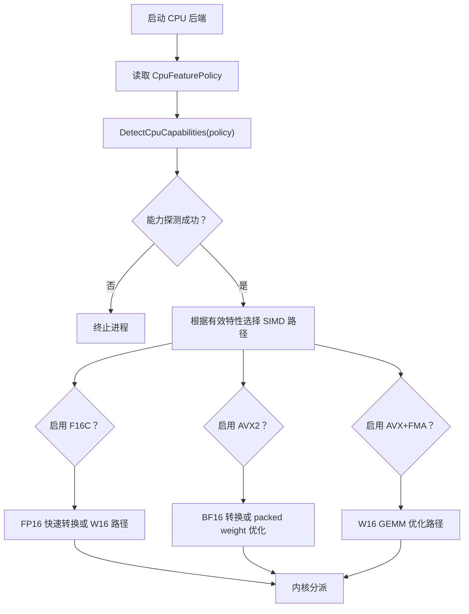
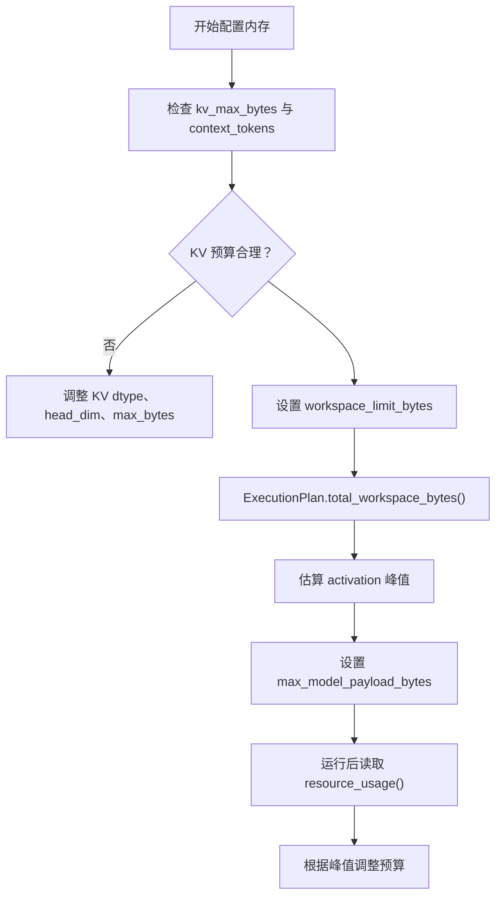
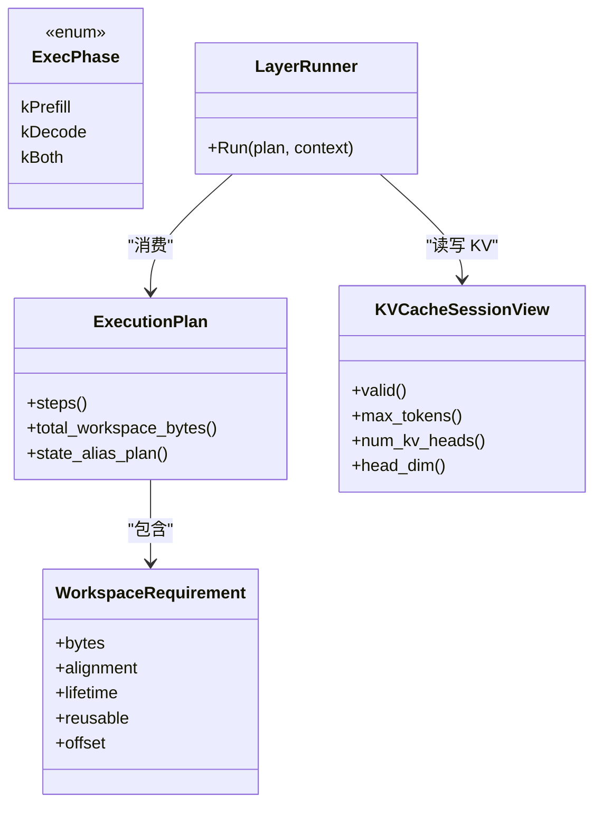
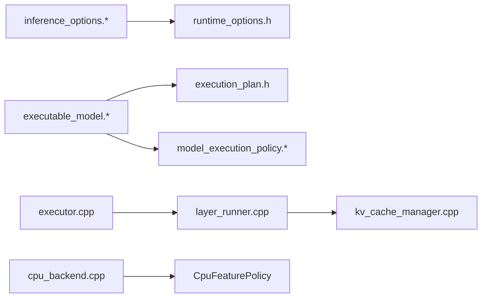

# 性能调优指南

**本文引用的文件**
- [executable_model.h](../../../include/aethermind/inference/executable_model.h)
- [executable_model.cpp](../../../src/inference/executable_model.cpp)
- [inference_options.h](../../../include/aethermind/inference/inference_options.h)
- [inference_options.cpp](../../../src/inference/inference_options.cpp)
- [resource_usage.h](../../../include/aethermind/inference/resource_usage.h)
- [model_execution_policy.h](../../../include/aethermind/inference/model_execution_policy.h)
- [model_execution_policy.cpp](../../../src/inference/model_execution_policy.cpp)
- [runtime_options.h](../../../include/aethermind/runtime/runtime_options.h)
- [kernel_attrs.h](../../../include/aethermind/base/kernel_attrs.h)
- [execution_plan.h](../../../include/aethermind/execution/execution_plan.h)
- [workspace_types.h](../../../include/aethermind/base/workspace_types.h)
- [executor.cpp](../../../src/execution/executor.cpp)
- [layer_runner.cpp](../../../src/execution/layer_runner.cpp)
- [kv_cache_manager.cpp](../../../src/kv_cache/kv_cache_manager.cpp)
- [cpu_backend.cpp](../../../src/backend/cpu/cpu_backend.cpp)
- [fp32-compatible-inference.md](../../guides/fp32-compatible-inference.md)
- [w16-fp32-inference.md](../../guides/w16-fp32-inference.md)
- [model_benchmark.cpp](../../../tests/benchmark/models/model_benchmark.cpp)

## 目录
1. [简介](#简介)
2. [项目结构](#项目结构)
3. [核心组件](#核心组件)
4. [架构总览](#架构总览)
5. [关键组件深度分析](#关键组件深度分析)
6. [依赖关系分析](#依赖关系分析)
7. [性能调优步骤](#性能调优步骤)
8. [监控与指标采集](#监控与指标采集)
9. [推理模式与精度选择](#推理模式与精度选择)
10. [生产环境资源配置建议](#生产环境资源配置建议)
11. [故障排查](#故障排查)
12. [结论](#结论)

## 简介
本指南面向需要在 CPU 上优化 AetherMind 推理性能的工程师和运维人员。内容覆盖：
- CPU 特性策略：通过 `CpuFeaturePolicy` 控制必需或禁用的指令集，驱动 AVX2、F16C、AVX+FMA 等路径。
- 内存优化：合理设置 `kv_max_bytes`、`workspace_limit_bytes`、模型 payload 上限，避免峰值分配和碎片化。
- 并行与执行顺序：Prefill 与 Decode 的共享计划、Activation arena 复用机制。
- 可操作调优流程：基准测试 → 定位瓶颈 → 调整参数 → 验证收益。
- 监控方法：`ExecutableModel::resource_usage()`、KV 容量观察、推理延迟测量。
- 精度模式：FP32 兼容推理与 W16（保留 F16/BF16 权重 + FP32 激活）的特征与适用场景。
- 生产实践：CPU 能力检测、资源限额、失败回退与可观测性。

## 项目结构
AetherMind 的推理性能相关代码集中在以下层次：
- 运行时配置层：`RuntimeOptions`、`BackendRuntimeOptions`、`WorkspaceRuntimeOptions`、`KVCacheRuntimeOptions`。
- 推理装配层：`MakeCpuRuntimeOptions`、`MakeCompileOptions`、`CpuRuntimeAssemblyOptions`。
- 模型准备层：`ExecutableModel`、`ModelLoadOptions`、`WeightPolicy`、`ModelResourceUsage`。
- 执行层：`ExecutionPlan`、`Executor`、`LayerRunner`、KV Cache 状态绑定。
- CPU 后端层：CPU 能力检测、packed weight、SIMD 转换与 kernel 选择。
- 基准工具层：模型级 benchmark、进程 RSS、KV 占用、分配计数。

**图示来源**
- [runtime_options.h:1-69](../../../include/aethermind/runtime/runtime_options.h#L1-L69)
- [inference_options.cpp:27-57](../../../src/inference/inference_options.cpp#L27-L57)
- [executable_model.h:35-183](../../../include/aethermind/inference/executable_model.h#L35-L183)
- [execution_plan.h:1-200](../../../include/aethermind/execution/execution_plan.h#L1-L200)
- [executor.cpp:1-12](../../../src/execution/executor.cpp#L1-L12)
- [cpu_backend.cpp:1-200](../../../src/backend/cpu/cpu_backend.cpp#L1-L200)

**章节来源**
- [runtime_options.h:1-69](../../../include/aethermind/runtime/runtime_options.h#L1-L69)
- [inference_options.h:1-61](../../../include/aethermind/inference/inference_options.h#L1-L61)
- [inference_options.cpp:1-57](../../../src/inference/inference_options.cpp#L1-L57)
- [executable_model.h:35-183](../../../include/aethermind/inference/executable_model.h#L35-L183)

## 核心组件
本节列出对性能调优最关键的接口与数据结构，并说明其作用。

| 组件 | 职责 | 性能影响 |
|---|---|---|
| `CpuFeaturePolicy` | 指定 CPU 必需或禁用特性，用于 CPU 能力探测 | 决定 AVX2、F16C、AVX+FMA 是否可用 |
| `RuntimeOptions.backend.cpu_feature_policy` | 将策略注入后端 | 控制 kernel 分派路径 |
| `RuntimeOptions.kv_cache.max_bytes` | KV 平面最大字节数 | 控制 KV 峰值内存 |
| `RuntimeOptions.workspace.default_workspace_limit_bytes` | Session arena 工作区上限 | 控制 activation scratch 峰值 |
| `ModelLimits.max_model_payload_bytes` | 模型原始权重、inline constant、packed weight 上限 | 防止准备阶段 OOM |
| `ModelLoadOptions.weights` | 选择 FP32、转换为 FP32、或保留 W16 | 影响权重大小、转换成本、计算路径 |
| `ModelLoadOptions.activation_dtype` | 激活精度 | 影响 activation arena 占用 |
| `ExecutionPlan` | 包含 step、workspace layout、state alias | 决定执行顺序与 workspace 复用 |
| `ModelResourceUsage` | 模型侧 payload、packed weight、转换用量 | 帮助识别权重与转换峰值 |
| `RequestResourceUsage` | 单次请求 workspace、activation、KV、峰值 | 帮助评估单请求内存压力 |

**章节来源**
- [runtime_options.h:1-69](../../../include/aethermind/runtime/runtime_options.h#L1-L69)
- [inference_options.h:1-61](../../../include/aethermind/inference/inference_options.h#L1-L61)
- [executable_model.h:35-183](../../../include/aethermind/inference/executable_model.h#L35-L183)
- [resource_usage.h:1-43](../../../include/aethermind/inference/resource_usage.h#L1-L43)
- [workspace_types.h:1-84](../../../include/aethermind/base/workspace_types.h#L1-L84)

## 架构总览
下图展示从配置到执行的关键路径，以及性能相关数据流。

**图示来源**
- [inference_options.cpp:27-57](../../../src/inference/inference_options.cpp#L27-L57)
- [executable_model.h:88-166](../../../include/aethermind/inference/executable_model.h#L88-L166)
- [execution_plan.h:130-200](../../../include/aethermind/execution/execution_plan.h#L130-L200)
- [executor.cpp:1-12](../../../src/execution/executor.cpp#L1-L12)
- [kv_cache_manager.cpp:1-176](../../../src/kv_cache/kv_cache_manager.cpp#L1-L176)

## 关键组件深度分析

### CPU 特性优化：`CpuFeaturePolicy` 与 SIMD 加速
CPU 后端在构造时调用能力检测函数，该函数接收 `CpuFeaturePolicy`，并根据策略返回可用的 CPU 能力。随后，packed weight、FP16/BF16 转换、GEMM 等路径依据 effective features 选择实现。

关键点：
- `BackendRuntimeOptions` 中的 `cpu_feature_policy` 会进入 `RuntimeOptions`。
- `MakeCpuRuntimeOptions` 将 `CpuRuntimeAssemblyOptions.cpu_feature_policy` 复制到 `backend.cpu_feature_policy`。
- `DetectCapabilitiesOrDie` 使用 `CpuFeaturePolicy` 调用底层能力探测；如果探测失败则终止进程。
- 在 FP32 兼容路径中，FP16 转换可使用 F16C，BF16 转换可使用 AVX2 整数路径；缺少对应 ISA 时回退标量实现。
- W16 Linear/LM head 与 QKV/GateUp optimized driver 依赖 AVX2/FMA；reference fallback 在无优化路径下仍可运行。

**图示来源**
- [runtime_options.h:12-40](../../../include/aethermind/runtime/runtime_options.h#L12-L40)
- [inference_options.cpp:27-57](../../../src/inference/inference_options.cpp#L27-L57)
- [cpu_backend.cpp:40-70](../../../src/backend/cpu/cpu_backend.cpp#L40-L70)
- [fp32-compatible-inference.md](../../guides/fp32-compatible-inference.md)
- [w16-fp32-inference.md](../../guides/w16-fp32-inference.md)

**章节来源**
- [runtime_options.h:12-40](../../../include/aethermind/runtime/runtime_options.h#L12-L40)
- [inference_options.cpp:27-57](../../../src/inference/inference_options.cpp#L27-L57)
- [cpu_backend.cpp:1-200](../../../src/backend/cpu/cpu_backend.cpp#L1-L200)
- [fp32-compatible-inference.md](../../guides/fp32-compatible-inference.md)
- [w16-fp32-inference.md](../../guides/w16-fp32-inference.md)

### 内存使用优化：KV、workspace 与模型 payload
#### KV 缓存
- `KVCacheRuntimeOptions.max_bytes` 表示 K/V 平面联合最大字节数，包括布局 padding；零值表示无限制。
- `MakeKVCacheOptions` 基于模型几何、上下文 token 数和 kv dtype 生成逻辑 head dimension、dtype 和对齐。
- `KVCacheManager::Init` 先规划 layout，再分配 key/value buffer；任一分配失败返回 `ResourceExhausted`。
- `ReservationCapacity` 校验 prompt_len 与 future_kv_appends 之和不超过物理 KV capacity。
- 推荐将 `context_tokens` 与 `kv_max_bytes` 一起设置，避免 KV 预留过大但实际未使用。

#### Workspace 与 Activation Arena
- `WorkspaceRuntimeOptions.default_workspace_limit_bytes` 是 Session 级 arena 的工作区上限，零值表示无限制。
- `ExecutionPlan.total_workspace_bytes()` 提供 plan 级 workspace 总需求；`WorkspaceRequirement` 描述每个 step 的 scratch 生命周期和复用标记。
- `WorkspaceLifetime` 支持 per-operator、per-layer、per-token、per-sequence、persistent 等粒度，便于复用临时 buffer。

#### 模型 payload 上限
- `ModelLimits.max_model_payload_bytes` 控制 raw backing、converted weights、inline constants、packed weights 的上限。
- `ModelResourceUsage.managed_payload_bytes` 是可管理 payload 的部分观察值；`packing_plan_complete` 表示 packing 账本是否完整。
- `RequestResourceUsage` 提供 workspace、prefill activation、decode activation、peak payload、KV reserved bytes 等请求级指标。

**图示来源**
- [runtime_options.h:42-69](../../../include/aethermind/runtime/runtime_options.h#L42-L69)
- [inference_options.cpp:27-57](../../../src/inference/inference_options.cpp#L27-L57)
- [kv_cache_manager.cpp:1-176](../../../src/kv_cache/kv_cache_manager.cpp#L1-L176)
- [execution_plan.h:160-200](../../../include/aethermind/execution/execution_plan.h#L160-L200)
- [workspace_types.h:1-84](../../../include/aethermind/base/workspace_types.h#L1-L84)
- [resource_usage.h:1-43](../../../include/aethermind/inference/resource_usage.h#L1-L43)

**章节来源**
- [runtime_options.h:42-69](../../../include/aethermind/runtime/runtime_options.h#L42-L69)
- [kv_cache_manager.cpp:1-176](../../../src/kv_cache/kv_cache_manager.cpp#L1-L176)
- [execution_plan.h:130-200](../../../include/aethermind/execution/execution_plan.h#L130-L200)
- [workspace_types.h:1-84](../../../include/aethermind/base/workspace_types.h#L1-L84)
- [resource_usage.h:1-43](../../../include/aethermind/inference/resource_usage.h#L1-L43)

### 并行化与执行顺序：Prefill、Decode 与 Activation Arena
- `ExecPhase` 定义 `kPrefill`、`kDecode`、`kBoth`。
- `ExecutableModel::plan(phase)` 当前 Prefill 和 Decode 共享同一个 immutable plan；查询时会校验 artifact 编译 phase。
- `Executor::Execute` 委托给 `LayerRunner::Run`，由 layer runner 处理 KV state、attention、KVCacheUpdate 等语义。
- `WorkspaceArena` 按 `WorkspaceRequirement` 的 offset、alignment、lifetime 和 reusable 标志复用 scratch 空间。
- Prefill 通常产生较大的 activation 峰值；Decode 每步较小，但需要重复访问 KV cache。

**图示来源**
- [kernel_attrs.h:20-47](../../../include/aethermind/base/kernel_attrs.h#L20-L47)
- [execution_plan.h:130-200](../../../include/aethermind/execution/execution_plan.h#L130-L200)
- [workspace_types.h:1-84](../../../include/aethermind/base/workspace_types.h#L1-L84)
- [layer_runner.cpp:1-200](../../../src/execution/layer_runner.cpp#L1-L200)

**章节来源**
- [kernel_attrs.h:20-47](../../../include/aethermind/base/kernel_attrs.h#L20-L47)
- [executable_model.h:106-140](../../../include/aethermind/inference/executable_model.h#L106-L140)
- [executor.cpp:1-12](../../../src/execution/executor.cpp#L1-L12)
- [layer_runner.cpp:1-200](../../../src/execution/layer_runner.cpp#L1-L200)
- [workspace_types.h:1-84](../../../include/aethermind/base/workspace_types.h#L1-L84)

## 依赖关系分析
AetherMind 的性能相关依赖具有清晰分层：
- 配置层不直接依赖后端实现，只描述 policy、capacity、dtype。
- 推理装配层将 Hf 模型配置映射为 `RuntimeOptions`。
- 模型准备层依赖 compiler artifact、packed weight、binding metadata。
- 执行层依赖 execution plan、workspace layout、KV session view。
- CPU 后端依赖 capability detection、SIMD conversion、packed weight layout。

**图示来源**
- [inference_options.cpp:1-57](../../../src/inference/inference_options.cpp#L1-L57)
- [executable_model.cpp:1-200](../../../src/inference/executable_model.cpp#L1-L200)
- [execution_plan.h:1-200](../../../include/aethermind/execution/execution_plan.h#L1-L200)
- [executor.cpp:1-12](../../../src/execution/executor.cpp#L1-L12)
- [kv_cache_manager.cpp:1-176](../../../src/kv_cache/kv_cache_manager.cpp#L1-L176)
- [cpu_backend.cpp:1-200](../../../src/backend/cpu/cpu_backend.cpp#L1-L200)

**章节来源**
- [inference_options.cpp:1-57](../../../src/inference/inference_options.cpp#L1-L57)
- [executable_model.cpp:1-200](../../../src/inference/executable_model.cpp#L1-L200)
- [execution_plan.h:1-200](../../../include/aethermind/execution/execution_plan.h#L1-L200)
- [kv_cache_manager.cpp:1-176](../../../src/kv_cache/kv_cache_manager.cpp#L1-L176)
- [cpu_backend.cpp:1-200](../../../src/backend/cpu/cpu_backend.cpp#L1-L200)

## 性能调优步骤

### 第一步：建立基准
- 使用模型 benchmark 工具收集 load、compile、prepare、runtime、generate 时间。
- 记录 process peak RSS、KV capacity bytes、workspace bytes、prefill/decode activation bytes。
- 固定 prompt、max_new_tokens、warmup、repetitions，保证对比公平。

参考入口：
- `tests/benchmark/models/model_benchmark.cpp` 暴露 model、prompt、preset、weights、kv_dtype、activation_dtype、warmup、repetitions 等参数。
- Python 脚本负责收集源码快照、模型 identity、机器信息、动态库链接信息。

**章节来源**
- [model_benchmark.cpp:1-200](../../../tests/benchmark/models/model_benchmark.cpp#L1-L200)

### 第二步：识别瓶颈
- 如果 prepare 时间长且 `weight_fp32_conversion` 存在，瓶颈可能在权重转换。
- 如果 prefill activation bytes 高，瓶颈可能是大 batch 或长 prompt。
- 如果 decode activation bytes 低但延迟不稳定，可能受 workspace 分配或 CPU 调度影响。
- 如果 RSS 增长快于 KV reserved bytes，检查是否有额外 allocation 或 workspace 上限过小导致频繁分配。

**章节来源**
- [resource_usage.h:1-43](../../../include/aethermind/inference/resource_usage.h#L1-L43)
- [model_benchmark.cpp:1-200](../../../tests/benchmark/models/model_benchmark.cpp#L1-L200)

### 第三步：调整 CPU 特性
- 若目标机器支持 AVX2、F16C、AVX+FMA，确保 `CpuFeaturePolicy` 允许这些特性。
- 若需要强制兼容旧 CPU，可通过禁用某些 feature 使后端选择 scalar fallback，但吞吐会下降。
- 对于 W16 optimized path，AVX2/FMA 通常能显著提升线性层和融合 kernel 性能。

**章节来源**
- [cpu_backend.cpp:40-70](../../../src/backend/cpu/cpu_backend.cpp#L40-L70)
- [fp32-compatible-inference.md](../../guides/fp32-compatible-inference.md)
- [w16-fp32-inference.md](../../guides/w16-fp32-inference.md)

### 第四步：调整内存预算
- 先设置 `kv_max_bytes` 略大于 KV 物理占用，避免 KV 扩容触发二次分配。
- 设置 `workspace_limit_bytes` 为 `ExecutionPlan.total_workspace_bytes()` 的合理倍数，避免 per-step 频繁分配。
- 对多模型部署，设置 `max_model_payload_bytes` 限制单个模型的 raw、converted、packed payload。

**章节来源**
- [runtime_options.h:42-69](../../../include/aethermind/runtime/runtime_options.h#L42-L69)
- [execution_plan.h:160-200](../../../include/aethermind/execution/execution_plan.h#L160-L200)
- [executable_model.h:35-70](../../../include/aethermind/inference/executable_model.h#L35-L70)

### 第五步：验证提升
- 比较调整前后的 generate latency、first-token latency、RSS 峰值、allocation 次数。
- 对 FP32 兼容路径，确认 `weight_fp32_conversion.visible_peak` 是否在预期范围。
- 对 W16 路径，确认 KV dtype 与 retained W16 policy 一致，数值回归仍在验收范围内。

**章节来源**
- [fp32-compatible-inference.md](../../guides/fp32-compatible-inference.md)
- [w16-fp32-inference.md](../../guides/w16-fp32-inference.md)
- [model_benchmark.cpp:1-200](../../../tests/benchmark/models/model_benchmark.cpp#L1-L200)

## 监控与指标采集

### 使用 `ExecutableModel::resource_usage()`
- `ModelResourceUsage.weights` 给出权重存储分类。
- `inline_constant_bytes` 和 `packed_weight_bytes` 区分 inline 常量与 packed artifact。
- `managed_payload_bytes` 是可管理 payload 的部分观察值。
- `weight_fp32_conversion` 提供 source/converted backing、unique bytes 和 visible peak。

适合回答的问题：
- 模型加载后，多少内存来自原始权重、转换权重、packed weights？
- FP32 兼容路径是否产生了显著转换峰值？
- packed weight 是否占用了过多内存？

**章节来源**
- [executable_model.h:142-183](../../../include/aethermind/inference/executable_model.h#L142-L183)
- [resource_usage.h:1-43](../../../include/aethermind/inference/resource_usage.h#L1-L43)
- [fp32-compatible-inference.md](../../guides/fp32-compatible-inference.md)

### 观察 KV 与 workspace 峰值
- 通过 `KVCacheManager::total_bytes()` 观察 KV 平面总字节。
- 通过 `KVCacheManager::capacity_tokens()` 观察物理 KV token 容量。
- 通过 `ExecutionPlan.total_workspace_bytes()` 观察 plan 级 workspace 需求。
- 通过 benchmark 中的 process peak RSS 观察进程级驻留内存变化。

**章节来源**
- [kv_cache_manager.cpp:140-176](../../../src/kv_cache/kv_cache_manager.cpp#L140-L176)
- [execution_plan.h:160-200](../../../include/aethermind/execution/execution_plan.h#L160-L200)
- [model_benchmark.cpp:1-200](../../../tests/benchmark/models/model_benchmark.cpp#L1-L200)

### 推理延迟测量
- 使用 benchmark 记录的 `request_setup_ns`、`first_token_request_ns`、`prefill_execute_ns`、`decode_setup_ns`、`generate_ns`。
- 生产环境中建议同时记录首 token 延迟、平均 token 延迟、P95/P99 延迟。
- 对长 prompt，prefill 延迟更重要；对长生成序列，decode 延迟和 KV 带宽更关键。

**章节来源**
- [model_benchmark.cpp:1-200](../../../tests/benchmark/models/model_benchmark.cpp#L1-L200)

## 推理模式与精度选择

### FP32 兼容推理
- 将已接受的 F16/BF16 checkpoint 权重显式拓宽为 FP32，然后复用 FP32 O1/plain 执行链。
- activation、residual、KV、logits 均为 FP32。
- 转换可在 backend 的 effective features 下使用 F16C 或 AVX2 整数路径。
- 适用于需要严格数值兼容性、现有 FP32 执行链路稳定的场景。

性能特征：
- 准备阶段可能有权重转换开销。
- 推理阶段 activation/KV 占用较大。
- 若 CPU 支持 F16C/AVX2，转换路径更快。

**章节来源**
- [fp32-compatible-inference.md](../../guides/fp32-compatible-inference.md)
- [model_execution_policy.h:12-58](../../../include/aethermind/inference/model_execution_policy.h#L12-L58)
- [model_execution_policy.cpp:1-200](../../../src/inference/model_execution_policy.cpp#L1-L200)

### W16：保留 F16/BF16 权重 + FP32 激活
- 矩阵、Embedding、LM head 保留选定的 F16 或 BF16 格式。
- Norm 权重在准备期转为 FP32。
- activation、residual、logits 为 FP32；KV 默认 FP32，也可在 retained-W16 policy 下选择 F16/BF16。
- Optimized W16 Linear/LM head/QKV/GateUp 依赖 AVX2/FMA；reference fallback 在无优化路径下仍可用。

性能特征：
- 权重体积更小，减少内存带宽压力。
- 转换或 Norm 拓宽有准备期成本。
- KV16 可降低 KV 存储，但小 head_dim 的对齐行可能限制实际减半效果。

**章节来源**
- [w16-fp32-inference.md](../../guides/w16-fp32-inference.md)
- [model_execution_policy.cpp:1-200](../../../src/inference/model_execution_policy.cpp#L1-L200)

## 生产环境资源配置建议

### CPU 特性策略
- 默认允许后端自动探测并使用本机最优 ISA。
- 在多机型部署中，如需强制兼容，应显式禁用不支持的 feature，并接受 scalar fallback 的性能损失。
- 对 W16 optimized path，优先启用 AVX2 和 FMA；对 FP32 兼容转换，优先启用 F16C 或 AVX2。

**章节来源**
- [runtime_options.h:12-40](../../../include/aethermind/runtime/runtime_options.h#L12-L40)
- [cpu_backend.cpp:40-70](../../../src/backend/cpu/cpu_backend.cpp#L40-L70)

### KV 缓存配置
- 根据业务 prompt 长度和未来 token 生成数量设置 `context_tokens`。
- 将 `kv_max_bytes` 设置为略大于 KV 物理占用，避免扩容。
- 对长对话服务，考虑使用 KV16 以降低 KV 峰值，但需结合 head_dim 和对齐行评估真实收益。

**章节来源**
- [runtime_options.h:42-69](../../../include/aethermind/runtime/runtime_options.h#L42-L69)
- [kv_cache_manager.cpp:1-176](../../../src/kv_cache/kv_cache_manager.cpp#L1-L176)
- [w16-fp32-inference.md](../../guides/w16-fp32-inference.md)

### Workspace 与 Allocation 管理
- 设置 `default_workspace_limit_bytes`，避免 per-step 频繁分配。
- 使用 benchmark 中的 allocator request 计数辅助判断是否频繁分配。
- 对多请求并发场景，确保每个 session 的 arena 预算足够，但又不过度预留。

**章节来源**
- [runtime_options.h:28-40](../../../include/aethermind/runtime/runtime_options.h#L28-L40)
- [workspace_types.h:1-84](../../../include/aethermind/base/workspace_types.h#L1-L84)
- [model_benchmark.cpp:1-200](../../../tests/benchmark/models/model_benchmark.cpp#L1-L200)

### 模型负载隔离
- 为每个模型设置 `max_model_payload_bytes`，防止单个模型占用过多内存。
- 对 FP32 兼容路径，注意转换期间的 visible peak。
- 对 W16 路径，注意 retained backing、Norm conversion、packed artifacts 的合计占用。

**章节来源**
- [executable_model.h:35-70](../../../include/aethermind/inference/executable_model.h#L35-L70)
- [fp32-compatible-inference.md](../../guides/fp32-compatible-inference.md)
- [w16-fp32-inference.md](../../guides/w16-fp32-inference.md)

## 故障排查

### 常见错误与定位方法
| 现象 | 可能原因 | 排查方法 |
|---|---|---|
| 启动即崩溃或能力探测失败 | CPU 能力探测失败 | 检查 `CpuFeaturePolicy` 是否要求了不存在或不支持的 feature |
| KV 分配失败 | `kv_max_bytes` 太小或 prompt+future tokens 超限 | 查看 `KVCacheManager::ReservationCapacity` 和 `ReserveForSession` 的错误 |
| workspace 分配失败 | `workspace_limit_bytes` 过小 | 比较 `ExecutionPlan.total_workspace_bytes()` 与实际 limit |
| 模型准备失败 | 权重 dtype 与 policy 不匹配 | 检查 `ValidateSourceWeights` 和 `WeightPolicy` |
| 数值不一致 | 混合使用不同精度或 reference 预算 | 确认 FP32 兼容 vs W16 验收边界 |

**章节来源**
- [cpu_backend.cpp:40-70](../../../src/backend/cpu/cpu_backend.cpp#L40-L70)
- [kv_cache_manager.cpp:1-176](../../../src/kv_cache/kv_cache_manager.cpp#L1-L176)
- [model_execution_policy.cpp:1-200](../../../src/inference/model_execution_policy.cpp#L1-L200)

### 性能退化排查
- 若首次运行慢但后续稳定，可能是 warmup、CPU frequency governor、文件系统冷读引起。
- 若 RSS 持续增长，检查 KV 是否被多次重建、workspace 是否频繁分配、是否存在泄漏的 buffer。
- 若吞吐低于预期，检查是否因禁用 ISA 而回退到 scalar 路径，或是否选择了 FP32 兼容而非 W16 optimized path。

**章节来源**
- [model_benchmark.cpp:1-200](../../../tests/benchmark/models/model_benchmark.cpp#L1-L200)
- [cpu_backend.cpp:1-200](../../../src/backend/cpu/cpu_backend.cpp#L1-L200)

## 结论
AetherMind 的性能调优应以“基准先行、指标驱动”为原则：
- 先用模型 benchmark 建立基线，记录延迟、RSS、KV、workspace、分配次数。
- 再通过 `CpuFeaturePolicy` 启用合适的 SIMD 路径，优先 AVX2、F16C、AVX+FMA。
- 然后通过 `kv_max_bytes`、`workspace_limit_bytes`、`max_model_payload_bytes` 控制内存峰值。
- 最后根据业务需求选择 FP32 兼容或 W16 推理模式，并在生产环境持续监控 `ExecutableModel::resource_usage()` 与推理延迟。
