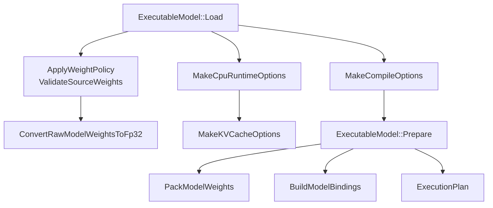
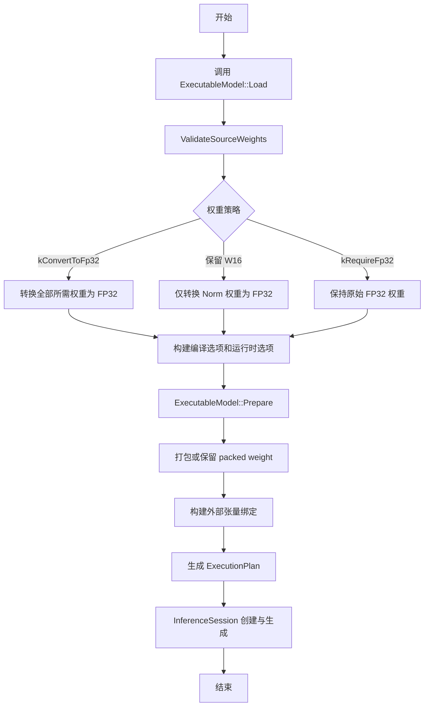
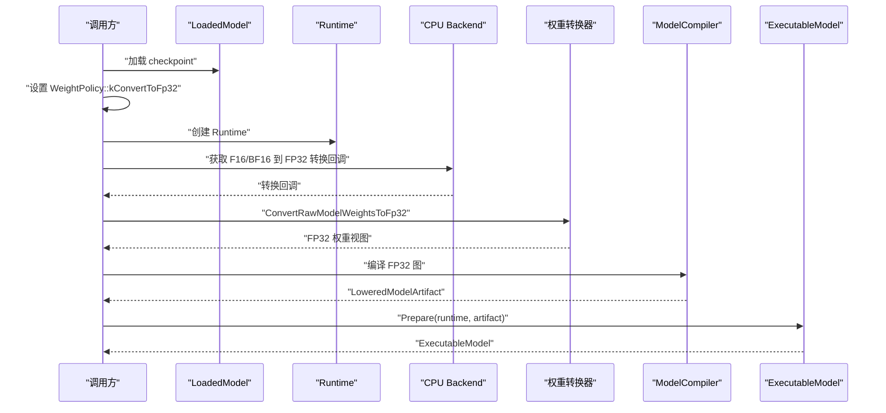
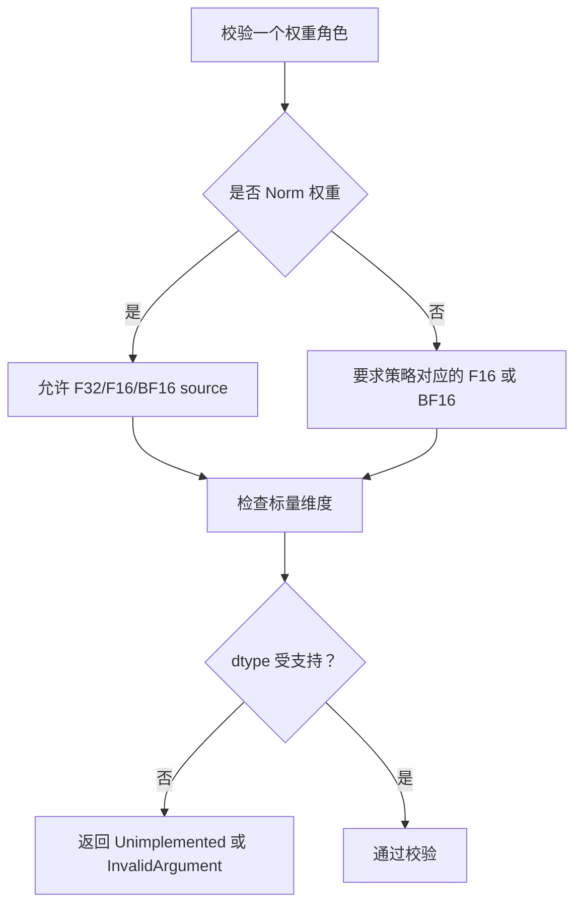
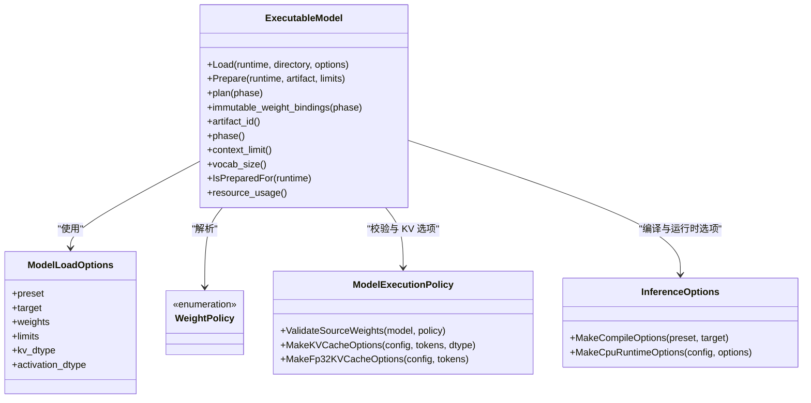

# 推理模式配置

**本文引用的文件**
- [executable_model.h](../../../include/aethermind/inference/executable_model.h)
- [executable_model.cpp](../../../src/inference/executable_model.cpp)
- [model_execution_policy.h](../../../include/aethermind/inference/model_execution_policy.h)
- [model_execution_policy.cpp](../../../src/inference/model_execution_policy.cpp)
- [inference_options.h](../../../include/aethermind/inference/inference_options.h)
- [inference_options.cpp](../../../src/inference/inference_options.cpp)
- [fp32-compatible-inference.md](../../guides/fp32-compatible-inference.md)
- [w16-fp32-inference.md](../../guides/w16-fp32-inference.md)
- [runtime-configuration.md](../../guides/runtime-configuration.md)

## 目录
1. [简介](#简介)
2. [项目结构与入口](#项目结构与入口)
3. [核心组件](#核心组件)
4. [架构总览](#架构总览)
5. [详细组件分析](#详细组件分析)
6. [依赖关系分析](#依赖关系分析)
7. [性能与内存特征](#性能与内存特征)
8. [数值精度、对齐与 NaN 处理](#数值精度对齐与-nan-处理)
9. [完整使用示例](#完整使用示例)
10. [故障排除指南](#故障排除指南)
11. [结论](#结论)

## 简介
本文说明 AetherMind 推理系统中的两种特殊权重与执行模式：

- **FP32 兼容推理模式**：使用 `WeightPolicy::kConvertToFp32`，在编译前把 F16/BF16 checkpoint 权重转换为 FP32，然后复用既有的 FP32 O1/plain 执行链。权重本身保留为 FP32 视图，激活、KV、logits 均为 FP32。
- **W16 权重 + FP32 执行模式**：矩阵、Embedding 和 LM head 保留选定的 16-bit 格式（F16 或 BF16），Norm 层在准备期转为 FP32；激活、残差和 logits 仍为 FP32。支持 `CompilePreset::kO1Plain` 和 `CompilePreset::kO2Packed`，其中 O2 使用 identity-packed 布局。

两种模式都通过 `ExecutableModel::Load` 暴露统一入口；显式 KV16 允许在 W16 模式下选择 K/V dtype，但必须与 Runtime 的物理 KV dtype 一致。

## 项目结构与入口
推理模式的配置集中在 inference 头文件和实现中：

- `include/aethermind/inference/executable_model.h`：定义 `ModelLoadOptions`、`ExecutableModel::Load`/`Prepare` 以及模型生命周期契约。
- `src/inference/executable_model.cpp`：实现权重策略应用、资源统计、packed weight 打包、绑定构建和执行阶段检查。
- `include/aethermind/inference/model_execution_policy.h`：定义 `WeightPolicy` 枚举及 KV cache 选项构造接口。
- `src/inference/model_execution_policy.cpp`：实现 source dtype 校验、角色级 dtype 约束、KV cache 几何映射。
- `include/aethermind/inference/inference_options.h`：定义 `CompilePreset`、`CpuRuntimeAssemblyOptions` 等 CPU 运行前配置。
- `src/inference/inference_options.cpp`：将 preset 映射到编译选项，将用户运行时参数映射到 `RuntimeOptions`。

**图表来源**
- [executable_model.h:57-112](../../../include/aethermind/inference/executable_model.h#L57-L112)
- [executable_model.cpp:316-376](../../../src/inference/executable_model.cpp#L316-L376)
- [model_execution_policy.h:17-55](../../../include/aethermind/inference/model_execution_policy.h#L17-L55)
- [inference_options.h:14-58](../../../include/aethermind/inference/inference_options.h#L14-L58)

**章节来源**
- [executable_model.h:1-183](../../../include/aethermind/inference/executable_model.h#L1-L183)
- [executable_model.cpp:1-200](../../../src/inference/executable_model.cpp#L1-L200)
- [model_execution_policy.h:1-58](../../../include/aethermind/inference/model_execution_policy.h#L1-L58)
- [inference_options.h:1-61](../../../include/aethermind/inference/inference_options.h#L1-L61)

## 核心组件
### ModelLoadOptions
`ModelLoadOptions` 是调用 `ExecutableModel::Load` 时的单点配置对象，包含：

| 字段 | 含义 |
|---|---|
| `preset` | 编译预设，`kO1Plain` 或 `kO2Packed`。 |
| `target` | 目标设备类型，FP32 兼容模式要求 CPU。 |
| `weights` | 源权重策略：严格 FP32、转换到 FP32，或保留 F16/BF16 矩阵并执行 FP32 激活。 |
| `limits` | 每模型负载上限，控制 raw payload 与 packed weight。 |
| `kv_dtype` | KV 存储元素类型；默认 FP32，仅在保留 W16 策略下可接受 F16/BF16。 |
| `activation_dtype` | 激活 dtype；当前文档重点为 FP32 激活语义。 |

**章节来源**
- [executable_model.h:57-83](../../../include/aethermind/inference/executable_model.h#L57-L83)

### WeightPolicy
`WeightPolicy` 是权重准入和转换策略：

| 值 | 行为 |
|---|---|
| `kRequireFp32` | 仅接受已加载的 FP32 权重，不转换。 |
| `kConvertToFp32` | 把需要的 F16/BF16 权重转换为 FP32，随后走 FP32 执行链。 |
| `kKeepFp16WeightsFp32Activation` | 矩阵、Embedding、LM head 保留 F16，Norm 转 FP32。 |
| `kKeepBf16WeightsFp32Activation` | 矩阵、Embedding、LM head 保留 BF16，Norm 转 FP32。 |

**章节来源**
- [model_execution_policy.h:17-27](../../../include/aethermind/inference/model_execution_policy.h#L17-L27)

### ExecutableModel
`ExecutableModel` 是从编译器产物到推理会话之间的不可变模型对象。它拥有：

- 已降低图产物 `LoweredModelArtifact`。
- 可选的 packed weight 集合。
- 绑定元数据与外部张量绑定表。
- 执行计划。
- 编译阶段、上下文长度、词表大小和资源用量。

其所有权顺序是析构顺序保证：先释放执行计划和绑定表，再释放绑定元数据和编译器产物 backing。它是移动唯一对象，不允许拷贝或赋值。

**章节来源**
- [executable_model.h:85-183](../../../include/aethermind/inference/executable_model.h#L85-L183)

## 架构总览
下图展示从加载到执行的关键路径，以及两种推理模式的分叉点。

**图表来源**
- [executable_model.cpp:316-376](../../../src/inference/executable_model.cpp#L316-L376)
- [executable_model.cpp:377-450](../../../src/inference/executable_model.cpp#L377-L450)
- [model_execution_policy.cpp:173-200](../../../src/inference/model_execution_policy.cpp#L173-L200)

## 详细组件分析

### FP32 兼容推理模式
该模式的核心是“先转换，后复用 FP32 执行链”。

#### 转换流程

**图表来源**
- [executable_model.cpp:316-376](../../../src/inference/executable_model.cpp#L316-L376)
- [fp32-compatible-inference.md](../../guides/fp32-compatible-inference.md)

#### 关键实现细节
- `ApplyWeightPolicy` 先调用 `ValidateSourceWeights`，确认 source dtype hint 和实际权重满足策略。
- 当策略不是 `kRequireFp32` 时，从 Runtime 取得 CPU allocator 和 backend，查询 host 端的 F16/BF16 转换回调。
- 调用 `ConvertRawModelWeightsToFp32`，并根据策略选择作用域：
  - `kConvertToFp32`：转换所有必需权重。
  - 保留 W16 模式：仅转换 Norm 权重。
- 最终视图保留 surviving source backing，包括 W16 矩阵；转换后的 Norm 使用新的 FP32 owner。

**章节来源**
- [executable_model.cpp:316-376](../../../src/inference/executable_model.cpp#L316-L376)
- [fp32-compatible-inference.md](../../guides/fp32-compatible-inference.md)

### W16 权重与 FP32 执行模式
该模式的目标是减少权重体积，同时复用稳定的 FP32 执行逻辑。

#### 权重精度分配
| 组件 | 保留格式 | 执行期精度 |
|---|---|---|
| Attention Q/K/V/O | F16 或 BF16 | 由 kernel 按策略读取 16-bit 权重 |
| MLP Gate/Up/Down | F16 或 BF16 | 同上 |
| Token Embedding | F16 或 BF16 | 按行读取并 widening |
| LM Head | F16 或 BF16 | 同 Embedding |
| Input / PostAttention / Final Norm | 可能为 F32/F16/BF16 | 准备期转为 FP32 |
| 激活、残差、logits | 不适用 | FP32 |
| KV | 可选 FP32/F16/BF16 | 与 Runtime 物理 KV dtype 一致 |

**章节来源**
- [w16-fp32-inference.md](../../guides/w16-fp32-inference.md)
- [model_execution_policy.cpp:63-121](../../../src/inference/model_execution_policy.cpp#L63-L121)

#### 校验逻辑
`ValidateRoleDType` 对每个 Transformer 权重角色判断：

1. 识别是否为 Norm 权重。
2. 若策略是保留 W16 且角色不是 Norm，则要求实际 dtype 等于策略指定的 F16 或 BF16。
3. 若策略允许 widening，则额外允许 source 为 F32/F16/BF16。
4. 所有 dtype 必须是标量，否则拒绝。

**图表来源**
- [model_execution_policy.cpp:63-121](../../../src/inference/model_execution_policy.cpp#L63-L121)

**章节来源**
- [model_execution_policy.cpp:63-121](../../../src/inference/model_execution_policy.cpp#L63-L121)

### 显式 KV16 配置
KV16 与 W16 权重是两个独立开关：

- `ModelLoadOptions::kv_dtype` 决定 KV 存储元素类型。
- `CpuRuntimeAssemblyOptions::kv_dtype` 决定 Runtime 物理 KV dtype。
- 两者必须一致；不一致会在转换或 packing 前被拒绝。
- 默认值为 FP32；产品 CLI 和 C ABI 不会自动升级为 KV16。

KV cache 选项由 `MakeKVCacheOptions` 构造，要求：

- kv_dtype 是标量 FP32、FP16 或 BF16。
- context_tokens 为正且不大于 `max_position_embeddings`。
- head_dim 来自模型配置，缺失时使用 `hidden_size / num_attention_heads`。
- alignment 固定为 64 字节。

**章节来源**
- [model_execution_policy.h:31-55](../../../include/aethermind/inference/model_execution_policy.h#L31-L55)
- [model_execution_policy.cpp:211-259](../../../src/inference/model_execution_policy.cpp#L211-L259)
- [w16-fp32-inference.md](../../guides/w16-fp32-inference.md)

## 依赖关系分析

**图表来源**
- [executable_model.h:57-183](../../../include/aethermind/inference/executable_model.h#L57-L183)
- [model_execution_policy.h:17-55](../../../include/aethermind/inference/model_execution_policy.h#L17-L55)
- [inference_options.h:14-58](../../../include/aethermind/inference/inference_options.h#L14-L58)

**章节来源**
- [executable_model.h:57-183](../../../include/aethermind/inference/executable_model.h#L57-L183)
- [model_execution_policy.h:17-55](../../../include/aethermind/inference/model_execution_policy.h#L17-L55)
- [inference_options.h:14-58](../../../include/aethermind/inference/inference_options.h#L14-L58)

## 性能与内存特征

### FP32 兼容模式
- 权重转换发生在准备阶段，不是推理内核中的混合 dtype 计算。
- F16C 可用于加速 F16 到 FP32 的批量 widening，但这是准备期优化，不代表 token 吞吐提升。
- 相同 source owner、起始地址、范围、dtype 和 shape 的 reduced view 只转换一次，因此 tied embedding/lm_head 可共享转换 storage。
- `weight_fp32_conversion` 指标报告 source/converted backing 分类和可见峰值，但不等于 RSS、mmap resident pages 或后续 packed artifacts 峰值。

**章节来源**
- [fp32-compatible-inference.md](../../guides/fp32-compatible-inference.md)
- [executable_model.cpp:201-255](../../../src/inference/executable_model.cpp#L201-L255)

### W16 模式
- 矩阵、Embedding 和 LM head 保留 16-bit 格式，减小权重体积。
- Norm 在准备期转为 FP32，避免执行期 mixed-dtype norm 分支。
- O2/identity-packed 复用 QKV/GateUp composite 布局，两字节元素仍保持 packed 形式。
- 小 head_dim 的 KV16 可能因 64 字节对齐而不减半物理内存。
- Linear/LM head、QKV/GateUp 接入 AVX2/FMA driver，reference 作为兼容 fallback。

**章节来源**
- [w16-fp32-inference.md](../../guides/w16-fp32-inference.md)
- [model_execution_policy.cpp:211-259](../../../src/inference/model_execution_policy.cpp#L211-L259)

## 数值精度、对齐与 NaN 处理

### 转换精度
- 有限值包括次正规数均精确拓宽。
- signed zero 被保留。
- NaN 保留 sign/payload，并在 FP32 结果置 quiet bit。
- 转换不要求 source 对齐，也不把原始字节解释为对齐的 C++ reduced-float 对象。

### 对齐要求
- KV cache 选项固定 alignment 为 64 字节。
- 即使 KV element 是两字节，也可能占用完整对齐行。

### W16 数值合同
- K 在既有 FP32 RoPE 后 narrow。
- V 在写入 KV cache 时 narrow。
- Prefill 当前 token 先写 KV16，Attention 再 widening 并使用 FP32 计算。
- 不使用并行 FP32 cache。

**章节来源**
- [fp32-compatible-inference.md](../../guides/fp32-compatible-inference.md)
- [model_execution_policy.cpp:211-259](../../../src/inference/model_execution_policy.cpp#L211-L259)
- [w16-fp32-inference.md](../../guides/w16-fp32-inference.md)

## 完整使用示例

### 示例一：FP32 兼容推理模式
目标：用 `WeightPolicy::kConvertToFp32` 加载 F16/BF16 checkpoint，并复用 FP32 执行链。

推荐用法：

1. 创建并稳定持有 `Runtime`。
2. 设置 `ModelLoadOptions`：
   - `preset = CompilePreset::kO1Plain`
   - `target = DeviceType::kCPU`
   - `weights = WeightPolicy::kConvertToFp32`
   - `limits.max_model_payload_bytes` 根据 checkpoint 大小设置。
3. 调用 `ExecutableModel::Load`。

参考路径：
- [fp32-compatible-inference.md](../../guides/fp32-compatible-inference.md)
- [executable_model.h:107-112](../../../include/aethermind/inference/executable_model.h#L107-L112)

### 示例二：W16 权重 + FP32 执行模式
目标：保留矩阵为 F16 或 BF16，Norm 转为 FP32，激活和 KV 为 FP32。

推荐用法：

1. 创建 `Runtime`。
2. 设置 `ModelLoadOptions`：
   - `preset = CompilePreset::kO1Plain` 或 `kO2Packed`
   - `weights = kKeepFp16WeightsFp32Activation` 或 `kKeepBf16WeightsFp32Activation`
   - `kv_dtype = DataType::Float32()`
3. 调用 `ExecutableModel::Load`。

参考路径：
- [w16-fp32-inference.md](../../guides/w16-fp32-inference.md)
- [model_execution_policy.cpp:63-121](../../../src/inference/model_execution_policy.cpp#L63-L121)

### 示例三：显式 KV16
目标：在 W16 模式下启用 BF16 KV cache。

推荐用法：

1. 使用 `MakeCpuRuntimeOptions` 传入 `kv_dtype = DataType::BFloat(16)`。
2. 在 `ModelLoadOptions` 中使用相同的 `kv_dtype`。
3. 使用保留 W16 的权重策略。
4. 调用 `ExecutableModel::Load`。

参考路径：
- [w16-fp32-inference.md](../../guides/w16-fp32-inference.md)
- [model_execution_policy.cpp:211-259](../../../src/inference/model_execution_policy.cpp#L211-L259)

### 示例四：手动 Load → Compile → Prepare
目标：先读取 model config 组装 Runtime，再显式转换权重并编译。

步骤：

1. `ModelLoader::Load`。
2. `ValidateSourceWeights`。
3. `MakeCpuRuntimeOptions`。
4. `RuntimeBuilder::WithOptions` + `TryBuild`。
5. `ConvertRawModelWeightsToFp32`。
6. `MakeCompileOptions`。
7. `ModelCompiler::Compile`。
8. `ExecutableModel::Prepare`。
9. `InferenceSession::Create` 与 `Generate`。

参考路径：
- [fp32-compatible-inference.md](../../guides/fp32-compatible-inference.md)
- [runtime-configuration.md](../../guides/runtime-configuration.md)

## 故障排除指南

### 错误：未知权重策略
**现象**：传入未定义的 `WeightPolicy`。
**原因**：策略枚举校验失败。
**处理**：仅使用 `kRequireFp32`、`kConvertToFp32`、`kKeepFp16WeightsFp32Activation`、`kKeepBf16WeightsFp32Activation`。

**章节来源**
- [model_execution_policy.cpp:173-184](../../../src/inference/model_execution_policy.cpp#L173-L184)

### 错误：不支持的 dtype hint
**现象**：model config 的 `weight_dtype_hint_name` 无法映射到受支持的 source dtype。
**原因**：hint 不是 auto、F32、F16 或 BF16。
**处理**：修正 checkpoint metadata，或改用可接受的策略。

**章节来源**
- [model_execution_policy.cpp:123-152](../../../src/inference/model_execution_policy.cpp#L123-L152)

### 错误：权重 dtype 与策略不匹配
**现象**：矩阵不是预期的 F16/BF16，或 Norm 不是允许的 F32/F16/BF16。
**原因**：`ValidateRoleDType` 发现 dtype 不满足策略。
**处理**：确保矩阵 dtype 与所选保留策略一致；Norm 可以是 F32/F16/BF16。

**章节来源**
- [model_execution_policy.cpp:63-121](../../../src/inference/model_execution_policy.cpp#L63-L121)

### 错误：KV dtype 不受支持
**现象**：传入非标量或非浮点 dtype。
**原因**：KV dtype 必须为 FP32、FP16 或 BF16。
**处理**：改为 `DataType::Float32()`、`DataType::Float(16)` 或 `DataType::BFloat(16)`。

**章节来源**
- [model_execution_policy.cpp:211-221](../../../src/inference/model_execution_policy.cpp#L211-L221)

### 错误：context_tokens 无效
**现象**：context_tokens 为零或超过 `max_position_embeddings`。
**原因**：KV capacity 必须为正且不超过模型上下文长度。
**处理**：调整 `context_tokens`，使其不大于模型配置中的最大位置数。

**章节来源**
- [model_execution_policy.cpp:223-237](../../../src/inference/model_execution_policy.cpp#L223-L237)

### 错误：head_dim 推导失败
**现象**：head_dim 为零且 `hidden_size % num_attention_heads != 0`。
**原因**：loader 缺失 head_dim 时需要整除推导。
**处理**：修正模型配置，使 `hidden_size` 能被注意力头数整除。

**章节来源**
- [model_execution_policy.cpp:239-248](../../../src/inference/model_execution_policy.cpp#L239-L248)

### 错误：硬件特性缺失
**现象**：F16C 或 AVX2 相关 fast path 不可用。
**原因**：backend 缺少相应 CPU feature 或未编译对应 ISA。
**处理**：回退 scalar 实现；不要在模型层重复检测 CPU 能力。

**章节来源**
- [fp32-compatible-inference.md](../../guides/fp32-compatible-inference.md)

### 错误：Runtime 生命周期问题
**现象**：转换失败、binding 失效或后端状态异常。
**原因**：Runtime 地址改变或被提前销毁。
**处理**：在转换前创建 Runtime，并保持其地址不变，直到 model 和 session 销毁。

**章节来源**
- [executable_model.h:93-106](../../../include/aethermind/inference/executable_model.h#L93-L106)
- [fp32-compatible-inference.md](../../guides/fp32-compatible-inference.md)
- [runtime-configuration.md](../../guides/runtime-configuration.md)

### 错误：资源限额不足
**现象**：`max_model_payload_bytes` 触发限制。
**原因**：retained owned bytes、转换 Norm payload、inline constants 或 packed weights 超出 cap。
**处理**：增大 `ModelLoadOptions::limits.max_model_payload_bytes`，或减少 checkpoint 体积、降低 packed weight 容量。

**章节来源**
- [executable_model.cpp:201-255](../../../src/inference/executable_model.cpp#L201-L255)
- [w16-fp32-inference.md](../../guides/w16-fp32-inference.md)

## 结论
AetherMind 的特殊推理模式以 `ModelLoadOptions` 和 `WeightPolicy` 为中心，提供两条清晰路径：

- **FP32 兼容模式**：适合希望完全复用既有 FP32 O1/plain 执行链的场景，代价是准备期进行权重转换。
- **W16 权重 + FP32 执行模式**：适合需要压缩权重体积、同时保持稳定 FP32 激活与 KV 语义的场景，支持 O1/plain 与 O2/identity-packed。

显式 KV16 进一步分离了权重精度与 KV 精度，但要求与 Runtime 物理 KV dtype 一致。正确配置这些模式的关键在于理解 `Load` 与 `Prepare` 的所有权边界、`ValidateSourceWeights` 的 dtype 约束，以及 KV cache 的几何与对齐要求。
