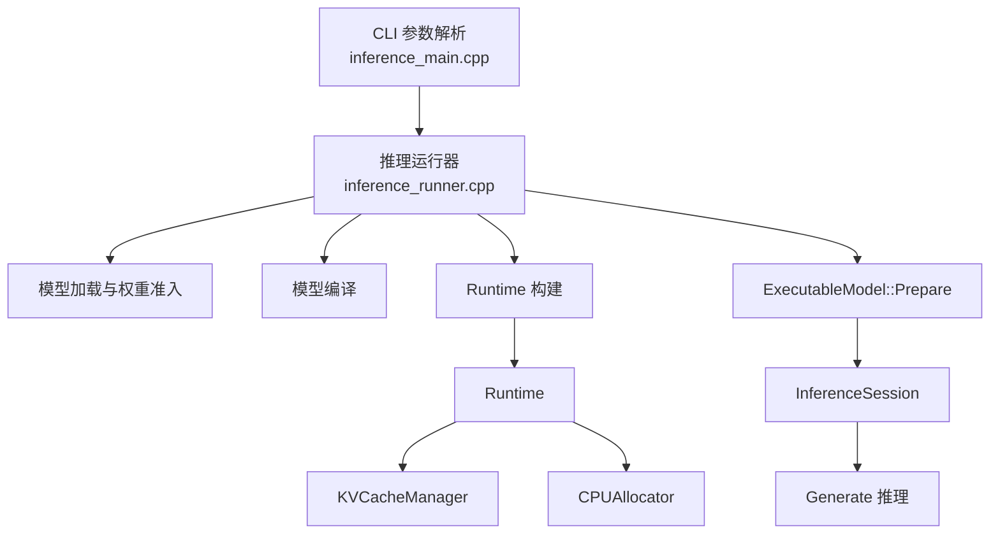
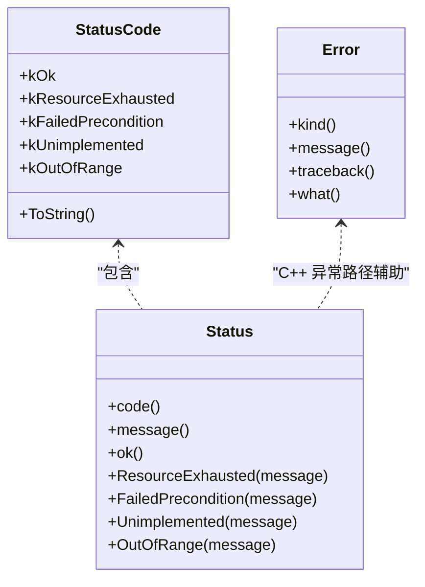
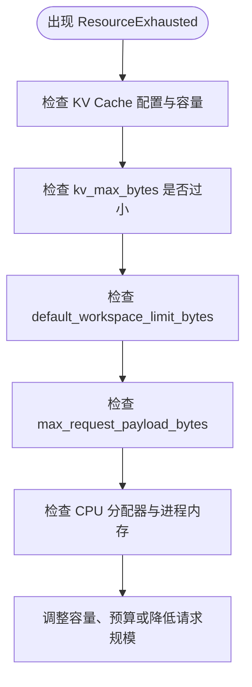
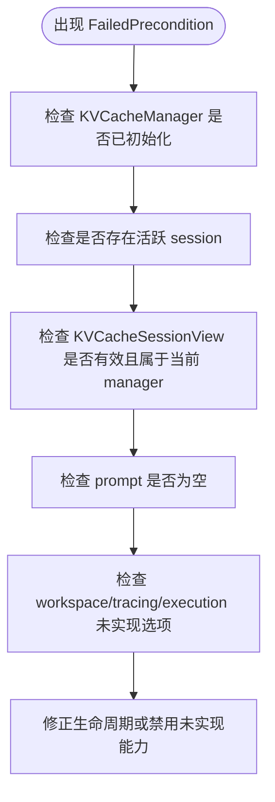
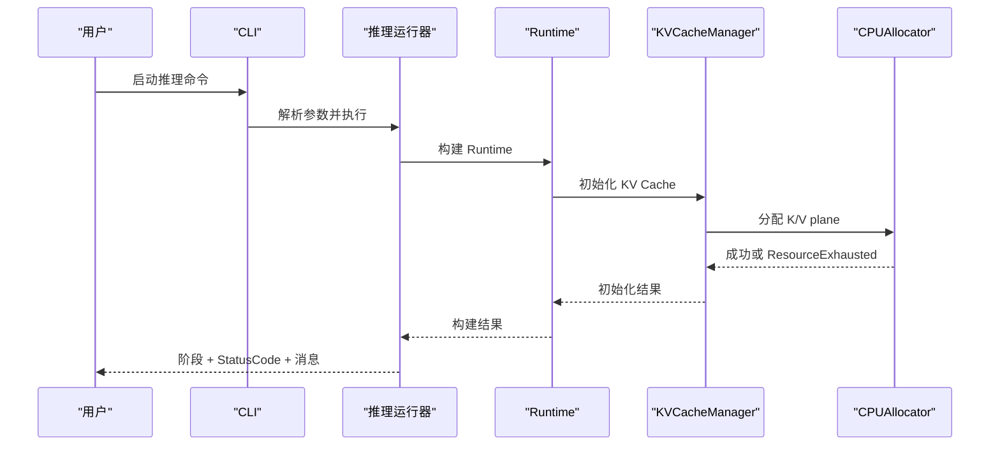

# 故障排除与诊断

**本文引用的文件**
- [README.md](../../../README.md)
- [include/aethermind/base/status.h](../../../include/aethermind/base/status.h)
- [src/base/status.cpp](../../../src/base/status.cpp)
- [include/aethermind/base/error.h](../../../include/aethermind/base/error.h)
- [include/aethermind/base/traceback.h](../../../include/aethermind/base/traceback.h)
- [src/base/traceback.cpp](../../../src/base/traceback.cpp)
- [src/c_api_error.cpp](../../../src/c_api_error.cpp)
- [include/aethermind/runtime/runtime_options.h](../../../include/aethermind/runtime/runtime_options.h)
- [docs/guides/runtime-configuration.md](../../guides/runtime-configuration.md)
- [src/runtime/](../../../src/runtime)
- [src/runtime/workspace_planner.cpp](../../../src/runtime/workspace_planner.cpp)
- [include/aethermind/kv_cache/kv_cache_manager.h](../../../include/aethermind/kv_cache/kv_cache_manager.h)
- [src/kv_cache/kv_cache_manager.cpp](../../../src/kv_cache/kv_cache_manager.cpp)
- [include/aethermind/inference/inference_session.h](../../../include/aethermind/inference/inference_session.h)
- [src/inference/inference_session.cpp](../../../src/inference/inference_session.cpp)
- [apps/inference/inference_runner.cpp](../../../apps/inference/inference_runner.cpp)
- [apps/inference/inference_main.cpp](../../../apps/inference/inference_main.cpp)
- [include/aethermind/memory/allocator.h](../../../include/aethermind/memory/allocator.h)
- [src/memory/cpu_allocator.cpp](../../../src/memory/cpu_allocator.cpp)
- [tests/unit/kv_cache/test_kv_cache_session_view_oom.cpp](../../../tests/unit/kv_cache/test_kv_cache_session_view_oom.cpp)
- [tests/unit/inference/test_inference_resource_limits.cpp](../../../tests/unit/inference/test_inference_resource_limits.cpp)
- [docs/archive/designs/kv_cache_design.md](../../archive/designs/kv_cache_design.md)
- [docs/guides/resource-budgeting.md](../../guides/resource-budgeting.md)

## 目录
1. [引言](#引言)
2. [项目结构与排障定位](#项目结构与排障定位)
3. [核心错误模型](#核心错误模型)
4. [常见故障分类与处理方法](#常见故障分类与处理方法)
5. [日志、堆栈与调试技巧](#日志堆栈与调试技巧)
6. [性能问题排查](#性能问题排查)
7. [配置错误诊断清单](#配置错误诊断清单)
8. [监控告警建议](#监控告警建议)
9. [典型故障案例](#典型故障案例)
10. [结论](#结论)

## 引言
AetherMind 是面向 Llama 密集模型的 CPU 推理运行时，提供 C++ API、独立 CLI 和稳定的 C ABI。其核心路径为：加载模型 → 编译图 → 构建 Runtime → 准备可执行模型 → 创建推理 Session → 生成 Token。部署运维中最常见的故障通常集中在资源耗尽、前置条件不满足、功能尚未实现以及 KV Cache 或输入范围越界。

本指南面向运维人员，聚焦四类关键错误：ResourceExhausted、FailedPrecondition、Unimplemented、OutOfRange；同时覆盖日志与堆栈分析、性能瓶颈定位、配置校验清单、监控告警策略，以及典型故障的恢复流程。

## 项目结构与排障定位
AetherMind 的排障入口通常不是单点主函数，而是“CLI → Runner → Runtime/Session/KV Cache”这条调用链。

**图表来源**
- [apps/inference/inference_main.cpp:1-120](../../../apps/inference/inference_main.cpp#L1-L120)
- [apps/inference/inference_runner.cpp:1-120](../../../apps/inference/inference_runner.cpp#L1-L120)
- [docs/architecture.md](../../../README.md)

**章节来源**
- [README.md](../../../README.md)
- [apps/inference/inference_main.cpp:1-120](../../../apps/inference/inference_main.cpp#L1-L120)
- [apps/inference/inference_runner.cpp:1-120](../../../apps/inference/inference_runner.cpp#L1-L120)

## 核心错误模型
AetherMind 使用与 gRPC 状态码对齐的 `StatusCode` 作为主要错误模型。C++ 层通过 `Status` 返回错误，异常路径通过 `Error` 携带 kind、message 和 traceback。CLI 和 C ABI 将内部状态映射到 C ABI 状态码。

| 错误类型 | 含义 | 常见触发位置 |
|---|---|---|
| ResourceExhausted | 内存分配失败、预算不足、底层分配器拒绝请求 | KV 初始化、workspace 分配、activation 分配、CLI bad_alloc 捕获 |
| FailedPrecondition | 对象未初始化、会话已占用、视图无效、选项不支持但语义属于前置条件 | KV 未初始化、已有 session reservation、KV view 不属于当前 manager、Workspace manager 未实现 |
| Unimplemented | 当前产品未实现的功能 | graph executor、workspace manager、profiling、GPU backend factory 缺失 |
| OutOfRange | 数值、token、KV capacity 超出允许范围 | prompt token 超出词表、context_tokens 超过模型上下文、KV 物理容量不足 |

**图表来源**
- [include/aethermind/base/status.h:1-200](../../../include/aethermind/base/status.h#L1-L200)
- [src/base/status.cpp:1-101](../../../src/base/status.cpp#L1-L101)
- [include/aethermind/base/error.h:1-174](../../../include/aethermind/base/error.h#L1-L174)

**章节来源**
- [include/aethermind/base/status.h:1-200](../../../include/aethermind/base/status.h#L1-L200)
- [src/base/status.cpp:1-101](../../../src/base/status.cpp#L1-L101)
- [include/aethermind/base/error.h:1-174](../../../include/aethermind/base/error.h#L1-L174)

## 常见故障分类与处理方法

### ResourceExhausted（资源耗尽）

#### 触发场景
- KV Cache 初始化时 K/V plane 分配失败。
- Workspace 规划过程中发生 `std::bad_alloc`。
- InferenceSession 的 request payload 预算不足，或在 reservation、workspace、activation 分配阶段失败。
- CPU 分配器因 ENOMEM 拒绝分配。
- CLI 在推理主体中捕获 `std::bad_alloc`，统一转换为 ResourceExhausted。

#### 诊断步骤
1. 检查是否启用了 KV Cache：若启用，确认 `num_layers`、`num_kv_heads`、`max_tokens`、`head_dim`、`kv_dtype`、`alignment` 是否与模型一致。
2. 检查 `KVCacheRuntimeOptions::max_bytes`：该值限制 K/V 两个 plane 的可见 payload，0 表示无限制。
3. 检查 `WorkspaceRuntimeOptions::default_workspace_limit_bytes`：即使没有 workspace manager，该上限仍会阻止 workspace 分配。
4. 检查 `InferenceSessionOptions::max_request_payload_bytes`：该预算覆盖 workspace 与两阶段 activation peak。
5. 查看 CLI 输出：当 ResourceExhausted 消息为空时，CLI 明确输出“memory allocation failed”。

#### 修复方法
- 增大 KV capacity：提高 `context_tokens` 或调整 KV geometry。
- 增大 KV 字节上限：提高 `kv_max_bytes`。
- 降低单次请求负载：减小 prompt length、减少 `max_new_tokens`，或使用更小的模型。
- 放宽 workspace 或 request payload 上限：仅在系统确有足够内存时调整。
- 关闭或不启用不必要的自定义 provider/factory，避免额外开销。

**图表来源**
- [src/kv_cache/kv_cache_manager.cpp:1-60](../../../src/kv_cache/kv_cache_manager.cpp#L1-L60)
- [src/runtime/workspace_planner.cpp:1-71](../../../src/runtime/workspace_planner.cpp#L1-L71)
- [src/inference/inference_session.cpp:1-120](../../../src/inference/inference_session.cpp#L1-L120)
- [src/memory/cpu_allocator.cpp:1-127](../../../src/memory/cpu_allocator.cpp#L1-L127)
- [apps/inference/inference_runner.cpp:120-200](../../../apps/inference/inference_runner.cpp#L120-L200)
- [apps/inference/inference_main.cpp:120-200](../../../apps/inference/inference_main.cpp#L120-L200)

**章节来源**
- [src/kv_cache/kv_cache_manager.cpp:1-60](../../../src/kv_cache/kv_cache_manager.cpp#L1-L60)
- [src/runtime/workspace_planner.cpp:1-71](../../../src/runtime/workspace_planner.cpp#L1-L71)
- [src/inference/inference_session.cpp:1-120](../../../src/inference/inference_session.cpp#L1-L120)
- [src/memory/cpu_allocator.cpp:1-127](../../../src/memory/cpu_allocator.cpp#L1-L127)
- [apps/inference/inference_runner.cpp:120-200](../../../apps/inference/inference_runner.cpp#L120-L200)
- [apps/inference/inference_main.cpp:120-200](../../../apps/inference/inference_main.cpp#L120-L200)

### FailedPrecondition（前置条件失败）

#### 触发场景
- KVCacheManager 未初始化即访问。
- KV Cache 已有活跃 session reservation，再次 ReserveForSession。
- ResetSession 或 ReleaseSession 传入不属于当前 manager 或已失效的 KVCacheSessionView。
- KV session reservation 要求非空 prompt。
- Workspace manager 被显式启用但当前未实现。
- 在 budget 检查之前，KV 容量或生命周期错误优先返回。

#### 诊断步骤
1. 确认 KVCacheManager 是否成功 Init。
2. 确认同一 Runtime 上是否存在未释放的 KV session reservation。
3. 确认 KVCacheSessionView 的生命周期：ReserveForSession 后必须 ReleaseSession。
4. 确认 Prompt 非空，且 future_kv_appends 与 prompt_len 组合至少为一个 token。
5. 检查 RuntimeOptions 中 workspace、tracing、execution 选项是否启用了当前版本拒绝的能力。

#### 修复方法
- 在构造 KVCacheManager 前完成所有 KV geometry 配置。
- 确保每次 Generate 完成后释放 KV reservation。
- 避免重复 ReserveForSession，直到上一次 ReleaseSession。
- 对 ResetSession，仅使用有效且属于当前 manager 的 view。
- 不要启用 workspace manager、graph executor、profiling 等当前拒绝的能力。

**图表来源**
- [src/kv_cache/kv_cache_manager.cpp:60-176](../../../src/kv_cache/kv_cache_manager.cpp#L60-L176)
- [docs/guides/runtime-configuration.md](../../guides/runtime-configuration.md)
- [tests/unit/inference/test_inference_resource_limits.cpp:260-334](../../../tests/unit/inference/test_inference_resource_limits.cpp#L260-L334)

**章节来源**
- [src/kv_cache/kv_cache_manager.cpp:60-176](../../../src/kv_cache/kv_cache_manager.cpp#L60-L176)
- [docs/guides/runtime-configuration.md](../../guides/runtime-configuration.md)
- [tests/unit/inference/test_inference_resource_limits.cpp:260-334](../../../tests/unit/inference/test_inference_resource_limits.cpp#L260-L334)

### Unimplemented（功能未实现）

#### 触发场景
- `execution.enable_graph_executor = true`。
- `workspace.enable_workspace_manager = true`。
- `tracing.enable_profiling = true` 或 `tracing.enable_memory_profiling = true`。
- `execution.enable_default_stream = false`。
- 启用了 CUDA/CANN backend，但未注册对应 custom BackendFactory。

#### 诊断步骤
1. 检查 `RuntimeOptions` 中 execution、workspace、tracing、backend 字段。
2. 确认是否误将“保留字段”当作“可开启能力”。
3. 如果确实需要 GPU backend，确认已通过 `RegisterBackendFactory` 注入同设备工厂。

#### 修复方法
- 保持 execution、workspace、tracing 为当前兼容默认值。
- 不使用 workspace manager；当前产品通过 Runtime 持有的 `workspace_limit_bytes_` 和上层预算控制 workspace。
- 如需 GPU，按现有契约注册 custom BackendFactory，而不是直接启用 backend 开关。

**章节来源**
- [include/aethermind/runtime/runtime_options.h:1-69](../../../include/aethermind/runtime/runtime_options.h#L1-L69)
- [docs/guides/runtime-configuration.md](../../guides/runtime-configuration.md)
- [src/runtime/](../../../src/runtime)

### OutOfRange（范围越界）

#### 触发场景
- prompt token 大于等于 vocab_size。
- eos_token_id 超出词表。
- context_tokens 超过模型 `max_position_embeddings`。
- KV session reservation 的 prompt_len + future_kv_appends 超过物理 `max_tokens`。
- KVCacheSessionView 的 layer、head、position、dimension 越界。
- 读取超出 committed_tokens 的历史 KV。

#### 诊断步骤
1. 核对 CLI 的 `--tokens`、`--eos-token-id`、`--context-tokens`。
2. 核对 HfModelConfig 中的 vocab_size 与 max_position_embeddings。
3. 核对 KV geometry：num_layers、num_kv_heads、max_tokens、head_dim。
4. 核对 KVCacheSessionView 的读写索引边界。

#### 修复方法
- 校正 prompt token 与 eos_token_id，使其小于 vocab_size。
- 将 context_tokens 设置为不超过模型最大位置嵌入。
- 增大 KV capacity 或降低 prompt_length / future_kv_appends。
- 修正算子或执行路径中对 KV 的 layer/head/position/dimension 索引。

**章节来源**
- [apps/inference/inference_runner.cpp:1-120](../../../apps/inference/inference_runner.cpp#L1-L120)
- [src/kv_cache/kv_cache_manager.cpp:60-120](../../../src/kv_cache/kv_cache_manager.cpp#L60-L120)
- [tests/unit/kv_cache/test_kv_cache_session_view_oom.cpp:1-120](../../../tests/unit/kv_cache/test_kv_cache_session_view_oom.cpp#L1-L120)

## 日志、堆栈与调试技巧

### 日志配置
- AetherMind 依赖 spdlog。CLI 和 CPU 分配器等路径会使用 spdlog 进行警告输出。
- CPU 大页（THP）相关操作失败时会记录 warning。
- CLI 的错误输出格式固定为：程序名前缀、阶段名、StatusCode 名称、可选 message。ResourceExhausted 空消息时补充“memory allocation failed”。

### 堆栈追踪
- 内部异常类型 `Error` 包含 kind、message、traceback，并可通过 `what()` 输出标准回溯格式。
- Traceback 支持 libbacktrace，默认最大帧数为 512，可通过环境变量 `TRACEBACK_LIMIT` 调整。
- 框架会过滤部分低信息帧，例如 stdlib、测试框架、Python 解释器边界，以便让上层语言报告自己的调用栈。
- `AM_THROW` 会在抛出前向 stderr 输出完整错误；`AM_THROW_SILENT` 抑制该输出。

### 调试建议
1. 先通过 CLI 的 stage 输出判断失败发生在 load、parameters、compile、runtime_build、prepare、session 还是 generate。
2. 对于 ResourceExhausted，结合 KV geometry、workspace limit、request payload limit 三处预算逐步缩小范围。
3. 对于 FailedPrecondition，重点检查 KV 生命周期：Init → Reserve → Execute → Reset/Release。
4. 对于 Unimplemented，直接检查 RuntimeOptions 的保留字段。
5. 使用 `TRACEBACK_LIMIT` 控制回溯长度；生产环境建议限制帧数，避免异常堆栈过大。
6. 对内存问题可关注 THP 相关 warning，并结合系统内存使用情况判断是否真正 OOM。

**图表来源**
- [apps/inference/inference_main.cpp:1-120](../../../apps/inference/inference_main.cpp#L1-L120)
- [apps/inference/inference_runner.cpp:1-120](../../../apps/inference/inference_runner.cpp#L1-L120)
- [src/kv_cache/kv_cache_manager.cpp:1-60](../../../src/kv_cache/kv_cache_manager.cpp#L1-L60)
- [src/memory/cpu_allocator.cpp:1-127](../../../src/memory/cpu_allocator.cpp#L1-L127)

**章节来源**
- [include/aethermind/base/error.h:1-174](../../../include/aethermind/base/error.h#L1-L174)
- [include/aethermind/base/traceback.h:1-74](../../../include/aethermind/base/traceback.h#L1-L74)
- [src/base/traceback.cpp:1-200](../../../src/base/traceback.cpp#L1-L200)
- [apps/inference/inference_main.cpp:120-200](../../../apps/inference/inference_main.cpp#L120-L200)
- [src/memory/cpu_allocator.cpp:1-127](../../../src/memory/cpu_allocator.cpp#L1-L127)

## 性能问题排查

### 内存泄漏检测
- AetherMind 的核心 Buffer 由 MemoryHandle 管理，allocator 负责存储所有权。
- CPUAllocator 使用 posix_memalign，并在 THP 阈值以上尝试 madvise 大页。
- 资源预算接口不会统计进程 RSS、allocator metadata、外部 backing payload 或 OS RSS，因此“内存持续增长”不能只依赖 `resource_usage()`。
- 排查建议：
  - 对比计划峰值与实际分配：使用 `PlanResources` 获取 workspace、prefill activation、decode activation 和 KV reserved bytes。
  - 区分模型 weight payload 与 request runtime payload。
  - 检查是否有外部未释放的 tensor buffer 或自定义 allocator storage。
  - 对 KV Cache，确认每个 session reservation 最终都调用了 ReleaseSession。

### CPU 利用率分析
- 当前推理路径为同步、单请求 greedy generation。
- CPU kernel 包括 RMSNorm、embedding、dot product 等参考或 SIMD 优化实现。
- 若 CPU 长期满载但吞吐低，优先检查：
  - prompt 过长导致 Prefill 阶段长时间计算。
  - `max_new_tokens` 过大导致 Decode 循环过多。
  - workspace 或 activation 频繁重新分配。
  - 模型 packing 策略与硬件 ISA 匹配情况。

### 推理延迟瓶颈识别
- Prefill 阶段：主要受 prompt length、attention 计算、KV append 影响。
- Decode 阶段：每步生成一个 token，受 KV update、attention、linear/rmsnorm 等算子影响。
- 瓶颈定位建议：
  - 先固定 prompt，观察 decode 单 token 延迟。
  - 再固定 generation 长度，观察不同 prompt length 下的 Prefill 延迟。
  - 检查 KV cache 是否过小，导致需要缩短上下文或丢弃历史。
  - 检查 workspace 是否过小，导致预算拒绝或分配压力。
  - 使用 benchmark 目标分离 prepare、internal prepared Prefill/Decode 与 public Generate。

**章节来源**
- [docs/guides/resource-budgeting.md](../../guides/resource-budgeting.md)
- [include/aethermind/inference/inference_session.h:1-114](../../../include/aethermind/inference/inference_session.h#L1-L114)
- [src/inference/inference_session.cpp:1-120](../../../src/inference/inference_session.cpp#L1-L120)
- [src/memory/cpu_allocator.cpp:1-127](../../../src/memory/cpu_allocator.cpp#L1-L127)
- [docs/archive/designs/kv_cache_design.md](../../archive/designs/kv_cache_design.md)

## 配置错误诊断清单

### Runtime 配置冲突
- 启用 graph executor：当前拒绝。
- 启用 workspace manager：当前拒绝。
- 启用 profiling 或 memory profiling：当前拒绝。
- 设置 `enable_default_stream = false`：当前拒绝。
- 启用 CUDA/CANN backend：必须有对应 custom BackendFactory。

**检查项**
- 确认 `ExecutionRuntimeOptions`、`WorkspaceRuntimeOptions`、`TracingRuntimeOptions`、`BackendRuntimeOptions` 均为当前兼容值。
- 如使用 C ABI，注意其生命周期是先创建 Runtime，再加载模型；不能依赖模型 metadata 后再创建 Runtime。

### KV Cache 容量不足
- KV geometry 与模型不一致。
- `max_tokens` 小于 prompt_len + future_kv_appends。
- `kv_max_bytes` 小于实际 KV layout padding 后的总字节。
- 已存在活跃 session reservation。

**检查项**
- `num_layers`、`num_kv_heads`、`max_tokens`、`head_dim`、`kv_dtype`、`alignment`。
- KV 总字节是否超过 `max_bytes`。
- 是否在同一个 Runtime 上重复 reserve。

### Workspace 规划失败
- alignment 不是非零 2 的幂。
- 布局累加溢出 size_t。
- 诊断分配失败被包装为 ResourceExhausted。
- 规划失败不修改已输入的 offset，便于重试。

**检查项**
- 每个 workspace requirement 的 alignment。
- total_bytes 是否接近 size_t 上限。
- 是否误把“诊断分配失败”当成业务逻辑错误。

### 推理请求预算错误
- `max_request_payload_bytes` 小于 workspace + max(prefill activation, decode activation)。
- 正数 token 请求会再次检查 KV 容量和生命周期，这些错误不会被 budget 的 ResourceExhausted 覆盖。
- `max_new_tokens == 0` 不申请 KV、workspace 或 activation，也不应用 budget。

**检查项**
- 先用 `PlanResources` 查询真实需求。
- 比较 plan 峰值与 request payload limit。
- 确认 zero generation 行为是否符合预期。

**章节来源**
- [include/aethermind/runtime/runtime_options.h:1-69](../../../include/aethermind/runtime/runtime_options.h#L1-L69)
- [docs/guides/runtime-configuration.md](../../guides/runtime-configuration.md)
- [src/runtime/workspace_planner.cpp:1-71](../../../src/runtime/workspace_planner.cpp#L1-L71)
- [docs/guides/resource-budgeting.md](../../guides/resource-budgeting.md)
- [include/aethermind/inference/inference_session.h:1-114](../../../include/aethermind/inference/inference_session.h#L1-L114)

## 监控告警建议

### 关键指标
| 指标 | 建议阈值 | 说明 |
|---|---|---|
| KV Cache 总字节 | 不超过 `kv_max_bytes` | 防止 KV 平面超预算 |
| KV 物理容量使用率 | 低于 90% | 为 prompt + future appends 留余量 |
| Workspace 分配失败次数 | 0 | 非零表示预算或规划异常 |
| Request payload 分配失败次数 | 0 | 非零可能表示模型或请求负载过大 |
| KV session reservation 未释放数量 | 0 | 非零可能泄露 KV 生命周期 |
| ResourceExhausted 错误率 | 趋近 0 | 持续升高说明系统内存不足 |
| FailedPrecondition 错误率 | 趋近 0 | 通常代表调用方生命周期错误 |
| OutOfRange 错误率 | 趋近 0 | 通常代表 prompt/eos/context 配置错误 |
| Unimplemented 错误率 | 0 | 应通过配置治理消除 |

### 自动告警规则
- 连续多次 ResourceExhausted：立即告警，建议暂停新请求或降级请求规模。
- KV reservation 持有时间过长：检查 ReleaseSession 是否遗漏。
- KV 总字节持续增长：检查 KV geometry 是否被动态放大或存在泄漏。
- Workspace 规划 InvalidArgument 或 Overflow：检查 alignment 和布局参数。
- CLI 阶段错误集中在某个 stage：例如 runtime_build 或 generate，用于快速定位组件。
- 异常堆栈中出现大量 traceback 帧：考虑降低 TRACEBACK_LIMIT，避免日志膨胀。

**章节来源**
- [docs/guides/resource-budgeting.md](../../guides/resource-budgeting.md)
- [src/kv_cache/kv_cache_manager.cpp:60-176](../../../src/kv_cache/kv_cache_manager.cpp#L60-L176)
- [apps/inference/inference_main.cpp:120-200](../../../apps/inference/inference_main.cpp#L120-L200)
- [include/aethermind/base/traceback.h:1-74](../../../include/aethermind/base/traceback.h#L1-L74)

## 典型故障案例

### 案例一：KV Cache 初始化导致 ResourceExhausted
**现象**
- CLI 输出阶段为 runtime_build 或 prepare，随后出现 ResourceExhausted。
- KVCacheManager::Init 在分配 key_buffer 或 value_buffer 时失败。

**根因**
- KV geometry 过大，或 `kv_max_bytes` 过小。
- 底层 CPU 分配器返回 ENOMEM。
- 诊断过程本身触发分配失败，被包装为 ResourceExhausted。

**处理步骤**
1. 打印 KV geometry 与 `kv_max_bytes`。
2. 计算 PlanKVCacheLayout 的 TotalBytes。
3. 若 TotalBytes > max_bytes，增大 KV 预算或缩小 geometry。
4. 若系统确实内存不足，降低并发或模型规模。
5. 确认 KV 初始化成功后再创建 Session。

**章节来源**
- [src/kv_cache/kv_cache_manager.cpp:1-60](../../../src/kv_cache/kv_cache_manager.cpp#L1-L60)
- [src/memory/cpu_allocator.cpp:1-127](../../../src/memory/cpu_allocator.cpp#L1-L127)
- [docs/archive/designs/kv_cache_design.md](../../archive/designs/kv_cache_design.md)

### 案例二：重复创建 KV session 导致 FailedPrecondition
**现象**
- 第一次 Generate 成功，第二次 Generate 报 FailedPrecondition。
- 错误信息指向 KV 已有活跃 session reservation。

**根因**
- 上一次 KV reservation 未 ReleaseSession。
- 调用方可能在错误分支跳过了清理逻辑。

**处理步骤**
1. 确认 KVCacheSessionView 在 Close/Finalize 路径中被释放。
2. 对异常路径也保证 ReleaseSession。
3. 在监控中统计未释放 reservation 的数量。

**章节来源**
- [src/kv_cache/kv_cache_manager.cpp:120-176](../../../src/kv_cache/kv_cache_manager.cpp#L120-L176)
- [src/inference/inference_session.cpp:120-200](../../../src/inference/inference_session.cpp#L120-L200)
- [tests/unit/inference/test_inference_resource_limits.cpp:260-334](../../../tests/unit/inference/test_inference_resource_limits.cpp#L260-L334)

### 案例三：prompt token 越界导致 OutOfRange
**现象**
- CLI 参数中包含不在 vocab_size 范围内的 token。
- eos_token_id 也超出词表。

**根因**
- 输入 token 来自外部 tokenizer 或上游服务，未做词表校验。
- 模型 checkpoint 与配置不一致。

**处理步骤**
1. 打印 vocab_size。
2. 校验 prompt_tokens 与 eos_token_id。
3. 在上游或 CLI 层提前返回 InvalidArgument/OutOfRange。
4. 对离线部署，固化 model_dir 和 config.json 的版本。

**章节来源**
- [apps/inference/inference_runner.cpp:1-120](../../../apps/inference/inference_runner.cpp#L1-L120)
- [apps/inference/inference_main.cpp:1-120](../../../apps/inference/inference_main.cpp#L1-L120)

### 案例四：启用 workspace manager 导致 Unimplemented
**现象**
- RuntimeBuilder::TryBuild 返回 Unimplemented。
- 配置中 workspace.enable_workspace_manager 为 true。

**根因**
- 当前产品未装配 workspace manager。
- 该选项被设计为保留字段，显式拒绝而非静默忽略。

**处理步骤**
1. 将 workspace manager 改为 false。
2. 使用 Runtime 的 `workspace_limit_bytes_` 和上层预算控制 workspace。
3. 若确需 workspace manager，需在 RuntimeBuilder 与 Runtime 扩展契约后实现。

**章节来源**
- [include/aethermind/runtime/runtime_options.h:1-69](../../../include/aethermind/runtime/runtime_options.h#L1-L69)
- [docs/guides/runtime-configuration.md](../../guides/runtime-configuration.md)
- [src/runtime/](../../../src/runtime)

### 案例五：KV Cache 视图写入越界导致 OutOfRange
**现象**
- KVCacheSessionView 的 Write、Read、Append、BindLayerForRead 等操作返回 OutOfRange。
- 可能出现在 layer、head、position、dim 越界，或读超出 committed_tokens。

**根因**
- 算子或执行路径传入的 KV 索引不正确。
- prompt_len、future_kv_appends、committed_tokens 与 attention 步数不一致。

**处理步骤**
1. 检查 KV session 的 capacity_tokens、prompt_len、committed_tokens。
2. 检查 KVCacheLayout 的 num_layers、num_kv_heads、max_tokens、head_dim。
3. 核对 attention 与 kvcache_update 算子的索引范围。
4. 使用单元测试中的诊断用例对照常见越界模式。

**章节来源**
- [tests/unit/kv_cache/test_kv_cache_session_view_oom.cpp:1-120](../../../tests/unit/kv_cache/test_kv_cache_session_view_oom.cpp#L1-L120)
- [include/aethermind/kv_cache/kv_cache_manager.h:1-115](../../../include/aethermind/kv_cache/kv_cache_manager.h#L1-L115)

## 结论
AetherMind 的运维排障应以错误类型为第一入口：ResourceExhausted 优先查预算与底层分配，FailedPrecondition 优先查 KV 生命周期与对象状态，Unimplemented 优先查 RuntimeOptions 保留字段，OutOfRange 优先查 prompt、eos、context 与 KV 几何。配合 CLI 阶段输出、spdlog 日志、traceback 堆栈和资源预算接口，可以快速定位问题根源并恢复服务。生产环境中应建立针对 KV 容量、reservation 生命周期、workspace 分配、request payload 预算和错误率的监控告警体系，避免将配置错误与资源问题混为一谈。
