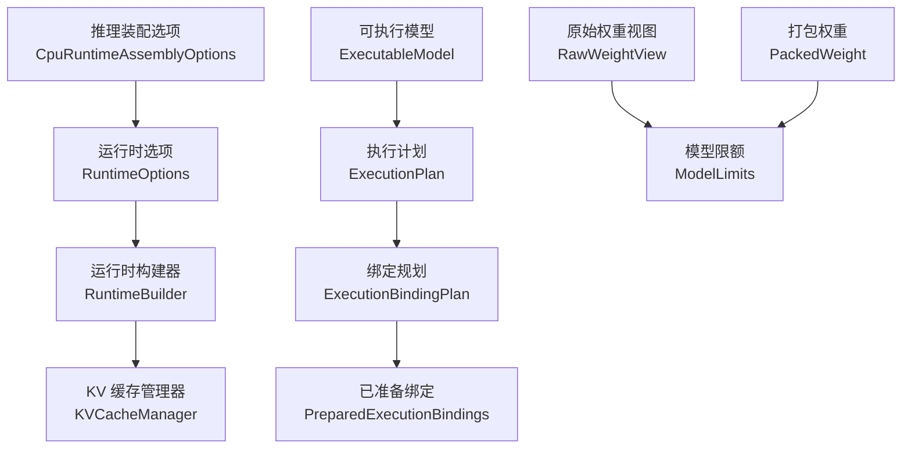
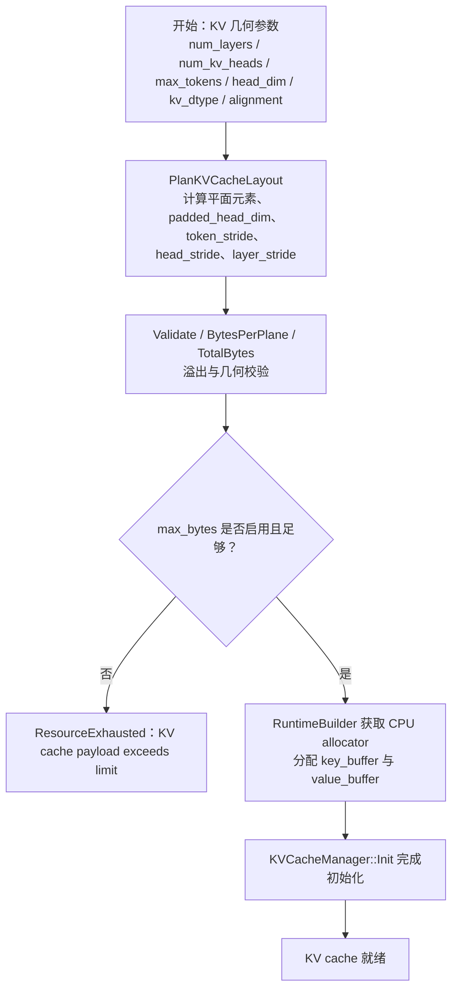
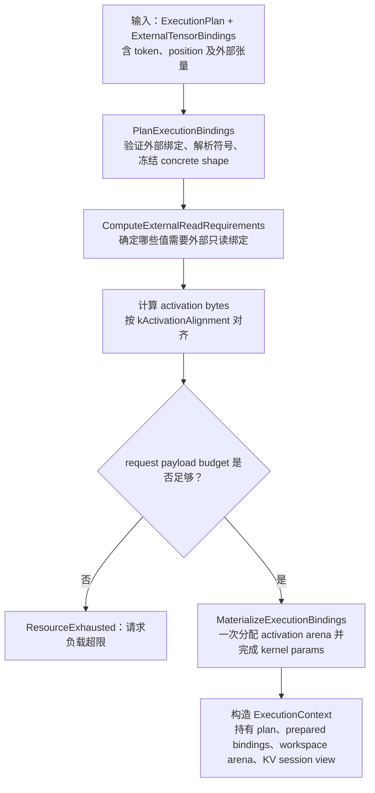
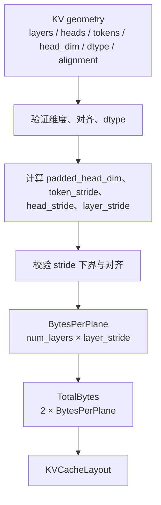
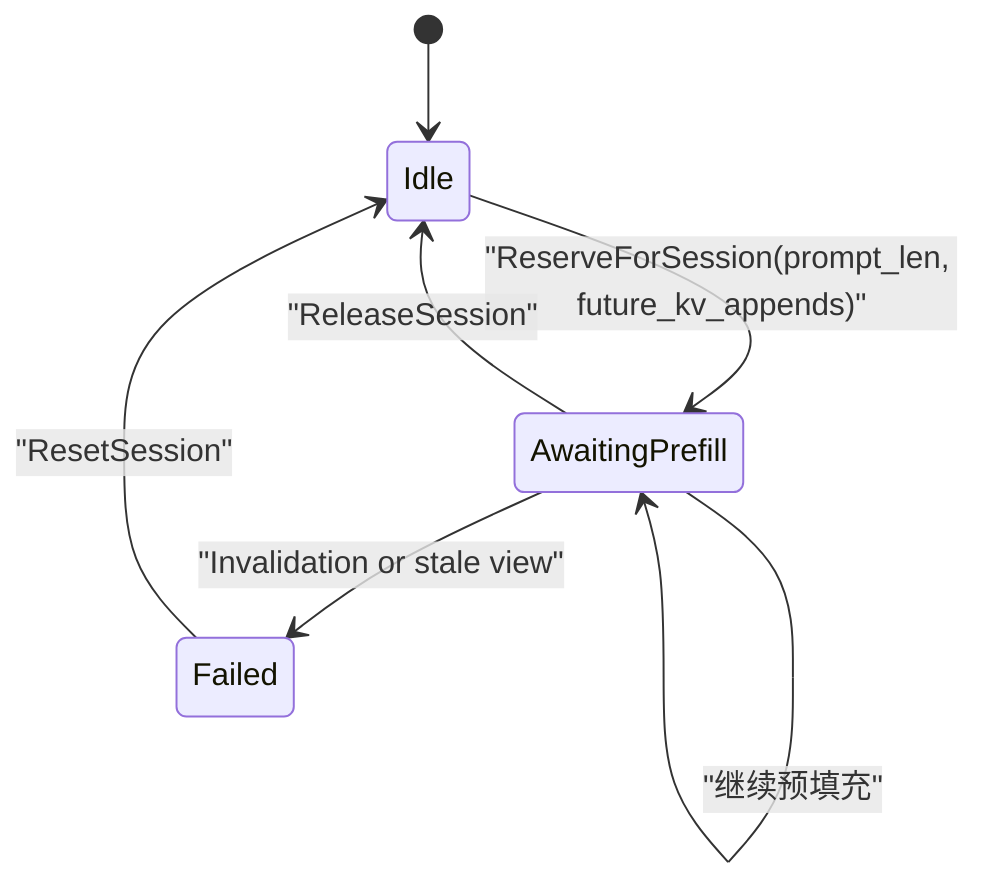

# 资源预算与配额控制

**本文引用的文件**
- [inference_options.h](../../../include/aethermind/inference/inference_options.h)
- [inference_options.cpp](../../../src/inference/inference_options.cpp)
- [runtime_options.h](../../../include/aethermind/runtime/runtime_options.h)
- [runtime_builder.cpp](../../../src/runtime/runtime_builder.cpp)
- [kv_cache_layout.h](../../../include/aethermind/kv_cache/kv_cache_layout.h)
- [kv_cache_layout.cpp](../../../src/kv_cache/kv_cache_layout.cpp)
- [kv_cache_manager.cpp](../../../src/kv_cache/kv_cache_manager.cpp)
- [execution_plan.h](../../../include/aethermind/execution/execution_plan.h)
- [execution_bindings.h](../../../include/aethermind/execution/execution_bindings.h)
- [execution_bindings.cpp](../../../src/execution/execution_bindings.cpp)
- [executable_model.h](../../../include/aethermind/inference/executable_model.h)
- [raw_weight.h](../../../include/aethermind/model/raw_weight.h)
- [raw_weight_storage_usage.cpp](../../../src/model/weight/raw_weight_storage_usage.cpp)
- [packed_weight.h](../../../include/aethermind/backend/packed_weight.h)
- [resource-budgeting.md](../../guides/resource-budgeting.md)
- [test_runtime_resource_limits.cpp](../../../tests/unit/runtime/test_runtime_resource_limits.cpp)

## 目录
1. [引言](#引言)
2. [项目结构与职责边界](#项目结构与职责边界)
3. [核心预算参数与作用域](#核心预算参数与作用域)
4. [整体架构与分阶段准入流程](#整体架构与分阶段准入流程)
5. [KVCache 几何、布局与容量控制](#kvcache-几何布局与容量控制)
6. [执行计划、绑定规划与请求级预算](#执行计划绑定规划与请求级预算)
7. [原始权重与打包权重的资源查询机制](#原始权重与打包权重的资源查询机制)
8. [完整预算配置示例](#完整预算配置示例)
9. [错误类型与处理策略](#错误类型与处理策略)
10. [性能与可观测性建议](#性能与可观测性建议)
11. [结论](#结论)

## 引言
AetherMind 的资源预算系统围绕“在分配之前发现不可行”的原则，将模型准备、运行时 KV 缓存、请求 workspace 和激活张量等关键内存消费点划分为多个检查阶段。它不是进程级或 Runtime 全局内存配额系统，而是对可确定字节数的 payload 建立静态上限：零值表示不启用该限制，正数表示可见 payload 的字节上限。

文档重点说明以下对象的作用域与单位：
- `KVCacheRuntimeOptions::max_bytes`
- `WorkspaceRuntimeOptions::default_workspace_limit_bytes`
- `InferenceSessionOptions::max_request_payload_bytes`
- `ModelLimits::max_packed_weight_bytes`
- `ModelLimits::max_model_payload_bytes`

并解释两条主线：
1. KV 缓存从几何到分配的准入链：`KV geometry → PlanKVCacheLayout → KV cap → RuntimeBuilder 分配`
2. 请求执行从计划到绑定的准入链：`ExecutionPlan + concrete external shapes → PlanExecutionBindings → request caps → MaterializeExecutionBindings`

## 项目结构与职责边界
资源预算相关代码分布在推理选项、运行时构建、KV 缓存、执行绑定、模型准备和权重存储五个层次：

| 层次 | 主要文件 | 职责 |
|---|---|---|
| 推理装配选项 | [inference_options.h](../../../include/aethermind/inference/inference_options.h)、[inference_options.cpp](../../../src/inference/inference_options.cpp) | 将 HF 模型元数据转换为 `RuntimeOptions`，写入 KV dtype、KV 最大字节数和 workspace 限制 |
| 运行时选项与构建器 | [runtime_options.h](../../../include/aethermind/runtime/runtime_options.h)、[runtime_builder.cpp](../../../src/runtime/runtime_builder.cpp) | 校验运行期选项、规划 KV 布局、比较 KV payload 上限、构造 Runtime |
| KV 缓存布局与管理器 | [kv_cache_layout.h](../../../include/aethermind/kv_cache/kv_cache_layout.h)、[kv_cache_layout.cpp](../../../src/kv_cache/kv_cache_layout.cpp)、[kv_cache_manager.cpp](../../../src/kv_cache/kv_cache_manager.cpp) | 计算 KV plane 几何、对齐、总字节数，以及 session token 容量和生命周期状态 |
| 执行计划与绑定 | [execution_plan.h](../../../include/aethermind/execution/execution_plan.h)、[execution_bindings.h](../../../include/aethermind/execution/execution_bindings.h)、[execution_bindings.cpp](../../../src/execution/execution_bindings.cpp) | 验证外部绑定、冻结激活布局、计算 activation arena 大小、分配激活缓冲区 |
| 模型准备与权重 | [executable_model.h](../../../include/aethermind/inference/executable_model.h)、[raw_weight.h](../../../include/aethermind/model/raw_weight.h)、[raw_weight_storage_usage.cpp](../../../src/model/weight/raw_weight_storage_usage.cpp)、[packed_weight.h](../../../include/aethermind/backend/packed_weight.h) | 统计 raw backing、inline constants、packed weight payload，并在 packing 前应用模型级限额 |



**图表来源**
- [inference_options.h:30-58](../../../include/aethermind/inference/inference_options.h#L30-L58)
- [runtime_options.h:10-67](../../../include/aethermind/runtime/runtime_options.h#L10-L67)
- [runtime_builder.cpp:14-48](../../../src/runtime/runtime_builder.cpp#L14-L48)
- [kv_cache_manager.cpp:13-44](../../../src/kv_cache/kv_cache_manager.cpp#L13-L44)
- [execution_plan.h:135-198](../../../include/aethermind/execution/execution_plan.h#L135-L198)
- [execution_bindings.h:120-233](../../../include/aethermind/execution/execution_bindings.h#L120-L233)
- [executable_model.h:24-43](../../../include/aethermind/inference/executable_model.h#L24-L43)
- [packed_weight.h:21-37](../../../include/aethermind/backend/packed_weight.h#L21-L37)

**章节来源**
- [resource-budgeting.md](../../guides/resource-budgeting.md)
- [execution_plan.h:135-198](../../../include/aethermind/execution/execution_plan.h#L135-L198)

## 核心预算参数与作用域

### `KVCacheRuntimeOptions::max_bytes`
- **作用域**：KV cache manager 的物理 K/V plane 总 payload。
- **单位**：字节。
- **含义**：包含 layout padding 后的两个 KV plane 总字节数；零表示不启用 KV payload 上限。
- **检查位置**：`RuntimeBuilder::TryBuildKVCacheManager` 中先通过 `PlanKVCacheLayout` 计算布局，再调用 `TotalBytes()` 并与 `max_bytes` 比较；未启用 KV manager 时不会进入该分支。
- **失败语义**：超过限制返回 `ResourceExhausted`，消息中包含 required 与 limit。

**章节来源**
- [runtime_options.h:48-61](../../../include/aethermind/runtime/runtime_options.h#L48-L61)
- [runtime_builder.cpp:145-180](../../../src/runtime/runtime_builder.cpp#L145-L180)
- [kv_cache_layout.h:55-74](../../../include/aethermind/kv_cache/kv_cache_layout.h#L55-L74)

### `WorkspaceRuntimeOptions::default_workspace_limit_bytes`
- **作用域**：Request 级别的 workspace arena 最大可见 payload。
- **单位**：字节。
- **含义**：Prefill 和 Decode 共享的 workspace 上限；零表示不启用。
- **检查位置**：由 `RuntimeOptions` 传入 `Runtime`，并在 Request 准备 workspace 时用于预算判断。当前工作区管理器开关被拒绝，但该 limit 仍适用于 Session 拥有的 arena。
- **失败语义**：超出限制通常表现为分配失败，上层可映射为资源耗尽类错误。

**章节来源**
- [runtime_options.h:27-36](../../../include/aethermind/runtime/runtime_options.h#L27-L36)
- [runtime_builder.cpp:28-42](../../../src/runtime/runtime_builder.cpp#L28-L42)
- [resource-budgeting.md](../../guides/resource-budgeting.md)

### `InferenceSessionOptions::max_request_payload_bytes`
- **作用域**：单个推理请求的可见 payload 峰值。
- **单位**：字节。
- **含义**：覆盖 `workspace + max(prefill activation, decode activation)`；不是两者相加，因为 prefill context 清理后才构造 decode context。
- **检查位置**：在 reservation、workspace 和 activation 分配之前进行预算检查。
- **失败语义**：超出限制返回 `ResourceExhausted`；已有 KV reservation 或物理 KV 容量不足等既有错误不被 budget 覆盖。

**章节来源**
- [resource-budgeting.md](../../guides/resource-budgeting.md)
- [resource-budgeting.md](../../guides/resource-budgeting.md)

### `ModelLimits::max_packed_weight_bytes`
- **作用域**：模型准备阶段的打包权重 storage 上界。
- **单位**：字节。
- **含义**：batch 查询的 packed artifact 需求上界；零表示不启用。
- **检查位置**：任一 packed artifact 分配前检查。有限 model payload cap 要求 packing 需求可查询。
- **失败语义**：超出限制返回 `ResourceExhausted`；packing 需求不可用时可能拒绝有限 model payload cap。

**章节来源**
- [executable_model.h:24-43](../../../include/aethermind/inference/executable_model.h#L24-L43)
- [resource-budgeting.md](../../guides/resource-budgeting.md)
- [resource-budgeting.md](../../guides/resource-budgeting.md)

### `ModelLimits::max_model_payload_bytes`
- **作用域**：模型准备阶段的原始权重 backing、inline constants 和 packed payload 组合上限。
- **单位**：字节。
- **含义**：已知 owned raw backing、unique inline constants、packed payload；mapped/external backing 单独报告但不计入同一计数方式；allocator overhead 和 RSS 不计入。
- **约束**：若设置该有限 cap，则必须能获取完整的 raw backing footprint；未知 backing 会拒绝该模型。
- **失败语义**：超出限制返回 `ResourceExhausted`；backing 不完整时也可能拒绝。

**章节来源**
- [executable_model.h:24-43](../../../include/aethermind/inference/executable_model.h#L24-L43)
- [raw_weight.h:16-35](../../../include/aethermind/model/raw_weight.h#L16-L35)
- [raw_weight_storage_usage.cpp:17-36](../../../src/model/weight/raw_weight_storage_usage.cpp#L17-L36)
- [resource-budgeting.md](../../guides/resource-budgeting.md)

## 整体架构与分阶段准入流程

### KV 缓存准入链


**图表来源**
- [kv_cache_layout.h:84-103](../../../include/aethermind/kv_cache/kv_cache_layout.h#L84-L103)
- [kv_cache_layout.cpp:158-200](../../../src/kv_cache/kv_cache_layout.cpp#L158-L200)
- [runtime_builder.cpp:145-180](../../../src/runtime/runtime_builder.cpp#L145-L180)

### 请求执行准入链


**图表来源**
- [execution_bindings.h:165-233](../../../include/aethermind/execution/execution_bindings.h#L165-L233)
- [execution_bindings.cpp:318-583](../../../src/execution/execution_bindings.cpp#L318-L583)

**章节来源**
- [resource-budgeting.md](../../guides/resource-budgeting.md)
- [execution_bindings.cpp:318-583](../../../src/execution/execution_bindings.cpp#L318-L583)

## KVCache 几何、布局与容量控制

### KVCacheLayout 数据结构
`KVCacheLayout` 描述一个 KV plane 的物理布局，包括层、头、token、head_dim、padded_head_dim、各维度 stride、dtype 和对齐。它不分配内存，但负责所有索引与字节偏移的溢出检查。

| 字段 | 含义 |
|---|---|
| `num_layers` | 解码层数 |
| `num_kv_heads` | 每层 KV 头数 |
| `max_tokens` | 物理 token 容量 |
| `head_dim` | 逻辑 head 宽度（完整 dtype 元素） |
| `padded_head_dim` | 考虑对齐后可能更大的 head 宽度 |
| `token_stride` | 连续序列位置之间的字节偏移 |
| `head_stride` | 连续 KV 头之间的字节偏移 |
| `layer_stride` | 连续层之间的字节偏移 |
| `kv_dtype` | KV 元素数据类型 |
| `alignment` | 行与平面字节对齐下限 |

**章节来源**
- [kv_cache_layout.h:18-53](../../../include/aethermind/kv_cache/kv_cache_layout.h#L18-L53)

### 布局规划与校验
`PlanKVCacheLayout` 接收 KV geometry，生成并验证布局。关键规则包括：
- 所有几何维度必须为正数。
- alignment 必须是非零 2 的幂。
- dtype 必须是固定长度且元素字节数非零。
- `token_stride` 必须至少覆盖 `padded_head_dim × element_bytes`，并且是对齐倍数。
- `head_stride` 必须覆盖一个 head 的所有 token。
- `layer_stride` 必须覆盖一层的所有 head。
- `BytesPerPlane` 和 `TotalBytes` 使用严格溢出检查，避免把超大几何误判为合法。



**图表来源**
- [kv_cache_layout.cpp:27-56](../../../src/kv_cache/kv_cache_layout.cpp#L27-L56)
- [kv_cache_layout.cpp:158-200](../../../src/kv_cache/kv_cache_layout.cpp#L158-L200)

**章节来源**
- [kv_cache_layout.cpp:27-56](../../../src/kv_cache/kv_cache_layout.cpp#L27-L56)
- [kv_cache_layout.cpp:158-200](../../../src/kv_cache/kv_cache_layout.cpp#L158-L200)

### KV 容量与 Session 准入
`KVCacheManager::ReservationCapacity` 检查：
- 管理器是否已初始化。
- 是否已有活跃 session reservation。
- prompt_len 是否为正。
- `prompt_len + future_kv_appends` 是否不超过 `max_tokens`。
- 是否发生 size_t 溢出。

`ReserveForSession` 创建 `KVCacheSessionView`，记录 prompt 长度、已提交 token 数量和生命周期状态。释放时重置生命周期并失效视图。



**图表来源**
- [kv_cache_manager.cpp:46-105](../../../src/kv_cache/kv_cache_manager.cpp#L46-L105)
- [kv_cache_manager.cpp:107-174](../../../src/kv_cache/kv_cache_manager.cpp#L107-L174)

**章节来源**
- [kv_cache_manager.cpp:13-44](../../../src/kv_cache/kv_cache_manager.cpp#L13-L44)
- [kv_cache_manager.cpp:46-105](../../../src/kv_cache/kv_cache_manager.cpp#L46-L105)
- [kv_cache_manager.cpp:107-174](../../../src/kv_cache/kv_cache_manager.cpp#L107-L174)

## 执行计划、绑定规划与请求级预算

### ExecutionPlan 与 Workspace
`ExecutionPlan` 保存经过验证的执行步骤、逻辑值描述、模型输入输出、状态别名计划和 workspace 布局。其 workspace 布局提供：
- `total_workspace_bytes`：所有步骤需要的 workspace 总字节数。
- `workspace_alignment`：workspace base 所需对齐。

**章节来源**
- [execution_plan.h:135-198](../../../include/aethermind/execution/execution_plan.h#L135-L198)

### PlanExecutionBindings：冻结 concrete 形状与预算
`PlanExecutionBindings` 的职责是：
1. 验证外部只读和张量写绑定的合法性。
2. 不允许 state 或 activation 作为外部只读绑定。
3. 允许 activation 作为外部可写绑定，但会快照 metadata。
4. 对于未提供的 activation，根据 spec 和 symbol_value_map 推导 concrete shape 和 byte size。
5. 按 `kActivationAlignment` 对齐并累计 activation arena 大小。
6. 返回 `ExecutionBindingPlan`，此时尚未分配 activation Buffer。

这一步是“request caps”的主要入口：上层可在此阶段汇总 workspace 与 activation peak，并在实际分配前拒绝超限请求。

**章节来源**
- [execution_bindings.cpp:318-583](../../../src/execution/execution_bindings.cpp#L318-L583)
- [execution_bindings.h:165-233](../../../include/aethermind/execution/execution_bindings.h#L165-L233)

### MaterializeExecutionBindings：分配 activation arena
`MaterializeExecutionBindings` 只能消费与其 `ExecutionPlan` 兼容的 `ExecutionBindingPlan`。它会：
- 一次性分配 activation arena。
- 将计划中的 offset 映射为 MutableTensorView。
- 为每个有 params builder 的步骤分配 kernel params 区域。
- 返回 `PreparedExecutionBindings`，供 executor 热路径复用。

**章节来源**
- [execution_bindings.cpp:584-715](../../../src/execution/execution_bindings.cpp#L584-L715)
- [execution_bindings.h:120-163](../../../include/aethermind/execution/execution_bindings.h#L120-L163)

## 原始权重与打包权重的资源查询机制

### RawStorage 与 footprint
`RawStorage` 是原始权重背板的抽象。`footprint()` 返回可选的 `RawStorageFootprint`，包含：
- `kind`：`kMapped`、`kOwned`、`kExternal`。
- `bytes`：可见 backing extent，不含 allocator overhead 和 RSS。

自定义 storage 可能返回空，表示 unknown backing。此时 `RawWeightStorageUsage::backing_usage_complete` 为 false。

**章节来源**
- [raw_weight.h:16-35](../../../include/aethermind/model/raw_weight.h#L16-L35)
- [raw_weight.h:55-91](../../../include/aethermind/model/raw_weight.h#L55-L91)

### RawWeightStorageUsage：合并与去重
`SummarizeOwners` 基于 `RawStorage` ownership identity 合并重叠 view 区间，并按 kind 分类统计 mapped、owned、external 字节数。它还会：
- 校验 referenced ranges 不能大于 owner footprint。
- 处理 overflow。
- 当 footprint 缺失时标记 backing usage 不完整。

**章节来源**
- [raw_weight_storage_usage.cpp:17-36](../../../src/model/weight/raw_weight_storage_usage.cpp#L17-L36)
- [raw_weight_storage_usage.cpp:56-117](../../../src/model/weight/raw_weight_storage_usage.cpp#L56-L117)
- [raw_weight_storage_usage.cpp:118-200](../../../src/model/weight/raw_weight_storage_usage.cpp#L118-L200)

### PackedWeight 与 Backend 打包需求
`PackedWeight` 是后端布局无关的打包权重产物，提供 op type、selector、storage、recipe、logical dtype 和 logical shape。`Backend::GetWeightPackingRequirements` 读取组件 metadata，返回 exact recipe 所需的 visible bytes 和 alignment。

有限 packed/model cap 要求在 batch 内全部 artifact 分配前检查 packing requirements。旧 backend 在 unlimited 路径可返回 `Unimplemented`，此时 model 的 `packing_plan_complete` 为 false；不能把未知大小当作零。

**章节来源**
- [packed_weight.h:21-37](../../../include/aethermind/backend/packed_weight.h#L21-L37)
- [resource-budgeting.md](../../guides/resource-budgeting.md)

## 完整预算配置示例

以下示例展示从模型加载、编译、Runtime 构造、模型准备到 Request 预算检查的完整顺序。注意：
- 所有整数限制单位为字节。
- 零表示不启用对应限制。
- Runtime 必须保持稳定地址并优先于 `ExecutableModel` 销毁。
- `InferenceSession::PlanResources` 是冷路径需求报告；`Generate` 会在执行前再次做 admission。

```text
1. 加载模型并验证源权重
2. 生成编译选项 MakeCompileOptions(CompilePreset::kO1Plain, DeviceType::kCPU)
3. 生成 CPU 运行时选项 MakeCpuRuntimeOptions(...)
   - context_tokens：KV capacity tokens
   - kv_max_bytes：KV cache payload 上限
   - workspace_limit_bytes：workspace 默认上限
4. 编译得到 LoweredModelArtifact
5. 使用 RuntimeBuilder 构造 Runtime
6. 使用 ExecutableModel::Prepare(..., ModelLimits)
   - max_model_payload_bytes：raw backing + inline constants + unique packed payload
   - max_packed_weight_bytes：packed storage 上界
7. 创建 InferenceSession
   - max_request_payload_bytes：workspace + max(prefill activation, decode activation)
8. 调用 PlanResources(prompt_len, {max_new_tokens})
9. 调用 Generate(prompt, {max_new_tokens})
```

具体参考路径见 [resource-budgeting.md](../../guides/resource-budgeting.md)。

**章节来源**
- [resource-budgeting.md](../../guides/resource-budgeting.md)
- [inference_options.cpp:23-56](../../../src/inference/inference_options.cpp#L23-L56)
- [executable_model.h:54-115](../../../include/aethermind/inference/executable_model.h#L54-L115)

## 错误类型与处理策略

| 错误类型 | 典型触发点 | 原因 | 推荐处理策略 |
|---|---|---|---|
| `ResourceExhausted` | KV payload 超过 `KVCacheRuntimeOptions::max_bytes` | 布局总字节数大于用户限制 | 降低 KV capacity、减少 layers/heads/tokens/head_dim/dtype 开销，或增大 `max_bytes` |
| `ResourceExhausted` | allocation 失败 | allocator 无法分配 KV planes、workspace 或 activation arena | 重试较小请求、释放旧模型/会话、检查进程内存压力 |
| `FailedPrecondition` | KVCacheManager 未初始化 | 在 `Init` 成功前调用 reservation | 确保先成功构建 Runtime 并初始化 KV manager |
| `FailedPrecondition` | 已有活跃 session reservation | 同一 KV manager 上存在未释放的 session | 调用 `Close` 或 `Finish` 释放现有上下文后再创建新请求 |
| `FailedPrecondition` | 外部绑定缺少必需只读值 | `ComputeExternalReadRequirements` 指出某值必须由外部提供 | 根据 plan 返回值补充外部只读 binding |
| `FailedPrecondition` | ExecutionBindingPlan 与 ExecutionPlan 不兼容 | 绑定规划与计划身份、值数量或步数不一致 | 重建绑定规划，不要复用旧 `ExecutionBindingPlan` |
| `InvalidArgument` | KV geometry 非法 | 维度为零、alignment 非 2 的幂、dtype 不固定 | 修正 KV 几何参数 |
| `OutOfRange` | KV session 请求 token 超过物理容量 | `prompt_len + future_kv_appends > max_tokens` | 减少 prompt 或 `max_new_tokens` |
| `Overflow` | KV 几何或字节计算溢出 | 超大 geometry 导致 size_t 溢出 | 缩小模型规模或 KV capacity |

**章节来源**
- [runtime_builder.cpp:145-180](../../../src/runtime/runtime_builder.cpp#L145-L180)
- [kv_cache_manager.cpp:46-105](../../../src/kv_cache/kv_cache_manager.cpp#L46-L105)
- [execution_bindings.cpp:318-420](../../../src/execution/execution_bindings.cpp#L318-L420)
- [test_runtime_resource_limits.cpp:104-140](../../../tests/unit/runtime/test_runtime_resource_limits.cpp#L104-L140)

## 性能与可观测性建议

1. **区分逻辑 dtype 与物理 stride**
   KV16 可能使逻辑元素减半，但由于 row alignment，物理 token_stride 不一定减半。预算时应使用 `KVCacheLayout::TotalBytes()` 而非仅按逻辑元素数估算。

2. **避免重复分配**
   `MaterializeExecutionBindings` 一次性分配 activation arena 并缓存 step 的 TensorViews；应重用 `PreparedExecutionBindings`，不要每次推理都重新 materialize。

3. **prefill 与 decode 峰值不是相加**
   文档明确 prefill context 清理后才构造 decode context，因此 request peak 不应简单叠加两阶段 activation。

4. **模型观察值不等于 live ledger**
   `ExecutableModel::resource_usage()` 反映当前模型的 preparation accounting，不是多模型 Runtime 的实时占用账本。

5. **未知 backing 谨慎设置 model payload cap**
   如果 `RawStorage::footprint()` 不可用，设置 `max_model_payload_bytes` 会拒绝模型；可改用 `max_packed_weight_bytes` 或先确保 backing metadata 可用。

**章节来源**
- [kv_cache_layout.cpp:27-56](../../../src/kv_cache/kv_cache_layout.cpp#L27-L56)
- [execution_bindings.cpp:584-715](../../../src/execution/execution_bindings.cpp#L584-L715)
- [resource-budgeting.md](../../guides/resource-budgeting.md)
- [resource-budgeting.md](../../guides/resource-budgeting.md)

## 结论
AetherMind 的资源预算系统将 KV 缓存、workspace、activation 和权重 payload 的分配前检查拆分为清晰的阶段：KV geometry 先通过 `PlanKVCacheLayout` 形成可计算的物理布局，再由 `KVCacheRuntimeOptions::max_bytes` 在 `RuntimeBuilder` 中拦截；执行侧通过 `ExecutionPlan` 与 concrete external shapes 产生 `ExecutionBindingPlan`，在 `MaterializeExecutionBindings` 前评估 `InferenceSessionOptions::max_request_payload_bytes`；模型准备阶段通过 `RawStorage::footprint()` 和 `Backend::GetWeightPackingRequirements` 分别控制 `ModelLimits::max_model_payload_bytes` 与 `ModelLimits::max_packed_weight_bytes`。

正确配置这些参数的关键是理解它们都是“可见 payload 字节”，而不是进程内存总量；同时要根据 KV 对齐、layout padding、prefill/decode 峰值分离和 unknown backing 等边界行为调整上限，以避免过早失败或遗漏关键资源检查。
