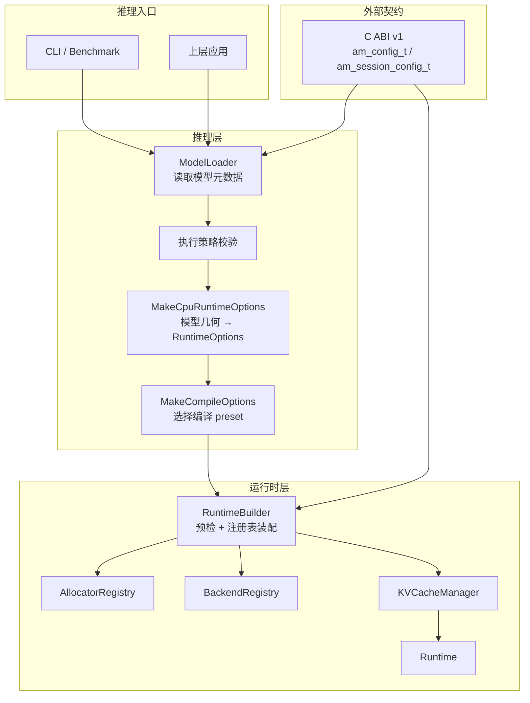
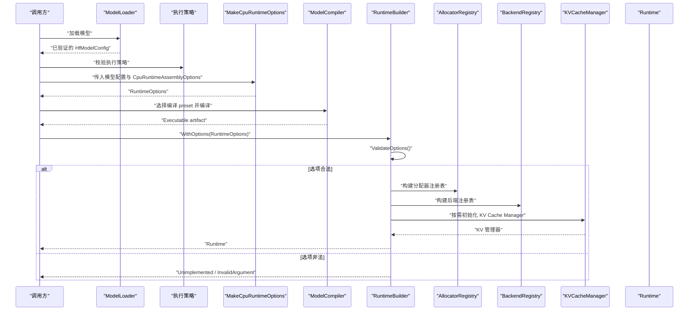
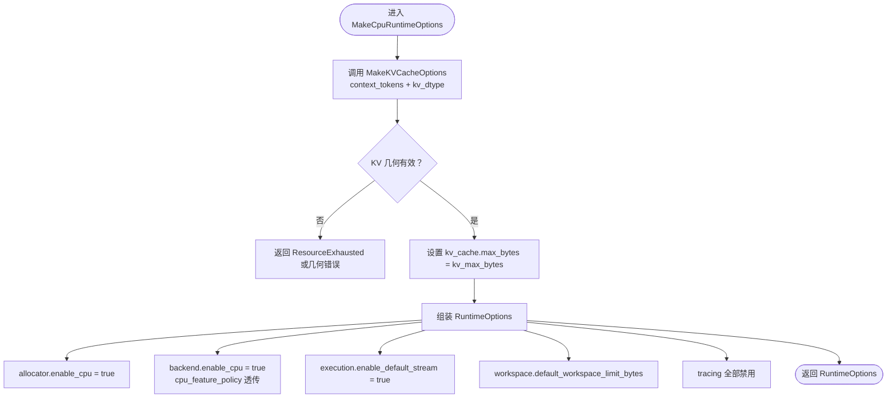
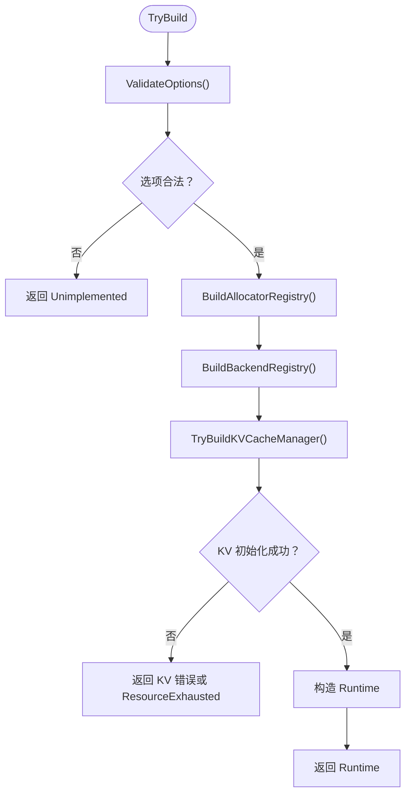
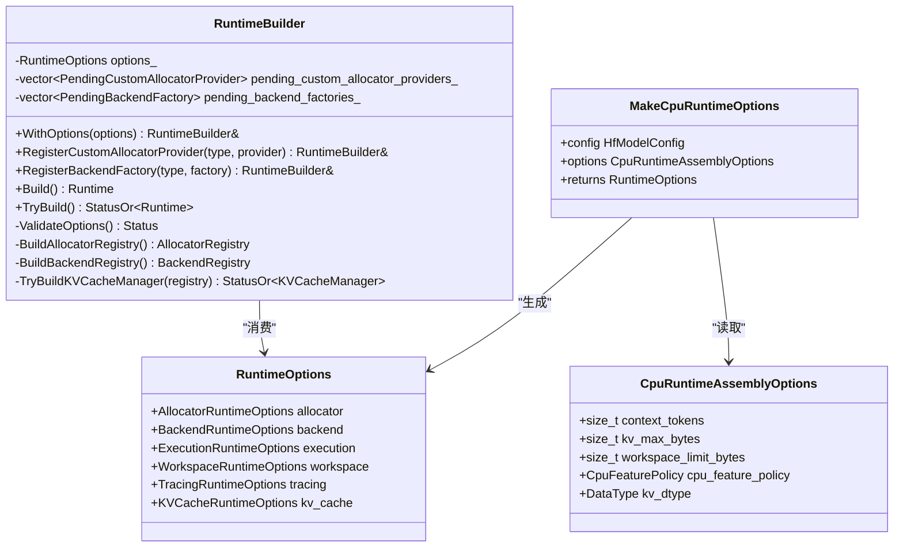

# 运行时配置管理

**本文引用的文件**
- [runtime_builder.h](../../../include/aethermind/runtime/runtime_builder.h)
- [runtime_options.h](../../../include/aethermind/runtime/runtime_options.h)
- [inference_options.h](../../../include/aethermind/inference/inference_options.h)
- [runtime_builder.cpp](../../../src/runtime/runtime_builder.cpp)
- [inference_options.cpp](../../../src/inference/inference_options.cpp)
- [runtime-c-abi.md](../../api/runtime-c-abi.md)
- [runtime-configuration.md](../../guides/runtime-configuration.md)
- [test_runtime_builder.cpp](../../../tests/unit/runtime/test_runtime_builder.cpp)

## 目录
1. [引言](#引言)
2. [项目结构](#项目结构)
3. [核心组件](#核心组件)
4. [架构总览](#架构总览)
5. [详细组件分析](#详细组件分析)
6. [依赖关系分析](#依赖关系分析)
7. [性能与容量调优](#性能与容量调优)
8. [故障诊断指南](#故障诊断指南)
9. [结论](#结论)
10. [附录：完整标准流程](#附录完整标准流程)

## 引言
本文面向 AetherMind 的 CPU 推理运行时，系统化说明运行时配置的管理方式。重点包括：
- `RuntimeBuilder`、`RuntimeOptions`、`CpuRuntimeAssemblyOptions` 的职责、字段含义与生命周期。
- `MakeCpuRuntimeOptions` 如何将模型几何映射到 CPU Runtime 配置，以及各预算参数的语义。
- Builder 的预检机制、选项验证流程、错误处理与重试语义。
- C ABI 边界限制与兼容性要求。
- 常见配置错误的诊断方法与性能调优建议。

## 项目结构
运行时配置涉及两个层次：
- **inference 层**：根据已加载模型的元数据，生成不依赖具体权重或运行时的 `RuntimeOptions`。
- **runtime 层**：根据 `RuntimeOptions` 构建分配器注册表、后端注册表与 KV Cache Manager。

**图表来源**
- [runtime-configuration.md](../../guides/runtime-configuration.md)
- [runtime_builder.h:1-112](../../../include/aethermind/runtime/runtime_builder.h#L1-L112)
- [inference_options.h:1-61](../../../include/aethermind/inference/inference_options.h#L1-L61)

**章节来源**
- [runtime-configuration.md](../../guides/runtime-configuration.md)
- [runtime_builder.h:1-112](../../../include/aethermind/runtime/runtime_builder.h#L1-L112)
- [inference_options.h:1-61](../../../include/aethermind/inference/inference_options.h#L1-L61)

## 核心组件

### `RuntimeOptions`：运行时装配值对象
`RuntimeOptions` 是运行时层的资源装配值对象，本身不持有运行时实例，也不直接依赖模型权重。它按功能分组组织：

| 分组 | 关键字段 | 当前行为与约束 |
|---|---|---|
| `allocator` | `enable_cpu`、`enable_cuda`、`enable_cann` | 决定默认分配器是否启用；CPU 默认开启，GPU/CANN 默认关闭且需自定义工厂。 |
| `backend` | `enable_cpu`、`enable_cuda`、`enable_cann`、`cpu_feature_policy` | CPU backend 由内置工厂创建；CUDA/CANN 必须提供自定义 `BackendFactory`。 |
| `execution` | `enable_default_stream`、`enable_graph_executor` | 仅兼容默认流；图执行器当前未实现。 |
| `workspace` | `enable_workspace_manager`、`default_workspace_limit_bytes` | 工作区管理器未装配；单请求 workspace payload 上限仍生效。 |
| `tracing` | `enable_profiling`、`enable_memory_profiling` | 首版均被拒绝。 |
| `kv_cache` | `enable_manager`、`num_layers`、`num_kv_heads`、`max_tokens`、`head_dim`、`kv_dtype`、`alignment`、`max_bytes` | 控制 KV Cache Manager 是否初始化及 KV 平面容量。 |

**章节来源**
- [runtime_options.h:1-69](../../../include/aethermind/runtime/runtime_options.h#L1-L69)

### `CpuRuntimeAssemblyOptions`：模型到 Runtime 的配置输入
`CpuRuntimeAssemblyOptions` 是调用方在模型加载后、Runtime 构建前设置的运行前输入，用于将模型几何映射到 CPU Runtime 配置：

| 字段 | 含义 | 约束 |
|---|---|---|
| `context_tokens` | 物理 KV 容量，即最大可容纳的 token 数 | 必填，须为正且不超过模型上下文上限。 |
| `kv_max_bytes` | K/V 两个平面的可见 payload 上限 | 0 表示无限制。 |
| `workspace_limit_bytes` | 单请求 workspace payload 上限 | 0 表示无限制。 |
| `cpu_feature_policy` | CPU kernel 选择的 required/disabled feature policy | 由底层 CPU backend 能力检查使用。 |
| `kv_dtype` | KV storage element dtype | 默认 FP32；首版要求与编译后的 state dtype 一致。 |

该结构体由 inference 层暴露给应用入口，避免调用方直接操作 `RuntimeOptions` 的复杂分组。

**章节来源**
- [inference_options.h:24-61](../../../include/aethermind/inference/inference_options.h#L24-L61)
- [runtime-configuration.md](../../guides/runtime-configuration.md)

### `RuntimeBuilder`：运行时装配器
`RuntimeBuilder` 负责从 `RuntimeOptions` 和可选自定义 provider/factory 装配出 `Runtime`。其职责包括：
- 保存并替换后续构建使用的选项。
- 注册自定义分配器 provider 与后端 factory。
- 预检选项合法性。
- 构建 `AllocatorRegistry` 与 `BackendRegistry`。
- 按需初始化 `KVCacheManager`。
- 提供 `Build()` 与 `TryBuild()` 两种构建方式。

**章节来源**
- [runtime_builder.h:12-112](../../../include/aethermind/runtime/runtime_builder.h#L12-L112)

## 架构总览
从模型加载到 Runtime 构建的标准流程如下：

**图表来源**
- [runtime-configuration.md](../../guides/runtime-configuration.md)
- [inference_options.cpp:18-57](../../../src/inference/inference_options.cpp#L18-L57)
- [runtime_builder.cpp:12-74](../../../src/runtime/runtime_builder.cpp#L12-L74)

**章节来源**
- [runtime-configuration.md](../../guides/runtime-configuration.md)
- [runtime_builder.cpp:12-74](../../../src/runtime/runtime_builder.cpp#L12-L74)

## 详细组件分析

### `MakeCpuRuntimeOptions`：模型几何到 CPU Runtime 配置映射
`MakeCpuRuntimeOptions` 是 CPU Runtime 配置的唯一映射入口。它接收已验证的 `HfModelConfig` 与 `CpuRuntimeAssemblyOptions`，返回完整的 `RuntimeOptions`。

#### 映射规则
1. **KV Cache 几何**：通过 `MakeKVCacheOptions` 将 `context_tokens` 与 `kv_dtype` 转换为 `KVCacheRuntimeOptions`。
2. **KV payload 上限**：将 `kv_max_bytes` 写入 `kv_cache.max_bytes`。
3. **分配器后端**：固定启用 CPU 分配器与 CPU backend，禁用 CUDA/CANN。
4. **执行策略**：固定启用默认流，禁用图执行器。
5. **工作区策略**：禁用 workspace manager，但设置 `default_workspace_limit_bytes`。
6. **追踪策略**：禁用 profiling 与 memory profiling。
7. **CPU 特性策略**：透传 `cpu_feature_policy`。

**图表来源**
- [inference_options.cpp:18-57](../../../src/inference/inference_options.cpp#L18-L57)
- [runtime_options.h:1-69](../../../include/aethermind/runtime/runtime_options.h#L1-L69)

#### 关键参数语义
- `context_tokens`：影响 `kv_cache.num_layers`、`kv_cache.num_kv_heads`、`kv_cache.max_tokens`、`kv_cache.head_dim`、`kv_cache.kv_dtype`。
- `kv_max_bytes`：KV Cache 物理平面 payload 上限，由 `RuntimeBuilder` 结合布局规划结果进行最终校验。
- `workspace_limit_bytes`：单请求 workspace payload 上限，零值表示无限制。
- `cpu_feature_policy`：CPU kernel 选择时使用的 required/disabled 特性策略，实际能力检查发生在后端创建阶段。

**章节来源**
- [inference_options.h:24-61](../../../include/aethermind/inference/inference_options.h#L24-L61)
- [inference_options.cpp:18-57](../../../src/inference/inference_options.cpp#L18-L57)
- [runtime_options.h:1-69](../../../include/aethermind/runtime/runtime_options.h#L1-L69)

### `RuntimeBuilder`：预检、验证与错误处理

#### 预检机制
`ValidateOptions` 在 registry 组装之前执行，主要检查：
- `execution.enable_default_stream` 必须为 true。
- `execution.enable_graph_executor` 当前不支持。
- `workspace.enable_workspace_manager` 当前不支持。
- `tracing.enable_profiling` 与 `tracing.enable_memory_profiling` 当前不支持。
- `backend.enable_cuda` 必须配合自定义 CUDA `BackendFactory`。
- `backend.enable_cann` 必须配合自定义 CANN `BackendFactory`。

这些检查失败会返回 `Unimplemented`，而不是创建任何运行时资源。

#### 选项验证与资源分配流程

**图表来源**
- [runtime_builder.cpp:12-74](../../../src/runtime/runtime_builder.cpp#L12-L74)
- [runtime_builder.cpp:76-138](../../../src/runtime/runtime_builder.cpp#L76-L138)

#### KV Cache 初始化逻辑
当 `kv_cache.enable_manager` 为 true 时：
1. 调用 `PlanKVCacheLayout` 计算 KV layout。
2. 计算 `required_bytes`。
3. 如果设置了 `max_bytes` 且 `required_bytes > max_bytes`，返回 `ResourceExhausted`。
4. 从 allocator registry 获取 CPU 分配器。
5. 调用 `KVCacheManager::Init` 完成初始化。

**章节来源**
- [runtime_builder.cpp:12-74](../../../src/runtime/runtime_builder.cpp#L12-L74)
- [runtime_builder.cpp:76-138](../../../src/runtime/runtime_builder.cpp#L76-L138)
- [runtime_builder.cpp:140-204](../../../src/runtime/runtime_builder.cpp#L140-L204)

#### 自定义 Provider 与 Factory 的生命周期
- `RegisterCustomAllocatorProvider` 与 `RegisterBackendFactory` 会将 pending 条目暂存。
- `BuildAllocatorRegistry` 与 `BuildBackendRegistry` 在转移条目前会先 pop，以避免异常导致 pending 列表残留 moved-from 条目。
- 一旦开始 registry 组装，失败的步骤可能丢弃已部分构建的 registry；已转移到丢弃 registry 的 registration 不可恢复。
- `TryBuild` 成功后，pending registrations 被消费；再次调用 `TryBuild` 只会使用当前选项及之后新增的 registrations。

**章节来源**
- [runtime_builder.h:34-112](../../../include/aethermind/runtime/runtime_builder.h#L34-L112)
- [runtime_builder.cpp:76-138](../../../src/runtime/runtime_builder.cpp#L76-L138)

### C ABI 边界与兼容性
C ABI v1 与 C++ Runtime 配置之间存在明确边界：

| 维度 | 要求 |
|---|---|
| 生命周期 | 先 `am_runtime_create`，再 `am_model_load`，再 `am_session_create`。 |
| 配置来源 | C ABI config 显式提供 KV geometry；不能等待模型 metadata 后再创建 Runtime。 |
| 类型安全 | 不暴露 C++ 布局、STL、exception 或 `TensorView`。 |
| 版本控制 | `AM_ABI_VERSION` 固定；major 破坏性变更使用 `_v2` 接口。 |
| 一致性校验 | 模型加载后校验 Runtime/model KV 一致性，不一致则拒绝发布 model handle。 |
| 线程模型 | 共享 Runtime 的 load/create/generate/destroy 由宿主串行化。 |

C ABI 的 CPU 默认值来自 `RuntimeOptions{}`，没有复制 CLI/benchmark 的模型感知映射；因此 C 调用方必须显式提供合理的 `num_layers`、`num_kv_heads`、`head_dim`、`max_tokens`、`kv_dtype`、`cpu_preset`。

**章节来源**
- [runtime-c-abi.md](../../api/runtime-c-abi.md)
- [runtime-configuration.md](../../guides/runtime-configuration.md)

### 测试覆盖的关键行为
单元测试覆盖了以下行为：
- KV cache 启用时初始化 `KVCacheManager`。
- KV cache 禁用时 manager 为空。
- 无效 KV geometry 返回错误而非 abort。
- 无效 KV alignment 返回错误。
- 失败后 pending registrations 被消费，重试可用。
- `Build()` 与 `TryBuild()` 成功路径等价。
- OOM 注入下 allocator/provider 转移语义正确。

**章节来源**
- [test_runtime_builder.cpp:1-200](../../../tests/unit/runtime/test_runtime_builder.cpp#L1-L200)

## 依赖关系分析

**图表来源**
- [runtime_options.h:1-69](../../../include/aethermind/runtime/runtime_options.h#L1-L69)
- [inference_options.h:24-61](../../../include/aethermind/inference/inference_options.h#L24-L61)
- [runtime_builder.h:12-112](../../../include/aethermind/runtime/runtime_builder.h#L12-L112)
- [inference_options.cpp:18-57](../../../src/inference/inference_options.cpp#L18-L57)

**章节来源**
- [runtime_options.h:1-69](../../../include/aethermind/runtime/runtime_options.h#L1-L69)
- [inference_options.h:24-61](../../../include/aethermind/inference/inference_options.h#L24-L61)
- [runtime_builder.h:12-112](../../../include/aethermind/runtime/runtime_builder.h#L12-L112)
- [inference_options.cpp:18-57](../../../src/inference/inference_options.cpp#L18-L57)

## 性能与容量调优

### 容量参数调优建议
| 参数 | 调优方向 | 风险 |
|---|---|---|
| `context_tokens` | 增大可提升长 prompt 与多轮对话能力，但线性增加 KV 存储。 | 超出系统内存或触发 `ResourceExhausted`。 |
| `kv_max_bytes` | 限制 KV plane payload，防止单个模型占用过多内存。 | 过小会提前拒绝有效 KV 布局。 |
| `workspace_limit_bytes` | 限制单次请求 workspace 峰值，保护批内其他请求。 | 过小可能导致算子 workspace 不足。 |
| `cpu_feature_policy` | 根据目标 CPU ISA 调整 required/disabled 特性。 | 过于严格会导致无法选择高性能 kernel。 |

### 运行时策略建议
- 保持 `execution.enable_default_stream = true`，避免当前不支持的执行策略。
- 不启用 `workspace.enable_workspace_manager`，因为当前未装配 workspace manager。
- 不启用 tracing profiling，除非未来实现支持。
- 如需 CUDA/CANN，必须先注册对应 `BackendFactory`。
- 优先使用 `TryBuild()` 以便捕获可恢复错误，仅在不可恢复场景使用 `Build()`。

### 复杂度与分配特征
- `MakeCpuRuntimeOptions` 只读取模型元数据，不分配权重 buffer。
- `RuntimeBuilder` 在 registry 构建与 KV 初始化时分配内存。
- OOM 路径统一映射为 `ResourceExhausted`，消息为空以避免二次分配。
- KV 布局规划在构建 KV manager 前完成，确保 `max_bytes` 比较基于最终布局。

**章节来源**
- [runtime_builder.cpp:12-74](../../../src/runtime/runtime_builder.cpp#L12-L74)
- [runtime_builder.cpp:140-204](../../../src/runtime/runtime_builder.cpp#L140-L204)
- [runtime-configuration.md](../../guides/runtime-configuration.md)

## 故障诊断指南

### 常见错误与定位方法

| 现象 | 可能原因 | 诊断建议 |
|---|---|---|
| `Unimplemented: execution.enable_default_stream=false` | 启用了非默认执行流。 | 保持默认流或移除该选项。 |
| `Unimplemented: execution.enable_graph_executor` | 启用了图执行器。 | 当前不支持，禁用该选项。 |
| `Unimplemented: workspace.enable_workspace_manager` | 启用了 workspace manager。 | 当前未装配，使用该字段会报错。 |
| `Unimplemented: tracing.*` | 启用了 profiling。 | 首版不支持，禁用 tracing。 |
| `Unimplemented: backend.enable_cuda/cann without custom factory` | 启用了 GPU/CANN backend 但未注册 factory。 | 注册对应 `BackendFactory` 或禁用 backend。 |
| `ResourceExhausted: KV cache payload exceeds limit` | KV 布局所需字节超过 `kv_max_bytes`。 | 增大 `kv_max_bytes` 或减小 `context_tokens`。 |
| `InvalidArgument: invalid KV geometry/alignment` | `head_dim=0`、`alignment=0` 等非法几何。 | 检查 `context_tokens`、`head_dim`、`alignment`。 |
| C ABI 创建失败 | `struct_size`、`abi_version`、KV geometry 不匹配。 | 对照 `am_config_t` 合同逐项检查。 |

### 重试与状态保留
- `TryBuild` 的选项预检失败不会消费 pending registrations。
- 一旦 registry 组装开始，失败的步骤可能丢弃已部分构建的 registry。
- 已转移到丢弃 registry 的 registration 不可恢复；重试时不应期望旧 registration 回到 builder。
- `Build()` 内部包装 `TryBuild()`，失败时通过断言终止；需要可恢复错误时使用 `TryBuild()`。

**章节来源**
- [runtime_builder.cpp:12-74](../../../src/runtime/runtime_builder.cpp#L12-L74)
- [runtime_builder.cpp:76-138](../../../src/runtime/runtime_builder.cpp#L76-L138)
- [runtime_builder.h:52-112](../../../include/aethermind/runtime/runtime_builder.h#L52-L112)
- [test_runtime_builder.cpp:1-200](../../../tests/unit/runtime/test_runtime_builder.cpp#L1-L200)

## 结论
AetherMind 的运行时配置采用“推理层映射 + 运行时层装配”的分层设计：
- `CpuRuntimeAssemblyOptions` 表达调用方的容量与特性意图。
- `MakeCpuRuntimeOptions` 将模型几何与安全默认值合并为 `RuntimeOptions`。
- `RuntimeBuilder` 负责预检、registry 装配与 KV 初始化，并提供可恢复的错误语义。
- C ABI v1 通过固定结构体与严格生命周期保证跨语言兼容性，但要求调用方显式提供 KV geometry。

在实际工程中，应优先使用 `TryBuild()`、合理设置 `context_tokens`、`kv_max_bytes` 与 `workspace_limit_bytes`，并根据目标 CPU 设置 `cpu_feature_policy`。

## 附录：完整标准流程

下面给出从模型加载到 Runtime 构建的标准流程说明。为避免直接粘贴代码，本文以结构化步骤描述，并可参考源码路径。

### 标准步骤
1. 使用 `ModelLoader::Load` 加载模型。
2. 校验权重执行策略，例如要求 FP32。
3. 构造 `CpuRuntimeAssemblyOptions`：
   - 设置 `context_tokens`。
   - 设置 `kv_max_bytes`。
   - 设置 `workspace_limit_bytes`。
   - 设置 `cpu_feature_policy`。
   - 如需要，设置 `kv_dtype`。
4. 调用 `MakeCpuRuntimeOptions` 得到 `RuntimeOptions`。
5. 调用 `MakeCompileOptions` 选择 `CompilePreset` 与 `DeviceType::kCPU`。
6. 调用 `ModelCompiler::Compile` 生成 artifact。
7. 构造 `RuntimeBuilder` 并调用 `WithOptions`。
8. 调用 `TryBuild` 构建 `Runtime`。
9. 使用 `ExecutableModel::Prepare` 准备可执行模型。
10. 使用 `InferenceSession::Create` 创建会话。
11. 调用 `Generate` 执行推理。

### 参考路径
- 推理层映射与示例流程：[runtime-configuration.md](../../guides/runtime-configuration.md)
- CPU Runtime 配置映射实现：[inference_options.cpp:18-57](../../../src/inference/inference_options.cpp#L18-L57)
- Runtime 装配与 KV 初始化：[runtime_builder.cpp:12-204](../../../src/runtime/runtime_builder.cpp#L12-L204)
- C ABI 配置与生命周期：[runtime-c-abi.md](../../api/runtime-c-abi.md)

**章节来源**
- [runtime-configuration.md](../../guides/runtime-configuration.md)
- [inference_options.cpp:18-57](../../../src/inference/inference_options.cpp#L18-L57)
- [runtime_builder.cpp:12-204](../../../src/runtime/runtime_builder.cpp#L12-L204)
- [runtime-c-abi.md](../../api/runtime-c-abi.md)
