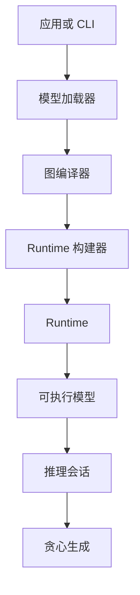
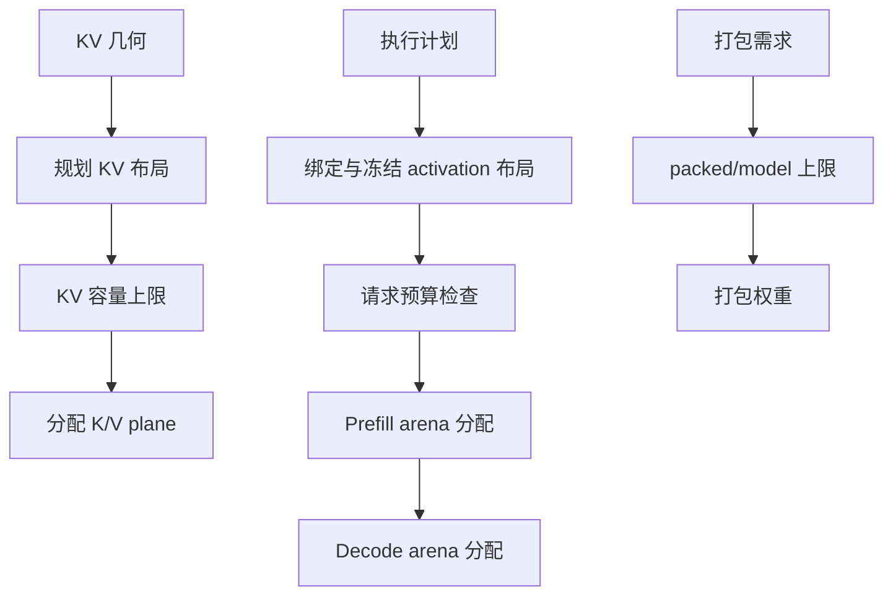
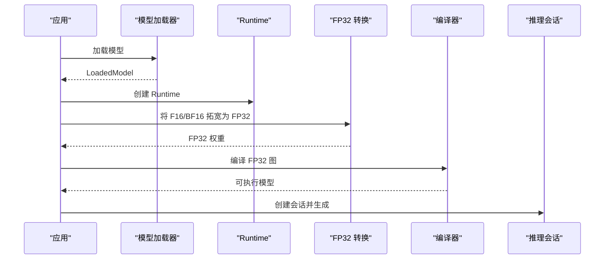
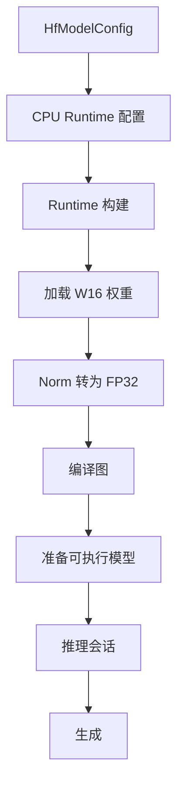
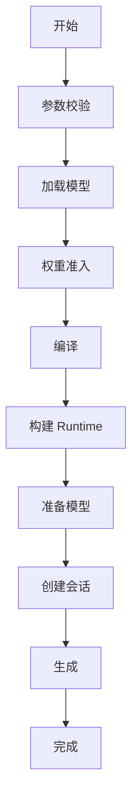
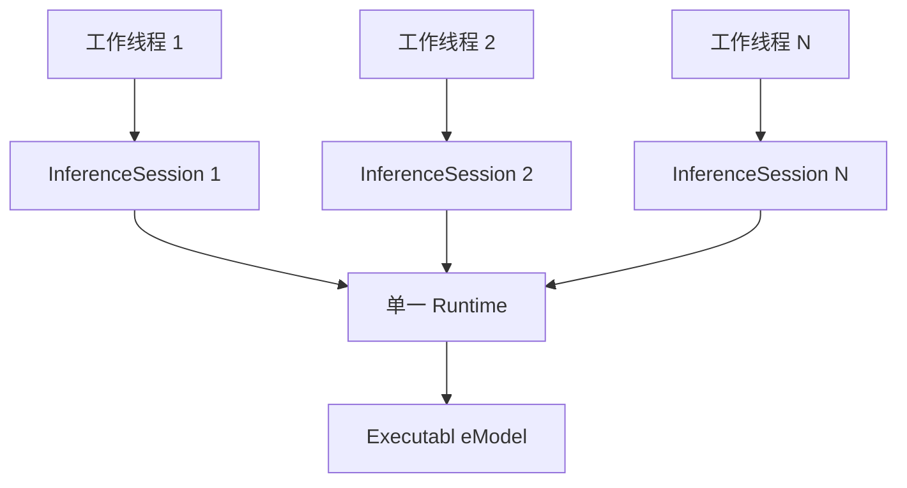

# 部署与运维

**本文引用的文件**
- [README.md](../../../README.md)
- [runtime-configuration.md](../../guides/runtime-configuration.md)
- [resource-budgeting.md](../../guides/resource-budgeting.md)
- [fp32-compatible-inference.md](../../guides/fp32-compatible-inference.md)
- [w16-fp32-inference.md](../../guides/w16-fp32-inference.md)
- [inference_options.h](../../../include/aethermind/inference/inference_options.h)
- [runtime_options.h](../../../include/aethermind/runtime/runtime_options.h)
- [resource_usage.h](../../../include/aethermind/inference/resource_usage.h)
- [env.h](../../../include/aethermind/base/env.h)
- [env.cpp](../../../src/base/env.cpp)
- [inference_session.h](../../../include/aethermind/inference/inference_session.h)
- [inference_runner.cpp](../../../apps/inference/inference_runner.cpp)
- [runtime-c-abi.md](../../api/runtime-c-abi.md)

## 目录
1. [引言](#引言)
2. [项目结构与运行入口](#项目结构与运行入口)
3. [生产环境资源配置建议](#生产环境资源配置建议)
4. [运行时参数调优](#运行时参数调优)
5. [资源预算控制](#资源预算控制)
6. [FP32 兼容推理配置](#fp32-兼容推理配置)
7. [W16 权重与 KV16 推理配置](#w16-权重与-kv16-推理配置)
8. [监控指标与日志](#监控指标与日志)
9. [故障诊断方法](#故障诊断方法)
10. [性能调优策略](#性能调优策略)
11. [并发处理最佳实践](#并发处理最佳实践)
12. [结论](#结论)

## 引言
AetherMind 是面向 Llama Dense 模型的桌面与服务端 CPU 推理运行时，提供同步、单请求的贪心生成、静态 KV 缓存和 Token IDs I/O。CLI 与 Runtime C ABI v1 使用 strict FP32。C++ 还提供 W16/A32、KV16 和 FP16/BF16 A16 等路径。支持组合、验证范围与产品边界见 [产品能力矩阵](../../product.md#14-当前能力与验证状态)。

从部署角度看，生产系统通常围绕以下阶段组织：加载模型 → 验证权重格式 → 编译图 → 构建 Runtime → 准备可执行模型 → 创建会话 → 执行生成。CLI 路径显式串联这些阶段，C ABI 则先创建 Runtime，再加载模型并校验 Runtime 与模型的一致性。

**章节来源**
- [README.md](../../../README.md)

## 项目结构与运行入口
AetherMind 的核心库位于 `include/aethermind/` 与对应实现 `src/`，应用入口在 `apps/inference/`，文档与测试分别位于 `docs/` 和 `tests/`。CLI 使用独立的 runner 装配模型加载器、编译器、Runtime 构建器、可执行模型和推理会话。

**图表来源**
- [README.md](../../../README.md)
- [inference_runner.cpp:25-120](../../../apps/inference/inference_runner.cpp#L25-L120)

### 关键运行阶段
| 阶段 | 职责 | 典型失败原因 |
|---|---|---|
| 模型加载 | 读取 HuggingFace config 与 safetensors | 路径无效、JSON/safetensors 损坏 |
| 权重准入 | 检查权重 dtype、角色和格式 | F16/BF16 未启用兼容模式、未知 dtype |
| 编译 | 生成优化后的计算图 | 未知 preset、非法目标设备 |
| Runtime 构建 | 分配 KV cache、初始化后端 | KV 几何不匹配、内存不足 |
| 模型准备 | 加载权重、打包、绑定执行状态 | packed weight 超限、布局不一致 |
| 会话创建 | 建立请求级上下文 | 缺少 KV manager、请求预算不合法 |
| 生成 | Prefill + Decode 迭代 | prompt 越界、context 不足、OOM |

**章节来源**
- [README.md](../../../README.md)
- [inference_runner.cpp:25-120](../../../apps/inference/inference_runner.cpp#L25-L120)

## 生产环境资源配置建议
生产部署应把资源划分为三层：Runtime 层、模型准备层、请求层。每层都有明确的 budget 含义，不能混用进程 RSS、allocator capacity 或全局内存配额。

### Runtime 层配置
通过 `CpuRuntimeAssemblyOptions` 集中设置 CPU Runtime 的运行前参数，再由 `MakeCpuRuntimeOptions` 映射到 `RuntimeOptions`。

| 配置项 | 推荐用途 | 默认行为 |
|---|---|---|
| `context_tokens` | 固定 KV 容量，必须为正且不超过模型 `max_position_embeddings` | 不允许为零 |
| `kv_max_bytes` | K/V 两个 plane 的可见 payload 上限 | 零表示无限制 |
| `workspace_limit_bytes` | 单请求 workspace payload 上限 | 零表示无限制 |
| `cpu_feature_policy` | 控制 CPU kernel 必需/禁用特性 | 空策略走后端能力探测 |
| `kv_dtype` | KV 存储元素类型，支持 FP32、FP16、BF16 | FP32 |

### 模型准备层配置
通过 `ModelLimits` 限制准备阶段的权重负载。

| 配置项 | 覆盖内容 |
|---|---|
| `max_model_payload_bytes` | 原始 backing、内联常量、packed payload 的上界 |
| `max_packed_weight_bytes` | 打包后权重的上界 |

### 请求层配置
通过 `InferenceSessionOptions::max_request_payload_bytes` 限制单次推理的请求级内存。

| 配置项 | 覆盖内容 |
|---|---|
| `max_request_payload_bytes` | workspace 加上 prefill/decode 中较大的 activation peak |

### 推荐配置流程
1. 根据模型最大 context 设置 `context_tokens`，避免过长 prompt 触发 capacity 错误。
2. 为 KV cache 设置保守的 `kv_max_bytes`，使多轮对话不会耗尽可用内存。
3. 为 workspace 设置 `workspace_limit_bytes`，限制中间算子临时空间。
4. 对首次上线的大模型，先不设置 packed/model payload 上限，观察 `ExecutableModel::resource_usage()` 后再收紧。
5. 对每个请求调用 `PlanResources`，用冷路径预测峰值，再决定是否拒绝或降级。

**章节来源**
- [inference_options.h:28-61](../../../include/aethermind/inference/inference_options.h#L28-L61)
- [runtime_options.h:12-69](../../../include/aethermind/runtime/runtime_options.h#L12-L69)
- [resource_budgeting.md](../../guides/resource-budgeting.md)
- [runtime-configuration.md](../../guides/runtime-configuration.md)

## 运行时参数调优
### 编译预设
| 预设 | 适用场景 | 特点 |
|---|---|---|
| `kO1Plain` | 兼容性优先、调试稳定 | 平铺权重，便于 FP32 兼容模式和 W16 reference fallback |
| `kO2Packed` | 吞吐优先 | 启用 packed weights，适合 QKV/GateUp 等 composite layout |

选择 preset 时不要只看吞吐量：O2/packed 可能带来更复杂的准备期和 packing 约束，而 O1/plain 更容易复用 reference kernel 做数值对齐。

### CPU 特性策略
`cpu_feature_policy` 用于控制 CPU kernel 选择。如果生产机器存在不同 CPU 型号，应在统一基线硬件上采集特征，并在部署配置中固定策略，避免运行时因 ISA 回退造成不可预期的延迟抖动。

### KV 精度调优
默认 KV 为 FP32。若显式启用 KV16（FP16 或 BF16），需要注意：
- KV 字节数由 padded layout 决定，小 head_dim 的两字节元素仍可能占用相同对齐行。
- K 在 RoPE 后 narrow，V 写 cache 时 narrow；Attention 读取时 widening 并用 FP32 计算。
- 同一 Runtime 的所有层共享同一个 scalar KV dtype。
- 实际内存收益不一定等于理论减半，需要结合具体 model 几何测量。

**章节来源**
- [inference_options.h:28-61](../../../include/aethermind/inference/inference_options.h#L28-L61)
- [w16-fp32-inference.md](../../guides/w16-fp32-inference.md)
- [runtime-configuration.md](../../guides/runtime-configuration.md)

## 资源预算控制
AetherMind 的资源预算不是进程级内存隔离机制，而是“分配前准入”的可控边界。其核心目标是让已知 payload 在分配前失败，而不是等到 OOM 才崩溃。

### 预算生命周期

**图表来源**
- [resource-budgeting.md](../../guides/resource-budgeting.md)

### 关键预算接口
| 阶段 | 接口 | 单位 | 零值语义 |
|---|---|---|---|
| Runtime 构造 | `KVCacheRuntimeOptions::max_bytes` | 字节 | 无限制 |
| 请求 | `WorkspaceRuntimeOptions::default_workspace_limit_bytes` | 字节 | 无限制 |
| 请求 | `InferenceSessionOptions::max_request_payload_bytes` | 字节 | 无限制 |
| 模型准备 | `ModelLimits::max_packed_weight_bytes` | 字节 | 无限制 |
| 模型准备 | `ModelLimits::max_model_payload_bytes` | 字节 | 无限制 |

### 预算观测
- `ExecutableModel::resource_usage()` 返回模型侧已管理 payload 的观察值，不包含 allocator overhead、RSS、外部映射页。
- `InferenceSession::PlanResources(prompt_len, config)` 返回 workspace、prefill/decode activation peak、KV reserved bytes 和模型 managed payload 的估算。
- 注意：`PlanResources` 是冷路径查询，不预约 KV、不分配 tensor Buffer；真正的 admission 发生在 `Generate`。

### 常见预算问题
| 现象 | 可能原因 | 处理建议 |
|---|---|---|
| `ResourceExhausted` | KV、workspace、activation 或 packed weight 超过 limit | 提高对应 budget 或降低 context/new tokens |
| `OutOfRange` | prompt 长度超过 KV capacity 或 token 超出词表 | 调整 `context_tokens` 或清洗 prompt |
| `FailedPrecondition` | 未知 retained backing 遇到有限 model payload cap | 放宽 `max_model_payload_bytes` 或改用已知 backing |
| `Unimplemented` | 不支持的 backend/tracing/workspace 选项或旧 backend 的 packing query | 使用当前支持的 CPU/F32 路径 |

**章节来源**
- [resource_budgeting.md](../../guides/resource-budgeting.md)
- [resource_usage.h:1-43](../../../include/aethermind/inference/resource_usage.h#L1-L43)
- [inference_session.h:23-114](../../../include/aethermind/inference/inference_session.h#L23-L114)

## FP32 兼容推理配置
FP32 兼容推理的目标是把已由 loader 接受的 F16/BF16 checkpoint 权重显式拓宽为 FP32，然后复用既有 FP32 执行链。这不是原生 F16/BF16 推理，也不保留 16-bit 权重参与后续计算。

### 适用场景
- 已有 HF checkpoint 是 F16 或 BF16，但希望继续使用经过验证的 FP32 activation/KV/logits 执行路径。
- 需要用同一 F16 或 BF16 checkpoint 建立 FP32 执行对照。
- 需要以转换过程作为质量门控，确保 graph activation、KV state 和最终 logits 均为 FP32。

### 配置方式
推荐使用 `WeightPolicy::kConvertToFp32` 配合 `CompilePreset::kO1Plain`。该策略要求 CPU 目标，非 CPU 目标会返回 `Unimplemented`。

**图表来源**
- [fp32-compatible-inference.md](../../guides/fp32-compatible-inference.md)

### 转换约束
- 每个必需、连续、标量的实际权重 view 必须是 F32、F16 或 BF16。
- 转换使用 Runtime 的 CPU allocator；Runtime 必须在转换前创建并保持稳定地址。
- F32 view 零拷贝并继续共享原 owner；相同的 reduced view 只转换一次。
- NaN 保持符号与有效载荷，并在 FP32 结果置 quiet bit。
- F16/BF16 批量转换可按后端有效特性选择 F16C 或 AVX2 整数实现，缺失特性时回退 scalar。

### 资源观察
- `ExecutableModel::resource_usage().weight_fp32_conversion` 提供 source/converted backing 分类、唯一转换源/目标字节，以及转换期间同时存活的可见峰值。
- `max_model_payload_bytes` 在转换 payload 分配前检查 retained FP32 owned bytes 加即将创建的 converted bytes。

**章节来源**
- [fp32-compatible-inference.md](../../guides/fp32-compatible-inference.md)
- [resource_usage.h:1-43](../../../include/aethermind/inference/resource_usage.h#L1-L43)

## W16 权重与 KV16 推理配置
在 W16/A32 配置下，Embedding、Linear 和 LM head 矩阵保留选定的 16-bit 格式，activation、residual、logits 使用 FP32。KV 默认为 FP32，也可以显式选择 KV16。配置步骤见 [W16/A32 与 KV16](../../guides/w16-fp32-inference.md)。

A16 通过 `ModelLoadOptions::activation_dtype` 选择。FP16 或 BF16 activation 要求同型的 retained-W16 策略和 KV。FP16 A16 的跨层 residual 保持 FP32。具体前置条件见 [C++ API](../../api/public-api.md#executablemodelincludeaethermindinferenceexecutable_modelh)。

### 权重策略
| 策略 | 行为 |
|---|---|
| `kKeepFp16WeightsFp32Activation` | 保留 F16 矩阵，activation 由 `activation_dtype` 控制 |
| `kKeepBf16WeightsFp32Activation` | 保留 BF16 矩阵，activation 由 `activation_dtype` 控制 |
| `kRequireFp32` | 要求 FP32 源权重 |
| `kConvertToFp32` | 将 F16/BF16 拓宽为 FP32 |

### KV16 配置要点
- FP32 activation 路径允许独立选取矩阵权重和 KV dtype。
- 同一 Runtime 的所有层 K/V 使用同一个 scalar dtype。
- K 在 RoPE 后 narrow，V 写 cache 时 narrow；Attention 读取时 widening 并以 FP32 计算。
- 物理 KV 字节由 padded layout 决定，不能假设两字节元素一定减半内存。

**图表来源**
- [w16-fp32-inference.md](../../guides/w16-fp32-inference.md)

### 数值与 Kernel
- Embedding 按 token 读取一行 W16 bytes，reference kernel 可在全部 CPU feature 禁用时运行。
- Linear/LM head 的 reference 支持预验证 stride，累加按升序执行 FP32 product 与 FP32 add。
- optimized path 复用共享 GEMM driver，reference 作为兼容 fallback/oracle。
- 数值验收以同 reduced checkpoint 的 FP32 compatibility 为对照，tiny fixture 使用绝对误差阈值和 argmax margin 规则。

**章节来源**
- [w16-fp32-inference.md](../../guides/w16-fp32-inference.md)

## 监控指标与日志
### 内置环境变量
AetherMind 在初始化过程中注册一些底层环境变量：
- `THP_MEM_ALLOC_ENABLE=1`
- `TRACEBACK_LIMIT=512`

这些变量由内部 `RegisterEnvs` 在启动期设置，不应依赖它们作为完整运行时监控接口。

### 资源指标
| 指标 | 来源 | 说明 |
|---|---|---|
| 模型 managed payload | `ExecutableModel::resource_usage()` | raw backing + inline constants + unique packed storage |
| 转换转换峰值 | `ExecutableModel::resource_usage().weight_fp32_conversion` | FP32 兼容模式下的转换期间可见峰值 |
| 请求 workspace | `InferenceSession::PlanResources()` | 当前 prompt 和 generation 配置的 workspace 估计 |
| activation peak | `RequestResourceUsage::peak_payload_bytes` | prefill/decode 中较大者，不叠加 |
| KV reserved bytes | `RequestResourceUsage::kv_reserved_bytes` | 物理 KV reservation，与 committed-token watermark 无关 |

### 日志系统
项目依赖 spdlog v1.17.0 作为日志实现。当前公开部署文档主要聚焦资源、配置和执行流；日志级别、sink 和输出格式属于宿主进程集成层面，AetherMind 本身没有暴露统一的日志配置 API。生产环境建议：
- 在应用层统一接入 spdlog sink。
- 将 AetherMind 的错误码、阶段信息和资源估算写入结构化日志。
- 对 OOM、OutOfRange、InvalidArgument 等关键错误单独打标。

**章节来源**
- [env.cpp:1-55](../../../src/base/env.cpp#L1-L55)
- [README.md](../../../README.md)
- [resource_usage.h:1-43](../../../include/aethermind/inference/resource_usage.h#L1-L43)

## 故障诊断方法
### 定位阶段
CLI runner 维护 `RunStage`，帮助判断失败发生在参数校验、模型加载、权重准入、编译、Runtime 构建、准备、会话创建还是生成阶段。

**图表来源**
- [inference_runner.cpp:25-120](../../../apps/inference/inference_runner.cpp#L25-L120)

### 常见错误与排查
| 错误类型 | 典型位置 | 排查步骤 |
|---|---|---|
| `InvalidArgument` | 模型目录为空、prompt 为空、preset 未知、EOS token 越界 | 检查 CLI 参数、model_dir、vocab_size、eos_token_id |
| `OutOfRange` | prompt token 超出词表、context 超出模型最大位置、buffer 过短 | 检查 prompt 是否被截断或重复编码，确认 `context_tokens` |
| `ResourceExhausted` | 权重转换、KV、workspace、activation、packed weight 分配失败 | 查看 `PlanResources` 和 `resource_usage()`，逐步放宽 budget |
| `Unimplemented` | 非 CPU 目标、不支持的 tracing/workspace/backend 选项 | 退回 CPU/F32 路径，关闭未支持选项 |
| `FailedPrecondition` | KV manager 不存在、unknown retained backing 遇有限 cap | 确保 Runtime 已创建 KV manager，放宽 model payload cap |

### C ABI 特殊注意事项
C ABI v1 的生命周期是 `am_runtime_create` → `am_model_load` → `am_session_create` → `am_session_generate`。因此：
- Runtime 必须在模型加载前创建。
- KV geometry 必须由调用方提供，不能等待模型 metadata 后再构造 Runtime。
- 所有共享 Runtime 的 load/create/generate/destroy 必须由宿主串行化。
- `std::bad_alloc` 映射为 ResourceExhausted，其他未识别异常映射为 Internal。

**章节来源**
- [inference_runner.cpp:25-120](../../../apps/inference/inference_runner.cpp#L25-L120)
- [runtime-c-abi.md](../../api/runtime-c-abi.md)

## 性能调优策略
### 选择合适 preset
- 首次上线或回归验证优先使用 `kO1Plain`，便于复现 reference kernel 数值。
- 稳定后评估 `kO2Packed`，关注 prepare 时间、packed weight 大小和 decode 吞吐变化。

### 控制预热与准备成本
- FP32 兼容模式会在准备阶段产生额外转换开销，不适合每次请求都重新加载模型。
- W16 模式的 Norm-only FP32 转换和 packed identity artifacts 也会增加准备成本。
- 建议加载一次模型，复用 Runtime 和 ExecutableModel，仅创建新的 InferenceSession。

### 减少内存碎片
- 使用固定 `context_tokens` 避免频繁重建 KV。
- 合理设置 `kv_max_bytes`，防止长上下文会话撑满 KV。
- 避免在同一进程中无限创建大量短期 session；必要时重启 worker。

### 利用 CPU 特性
- 在稳定硬件上固定 `cpu_feature_policy`，避免运行时 ISA 回退。
- 对 embedding、linear、attention 等热点路径，参考各 operator benchmark 文档，但不把 tiny fixture 性能直接外推到大模型。

### 预算先行
- 先用 `PlanResources` 获取冷路径估算，再决定是否接受请求。
- 对 OOM 高频场景，区分 KV 不足、workspace 不足和 activation peak 不足，分别调整对应 budget。

**章节来源**
- [README.md](../../../README.md)
- [fp32-compatible-inference.md](../../guides/fp32-compatible-inference.md)
- [w16-fp32-inference.md](../../guides/w16-fp32-inference.md)
- [resource_budgeting.md](../../guides/resource-budgeting.md)

## 并发处理最佳实践
### 当前并发边界
- `InferenceSession` 是同步、单请求对象。
- 多个共享 Runtime 的 load/create/generate/destroy 必须由宿主串行化。
- 不同 session 之间不能共享 Runtime 来并发执行。
- 当前交付不包含 PagedAttention、continuous batching、异步 streaming、调度或 GPU offload。

### 推荐并发模型

虽然多个 session 可以共享同一个 Runtime 对象，但访问必须串行化。更稳妥的做法是：
- 每个工作线程持有独立 Runtime。
- 每个请求创建独立 InferenceSession。
- 使用有界线程池限制并发度，避免过多 session 同时竞争 CPU 和内存。
- 通过进程级隔离（worker 进程）承载高价值模型，避免跨进程共享内存不确定性。

### 资源隔离建议
| 层级 | 建议 |
|---|---|
| 进程 | 使用容器或 cgroup 限制总内存和 CPU |
| Runtime | 每个模型一个 Runtime，固定 KV capacity |
| Session | 每个请求一个 session，短生命周期 |
| Budget | 明确设置 KV、workspace、request payload 上限 |
| 队列 | 上游限流，防止突发 prompt 压垮准备期 |

**章节来源**
- [inference_session.h:23-114](../../../include/aethermind/inference/inference_session.h#L23-L114)
- [runtime-c-abi.md](../../api/runtime-c-abi.md)

## 结论
AetherMind 的生产部署应以“分阶段预算 + 固定 Runtime + 串行推理”为核心原则。FP32 兼容推理适合从 F16/BF16 checkpoint 迁移到稳定 FP32 执行链的场景；W16 权重推理适合希望减少权重驻留内存但仍保持 FP32 activation 的场景。KV16 能降低 KV 存储的理论占用，但不能简单等同于整体内存减半。

在生产环境中，应优先：
1. 固定 CPU 硬件和 `cpu_feature_policy`。
2. 使用 `CpuRuntimeAssemblyOptions` 和 `RuntimeOptions` 明确 KV、workspace 和 backend 配置。
3. 使用 `ModelLimits` 限制准备期权重负载。
4. 使用 `InferenceSessionOptions` 和 `PlanResources` 控制请求级峰值。
5. 将 OOM、OutOfRange、InvalidArgument、Unimplemented 等错误纳入监控和告警。
6. 串行化共享 Runtime 的推理访问，并通过线程池或进程池控制并发度。
7. 在 release 版本中持续对比 FP32 兼容、W16 和 KV16 配置下的延迟、吞吐与内存曲线。
