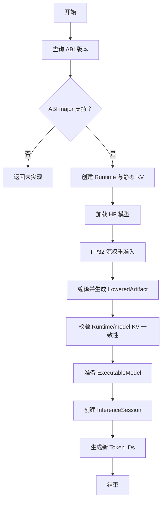

# 附录

**本文引用的文件**
- [README.md](../../README.md)
- [AGENTS.md](../../AGENTS.md)
- [CMakeLists.txt](../../CMakeLists.txt)
- [cmake/AetherMindBuildChecks.cmake](../../cmake/AetherMindBuildChecks.cmake)
- [include/c_api.h](../../include/c_api.h)
- [include/aethermind/base/status.h](../../include/aethermind/base/status.h)
- [include/aethermind/memory/allocator.h](../../include/aethermind/memory/allocator.h)
- [include/aethermind/base/alignment.h](../../include/aethermind/base/alignment.h)
- [include/aethermind/base/workspace_types.h](../../include/aethermind/base/workspace_types.h)
- [include/aethermind/execution/executor.h](../../include/aethermind/execution/executor.h)
- [include/aethermind/execution/kernel_invoker.h](../../include/aethermind/execution/kernel_invoker.h)
- [include/aethermind/kv_cache/kv_cache_session_view.h](../../include/aethermind/kv_cache/kv_cache_session_view.h)
- [docs/api/public-api.md](../api/public-api.md)
- [docs/api/runtime-c-abi.md](../api/runtime-c-abi.md)
- [docs/api/doxygen_baseline.txt](../api/doxygen_baseline.txt)
- [docs/issues.md](../issues.md)
- [项目路线图](../roadmap/README.md)
- [tools/check_docs_links.py](../../tools/check_docs_links.py)

## 目录
1. [引言](#引言)
2. [常见问题解答](#常见问题解答)
3. [错误码参考](#错误码参考)
4. [已知问题列表](#已知问题列表)
5. [项目路线图与版本规划](#项目路线图与版本规划)
6. [社区贡献指南](#社区贡献指南)
7. [Doxygen 文档生成配置](#doxygen-文档生成配置)
8. [API 变更记录](#api-变更记录)
9. [兼容性矩阵](#兼容性矩阵)
10. [相关技术参考资料](#相关技术参考资料)
11. [故障排查指南](#故障排查指南)
12. [结论](#结论)

## 引言
本附录面向 AetherMind 的维护者、集成者和外部 C/C++ 调用方，汇总项目当前状态下的常见问题、错误码、已知缺陷、演进路线、贡献方式、文档构建方法、API 变更历史、兼容性边界及学习资源。AetherMind 目前是一个面向 Llama Dense 模型的桌面/服务器 CPU 推理引擎，提供 C++20 API、可选 CLI 和冻结的 v1 Runtime C ABI；GPU、服务化与分布式能力属于长期方向，不是当前交付承诺。

## 常见问题解答

### 运行时与模型加载
- **为什么 `am_model_load` 会失败但不创建 model handle？**
  该入口执行 HF 模型读取、FP32 源权重准入、编译、Runtime/model KV 一致性检查与 `ExecutableModel::Prepare`。任一阶段失败都不会发布部分模型句柄，但已创建的 Runtime/KV 不会因此回滚。

- **为什么 `am_runtime_create` 已经分配 KV，但非法模型仍不释放它？**
  C ABI 首版在模型加载前创建并分配静态 KV。若模型校验失败，adapter 清理本次临时对象，但不会销毁已存在的 Runtime/KV，因为 KV 可能已被其他模型或会话共享。

- **为什么不能通过修改 `am_config_t` 的 `struct_size` 向后追加字段？**
  v1 合同明确固定 `am_config_t` 为 48 字节、`am_session_config_t` 为 24 字节。新增能力应使用新命名的结构体或函数，而不是破坏既有 offset。

- **为什么 `am_session_generate` 返回短缓冲上界时没有生成 token？**
  当 `max_new_tokens > output_capacity` 时，接口只写 `output_len = N` 作为安全容量上界，不调用底层 Generate、不预约 KV、不验证 prompt/EOS 语义。这是为了避免重复执行 EOS 依赖的执行路径。

- **为什么 `N=0` 仍可报错？**
  `N=0` 是合法生成配置，但仍会校验 prompt 非空、token 在词表内、prompt 长度满足模型 context。这些语义校验成功后才返回实际长度为 0。

### C++ API 与所有权
- **`InferenceSession::Generate` 返回什么？**
  同步 greedy 生成，返回拥有的新 Token IDs 向量，包含 Prefill 预测的第一个 token 以及生成的 EOS，不包含 prompt。每次调用都会重新 Prefill，并在成功或失败返回前释放 KV reservation。

- **为什么共享 Runtime 的 `Generate` 必须串行？**
  当前接口不承诺并发 Session。共享 Runtime 的所有 load/create/generate/destroy 都由宿主串行化；共享 ownership 仅保证生命周期，不增加内部锁或多线程执行。

- **`Allocator::TryAllocate` 可以抛出异常吗？**
  接口本身声明 `noexcept`，并通过 `StatusOr<Buffer>` 返回分配结果。只有上层 `Allocator::Allocate` 会把 OOM 映射为 `std::bad_alloc`。

- **Workspace 绑定能跨 kernel 调用保留吗？**
  不能。`WorkspaceBinding` 仅供单次 kernel 调用，不得保存到调用结束之后；arena 生命周期由执行上下文管理。

### 内存与对齐
- **零字节分配有效吗？**
  有效。`AllocationRequest{nbytes, alignment}` 中零字节请求会产生拥有型 Buffer；CPU 实现通常至少申请 1 byte，避免返回裸 null 指针被误判为空视图。

- **`IsValidAlignment` 接受哪些值？**
  非零且为 2 的幂的值视为合法，包括 1；0 和非 2 的幂非法。

- **`AlignOffsetUp` 失败时如何处理？**
  非法 alignment 返回 `kInvalidArgument`，结果不可表示为 `size_t` 返回 `kOverflow`；诊断 OOM 返回空 message 的 `kResourceExhausted`。

### 精度与数据类型
- **W16/A32 是否意味着所有计算都是 16 位？**
  不是。Retained-W16 策略保持 Embedding、Linear 和 LM head 等矩阵权重为 F16/BF16，但激活、累加、KV 和 logits 仍为 FP32。

- **Half 到 Float32 的 NaN 行为如何？**
  Half 转 Float32 会将所有 binary16 NaN 转为 quiet NaN，保留符号和高位 payload 位，并使用整数位运算完成转换，不依赖当前舍入模式。

- **BFloat16 截断 NaN payload 后还会是 NaN 吗？**
  是的。payload 截断为零时会替换为最小非零 quiet payload，使结果仍是 NaN 而非 Infinity。

### 构建与依赖
- **为什么需要 C++20 的 `std::format`？**
  根 `CMakeLists.txt` 会检测 `<format>` 支持；若不满足，直接报告致命错误，不会降级到旧格式后端。

- **如何离线获取 GoogleTest 或 Benchmark？**
  可在首次 configure 前准备对应源码 checkout，并通过 `FETCHCONTENT_SOURCE_DIR_GOOGLETEST` 或 `FETCHCONTENT_SOURCE_DIR_GOOGLE_BENCHMARK` 指定本地路径。

- **KALLOC_ALIGNMENT 有什么限制？**
  必须是正十进制字符串，且在目标编译器中能被解释为 size_t 范围内的 2 的幂；否则 CMake 配置阶段直接失败。

## 错误码参考

AetherMind 的 C++ `StatusCode` 与 C ABI `am_status_code` 通过静态断言保持 1:1 数值映射，新增错误码必须同步扩展两端。

| 错误类别 | C++ 枚举 | C ABI 宏 | 典型含义 |
|---|---|---|---|
| 成功 | `kOk` | `AM_STATUS_OK` | 操作成功 |
| 取消 | `kCancelled` | `AM_STATUS_CANCELLED` | 请求被外部取消 |
| 未知错误 | `kUnknown` | `AM_STATUS_UNKNOWN` | 未识别错误或错误对象为空 |
| 参数非法 | `kInvalidArgument` | `AM_STATUS_INVALID_ARGUMENT` | 配置、几何、句柄、path 或 buffer 参数非法 |
| 超时 | `kDeadlineExceeded` | `AM_STATUS_DEADLINE_EXCEEDED` | 当前同步推理路径中较少使用 |
| 不存在 | `kNotFound` | `AM_STATUS_NOT_FOUND` | 模型文件或必需资源缺失 |
| 已存在 | `kAlreadyExists` | `AM_STATUS_ALREADY_EXISTS` | 冲突的资源或身份 |
| 权限不足 | `kPermissionDenied` | `AM_STATUS_PERMISSION_DENIED` | 资源访问受限 |
| 资源耗尽 | `kResourceExhausted` | `AM_STATUS_RESOURCE_EXHAUSTED` | 内存、KV、workspace 或分配失败 |
| 前置条件不满足 | `kFailedPrecondition` | `AM_STATUS_FAILED_PRECONDITION` | KV manager 未初始化或状态不一致 |
| 中止 | `kAborted` | `AM_STATUS_ABORTED` | 内部事务或执行步骤被中止 |
| 范围越界 | `kOutOfRange` | `AM_STATUS_OUT_OF_RANGE` | `max_new_tokens`、context 或容量不满足要求 |
| 未实现 | `kUnimplemented` | `AM_STATUS_UNIMPLEMENTED` | ABI 版本不支持或能力尚未实现 |
| 内部错误 | `kInternal` | `AM_STATUS_INTERNAL` | 分配器契约违规、设备不匹配或内部不变量失败 |
| 不可用 | `kUnavailable` | `AM_STATUS_UNAVAILABLE` | 运行时或依赖暂时不可用 |
| 数据损坏 | `kDataLoss` | `AM_STATUS_DATA_LOSS` | 权重或序列化数据损坏 |
| 算术溢出 | `kOverflow` | `AM_STATUS_OVERFLOW` | 尺寸、偏移或字节计算溢出 |
| 未认证 | `kUnauthenticated` | `AM_STATUS_UNAUTHENTICATED` | 当前本地推理路径中较少使用 |

常见触发场景：
- `am_session_generate` 的 `output_capacity < max_new_tokens` 返回 `OUT_OF_RANGE`，并写入安全容量上界。
- `std::bad_alloc` 在 C ABI wrapper 中映射为 `RESOURCE_EXHAUSTED`。
- `Allocator::TryAllocate` 的非 2 的幂对齐返回 `INVALID_ARGUMENT`。
- KV layout、层数、head_dim、dtype 或 capacity 与模型不一致时返回 `FAILED_PRECONDITION` 或 `INVALID_ARGUMENT`。
- ABI major 不支持或请求 minor 高于实现返回 `UNIMPLEMENTED`。

**章节来源**
- [include/aethermind/base/status.h:24-73](../../include/aethermind/base/status.h#L24-L73)
- [include/aethermind/base/status.h:109-175](../../include/aethermind/base/status.h#L109-L175)
- [include/c_api.h:56-83](../../include/c_api.h#L56-L83)
- [docs/api/runtime-c-abi.md](../api/runtime-c-abi.md)

## 已知问题列表

### 未解决
- `ElementwiseMul` operator inference 与 CPU kernel 支持 broadcast，但 `GraphOpBuilder::AddElementwiseMul` 拒绝不同完整 `TensorSpec`，形成三层语义不一致。
- `WorkspaceRequirement::lifetime/reusable` 尚未影响 offset 规划，`PlanWorkspaceRequirements` 仍顺序累加全部 requirement。
- activation arena 对所有 activation 顺序分配，尚无 producer/last-consumer liveness reuse，峰值接近全部 activation 字节之和。
- PRD 关于单线程/OpenMP、compile-time dispatch/planning-time resolve、多 Session 验收与单 active KV slot 的表述需按当前事实与产品目标重新裁决。
- GEMM 尚缺三项 production 门禁证据：裸机 perf/governor/microcode、稳定 5% 级性能门禁、raw artifact 的 CI/object-storage retention URL。

### 已解决
- HF reader 将 sliding_window 当作未知字段跳过，现改为显式解析，缺失/null 接受，所有显式窗口值拒绝，并覆盖加载、构图与 runner 分配边界。
- `HfModelValidator` 不再接受 `gelu/relu`，防止 config 被静默编译为错误 MLP 语义。
- `KVCacheManager::Init` 不再重置 generation，避免旧 view 复活。
- `KVCacheManager::ResetSession/ReleaseSession` 增加跨 Manager view 校验，拒绝无效操作并保持双方 reservation。
- `InferenceSession::Generate` 将 CPU `ENOMEM` 上报为可恢复失败，并把 `bad_alloc` 转换为资源耗尽错误，同时保证 KV 清理与重试边界。
- 设计文档迁移：`docs/designs/` 合并为 `docs/modules/`，源文档归档至 `docs/archive/designs/`。
- 核心文档中的 Phase 1/Phase 2 术语迁移为具体 capability 表述。
- 01 号方案 kernel 覆盖表中 Linear、RoPE、Argmax 从“无/阻塞”更新为 FP32 reference / 可用。
- 文档治理、issues 登记、代码评审命令与 ammalloc 残留等历史问题已标记或删除。

**章节来源**
- [docs/issues.md](../issues.md)
- [docs/issues.md](../issues.md)

## 项目路线图与版本规划

### 活跃在研方向

[当前优先事项](../roadmap/README.md#当前优先事项) 记录在研方向与下一步目标。草案见 [候选提案](../roadmap/README.md#候选提案)。

### 已完成或被取代的方案

方案原文见 [历史提案](../roadmap/README.md#历史提案)。

### 版本信息
- 工程版本：`1.0.0`
- C ABI 版本：`1.0`（`0x00010000`），由 M5 冻结、M6 实现，尚未正式发布
- ABI 查询接口返回 `(major << 16) | minor`，不分配内存且不抛异常

**图表来源**
- [include/c_api.h:114-199](../../include/c_api.h#L114-L199)
- [docs/api/runtime-c-abi.md](../api/runtime-c-abi.md)

**章节来源**
- [项目路线图](../roadmap/README.md)
- [CMakeLists.txt:1-12](../../CMakeLists.txt#L1-L12)
- [include/c_api.h:105-113](../../include/c_api.h#L105-L113)

## 社区贡献指南

### 角色与边界
- 仓库智能代理应以 AGENTS.md 为权威执行指南，优先遵循已验证的仓库事实与用户指令。
- 模块间有严格依赖边界：operators 不依赖 execution/backend/model，inference 位于依赖最上层，任何下层模块不得反向依赖 inference。
- 权重准备、打包布局、KV cache 生命周期与 session view 均有独立职责划分，不应把物理存储细节混入算子语义层。

### 提交建议
- 先定位最近相关模块与测试，再修改头文件与实现。
- 公开 API 注释变化需要同步 `docs/api/public-api.md`。
- 新增或调整错误码必须同步 C++ `StatusCode` 与 C ABI `am_status_code`。
- 文档链接变更后可运行 `tools/check_docs_links.py` 检查相对 Markdown 链接。
- 涉及 Doxygen 注释修复后，应刷新 `docs/api/doxygen_baseline.txt` 中的警告计数。

### 开发与构建
- 推荐构建命令：`cmake -S . -B build -DCMAKE_EXPORT_COMPILE_COMMANDS=ON`，然后 `cmake --build build -j`。
- 单独构建核心库、单元测试或基准目标可减少迭代时间。
- 启用 sanitizer 可使用 TSAN 变体构建配置。
- 第三方依赖默认通过 CMake FetchContent 自动获取，也可通过父工程提供的 target 复用。

**章节来源**
- [AGENTS.md](../../AGENTS.md)
- [AGENTS.md](../../AGENTS.md)
- [tools/check_docs_links.py:1-72](../../tools/check_docs_links.py#L1-L72)
- [docs/api/doxygen_baseline.txt:1-19](../api/doxygen_baseline.txt#L1-L19)

## Doxygen 文档生成配置

### 现状
仓库记录 Doxygen warning baseline，但初始捕获项仍标注为 pending；Doxygen 尚未安装或未产生正式基线日志。

### 生成步骤
1. 配置构建目录并启用文档目标：
   `cmake -S . -B build -DBUILD_DOCS=ON`
2. 构建文档目标：
   `cmake --build build --target aethermind_docs`
3. 统计警告数量并更新基线：
   `wc -l < build/docs/doxygen_warnings.log`

### 维护规则
- 每次注释修复批次后，必须刷新 baseline 中的警告行数。
- 基线用于捕获回归，而不是证明所有公共头均已完善。
- 公共 API 语义仍应与 `docs/api/public-api.md` 保持同源同步。

**章节来源**
- [docs/api/doxygen_baseline.txt:1-19](../api/doxygen_baseline.txt#L1-L19)
- [CMakeLists.txt:19-22](../../CMakeLists.txt#L19-L22)

## API 变更记录

### C ABI v1
- 冻结版本：`AM_ABI_VERSION_MAJOR=1`，`AM_ABI_VERSION_MINOR=0`。
- 新增句柄类型：`am_runtime_t`、`am_model_t`、`am_session_t`。
- 新增配置结构：`am_config_t`（48 字节）、`am_session_config_t`（24 字节）。
- 新增接口：
  - `am_get_abi_version()`
  - `am_runtime_create()` / `am_runtime_destroy()`
  - `am_model_load()` / `am_model_unload()`
  - `am_session_create()` / `am_session_destroy()`
  - `am_session_generate()`
- 保留接口：
  - `IncObjectRef()` / `DecObjectRef()`
  - `am_error_create()` / `am_error_destroy()` / `am_error_code()` / `am_error_message()`

### 关键行为变更
- `am_session_generate` 对短缓冲采用安全容量上界策略，不执行生成。
- `N=0` 允许查询上限或直接返回 0，但仍校验 prompt/EOS/context。
- ABI major 破坏性变更应使用显式 `_v2` 接口，不在原结构尾部追加字段。
- 所有带 `am_error_handle*` 的接口进入后清空槽位，错误对象 OOM 时 error 可为 NULL，但不能据此判断成功。

### C++ 公开 API 重要变更
- `BoundValue` 移除 `readable/writable/has_writable` 字段，改用 `ReadView()` 与 `TryGetWritableView()`。
- `InvokePreparedKernel` 签名调整，调用方需在调用前设置 `kernel_params`。
- `KVAppendLayerState` 从原始标量迁移为枚举，表示逐层 append 状态。
- 旧 `CommitUntil` 与私有提交访问头已移除，不提供兼容别名。
- 旧 `AlignWorkspaceOffset()` 与 `IsValidWorkspaceAlignment()` 已删除，应改用 `AlignOffsetUp()` 与 `IsValidAlignment()`。

**章节来源**
- [include/c_api.h:85-218](../../include/c_api.h#L85-L218)
- [docs/api/runtime-c-abi.md](../api/runtime-c-abi.md)
- [docs/api/public-api.md](../api/public-api.md)

## 兼容性矩阵

### 平台与工具链
| 项目 | 当前支持 | 备注 |
|---|---|---|
| 语言标准 | C++20 | 需要 `std::format` 与 `std::format_string` |
| CMake | ≥ 3.28 | 构建系统最低版本 |
| 编译器 | GCC libstdc++ ≥ 13.1、Clang ≥ 14、MSVC ≥ 19.30 | 以 CMake 检测为准 |
| 操作系统 | README 主要验证 Linux/x86_64 | 其他平台未承诺 |
| 线程库 | pthreads | 通过 Threads 查找包启用 |

### 模型与精度
| 能力 | 当前支持 | 说明 |
|---|---|---|
| 模型家族 | Llama Dense | 其他家族、MoE、编码器-解码器模型不属于当前交付 |
| 激活精度 | CLI 与 Runtime C ABI 为 FP32，C++ 支持 FP32 与受支持的 A16 组合 | 见 [产品能力矩阵](../product.md#14-当前能力与验证状态) |
| 权重策略 | 严格 FP32、F16/BF16 拓宽到 FP32、保留 F16/BF16 矩阵 | 配置条件见 [C++ API](../api/public-api.md#executablemodelincludeaethermindinferenceexecutable_modelh) |
| KV 缓存 | 静态 KV，默认 FP32，显式 KV16 | 不支持 PagedAttention 或 continuous batching |
| 采样策略 | Greedy | temperature/top-k/top-p 未实现 |
| I/O | Token IDs | 不包含 tokenizer、HTTP/gRPC serving |

### 后端与硬件
| 后端 | 状态 | 说明 |
|---|---|---|
| CPU | 已交付 | 经 CPU ISA 探测、sanitizer、benchmark 与单元/集成测试验证 |
| CUDA/GPU | 方向 | 单 GPU 同步基线与 target-aware 编译处于草案阶段 |
| CANN | 抽象存在 | 分配器头存在，但不构成当前交付承诺 |

### ABI 兼容性
| 消费者 | 兼容级别 | 说明 |
|---|---|---|
| C11 翻译单元 | 编译合同 | 通过 `tests/unit/c_api/test_c_api_contract.c` 检查 |
| C++ 消费者 | 布局合同 | 通过 `tests/unit/c_api/test_c_api_runtime_integration.cpp` 对照 C++ Session |
| 纯 C 调用方 | 运行时合同 | 通过 `tests/unit/c_api/test_c_api_runtime_consumer.c` 验证生命周期与生成流程 |

**章节来源**
- [README.md](../../README.md)
- [README.md](../../README.md)
- [CMakeLists.txt:1-22](../../CMakeLists.txt#L1-L22)
- [cmake/AetherMindBuildChecks.cmake:1-44](../../cmake/AetherMindBuildChecks.cmake#L1-L44)
- [docs/api/runtime-c-abi.md](../api/runtime-c-abi.md)

## 相关技术参考资料

### 项目内文档
- 架构总览：`docs/architecture.md`
- 产品范围与验收标准：`docs/product.md`
- [项目手册](README.md)
- 开发指南：`docs/guides/`
- 算子契约与基准：`docs/operators/`
- 演进提案索引：`docs/roadmap/README.md`
- 公共 API 参考：`docs/api/public-api.md`
- Runtime C ABI 合同：`docs/api/runtime-c-abi.md`

### 外部技术主题
- C++20 标准库与 `std::format`
- CMake 3.28+ 构建系统与 FetchContent
- HuggingFace safetensors/config.json 模型格式
- gRPC status code 风格错误模型
- SIMD 优化与 CPU ISA 探测
- KV cache 与注意力机制的基础概念

### 学习资源推荐
- C++20 现代 C++ 编程实践
- 大模型推理系统中的图 IR、算子融合与执行计划
- 静态 KV cache 的生命周期与资源预算
- C ABI 设计与版本管理最佳实践
- 基于 CMake 的工程依赖管理与离线构建

[本节为通用参考资料汇总，不直接分析特定源代码文件]

## 故障排查指南

### 构建阶段
- **缺少 `std::format` 支持**：升级 C++ 工具链，确保 libstdc++ ≥ 13.1 或兼容标准库。
- **KALLOC_ALIGNMENT 配置失败**：检查是否为正数且为 2 的幂，并确保可表示为目标 `size_t`。
- **FetchContent 下载或锁定失败**：检查网络、Git 可用性、`.deps` 目录状态与进程锁；必要时清理对应 dependency staging 目录后重新 configure。

### 运行时阶段
- **ResourceExhausted**：检查模型 context、KV capacity、workspace、activation 与输出 buffer 容量；确认 `output_capacity >= max_new_tokens`。
- **InvalidArgument**：检查 ABI struct_size、abi_version、num_layers、num_kv_heads、head_dim、kv_dtype、cpu_preset、session config、prompt 非空与 token 范围。
- **FailedPrecondition**：检查 KV manager 是否初始化、KV layout/dtype 是否与编译后的模型一致。
- **OutOfRange**：检查 `max_new_tokens`、context 上限与字节/元素计算是否溢出。
- **Internal**：检查 allocator 对齐、设备类型、内存句柄有效性或内部不变量。

### 调试建议
- 使用 C ABI 时优先确认 `am_get_abi_version()` 返回值。
- 对每个 create/load/create/generate/destroy 调用检查 error handle，但不要认为 error=NULL 一定代表成功。
- 对于短缓冲查询，确认 `output_len` 是否等于 `max_new_tokens`，并按上界重新分配。
- 对内存问题启用 sanitizer 构建，并关注 OOM、UAF、double-free 与 LSAN 基线。
- 文档链接问题可通过 `tools/check_docs_links.py` 扫描 `docs/` 下 Markdown 文件。

**章节来源**
- [CMakeLists.txt:1-22](../../CMakeLists.txt#L1-L22)
- [cmake/AetherMindBuildChecks.cmake:1-44](../../cmake/AetherMindBuildChecks.cmake#L1-L44)
- [include/aethermind/memory/allocator.h](../../include/aethermind/memory/allocator.h)
- [include/aethermind/base/alignment.h](../../include/aethermind/base/alignment.h)
- [docs/api/runtime-c-abi.md](../api/runtime-c-abi.md)
- [tools/check_docs_links.py:1-72](../../tools/check_docs_links.py#L1-L72)

## 结论
AetherMind 当前聚焦于 Llama Dense 的 CPU 推理、静态 KV Cache 与 Token IDs I/O。外部集成者可按 [产品能力矩阵](../product.md#14-当前能力与验证状态) 选择模型与精度，再查阅 [C++ API](../api/public-api.md) 或 [Runtime C ABI](../api/runtime-c-abi.md)。
