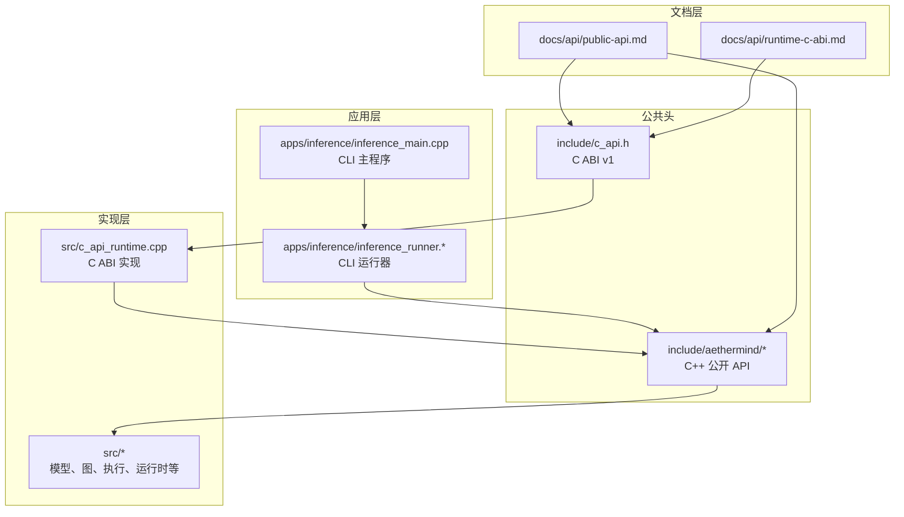
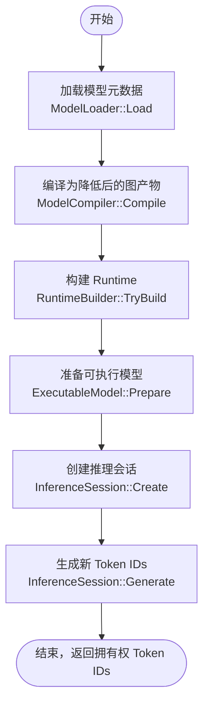
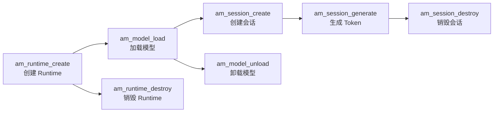
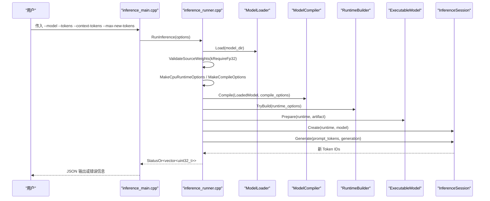
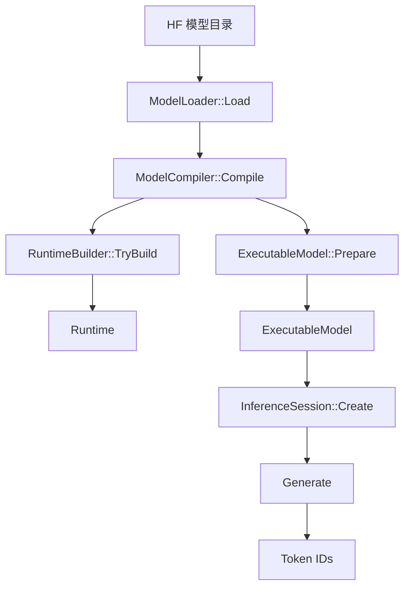
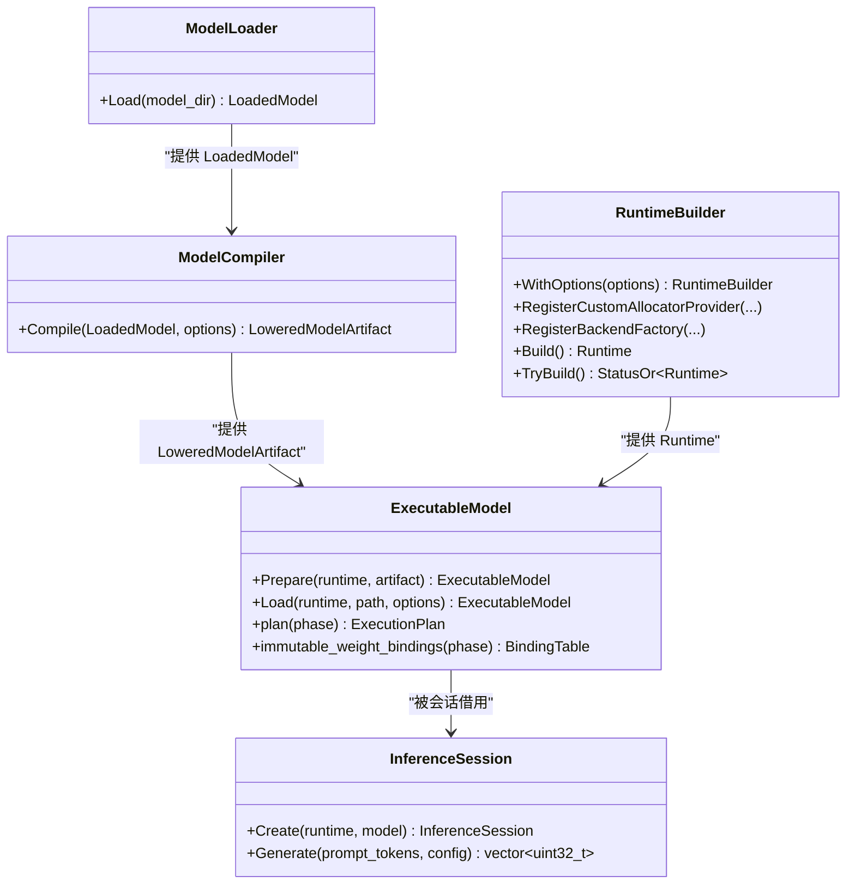
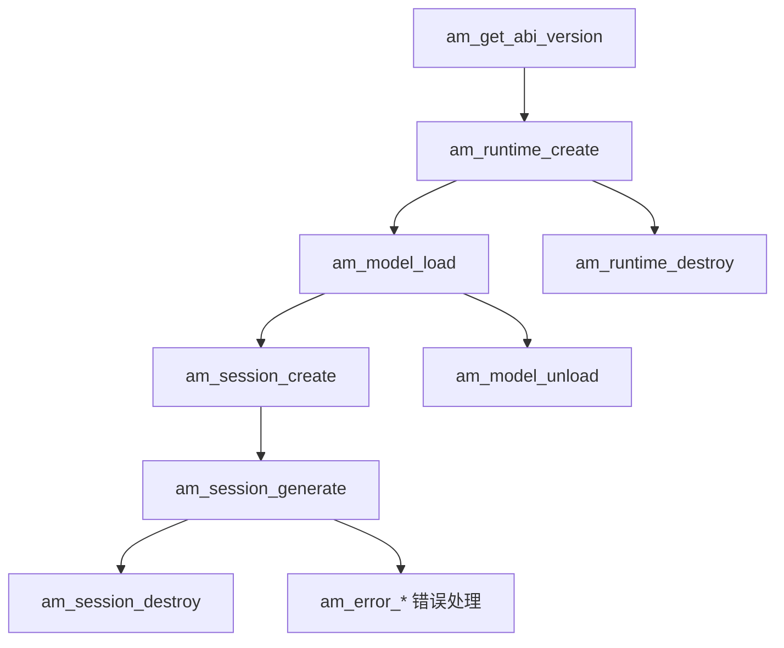
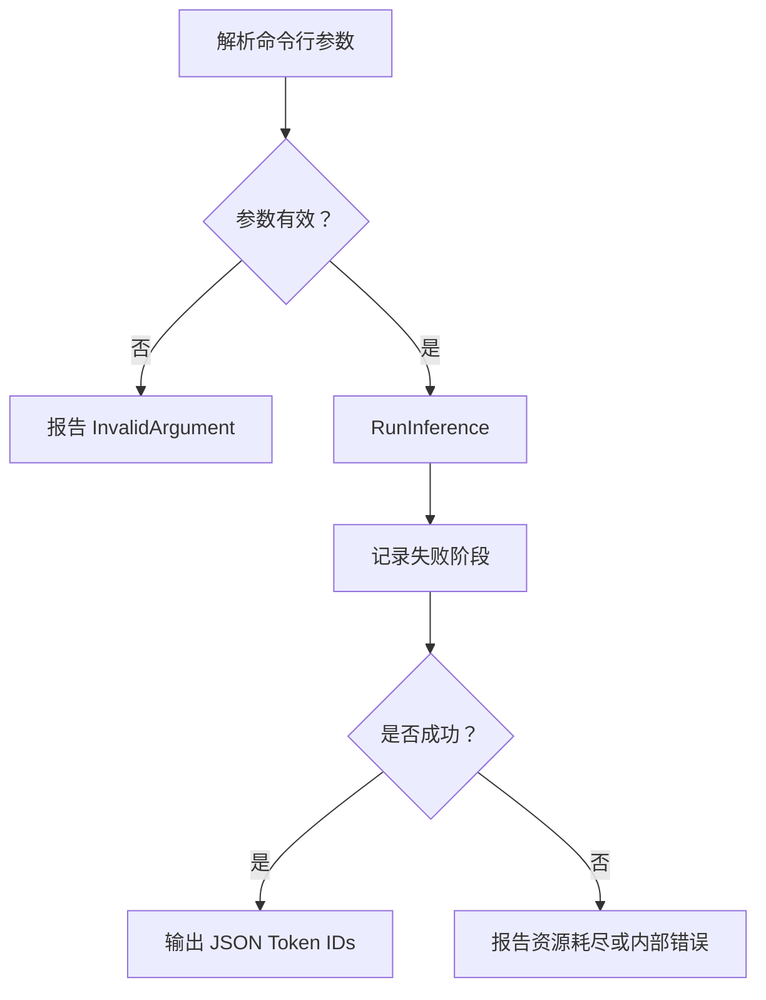
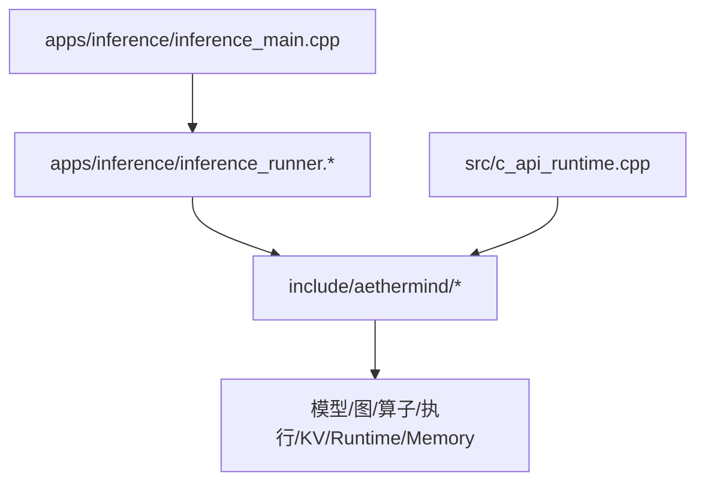

# API 暴露方式

**本文引用的文件**
- [README.md](../../../README.md)
- [include/c_api.h](../../../include/c_api.h)
- [docs/api/public-api.md](../../api/public-api.md)
- [docs/api/runtime-c-abi.md](../../api/runtime-c-abi.md)
- [apps/inference/inference_main.cpp](../../../apps/inference/inference_main.cpp)
- [apps/inference/inference_runner.h](../../../apps/inference/inference_runner.h)
- [apps/inference/inference_runner.cpp](../../../apps/inference/inference_runner.cpp)

## 目录
1. [引言](#引言)
2. [项目结构与入口](#项目结构与入口)
3. [C++ 公开 API：设计理念与面向对象模式](#c-公开-api设计理念与面向对象模式)
4. [C ABI v1：稳定接口契约](#c-abi-v1稳定接口契约)
5. [CLI 工具 aethermind_infer：功能与用法](#cli-工具-aethermind_infer功能与用法)
6. [三种暴露方式的对比与选型](#三种暴露方式的对比与选型)
7. [架构总览](#架构总览)
8. [详细组件分析](#详细组件分析)
9. [依赖关系分析](#依赖关系分析)
10. [性能与使用建议](#性能与使用建议)
11. [故障排查指南](#故障排查指南)
12. [结论](#结论)

## 引言
AetherMind 面向桌面与服务端 CPU 环境，提供 Llama Dense 模型的同步推理能力。当前交付范围以 FP32 激活、静态 KV 存储和 Token IDs 输入输出为主；GPU 卸载、服务化与分布式执行属于产品方向，不在当前交付承诺中。

仓库同时暴露三种集成入口：
- C++ 公开 API：适合 C++20 应用直接复用模型加载、编译、运行时装配、会话生成等面向对象构建块。
- C ABI v1：冻结的 C/C++ 兼容接口，适合需要跨语言、跨进程或长期二进制稳定的调用方。
- CLI 工具 `aethermind_infer`：独立可执行程序，用于快速验证 HF 模型目录、参数和生成结果。

本文重点说明这三种 API 暴露方式的设计目标、适用场景、关键数据结构、错误处理机制以及选择建议，并给出基于仓库实现的简要示例路径和最佳实践。

**章节来源**
- [README.md](../../../README.md)

## 项目结构与入口
AetherMind 的核心公共头位于 `include/aethermind/`，实现位于 `src/`，CLI 入口位于 `apps/inference/`，API 文档位于 `docs/api/`。

**图表来源**
- [include/c_api.h:1-218](../../../include/c_api.h#L1-L218)
- [docs/api/public-api.md](../../api/public-api.md)
- [docs/api/runtime-c-abi.md](../../api/runtime-c-abi.md)
- [apps/inference/inference_main.cpp:1-200](../../../apps/inference/inference_main.cpp#L1-L200)
- [apps/inference/inference_runner.h:1-72](../../../apps/inference/inference_runner.h#L1-L72)

**章节来源**
- [README.md](../../../README.md)
- [docs/api/public-api.md](../../api/public-api.md)
- [docs/api/runtime-c-abi.md](../../api/runtime-c-abi.md)

## C++ 公开 API：设计理念与面向对象模式
C++ 公开 API 采用“明确职责、显式所有权”的面向对象设计。典型流程由以下对象组成：
- `ModelLoader`：负责加载 HuggingFace 配置与原始权重视图，不构建图、不解析 kernel、不预打包。
- `ModelCompiler`：负责语义图构建、优化 pass、lowering，产出 `LoweredModelArtifact`。
- `RuntimeBuilder`：负责装配分配器、后端注册表、KV Cache Manager，提供 `Build` 与 `TryBuild`。
- `ExecutableModel`：封装已准备的可执行模型、绑定表和执行计划。
- `InferenceSession`：封装单次推理请求上下文，提供 `Generate`。

### 面向对象生命周期

**图表来源**
- [docs/api/public-api.md](../../api/public-api.md)
- [apps/inference/inference_runner.cpp:1-200](../../../apps/inference/inference_runner.cpp#L1-L200)

### 核心设计要点
- **显式资源边界**：`StatusOr` 与 `Status` 表示成功或失败；异常通常映射为资源耗尽或内部错误。
- **策略分离**：权重策略（如 `kRequireFp32`、`kConvertToFp32`、保留 W16 策略）与编译预设（O1/plain、O2/packed）分开表达。
- **运行时稳定性**：从 `Prepare` 起，`Runtime` 必须保持地址稳定，且生命周期长于 `ExecutableModel` 与 `InferenceSession`。
- **不可变执行计划**：`ExecutableModel` 持有 immutable plan 与 binding table，避免请求级状态污染。

### 面向对象使用模式示例
- **C++ 直接调用模式**：调用方依次构造 `ModelLoader`、`ModelCompiler`、`RuntimeBuilder`、`ExecutableModel`、`InferenceSession`，并在成功后释放资源。
- **CLI 简化模式**：`RunInference` 将上述步骤封装为一次请求，返回拥有的 Token IDs。

**章节来源**
- [docs/api/public-api.md](../../api/public-api.md)
- [apps/inference/inference_runner.h:1-72](../../../apps/inference/inference_runner.h#L1-L72)
- [apps/inference/inference_runner.cpp:1-200](../../../apps/inference/inference_runner.cpp#L1-L200)

## C ABI v1：稳定接口契约
C ABI v1 是 AetherMind 对外部 C/C++ 或其他语言调用的稳定边界。它不暴露 C++ 布局、STL、异常或 `TensorView`，而是通过 opaque handle、固定结构体和错误句柄传递状态。

### 关键类型与常量
- `am_runtime_t`、`am_model_t`、`am_session_t`：不透明句柄，分别代表 Runtime、模型、会话。
- `am_config_t`：CPU Runtime 与模型准备策略，包含层数、KV heads、head_dim、最大 token 容量、KV dtype、CPU preset。
- `am_session_config_t`：生成配置，包含最大新 token 数、EOS 开关与 EOS token ID。
- `AM_ABI_VERSION`：ABI 版本宏，v1.0 对应 `0x00010000`。
- `AM_CPU_PRESET_O1_PLAIN`、`AM_CPU_PRESET_O2_PACKED`：CPU 编译预设。
- `AM_KV_DTYPE_FLOAT32`：首版 KV dtype。

### 句柄生命周期

**图表来源**
- [include/c_api.h:1-218](../../../include/c_api.h#L1-L218)
- [docs/api/runtime-c-abi.md](../../api/runtime-c-abi.md)

### 配置结构体
`am_config_t` 与 `am_session_config_t` 要求先零初始化，再设置 `struct_size`、`abi_version` 及业务字段。布局大小固定：
- `am_config_t`：48 字节。
- `am_session_config_t`：24 字节。

字段校验规则包括：
- `struct_size` 必须匹配。
- ABI major 必须支持，minor 不能高于库实现。
- 几何字段需为正数且能安全转换为 `size_t`。
- `kv_dtype` 首版仅允许 FP32。
- `cpu_preset` 仅允许 O1/plain 或 O2/packed。
- `max_new_tokens` 为非负数且元素计数可表示。
- `has_eos_token_id` 仅允许 0 或 1。

### 错误处理机制
C ABI 使用 `am_error_handle` 作为可选诊断输出：
- 若传入 error 槽，函数进入后先将其置空，不读取旧值。
- 成功时保持 NULL。
- 失败时尽量创建独立错误对象，调用方用 `am_error_destroy` 释放。
- 错误对象自身分配失败时不再抛异常，error 仍为 NULL；因此 error 为空不代表成功。
- `am_error_code(NULL)` 返回 `AM_STATUS_UNKNOWN`，`am_error_message(NULL)` 返回非 NULL 空字符串。
- 底层未识别异常映射为 Internal，`std::bad_alloc` 映射为 ResourceExhausted。

### 生成接口行为
`am_session_generate` 的行为严格区分“查询容量上界”和“真正执行”：
- 若 `output_capacity < max_new_tokens`，返回 `AM_STATUS_OUT_OF_RANGE`，写入实际所需容量的安全上界，不执行也不预约 KV。
- 若 `output_tokens=NULL` 且 `output_capacity=0`，在 `max_new_tokens > 0` 时仍按上界规则处理。
- 真正成功后才复制完整新 Token 并写入实际长度。
- N=0 是合法配置，不进行重复计算，但仍校验 prompt、EOS 和模型上下文语义。

**章节来源**
- [include/c_api.h:1-218](../../../include/c_api.h#L1-L218)
- [docs/api/runtime-c-abi.md](../../api/runtime-c-abi.md)
- [docs/api/public-api.md](../../api/public-api.md)

## CLI 工具 aethermind_infer：功能与用法
`aethermind_infer` 是独立可执行程序，用于对 HuggingFace 模型目录进行 CPU FP32 Llama Dense 推理，并以 JSON 整数数组形式输出新 Token IDs。默认 preset 为 `o1-plain`。

### 命令行参数
| 参数 | 是否必需 | 含义 |
|---|---:|---|
| `--model` | 是 | HF 模型目录路径 |
| `--tokens` | 是 | 逗号分隔的 uint32 prompt tokens |
| `--context-tokens` | 是 | 正数，KV 上下文容量 |
| `--max-new-tokens` | 是 | 非负数，最多生成的新 token 数 |
| `--eos-token-id` | 否 | EOS token ID |
| `--preset` | 否 | `o1-plain` 或 `o2-packed`，默认为 `o1-plain` |
| `--help` | 否 | 显示帮助信息 |

### 基本使用方法
- 准备一个有效的 HF 模型目录，包含 `config.json` 与 safetensors 权重。
- 指定 prompt tokens、上下文容量和最大新 token 数。
- 可选指定 EOS token ID 和编译 preset。
- 标准输出为 JSON 整数数组；错误信息输出到标准错误。

### 内部执行流程
CLI 主程序负责参数解析、状态报告与日志输出；真正的推理逻辑委托给 `RunInference`。其内部顺序为：
1. 验证参数。
2. 加载模型。
3. 校验源权重策略。
4. 映射 CPU Runtime 选项与编译选项。
5. 编译模型。
6. 构建 Runtime。
7. 准备 `ExecutableModel`。
8. 创建 `InferenceSession`。
9. 执行生成。

**图表来源**
- [apps/inference/inference_main.cpp:1-200](../../../apps/inference/inference_main.cpp#L1-L200)
- [apps/inference/inference_runner.cpp:1-200](../../../apps/inference/inference_runner.cpp#L1-L200)

**章节来源**
- [apps/inference/inference_main.cpp:1-200](../../../apps/inference/inference_main.cpp#L1-L200)
- [apps/inference/inference_runner.h:1-72](../../../apps/inference/inference_runner.h#L1-L72)
- [apps/inference/inference_runner.cpp:1-200](../../../apps/inference/inference_runner.cpp#L1-L200)

## 三种暴露方式的对比与选型

| 维度 | C++ 公开 API | C ABI v1 | CLI 工具 aethermind_infer |
|---|---|---|---|
| 主要用途 | C++20 应用直接集成推理管线 | 跨语言、跨进程或长期二进制稳定集成 | 快速验证模型、参数与生成结果 |
| 集成复杂度 | 中高：需自行管理生命周期与错误 | 中：需手动管理句柄、配置、错误对象 | 低：命令行参数驱动 |
| 语言支持 | C++20 | C/C++ 及其他可链接共享库的语言 | 任何可通过进程调用的语言 |
| 面向对象程度 | 高：对象组合清晰 | 低：句柄 + 结构体 + 错误句柄 | 不适用 |
| 二进制稳定性 | 依赖 C++ ABI 与编译器 | 冻结的 C ABI v1，更稳定 | 不涉及库 ABI |
| 并发控制 | 由调用方串行化共享 Runtime | 调用方串行化共享 Runtime | 单进程单请求 |
| 错误模型 | `Status`、`StatusOr`、异常映射 | `am_status_code` + `am_error_handle` | 标准错误输出与退出状态 |
| 适用场景 | C++ 服务、库、框架集成 | Python/Rust/Go/C 等外部语言封装 | 开发调试、基准测试、最小可用验证 |

### 选型建议
- **优先选择 C++ API**：如果你的应用是 C++20，并且希望获得清晰的面向对象抽象、细粒度控制和较高开发效率。
- **选择 C ABI v1**：如果你需要与 C/C++ 以外的语言集成，或需要长期稳定的二进制契约，且愿意接受句柄式生命周期管理。
- **选择 CLI**：如果你只需要快速验证 HF 模型、prompt 和生成结果，或者用于自动化脚本与回归测试。

**章节来源**
- [README.md](../../../README.md)
- [docs/api/public-api.md](../../api/public-api.md)
- [docs/api/runtime-c-abi.md](../../api/runtime-c-abi.md)

## 架构总览
AetherMind 的 CLI 明确组装了 C++ 公开构建块：
`ModelLoader::Load → ModelCompiler::Compile → RuntimeBuilder::TryBuild → ExecutableModel::Prepare → InferenceSession::Create → Generate`

C ABI 也遵循类似的顺序，但在 adapter 层增加了对 Runtime 与模型 KV 一致性的检查。

**图表来源**
- [README.md](../../../README.md)
- [docs/api/public-api.md](../../api/public-api.md)

## 详细组件分析

### C++ 公开 API 组件
#### 模型加载与编译
- `ModelLoader::Load` 只读模型元数据，不访问 backend 或执行 kernel。
- `ModelCompiler::Compile` 消费 `LoadedModel`，产出 `LoweredModelArtifact`，不包含 runtime 依赖。

#### 运行时装配
- `RuntimeBuilder` 提供链式 `WithOptions`，支持自定义分配器与后端工厂。
- `TryBuild` 将分配失败转为 `ResourceExhausted`，失败时可复用 builder，但已转移的 registry 注册项不可恢复。

#### 可执行模型与会话
- `ExecutableModel::Load` 封装 Load → 权重准入 → 可选转换 → Compile → Prepare。
- `InferenceSession::Generate` 负责 prompt、词表、EOS、context 上限与物理 KV capacity 检查。

**图表来源**
- [docs/api/public-api.md](../../api/public-api.md)

**章节来源**
- [docs/api/public-api.md](../../api/public-api.md)

### C ABI v1 组件
C ABI 的关键组件包括：
- `am_get_abi_version`：查询 ABI 版本。
- `am_runtime_create` / `am_runtime_destroy`：创建和销毁 Runtime。
- `am_model_load` / `am_model_unload`：加载和卸载模型。
- `am_session_create` / `am_session_destroy`：创建和销毁会话。
- `am_session_generate`：同步生成新 Token。
- `am_error_create` / `am_error_destroy` / `am_error_code` / `am_error_message`：错误对象管理。

**图表来源**
- [include/c_api.h:1-218](../../../include/c_api.h#L1-L218)
- [docs/api/runtime-c-abi.md](../../api/runtime-c-abi.md)

**章节来源**
- [include/c_api.h:1-218](../../../include/c_api.h#L1-L218)
- [docs/api/runtime-c-abi.md](../../api/runtime-c-abi.md)

### CLI 组件
CLI 分为两个层次：
- `inference_main.cpp`：参数解析、标志校验、错误报告、日志输出。
- `inference_runner.*`：封装完整的推理生命周期，返回拥有的 Token IDs。

**图表来源**
- [apps/inference/inference_main.cpp:1-200](../../../apps/inference/inference_main.cpp#L1-L200)
- [apps/inference/inference_runner.cpp:1-200](../../../apps/inference/inference_runner.cpp#L1-L200)

**章节来源**
- [apps/inference/inference_main.cpp:1-200](../../../apps/inference/inference_main.cpp#L1-L200)
- [apps/inference/inference_runner.h:1-72](../../../apps/inference/inference_runner.h#L1-L72)
- [apps/inference/inference_runner.cpp:1-200](../../../apps/inference/inference_runner.cpp#L1-L200)

## 依赖关系分析
AetherMind 的依赖关系可以概括为：
- CLI 依赖 `inference_runner`。
- `inference_runner` 依赖 C++ 公开 API。
- C ABI 实现依赖 C++ 公开 API。
- C++ 公开 API 依赖模型、图、算子、执行、KV cache、runtime、memory 等模块。

**图表来源**
- [apps/inference/inference_main.cpp:1-200](../../../apps/inference/inference_main.cpp#L1-L200)
- [apps/inference/inference_runner.h:1-72](../../../apps/inference/inference_runner.h#L1-L72)
- [include/c_api.h:1-218](../../../include/c_api.h#L1-L218)

**章节来源**
- [README.md](../../../README.md)
- [docs/api/public-api.md](../../api/public-api.md)

## 性能与使用建议
- **首选稳定配置**：CLI 与 C ABI 当前强调 strict FP32 source admission；C++ API 支持显式 F16/BF16 拓宽或 retained-W16 策略，但不等同于更高吞吐。
- **合理设置 context 容量**：`context-tokens` 不能超过模型 `max_position_embeddings`，否则参数校验失败。
- **预留足够输出缓冲**：C ABI 的 `am_session_generate` 要求 `output_capacity >= max_new_tokens`；短缓冲只会返回容量上界，不会执行。
- **串行化共享 Runtime**：所有共享 Runtime 的 load、create、generate、destroy 都应由宿主串行化，C wrapper 不增加并发支持。
- **优先使用 C++ API 的 `TryBuild`**：可将分配失败转为 `ResourceExhausted`，便于上层统一处理资源不足问题。
- **避免重复生成**：C ABI 明确拒绝“先生成获取精确 required-size，再重试”的方案，因为 EOS 使实际长度依赖执行。

[本节为通用建议，不直接分析具体代码行]

## 故障排查指南

### C++ 公开 API 常见错误
- 参数无效：prompt 为空、token 超出词表、context 容量超过模型上限。
- 资源不足：内存分配失败映射为 `ResourceExhausted`。
- 运行时未稳定：`Runtime` 地址在 `Prepare` 后不应移动。

**章节来源**
- [docs/api/public-api.md](../../api/public-api.md)
- [apps/inference/inference_runner.cpp:1-200](../../../apps/inference/inference_runner.cpp#L1-L200)

### C ABI v1 常见错误
- 配置结构体大小或 ABI 版本不匹配：返回 `InvalidArgument` 或 `Unimplemented`。
- KV 几何不一致：层数、KV heads、head_dim、dtype、max_tokens 不匹配。
- 输出缓冲不足：返回 `AM_STATUS_OUT_OF_RANGE`，写入安全容量上界。
- 错误对象为空：可能是 OOM 降级，不能视为成功。

**章节来源**
- [docs/api/runtime-c-abi.md](../../api/runtime-c-abi.md)
- [include/c_api.h:1-218](../../../include/c_api.h#L1-L218)

### CLI 常见错误
- 缺少必需参数：`--model`、`--tokens`、`--context-tokens`、`--max-new-tokens`。
- 重复参数或未知参数：参数解析直接拒绝。
- 内存分配失败：stderr 输出资源耗尽提示。

**章节来源**
- [apps/inference/inference_main.cpp:1-200](../../../apps/inference/inference_main.cpp#L1-L200)

## 结论
AetherMind 提供了三种互补的 API 暴露方式：
- C++ 公开 API 适合需要面向对象抽象、细粒度控制和 C++20 生态集成的开发者。
- C ABI v1 适合需要跨语言、跨进程或长期二进制稳定的调用方，代价是手动管理句柄和配置。
- CLI 工具 `aethermind_infer` 适合快速验证、脚本化和最小可用测试。

在实际工程中，推荐优先使用 C++ 公开 API；当存在跨语言或长期 ABI 约束时，使用 C ABI v1；当只需要端到端验证时，使用 CLI。无论选择哪种方式，都应重视配置校验、资源预算、错误处理和 Runtime 生命周期管理。

[本节为总结性内容，不直接分析具体代码行]
