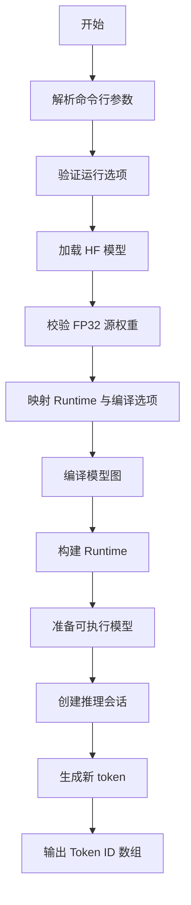
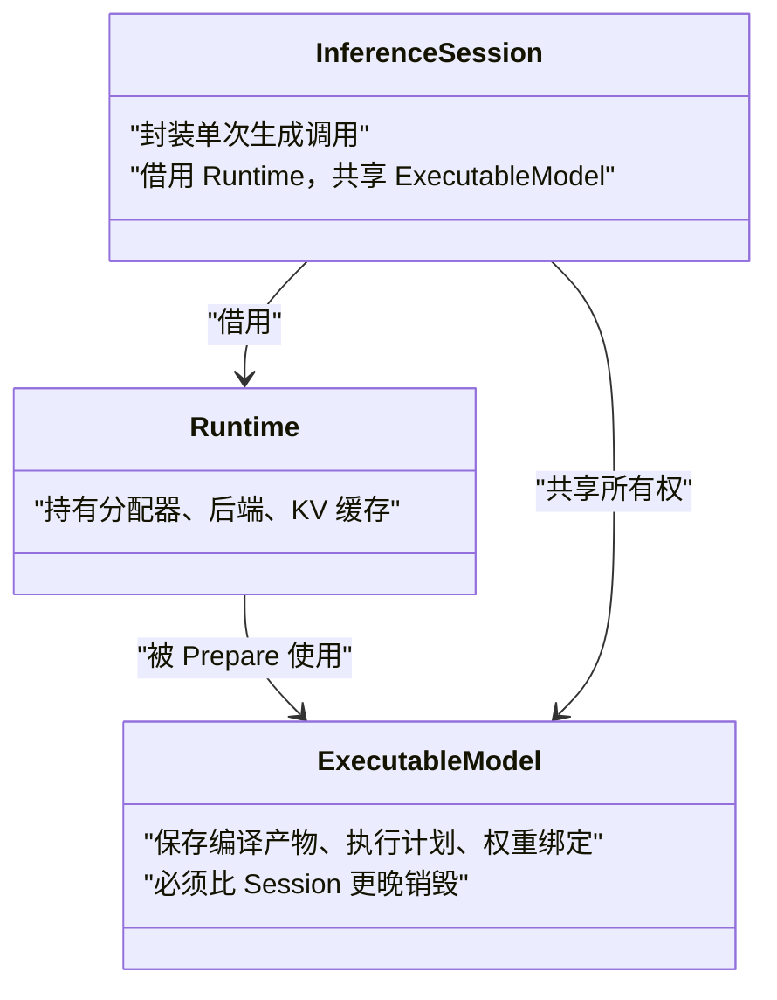

# 快速开始

**本文引用的文件**
- [README.md](../../../README.md)
- [CMakeLists.txt](../../../CMakeLists.txt)
- [apps/inference/CMakeLists.txt](../../../apps/inference/CMakeLists.txt)
- [apps/inference/inference_main.cpp](../../../apps/inference/inference_main.cpp)
- [apps/inference/inference_runner.h](../../../apps/inference/inference_runner.h)
- [apps/inference/inference_runner.cpp](../../../apps/inference/inference_runner.cpp)
- [include/aethermind/inference/executable_model.h](../../../include/aethermind/inference/executable_model.h)
- [include/aethermind/inference/inference_session.h](../../../include/aethermind/inference/inference_session.h)
- [include/aethermind/runtime/runtime_builder.h](../../../include/aethermind/runtime/runtime_builder.h)
- [include/c_api.h](../../../include/c_api.h)
- [docs/api/runtime-c-abi.md](../../api/runtime-c-abi.md)

## 目录
1. [简介](#简介)
2. [环境要求](#环境要求)
3. [基础安装与构建](#基础安装与构建)
4. [第一个 CLI 推理示例](#第一个-cli-推理示例)
5. [通过 C/C++ API 最小集成](#通过-cc-api-最小集成)
6. [从模型加载到生成 token 的完整流程](#从模型加载到生成-token-的完整流程)
7. [常见问题排查](#常见问题排查)
8. [结论](#结论)

## 简介
AetherMind 是面向 Llama 系列密集模型的桌面/服务器 CPU 推理引擎。当前稳定交付范围以同步、单请求、贪心采样为主，输入输出为 Token ID，KV 缓存为静态分配；FP32 激活、logits 和 KV 是首版核心语义，权重策略支持 FP32 源权重以及可选的 F16/BF16 保留路径。CLI 工具 `aethermind_infer` 直接调用公共 C++ API，完成模型加载、编译、Runtime 构建、模型准备、会话创建和 token 生成。

**章节来源**
- [README.md](../../../README.md)

## 环境要求
- **编译器**：C++20 工具链，必须提供 `<format>` 支持。文档推荐 GCC（libstdc++ ≥ 13.1）、Clang ≥ 14，或 MSVC ≥ 19.30。
- **CMake**：≥ 3.28。
- **运行时依赖**：pthread；默认启用 libbacktrace。
- **可选第三方依赖**：spdlog、Google Benchmark、GoogleTest；测试与基准目标开启时由 CMake 自动获取。

根工程在配置阶段会检查 `std::format` 能力；若不满足，会直接报告缺少 C++20 格式化支持。

**章节来源**
- [README.md](../../../README.md)
- [CMakeLists.txt:1-20](../../../CMakeLists.txt#L1-L20)

## 基础安装与构建
推荐使用标准 CMake 工作流：

```bash
cmake -S . -B build -DCMAKE_EXPORT_COMPILE_COMMANDS=ON
cmake --build build -j
```

如果只需要推理 CLI，可显式启用该目标：

```bash
cmake -S . -B build -DBUILD_INFERENCE_TOOL=ON
cmake --build build --target aethermind_infer -j
```

构建产物 `aethermind_infer` 链接核心库 `AetherMind` 和日志库 spdlog。

| 选项 | 含义 |
|---|---|
| `-DBUILD_TESTS=ON` | 启用单元测试（默认开启） |
| `-DBUILD_BENCHMARKS=ON` | 启用性能基准（默认开启） |
| `-DBUILD_INFERENCE_TOOL=ON` | 启用推理 CLI |
| `-DUSE_LIBBACKTRACE=ON` | 启用回溯（非 MSVC 默认开启） |

**章节来源**
- [README.md](../../../README.md)
- [CMakeLists.txt:20-40](../../../CMakeLists.txt#L20-L40)
- [apps/inference/CMakeLists.txt:1-10](../../../apps/inference/CMakeLists.txt#L1-L10)

## 第一个 CLI 推理示例
CLI 二进制名为 `aethermind_infer`，其典型用法如下：

```bash
./build/aethermind_infer \
  --model <HF 模型目录> \
  --tokens "<提示词 Token 列表>" \
  --context-tokens <上下文容量> \
  --max-new-tokens <最大新 token 数> \
  [--eos-token-id <结束符 token>] \
  [--preset o1-plain|o2-packed]
```

参数说明：
- `--model`：HuggingFace 格式的本地模型目录，必需。
- `--tokens`：逗号分隔的无符号十进制 Token ID 数组，必需。
- `--context-tokens`：正整数，表示预填充阶段的上下文容量，必需。
- `--max-new-tokens`：非负整数，表示要生成的新 token 数量，必需。
- `--eos-token-id`：可选的结束符 Token ID。
- `--preset`：CPU 编译预设，`o1-plain` 或 `o2-packed`，默认为 `o1-plain`。

运行后，CLI 会输出一个 JSON 形式的 Token ID 数组，包含 Prefill 预测的第一个 token 以及后续生成的 token；若触发 EOS，结果中也包含 EOS token。

错误信息会写入标准错误流，例如参数缺失、重复参数、非法数值、超出词表范围、超出上下文上限等。

**章节来源**
- [apps/inference/inference_main.cpp:1-200](../../../apps/inference/inference_main.cpp#L1-L200)

## 通过 C/C++ API 最小集成
本节给出“只跑通一次推理”的最小 API 路径。你可以选择 C++ 接口，也可以选择冻结的 C ABI。

### C++ API 最小步骤
1. 构造 `RuntimeBuilder` 并设置 `RuntimeOptions`。
2. 使用 `ModelLoader::Load` 加载 HuggingFace 模型。
3. 通过 `ModelCompiler::Compile` 生成编译产物。
4. 用 `RuntimeBuilder::TryBuild` 构建 Runtime。
5. 用 `ExecutableModel::Prepare` 准备可执行模型。
6. 用 `InferenceSession::Create` 创建推理会话。
7. 调用 `session->Generate(prompt_tokens, generation_config)` 得到新 token。

关键头文件：
- `aethermind/model/model_loader.h`
- `aethermind/compiler/model_compiler.h`
- `aethermind/runtime/runtime_builder.h`
- `aethermind/inference/executable_model.h`
- `aethermind/inference/inference_session.h`

重要类型：
- `GenerationConfig`：包含 `max_new_tokens` 和可选 `eos_token_id`。
- `ModelLoadOptions`：控制编译预设、设备、权重策略、KV dtype 和激活 dtype。
- `RuntimeOptions`：描述分配器、后端和 KV 缓存资源。

参考路径：
- [include/aethermind/runtime/runtime_builder.h:1-112](../../../include/aethermind/runtime/runtime_builder.h#L1-L112)
- [include/aethermind/inference/executable_model.h:1-183](../../../include/aethermind/inference/executable_model.h#L1-L183)
- [include/aethermind/inference/inference_session.h:1-114](../../../include/aethermind/inference/inference_session.h#L1-L114)

### C ABI 最小步骤
C ABI v1 暴露 opaque handle：
- `am_runtime_create`
- `am_model_load`
- `am_session_create`
- `am_session_generate`
- `am_session_destroy`
- `am_model_unload`
- `am_runtime_destroy`

C 端需要填写固定布局结构体：
- `am_config_t`：描述层数、KV head 数、head_dim、最大 token 数、KV dtype、CPU preset。
- `am_session_config_t`：描述 `max_new_tokens`、EOS 开关和 EOS token ID。

返回值为状态码或句柄指针；错误通过 `am_error_handle` 查询。

参考路径：
- [include/c_api.h:1-200](../../../include/c_api.h#L1-L200)
- [docs/api/runtime-c-abi.md](../../api/runtime-c-abi.md)

**章节来源**
- [include/aethermind/runtime/runtime_builder.h:1-112](../../../include/aethermind/runtime/runtime_builder.h#L1-L112)
- [include/aethermind/inference/executable_model.h:1-183](../../../include/aethermind/inference/executable_model.h#L1-L183)
- [include/aethermind/inference/inference_session.h:1-114](../../../include/aethermind/inference/inference_session.h#L1-L114)
- [include/c_api.h:1-200](../../../include/c_api.h#L1-L200)
- [docs/api/runtime-c-abi.md](../../api/runtime-c-abi.md)

## 从模型加载到生成 token 的完整流程
CLI 和内部 runner 共享同一主流程：**模型加载 → 模型准入 → 编译 → Runtime 构建 → 模型准备 → 会话创建 → 生成**。



**图表来源**
- [apps/inference/inference_runner.cpp:1-200](../../../apps/inference/inference_runner.cpp#L1-L200)
- [apps/inference/inference_runner.h:1-72](../../../apps/inference/inference_runner.h#L1-L72)

### 关键阶段说明
| 阶段 | 职责 | 常见失败原因 |
|---|---|---|
| 参数解析 | 校验必填参数、去重、解析 Token 数组和整数 | 缺少参数、重复参数、非法数字 |
| 选项验证 | 检查 preset、prompt、词表范围、上下文上限 | 词表越界、上下文过大 |
| 模型加载 | 读取 HF 目录和 safetensors 权重 | 目录无效、权重缺失 |
| 权重准入 | 强制 FP32 源权重策略 | 不符合 FP32 源权重要求 |
| 编译 | 将 LoadedModel 转为 LoweredModelArtifact | 图优化或编译失败 |
| Runtime 构建 | 初始化分配器、后端和 KV 缓存 | KV 几何或内存不足 |
| 模型准备 | 绑定权重、构建执行计划 | 后端不可用、计划不兼容 |
| 会话创建 | 绑定模型与 Runtime | 生命周期或 plan 合同不匹配 |
| 生成 | Prefill + Decode，返回新 token | EOS、上下文溢出、资源耗尽 |

### C++ 对象生命周期


**图表来源**
- [include/aethermind/inference/executable_model.h:1-183](../../../include/aethermind/inference/executable_model.h#L1-L183)
- [include/aethermind/inference/inference_session.h:1-114](../../../include/aethermind/inference/inference_session.h#L1-L114)

### C ABI 句柄生命周期


C ABI 中：
- Runtime 地址从 Prepare 起保持稳定，直至最后一个 owner 销毁。
- model 保活 runtime。
- session 保活 model 及其 runtime。
- 所有共享 Runtime 的操作必须串行化。

**图表来源**
- [docs/api/runtime-c-abi.md](../../api/runtime-c-abi.md)
- [include/c_api.h:1-200](../../../include/c_api.h#L1-L200)

**章节来源**
- [apps/inference/inference_runner.cpp:1-200](../../../apps/inference/inference_runner.cpp#L1-L200)
- [apps/inference/inference_runner.h:1-72](../../../apps/inference/inference_runner.h#L1-L72)
- [include/aethermind/inference/executable_model.h:1-183](../../../include/aethermind/inference/executable_model.h#L1-L183)
- [include/aethermind/inference/inference_session.h:1-114](../../../include/aethermind/inference/inference_session.h#L1-L114)
- [docs/api/runtime-c-abi.md](../../api/runtime-c-abi.md)

## 常见问题排查
| 现象 | 可能原因 | 处理建议 |
|---|---|---|
| CMake 报错缺少 `std::format` | 编译器或标准库不支持 C++20 `<format>` | 升级 GCC/libstdc++、Clang 或 MSVC |
| CLI 报缺少必填选项 | 未传入 `--model`、`--tokens`、`--context-tokens` 或 `--max-new-tokens` | 补全必填参数 |
| CLI 报重复选项 | 同一个 flag 出现多次 | 删除重复参数 |
| 提示 Token 超出词表 | `--tokens` 中的值大于模型词表大小 | 检查 tokenizer 输出与模型配置 |
| `context-tokens` 超过模型上下文上限 | 传入值大于 `max_position_embeddings` | 减小上下文容量 |
| 构建找不到 `aethermind_infer` | 未启用推理工具 | 使用 `-DBUILD_INFERENCE_TOOL=ON` |
| 生成返回空结果但状态成功 | `max-new-tokens` 为 0 | 这是合法边界：不生成新 token |
| 内存不足 | KV 容量、workspace 或权重过大 | 降低 `max_new_tokens`、调整 KV 配置或减少上下文长度 |
| C ABI 返回短 buffer 上界 | `output_capacity` 小于配置的 `max_new_tokens` | 按上界分配足够输出缓冲区 |

**章节来源**
- [CMakeLists.txt:1-20](../../../CMakeLists.txt#L1-L20)
- [apps/inference/inference_main.cpp:1-200](../../../apps/inference/inference_main.cpp#L1-L200)
- [apps/inference/inference_runner.cpp:1-200](../../../apps/inference/inference_runner.cpp#L1-L200)
- [docs/api/runtime-c-abi.md](../../api/runtime-c-abi.md)

## 结论
对于初次接触 AetherMind 的用户，最简路径是：
1. 确认 C++20 与 CMake ≥ 3.28。
2. 构建 `aethermind_infer`。
3. 准备一个 HuggingFace 模型目录。
4. 用 CLI 传入提示 Token、上下文容量和生成数量。
5. 如果需要集成，按照 Runtime → 模型加载 → 编译 → 准备 → 会话 → 生成的顺序调用 C++ API，或使用 C ABI 的固定结构体和句柄。

该路径覆盖了从模型加载到生成 token 的核心闭环，适合在 10 分钟内完成第一次推理任务。

[本节不直接分析具体代码文件，因此无章节来源]
