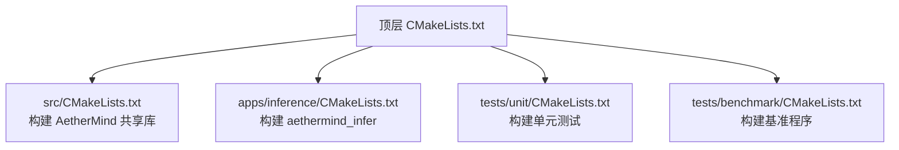
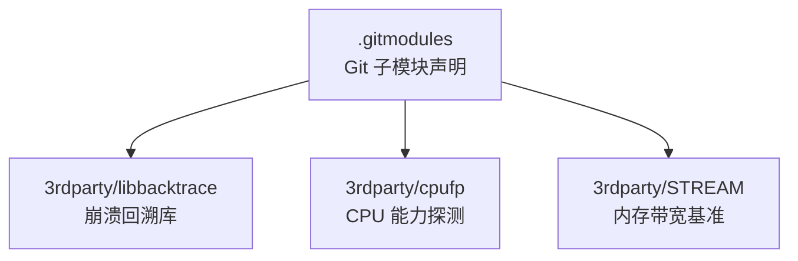
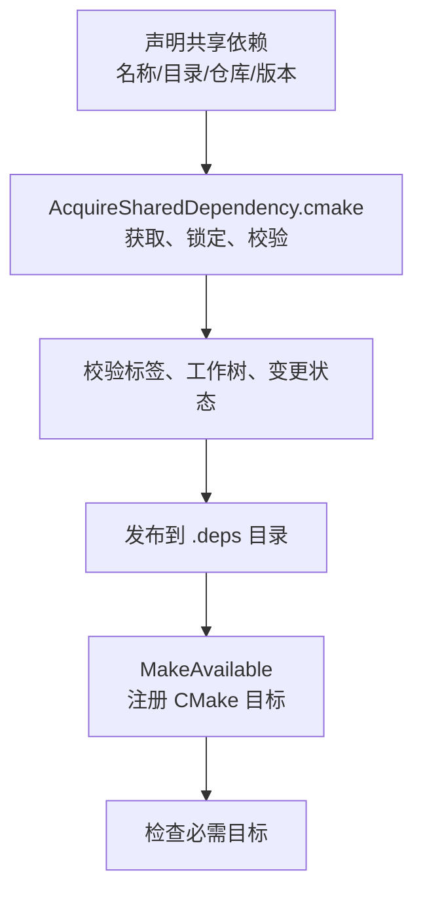
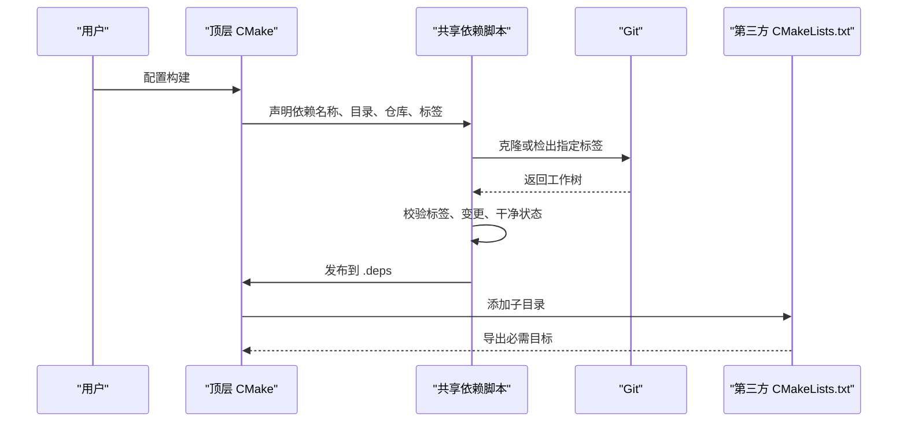

# 技术栈与依赖

**本文引用的文件**
- [CMakeLists.txt](../../../CMakeLists.txt)
- [README.md](../../../README.md)
- [.gitmodules](../../../.gitmodules)
- [cmake/AetherMindCpuIsa.cmake](../../../cmake/AetherMindCpuIsa.cmake)
- [cmake/AcquireSharedDependency.cmake](../../../cmake/AcquireSharedDependency.cmake)
- [cmake/AetherMindDependencySources.cmake](../../../cmake/AetherMindDependencySources.cmake)
- [cmake/AetherMindFindPython.cmake](../../../cmake/AetherMindFindPython.cmake)
- [cmake/AetherMindLibbacktrace.cmake](../../../cmake/AetherMindLibbacktrace.cmake)
- [cmake/AetherMindSanitizers.cmake](../../../cmake/AetherMindSanitizers.cmake)
- [cmake/AetherMindTests.cmake](../../../cmake/AetherMindTests.cmake)
- [src/CMakeLists.txt](../../../src/CMakeLists.txt)
- [apps/inference/CMakeLists.txt](../../../apps/inference/CMakeLists.txt)
- [tests/unit/CMakeLists.txt](../../../tests/unit/CMakeLists.txt)
- [tests/benchmark/CMakeLists.txt](../../../tests/benchmark/CMakeLists.txt)

## 目录
1. [简介](#简介)
2. [项目结构与构建入口](#项目结构与构建入口)
3. [语言标准与 C++20 特性要求](#语言标准与-c20-特性要求)
4. [核心第三方依赖](#核心第三方依赖)
5. [子模块与本地依赖](#子模块与本地依赖)
6. [硬件架构与 SIMD 指令集支持](#硬件架构与-simd-指令集支持)
7. [依赖管理策略](#依赖管理策略)
8. [交叉编译与工具链约束](#交叉编译与工具链约束)
9. [测试、基准与调试工具链](#测试基准与调试工具链)
10. [常见问题排查](#常见问题排查)
11. [总结](#总结)

## 简介
AetherMind 是一个面向桌面和服务器的 C++20 CPU 推理引擎，主要面向 Llama Dense 模型。其公开接口包括 C++ API、可选命令行推理工具以及稳定的 C ABI；当前交付范围集中在 FP32 激活、静态 KV 缓存和 Token ID I/O，不包含 GPU 卸载、服务化或分布式执行。

从技术栈角度看，项目以 CMake 作为唯一构建系统，使用 spdlog 提供日志能力，使用 GoogleTest 组织单元测试，使用 Google Benchmark 组织性能基准，并通过 git 子模块引入 libbacktrace 实现崩溃回溯信息收集。SIMD 优化集中在 x86_64 平台，支持 AVX2、FMA、F16C、AVX512-BF16 和 AVX512-FP16 等可选扩展；ARM64 没有为这些 SIMD 内核启用专用路径。

**章节来源**
- [README.md](../../../README.md)

## 项目结构与构建入口
顶层 CMake 清单定义项目名称、版本、语言和最低 CMake 版本，并设置 C++20 与位置无关代码。它负责：
- 验证 C++20 `std::format` 支持。
- 配置 spdlog、GoogleTest、Google Benchmark 的获取或复用逻辑。
- 添加核心库子目录 `src/`。
- 根据选项添加推理工具、单元测试和基准目标。
- 提供 Doxygen 文档生成目标。

**图示来源**
- [CMakeLists.txt:1-171](../../../CMakeLists.txt#L1-L171)
- [src/CMakeLists.txt:1-193](../../../src/CMakeLists.txt#L1-L193)
- [apps/inference/CMakeLists.txt:1-10](../../../apps/inference/CMakeLists.txt#L1-L10)
- [tests/unit/CMakeLists.txt:1-99](../../../tests/unit/CMakeLists.txt#L1-L99)
- [tests/benchmark/CMakeLists.txt:1-79](../../../tests/benchmark/CMakeLists.txt#L1-L79)

**章节来源**
- [CMakeLists.txt:1-171](../../../CMakeLists.txt#L1-L171)
- [src/CMakeLists.txt:1-193](../../../src/CMakeLists.txt#L1-L193)

## 语言标准与 C++20 特性要求
项目强制使用 C++20，并将 `CMAKE_CXX_STANDARD` 设置为 20，同时为库目标显式声明 `cxx_std_20`。构建系统在配置阶段直接编译一个最小测试程序，检查编译器是否提供 `std::format` 和 `std::format_string`。如果缺失，配置会立即失败，而不是等到链接或运行期才暴露问题。

关键语言与工具链约束如下：
- 最低 CMake 版本：3.28。
- 最低 C++ 标准：C++20。
- 必须支持 `<format>`：GCC 搭配 libstdc++ ≥ 13.1、Clang ≥ 14 或 MSVC ≥ 19.30。
- 默认开启位置无关代码，便于输出共享库。
- 可选启用内存分配对齐宏 `KALLOC_ALIGNMENT`，并在编译前验证其为 `size_t` 可表示的 2 的幂。

spdlog 在启用 `SPDLOG_USE_STD_FORMAT` 时也会通过 `target_compile_features` 暴露 C++20 需求。这使日志后端能够复用项目统一的现代格式化能力。

**章节来源**
- [CMakeLists.txt:1-44](../../../CMakeLists.txt#L1-L44)
- [src/CMakeLists.txt:118-126](../../../src/CMakeLists.txt#L118-L126)
- [cmake/AetherMindBuildChecks.cmake:1-44](../../../cmake/AetherMindBuildChecks.cmake#L1-L44)

## 核心第三方依赖

### spdlog：日志
| 项目 | 值 |
|---|---|
| 版本 | v1.17.0 |
| 用途 | 结构化日志记录 |
| 获取方式 | FetchContent 自动下载或父项目提供的 `spdlog::spdlog` 目标 |
| 构建选项 | `SPDLOG_BUILD_SHARED=OFF`、`SPDLOG_BUILD_PIC=ON` |
| 格式化后端 | 优先使用 `std::format`；可通过外部 fmt 或关闭该选项回退到 fmt 后端 |

当父项目未提供 `spdlog::spdlog` 目标时，项目会在 `.deps/spdlog` 下获取源码，并尝试把 C++20 编译特性传播给 spdlog。如果父项目已经提供导入目标，则只沿用现有配置，不覆盖上游构建选项。

**章节来源**
- [CMakeLists.txt:45-92](../../../CMakeLists.txt#L45-L92)

### GoogleTest：单元测试
| 项目 | 值 |
|---|---|
| 版本 | v1.18.0 |
| 用途 | 单元测试框架 |
| 获取方式 | FetchContent 自动下载或父项目提供的 GTest 目标 |
| 必需目标 | `GTest::gtest` 和 `GTest::gtest_main` |
| 构建选项 | 禁用 GoogleMock、安装、自身测试和示例 |

项目要求两个目标同时存在；只提供其中一个时会报错。这样避免部分链接或缺少主函数导致的测试可执行文件无法运行。

**章节来源**
- [CMakeLists.txt:94-133](../../../CMakeLists.txt#L94-L133)
- [tests/unit/CMakeLists.txt:1-25](../../../tests/unit/CMakeLists.txt#L1-L25)

### Google Benchmark：性能基准
| 项目 | 值 |
|---|---|
| 版本 | v1.9.5 |
| 用途 | CPU 算子和模型级性能基准 |
| 获取方式 | FetchContent 自动下载或父项目提供的 benchmark 目标 |
| 必需目标 | `benchmark::benchmark` 和 `benchmark::benchmark_main` |
| 构建选项 | 禁用 GoogleBenchmark 自身的测试、安装及 GoogleTest 集成 |

基准目标是可选的，仅在 `BUILD_BENCHMARKS=ON` 时启用。如果父项目已提供完整目标集合，项目不会修改父项目的基准配置。

**章节来源**
- [CMakeLists.txt:135-168](../../../CMakeLists.txt#L135-L168)
- [tests/benchmark/CMakeLists.txt:1-79](../../../tests/benchmark/CMakeLists.txt#L1-L79)

### libbacktrace：崩溃回溯
| 项目 | 值 |
|---|---|
| 来源 | git 子模块 `3rdparty/libbacktrace` |
| 用途 | 在段错误等崩溃场景收集调用栈信息 |
| 构建方式 | CMake ExternalProject 编译静态库并安装头文件和静态归档 |
| 启用开关 | `USE_LIBBACKTRACE`（非 MSVC 默认启用） |
| 运行时开关 | `BACKTRACE_ON_SEGFAULT`（默认启用） |

libbacktrace 不是通过 FetchContent 管理的通用依赖，而是作为独立子模块构建。项目为其创建导入静态库目标，并根据开关注入 `USE_LIBBACKTRACE` 和 `BACKTRACE_ON_SEGFAULT` 编译宏。

**章节来源**
- [.gitmodules:1-9](../../../.gitmodules#L1-L9)
- [cmake/AetherMindLibbacktrace.cmake:1-72](../../../cmake/AetherMindLibbacktrace.cmake#L1-L72)
- [src/CMakeLists.txt:152-193](../../../src/CMakeLists.txt#L152-L193)

## 子模块与本地依赖
项目使用 git 子模块维护三类本地依赖：

| 子模块路径 | 仓库 | 作用 |
|---|---|---|
| `3rdparty/libbacktrace` | tlc-pack/libbacktrace | 崩溃回溯库 |
| `3rdparty/cpufp` | pigirons/cpufp | CPU 能力探测相关工具 |
| `3rdparty/STREAM` | jeffhammond/STREAM | 内存带宽基准参考实现 |

其中 libbacktrace 由构建系统直接参与编译和链接；cpufp 和 STREAM 通常用于性能测量、能力探测或开发辅助，而不是核心库的运行时依赖。

**图示来源**
- [.gitmodules:1-9](../../../.gitmodules#L1-L9)
- [cmake/AetherMindLibbacktrace.cmake:1-72](../../../cmake/AetherMindLibbacktrace.cmake#L1-L72)

**章节来源**
- [.gitmodules:1-9](../../../.gitmodules#L1-L9)
- [cmake/AetherMindLibbacktrace.cmake:1-72](../../../cmake/AetherMindLibbacktrace.cmake#L1-L72)

## 硬件架构与 SIMD 指令集支持

### 支持的处理器架构
项目对 x86_64 及其变体具有明确检测和优化路径；ARM64 不在当前 x86 SIMD 探测范围内。

x86 处理器名称匹配规则包含：
- `x86_64`
- `amd64`
- `x64`
- `i[3-6]86`
- `x86`

对于 ARM64，项目仍会构建核心库和公共接口，但不会启用针对 x86 SIMD 的内核编译单元。也就是说，ARM64 可以编译和运行基础推理流程，但不会获得当前仓库中基于 AVX2、F16C、AVX512-BF16、AVX512-FP16 的专用内核。

**章节来源**
- [cmake/AetherMindCpuIsa.cmake:1-32](../../../cmake/AetherMindCpuIsa.cmake#L1-L32)
- [src/CMakeLists.txt:1-60](../../../src/CMakeLists.txt#L1-L60)

### AVX2 与 FMA
- 功能：注意力、RMSNorm、SiLU-Mul、点积、GEMM、权重打包等 SIMD 内核。
- 编译开关：`AETHERMIND_ENABLE_AVX2`。
- 探测条件：x86 处理器 + GNU/Clang/AppleClang。
- 编译标志：`-mavx2 -mfma -fno-lto`。
- 构建影响：缺少 AVX2/FMA 时，相关源文件会被移除，而不是编译失败。

项目还单独标记了 AVX2/FMA 内核，并禁止快速数学近似和浮点收缩，以保证数值契约稳定。

**章节来源**
- [cmake/AetherMindCpuIsa.cmake:33-86](../../../cmake/AetherMindCpuIsa.cmake#L33-L86)
- [src/CMakeLists.txt:1-60](../../../src/CMakeLists.txt#L1-L60)
- [src/CMakeLists.txt:170-193](../../../src/CMakeLists.txt#L170-L193)

### F16C 半精度转换
- 功能：FP16 与 FP32 之间的高效转换。
- 编译开关：`AETHERMIND_ENABLE_F16C`。
- 探测条件：x86 处理器 + 支持 `-mavx -mf16c` 的工具链。
- 编译标志：`-mavx -mf16c -fno-lto`。
- 构建影响：缺少 F16C 时，对应转换源被移除，并关闭 `FP16_HAS_F16C_CONVERSION`。

许多 A16/GEMM/KV16 内核依赖 F16C 完成 FP16 数据类型转换，因此 F16C 与 AVX2/FMA 共同决定更高级内核是否可用。

**章节来源**
- [cmake/AetherMindCpuIsa.cmake:22-48](../../../cmake/AetherMindCpuIsa.cmake#L22-L48)
- [src/CMakeLists.txt:27-40](../../../src/CMakeLists.txt#L27-L40)
- [src/CMakeLists.txt:128-169](../../../src/CMakeLists.txt#L128-L169)

### AVX512-BF16 与 AVX512-FP16
- 功能：A16 量化下的 BF16/FP16 高性能内核。
- 编译开关：`AETHERMIND_ENABLE_AVX512BF16`、`AETHERMIND_ENABLE_AVX512FP16`。
- 探测条件：x86 处理器 + 支持对应扩展的工具链。
- 编译标志：
  - AVX512-BF16：`-mavx512f -mavx512bf16 -fno-lto`
  - AVX512-FP16：`-mavx512f -mavx512fp16 -fno-lto`
- 构建影响：仅当工具链探测成功时，才会编译对应的 A16 内核源文件。

需要注意：这些探测是“工具链能否发出指令”的检测，不代表宿主 CPU 一定具备该能力。实际内核选择仍由运行期 CPU 能力判断控制。

**章节来源**
- [cmake/AetherMindCpuIsa.cmake:87-156](../../../cmake/AetherMindCpuIsa.cmake#L87-L156)
- [src/CMakeLists.txt:62-90](../../../src/CMakeLists.txt#L62-L90)

### SIMD 支持总览

| 指令集 | 适用架构 | 主要用途 | 默认行为 |
|---|---|---|---|
| AVX2 | x86_64 | 整数向量、点积、GEMW/W16、RMSNorm、注意力、SiLU-Mul | 启用，工具链不支持时被跳过 |
| FMA | x86_64 | 浮点乘加融合 | 随 AVX2 探测 |
| F16C | x86_64 | FP16/FP32 转换 | 启用，工具链不支持时被跳过 |
| AVX512-BF16 | x86_64 | A16/BF16 GEMM 和 RMSNorm | 启用，工具链不支持时被跳过 |
| AVX512-FP16 | x86_64 | A16/FP16 GEMM 和 RMSNorm | 启用，工具链不支持时被跳过 |
| ARM64 SIMD | ARM64 | 无专用 SIMD 内核路径 | 不影响基础推理流程 |

**章节来源**
- [cmake/AetherMindCpuIsa.cmake:1-156](../../../cmake/AetherMindCpuIsa.cmake#L1-L156)
- [src/CMakeLists.txt:1-90](../../../src/CMakeLists.txt#L1-L90)

## 依赖管理策略

### 统一依赖声明
项目通过 `aethermind_declare_shared_dependency` 声明每个 FetchContent 依赖的名称、源码目录、远程仓库和版本标签。随后通过 `aethermind_make_shared_dependency_available` 将依赖转换为可用的 CMake 目标，并校验所需目标是否存在。

**图示来源**
- [cmake/AetherMindDependencySources.cmake:1-129](../../../cmake/AetherMindDependencySources.cmake#L1-L129)
- [cmake/AcquireSharedDependency.cmake:1-175](../../../cmake/AcquireSharedDependency.cmake#L1-L175)
- [CMakeLists.txt:45-168](../../../CMakeLists.txt#L45-L168)

### 共享源码目录
默认共享源码位于 `.deps/`：
- `.deps/spdlog`
- `.deps/googletest`
- `.deps/benchmark`

这些目录不会被纳入版本控制，每次构建保留各自的二进制和生成文件。依赖获取过程使用进程锁和临时目录，确保并发配置安全，并在最终提交前验证 Git 标签和工作树状态。

### 离线构建与父项目覆盖
- 可以通过 `FETCHCONTENT_SOURCE_DIR_<DEPENDENCY>` 指定本地源码目录，绕过自动获取和标签校验。
- 父项目可以直接提供 `spdlog::spdlog`、`GTest::gtest`、`GTest::gtest_main`、`benchmark::benchmark`、`benchmark::benchmark_main` 等目标。
- 父项目提供的目标不会被修改构建选项，除非项目确实构建了对应源码。
- 完全离线模式 (`FETCHCONTENT_FULLY_DISCONNECTED`) 不允许下载缺失源码，但允许补全已存在的空占位目录。

**图示来源**
- [cmake/AetherMindDependencySources.cmake:1-129](../../../cmake/AetherMindDependencySources.cmake#L1-L129)
- [cmake/AcquireSharedDependency.cmake:1-175](../../../cmake/AcquireSharedDependency.cmake#L1-L175)

**章节来源**
- [CMakeLists.txt:45-168](../../../CMakeLists.txt#L45-L168)
- [cmake/AetherMindDependencySources.cmake:1-129](../../../cmake/AetherMindDependencySources.cmake#L1-L129)
- [cmake/AcquireSharedDependency.cmake:1-175](../../../cmake/AcquireSharedDependency.cmake#L1-L175)
- [README.md](../../../README.md)

## 交叉编译与工具链约束

### 允许的 C/C++ 工具链
- 常规构建：GNU、Clang、AppleClang。
- MSVC：允许构建核心库，但不构建 libbacktrace。
- Sanitizer：仅支持 Unix 上的 GNU/Clang/AppleClang，Windows 上禁用。

### libbacktrace 的交叉编译处理
libbacktrace 通过 ExternalProject 调用其原生 `configure` 脚本构建。CMake 传入：
- 源目录：`3rdparty/libbacktrace`
- 安装目录：构建目录下的 `3rdparty/libbacktrace`
- 编译器：优先使用 `CMAKE_C_COMPILER`，在 macOS 且编译器位于 `/Library` 或 `/Applications` 时回退到 `/usr/bin/cc`
- 主机目标：`MACHINE_NAME`
- 构建产物：`libbacktrace.a` 和 `include/backtrace.h`

注意：`MACHINE_NAME` 来自 CMake 变量，若未显式配置，可能无法正确表达目标三元组。对于严格交叉编译环境，应确保该变量由工具链文件或 CMakePresets 正确设置。

**章节来源**
- [cmake/AetherMindLibbacktrace.cmake:1-72](../../../cmake/AetherMindLibbacktrace.cmake#L1-L72)
- [cmake/AetherMindSanitizers.cmake:1-59](../../../cmake/AetherMindSanitizers.cmake#L1-L59)

### Python 构建工具
项目提供了一个受控的 Python 解释器发现模块，主要用于 CTest 中的 Python 测试脚本和开发工具。它支持：
- 显式指定 `AETHERMIND_PYTHON_EXECUTABLE`。
- 通过 `Python3_EXECUTABLE` 缓存项固定解释器。
- 检测虚拟环境、uv 项目环境和项目内 `.venv`。
- 最终回退到系统 Python。
- 可选最小版本检查。

该模块不加载 torch、transformers 等机器学习第三方包，以避免把构建环境与推理环境耦合。

**章节来源**
- [cmake/AetherMindFindPython.cmake:1-200](../../../cmake/AetherMindFindPython.cmake#L1-L200)

## 测试、基准与调试工具链

### 单元测试
- 目标：`aethermind_unit_tests`
- 框架：GoogleTest
- 特殊处理：
  - C ABI 合约测试以 C11 编译，验证 ABI 稳定性。
  - 复用应用侧 runner 源码，但通过编译宏隔离测试构造逻辑。
  - Linux 上导出符号以便 malloc 拦截测试。
  - 按测试类别打标签，如 unit、model、smoke、numerical、lifecycle 等。

**章节来源**
- [tests/unit/CMakeLists.txt:1-99](../../../tests/unit/CMakeLists.txt#L1-L99)
- [cmake/AetherMindTests.cmake:1-200](../../../cmake/AetherMindTests.cmake#L1-L200)

### 性能基准
- 目标：`aethermind_benchmark`
- 框架：Google Benchmark
- 模型基准：`aethermind_model_benchmark`，Linux 专属，生成构建信息头，记录编译器、构建类型、Sanitizer、AVX2/FMA 支持等元数据。

**章节来源**
- [tests/benchmark/CMakeLists.txt:1-79](../../../tests/benchmark/CMakeLists.txt#L1-L79)

### Sanitizer 支持
项目通过 `AETHERMIND_SANITIZER` 选择 Sanitizer：
- `none`：默认关闭。
- `asan-ubsan`：地址消毒 + 未定义行为消毒。
- `tsan`：线程消毒。

启用后会：
- 验证 C/C++ 工具链能编译并链接对应 Sanitizer。
- 向项目自有目标添加 `-fsanitize=...`、`-fno-omit-frame-pointer`、`-g`。
- 对线程消毒额外添加 `-O1`。
- 不修改第三方依赖目标的编译选项。

**章节来源**
- [cmake/AetherMindSanitizers.cmake:1-59](../../../cmake/AetherMindSanitizers.cmake#L1-L59)

## 常见问题排查

| 问题 | 原因 | 处理方式 |
|---|---|---|
| 配置阶段报告缺少 `std::format` | 编译器或标准库未满足 C++20 `<format>` 要求 | 升级到 GCC 13.1+、Clang 14+ 或 MSVC 19.30+ |
| spdlog 目标缺失 | 父项目未提供完整目标或未启用 spdlog | 让 CMake 自动获取 v1.17.0，或提前提供 `spdlog::spdlog` |
| GoogleTest 只提供一个目标 | 父项目只找到 `GTest::gtest` 或 `GTest::gtest_main` | 同时提供两个目标，或让 CMake 自动获取 v1.18.0 |
| Google Benchmark 只提供一个目标 | 父项目只找到 `benchmark::benchmark` 或 `benchmark::benchmark_main` | 同时提供两个目标，或让 CMake 自动获取 v1.9.5 |
| 依赖获取失败 | 本地 `.deps` 目录有变更、标签不匹配或不是干净 Git 工作树 | 停止所有使用该目录的构建，清理或替换对应 `.deps/<依赖>` |
| 完全离线构建失败 | 缺少依赖源码且不允许下载 | 提前准备匹配的源码目录，或使用 `FETCHCONTENT_SOURCE_DIR_*` |
| libbacktrace 构建失败 | 交叉编译时 `MACHINE_NAME` 不正确，或非 Unix 平台 | 检查交叉工具链配置；MSVC 上默认不构建 libbacktrace |
| SIMD 内核不可用 | 工具链不支持对应扩展，或处理器非 x86_64 | 确认编译器标志、处理器架构，或在 x86_64 上使用支持 AVX2/F16C 的工具链 |
| Sanitizer 构建失败 | Windows 或非 GNU/Clang/AppleClang 工具链 | 改用 Unix 工具链或关闭 Sanitizer |

**章节来源**
- [CMakeLists.txt:1-171](../../../CMakeLists.txt#L1-L171)
- [cmake/AcquireSharedDependency.cmake:1-175](../../../cmake/AcquireSharedDependency.cmake#L1-L175)
- [cmake/AetherMindLibbacktrace.cmake:1-72](../../../cmake/AetherMindLibbacktrace.cmake#L1-L72)
- [cmake/AetherMindSanitizers.cmake:1-59](../../../cmake/AetherMindSanitizers.cmake#L1-L59)

## 总结
AetherMind 的技术栈围绕 C++20、CMake 3.28+ 和少量高质量第三方库展开。核心依赖包括 spdlog、GoogleTest、Google Benchmark 和 libbacktrace；其中前三者通过 FetchContent 统一管理版本和获取流程，libbacktrace 通过 git 子模块和 ExternalProject 构建。SIMD 优化集中在 x86_64，支持 AVX2、FMA、F16C、AVX512-BF16 和 AVX512-FP16，而 ARM64 目前不启用这些专用路径。依赖管理强调可复现、可离线、可被父项目覆盖，并通过严格的标签校验和进程锁保证并发安全。
