# 架构总览

**本文引用的文件**
- [README.md](../../../README.md)
- [docs/README.md](../../README.md)
- [docs/architecture.md](../../architecture.md)
- [apps/inference/inference_runner.h](../../../apps/inference/inference_runner.h)
- [apps/inference/inference_runner.cpp](../../../apps/inference/inference_runner.cpp)
- [include/aethermind/model/model_loader.h](../../../include/aethermind/model/model_loader.h)
- [include/aethermind/model/loaded_model.h](../../../include/aethermind/model/loaded_model.h)
- [include/aethermind/compiler/model_compiler.h](../../../include/aethermind/compiler/model_compiler.h)
- [include/aethermind/graph/graph.h](../../../include/aethermind/graph/graph.h)
- [include/aethermind/execution/executor.h](../../../include/aethermind/execution/executor.h)
- [include/aethermind/execution/execution_plan.h](../../../include/aethermind/execution/execution_plan.h)
- [include/aethermind/backend/backend.h](../../../include/aethermind/backend/backend.h)
- [include/aethermind/memory/allocator.h](../../../include/aethermind/memory/allocator.h)
- [include/aethermind/kv_cache/kv_cache_manager.h](../../../include/aethermind/kv_cache/kv_cache_manager.h)
- [include/aethermind/inference/inference_session.h](../../../include/aethermind/inference/inference_session.h)
- [src/inference/inference_session.cpp](../../../src/inference/inference_session.cpp)

## 目录
1. [引言](#引言)
2. [项目结构](#项目结构)
3. [核心组件](#核心组件)
4. [架构总览](#架构总览)
5. [详细组件分析](#详细组件分析)
6. [依赖关系分析](#依赖关系分析)
7. [性能与内存特性](#性能与内存特性)
8. [故障排查指南](#故障排查指南)
9. [结论](#结论)

## 引言
AetherMind 是一个面向 Llama 密集模型的桌面与服务器 CPU 推理引擎。它通过 C++ 公开 API 和稳定的 C ABI 暴露同步、单请求的贪婪生成能力：输入是 Token ID 数组，输出也是 Token ID 数组；KV 缓存采用静态预分配；激活值与 logits 当前以 FP32 为主路径。系统按六个概念责任层组织：API 接口层、调度控制层、计算图语义层、编译器层、执行计划层、硬件执行层。本文件把用户提出的六层职责映射到代码中的实际模块，并完整说明从 HF 模型加载、图构建与优化、执行计划生成，到 Prefill/Decode 调度的数据流。

**章节来源**
- [README.md](../../../README.md)
- [docs/README.md](../../README.md)

## 项目结构
仓库采用“公共头 → 实现镜像 → 应用 → 测试”的组织方式：
- `include/aethermind/` 定义跨模块契约，包括后端抽象、算子、图 IR、编译器产物、执行计划、推理会话、KV 缓存、运行时、内存分配器和模型加载器。
- `src/` 按相同命名空间组织实现。
- `apps/inference/` 提供独立 CLI 所需的同步推理 runner。
- `tests/` 包含单元测试、基准测试和夹具。
- `docs/` 是架构权威文档入口，明确各模块职责、术语和权威顺序。

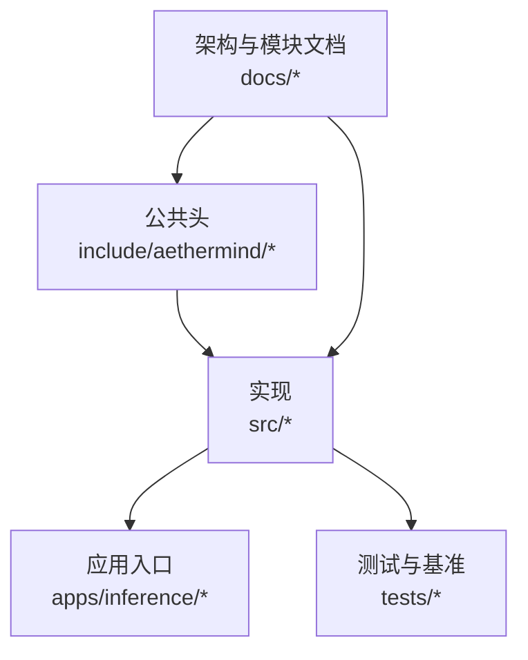

**图表来源**
- [README.md](../../../README.md)
- [docs/README.md](../../README.md)

**章节来源**
- [README.md](../../../README.md)
- [docs/README.md](../../README.md)

## 核心组件
本节对应六层概念边界，但强调它们不是源目录的一一对应关系。

| 概念层 | 代码映射 | 主要职责 | 关键类型/函数 |
|---|---|---|---|
| API 接口层 | `c_api.h`、CLI runner、C++ 公开 API | 暴露稳定 C/C++ 生命周期与同步生成入口；封装错误码与 Token ID I/O | `RunInference`、`InferenceSession::Create`/`Generate` |
| 调度控制层 | `RuntimeBuilder`、`Runtime`、`Executor`、`ModelLoader`、`ExecutableModel`、`InferenceSession` | 协调一次请求的资源装配、会话预约、Prefill/Decode 状态推进 | `Executor::Execute`、`InferenceSession::Generate` |
| 计算图语义层 | `model/build_model_graph.h`、`graph/graph.h`、pass 管理 | 构建 backend-independent 的语义 DAG，执行常量折叠、融合、DCE 等 pass | `BuildModelGraph`、`ModelGraph` |
| 编译器层 | `compiler/model_compiler.h`、`lowered_graph.h` | 组合图构建、优化与 lowering，产出不可变编译产物 | `ModelCompiler::Compile`、`LoweredModelArtifact` |
| 执行计划层 | `execution/execution_plan.h`、`execution_plan_builder.*` | 冻结 kernel、权重绑定、workspace 需求与状态别名 | `ExecutionPlan`、`ExecutionStep` |
| 硬件执行层 | `backend/*`、`operators/*`、`memory/*`、`kv_cache/*` | 选择 kernel、执行 step、管理 workspace 与 KV 物理存储 | `Backend::PrepareKernel`、`LayerRunner`、`CPUAllocator`、`KVCacheManager` |

**章节来源**
- [docs/architecture.md](../../architecture.md)
- [docs/README.md](../../README.md)

## 架构总览
下图展示从外部应用到 CPU 内核的单向主路径。注意：调度控制层负责“一次请求内”的执行步骤编排，而不是多请求负载均衡。

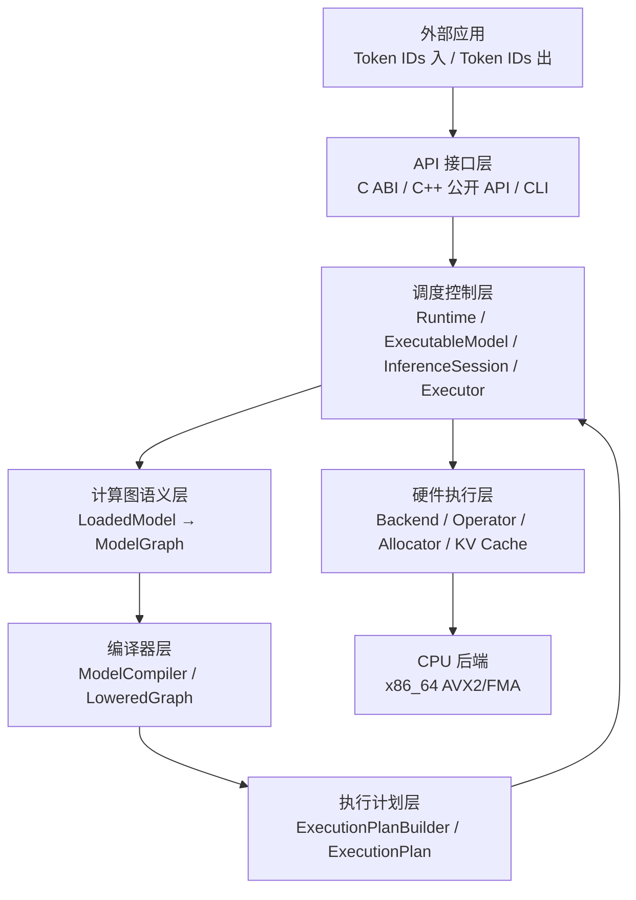

**图表来源**
- [docs/architecture.md](../../architecture.md)
- [README.md](../../../README.md)

## 详细组件分析

### 一、API 接口层
API 接口层是进程内集成边界，不等同于 HTTP/gRPC 服务层。CLI runner 把用户参数转换为内部配置，调用 `ModelLoader`、`ModelCompiler`、`RuntimeBuilder`、`ExecutableModel` 和 `InferenceSession`，最终返回拥有所有权的新增 Token ID。

关键设计要点：
- 同步单次请求：`RunInference` 在单个调用中完成加载、编译、准备、会话创建和生成。
- 失败阶段诊断：`RunStage` 标记参数校验、模型准入、编译、运行期构建、准备、会话或生成失败位置。
- 资源异常归一化：捕获 `std::bad_alloc` 并转为空消息的 `ResourceExhausted`，避免报告错误时再次分配。

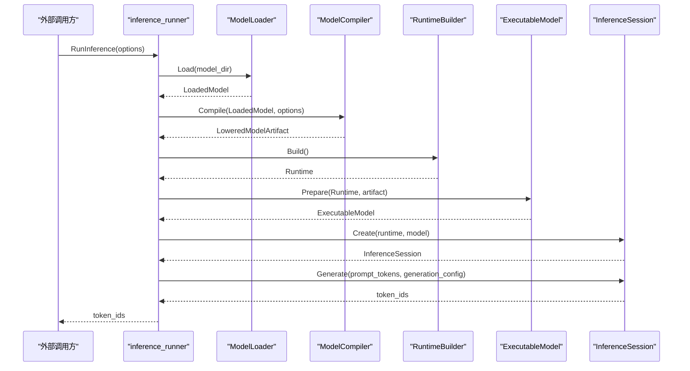

**图表来源**
- [apps/inference/inference_runner.h:10-72](../../../apps/inference/inference_runner.h#L10-L72)
- [apps/inference/inference_runner.cpp:20-120](../../../apps/inference/inference_runner.cpp#L20-L120)

**章节来源**
- [apps/inference/inference_runner.h:10-72](../../../apps/inference/inference_runner.h#L10-L72)
- [apps/inference/inference_runner.cpp:20-120](../../../apps/inference/inference_runner.cpp#L20-L120)

### 二、调度控制层
调度控制层维护一次推理请求的生命周期：
1. 校验 prompt、上下文长度和采样配置。
2. 将模型配置映射为 CPU Runtime 选项与编译预设。
3. 调用 `ModelCompiler::Compile` 得到 `LoweredModelArtifact`。
4. 构建 `Runtime`，再调用 `ExecutableModel::Prepare` 得到可执行模型。
5. 创建 `InferenceSession`，并按 Prompt 长度规划资源。
6. 执行 Prefill/Decode 循环，最后释放 KV 预约。

`InferenceSession` 的关键约束：
- 共享同一个 `Runtime` 的所有 `Generate` 必须串行。
- 每次 `Generate` 使用新的 Prefill 并在返回前释放 KV 预约。
- `PlanResources` 只做几何和资源检查，不分配 tensor Buffer 或执行 kernel。

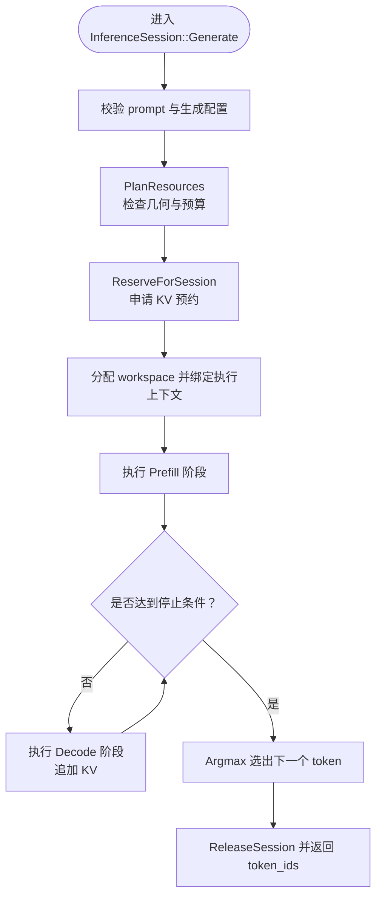

**图表来源**
- [include/aethermind/inference/inference_session.h:20-114](../../../include/aethermind/inference/inference_session.h#L20-L114)
- [src/inference/inference_session.cpp:1-200](../../../src/inference/inference_session.cpp#L1-L200)

**章节来源**
- [include/aethermind/inference/inference_session.h:20-114](../../../include/aethermind/inference/inference_session.h#L20-L114)
- [src/inference/inference_session.cpp:1-200](../../../src/inference/inference_session.cpp#L1-L200)

### 三、计算图语义层
计算图语义层负责把 HF 模型描述转化为 backend-independent 的语义图。

- `ModelLoader` 只处理目录 I/O、config 解析、验证和逻辑权重解析，不构建图、不选择 kernel、不做权重预打包。
- `LoadedModel` 持有已验证的 config 和 resolved weights，不包含后端 artifact。
- `BuildModelGraph` 根据模型家族（例如 Llama Dense）构建 `ModelGraph`。
- `ModelGraph` 是节点与张量值的有向无环图，支持添加输入、权重、常量、状态和算子节点。

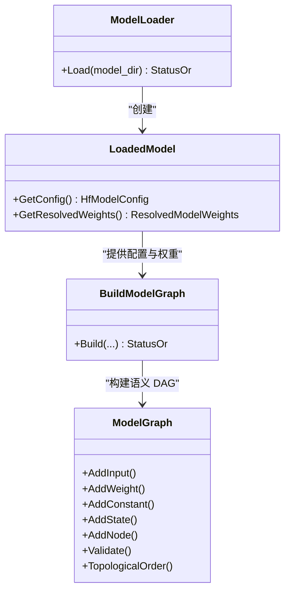

**图表来源**
- [include/aethermind/model/model_loader.h:10-38](../../../include/aethermind/model/model_loader.h#L10-L38)
- [include/aethermind/model/loaded_model.h:10-45](../../../include/aethermind/model/loaded_model.h#L10-L45)
- [include/aethermind/graph/graph.h:10-120](../../../include/aethermind/graph/graph.h#L10-L120)

**章节来源**
- [include/aethermind/model/model_loader.h:10-38](../../../include/aethermind/model/model_loader.h#L10-L38)
- [include/aethermind/model/loaded_model.h:10-45](../../../include/aethermind/model/loaded_model.h#L10-L45)
- [include/aethermind/graph/graph.h:10-120](../../../include/aethermind/graph/graph.h#L10-L120)

### 四、编译器层
编译器层是 `LoadedModel` 到 `LoweredModelArtifact` 的状态机外观：
1. 构建语义图。
2. 应用语义优化 pass，如常量折叠、死代码消除、SiLU-Mul 融合、QKV Linear 融合等。
3. 对语义图进行 lowering，产出结构验证过的 `LoweredGraph`。
4. 不在此阶段 resolve kernel，也不物化权重；这些工作推迟到执行计划构建阶段。

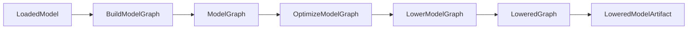

**图表来源**
- [include/aethermind/compiler/model_compiler.h:10-64](../../../include/aethermind/compiler/model_compiler.h#L10-L64)
- [docs/architecture.md](../../architecture.md)

**章节来源**
- [include/aethermind/compiler/model_compiler.h:10-64](../../../include/aethermind/compiler/model_compiler.h#L10-L64)
- [docs/architecture.md](../../architecture.md)

### 五、执行计划层
执行计划层把 compiler 产物翻译成可在运行时执行的不可变计划。

- `ExecutionStep` 冻结一个算子步骤的 kernel selector、resolved kernel、packed weight 引用、workspace 需求和端口映射。
- `ExecutionPlan` 由多个 `ExecutionStep` 组成，并记录模型输入、输出、状态别名计划和 workspace 布局。
- `ExecutionPlanBuilder` 负责向 `Backend` 发起 kernel resolve，并把结果写入 plan。

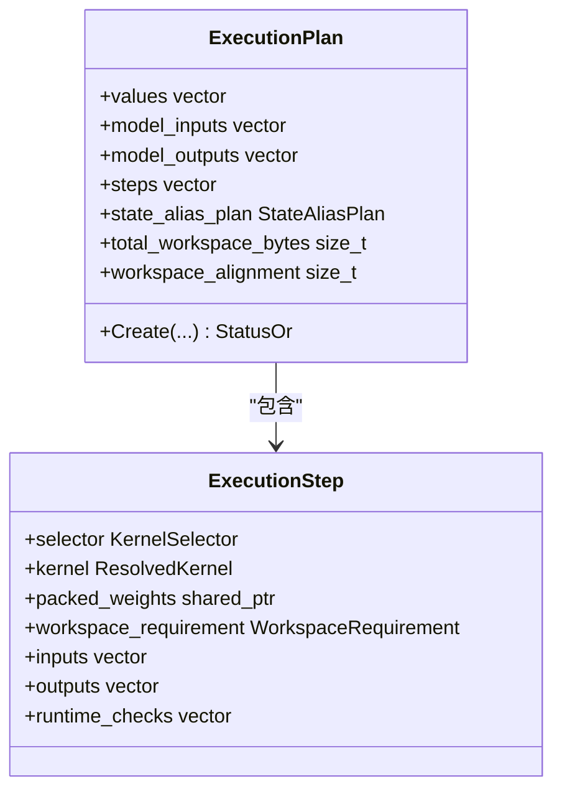

**图表来源**
- [include/aethermind/execution/execution_plan.h:10-200](../../../include/aethermind/execution/execution_plan.h#L10-L200)

**章节来源**
- [include/aethermind/execution/execution_plan.h:10-200](../../../include/aethermind/execution/execution_plan.h#L10-L200)

### 六、硬件执行层
硬件执行层距离 CPU 最近，负责在给定后端上高效执行已冻结的执行计划。

- `Backend` 暴露 kernel resolve、dtype 转换函数、packing recipe 查询和可选的 packed weight 打包接口。
- `Executor` 是同步执行入口，委托给 `LayerRunner` 按序执行每个 step。
- `KVCacheManager` 管理 KV 的物理平面、单 session 预约、提交水位和视图生命周期。
- `Allocator` 统一设备分配入口，`CPUAllocator` 是当前实现的 CPU 分配器。

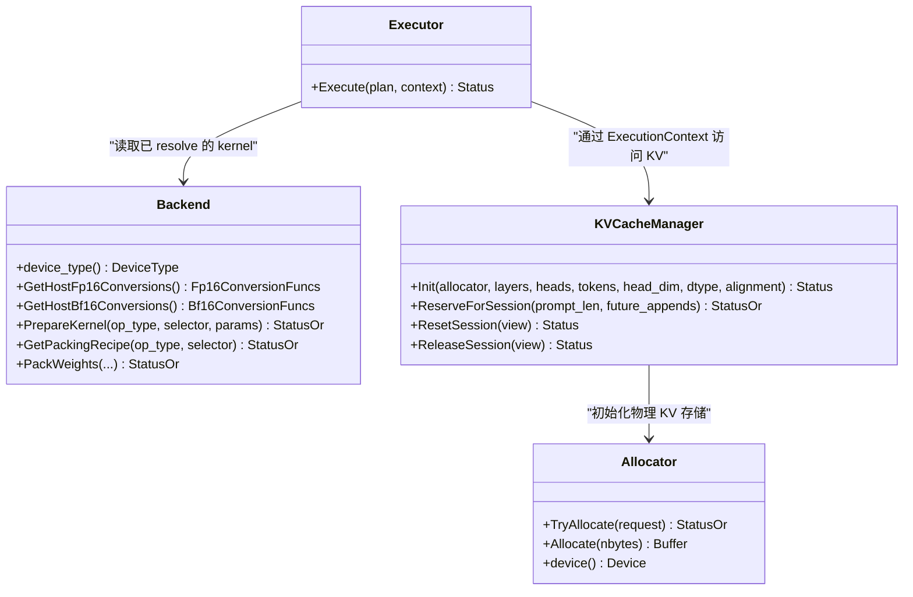

**图表来源**
- [include/aethermind/backend/backend.h:10-163](../../../include/aethermind/backend/backend.h#L10-L163)
- [include/aethermind/execution/executor.h:10-34](../../../include/aethermind/execution/executor.h#L10-L34)
- [include/aethermind/kv_cache/kv_cache_manager.h:10-115](../../../include/aethermind/kv_cache/kv_cache_manager.h#L10-L115)
- [include/aethermind/memory/allocator.h:10-114](../../../include/aethermind/memory/allocator.h#L10-L114)

**章节来源**
- [include/aethermind/backend/backend.h:10-163](../../../include/aethermind/backend/backend.h#L10-L163)
- [include/aethermind/execution/executor.h:10-34](../../../include/aethermind/execution/executor.h#L10-L34)
- [include/aethermind/kv_cache/kv_cache_manager.h:10-115](../../../include/aethermind/kv_cache/kv_cache_manager.h#L10-L115)
- [include/aethermind/memory/allocator.h:10-114](../../../include/aethermind/memory/allocator.h#L10-L114)

## 依赖关系分析
整体依赖方向自顶向下：API 层依赖调度层，调度层依赖图构建、编译器、执行计划和硬件执行层；底层模块不反向依赖上层。

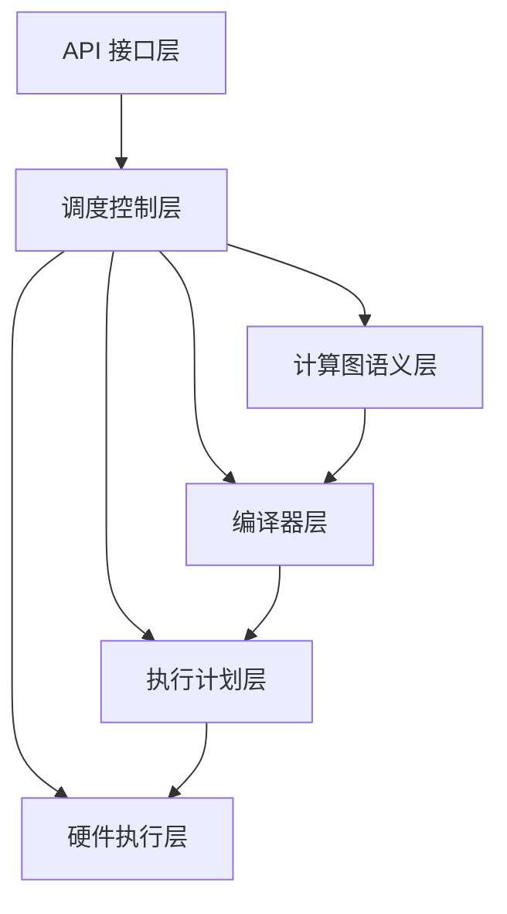

**图表来源**
- [docs/architecture.md](../../architecture.md)

### 关键数据结构关系
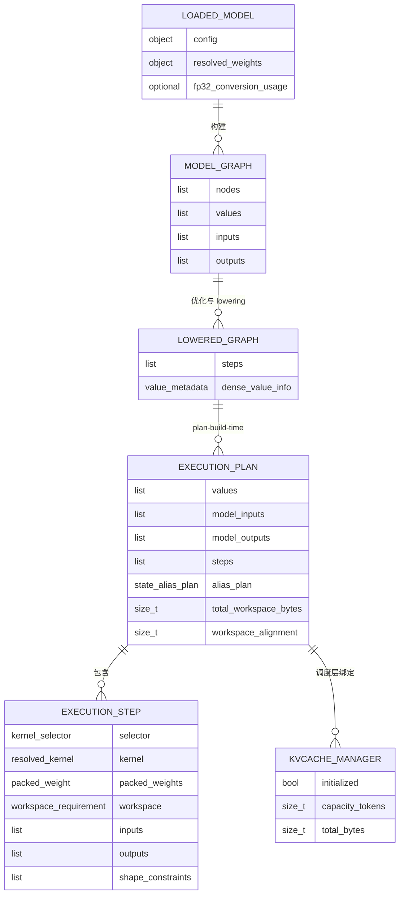

**图表来源**
- [include/aethermind/model/loaded_model.h:10-45](../../../include/aethermind/model/loaded_model.h#L10-L45)
- [include/aethermind/graph/graph.h:10-120](../../../include/aethermind/graph/graph.h#L10-L120)
- [include/aethermind/compiler/model_compiler.h:10-64](../../../include/aethermind/compiler/model_compiler.h#L10-L64)
- [include/aethermind/execution/execution_plan.h:10-200](../../../include/aethermind/execution/execution_plan.h#L10-L200)
- [include/aethermind/kv_cache/kv_cache_manager.h:10-115](../../../include/aethermind/kv_cache/kv_cache_manager.h#L10-L115)

**章节来源**
- [docs/architecture.md](../../architecture.md)

## 性能与内存特性
- 图优化：常量折叠、死代码消除、SiLU-Mul 融合、QKV Linear 融合等 pass 在 lowering 前减少无用计算和中间激活。
- 执行冻结：`ExecutionPlan` 在 plan-build-time 冻结 kernel、workspace 需求和权重绑定，热路径避免 registry/hash/string lookup。
- KV 缓存：静态预分配，单 session reservation；`KVCacheManager` 保证同一时刻只有一个活跃预约，避免并发竞争。
- 工作空间：`WorkspaceArena` 在 allocator 提供的缓冲区内按对齐偏移复用临时内存，减少频繁分配。
- 内存异常：`Allocator::TryAllocate` 对 OOM 返回 ResourceExhausted；推理 runner 将 `std::bad_alloc` 统一归一化为空消息的资源耗尽错误，避免错误报告本身触发二次分配。

[本节为通用性能讨论，不直接分析具体代码片段]

## 故障排查指南

### 常见失败阶段定位
CLI runner 通过 `RunStage` 标识失败发生在哪个阶段：
- `kParameters`：prompt、context、preset 或模型配置不合法。
- `kLoad`：HF 目录无法加载或 config/safetensors 无效。
- `kModelAdmission`：权重策略不符合当前执行策略。
- `kCompile`：图构建、优化或 lowering 失败。
- `kRuntimeBuild`：Runtime 构建失败，通常与后端、分配器或 KV 容量有关。
- `kPrepare`：执行计划构建、kernel resolve 或 packed weight 打包失败。
- `kSession`：会话创建失败。
- `kGenerate`：Prefill/Decode、workspace 或 KV 预约失败。

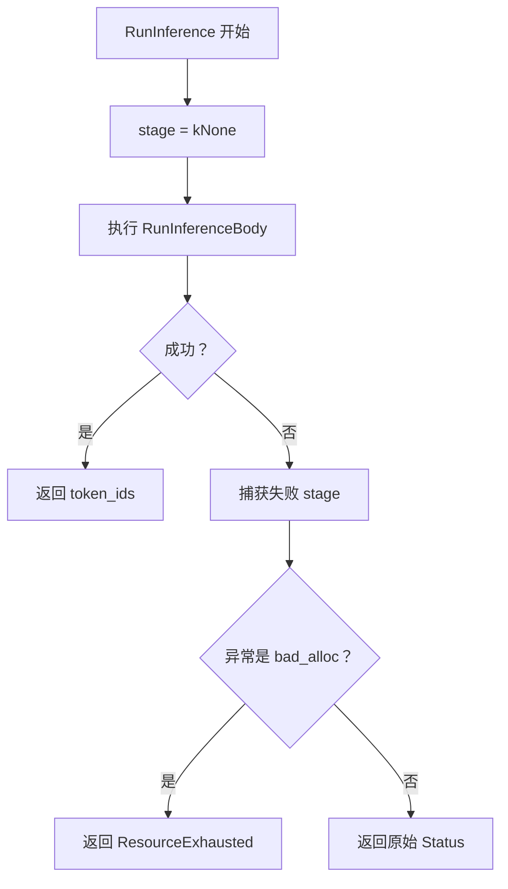

**图表来源**
- [apps/inference/inference_runner.h:20-72](../../../apps/inference/inference_runner.h#L20-L72)
- [apps/inference/inference_runner.cpp:120-200](../../../apps/inference/inference_runner.cpp#L120-L200)

### 资源与配额问题
- `InferenceSession::PlanResources` 可以提前检查 prompt 长度和生成配置是否超出模型上下文或预算，但不做严格 KV 物理容量校验。
- `KVCacheManager::ReserveForSession` 会拒绝未初始化、已有活跃预约或超过物理容量的请求。
- `InferenceSessionOptions.max_request_payload_bytes` 限制 per-request workspace 和激活负载上限。

**章节来源**
- [include/aethermind/inference/inference_session.h:40-114](../../../include/aethermind/inference/inference_session.h#L40-L114)
- [include/aethermind/kv_cache/kv_cache_manager.h:40-115](../../../include/aethermind/kv_cache/kv_cache_manager.h#L40-L115)
- [src/inference/inference_session.cpp:60-160](../../../src/inference/inference_session.cpp#L60-L160)

## 结论
AetherMind 的六层概念责任边界清晰分离了模型加载、语义图构建、编译器 lowering、执行计划冻结、调度控制和硬件执行。其核心数据流是：HF 模型目录 → `ModelLoader` → `LoadedModel` → `ModelCompiler` → `LoweredGraph` → `ExecutionPlan` → `InferenceSession` → Prefill/Decode → Token ID 输出。系统在当前产品范围内聚焦 CPU 上的 Llama Dense FP32 主路径，并通过稳定 C ABI 和 C++ 公开 API 提供可验证、可复现的推理能力。扩展 GPU、批处理、异步服务和更多量化精度属于演进方向，而非当前交付承诺。

[本节为总结性内容，不直接分析具体文件]
