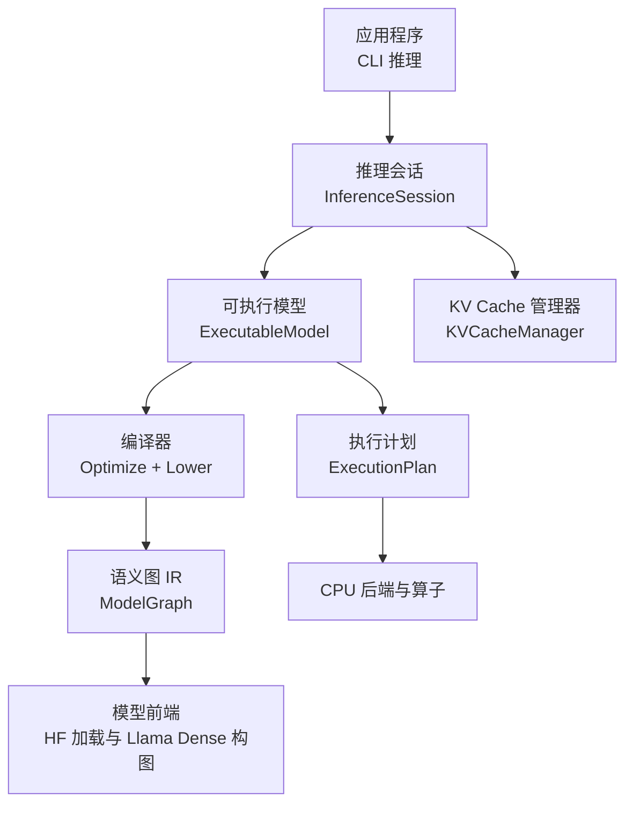
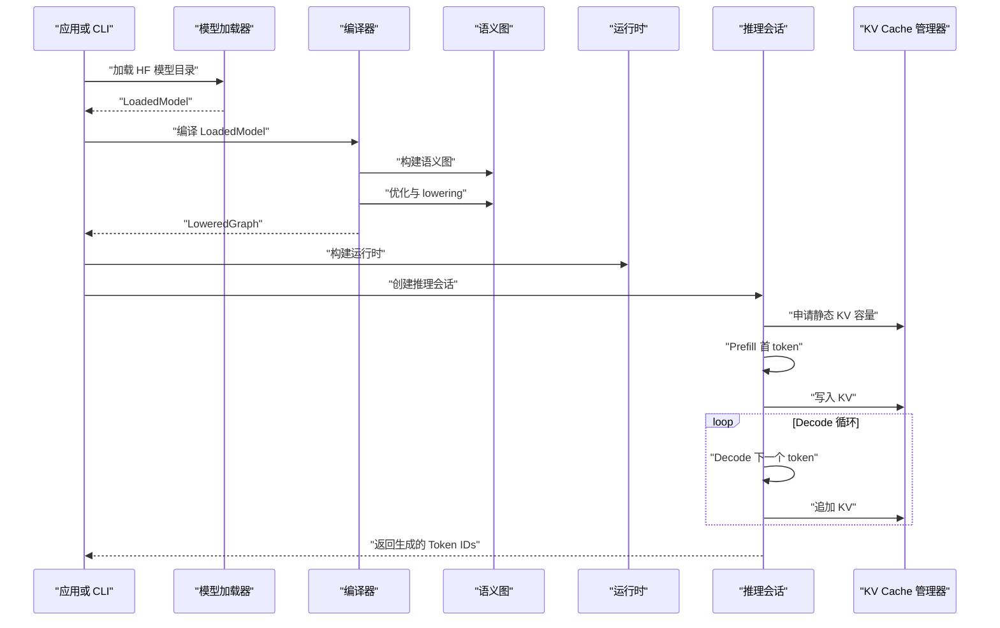
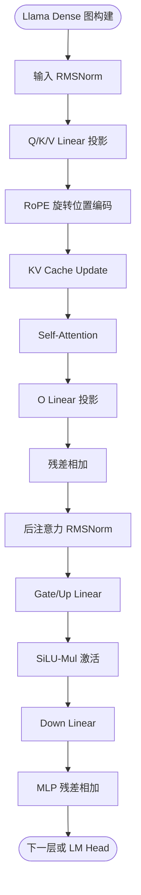
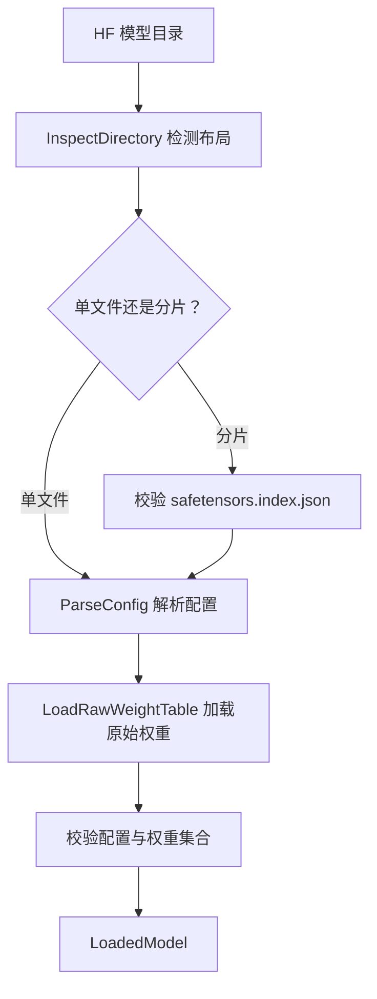
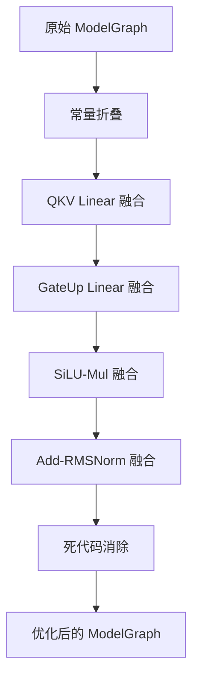
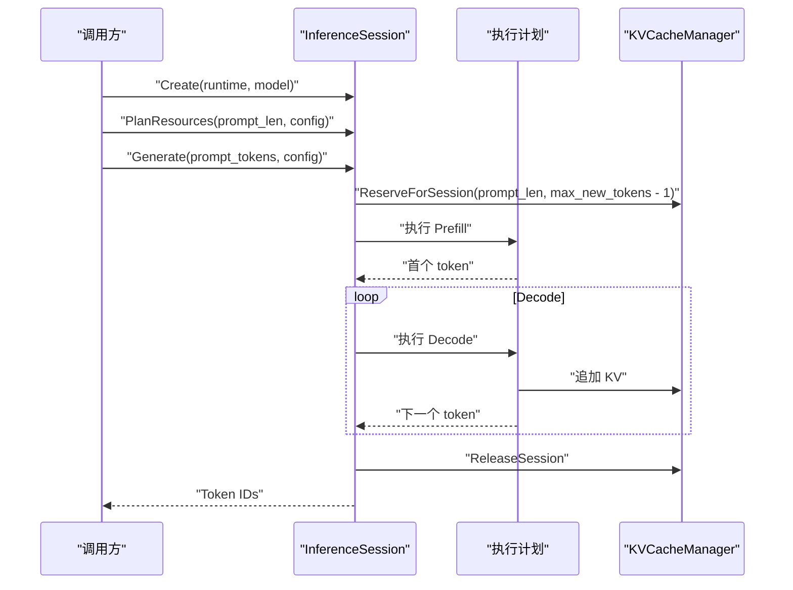
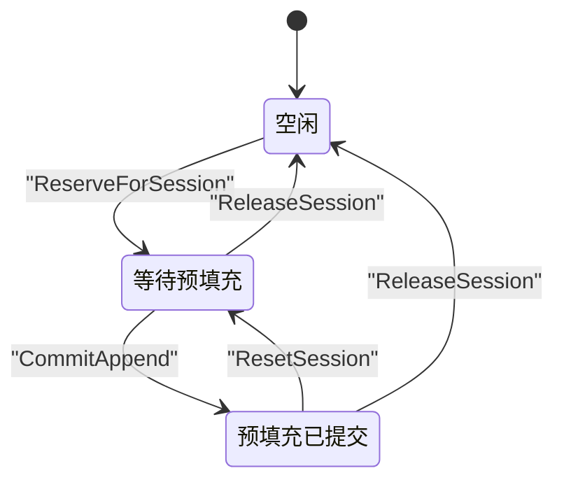
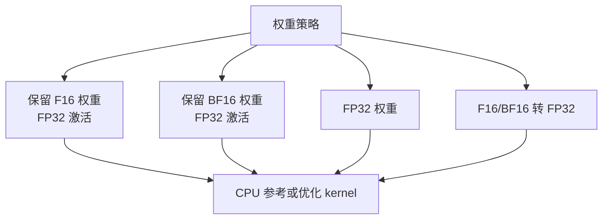
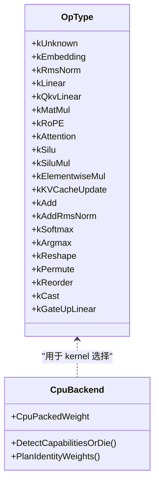
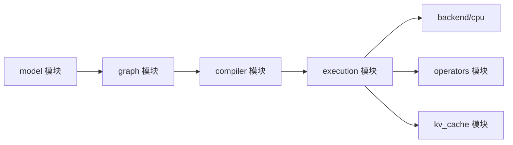

# 核心特性

**本文引用的文件**
- [README.md](../../../README.md)
- [docs/README.md](../../README.md)
- [include/aethermind/model/llama_dense_graph_builder.h](../../../include/aethermind/model/llama_dense_graph_builder.h)
- [src/model/llama_dense_graph_builder.cpp](../../../src/model/llama_dense_graph_builder.cpp)
- [include/aethermind/model/formats/hf/hf_directory_reader.h](../../../include/aethermind/model/formats/hf/hf_directory_reader.h)
- [src/model/](../../../src/model)
- [include/aethermind/compiler/optimize_graph.h](../../../include/aethermind/compiler/optimize_graph.h)
- [src/compiler/optimize_graph.cpp](../../../src/compiler/optimize_graph.cpp)
- [src/compiler/](../../../src/compiler)
- [src/graph/](../../../src/graph)
- [include/aethermind/inference/inference_session.h](../../../include/aethermind/inference/inference_session.h)
- [src/inference/inference_session.cpp](../../../src/inference/inference_session.cpp)
- [include/aethermind/kv_cache/kv_cache_manager.h](../../../include/aethermind/kv_cache/kv_cache_manager.h)
- [src/kv_cache/kv_cache_manager.cpp](../../../src/kv_cache/kv_cache_manager.cpp)
- [src/kv_cache/](../../../src/kv_cache)
- [include/aethermind/operators/op_type.h](../../../include/aethermind/operators/op_type.h)
- [include/aethermind/operators/ops/attention_op.h](../../../include/aethermind/operators/ops/attention_op.h)
- [include/aethermind/operators/ops/kvcache_update_op.h](../../../include/aethermind/operators/ops/kvcache_update_op.h)
- [src/backend/cpu/cpu_backend.cpp](../../../src/backend/cpu/cpu_backend.cpp)

## 目录
1. [引言](#引言)
2. [项目结构](#项目结构)
3. [核心能力总览](#核心能力总览)
4. [架构总览](#架构总览)
5. [详细特性分析](#详细特性分析)
6. [依赖关系与边界](#依赖关系与边界)
7. [性能与适用场景](#性能与适用场景)
8. [故障排查指南](#故障排查指南)
9. [结论](#结论)

## 引言
AetherMind 是面向桌面与服务器的 C++20 CPU 推理运行时，当前产品范围聚焦 Llama 家族中的密集模型。它提供命令行接口与稳定的 C ABI，支持同步、单请求的贪婪生成；同时暴露 C++ API，用于显式 FP32 推理、W16/A32 权重策略、静态 KV 存储以及 Token ID 输入输出。系统由模型加载、语义图构建、编译器优化、执行计划、推理会话和静态 KV Cache 等模块组成，整体采用“前端模型 → 语义图 → 编译产物 → 执行期绑定”的分层设计。

本章节总结项目定位、已交付能力与未承诺方向，并给出高层调用链：`ModelLoader::Load → ModelCompiler::Compile → RuntimeBuilder::TryBuild → ExecutableModel::Prepare → InferenceSession::Create → Generate`。

**章节来源**
- [README.md](../../../README.md)
- [docs/README.md](../../README.md)

## 项目结构
仓库按公共头、实现、应用、测试、文档与工具分层组织：

- `include/aethermind/`：对外 C++ 头文件，覆盖 base、dtypes、model、graph、compiler、operators、backend、execution、kv_cache、runtime、memory 等模块。
- `src/`：与 include 对称的实现源码，包含后端、编译器、推理、KV Cache、算子、形状推断等。
- `apps/inference/`：独立 CLI 程序入口与同步推理运行器。
- `tests/`：单元测试、夹具与基准测试。
- `docs/`：权威架构文档、模块说明、算子契约与开发指南。
- `cmake/` 与 `tools/`：构建辅助脚本、依赖获取与验证工具。

**图表来源**
- [README.md](../../../README.md)
- [src/compiler/](../../../src/compiler)
- [src/model/](../../../src/model)

**章节来源**
- [README.md](../../../README.md)
- [docs/README.md](../../README.md)

## 核心能力总览
| 能力 | 解决的问题 | 使用场景 | 技术要点 |
|---|---|---|---|
| Llama Dense 模型支持 | 将 HF Llama 检查点转换为可执行的 CPU 推理图 | Llama 系列密集模型的本地推理 | 通过 `BuildLlamaDense` 构建注意力块、MLP、RoPE、KV Cache Update、Argmax 等节点 |
| HF 格式解析 | 统一读取 `config.json` 与 safetensors，包括分片模型 | 直接加载 HuggingFace 风格模型目录 | 目录检测、布局判定、配置解析、原始张量视图解析 |
| 图编译优化 | 减少运行时计算、合并相邻算子、消除无用节点 | 模型准备阶段一次性优化 | 常量折叠、死代码消除、QKV Linear 融合、GateUp Linear 融合、SiLU-Mul 融合、Add-RMSNorm 融合 |
| Prefill/Decode 推理流程 | 分离首 token 并行预填充与后续逐 token 解码 | 长上下文生成、对话续写 | `InferenceSession::Generate` 先 Prefill 再 Decode，最后 Argmax 停止 |
| 静态 KV Cache 管理 | 避免每次生成重复分配 K/V 内存 | 固定长度或上限的会话推理 | 一次性规划 K/V plane，单 session 预约、提交水位、view 生命周期控制 |
| 多精度权重支持 | 在保留权重体积的同时维持 FP32 激活数值稳定性 | FP32/BF16/F16/W16 权重策略选择 | `WeightPolicy`、显式 FP32 转换、W16 保留矩阵但激活为 FP32 |
| 算子语义与执行 | 覆盖 Llama Dense 推理所需的基础与复合算子 | 从 Embedding 到 Attention、RMSNorm、Linear、KV Cache Update 等 | [OpType 枚举](../../../include/aethermind/operators/op_type.h)、算子 schema、参考与 SIMD 内核、CPU 后端注册 |

**章节来源**
- [README.md](../../../README.md)
- [include/aethermind/operators/op_type.h:10-60](../../../include/aethermind/operators/op_type.h#L10-L60)

## 架构总览
AetherMind 的核心数据流从 HF 模型目录开始，经过模型加载、语义图构建、编译优化、lowering、执行计划装配，最终由推理会话驱动 Prefill 与 Decode。

**图表来源**
- [README.md](../../../README.md)
- [include/aethermind/inference/inference_session.h:40-110](../../../include/aethermind/inference/inference_session.h#L40-L110)
- [include/aethermind/kv_cache/kv_cache_manager.h:20-110](../../../include/aethermind/kv_cache/kv_cache_manager.h#L20-L110)

**章节来源**
- [README.md](../../../README.md)
- [src/compiler/](../../../src/compiler)

## 详细特性分析

### Llama Dense 模型支持
#### 解决什么问题
HuggingFace Llama 检查点包含大量命名规范不同的权重张量，而不同部署路径需要统一的语义表达。Llama Dense 支持把 HF 配置与权重映射成 backend-independent 的语义图，从而让同一套优化和执行管线复用。

#### 使用场景
- 直接加载 HF 风格的 Llama 密集模型。
- 需要可优化的语义图，而不是直接调用原始 kernel。
- 需要与其他模型前端的图构建流程保持一致。

#### 技术实现要点
- `BuildLlamaDense` 是 HF 到语义图的唯一权威入口之一，负责校验 RoPE 变体并拒绝不支持的配置。
- 每个 decoder layer 被拆分为注意力块与 MLP 块，包含 RMSNorm、Linear、RoPE、KV Cache Update、Attention、Elementwise Add 等节点。
- 注意力块通常包含输入归一化、Q/K/V 投影、旋转位置编码、KV 缓存更新、自注意力、输出投影与残差相加。
- MLP 块包含后注意力归一化、Gate/Up 线性变换、非线性激活、Down 线性变换与残差相加。
- 可选的 FP32 residual 会在特定边界插入类型转换节点，以平衡数值稳定与图复杂度。

**图表来源**
- [src/model/llama_dense_graph_builder.cpp:1-200](../../../src/model/llama_dense_graph_builder.cpp#L1-L200)
- [include/aethermind/model/llama_dense_graph_builder.h:1-27](../../../include/aethermind/model/llama_dense_graph_builder.h#L1-L27)

**章节来源**
- [include/aethermind/model/llama_dense_graph_builder.h:1-27](../../../include/aethermind/model/llama_dense_graph_builder.h#L1-L27)
- [src/model/llama_dense_graph_builder.cpp:1-200](../../../src/model/llama_dense_graph_builder.cpp#L1-L200)
- [src/model/](../../../src/model)

### HF 格式解析
#### 解决什么问题
HF 模型可能采用单文件 safetensors，也可能采用分片索引；配置字段存在向前兼容差异。如果解析失败或布局歧义，不应产生部分图或不可信权重。

#### 使用场景
- 直接加载 `config.json` + `*.safetensors` 的 HF 风格目录。
- 处理大模型分片，要求 index 与 shard 一致。
- 只进行目录检查，不加载完整权重时快速失败。

#### 技术实现要点
- `HfDirectoryReader` 支持单文件或分片 safetensors 布局，混合布局会被拒绝。
- `InspectDirectory` 只做目录形状与 layout 检测，不加载配置或权重。
- `ParseConfig` 解析 HF 配置子集，未知字段跳过，保持向前兼容。
- `LoadRawWeightTable` 加载 raw tensor 视图，分片模式下要求每个 indexed tensor 恰好出现一次。
- 模型校验包括维度、dtype、RoPE、注意力头数、bias/量化/adapter 策略等。

**图表来源**
- [include/aethermind/model/formats/hf/hf_directory_reader.h:20-100](../../../include/aethermind/model/formats/hf/hf_directory_reader.h#L20-L100)
- [src/model/](../../../src/model)

**章节来源**
- [include/aethermind/model/formats/hf/hf_directory_reader.h:1-109](../../../include/aethermind/model/formats/hf/hf_directory_reader.h#L1-L109)
- [src/model/](../../../src/model)

### 图编译优化
#### 解决什么问题
原始语义图可能包含可直接计算的常量、不再使用的中间值，以及可以合并的连续算子。这些冗余会增加 lowering 产物大小、执行步骤数量和内存访问压力。

#### 使用场景
- 模型准备阶段希望尽可能减少运行时算子数量。
- 对吞吐敏感且允许更长编译时间的离线部署。
- 需要根据优化等级调整 pass 组合。

#### 技术实现要点
- `OptimizeModelGraph` 根据 `PassContext::opt_level` 决定默认 pass 顺序。
- 默认优化等级会依次执行常量折叠、QKV Linear 融合、GateUp Linear 融合、SiLU-Mul 融合、Add-RMSNorm 融合，最后再做死代码消除。
- graph 模块提供 rewrite 框架与 pass 管理器；compiler 模块只负责组合默认 pipeline。
- 优化后的新图与原图解耦，原图保持不变。

**图表来源**
- [src/compiler/optimize_graph.cpp:1-40](../../../src/compiler/optimize_graph.cpp#L1-L40)
- [src/compiler/](../../../src/compiler)
- [src/graph/](../../../src/graph)

**章节来源**
- [include/aethermind/compiler/optimize_graph.h:1-20](../../../include/aethermind/compiler/optimize_graph.h#L1-L20)
- [src/compiler/optimize_graph.cpp:1-40](../../../src/compiler/optimize_graph.cpp#L1-L40)
- [src/compiler/](../../../src/compiler)
- [src/graph/](../../../src/graph)

### Prefill/Decode 推理流程
#### 解决什么问题
LLM 首 token 可由 prompt 并行计算，后续 token 必须依赖之前所有 KV 状态。若不分阶段，既无法有效利用静态 KV，也难以准确控制每步工作空间与内存峰值。

#### 使用场景
- 单请求贪婪生成。
- 已知 prompt 长度与最大生成 token 数。
- 需要明确区分首 token 预测与后续 decode 步骤。

#### 技术实现要点
- `InferenceSession::Create` 从已准备的 `ExecutableModel` 创建同步推理会话。
- `PlanResources` 在不预留 KV 的情况下评估资源需求。
- `Generate` 先执行 Prefill，得到第一个预测 token，然后最多执行 `max_new_tokens - 1` 次 Decode KV 追加。
- 每个请求结束后释放 KV 预约；异常或分配失败时报告资源耗尽。
- 请求级 workspace 与外部 tensor binding 在 session 内部完成。

**图表来源**
- [include/aethermind/inference/inference_session.h:40-110](../../../include/aethermind/inference/inference_session.h#L40-L110)
- [src/inference/inference_session.cpp:1-200](../../../src/inference/inference_session.cpp#L1-L200)
- [include/aethermind/kv_cache/kv_cache_manager.h:40-110](../../../include/aethermind/kv_cache/kv_cache_manager.h#L40-L110)

**章节来源**
- [include/aethermind/inference/inference_session.h:1-114](../../../include/aethermind/inference/inference_session.h#L1-L114)
- [src/inference/inference_session.cpp:1-200](../../../src/inference/inference_session.cpp#L1-L200)

### 静态 KV Cache 管理
#### 解决什么问题
逐 token 生成需要频繁读写 K/V 状态。若每次分配或复制 KV，会导致严重内存碎片、延迟上升与峰值内存不可控。

#### 使用场景
- 固定最大 token 容量的会话。
- 不需要 PagedAttention、连续批处理或跨请求 prefix cache。
- CPU 端轻量部署，优先确定性内存行为。

#### 技术实现要点
- `KVCacheManager` 持有连续的 K/V plane 物理存储，按层、head、token、dim 规划 stride。
- `Init` 一次性分配 key_buffer 与 value_buffer，失败时不会暴露半初始化状态。
- `ReserveForSession` 在同一时刻只允许一个活动预约，并记录 prompt_len、capacity_tokens、committed_tokens。
- `ResetSession` 保留预约并回到等待 Prefill 状态；`ReleaseSession` 释放预约并使 view 失效。
- View 提供 append/read binding，kernel 通过 stride 定位，而不是直接操作裸指针。

**图表来源**
- [include/aethermind/kv_cache/kv_cache_manager.h:20-115](../../../include/aethermind/kv_cache/kv_cache_manager.h#L20-L115)
- [src/kv_cache/kv_cache_manager.cpp:1-176](../../../src/kv_cache/kv_cache_manager.cpp#L1-L176)
- [src/kv_cache/](../../../src/kv_cache)

**章节来源**
- [include/aethermind/kv_cache/kv_cache_manager.h:1-115](../../../include/aethermind/kv_cache/kv_cache_manager.h#L1-L115)
- [src/kv_cache/kv_cache_manager.cpp:1-176](../../../src/kv_cache/kv_cache_manager.cpp#L1-L176)
- [src/kv_cache/](../../../src/kv_cache)

### 多精度权重支持
#### 解决什么问题
FP32 权重体积较大，BF16/F16 能减少存储与带宽压力；W16/A32 策略可在保留 16-bit 权重的同时维持 FP32 激活路径，兼顾体积与数值稳定性。

#### 使用场景
- 受磁盘或内存限制的部署。
- 需要在 CPU 上保留高精度激活路径。
- 使用 HF 原生 BF16/F16 权重但不想全部转为 FP32。

#### 技术实现要点
- `ExecutableModel::Load` 通过 `ModelLoadOptions::weights` 选择权重策略。
- 支持的策略包括：要求 FP32、将 F16/BF16 转为 FP32、保留 F16 权重并使用 FP32 激活、保留 BF16 权重并使用 FP32 激活。
- 显式 FP32 转换会生成新的 `LoadedModel`，源模型不变。
- W16 保留 Embedding、Linear、LM Head 矩阵的 16-bit 格式，但当前 Linear 参考 kernel 不一定带来更高吞吐。
- Attention 与 KV Cache Update 的 dtype 契约支持 FP32、FP16、BF16，并在 KV16 场景中允许激活与缓存之间的混合约定。

**图表来源**
- [README.md](../../../README.md)
- [include/aethermind/operators/ops/attention_op.h:15-55](../../../include/aethermind/operators/ops/attention_op.h#L15-L55)
- [include/aethermind/operators/ops/kvcache_update_op.h:15-53](../../../include/aethermind/operators/ops/kvcache_update_op.h#L15-L53)

**章节来源**
- [README.md](../../../README.md)
- [include/aethermind/operators/ops/attention_op.h:1-55](../../../include/aethermind/operators/ops/attention_op.h#L1-L55)
- [include/aethermind/operators/ops/kvcache_update_op.h:1-53](../../../include/aethermind/operators/ops/kvcache_update_op.h#L1-L53)

### 算子实现
#### 解决什么问题
Llama Dense 推理不仅依赖通用矩阵乘，还依赖 RMSNorm、RoPE、Embedding、Softmax、Argmax、KV Cache Update、多种线性与元素级算子。若算子不完整，就无法表达完整的语义图。

#### 使用场景
- 构建 Llama Dense 语义图。
- 在 CPU 后端选择对应 kernel。
- 扩展新算子时需要遵循统一 OpType 与 schema 体系。

#### 技术实现要点
- `OpType` 定义稳定的算子类型标签，用于语义调度、schema 校验与执行计划构建。
- 当前枚举覆盖 Embedding、RMSNorm、Linear、QkvLinear、MatMul、RoPE、Attention、Silu、SiluMul、ElementwiseMul、KVCacheUpdate、Add、AddRmsNorm、Softmax、Argmax、Reshape、Permute、Reorder、Cast、GateUpLinear。
- 算子支持通过 `OperatorSchema`、`op_params`、`operator_inference` 统一管理。
- CPU 后端封装 packed weight、capability detection、identity packing 与重量级打包计划。

**图表来源**
- [include/aethermind/operators/op_type.h:10-64](../../../include/aethermind/operators/op_type.h#L10-L64)
- [src/backend/cpu/cpu_backend.cpp:1-200](../../../src/backend/cpu/cpu_backend.cpp#L1-L200)

**章节来源**
- [include/aethermind/operators/op_type.h:1-64](../../../include/aethermind/operators/op_type.h#L1-L64)
- [src/backend/cpu/cpu_backend.cpp:1-200](../../../src/backend/cpu/cpu_backend.cpp#L1-L200)

## 依赖关系与边界
- model 模块负责 HF I/O、配置校验、权重解析与 Llama Dense 语义图构建。
- graph 模块负责 backend-independent 的语义图、重写框架与 semantic passes。
- compiler 模块负责优化 pass 组合与 lowering，产出不可变的 `LoweredGraph`。
- execution 模块负责执行计划、workspace 规划、kernel 绑定与调度。
- kv_cache 模块负责静态 KV 物理存储与单 session 生命周期。
- operators 模块提供算子类型、schema、参数序列化与推理契约。
- backend/cpu 提供 CPU 能力检测、packed weight 包装与具体 kernel 选择逻辑。

**图表来源**
- [src/model/](../../../src/model)
- [src/graph/](../../../src/graph)
- [src/compiler/](../../../src/compiler)
- [src/kv_cache/](../../../src/kv_cache)

**章节来源**
- [src/model/](../../../src/model)
- [src/graph/](../../../src/graph)
- [src/compiler/](../../../src/compiler)
- [src/kv_cache/](../../../src/kv_cache)

## 性能与适用场景
| 特性 | 性能优势 | 适用场景 | 限制或注意事项 |
|---|---|---|---|
| Llama Dense 语义图 | 将模型结构固化为可优化、可 lower 的 DAG | 标准 Llama 密集模型 | 当前不支持 MoE、encoder-decoder 或其他家族 |
| HF 解析 | 统一前端，减少适配成本 | HF 风格检查点 | 不支持的 RoPE 变体或非法布局会直接失败 |
| 常量折叠与死代码消除 | 减少无意义计算与无效节点 | 所有优化等级 | 低优化等级下收益较小 |
| 算子融合 | 减少中间结果写出、提升访存局部性 | 高吞吐离线部署 | 融合增加图构建复杂度 |
| Prefill/Decode 分离 | 充分利用静态 KV 与并行首 token 计算 | 长 prompt + 多 token 生成 | 当前不支持 continuous batching |
| 静态 KV Cache | 避免逐 token 动态分配 | 固定长度或上限推理 | 不支持 PagedAttention、prefix cache |
| 多精度权重 | 减小权重体积，保持 FP32 激活稳定性 | CPU 部署、内存受限环境 | W16 不自动等于更高吞吐 |
| 算子系统 | 覆盖 Llama Dense 主要计算路径 | 完整语义图执行 | 新增算子需补充 schema、kernel 与测试 |

[本节为通用性能讨论，不直接分析具体代码文件]

## 故障排查指南
| 现象 | 可能原因 | 排查建议 |
|---|---|---|
| HF 模型目录加载失败 | config 缺失、safetensors 布局冲突、shard 不一致 | 先用 `InspectDirectory` 检查目录；确认单文件或分片模式一致 |
| Llama Dense 图构建失败 | 不支持的 RoPE 变体、dtype 不匹配、权重 shape 错误 | 检查 config 中 RoPE 配置、linear dtype 是否统一、layer 权重维度 |
| 编译优化后图异常 | pass 组合不当或图本身不合法 | 降低 `opt_level`；先跑常量折叠与 DCE，再启用融合 |
| KV Cache 预约失败 | 未初始化、已有活动预约、prompt 为空、超过物理容量 | 检查 `is_initialized()`、`ValidateReservation`、`prompt_len` 与 `max_new_tokens` |
| 推理会话资源耗尽 | workspace 或 activation 分配失败 | 查看 `PlanResources` 返回值；减少 prompt 长度或生成 token 数 |
| 算子 dtype 不支持 | Attention 或 KV Cache Update 使用了非法 dtype 组合 | 确认 q、k、v、cache dtype 符合契约；KV16 场景注意激活与缓存混合规则 |
| CPU 后端 packing 失败 | 权重视图不连续、dtype 非法、shape 溢出 | 检查 row-major 连续性、固定 lane 数、元素个数与字节数溢出 |

**章节来源**
- [include/aethermind/kv_cache/kv_cache_manager.h:40-110](../../../include/aethermind/kv_cache/kv_cache_manager.h#L40-L110)
- [src/kv_cache/kv_cache_manager.cpp:40-176](../../../src/kv_cache/kv_cache_manager.cpp#L40-L176)
- [include/aethermind/operators/ops/attention_op.h:15-55](../../../include/aethermind/operators/ops/attention_op.h#L15-L55)
- [include/aethermind/operators/ops/kvcache_update_op.h:15-53](../../../include/aethermind/operators/ops/kvcache_update_op.h#L15-L53)
- [src/backend/cpu/cpu_backend.cpp:60-200](../../../src/backend/cpu/cpu_backend.cpp#L60-L200)

## 结论
AetherMind 的核心价值在于：以 HF Llama Dense 模型为起点，通过语义图与编译器优化形成可复用的执行产物，再用同步推理会话与静态 KV Cache 完成高效的 Prefill/Decode 生成。其关键优势包括明确的模块边界、稳定的算子类型体系、可控的多精度权重策略，以及面向 CPU 的确定性内存与执行行为。对于需要本地 Llama 密集模型推理、可解释图优化流程和稳定 FP32 激活路径的用户，该工程提供了清晰的接入点；对于 GPU 卸载、分布式推理、连续批处理等更复杂场景，则属于文档中标注的演进方向而非当前交付承诺。

[本节为总结性内容，不直接分析具体代码文件]
