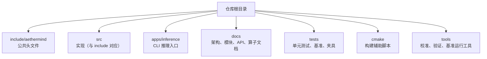
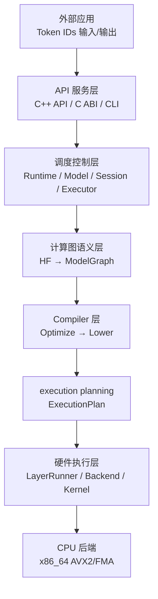
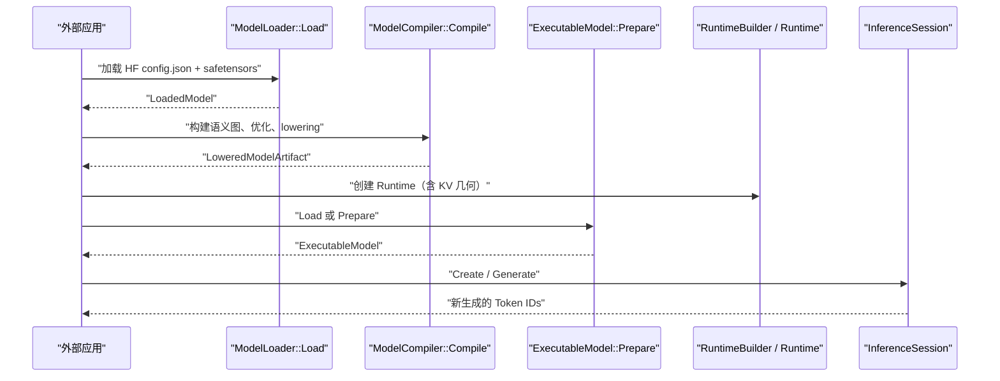
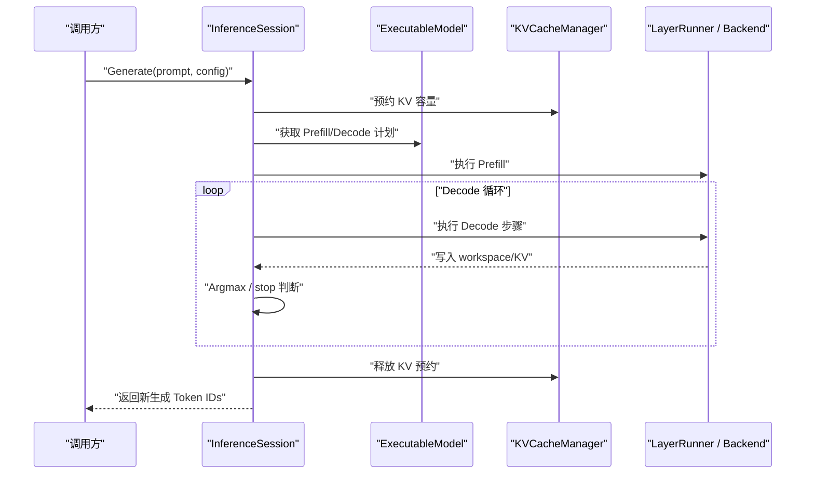
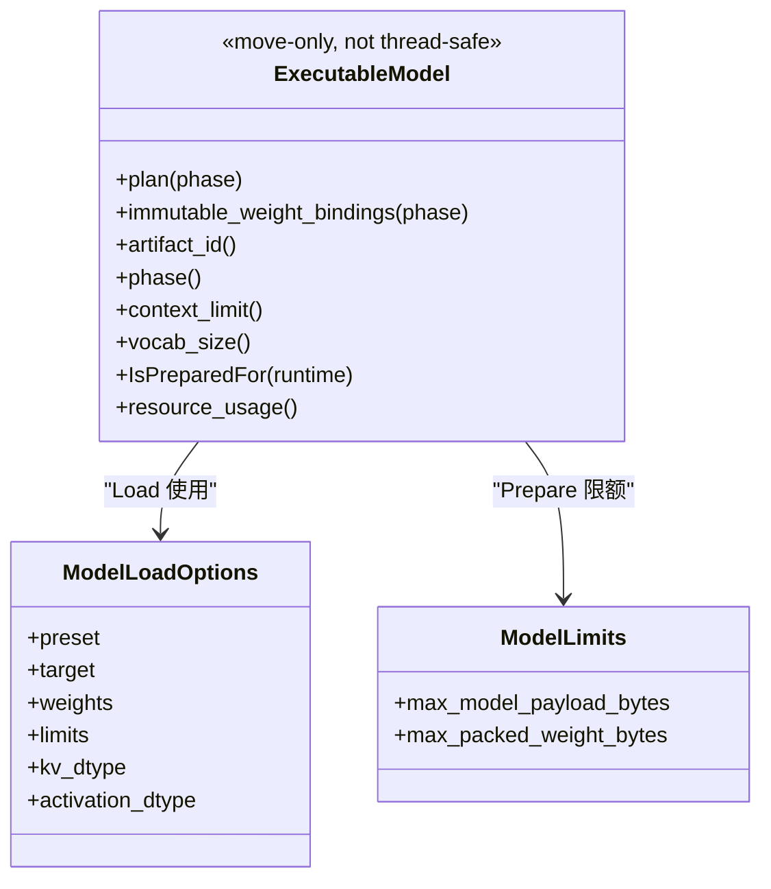
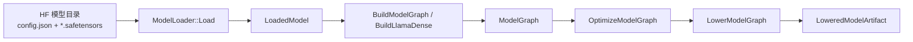
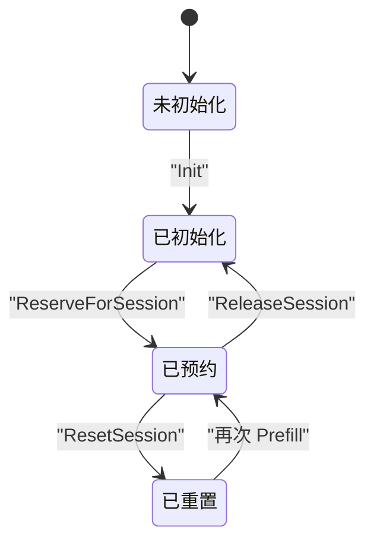
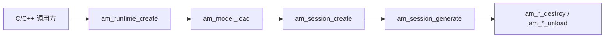
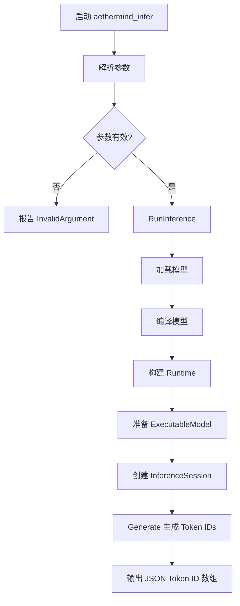
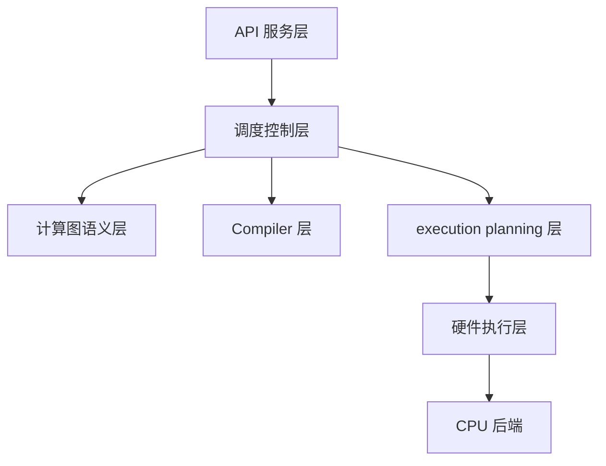

# 项目概览

**本文引用的文件**
- [README.md](../../../README.md)
- [docs/README.md](../../README.md)
- [docs/architecture.md](../../architecture.md)
- [docs/api/public-api.md](../../api/public-api.md)
- [docs/api/runtime-c-abi.md](../../api/runtime-c-abi.md)
- [include/c_api.h](../../../include/c_api.h)
- [apps/inference/inference_main.cpp](../../../apps/inference/inference_main.cpp)
- [apps/inference/inference_runner.h](../../../apps/inference/inference_runner.h)
- [src/c_api_runtime.cpp](../../../src/c_api_runtime.cpp)
- [include/aethermind/compiler/model_compiler.h](../../../include/aethermind/compiler/model_compiler.h)
- [include/aethermind/inference/executable_model.h](../../../include/aethermind/inference/executable_model.h)
- [include/aethermind/inference/inference_session.h](../../../include/aethermind/inference/inference_session.h)
- [include/aethermind/kv_cache/kv_cache_manager.h](../../../include/aethermind/kv_cache/kv_cache_manager.h)
- [include/aethermind/runtime/runtime_builder.h](../../../include/aethermind/runtime/runtime_builder.h)

## 目录
1. [引言](#引言)
2. [项目结构](#项目结构)
3. [核心组件](#核心组件)
4. [架构总览](#架构总览)
5. [详细组件分析](#详细组件分析)
6. [依赖关系分析](#依赖关系分析)
7. [性能与优化特性](#性能与优化特性)
8. [故障排查指南](#故障排查指南)
9. [结论](#结论)

## 引言
AetherMind 是一个基于 C++20 的桌面与服务器 CPU 推理引擎，面向 Llama Dense 家族模型提供本地推理能力。它通过 Hugging Face `config.json` 与 `*.safetensors` 格式加载模型，构建语义计算图，执行常量折叠、死代码消除、算子融合等编译期优化，最终生成不可变的执行计划，并在 CPU 后端上通过 Prefill 和 Decode 进行贪婪生成。C++、Runtime C ABI v1 与 CLI 采用同步单请求和静态 KV Cache。各入口支持的权重、activation 与 KV 组合见 [产品能力矩阵](../../product.md#14-当前能力与验证状态)。

本概览文档面向两类读者：
- 初学者：解释 LLM 推理中 Prompt 输入、Prefill、Decode、KV Cache、Token ID 输出等基本概念。
- 有经验的开发者：给出六层架构、主要组件职责、API 暴露方式、错误边界与资源契约的系统级视图。

**章节来源**
- [README.md](../../../README.md)
- [docs/README.md](../../README.md)

## 项目结构
仓库采用“头文件定义 + 源码镜像”的组织方式，公共接口位于 `include/aethermind/`，实现位于 `src/`，CLI 应用位于 `apps/inference/`，文档、测试与构建脚本分别位于 `docs/`、`tests/` 与 `cmake/`、根目录。

**图示来源**
- [README.md](../../../README.md)

从用户视角看，主要入口有三类：
- C++ 公开 API：`RuntimeBuilder`、`ModelLoader`、`ModelCompiler`、`ExecutableModel`、`InferenceSession`。
- C ABI v1：`am_runtime_create`、`am_model_load`、`am_session_create`、`am_session_generate` 等句柄式接口。
- CLI 工具：`aethermind_infer`，解析参数后调用内部 runner 完成完整推理流程。

**章节来源**
- [README.md](../../../README.md)
- [docs/README.md](../../README.md)

## 核心组件
本节按 AetherMind 的六层概念责任划分，说明每个层次的核心对象和职责。

| 层级 | 主要组件 | 职责简述 |
|---|---|---|
| API 服务层 | C ABI v1、C++ 公开 API、CLI | 定义进程内集成边界，暴露 Token IDs 输入输出、生命周期与错误码。 |
| 调度控制层 | `RuntimeBuilder`、`Runtime`、`Executor`、`ModelLoader`、`ExecutableModel`、`InferenceSession` | 装配运行时资源，编排一次请求的 Prefill/Decode 生命周期。 |
| 计算图语义层 | `BuildModelGraph`、`BuildLlamaDense`、`GraphRewrite`、`GraphPassManager` | 将 HF 配置与权重转换为 backend-independent 的语义图并执行优化 pass。 |
| Compiler 层 | `ModelCompiler`、`LoweredGraph` | 组合优化与 lowering，产出不可变编译产物。 |
| Execution planning 层 | `ExecutionPlanBuilder`、`ExecutionPlan`、`StateAliasPlan` | 冻结 kernel resolve、权重绑定与 workspace 需求。 |
| 硬件执行层 | `LayerRunner`、`Backend`、`KernelRegistry`、`CPUAllocator` | 在 CPU 后端按执行计划高效调用算子 kernel。 |

这些层级是逻辑责任边界，不是源文件目录的一对一映射。例如 compiler 层负责语义图之后到执行计划之前的编译产物与阶段编排。

**章节来源**
- [docs/architecture.md](../../architecture.md)

## 架构总览
AetherMind 的顶层数据流可以概括为：外部应用 → API 服务层 → 调度控制层 → 计算图语义层 → Compiler 层 → execution planning 层 → 硬件执行层 → CPU 后端。

**图示来源**
- [docs/architecture.md](../../architecture.md)

更贴近实现的加载与编译序列如下：

**图示来源**
- [docs/architecture.md](../../architecture.md)
- [docs/api/public-api.md](../../api/public-api.md)

## 详细组件分析

### 推理会话与生成流程
`InferenceSession` 是对已准备模型的同步单次推理封装。它借用 `Runtime`，并与 `ExecutableModel` 共享不可变执行计划。每次 `Generate` 会先执行 Prefill，再进入 Decode 循环，直到达到最大新 token 数或产生 EOS。

关键语义包括：
- 空 prompt 无效。
- `max_new_tokens=0` 不预约 KV，也不执行模型，只校验 prompt、词表、EOS 与上下文上限。
- 对于正数限制，Prefill 预测的第一个 token 也算作“新生成 token”。
- 所有共享 `Runtime` 的 `Generate` 调用必须由宿主串行化。

**图示来源**
- [include/aethermind/inference/inference_session.h:1-114](../../../include/aethermind/inference/inference_session.h#L1-L114)

**章节来源**
- [include/aethermind/inference/inference_session.h:1-114](../../../include/aethermind/inference/inference_session.h#L1-L114)
- [docs/api/public-api.md](../../api/public-api.md)

### 可执行模型与权重策略
`ExecutableModel` 是编译器产物之后的“可执行模型”。它拥有：
- 编译器产物及其原始权重 backing。
- packed weight artifacts。
- 不可变权重绑定表。
- 执行计划。
- 模型上下文上限与词表大小。

相关成员按声明的逆序销毁，确保 plan 和 binding table 在所借用的权重 backing 之前释放。`Load` 从模型目录完成准入、加载、编译和准备。`Prepare` 直接消费已编译 artifact。见 [ExecutableModel 生命周期](../API%20参考文档/C++%20公开%20API/ExecutableModel%20API.md#生命周期顺序)。

权重策略方面，当前产品支持：
- 严格 FP32 源权重。
- F16/BF16 拓宽到 FP32。
- retained-W16：保留 Embedding、Linear、LM head 的 16-bit 矩阵，Norm 权重与 logits 使用 FP32。C++ 调用方通过 `activation_dtype` 选择 A32 或受支持的 A16 组合。
- KV dtype 默认为 Float32；retained-W16 可在 CPU O1/plain 或 O2/identity-packed 下显式选择 KV16。

**图示来源**
- [include/aethermind/inference/executable_model.h:1-183](../../../include/aethermind/inference/executable_model.h#L1-L183)

**章节来源**
- [include/aethermind/inference/executable_model.h:1-183](../../../include/aethermind/inference/executable_model.h#L1-L183)
- [docs/api/public-api.md](../../api/public-api.md)

### 模型编译流水线
`ModelCompiler` 是无状态门面，负责将 `LoadedModel` 转换为 `LoweredModelArtifact`。其内部管线包括：
1. 构建语义图：HF 配置与 resolved weights 由 `model` 模块转换为 `ModelGraph`。
2. 语义优化：常量折叠、死代码消除、SiLU-Mul 融合、QKV Linear 融合、Add+RMSNorm 融合等。
3. Lowering：生成 `LoweredGraph`，包含 steps 与 dense value metadata。

**图示来源**
- [docs/architecture.md](../../architecture.md)
- [include/aethermind/compiler/model_compiler.h:1-64](../../../include/aethermind/compiler/model_compiler.h#L1-L64)

**章节来源**
- [include/aethermind/compiler/model_compiler.h:1-64](../../../include/aethermind/compiler/model_compiler.h#L1-L64)
- [docs/architecture.md](../../architecture.md)

### 静态 KV Cache 管理
`KVCacheManager` 持有物理 KV 存储，并维护单个 session reservation。其生命周期大致为：
- `Init`：根据层数、KV heads、head_dim、max_tokens、dtype 和 alignment 初始化 key/value plane。
- `ReserveForSession`：为一次推理预约一段连续 KV 位置。
- `ResetSession`：清理已提交位置，但不重复保存 prompt KV。
- `ReleaseSession`：释放 reservation，使 view 失效。
- `ValidateReservation`：在不改变状态的情况下检查容量与生命周期契约。

**图示来源**
- [include/aethermind/kv_cache/kv_cache_manager.h:1-115](../../../include/aethermind/kv_cache/kv_cache_manager.h#L1-L115)

**章节来源**
- [include/aethermind/kv_cache/kv_cache_manager.h:1-115](../../../include/aethermind/kv_cache/kv_cache_manager.h#L1-L115)

### C++ 公开 API 与运行时装配
`RuntimeBuilder` 负责组装 `Runtime`，包括 allocator registry、backend registry 与可选的 `KVCacheManager`。默认分配器与后端可从 `RuntimeOptions` 推导，但可通过 `RegisterCustomAllocatorProvider` 与 `RegisterBackendFactory` 覆盖。

典型调用链：
- `RuntimeBuilder::WithOptions(options)`
- `RuntimeBuilder::TryBuild()` 或 `Build()`
- 成功后得到 `Runtime`，用于后续 `ExecutableModel::Load/Prepare` 与 `InferenceSession::Create`。

**章节来源**
- [include/aethermind/runtime/runtime_builder.h:1-112](../../../include/aethermind/runtime/runtime_builder.h#L1-L112)
- [docs/api/public-api.md](../../api/public-api.md)

### C ABI v1
C ABI v1 暴露三类 opaque handle：`am_runtime_t`、`am_model_t`、`am_session_t`，并提供版本查询、运行时创建、模型加载、会话创建、同步生成与销毁函数。其设计重点包括：
- 固定布局的 `am_config_t` 与 `am_session_config_t`。
- 零初始化后再设置必要字段。
- 句柄所有权：session 保活 model，model 保活 runtime。
- 错误处理：`am_error_handle`、统一错误状态码、OOM 降级。
- 首版限定：CPU、scalar FP32、Llama Dense、同步、单请求、greedy、静态 KV、Token IDs I/O。

**图示来源**
- [include/c_api.h:1-200](../../../include/c_api.h#L1-L200)
- [docs/api/runtime-c-abi.md](../../api/runtime-c-abi.md)

**章节来源**
- [include/c_api.h:1-200](../../../include/c_api.h#L1-L200)
- [docs/api/runtime-c-abi.md](../../api/runtime-c-abi.md)

### CLI 工具 `aethermind_infer`
CLI 是独立于核心库的应用程序，负责：
- 解析命令行参数，如 `--model`、`--tokens`、`--context-tokens`、`--max-new-tokens`、`--eos-token-id`、`--preset`。
- 校验必填选项、重复选项、无符号整数范围与 preset 值。
- 调用内部 runner，完成 Load、Compile、Runtime 构建、模型 Prepare 与 Generate。
- 将失败阶段与 Status 编码为 stderr 诊断信息。

**图示来源**
- [apps/inference/inference_main.cpp:1-200](../../../apps/inference/inference_main.cpp#L1-L200)
- [apps/inference/inference_runner.h:1-72](../../../apps/inference/inference_runner.h#L1-L72)

**章节来源**
- [apps/inference/inference_main.cpp:1-200](../../../apps/inference/inference_main.cpp#L1-L200)
- [apps/inference/inference_runner.h:1-72](../../../apps/inference/inference_runner.h#L1-L72)

## 依赖关系分析
从高层依赖方向看，AetherMind 遵循自顶向下的单向依赖：
- API 服务层依赖调度控制层。
- 调度控制层依赖计算图语义层、compiler 层、execution planning 层与硬件执行层。
- graph 层不依赖 execution 或 backend。
- compiler 层产出不可变 `LoweredGraph`，execution planning 消费该产物。
- hardware execution 层依赖 backend/kernel 与内存分配抽象。

**图示来源**
- [docs/architecture.md](../../architecture.md)

**章节来源**
- [docs/architecture.md](../../architecture.md)

## 性能与优化特性
AetherMind 的性能优化贯穿多个阶段：

| 阶段 | 优化内容 | 说明 |
|---|---|---|
| 模型加载 | HF config.json + safetensors | 读取配置与原始权重，不做图构建或 kernel resolve。 |
| 图构建 | Llama Dense 语义图 | 将模型拓扑表达为 backend-independent DAG。 |
| 图优化 | 常量折叠、死代码消除、SiLU-Mul 融合、QKV Linear 融合、Add+RMSNorm 融合 | 减少冗余算子、合并相邻操作。 |
| Lowering | 生成 `LoweredGraph` | 固化 steps 与 dense value metadata。 |
| execution planning | kernel resolve、workspace 冻结 | 在 plan-build-time 确定 kernel 与资源需求。 |
| 精度策略 | [产品能力矩阵](../../product.md#14-当前能力与验证状态) | 按入口选择权重、activation、KV 与 residual 组合。 |
| 内核实现 | RMSNorm AVX2、embedding lookup、dot product | CPU SIMD 优化。 |
| KV Cache | 静态预分配 | 避免逐 token 动态分配带来的开销。 |

需要注意的是，当前产品的性能断言范围有限：验证使用 tiny HF 与生成的 checkpoint，不宣称大模型吞吐或全部产品硬门禁。

**章节来源**
- [README.md](../../../README.md)
- [docs/architecture.md](../../architecture.md)

## 故障排查指南

### 常见错误来源
- 参数非法：CLI 缺少必填参数、重复参数、非无符号整数、未知 preset。
- 配置不匹配：C ABI 的 `am_config_t` 与 `am_session_config_t` 字段 size、ABI version、geometry、KV dtype、EOS 开关不符合合同。
- Runtime/KV 不一致：已有 Runtime 的 KV geometry 与编译模型不一致。
- 资源不足：分配失败映射为 ResourceExhausted，短 buffer 返回 OutOfRange 并给出安全容量上界。
- 句柄违约：重复释放、伪造句柄、跨线程并发访问共享 Runtime。

### 推荐排查顺序
1. 确认 CLI 参数是否完整且合法。
2. 检查 HF 模型目录是否包含有效的 `config.json` 与 safetensors。
3. 确认 C ABI 配置结构已零初始化并设置正确的 struct_size、abi_version。
4. 检查 Runtime 的 KV geometry 与模型 layers、heads、head_dim、max_tokens 是否一致。
5. 检查 output buffer 容量是否满足 `max_new_tokens`。
6. 查看错误状态码与诊断消息，区分 InvalidArgument、OutOfRange、ResourceExhausted、Internal 等。

**章节来源**
- [apps/inference/inference_main.cpp:1-200](../../../apps/inference/inference_main.cpp#L1-L200)
- [docs/api/runtime-c-abi.md](../../api/runtime-c-abi.md)
- [src/c_api_runtime.cpp:1-260](../../../src/c_api_runtime.cpp#L1-L260)

## 结论
AetherMind 以清晰的六层架构组织 Llama Dense CPU 推理能力：从 HF 模型加载、语义图构建与优化，到 lowering、execution planning 与 CPU 后端执行，形成一条从数据到计算的稳定流水线。对外暴露 C++ 公开 API、C ABI v1 与 CLI 三种使用方式，既适合嵌入式集成，也适合快速验证模型与算子路径。

当前交付聚焦：
- CPU 本地推理。
- Llama Dense。
- FP32 logits。激活精度随所选的 [推理配置](../../product.md#14-当前能力与验证状态) 确定。
- 贪婪采样。
- 静态 KV Cache。
- Token IDs 输入输出。

未来演进方向包括量化执行、更多模型家族、GPU 后端、异步与服务端扩展等，但这些属于方向性目标，而非当前承诺。对初学者而言，建议从 CLI 与 `InferenceSession` 开始理解 Prefill/Decode 流程；对有经验的开发者而言，应重点关注 `ExecutableModel` 的生命周期、`ExecutionPlan` 的冻结语义、`KVCacheManager` 的静态存储契约，以及 C ABI v1 的句柄所有权与错误边界。
