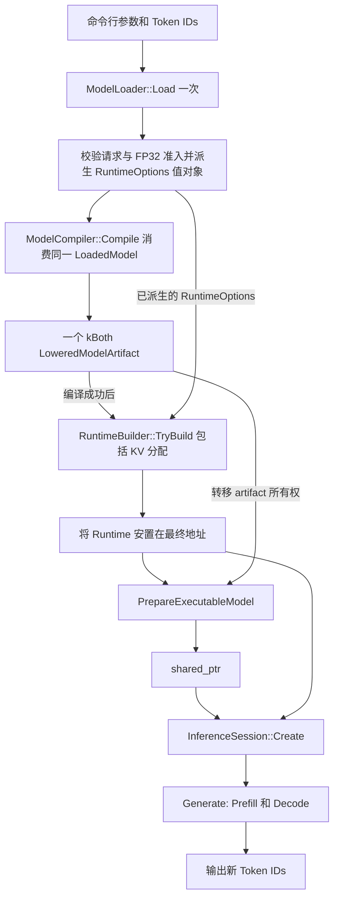

# 上层 Runtime 组装与推理入口实施方案

- **状态**: Draft
- **版本**: 1.6
- **日期**: 2026-10-19
- **最近更新**: 2026-10-21
- **产品边界**: [当前产品 PRD](../products/aethermind_prd.md)
- **架构边界**: [AGENTS.md](../../AGENTS.md) §2.1
- **关联计划**: [01 Generate 闭环](01-inference-session-generate-readiness.md)、[02 工程质量](02-engineering-quality-system.md)、[06 系统能力路线图](06-system-capability-evolution-roadmap.md)、[07 模型准备入口](07-executable-model-preparation.md)
- **关联模块**: 应用入口 / inference / runtime / model / compiler / API

本文是待实施方案。源码事实以 2026-10-19 的静态核对为基线，2026-10-21 补查 Load/Compile、Runtime/KV 分配和模型准备的依赖、失败边界、FP32 准入、KV 跨对象校验、C ABI 错误报告、依赖获取、日志与 fixture 来源及现有测试资产。本次仅修正文档，不新增运行入口，不修改公开 API，也不重新运行 C++ 测试。下文工具、选项和辅助函数均为拟新增内容。

## 1. 现状分析

### 1.1 缺口定位

`RuntimeBuilder::Build()` / `TryBuild()` 已有资源装配实现，作为公开 C++ 构建块由外部宿主调用是合理边界。库内部没有调用它们，本身不是 builder 的实现缺陷。

当前缺口是：仓库没有非测试调用方，将模型配置、Runtime、模型准备、Session 与 Token IDs I/O 连成一个可独立运行的入口。已有测试中的组装链不能替代产品使用入口，也不能证明 PRD 中的 C ABI 已交付。

| 已核对事实 | 源码依据 | 对方案的约束 |
|---|---|---|
| builder 装配 allocator/backend registry，按配置立即初始化并分配 KV；`TryBuild` 返回失败状态，`Build` 失败时 abort | [runtime_builder.cpp](../../src/runtime/runtime_builder.cpp)、[kv_cache_manager.cpp](../../src/kv_cache/kv_cache_manager.cpp) | 产品入口在 Compile 成功后使用 `TryBuild`；不另写资源工厂 |
| 模型准备与 Session 创建都接收外部 `Runtime&` | [executable_model.h](../../include/aethermind/inference/executable_model.h)、[inference_session.h](../../include/aethermind/inference/inference_session.h) | 上层负责 Runtime 所有权与稳定地址 |
| `ModelCompiler::Compile` 消费 `unique_ptr<LoadedModel>`，产物保活权重，不依赖 Runtime | [model_compiler.h](../../include/aethermind/compiler/model_compiler.h)、[model_compiler.cpp](../../src/compiler/model_compiler.cpp) | 加载一次，先编译再分配 KV；Runtime 地址稳定性从 Prepare 起约束 |
| Load 不执行家族构图与完整 RoPE 语义校验；家族识别和 RoPE 规范化/拒绝属于 Compile 的构图链 | [model_loader.cpp](../../src/model/model_loader.cpp)、[build_model_graph.cpp](../../src/model/build_model_graph.cpp)、[rope_params_builder.cpp](../../src/model/rope_params_builder.cpp) | Load 成功不能作为分配 KV 前唯一的模型准入条件 |
| Prefill/Decode 当前共享一个 plan；`ExecPhase::kBoth` 可供两阶段查询 | [executable_model.h](../../include/aethermind/inference/executable_model.h)、[graph_lowering.h](../../include/aethermind/compiler/graph_lowering.h) | 一次编译、一次准备；不预先拆成两份模型 |
| `LoadAndPrepareExecutableModel` 已串起加载、编译、准备，但要求 Runtime 已存在 | [executable_model.cpp](../../src/inference/executable_model.cpp) | 保留该便利 API；本入口为读取模型配置而显式组合其下层 API |
| 默认编译选项是 O2/plain，不能视为 CPU 通用可执行默认值；现有测试显式选择 O1/plain 或 O2/packed | [model_compiler.h](../../include/aethermind/compiler/model_compiler.h)、[graph_lowering.h](../../include/aethermind/compiler/graph_lowering.h)、[集成测试](../../tests/unit/inference/test_load_prepare_executable_model.cpp) | 入口必须有明确 CPU preset |
| Runtime 按值拥有 KV manager；workspace 和 activation 在请求准备路径分配 | [runtime.h](../../include/aethermind/runtime/runtime.h)、[inference_session.cpp](../../src/inference/inference_session.cpp) | 不把 workspace storage 搬进 builder |
| 当前 C API 仅有通用对象引用、错误处理等基础接口；PRD 的 runtime/model/session C ABI 仍是草案 | [c_api.h](../../include/c_api.h)、[PRD](../products/aethermind_prd.md) §3.4 | C++ 运行入口和 C ABI 分阶段验收 |
| 构建系统提供 shared library、单元测试和 benchmark，尚无推理工具目标 | [根 CMake](../../CMakeLists.txt)、[库 CMake](../../src/CMakeLists.txt) | 入口应能在关闭测试时单独构建 |
| 根 CMake 当前无条件获取 spdlog/google_benchmark，库 PUBLIC 链接 spdlog；`.models/` 被忽略 | [根 CMake](../../CMakeLists.txt)、[库 CMake](../../src/CMakeLists.txt)、[.gitignore](../../.gitignore) | A1 尚不能证明 benchmark 不被获取；HF fixture 由 CI/本地准备，不视为仓库自带文件 |

### 1.2 首版交付范围

推荐先实现独立 C++ 工具，复用现有公开构建块，建立受支持配置的可复现入口；之后再接 C ABI。

- CPU-only、同步、单模型、单请求、Llama Dense、FP32、greedy Argmax。
- 输入是 HF 模型目录、Token IDs、KV capacity 和生成配置；输出仅为新 Token IDs。
- O1/plain 作为首版默认；O2/packed 作为显式选择并单独验收，不承诺更快。
- HF 文件可加载不等于模型可执行；不承诺 FP16/BF16、INT8/INT4 或其他模型家族端到端支持。
- 不增加 tokenizer、HTTP、scheduler、并发 Session、GPU、Paged KV 或新的 weight packing 算法。

## 2. 目标架构

### 2.1 职责与依赖

| 所在层 | 负责 | 保持的边界 |
|---|---|---|
| 拟新增 `tools/inference/` | 参数解析、首版 FP32 准入、配置到 RuntimeOptions 的映射、CPU preset、对象生命周期、错误和 Token IDs I/O | FP32 准入只在 §2.4 的一个私有 helper 实现；仅消费 public headers，不 include `src/` 私有头或测试 helper |
| model | HF I/O、模型配置/权重验证、家族识别、semantic graph 前端 | 模型支持判断继续以 model 的既有权威入口为准；不依赖 Runtime，不校验 Runtime/model 跨对象一致性 |
| runtime | provider/factory、allocator/backend、静态 KV storage | 不依赖 model/compiler/inference，不读取 HF 配置 |
| compiler | semantic pipeline 与 lowering | 不访问 backend registry，不内置产品 CPU preset |
| inference | 模型准备、immutable 权重绑定、Session/Generate 编排 | 继续使用 `PrepareExecutableModel` 唯一准备入口 |
| 后续 C ABI 适配层 | opaque handle、所有权、Runtime/model KV 一致性、异常边界、状态与输出缓冲区 | KV 跨对象规则集中在 adapter 私有 helper；复用上述能力，不复制 compiler、packing 或执行算法 |

### 2.2 控制与数据流



首版 FP32 调用顺序为 Load → 请求校验与 `ValidateFp32ExecutionInputs` → 配置映射 → Compile → TryBuild → 将 Runtime 安置在最终地址 → Prepare → Create → Generate。FP32 准入检查实际 resolved weights；配置映射只生成值对象，不分配 KV。只有准入及 Compile 均成功后才调用 `TryBuild`，使精度策略、家族、RoPE 及其他构图/编译错误在 KV 分配前返回。

`Compile` 不借用 Runtime，不受其构造位置约束。Runtime 必须在 `PrepareExecutableModel` 前构造并安置在最终地址，从 Prepare 起不得移动或替换，且必须长于后续的 ExecutableModel 和 Session。

在 Compile 消费模型前，完成所需配置读取，将 RuntimeOptions、生成边界等保存在独立值对象中，不保存指向 LoadedModel 配置的借用。随后把同一个 `LoadedModel` 移入 `ModelCompiler::Compile`；不再调用 `LoadAndPrepareExecutableModel(model_dir, ...)` 重新加载。编译成功的 artifact 在 Runtime 构造后移入 `PrepareExecutableModel`，由该入口统一处理所有权、权重组装和 plan，工具不自行逐层绑定权重。

[11 号精度提案](11-fp16-bf16-execution-support.md) §2.3–2.4 规划由 Runtime allocator 分配 normalizer 的转换产物，该扩展路径可能要求 Runtime 早于 Normalize/Compile 构造。这是精度扩展的单独依赖，不适用于当前无需转换的 FP32 首版。接入时须同时明确如何在大块 KV 分配前完成可提前判定的模型语义校验，或设计延迟 KV 初始化；仅记录顺序差异不能满足同一 fail-fast 门禁。

### 2.3 核心数据与接口

首版新增工具私有 `RunOptions`，字段含义如下；不将其加入公共 C++ ABI。

| 字段 | 含义与校验 |
|---|---|
| `model_dir` | 本地 HF 目录，交给 ModelLoader 验证内容 |
| `prompt_tokens` | 非空 `uint32_t` 数组；严格解析整数，加载后检查词表范围 |
| `context_tokens` | 必填的静态 KV capacity；正数且不超过模型 `max_position_embeddings` |
| `generation` | 复用 `GenerationConfig{max_new_tokens, eos_token_id}`；EOS 不做隐式猜测 |
| `preset` | 工具私有枚举 `O1Plain` / `O2Packed`，默认 `O1Plain` |

工具私有入口拟为 `StatusOr<std::vector<uint32_t>> RunInference(const RunOptions&)`：它在一个作用域内拥有 Runtime、模型和 Session，只返回拥有数据的 Token IDs，不返回借用局部 Runtime 的 Session。`main` 只处理参数、输出和退出码。

CPU preset 必须逐项设置，不能直接转用 `ModelCompileOptions{}`：

| preset | `optimization.opt_level` | `lowering.enable_packed_weights` | selector |
|---|---:|---|---|
| `O1Plain` | 1 | false | CPU、`WeightFormat::kPlain`、`ExecPhase::kBoth` |
| `O2Packed` | 2 | true | CPU、`ExecPhase::kBoth`；具体消费权重的 step 由 lowering 标记 packed |

packing recipe 仍由 backend 选择。选择 O2 失败时传播错误，不静默降到 O1，不强制指定 identity/B-panel 布局。

### 2.4 RuntimeOptions 与 KV 配置映射

映射在 Compile 消费模型前读取已通过 loader 结构校验的配置，并对 signed→`size_t` 转换、除法和请求容量执行检查，输出不含模型或 Runtime 借用的 RuntimeOptions 值对象。它是产品配置适配，不建立第二套模型家族 schema；家族和完整 RoPE 语义仍由 Compile 的既有构图链判定，通过后才允许构建 Runtime/KV。

| Runtime 配置 | 来源与规则 |
|---|---|
| CPU allocator/backend | 显式启用；其他设备关闭；沿用默认 CPU provider/factory |
| `kv_cache.enable_manager` | true |
| `num_layers` | `config.num_hidden_layers`，验证为可表示的正数 |
| `num_kv_heads` | `config.num_key_value_heads`，使用 loader 规范化后的值；不在工具另造 fallback |
| `head_dim` | 优先使用正的 `config.head_dim`；为 0 时，在 heads/hidden 合法且整除后取 `hidden_size / num_attention_heads` |
| `max_tokens` | 用户给定的 `context_tokens`；不默认按模型最大窗口分配 |
| `kv_dtype` | 首版限定 `Float32`；必须与图的 activation/state dtype 一致 |
| `alignment` | 首版固定 64；物理 stride/padding 与溢出检查仍交给 KV layout/manager |

当前 Llama builder 用 `weight_dtype_hint`（未定义时回退 Float32）确定 activation/state dtype，依据见 [llama_dense_graph_builder.cpp](../../src/model/llama_dense_graph_builder.cpp)。loader 的 dtype 支持集允许 F32/F16/BF16，linear dtype 一致性也不等于全部权重为 FP32；缺失或 `auto` hint 不能证明实际权重精度。图语义校验在 Compile，kernel resolve/packing 在 Prepare；当前 Session 路径的 external binding 校验在 Generate 内的 `PrepareExecutionBindings`，晚于 KV reservation。这些边界各自验证对应合同，不能代替分配 KV 前的产品准入，也不能假定所有 dtype 错误都会延迟到同一阶段。

首版在 `tools/inference/inference_runner.cpp` 中拟新增唯一的工具私有策略入口：

```cpp
Status ValidateFp32ExecutionInputs(const LoadedModel& model);
```

runner 在 Load 成功后的请求/模型配置校验阶段调用一次，早于配置映射、Compile、TryBuild 和 KV reservation。它只读取 metadata，不依赖 Runtime，不读取权重 payload，不转换或分配权重，也不保存模型借用。`main`、preset 映射和后续 C ABI 不另写 dtype 遍历或准入分支。

| 校验职责 | 唯一归属与规则 |
|---|---|
| 配置、tensor schema、shape/bytes 与 loader dtype 支持集 | 沿用 `HfModelValidator`；不因首版 FP32 preset 将通用 loader 改为只接受 F32 |
| 首版 FP32 执行策略 | 只由 `ValidateFp32ExecutionInputs` 判定：显式 hint 必须为 Float32；缺失/`auto` 的 undefined hint 继续检查实际权重，不能直接返回成功 |
| 必需权重的实际 dtype | helper 遍历下述全部 resolved 权重角色，任何非 Float32 均拒绝；不扫描未被模型使用的额外原始 tensor |
| 算子与物理 binding 合同 | 保留原有 inference、kernel resolve、packing 和 `PrepareExecutionBindings` 校验；准入成功不构成完整可执行性证明，也不授权跳过信任边界检查 |

遍历范围覆盖 embedding、final norm、有效 lm-head，以及每层的 input/post-attention norm、Q/K/V/O projection、gate/up/down projection。按已有角色绑定使用 [ResolveWeightBinding](../../include/aethermind/model/weight/weight_binding_resolver.h)，不在工具建立第二套 role→field 映射；tied lm-head 缺失时沿用该 resolver 的 embedding fallback，缺失是否允许仍由 loader 验证。必需角色解析为空必须报错，不能跳过检查。Norm 也必须为 Float32，不能只检查 linear 或抽查首个 tensor。

精度策略拒绝返回 `Unimplemented`，诊断包含 hint 或权重角色/layer、实际 dtype 与要求的 Float32；runner 标记为模型准入阶段，CLI 按模型不支持返回退出码 1。不得改写 hint 或把 KV 设置为 FP32 来伪装权重转换。到 P2 接入 C ABI 前，按 §4.3 将这一个策略实现迁入 inference 并由两种入口共用；11 号提案若扩展 precision preset，再显式扩展策略，不能使本 helper 自动成为 normalizer。

对正的 `max_new_tokens = N`，本请求所需 KV token 数为：

```text
required_tokens = prompt_tokens.size() + (N - 1)
```

加法必须防溢出；要求 `required_tokens <= context_tokens <= model_context_limit`。首个新 token 由 Prefill 预测，因此不能把它再次计为一次 Decode KV append。EOS 可能提前结束，但不能依赖它缩小预约。`N == 0` 不做减一，遵循 Generate 的空输出语义。Session/manager 保留最终校验权，入口的提前报错不能替代底层检查。

`RuntimeOptions.workspace` 当前未被 builder 消费，不能把 `default_workspace_limit_bytes` 当作已生效的内存预算。workspace/activation 继续由 Generate 准备；用户指定的 KV capacity 也不代表进程总内存上限。

### 2.5 Ownership 与生命周期

LoadedModel 和 LoweredModelArtifact 可先于 Runtime 构造，它们不借用 Runtime。Compile 成功后构造 Runtime，再将 artifact 移入 Prepare，依次创建 shared model 和 Session。有借用关系的局部对象按 Runtime → shared model → Session 的顺序声明，按反序销毁；请求资源由 Generate 管理。`TryBuild` 的结果可以在模型准备前移动到最终 `Runtime` 局部变量，此后不得移动或替换它。

```text
RunInference 作用域
  LoweredModelArtifact             先于 Runtime 构造，Prepare 时移入模型
  Runtime                         长于下述执行对象，从 Prepare 起地址稳定
    └─ ExecutableModel            借用 Runtime，拥有 artifact/权重/plan
         └─ InferenceSession      借用 Runtime，共享 model
              └─ Generate 请求    workspace、activation、KV reservation
```

首版无需新增持有 Runtime/Session 的公共 `Engine` 类。以后确有长期 owning facade 需求时，需独立设计稳定地址的状态对象；不能把含 Runtime 和借用它的 Session 的结构体按默认 move 返回。

## 3. 方案与备选

| 方案 | 收益 / 代价 | 裁决 |
|---|---|---|
| 独立 C++ 工具显式组合现有 API | 修改小、可在无 GTest 环境运行，暴露真实配置与生命周期问题 | 首选，先实现并验收 |
| 立即增加公共 owning Engine facade | 可隐藏更多调用细节，但提前增加 public API、稳定地址和可移动性设计负担 | 等待真实长期宿主需求 |
| 在 RuntimeBuilder 内读取模型并准备 Session | 使用方式简短，但引入 runtime → model/compiler/inference 反向依赖 | 不采用 |
| 两次调用 LoadAndPrepare，分别准备 Prefill/Decode | 表面上阶段明确，但当前会重复加载、编译和准备，且没有合并两份模型的必要 | 不采用；复用一个 kBoth plan |
| 只补文档样例或继续由单元测试组装 | 成本低，但不能提供关闭测试后的独立运行入口 | 只作辅助材料 |
| 一次性实现全部 C ABI 再验证 | 直接覆盖产品目标，但将 runtime 配置、handle、错误/输出合同问题叠加 | 在 C++ 路径稳定后分阶段实施 |

## 4. 实施步骤

### 4.1 P0：固定配置与失败边界

1. 以由 CI/本地准备的 tiny Llama FP32 HF fixture 定义首版输入，固定来源/revision 与文件校验值，核对 `ParseModelArchitecture`、loader、graph 和 CPU 执行支持范围；不假定 clone 仓库即包含 `.models/` 数据。
2. 落实已知行为字段的拒绝合同；例如模型声明的 activation 必须与实际构图一致。结构与算子语义修复归 model，参照 [06 路线图](06-system-capability-evolution-roadmap.md)；不在 CLI 复制 validator 的 schema/shape/bytes 规则。首版 FP32 产品准入按 §2.4 仅实现于 `ValidateFp32ExecutionInputs`，与 loader 支持集分开。
3. 在工具私有 helper 中实现 RunOptions 校验、FP32 准入、KV 参数映射及 CPU preset；Load 后先完成实际权重遍历，再 Compile，成功后才 TryBuild。错误按参数/加载/模型准入/编译/Runtime 构建/准备/Session/生成阶段分类，同时保留底层 StatusCode。
4. 明确零 token、EOS、容量边界和 dtype 拒绝规则，以合法权重 fixture 定义不支持家族和未知 RoPE 的拒绝用例，先验证既有 model/Compile 的拒绝合同；runner 的分配观测随 P1 的 A12 落实。

退出条件：给定合法 FP32 配置能得出确定 RuntimeOptions，拒绝用例与失败阶段明确。P1 接入 runner 时，可在参数、加载、模型准入或编译阶段判定的非法输入、家族、activation、RoPE 及 dtype/preset/请求容量错误，必须在启动 KV 分配前失败；具体观测按 A12/A13 验收。依赖 Runtime 的 backend、packing、kernel resolve 和 plan 错误由 Prepare 拒绝，不将 Compile 成功视为 CPU 可执行证明；未支持的组合不得静默接受。

### 4.2 P1：提供独立 C++ 入口

拟新增文件：

- `tools/inference/inference_main.cpp`：先初始化 stderr logger，再执行参数解析与 runner，负责 stdout/stderr 和退出码。
- `tools/inference/inference_runner.h/.cpp`：工具私有 RunOptions、配置映射、preset 和 RunInference。
- `tools/inference/CMakeLists.txt`：拟新增 `aethermind_infer` 目标，链接 `AetherMind`，并因 main 直接使用日志 API 而显式 PRIVATE 链接已有的 `spdlog::spdlog`；不链接 GTest 或 benchmark。
- 根 CMake：拟新增 `BUILD_INFERENCE_TOOL` 选项（默认 OFF），启用时添加上述子目录，不依赖 `BUILD_TESTS`；同时将 google_benchmark 的 `FetchContent_Declare` / `FetchContent_MakeAvailable` 收入 `if(BUILD_BENCHMARKS)`。spdlog 作为库与工具的正式依赖继续获取，不新增第二份依赖来源。

工具的目标链接关系拟为 `target_link_libraries(aethermind_infer PRIVATE AetherMind spdlog::spdlog)`。当前 AetherMind 已 PUBLIC 传递 spdlog 依赖，显式列出工具的直接依赖使 main 的 logger 配置不依赖隐含链接关系；两者使用同一个 CMake target。

入口中沿 §2.2 的顺序，Compile 成功后才显式调用 `RuntimeBuilder::TryBuild()`，再固定 Runtime 地址并执行 Prepare。不复制 Runtime 的默认 provider/factory 注册代码，不手动调用 allocator 的底层存储实现。

配套 runner 单测与正式工具共用同一编排实现。测试构建提供工具私有的 RuntimeBuilder 配置注入点，供测试注册计数/失败 allocator provider 或失败 backend factory，验证 runner 的错误传播与清理，并观测 A12 的 KV 分配。正式 `RunInference` 使用默认 CPU 资源；不公开该注入接口，不增加 CLI 参数、环境变量开关或阶段计数 hook。测试替身不能作为数值、kernel 覆盖或 CLI 正常路径的证据。

CLI 拟定合同：

```text
aethermind_infer --model <hf-directory>
                 --tokens <comma-separated-uint32>
                 --context-tokens <positive-integer>
                 --max-new-tokens <nonnegative-integer>
                 [--eos-token-id <uint32>]
                 [--preset o1-plain|o2-packed]
```

stdout 只打印一行 JSON 整数数组（仅新生成 token，包含生成出的 EOS）；诊断写 stderr，工具进程中的库日志也须导向 stderr，避免污染机器可读输出。整数输入使用严格解析，拒绝负数、空项、尾随垃圾与越界，不新增 JSON/参数解析依赖。成功退出 0，参数错误退出 2，加载/模型准入/编译/Runtime 构建/准备/运行失败退出 1；这些是工具合同，不冻结内部 StatusCode 的数值表示。

日志初始化是 main 的首项可失败操作，必须早于任何 Runtime/模型 API 调用：

1. 通过 `<spdlog/sinks/stdout_sinks.h>` 创建 `spdlog::stderr_logger_mt("aethermind_infer")`，再用 `spdlog::set_default_logger` 安装为进程默认 logger，覆盖当前 spdlog 默认 stdout sink。保持在开始库调用前完成，运行中不并发替换 logger。
2. 若 logger 初始化失败，以 `std::fputs` 等不分配的固定诊断写 stderr，退出 1，不继续加载模型或构建 Runtime；异常不逃出 main。
3. 仅独立工具 main 配置该进程策略，库与 C ABI 不擅自替换宿主 logger。集成测试分别捕获 stdout/stderr，并覆盖共享库发出的默认 logger 日志，不能只验证 main 自行写入 stderr。

runner 在入口边界捕获 `std::bad_alloc` 并返回空 message 的 ResourceExhausted，不在 OOM 路径拼接阶段字符串；`main` 用尽量不分配的固定诊断报告。文件系统和其他可恢复异常在进程边界处理；底层 `AM_CHECK`/`noexcept` 终止不是 catch 能恢复的错误，应在可验证的参数路径上提前排除，并记录仍需独立修复的底层失败边界。

退出条件：只构建库和工具即可从 HF 目录生成 Token IDs；没有测试 fixture helper、fake backend 或空 kernel 成为工具运行依赖。

### 4.3 P2：接通产品 C ABI

在 P1 通过后，按 [PRD §3.4](../products/aethermind_prd.md#34-c-abi-规范) 冻结 runtime/model/session handle、错误所有权与输出 buffer 合同，再实施适配。接入 C ABI 的 FP32 模型加载路径前，必须将 `ValidateFp32ExecutionInputs` 的唯一实现迁入 inference，提供工具可消费的窄 C++ public header 声明，CLI 与 C ABI 适配层均调用该实现；删除工具中的规则副本，工具不 include inference 的 `src/` 私有头。C ABI 只转换 Status/错误表示，不重新枚举或检查权重 dtype。其他可复用的配置映射/preset helper 按第二个生产消费者的实际需求迁移，参数解析和 I/O 留在工具。

必须先处理 C ABI 中“Runtime 先创建、模型后加载”与 KV 几何来自模型之间的时序：保持当前 builder 行为的首版选择，是 runtime config 显式提供 KV 几何/容量，由 C ABI adapter 在模型加载/编译后执行跨对象校验。`ModelLoader` 与 model 模块不读取 Runtime。若要求模型加载后才能初始化 KV，需单独评审 Runtime 初始化 API，不能直接在 C wrapper 里更改已使用 Runtime 的 KV storage。

这条 C ABI 路径的 Runtime 创建早于模型加载；FP32 模型准入在 Load 后、Compile/Prepare/Generate 前调用共享 helper。须独立记录 KV 分配前可完成的校验及后续 model load/admission/compile 失败的清理证据，不能沿用首版 C++ runner 的 A12/A13 零 KV 分配结论。

**Runtime/model KV 校验的唯一入口**：P2 在 adapter 内拟新增私有 `ValidateRuntimeModelKV` helper，读取 `Runtime::GetKVCacheManager()->layout()` 和通过 Compile 验证的模型元数据。在 `am_model_load` 的 Compile 成功后、Prepare 与模型 handle 发布前调用；不修改 Runtime 或 KV storage。若 KV manager 缺失/未初始化，返回 `FailedPrecondition`。模型几何的规范化沿用 §2.4 的纯配置映射，在 P2 移入 inference 供 CLI/adapter 复用；字段比较只在 adapter helper 实现，不回填 model validator。

| 字段 | 校验规则与阶段 |
|---|---|
| `num_layers` | 模型加载阶段要求 `layout.num_layers == config.num_hidden_layers` |
| `num_kv_heads` | 模型加载阶段要求 `layout.num_kv_heads == config.num_key_value_heads` |
| `head_dim` | 模型加载阶段要求等于已规范化的逻辑 head_dim（正的 config.head_dim，否则使用经整除验证的 hidden_size/num_attention_heads），不比较 padded_head_dim |
| `kv_dtype` | 模型加载阶段确认已编译图中所有层 K/V state dtype 一致且符合明确 precision 策略，再要求 layout.kv_dtype 与其相等；首版 FP32 为 Float32，不能只采样首层或从原始 weight hint 推断 |
| `max_tokens` | 模型加载阶段要求 `1 <= layout.max_tokens <= config.max_position_embeddings`；允许小于模型上限，不要求相等 |
| 请求容量 | `am_session_generate` 对 `N = max_new_tokens > 0` 检查 checked `prompt_len + (N - 1) <= layout.max_tokens`，同时遵守模型 context limit；reservation 前完成，Generate/manager 保留最终检查 |

上述模型字段须已通过 model/Compile 验证并安全转换到 `size_t`。几何或 dtype 不匹配返回 `InvalidArgument`，容量超过模型上限返回 `OutOfRange`；失败时不发布 model handle，清理本次模型准备资源，保持既有 Runtime/KV 不变。`alignment`、padding、byte strides 与存储字节合法性仍由 [KVCacheLayout](../../include/aethermind/kv_cache/kv_cache_layout.h) / KVCacheManager 校验，不与模型字段建立相等关系。

`N == 0` 沿用 Generate 的参数验证与空输出语义，不计算 `N - 1`，请求路径不查询 KV manager、不预约 KV，也不因 `prompt_len > max_tokens` 拒绝该空生成；prompt 的非空、词表、EOS 和模型 context 校验仍保留。这不取消模型加载阶段的 Runtime/model KV 准入合同。

**Runtime 创建失败的拟定 C ABI 合同**：本提案选择显式 error out，P2 实现前同步 PRD §3.4 的草案签名并冻结；该调整不是已发布 ABI 的兼容性承诺。使用现有 [C 错误接口](../../include/c_api.h) 的 `am_error_handle` 与 `am_error_destroy`，不建立隐式 last-error/TLS 或第二套错误对象实现：

```c
am_runtime_t am_runtime_create(const am_config_t* config, am_error_handle* error);
```

- 成功返回非空 runtime handle；若 `error != NULL`，则 `*error = NULL`。
- `config == NULL` 返回 `NULL`，并按提供的 error out 报告 `InvalidArgument`；不隐式使用缺少 KV 几何的默认 runtime config。
- 失败返回 `NULL`；若 `error != NULL`，写入由调用方拥有的错误 handle，保留可报告的底层状态码，调用方以 `am_error_destroy` 释放。调用方须先释放该槽位中原有错误，函数不读取或释放传入槽位的旧值。
- 允许 `error == NULL`，此时仅凭返回 handle 判定成功/失败，不提供隐式诊断通道。
- 错误对象构造也可能分配失败；此时仍返回 `NULL` 并将提供的 `*error` 保持为 `NULL`，明确表示错误诊断不可用，不再次分配或抛出异常。`am_error_code(NULL)` 沿现有接口返回 UNKNOWN，不能把空错误 handle 当作成功。

上述错误对象的 OOM 降级与所有权必须在 P2 专门测试；PRD 中的 `am_error_t`/`am_error_free` 草案命名须与现有错误接口统一后再冻结，不把这里的声明当作当前已实现接口。

C handle 内部为 Runtime 提供稳定地址；model/session handle 持有必要的 owner 引用，使 destroy 顺序安全。逐一规定 null、长度/容量、required-size、失败时输出状态和重复 destroy 的合同；任何 C++ 异常都不能越过 C 边界，内部 STL/Status/TensorView 不成为 ABI。

退出条件：C 调用方通过正式 create/load/create/generate/destroy 链得到与 C++ 基线一致的结果，ABI/version/error/buffer/lifetime 测试通过。完成 P1 不能标记 C ABI 已交付。

### 4.4 P3：文档与可复现命令

实施 P1 时，同步根 README 的构建/运行说明和工具参数；新增 public API 时再同步 [公共 API 参考](../api/public-api.md)、对应 design 与 CHANGELOG。本提案在仅写入方案时维持 Draft。

以下是 P1 实施后的目标命令，目前选项和目标尚不存在；`MODEL_DIR` 必须指向由 CI/本地准备的合法、受支持的 FP32 HF fixture，并具有 §6.1 的来源与校验记录：

```bash
cmake -S . -B build-infer -DBUILD_INFERENCE_TOOL=ON -DBUILD_TESTS=OFF -DBUILD_BENCHMARKS=OFF
cmake --build build-infer --target aethermind_infer -j
./build-infer/tools/inference/aethermind_infer --model "$MODEL_DIR" --tokens 7 --context-tokens 8 --max-new-tokens 3 --preset o1-plain
```

当前根 CMake 的 `FetchContent_MakeAvailable(spdlog google_benchmark)` 无条件执行，即使 `BUILD_BENCHMARKS=OFF` 也可能下载/配置 benchmark；上述命令本身不能证明依赖已收口。P1 必须完成 §4.2 的条件化修改，在干净构建目录验收 OFF 时不获取/配置 google_benchmark、ON 时 benchmark 目标仍可构建。spdlog 仍是正式依赖；A1 不承诺无需网络下载、install/export 或离线发行，这些沿 [02 工程质量方案](02-engineering-quality-system.md) 独立验收。

## 5. 风险与依赖

| 风险 | 控制措施 |
|---|---|
| loader 接受的字段与 graph/kernel 语义漂移 | model 层 fail-closed 与配置→图→执行证据；不把加载成功当作入口成功 |
| 可在 Compile 判定的模型错误晚于 KV 分配，或被 KV OOM 掩盖 | FP32 runner 先 Compile 后 TryBuild；11 号 normalizer 扩展另行明确语义预校验或延迟 KV 的失败边界 |
| FP16/BF16 checkpoint 被误当作 FP32 可执行 | 由 §2.4 的唯一准入 helper 检查 hint 与全部必需权重；不以 loader dtype 支持集代替产品策略 |
| 缺失/auto hint 被当作 FP32 证明，或 CLI/C ABI 的 dtype 政策漂移 | Load 后由唯一 FP32 准入 helper 全量检查必需权重 metadata；P2 复用迁入 inference 的同一实现 |
| Runtime 移动或提前析构 | 首版只在单作用域持有；准备后不 move；返回纯数据结果 |
| KV 配置与模型不匹配、容量溢出或过量分配 | 使用规范化配置、检查转换/容量、显式 capacity；物理布局仍由 manager 校验 |
| 默认 O2/plain resolve 失败 | 显式 preset；packed recipe 交 backend；失败不隐式 fallback |
| 既有内部检查或 noexcept 在 OOM 下终止 | TryBuild/Status 不等于全链可恢复；对已知终止点独立记录与修复，不承诺工具全面 recoverable OOM |
| 将 CLI 输出长度或 Session 等价性误作独立数值/阶段证据 | 底层 oracle、runner 编排与 CLI 黑盒测试分别验收；synthetic 模型与 HF 目录 fixture 不混用预期值 |
| 误称稳态零分配或性能提升 | 本提案只新增 cold-path 组装；Decode/全请求分配、性能分别计量，不能推断 |
| 现有工作树和其他提案并行修改 | 实施前重查源码/状态，最小修改；09 号模型扩展不是本入口的前置 |

首版不增加并发能力；所有共享 Runtime 的调用继续串行。ASAN/UBSAN 用于生命周期/算术验证；仅当实施改变并发或同步契约时触发 TSAN，不借本入口引入线程池。

## 6. 验收标准

以下均为待执行门禁，不是本次文档编写的验证结果。

### 6.1 证据分层与 fixture 边界

| 层次 | 负责证明 | 资产与实施要求 |
|---|---|---|
| 底层数值与资源合同 | 实际 Prefill→两次 Decode、逐步 logits/Token IDs/KV/commit watermark、Generate 与 scalar oracle 对照、故障注入及资源恢复 | 复用 `TinyLlamaExecution`、Runtime/KV、preparation 和 Argmax 测试；按对应 suite/preset 记录执行结果 |
| runner 编排单测 | 配置映射、先 Compile 后 TryBuild、StatusCode 传播、runner 边界异常处理和失败清理 | 待新增；链接工具私有 runner，共用正式编排，使用 §4.2 的 test-only provider/factory 注入点和既有分配故障测试设施 |
| CLI 黑盒集成 | 参数解析、CLI→RunInference→Generate 接线、preset 选择、stdout/stderr/退出码，以及与直接 Session 的输出等价性 | 待新增；启动真实工具和默认 CpuBackend，对同一 HF fixture 与同一请求逐 preset 比较直接 `InferenceSession` 结果 |

现有 [TinyLlama 执行测试](../../tests/unit/inference/test_direct_prefill_decode.cpp) 的 `TinyLlamaExecution` 使用内存构造的 synthetic checkpoint，并按 `O1Plain` / `O2Packed` 参数化。`TinyTiedGqaLlamaMatchesScalarOracleAndReusesDecodeBindings` 实际执行 Prefill 和两次 Decode，比较逐步 logits、tokens、KV 与提交位置；`TinyGenerateMatchesScalarOracleAndStartsFreshEachCall` 对照完整 Generate。这些是底层阶段与数值证据，不是 HF 目录或 CLI 的 golden。

现有 [HF 目录集成测试](../../tests/unit/inference/test_load_prepare_executable_model.cpp) 使用由 CI/本地准备的 `.models/tiny-random-LlamaForCausalLM`；`.models/` 已被 [.gitignore](../../.gitignore) 忽略，不是 clone 仓库即自带的 fixture。现有测试已检查长度、词表范围和重复调用确定性，但没有该目录的逐步 logits oracle 或受版本控制的 golden IDs。首版不据此宣称已获得 HF/CLI 的独立数值对照。

CLI 集成测试对 `O1Plain`、`O2Packed` 分别运行：测试侧通过公开 Load→Compile→TryBuild→Prepare→Create→Generate 链取得直接 Session 结果，再启动工具，以相同模型内容、prompt、KV capacity、generation 配置及显式 preset 比较完整新 Token IDs。测试侧独立设置编译选项，不调用待测 runner 的 preset 映射 helper 生成期望值；不假定两个 preset 必须相互逐位一致。这项测试证明接线等价性，底层 oracle 继续承担独立数值验证；无需为现有 HF fixture 虚构 O1/O2 golden。

CI 必须固定 HF fixture 来源/revision、config 与权重校验值、prompt 和请求配置；fixture 由测试部署提供，生产 runner 不依赖测试源码。fixture 缺失须报告未取得工具集成证据，不能以静默跳过作为门禁通过。若后续要求 HF/CLI 的独立数值验收，还需独立参考生成脚本及按 preset 记录的 golden；下述 A13 转换产物只提供精度准入输入，不构成生成数值 oracle。

#### A13 HF fixture 生成与校验

保留 §6.4 的 loader→runner 集成门禁。P1 的测试资产交付必须包含以下受版本控制的文件；目前均为拟新增文件，不能把路径列出或 helper 单测通过视为集成资产已就绪：

- `tools/generate_fp32_admission_hf_fixtures.py`：测试侧离线转换器，输入已准备的 FP32 HF 目录，输出完整 HF 变体目录；不属于模型加载或生产 normalizer。
- `tests/fixtures/inference_admission/recipe.json`：锁定 base 的来源仓库与 revision（或归档 artifact ID）、`config.json` / `model.safetensors` 的 SHA-256、转换规则及变体清单。不以本地目录名或浮动 `main` 作为来源身份。
- `tests/fixtures/inference_admission/checksums.json`：经评审的预期清单，记录 recipe 与脚本 SHA-256、每个变体的 config/权重文件 SHA-256，以及逐 tensor 的名称、shape、dtype、字节数和 payload SHA-256。

输入沿用 CI/本地准备的 FP32 `tiny-random-LlamaForCausalLM`，生成前必须与 recipe 锁定的内容校验值相符。首版转换器只支持冻结的单文件 `model.safetensors`、完整 Llama 权重 schema、全部 tensor 为有限 F32 的输入；其他 dtype、分片或未知格式明确拒绝，不静默选择不同来源。源码与测试资产由该入口的实施者一并提交，CI fixture 准备任务或本地开发者运行脚本；生产 runner 和 CMake 的库/工具构建不运行转换器。

| 变体目录名 | 实际 tensor dtype | config 的 `torch_dtype` | 用途 |
|---|---|---|---|
| `f32-missing` / `f32-auto` / `f32-explicit` | 全部 F32 | 删除 / `auto` / `float32` | loader 与准入成功基线 |
| `f16-missing` / `f16-auto` | 全部 F16 | 删除 / `auto` | loader 成功、准入拒绝 |
| `bf16-missing` / `bf16-auto` | 全部 BF16 | 删除 / `auto` | loader 成功、准入拒绝 |
| `f16-f32-hint` / `bf16-f32-hint` | 全部 F16 / 全部 BF16 | `float32` | 实际权重不被 hint 覆盖 |
| `f32-f16-hint` / `f32-bf16-hint` | 全部 F32 | `float16` / `bfloat16` | 显式非 FP32 hint 拒绝 |
| `mixed-norm-{f16,bf16}-{missing,auto}` | embedding、所有 linear 与独立 lm-head 保持 F32；final/input/post-attention norm 全部为指定 16-bit dtype | 删除 / `auto` | 合法 mixed norm 的集成拒绝证据 |
| `single-norm-{f16,bf16}-{missing,auto}` | 仅最后一层 post-attention norm 为指定 16-bit dtype，其余全部 F32 | 删除 / `auto` | 单个、非首层 norm 的集成拒绝证据 |
| `f32-tied` | F32 embedding；删除独立 `lm_head.weight`，其余 F32 | `float32`，同时设置 `tie_word_embeddings=true` | tied lm-head fallback 成功用例 |

花括号表示脚本必须展开生成的变体。除 `f32-tied` 外均保留 base 的独立 lm-head；recipe 要求 base 为 untied，不能把缺少 lm-head 的目录冒充独立 head 用例。维度、tensor 名称/shape、activation 与 RoPE 配置保持不变。当前 parser 将 `torch_dtype` 和 `dtype` 都映射为同一 hint，生成前先移除两者，再按矩阵只写入 `torch_dtype`；缺失变体两者都不写，避免残留别名覆盖预期 hint。tied 变体仅额外修改 tie 字段并删除 head tensor，不复制一份 embedding 冒充共享绑定。

转换器采用 Python 标准库实现这一窄格式，不引入 torch/safetensors 运行依赖：读取 Safetensors 的 header/offsets，F32→F16 使用 `struct.pack('<e', value)`，F32→BF16 对原始 float32 bits 做 round-to-nearest-even（`(bits + 0x7fff + ((bits >> 16) & 1)) >> 16`），以 little-endian 16-bit 元素写入。非有限源值、F16 越界或转换后非有限值拒绝，不饱和截断。按 tensor 名排序重写 dtype、连续 offsets 和真实 payload；header 使用 UTF-8、sort_keys、紧凑 JSON，空格补齐到 8-byte 边界，并以 little-endian uint64 写入补齐后的 header 长度。config 使用 sort_keys、2-space 缩进、UTF-8 与单个末尾 LF；不得只改 dtype 标签。脚本自身需测试正负零、精确可表示值、舍入 tie 与拒绝边界，并以独立读取校验输出 dtype、offsets、bytes；这些是资产生成测试，不代替执行 kernel 的数值验证。

以下是脚本实现后的拟定命令，不代表当前已有脚本或生成结果：

```bash
python3 tools/generate_fp32_admission_hf_fixtures.py \
  --source "$MODEL_DIR" --recipe tests/fixtures/inference_admission/recipe.json \
  --output-dir .models/inference-admission
python3 tools/generate_fp32_admission_hf_fixtures.py \
  --source "$MODEL_DIR" --recipe tests/fixtures/inference_admission/recipe.json \
  --output-dir .models/inference-admission \
  --check tests/fixtures/inference_admission/checksums.json
```

生成操作不修改 base，只写 gitignored 的变体目录及 `.models/inference-admission/generated-manifest.json` 实际清单。开发者首次生成后评审该清单，将预期内容提交为 `tests/fixtures/inference_admission/checksums.json`；`--check` 复核 source、脚本/recipe 身份、输出文件与逐 tensor 校验值，并在临时目录重复生成对照，退出非零表示缺失或不一致，不更新预期清单。Python 版本、脚本/recipe 版本和每个变体的 config 变更也记入生成清单；文件排序、JSON 序列化、padding 固定规则须写入 recipe，输出不包含时间戳或绝对路径等机器相关内容。脚本或规则变化时，由开发者重新生成并评审提交新的 checksums，CI 不自动接受新值。

CI 顺序为准备锁定的 FP32 base → 生成变体 → `--check` → 对每个变体先断言 `ModelLoader::Load` 成功 → 运行 runner/CLI 的 A13 用例。拒绝变体须确认为模型准入阶段的 `Unimplemented`，且无 KV plane 分配；loader 提前失败不算 A13 通过。脚本、recipe 或实测 checksums 尚未交付时，将 loader→runner 证据标为未取得，不能降格成 synthetic helper 单测后仍宣称 A13 完成；不得填入未生成的占位校验值。

### 6.2 门禁与证据归属

| 编号 | 门禁 | 证据要求 |
|---|---|---|
| A1 | 独立构建运行 | 完成 §4.2 的 FetchContent 条件化；在干净目录以 `BUILD_TESTS=OFF`、`BUILD_BENCHMARKS=OFF` 构建运行工具，不获取/配置 google_benchmark，不依赖 GTest/benchmark，保留正式 spdlog 依赖；不等同于离线构建 |
| A2 | 真正接入 builder | 首版非测试 runner 在 Compile 成功后显式调用 TryBuild；KV 几何从当前模型派生，无 tiny fixture 常量 |
| A3 | 一次准备与接线 | 源码审查确认 Load/Compile/Prepare 各调用一次，runner 调用既有 Generate；同一 kBoth plan 覆盖 Prefill/Decode，不为计数增加生产 hook |
| A4 | 底层阶段执行 | `TinyLlamaExecution` 在 O1Plain/O2Packed 下实际执行 Prefill 加至少两次 Decode，并检查逐步状态；CLI 另用无 EOS、至少 3 个新 token 的请求证明接线等价，输出长度本身不作阶段证据 |
| A5 | 底层数值与 CLI 等价 | 底层逐 preset 对照 scalar oracle 的 logits/tokens/KV；CLI 按 §6.1 与同 HF fixture、同 preset 的直接 Session 结果对照；数值完全相等的最大 logit 选择最低词表 index，不为工具新增 public logits/debug API |
| A6 | 确定性与复用 | CLI 相同配置多次独立运行得到相同 IDs；底层 Session 测试验证重复 Generate 的 reservation 释放及跨请求状态隔离 |
| A7 | 边界输入与日志隔离 | 空 prompt、负数/越界 token、非法 EOS、无效路径、非 FP32、非法 preset/容量分别报错；main 在任何库调用前安装 stderr logger，验证库日志写 stderr，stdout 仅有成功 JSON 且失败无部分结果 |
| A8 | 容量与零值 | runner/CLI 验证容量及零值配置传递；底层验证 `prompt + N - 1 == capacity`、超限/溢出、N=0 不执行模型、EOS 包含及停止语义；CLI 与同请求的直接 Session 对照 |
| A9 | 分层失败与所有权 | 按 §6.3 分配底层、runner 与 CLI 的失败证据；验证 StatusCode、RAII、Prepare 后 Runtime 地址稳定及身份检查，ASAN/UBSAN 无新增问题；不要求 CLI 用系统 OOM 触发不可控失败 |
| A10 | C ABI 独立验收 | 仅 P2：C 编译的调用方、ABI version、buffer/error/null 合同、handle owner 顺序与异常封闭有专门测试 |
| A11 | 文档与范围 | README/索引/相关 API 文档准确；不得据 tiny FP32 成功宣称量化、其他家族、7B 性能或全部 PRD hard gates 已达成 |
| A12 | 首版分配前拒绝 | runner 单测使用合法 FP32 权重 fixture，仅注入不支持的家族或未知 RoPE，验证 Compile 返回相应错误且计数 allocator 未收到 KV plane 分配；CLI 验证错误输出与退出码，不能以损坏 Safetensors 的加载失败替代 Compile 证据 |
| A13 | FP32 准入与去重 | 先交付并校验 §6.1 的生成脚本、recipe、checksums 与 HF 变体，再按 §6.4 验证 hint 与全部实际权重角色；非 FP32 在模型准入阶段、Compile/TryBuild 前拒绝，KV 分配计数为零；P2 确认 CLI/C ABI 共用 inference 中唯一实现 |
| A14 | P2 KV 与 Runtime 创建合同 | 按 §4.3/§6.5 验证 adapter 字段比较、容量上下界与请求容量；以 C 调用方验证 runtime_create 的 error out、所有权和 OOM 诊断降级，不能仅以 CLI 结果代替 |

Argmax 的等值规则由 [reference 合同](../../src/backend/cpu/kernels/argmax/argmax_internal.h) 与 [CPUKernelArgmax 测试](../../tests/unit/backend/cpu/kernels/test_cpu_argmax_kernel.cpp) 约束。近似并列不属于等值 tie，仍按对应 preset 实际算出的 logits 取最大，不在 CLI 引入 epsilon 合并规则。

### 6.3 A9 失败证据与待补项

以下现有资产只表示源码中已有对应测试，本次未重新运行；runner/CLI 项全部待实施，不以底层通过替代新增编排代码的验证。

| 失败边界 | 现有底层资产 | 本入口新增的证据 |
|---|---|---|
| 加载与模型编译 | [ModelCompiler 测试](../../tests/unit/compiler/test_model_compiler.cpp) 的输入拒绝，以及 model 的配置/构图拒绝测试；HF 便利入口的缺路径用例只证明加载失败传播 | runner 用合法权重加不支持家族/未知 RoPE 触发真实 Compile 失败（A12）；CLI 测缺路径、非法模型与对应退出码 |
| FP32 模型准入 | loader 对 F16/BF16 的接受不是首版执行支持证明，产品准入 helper 尚待实现 | 按 A13 检查真实权重 dtype，runner 在 Compile/TryBuild 前返回 Unimplemented；CLI 检查准入诊断与退出码 1 |
| Runtime 注册表与 KV 分配 | [RuntimeBuilderTryBuild](../../tests/unit/runtime/test_runtime_builder.cpp) 的注册表 OOM；[KVCacheManagerInitAllocationFailure](../../tests/unit/kv_cache/test_kv_cache_manager.cpp) 的首/第二 plane、metadata 分配失败及清理/重试 | runner 通过失败 allocator provider 确定性触发 KV 分配错误，检查原 StatusCode 和已有分配释放；不以超大 capacity 或系统 OOM 作为 CI 手段 |
| 模型准备 | [HF 准备失败测试](../../tests/unit/inference/test_load_prepare_executable_model.cpp) 先成功编译，再以无 CPU backend 的 Runtime 验证 Prepare 失败及状态传播 | runner 测试注入失败 backend factory，在 Prepare 阶段确定性失败，验证状态传播及 Runtime/KV 清理；不要求默认 CLI 暴露 backend 开关 |
| 执行与请求分配 | [TinyLlama 执行与 workspace 测试](../../tests/unit/inference/test_direct_prefill_decode.cpp) 的执行失败/commit 不前移/清理，及 request buffer、binding、activation、workspace 分配失败与恢复 | runner 用测试 backend 返回明确执行错误，验证已有 Generate 错误的传播和资源清理；所有数值与阶段证据仍使用真实 CpuBackend |
| runner 自身异常边界 | 既有 `test_malloc_interposer` 提供限定分配故障设施；它不是 runner 测试已经完成的证明 | 在 runner 测试目标内确定性注入 `std::bad_alloc`，验证空消息 ResourceExhausted 和清理；CLI 独立测试参数错误、stdout 无部分结果、stderr 与退出码映射 |

runner 的失败测试与 CLI 黑盒成功测试共同覆盖新接线；底层故障资产仍负责具体分配点、KV transaction 和恢复合同。依赖 malloc interposer 的用例须记录平台适用性及实际注入命中；环境不支持或用例跳过应标为证据未取得。不得为本提案新增公开故障注入接口或把测试 allocator/backend 接入正式工具。

A12 复用 runner 的 test-only allocator 观测，不新增生产计数 API；分别确认 Compile、Runtime/KV 与 Prepare 的失败边界，不能仅断言进程退出码非零。11 号精度扩展与 P2 C ABI 的顺序和分配前校验范围单独验收，不由首版结果推导。

### 6.4 A13 FP32 准入回归

以下均为待新增测试。helper 单测定位 hint 分支与逐角色遍历；loader→runner 集成使用 §6.1 明确生成且通过 checksums 校验的 HF 变体，先证明 loader 成功，再检查模型准入阶段、`Unimplemented`、实际/要求 dtype 诊断及零 KV 分配。不能用手工修改的无来源目录、synthetic ResolvedModelWeights 单测或较晚的 Compile/Prepare/Generate 失败替代这一集成门禁。

| hint / 实际权重 | 预期 |
|---|---|
| hint 缺失、`auto`、显式 Float32 × 全部必需权重 F32 | 准入成功，O1Plain/O2Packed 均能进入 Compile；覆盖 tied lm-head fallback 与独立 lm-head |
| hint 缺失或 `auto` × 合法完整 F16/BF16 权重 | loader 成功，模型准入拒绝；分别覆盖 F16、BF16，防止只检查 hint |
| 显式 Float32 hint × 实际 F16/BF16 权重 | 模型准入拒绝，不能由 hint 覆盖实际 dtype |
| 显式 F16/BF16 hint × 实际全 F32 权重 | 模型准入拒绝，防止 graph activation/state 精度与首版策略不一致 |
| F32 linear × 单个或多个 F16/BF16 norm | loader 允许的混合 norm 组合仍由 FP32 准入拒绝；覆盖 final norm 和各层两类 norm |
| helper 单测逐一替换 embedding、lm-head、各层 norm/attention/MLP 角色的 dtype | 每个非 F32 角色均被检出并定位；不以首个 tensor 或首层检查替代完整遍历 |

通过 loader 的 F16/BF16 fixture 必须具有匹配 dtype 的真实 payload、bytes 和一致的 linear dtype；仅改 `RawWeightView.dtype` 或制造混合 linear 使 loader 提前失败，不是准入测试。逐角色 helper 单测与 loader→runner 集成证据分开记录。未使用的额外 tensor 不纳入 FP32 执行准入；lm-head 缺失是否合法及其他结构错误继续由原 validator 测试负责。

P2 迁移时复用同一组 helper 准入用例，并对 CLI/C ABI 的调用位置与错误表示适配分别回归，不保留两套 dtype 白名单或遍历实现。零 KV 分配是首版 runner 的顺序证据；C ABI 若已在模型加载前创建 Runtime，则按 §4.3 独立验收，不能从共用 helper 推导其分配顺序相同。

### 6.5 A14 P2 跨对象与错误报告回归

以下全部待 P2 实施，不代表当前 C ABI 已交付。

- adapter helper 单测逐一改变 `num_layers`、`num_kv_heads`、逻辑 `head_dim` 和 `kv_dtype`，要求模型加载失败、诊断定位字段，且不发布 model handle 或改写已有 Runtime/KV；缺失 KV manager 单独拒绝，不能只检查首层 K/V state dtype。
- 容量小于或等于模型 context 上限均可通过模型加载，超过上限拒绝；请求的 `prompt + N - 1` 等于容量成功、超过拒绝、算术溢出拒绝。`N == 0` 验证无减一溢出、无 reservation，且不会额外要求 prompt 满足物理 KV capacity。
- C 集成测试验证 `am_runtime_create` 成功及无效配置、确定性 Runtime/KV 分配失败：返回 handle 与 error out 状态正确，错误 handle 可独立释放，Runtime 不会部分发布。使用测试侧分配注入，不依赖系统 OOM。
- 分别测试 `error == NULL` 与错误对象构造自身 OOM；失败始终返回 `NULL`，后者无错误 handle、无泄漏、无异常越过 C 边界。不使用全局 last-error 作为未声明的后备通道。
- P2 冻结前检查 PRD、public C header 与 C 调用测试的 runtime_create/error 类型和销毁函数完全一致，不能只更新适配实现而保留相互冲突的草案。

执行前重建最小受影响目标，先跑入口聚焦用例；只有实现确实触及 kernel、packing、fusion 或 threading 时，才按 [算子工作流](../guides/operator-development-workflow.md) 增加相应证据。本入口没有性能变更目标，不以 microbenchmark 代替集成验收。
