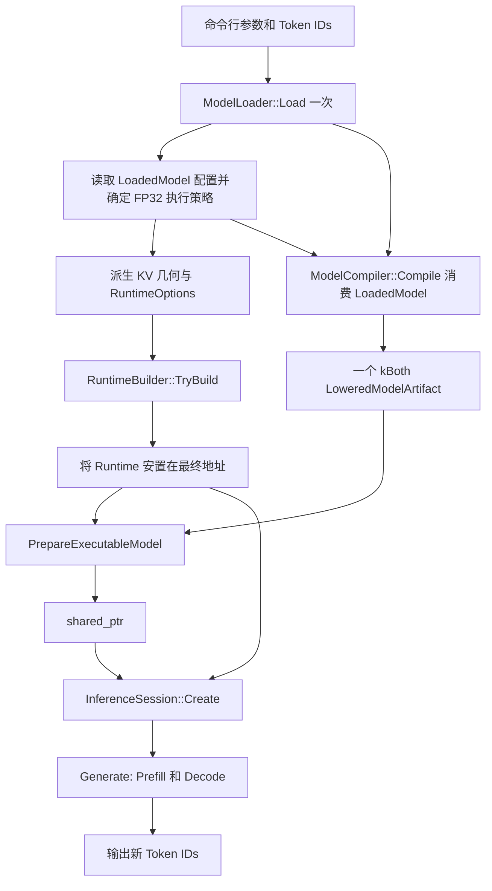

# 上层 Runtime 组装与推理入口实施方案

- **状态**: Draft
- **版本**: 1.0
- **日期**: 2026-10-19
- **产品边界**: [当前产品 PRD](../products/aethermind_prd.md)
- **架构边界**: [AGENTS.md](../../AGENTS.md) §2.1
- **关联计划**: [01 Generate 闭环](01-inference-session-generate-readiness.md)、[02 工程质量](02-engineering-quality-system.md)、[06 系统能力路线图](06-system-capability-evolution-roadmap.md)、[07 模型准备入口](07-executable-model-preparation.md)
- **关联模块**: 应用入口 / inference / runtime / model / compiler / API

本文是待实施方案。源码事实按 2026-10-19 当前工作树静态核对；本次只编写文档，不新增运行入口，不修改公开 API，也不重新运行 C++ 测试。下文工具、选项和辅助函数均为拟新增内容。

## 1. 现状分析

### 1.1 缺口定位

`RuntimeBuilder::Build()` / `TryBuild()` 已有资源装配实现，作为公开 C++ 构建块由外部宿主调用是合理边界。库内部没有调用它们，本身不是 builder 的实现缺陷。

当前缺口是：仓库没有非测试调用方，将模型配置、Runtime、模型准备、Session 与 Token IDs I/O 连成一个可独立运行的入口。已有测试中的组装链不能替代产品使用入口，也不能证明 PRD 中的 C ABI 已交付。

| 已核对事实 | 源码依据 | 对方案的约束 |
|---|---|---|
| builder 装配 allocator/backend registry，按配置初始化 KV；`TryBuild` 返回失败状态，`Build` 失败时 abort | [runtime_builder.cpp](../../src/runtime/runtime_builder.cpp) | 产品入口使用 `TryBuild`；不另写资源工厂 |
| 模型准备与 Session 创建都接收外部 `Runtime&` | [executable_model.h](../../include/aethermind/inference/executable_model.h)、[inference_session.h](../../include/aethermind/inference/inference_session.h) | 上层负责 Runtime 所有权与稳定地址 |
| `ModelCompiler::Compile` 消费 `unique_ptr<LoadedModel>`，产物保活权重 | [model_compiler.h](../../include/aethermind/compiler/model_compiler.h) | 加载一次，读取配置后转移同一模型，避免重新加载 |
| Prefill/Decode 当前共享一个 plan；`ExecPhase::kBoth` 可供两阶段查询 | [executable_model.h](../../include/aethermind/inference/executable_model.h)、[graph_lowering.h](../../include/aethermind/compiler/graph_lowering.h) | 一次编译、一次准备；不预先拆成两份模型 |
| `LoadAndPrepareExecutableModel` 已串起加载、编译、准备，但要求 Runtime 已存在 | [executable_model.cpp](../../src/inference/executable_model.cpp) | 保留该便利 API；本入口为读取模型配置而显式组合其下层 API |
| 默认编译选项是 O2/plain，不能视为 CPU 通用可执行默认值；现有测试显式选择 O1/plain 或 O2/packed | [model_compiler.h](../../include/aethermind/compiler/model_compiler.h)、[graph_lowering.h](../../include/aethermind/compiler/graph_lowering.h)、[集成测试](../../tests/unit/inference/test_load_prepare_executable_model.cpp) | 入口必须有明确 CPU preset |
| Runtime 按值拥有 KV manager；workspace 和 activation 在请求准备路径分配 | [runtime.h](../../include/aethermind/runtime/runtime.h)、[inference_session.cpp](../../src/inference/inference_session.cpp) | 不把 workspace storage 搬进 builder |
| 当前 C API 仅有通用对象引用、错误处理等基础接口；PRD 的 runtime/model/session C ABI 仍是草案 | [c_api.h](../../include/c_api.h)、[PRD](../products/aethermind_prd.md) §3.4 | C++ 运行入口和 C ABI 分阶段验收 |
| 构建系统提供 shared library、单元测试和 benchmark，尚无推理工具目标 | [根 CMake](../../CMakeLists.txt)、[库 CMake](../../src/CMakeLists.txt) | 入口应能在关闭测试时单独构建 |

### 1.2 首版交付范围

推荐先实现独立 C++ 工具，复用现有公开构建块，建立受支持配置的可复现入口；之后再接 C ABI。

- CPU-only、同步、单模型、单请求、Llama Dense、FP32、greedy Argmax。
- 输入是 HF 模型目录、Token IDs、KV capacity 和生成配置；输出仅为新 Token IDs。
- O1/plain 作为首版默认；O2/packed 作为显式选择并单独验收，不承诺更快。
- HF 文件可加载不等于模型可执行；不承诺 FP16/BF16、INT8/INT4 或其他模型家族端到端支持。
- 不增加 tokenizer、HTTP、scheduler、并发 Session、GPU、Paged KV 或新的 weight packing 算法。

## 2. 目标架构

### 2.1 职责与依赖

| 所在层 | 负责 | 保持的边界 |
|---|---|---|
| 拟新增 `tools/inference/` | 参数解析、配置到 RuntimeOptions 的映射、CPU preset、对象生命周期、错误和 Token IDs I/O | 仅消费 public headers，不 include `src/` 私有头或测试 helper |
| model | HF I/O、模型配置/权重验证、家族识别、semantic graph 前端 | 模型支持判断继续以 model 的既有权威入口为准 |
| runtime | provider/factory、allocator/backend、静态 KV storage | 不依赖 model/compiler/inference，不读取 HF 配置 |
| compiler | semantic pipeline 与 lowering | 不访问 backend registry，不内置产品 CPU preset |
| inference | 模型准备、immutable 权重绑定、Session/Generate 编排 | 继续使用 `PrepareExecutableModel` 唯一准备入口 |
| 后续 C ABI 适配层 | opaque handle、所有权、异常边界、状态与输出缓冲区 | 复用上述能力，不复制 compiler、packing 或执行算法 |

### 2.2 控制与数据流



首版调用顺序为 Load → 配置映射 → TryBuild → Compile → Prepare → Create → Generate。`Compile` 必须在本入口确定 Runtime 的最终存放位置后执行，便于使用一个明确的作用域管理后续资源。

读取配置后，直接把同一个 `LoadedModel` 移入 `ModelCompiler::Compile`；不再调用 `LoadAndPrepareExecutableModel(model_dir, ...)` 重新加载。`PrepareExecutableModel` 同时处理所有权、权重组装和 plan，入口不自行逐层绑定权重。

### 2.3 核心数据与接口

首版新增工具私有 `RunOptions`，字段含义如下；不将其加入公共 C++ ABI。

| 字段 | 含义与校验 |
|---|---|
| `model_dir` | 本地 HF 目录，交给 ModelLoader 验证内容 |
| `prompt_tokens` | 非空 `uint32_t` 数组；严格解析整数，加载后检查词表范围 |
| `context_tokens` | 必填的静态 KV capacity；正数且不超过模型 `max_position_embeddings` |
| `generation` | 复用 `GenerationConfig{max_new_tokens, eos_token_id}`；EOS 不做隐式猜测 |
| `preset` | 工具私有枚举 `O1Plain` / `O2Packed`，默认 `O1Plain` |

工具私有入口拟为 `StatusOr<std::vector<uint32_t>> RunInference(const RunOptions&)`：它在一个作用域内拥有 Runtime、模型和 Session，只返回拥有数据的 Token IDs，不返回借用局部 Runtime 的 Session。`main` 只处理参数、输出和退出码。

CPU preset 必须逐项设置，不能直接转用 `ModelCompileOptions{}`：

| preset | `optimization.opt_level` | `lowering.enable_packed_weights` | selector |
|---|---:|---|---|
| `O1Plain` | 1 | false | CPU、`WeightFormat::kPlain`、`ExecPhase::kBoth` |
| `O2Packed` | 2 | true | CPU、`ExecPhase::kBoth`；具体消费权重的 step 由 lowering 标记 packed |

packing recipe 仍由 backend 选择。选择 O2 失败时传播错误，不静默降到 O1，不强制指定 identity/B-panel 布局。

### 2.4 RuntimeOptions 与 KV 配置映射

映射只读取已由 loader 校验的配置，并对 signed→`size_t` 转换、除法和请求容量执行检查。它是产品配置适配，不建立第二套模型家族 schema。

| Runtime 配置 | 来源与规则 |
|---|---|
| CPU allocator/backend | 显式启用；其他设备关闭；沿用默认 CPU provider/factory |
| `kv_cache.enable_manager` | true |
| `num_layers` | `config.num_hidden_layers`，验证为可表示的正数 |
| `num_kv_heads` | `config.num_key_value_heads`，使用 loader 规范化后的值；不在工具另造 fallback |
| `head_dim` | 优先使用正的 `config.head_dim`；为 0 时，在 heads/hidden 合法且整除后取 `hidden_size / num_attention_heads` |
| `max_tokens` | 用户给定的 `context_tokens`；不默认按模型最大窗口分配 |
| `kv_dtype` | 首版限定 `Float32`；必须与图的 activation/state dtype 一致 |
| `alignment` | 首版固定 64；物理 stride/padding 与溢出检查仍交给 KV layout/manager |

当前 Llama builder 用 `weight_dtype_hint`（未定义时回退 Float32）确定 activation/state dtype，依据见 [llama_dense_graph_builder.cpp](../../src/model/llama_dense_graph_builder.cpp)。入口不能仅把 KV 设置成 FP32 就视为 checkpoint 已转换；必须核对该规则及实际使用的 resolved weights 均满足 FP32。非 FP32 执行组合明确拒绝，不改写 hint、不隐式转换权重。后续支持其他 dtype 时，在已有 model/inference 合同内扩展并补齐数值证据。

对正的 `max_new_tokens = N`，本请求所需 KV token 数为：

```text
required_tokens = prompt_tokens.size() + (N - 1)
```

加法必须防溢出；要求 `required_tokens <= context_tokens <= model_context_limit`。首个新 token 由 Prefill 预测，因此不能把它再次计为一次 Decode KV append。EOS 可能提前结束，但不能依赖它缩小预约。`N == 0` 不做减一，遵循 Generate 的空输出语义。Session/manager 保留最终校验权，入口的提前报错不能替代底层检查。

`RuntimeOptions.workspace` 当前未被 builder 消费，不能把 `default_workspace_limit_bytes` 当作已生效的内存预算。workspace/activation 继续由 Generate 准备；用户指定的 KV capacity 也不代表进程总内存上限。

### 2.5 Ownership 与生命周期

局部对象按 Runtime → shared model → Session 的顺序声明，按反序销毁；请求资源由 Generate 管理。`TryBuild` 的结果可以在模型准备前移动到最终 `Runtime` 局部变量，此后不得移动或替换它。

```text
RunInference 作用域
  Runtime                         最先构造、最后销毁、地址稳定
    └─ ExecutableModel            借用 Runtime，拥有 artifact/权重/plan
         └─ InferenceSession      借用 Runtime，共享 model
              └─ Generate 请求    workspace、activation、KV reservation
```

首版无需新增持有 Runtime/Session 的公共 `Engine` 类。以后确有长期 owning facade 需求时，需独立设计稳定地址的状态对象；不能把含 Runtime 和借用它的 Session 的结构体按默认 move 返回。

## 3. 方案与备选

| 方案 | 收益 / 代价 | 裁决 |
|---|---|---|
| 独立 C++ 工具显式组合现有 API | 修改小、可在无 GTest 环境运行，暴露真实配置与生命周期问题 | 首选，先实现并验收 |
| 立即增加公共 owning Engine facade | 可隐藏更多调用细节，但提前增加 public API、稳定地址和可移动性设计负担 | 等待真实长期宿主需求 |
| 在 RuntimeBuilder 内读取模型并准备 Session | 使用方式简短，但引入 runtime → model/compiler/inference 反向依赖 | 不采用 |
| 两次调用 LoadAndPrepare，分别准备 Prefill/Decode | 表面上阶段明确，但当前会重复加载、编译和准备，且没有合并两份模型的必要 | 不采用；复用一个 kBoth plan |
| 只补文档样例或继续由单元测试组装 | 成本低，但不能提供关闭测试后的独立运行入口 | 只作辅助材料 |
| 一次性实现全部 C ABI 再验证 | 直接覆盖产品目标，但将 runtime 配置、handle、错误/输出合同问题叠加 | 在 C++ 路径稳定后分阶段实施 |

## 4. 实施步骤

### 4.1 P0：固定配置与失败边界

1. 以现有 tiny Llama FP32 HF fixture 定义首版输入，核对 `ParseModelArchitecture`、loader、graph 和 CPU 执行支持范围。
2. 落实已知行为字段的拒绝合同；例如模型声明的 activation 必须与实际构图一致。相关修复归 model，参照 [06 路线图](06-system-capability-evolution-roadmap.md)，不在 CLI 复制 validator 或扩展白名单冒充完整支持。
3. 在工具私有 helper 中实现 RunOptions 校验、KV 参数映射及 CPU preset。错误按参数/加载/Runtime 构建/编译/准备/Session/生成阶段分类，同时保留底层 StatusCode。
4. 明确零 token、EOS、容量边界和 dtype 拒绝规则，再开始接入口。

退出条件：给定合法 FP32 配置能得出确定 RuntimeOptions；非法值在分配大块 KV 或执行前失败，未支持的 dtype/preset 组合不被静默接受。

### 4.2 P1：提供独立 C++ 入口

拟新增文件：

- `tools/inference/inference_main.cpp`：参数解析、调用 runner、stdout/stderr、退出码。
- `tools/inference/inference_runner.h/.cpp`：工具私有 RunOptions、配置映射、preset 和 RunInference。
- `tools/inference/CMakeLists.txt`：拟新增 `aethermind_infer` 目标，仅链接 `AetherMind`。
- 根 CMake：拟新增 `BUILD_INFERENCE_TOOL` 选项（默认 OFF），启用时添加上述子目录，不依赖 `BUILD_TESTS`。

入口中沿 §2.2 的顺序，显式调用 `RuntimeBuilder::TryBuild()`。不复制 Runtime 的默认 provider/factory 注册代码，不手动调用 allocator 的底层存储实现。

CLI 拟定合同：

```text
aethermind_infer --model <hf-directory>
                 --tokens <comma-separated-uint32>
                 --context-tokens <positive-integer>
                 --max-new-tokens <nonnegative-integer>
                 [--eos-token-id <uint32>]
                 [--preset o1-plain|o2-packed]
```

stdout 只打印一行 JSON 整数数组（仅新生成 token，包含生成出的 EOS）；诊断写 stderr，工具进程中的库日志也须导向 stderr，避免污染机器可读输出。整数输入使用严格解析，拒绝负数、空项、尾随垃圾与越界，不新增 JSON/参数解析依赖。成功退出 0，参数错误退出 2，加载/准备/运行失败退出 1；这些是工具合同，不冻结内部 StatusCode 的数值表示。

runner 在入口边界捕获 `std::bad_alloc` 并返回空 message 的 ResourceExhausted，不在 OOM 路径拼接阶段字符串；`main` 用尽量不分配的固定诊断报告。文件系统和其他可恢复异常在进程边界处理；底层 `AM_CHECK`/`noexcept` 终止不是 catch 能恢复的错误，应在可验证的参数路径上提前排除，并记录仍需独立修复的底层失败边界。

退出条件：只构建库和工具即可从 HF 目录生成 Token IDs；没有测试 fixture helper、fake backend 或空 kernel 成为工具运行依赖。

### 4.3 P2：接通产品 C ABI

在 P1 通过后，按 [PRD §3.4](../products/aethermind_prd.md#34-c-abi-规范) 冻结 runtime/model/session handle、错误所有权与输出 buffer 合同，再实施适配。CLI 可复用的配置映射/preset helper 若出现第二个生产消费者，再按职责移入 inference 的私有实现；参数解析和 I/O 留在工具。

必须先处理 C ABI 中“Runtime 先创建、模型后加载”与 KV 几何来自模型之间的时序：保持当前 builder 行为的首版选择，是 runtime config 显式提供 KV 几何/容量，model load 校验其与模型一致。若要求模型加载后才能初始化 KV，需单独评审 Runtime 初始化 API，不能直接在 C wrapper 里更改已使用 Runtime 的 KV storage。

C handle 内部为 Runtime 提供稳定地址；model/session handle 持有必要的 owner 引用，使 destroy 顺序安全。逐一规定 null、长度/容量、required-size、失败时输出状态和重复 destroy 的合同；任何 C++ 异常都不能越过 C 边界，内部 STL/Status/TensorView 不成为 ABI。

退出条件：C 调用方通过正式 create/load/create/generate/destroy 链得到与 C++ 基线一致的结果，ABI/version/error/buffer/lifetime 测试通过。完成 P1 不能标记 C ABI 已交付。

### 4.4 P3：文档与可复现命令

实施 P1 时，同步根 README 的构建/运行说明和工具参数；新增 public API 时再同步 [公共 API 参考](../api/public-api.md)、对应 design 与 CHANGELOG。本提案在仅写入方案时维持 Draft。

以下是 P1 实施后的目标命令，目前选项和目标尚不存在；`MODEL_DIR` 必须指向合法、受支持的本地 FP32 HF fixture：

```bash
cmake -S . -B build-infer -DBUILD_INFERENCE_TOOL=ON -DBUILD_TESTS=OFF -DBUILD_BENCHMARKS=OFF
cmake --build build-infer --target aethermind_infer -j
./build-infer/tools/inference/aethermind_infer --model "$MODEL_DIR" --tokens 7 --context-tokens 8 --max-new-tokens 3 --preset o1-plain
```

关闭测试构建是入口独立性的门禁，不等于已经解决依赖下载、install/export 或离线发行；这些沿 [02 工程质量方案](02-engineering-quality-system.md) 独立验收。

## 5. 风险与依赖

| 风险 | 控制措施 |
|---|---|
| loader 接受的字段与 graph/kernel 语义漂移 | model 层 fail-closed 与配置→图→执行证据；不把加载成功当作入口成功 |
| FP16/BF16 checkpoint 被误当作 FP32 可执行 | 同时检查 activation/state 规则和实际权重；未支持组合明确拒绝 |
| Runtime 移动或提前析构 | 首版只在单作用域持有；准备后不 move；返回纯数据结果 |
| KV 配置与模型不匹配、容量溢出或过量分配 | 使用规范化配置、检查转换/容量、显式 capacity；物理布局仍由 manager 校验 |
| 默认 O2/plain resolve 失败 | 显式 preset；packed recipe 交 backend；失败不隐式 fallback |
| 既有内部检查或 noexcept 在 OOM 下终止 | TryBuild/Status 不等于全链可恢复；对已知终止点独立记录与修复，不承诺工具全面 recoverable OOM |
| 误称稳态零分配或性能提升 | 本提案只新增 cold-path 组装；Decode/全请求分配、性能分别计量，不能推断 |
| 现有工作树和其他提案并行修改 | 实施前重查源码/状态，最小修改；09 号模型扩展不是本入口的前置 |

首版不增加并发能力；所有共享 Runtime 的调用继续串行。ASAN/UBSAN 用于生命周期/算术验证；仅当实施改变并发或同步契约时触发 TSAN，不借本入口引入线程池。

## 6. 验收标准

以下均为待执行门禁，不是本次文档编写的验证结果。

| 编号 | 门禁 | 证据要求 |
|---|---|---|
| A1 | 独立构建运行 | `BUILD_TESTS=OFF`、`BUILD_BENCHMARKS=OFF` 时可构建并运行工具；只依赖库及其正式依赖 |
| A2 | 真正接入 builder | 非测试 runner 显式调用 TryBuild；KV 几何从当前模型派生，无 tiny fixture 常量 |
| A3 | 一次准备 | 源码审查确认 Load/Compile/Prepare 各调用一次；同一 kBoth plan 覆盖 Prefill/Decode，不为计数增加生产 hook |
| A4 | 覆盖 Decode | 无 EOS 干扰的 tiny FP32 fixture 请求至少 3 个新 token，实际执行 Prefill 加至少两次 Decode；不能只断言 token 数量 |
| A5 | 数值与配置 | 复用既有 scalar/reference 测试的逐步 logits 容差基线，CLI 输出与同 fixture/preset 的预期 IDs 对照；O2/packed 单独验收，近似并列的 Argmax 有明确规则；不为工具新增 public logits/debug API |
| A6 | 确定性与复用 | 相同配置多次独立运行得到相同 IDs；现有 Session 重复 Generate 仍释放 reservation，无跨请求状态残留 |
| A7 | 边界输入 | 空 prompt、负数/越界 token、非法 EOS、无效路径、非 FP32、非法 preset/容量分别报错；stdout 无部分成功结果 |
| A8 | 容量与零值 | `prompt + N - 1 == capacity` 成功，超过失败，加法溢出失败；N=0 不执行模型且无减一溢出，EOS 提前停止包含 EOS |
| A9 | 失败与所有权 | 覆盖加载、Runtime/KV 分配、编译、准备和执行失败；StatusCode 保留，RAII 清理，Runtime 身份不匹配继续拒绝，ASAN/UBSAN 无新增问题 |
| A10 | C ABI 独立验收 | 仅 P2：C 编译的调用方、ABI version、buffer/error/null 合同、handle owner 顺序与异常封闭有专门测试 |
| A11 | 文档与范围 | README/索引/相关 API 文档准确；不得据 tiny FP32 成功宣称量化、其他家族、7B 性能或全部 PRD hard gates 已达成 |

测试先沿用 [LoadAndPrepare 集成测试](../../tests/unit/inference/test_load_prepare_executable_model.cpp) 与 [TinyLlama 执行测试](../../tests/unit/inference/test_direct_prefill_decode.cpp) 的数值/生命周期基线，再新增直接运行工具二进制的 smoke/integration 检查。生产 runner 不依赖测试源码；CI 明确准备 HF fixture，缺失时报告未取得端到端证据，不能以静默跳过作为门禁通过。

执行前重建最小受影响目标，先跑入口聚焦用例；只有实现确实触及 kernel、packing、fusion 或 threading 时，才按 [算子工作流](../guides/operator-development-workflow.md) 增加相应证据。本入口没有性能变更目标，不以 microbenchmark 代替集成验收。
