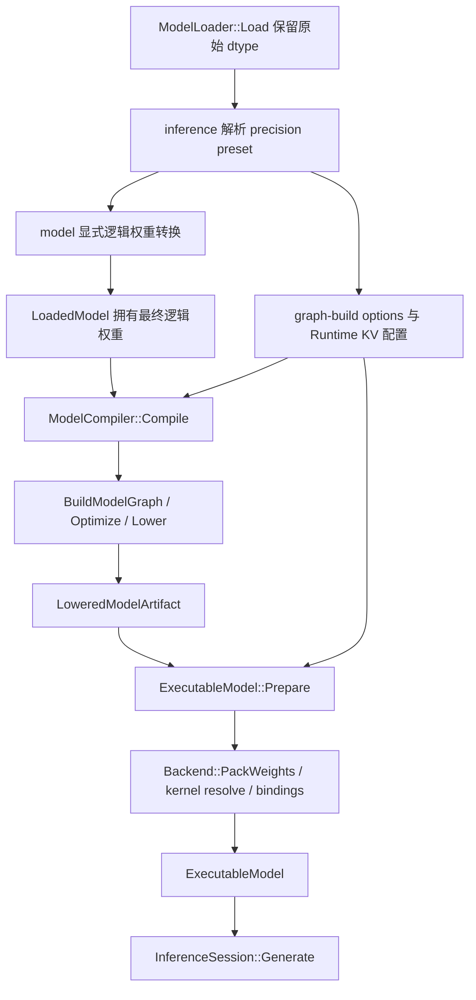

# FP16 / BF16 执行支持方案

- **状态**: In Progress
- **版本**: 2.6
- **日期**: 2026-11-12
- **产品边界**: [当前产品 PRD](../product.md)；CPU-only、单进程、同步、单请求、Token IDs I/O、Llama Dense、静态连续 KV
- **架构边界**: [AGENTS.md](../../AGENTS.md) §2.1
- **关联计划**: [06 系统能力路线图](06-system-capability-evolution-roadmap.md)、[07 模型准备入口](07-executable-model-preparation.md)、[08 KV/Attention 演进](08-kv-cache-and-attention-capability-evolution.md)、[09 模型家族扩展](09-qwen-and-moe-architecture-support.md)、[10 Runtime 组装入口](10-upper-level-runtime-assembly.md)
- **算子工作流**: [算子开发与优化工作流](../guides/operator-development-workflow.md)
- **关联模块**: dtypes / model / operators / graph / compiler / backend / execution / kv_cache / runtime / inference

本文是阶段化提案。P1 的显式 FP32 compatibility 已完成限定实现和 tiny checkpoint 验证，见 [FP32 兼容推理指南](../guides/fp32-compatible-inference.md) 与 [P1 验证报告](../archive/tests/fp32_compatibility_validation_2026-10-29.md)。P2 首批 CPU/O1/plain 与 O2/identity-packed、W16/A32/KV32 已完成限定验收，入口见 [W16 指南](../guides/w16-fp32-inference.md)，源码身份与 sanitizer 范围见 [P2 验收记录](../archive/tests/w16_fp32_execution_validation_2026-11-11.md)。P3 步骤 1–10 核心已完成：首批合同（§2.7–2.8）冻结与独立校准、mixed-KV 语义、`state_dtype` 身份迁移、布局账本、KV16 读写 reference、plan 事务、显式 `kv_dtype` 配置链、reduced fixture 四组合模型验收、§2.8 冻结预算校准 fixture（2048）正式生产验收、ASan/UBSan、prepared-operator baseline 与文档收口。KV16 在 CPU O1/O2 上端到端可执行并通过冻结预算验收；production ExecutionStep/模型级 baseline 与 SIMD 优化为后续 refinement；C ABI/CLI 保持 strict F32；P4 仍为未来工作。

P2 的转换基础已包括 [FP16 批量转换](../operators/fp16_conversion/README.md) 的 scalar、F16C widening、AVX2 narrowing，以及 [BF16 批量转换](../operators/bf16_conversion/README.md) 的双向 scalar/AVX2、checked byte spans、prepared Backend 函数表和 P1 callback。下文冻结 P2 的准入、Embedding、Norm-only 和 kernel args 合同，P2 能力状态由各批次退出门禁判定。

## 1. 现状分析

### 1.1 问题与推荐路线

“支持 FP16/BF16”需要分别回答：checkpoint 能否读取、图上 dtype 是否正确、所有 kernel 能否 resolve、数值是否符合合同、运行内存与性能是否达到目标。当前 P1 已在限定 tiny checkpoint 上闭环完整生成链；这不代表 native 16-bit 执行、任意 checkpoint 或后续阶段已支持。

推荐顺序：

```text
P0 数值与 dtype 合同
  → P1 F16/BF16 checkpoint 显式转换为 FP32 的兼容执行
  → P2 权重保留 16-bit，activation / 累加 / KV / logits 使用 FP32
  → P3 独立引入 16-bit KV storage
  → P4 16-bit activation 与对应硬件路径
```

P1 建立可执行基线，不是低内存方案；P2 是首个保留 16-bit 权重存储的交付目标。P2 的转换/SIMD 优化可以在该阶段获得 correctness baseline 后开展，不要求等待 P4。P3/P4 不作为 P2 的前置。

### 1.2 已核对事实

| 已核对事实 | 源码依据 | 对方案的约束 |
|---|---|---|
| `DataType`、`Half`、`BFloat16` 与 F16/BF16 safetensors 读取已存在；validator 接受 F32/F16/BF16 权重 | [DataType](../../include/aethermind/dtypes/data_type.h)、[HF dtype 解析](../../src/model/formats/hf/hf_utils.cpp)、[HF validator](../../src/model/formats/hf/hf_model_validator.cpp) | 不重复建设类型枚举或文件格式入口；加载不等于可执行 |
| 多数 Llama 算子语义允许 reduced dtype；`Add` 白名单有 BF16、缺 F16 | [Linear 合同](../../include/aethermind/operators/ops/linear_op.h)、[Add 合同](../../include/aethermind/operators/ops/add_op.h) | 补齐 F16 Add 时同步 semantic inference、constant folding、CPU 注册及测试 |
| `BuildLlamaDense` 接受显式 activation/KV dtype；W16 Load 指定 A32/KV32，Embedding 显式输出 F32 | [Llama builder](../../src/model/llama_dense_graph_builder.cpp)、[Load](../../src/inference/executable_model.cpp)、[Embedding inference](../../src/operators/ops/embedding_op.cpp) | P3 复用 graph-build options；公开 KV 精度选项必须与 Runtime 物理布局一致，不从源 hint 推测 |
| Linear/RMSNorm 语义分别校验 activation 与 weight，输出跟随 activation；Attention/KVUpdate 要求 activation 与 cache 同 dtype | [Linear inference](../../src/operators/ops/linear_op.cpp)、[RMSNorm inference](../../src/operators/ops/rmsnorm_op.cpp)、[Attention inference](../../src/operators/ops/attention_op.cpp)、[KVUpdate inference](../../src/operators/ops/kvcache_update_op.cpp) | W16/A32 有现成扩展基础；mixed KV 必须先扩展语义 |
| P2 W16/A32/KV32 的 plain/identity-packed 链已限定验收；CPU Attention/KVUpdate 仍只消费 F32 cache | [P2 验收](../archive/tests/w16_fp32_execution_validation_2026-11-11.md)、[Attention entry](../../src/backend/cpu/kernels/attention/attention_entry.cpp)、[KVUpdate entry](../../src/backend/cpu/kernels/kvcache_update/kvcache_update_entry.cpp) | KV16 需要独立的读写 reference 和完整模型证据，不因 Manager 接受两字节元素就获得执行支持 |
| `KernelSelector` 严格匹配 activation/weight dtype；`DeriveSelectorDTypes` 忽略 state，未独立表达 output dtype | [selector](../../include/aethermind/base/kernel_selector.h)、[dtype 派生](../../src/operators/operator_inference.cpp) | W16/A32 可复用；mixed KV 和后续 mixed output 才扩展匹配身份 |
| identity packing 保留源 dtype；现有 B-panel 只有 `kCpuBPanelF32Kc512Nr16`，packer/validator 限定 F32 | [CPU packing](../../src/backend/cpu/cpu_backend.cpp)、[recipe](../../include/aethermind/backend/packing_recipe.h)、[packed validation](../../src/backend/cpu/packed_weight_validation.cpp) | 16-bit B-panel 需要独立物理布局身份，不复用 F32 ID |
| `Half(float)` 软件标量转换使用固定 RNE + gradual underflow，双向转换 quiet NaN；BF16 转换使用 RNE 并保留 sign 与截断后的 NaN payload | [Half 转换](../../src/dtypes/half.cpp)、[BF16 转换](../../src/dtypes/bfloat16.cpp) | Half 的 FTZ 行为已独立迁移；软件转换的合同和测试不代表 native 16-bit kernel 已支持 |
| CPU capability 已检测 F16C、AVX512BF16、AMX_BF16 等，尚无对应完整 kernel 链；现有编译配置分别隔离 FP32 AVX2/FMA、FP16 F16C widening、FP16/BF16 AVX2 integer conversion | [CPU capability](../../include/aethermind/backend/cpu/cpu_capabilities.h)、[检测](../../src/backend/cpu/cpu_info.cpp)、[库 CMake](../../src/CMakeLists.txt) | feature detection 不是执行支持；新增 ISA 按 translation unit 隔离 |

### 1.3 范围与非目标

首批仅覆盖当前 Llama Dense 的完整推理链；其他模型家族按照 [09 号提案](09-qwen-and-moe-architecture-support.md) 分别验收，不因共享 dtype 获得自动支持。当前 loader 默认要求 linear 权重统一 dtype；P1 normalizer 在加载之后执行，不绕过或放宽该校验。Norm 与矩阵权重可以使用已批准的不同 dtype。

本提案不引入 GPU、服务化、并发请求、Paged KV、量化格式、自动精度搜索、通用 precision optimizer 或第二套 Graph IR。FP16/BF16 的浮点精度转换不承担 INT8/INT4 的 scale/zero-point/group 语义。

## 2. 目标架构

### 2.1 精度矩阵与不变量

下表区分已验收的 P1 范围与后续目标。W 表示矩阵权重存储，A 表示 activation；首批 residual 跟随 A。

| 模式 | Checkpoint 输入 | 执行矩阵权重 W | A / residual | KV storage | 累加 / logits | 状态 |
|---|---|---|---|---|---|---|
| FP32 兼容执行 | loader 已接受的 F32/F16/BF16 | 显式转换后的 F32 | F32 | F32 | 沿用既有 kernel / F32 | P1 C++ O1/plain 限定验收通过 |
| FP16 权重执行 | uniform F16 linear weights | F16 | F32 | F32 | F32 / F32 | P2 首批限定验收通过（O1/plain + O2/packed identity） |
| BF16 权重执行 | uniform BF16 linear weights | BF16 | F32 | F32 | F32 / F32 | P2 首批限定验收通过（O1/plain + O2/packed identity） |
| 16-bit KV | 已验收的 P2 权重组合 | F16/BF16 | F32 | 显式选择 F16 或 BF16，K/V 同型 | F32 / F32 | P3 待实施 |
| 16-bit activation | 后续按算子签名批准 | 按 preset 决定 | 显式边界；首版保留 FP32 residual 作为候选 | 独立选择已验收组合 | 至少 F32 / F32 | P4 待设计与实施 |

P2 要求 Embedding、linear 和 lm_head 的实际权重 dtype 与所选 F16/BF16 preset 一致。Norm 源权重允许 scalar F32/F16/BF16，准备后统一为 F32，矩阵权重保留目标 16-bit 格式。缺少独立 lm_head 时沿用 resolver 的 embedding fallback。显式 lm_head 验证实际 dtype，并保留其既有 storage 关系。

**P2 source hint 合同（当前实现）。** 在 [model_execution_policy.cpp](../../src/inference/model_execution_policy.cpp) 的新 policy 分支接受下表组合，先完成 metadata 准入，再分配转换 payload。

| Hint | P2 处理 |
|---|---|
| 缺省，或 undefined 且 name 为空 / `auto` | 接受，执行 dtype 由 policy 与实际权重决定 |
| scalar F32、F16、BF16，且与实际矩阵 dtype 一致 | 接受并保留原配置 |
| scalar F32、F16、BF16，与实际矩阵 dtype 不一致 | 接受并原样保留为 provenance / diagnostic，执行 activation/KV 显式为 F32 |
| 未识别的命名 hint，或上述集合以外的 dtype / lanes | 拒绝 |

所有矩阵角色的实际 dtype 仍须匹配所选 policy。即使 hint 匹配 policy，错误或混合的矩阵 dtype 也须拒绝。准入测试分别覆盖 known-hint mismatch 的接受与 actual-dtype mismatch 的拒绝。现有 Loader 已允许已识别 hint 与实际 dtype 不一致，P2 可沿用该读取合同。

必须保持：

1. TensorSpec、实际 bytes、TensorView、packed logical dtype、selector 与 kernel 参数一致。修改 dtype 标签不能代替数据转换。
2. checkpoint 源 dtype 以各 tensor 的实际 metadata 为准；执行 activation/KV dtype 以经解析的 graph-build options 为准，`weight_dtype_hint` 只保留来源信息。
3. 不按 hint 或 ISA 隐式改变精度；P2 不进行 F32→16 activation 转换，也不承诺任意 mixed linear dtype。P3 仅在显式选定的 KV 写入边界执行 F32→16，在读取边界 widening；不因 W/KV 类型不同而转换矩阵权重。其他转换须有明确策略并单独验收。
4. 累加精度是算子/kernel family 的固定数值合同，首批不开放任意 accumulator dtype 配置。
5. 不支持的 tuple 在编译或准备阶段失败，错误携带 op、端口、实际/要求 dtype、preset 和 phase。ISA fallback 只能替换实现，不能改变精度合同。
6. 相同 preset 的 Prefill/Decode 使用一致的权重与 KV 表示；阶段特化只能在同一数值合同下选择 kernel。

### 2.2 职责、数据结构与拟新增接口

下表的 P1/P2 model/compiler/inference、Embedding mixed output 与 W16 backend 已实现，后续 mixed KV 扩展仍是提案。C++ API 不承诺冻结 binary ABI。

| 所在层 | 数据/接口方向 | 职责 |
|---|---|---|
| inference | `WeightPolicy` / `ModelLoadOptions` 接入显式 C++ 准备入口 | P1 选择 O1/plain + compatibility，协调 Runtime CPU allocator、normalizer、FP32 graph options 与已有 Prepare；不实现转换算法或新 kernel |
| model | `ModelGraphBuildOptions` 与 `ConvertRawModelWeightsToFp32` | 构图前完成真实逻辑权重转换；`BuildModelGraph` 继续是模型到 semantic graph 的唯一入口 |
| compiler | `ModelCompileOptions.graph_build` 传给 `BuildModelGraph` | 编排 Build→Optimize→Lower；不分配/转换权重，不访问 backend registry |
| operators | `EmbeddingParams.output_dtype` 及其 inference/serde；后续按需增加 Cast | 定义 gather+widening、mixed KV、转换边界的可见语义，不查询 ISA |
| backend | 新增对应 dtype tuple 的 kernel、params builder、recipe/validator | 实现 weight widening、FP32 累加、物理 packing 与 ISA 选择 |
| execution | 既有 plan/binding/prepare 路径；P3 扩展 state dtype 身份校验 | 冻结 kernel/资源，校验 TensorSpec 与物理 binding；维持完整 plan 的 KV transaction |
| kv_cache / runtime | 使用解析后的 `kv_dtype`，沿用 layout/storage/allocator | 管理物理字节与布局，不解析 HF hint，不判断算子数值语义 |

不为本提案新增 owning Engine facade。当前统一使用 `ExecutableModel::Load(runtime, path, ModelLoadOptions)`，按 `WeightPolicy` 选择源权重准入及可选转换；artifact 准备统一使用 `ExecutableModel::Prepare`。旧创建自由函数与转发 overload 已删除，C++ 调用方需迁移；直接 `ModelCompiler::Compile` / `LoadAndCompile` 仍是低层编译入口，不自动触发转换。低层调用方若绕过 normalizer，必须构造真实一致的 specs，未覆盖的 kernel tuple 在 prepare 时明确拒绝，不能静默取得兼容模式的承诺。

新增 Embedding 字段的缺省语义须保留既有“输出跟随权重”；W16/A32 preset 显式选 F32 输出。字段迁移覆盖 OpParams、graph builder、inference、序列化/反序列化、constant evaluator（如适用）、kernel 参数和测试。通用 Cast 延后到 P4 真正需要图上 dtype transition 时再引入。

**P2 Embedding 输出与 builder 合同（当前实现）。** `EmbeddingParams::output_dtype` 的唯一解析规则为 `output_dtype.IsUndefined() ? weight_spec.dtype : output_dtype`，`InferEmbedding` 用该结果生成 output spec。首批显式 output dtype 支持 scalar F32，undefined 路径继续覆盖原有 F32/F16/BF16 同型输出。

[llama_dense_graph_builder.cpp](../../src/model/llama_dense_graph_builder.cpp) 中当前比较 `options.activation_dtype` 与 `weights.embed_tokens.dtype` 的 guard 必须替换。P2 构图先给 Embedding 设置 `output_dtype=F32`，再将显式 activation override 与推导后的 Embedding **output spec dtype** 比较。output dtype 未设置时，该 spec 跟随 weight。回归须验证旧缺省调用的跟随规则，以及 W16 weight + 显式 F32 activation/output 能成功构图且输出 spec 一致。

**P2 Embedding serde 合同（当前实现）。** 修改 [op_params_serde.cpp](../../src/operators/op_params_serde.cpp) 的序列化与解析分支。

| 参数状态 / 文本 | Canonical serialize / parse |
|---|---|
| `output_dtype` 为 undefined | 仍序列化为裸 `Embedding`，与旧输出逐字节一致 |
| 显式 scalar F32 | 序列化为 `Embedding output_dtype=float32` |
| 裸 `Embedding`，0 字段 | 解析为 `EmbeddingParams{}` |
| `Embedding output_dtype=float32`，1 字段 | 解析为显式 scalar F32 |
| 未知 key、重复 key、空值、额外字段、首批集合以外的显式 dtype | 返回 `InvalidArgument` |

解析只接受 0 或 1 个字段，重复 key 继续由已有 `ParseFields` 拒绝。对应回归包括两种 canonical 文本的 round trip、旧裸格式的逐字节断言，以及各非法字段分支。

### 2.3 控制与数据流



P1 转换全部非 F32 必需权重；P2 只执行合同要求的 Norm 等小权重转换，保留矩阵权重。转换完成后才构图，避免已冻结 TensorSpec 与实际存储不符。两种模式都只加载一次，不重新读取同一模型目录。

与 [10 号 Runtime 组装方案](10-upper-level-runtime-assembly.md) 集成时，先从已验证 config 和 preset 派生 KV dtype、capacity 及 RuntimeOptions；将 Runtime 放到最终地址，再通过其 allocator 完成需要的逻辑权重分配、Compile、Prepare、CreateSession、Generate。现有首版 FP32-only 入口合同在相应阶段验收后才扩展。

### 2.4 Ownership、分配与失败边界

```text
normalizer 生成新的 immutable RawStorage（拥有转换 buffer）
  → RawWeightView.storage
  → 新 LoadedModel 的 ResolvedModelWeights
  → LoweredModelArtifact.loaded_model
  → ExecutableModel.artifact_
       └─ immutable bindings 借用上述稳定 bytes 与自持 metadata
```

normalizer 创建新的 `LoadedModel`，不 `const_cast` 修改只读权重，不覆写 checkpoint mmap，也不改写原始 hint 伪装来源。无需给 ExecutableModel 增设平行的 converted-weight owner。沿用 [RawStorage/RawWeightView](../../include/aethermind/model/raw_weight.h)、[LoadedModel](../../include/aethermind/model/loaded_model.h) 和 [ExecutableModel](../../include/aethermind/inference/executable_model.h) 的生命周期路径。

- payload 经传入的 `Allocator&` 分配，以现有 Buffer/MemoryHandle 的正确释放合同封装进 source-private RawStorage 实现；不保存仅供分配调用的借用 allocator 引用，不更改 Allocator 接口。
- 每个输出 view 携带真实 dtype、shape、bytes 与 owner，并通过 `ValidateRawWeightView`；所有 shape×element-size、总字节与对齐计算检查溢出。
- 源数据不假定满足 SIMD alignment 或已构造为 `Half*`；使用满足 alignment、object lifetime 和 strict-aliasing 规则的读取，必要时经 `memcpy`/bit conversion。
- 按来源 storage、range 和逻辑 tensor identity 去重转换，保留 tied embedding/lm_head 的同源 alias；不能仅凭内容相同合并不同 tensor，也不能把同一权重转换两份。
- F32 来源可继续共享原 owner；不因兼容模式无条件再复制。RawStorage 只读性由封装与调用合同保证，`const Buffer` 本身不能证明没有其他可写 alias。
- 部分转换、metadata 或分配失败时 RAII 清理并返回原状态码及阶段上下文，不发布半成品模型；已存在的外部模型与 plan 不被替换。
- Runtime 地址稳定且长于模型/Session；model 长于所有借用权重的 prepared bindings。请求 workspace 仍由 Generate 分配，planner 只规划偏移。

**P2 Norm-only 预算合同（当前实现）。** 在 [RawWeightFp32ConversionOptions](../../include/aethermind/model/weight/raw_weight_fp32_conversion.h) 增加显式 scope，默认覆盖 P1 全量转换，P2 选择 Norm-only。所有角色先验证 metadata，转换计划仅收集 scope 选中且非 F32 的 view。retained 统计从转换后仍保留的 source views 构建，复用既有 ownership-identity 聚合与 range union 逻辑。

```text
final_owned = unique surviving source owners 的 owned backing
            + unique converted Norm F32 payload
peak_owned  = unique all source owners 的 owned backing
            + unique converted Norm F32 payload
```

Norm 与矩阵共享 backing 时，Norm 创建 F32 storage，矩阵保留原 view，原 backing 按 owner identity 计一次完整 footprint。Mapped/external 分类单列。有限 cap 要求 retained backing 信息完整，包含保留的 W16 backing。

同一实现批次必须更新转换器 public header 中的 `Unknown retained F32 backing...` 注释和 `retained Float32 backing metadata` 错误消息，使二者描述 retained backing（含 W16）。P1 与 P2 的固定账本验收见 §6.2。

### 2.5 Kernel、selector 与 packing

**P2：复用已有 act/weight selector。** Linear 使用 `{act=F32, weight=F16}` 或 `{act=F32, weight=BF16}`，输出 F32；Embedding 从显式 activation output 得出 act dtype。reference 读取 16-bit weight 并提升为 float，用 FP32 累加，直接写回 F32。不得用 reduced wrapper 的 `operator+=` 作为归约，也不在每个 token 展开整份 FP32 权重。

**P2 W16 Linear args 合同（当前实现）。** 现有 [LinearF32KernelArgs](../../src/backend/cpu/kernels/linear/linear_internal.h) 持有 `const float* weight`。新增 CPU-private `LinearF32W16KernelArgs`，由注册的 params builder 一次构造。

| 字段 / 行为 | 合同 |
|---|---|
| `input` / `output` | `const float*` / `float*`，activation/output 为 F32 |
| `weight` | `const std::byte*`，用 `memcpy` 读取 16-bit 元素 |
| `weight_dtype` | 实际 scalar F16 或 BF16，须与 weight TensorView 和 selector 一致 |
| 所有 row/col stride | 按对应张量的**元素数**计量，默认 col stride 为 1 |
| weight 地址计算 | 将逻辑元素 offset 显式乘以 2 转为 byte offset，binding-time 校验最大 offset 和字节范围溢出 |
| shape / layout / alias | 复用现有 TensorView、`AnalyzeRowwiseView` 与范围/alias 校验，沿用 rank flatten、空输出和零 K 合同 |

stride 回归使用相同物理 storage 的不同合法 row/col stride、非对齐 W16 source、尾部和溢出 metadata，确认 prepared args 与实际读写范围一致。

Prefill 可在已规划 scratch 中按 tile widening 并复用，Decode 可直接流式读取 16-bit weight；具体 blocking/threshold 属算子专项，须经 profiling 与 benchmark 决定。新增需求沿用 `WorkspaceRequirement`→plan→request allocation→binding，不在 kernel 中申请堆内存。

先验收 O1/plain；随后为 QKVLinear、GateUpLinear 等 fused consumer 补齐 mixed-dtype reference、identity packing 和绑定，再开放明确的 O2/packed preset。不能只增加 Linear 注册就宣称默认 O2/plain 可执行。

identity 布局可在合同允许时继续保存 16-bit 元素；如需新的 B-panel，新增包含 dtype、blocking、panel 顺序或 padding 特征的 `PackingLayout`，同步 byte formula、overflow、packer、descriptor、validator、artifact key 与 consumer。物理格式改变不得沿用 `kCpuBPanelF32Kc512Nr16`，也不预先照搬其 tile 参数。

**P3：最小扩展 state dtype。** 首批限定所有相关 K/V state ports 同 dtype，拟将 `state_dtype` 加入 KernelSelector；无 state 的 step 使用唯一的 undefined 表示，按严格相等匹配，不作为 wildcard。同步修改 dtype 派生、hash/equality/ToString、registry、lowering、untrusted plan 重校验与包含 selector 的 packing key。state dtype 来自真实 state specs，不借用 `weight_dtype` 字段。

KVUpdate 参数准备必须同时核对 state TensorSpec、selector、KV view/layout 与 binding dtype；保留现有 execution 校验。Attention 明确允许 `Q=F32, K/V=F16或BF16, output=F32`，KVUpdate 明确允许 `K/V activation=F32 → cache16`，在读写边界转换。

P4 如出现 input/output dtype 不同或同角色的多端口异型，需要按实际 schema port/role 扩展签名；单一 `result_dtype` 不能覆盖任意多输出异型情况。该合同在 P4 冻结并全链路迁移，P2 不提前建设通用端口签名系统。

### 2.6 数值与 ISA 合同

| 项目 | 推荐合同与限制 |
|---|---|
| Widening | F16/BF16 的有限值提升到 F32 精确表示，包括可表示的 subnormal；零符号保留；NaN 按已冻结的 bit-copy/quieting 规则处理 |
| Narrowing | Half 软件标量转换已采用固定 RNE + gradual underflow，保留 signed zero，overflow→Inf，NaN quiet 并保留可容纳的 payload，不设置浮点异常标志；FTZ 迁移见 [公共 API](../api/public-api.md)。后续 narrowing/SIMD 路径须匹配该合同；P1 的纯 widening 不依赖此次迁移 |
| GEMM/归约 | P1 沿用已有 kernel 的数值合同，当前 FP32 Linear reference 使用 double 累加。P2 新增 W16 Linear 固定 F32 累加，显式规定 reference 的累加顺序与 FMA contraction 策略，以独立 FP64 oracle、约定误差和 near-tie 规则验收 |
| Norm/Attention | 平方和、dot、stable softmax 的 max/exp/sum 与 value accumulation 至少 F32；RoPE 保留其既有更高精度频率/角度合同，不能因 dtype 扩展缩窄 |
| Fusion | 先规定 logical op 边界的 rounding/cast placement；融合不能移除要求的 narrowing 或额外引入舍入。浮点运算顺序变化按数值门禁审查，不要求所有实现逐位一致 |
| 硬件转换 | FP16 批量转换已具备 F16C widening 与 AVX2 整数 narrowing，并接入 P1 的 F16 权重准备，见 [合同与证据](../operators/fp16_conversion/README.md)。BF16 已有双向 scalar/AVX2 batch 与 P1 callback，见 [BF16 合同](../operators/bf16_conversion/README.md)。新增候选须遵守相同 subnormal/NaN 和异常合同 |
| Native BF16 | `VDPBF16PS` 乘数为 BF16、累加为 FP32；不能把 W16/A32 的 activation 偷转 BF16 以复用它。此类路径属于经过批准的 A16 模式 |
| Native FP16 | 有 FP16 算术指令不等于满足 FP32 累加；任何候选必须证明符合该 preset 的数值合同 |
| Dispatch/build | 独立 TU 与编译能力检查，使用实际 CPU/OS effective features，保留 scalar fallback；不全局添加高 ISA 或 fast-math 选项，不按 CPU 品牌猜测支持 |

P2 reference 的数值门禁固定如下。Embedding 与已冻结的 widening 位结果一致。W16 Linear 按 K 升序，每次先舍入 F32 product，再舍入 F32 add，reference TU 禁用 FMA contraction。有限且无溢出的单算子对照采用独立 double oracle，按 `gamma(2K) * sum(abs(A[k] * W[k]))` 加绝对误差下限检查，其中 `gamma(n)=n*u/(1-n*u)`、`u=2^-24`，并单列 subnormal、NaN/Inf 与溢出分类。

首批 tiny checkpoint 模型轨迹采用固定门禁 `abs_error <= 1e-5 + 1e-4 * abs(reference)`，逐 phase 记录最大误差。top-1 margin 大于两倍该步 logits 最大绝对误差时要求 argmax 一致，near-tie 按此 margin 规则分类。数值预算在调整算法前固定，后续改变 FMA/归约顺序的实现独立验收。

FP16 与 BF16 的指数范围和有效精度不同，不能按“都是 16-bit”互换。ISA 的可用性、吞吐与 workload 共同决定选择；不预设 BF16 总比 FP16 快，也不预设 16-bit 总比 FP32 快。硬件机制来源见 §7。

### 2.7 P3 首批执行合同（步骤 1 冻结；实现与验收见 §4.4）

本节定义并冻结实现必须满足的合同；当前实现与限定验收状态见 §4.4 和 [P3 验收记录](../archive/tests/kv16_execution_validation_2026-11-12.md)。算子细节分别归 [KVCacheUpdate](../operators/kv_cache_update/README.md) 和 [Attention](../operators/attention/README.md)。

| 矩阵 W | activation / residual / logits | 所有层 K/V storage | 首批 preset 与状态 |
|---|---|---|---|
| F16 | F32 | F16 | O1/plain 与 O2/identity-packed 已接通 |
| F16 | F32 | BF16 | 同上 |
| BF16 | F32 | F16 | 同上 |
| BF16 | F32 | BF16 | 同上 |

W 与 KV 精度独立选择；同一 Runtime 的全部层 K/V 必须使用同一 scalar dtype。Norm 保持 P2 的准备后 F32，checkpoint hint 继续只作 provenance。KV32 保持既有 P1/P2 合同。首批 KV16 只对上述两个 W16 policy 开放；F32 矩阵与 KV16 的模型组合另行准入。C ABI 与产品 CLI 保持 strict FP32。

**配置合同（当前实现）。** 在 `CpuRuntimeAssemblyOptions` 和 `ModelLoadOptions` 末尾分别追加 `DataType kv_dtype = DataType::Float32()`，不扩张 `WeightPolicy` 来编码 KV 精度。通用 `MakeKVCacheOptions(config, context_tokens, kv_dtype)` 接受 scalar F32/F16/BF16，拒绝 undefined、scalable、其他类型及非法 lanes；现有 `MakeFp32KVCacheOptions` 保留为 F32 wrapper。显式选项分别驱动 RuntimeOptions 与 ModelGraphBuildOptions；KV16 Load 在权重转换和 packing 前验证已有 Manager 的实际 dtype 与请求相等，不修改或重建 Runtime。低层 Compile→Prepare/binding 路径也必须验证真实 state specs 与已有物理布局一致。新增 C++ 字段改变结构布局，消费者需重新构建。

**唯一转换边界。** K 在既有 F32 RoPE 完成后窄化一次，V 从 F32 projection 输出窄化一次。KVUpdate 的 state 输入/输出 alias 同一实际 cache plane；Attention 必须从 cache16 读取，再 widening 到 F32。Prefill、Decode 及当前 query 可见的当步 K/V 都经过该边界，不能在 Prefill 直接旁路读取未窄化 activation。持久 cache 不保留平行 F32 数据源；未来 tile scratch 必须走既有 workspace 规划，不能改变该语义。

```text
K32 → 既有 F32 RoPE → RNE narrow → K cache16 ┐
V32 ─────────────────→ RNE narrow → V cache16 ├→ widen → F32 Attention(Q32) → output32
                                           ┘
```

**reference 算术。** KV 转换完全复用已有固定 RNE、gradual underflow、signed zero、overflow→signed Inf、quiet NaN 且保留 sign/可容纳 payload 的合同，转换自身不改变浮点环境。Attention 使用 F32 score、scale、max、`exp`、denominator、value accumulation 和除法；按 head dimension 升序进行独立 F32 product/add，按可见 token 升序执行 max 与 softmax 两遍扫描、累加 weighted V，最后除以 denominator。新 reference TU 禁止 FMA contraction 和 fast-math，不改变已交付 F32 kernel 的数值合同。RoPE 保持既有更高精度频率/旋转计算与最终 F32 写回。

数值误差门禁使用 FE_TONEAREST、gradual-underflow 的 F32 环境（x86 FTZ/DAZ 关闭）。Attention 不负责修改/恢复调用方 FP 控制，不承诺算术异常 flags 不变；转换的 FP 环境保证不能推广为 Attention 保证。NaN/Inf 或 F32 中间溢出不触发额外 payload 预扫描、clamp 或有限结果补救；按固定算法的 F32/`std::exp` 传播检查分类，Attention 算术不承诺 NaN payload。含 +Inf 或全 -Inf 的 logits 不承诺有限 softmax，不能用零向量替代 NaN 来通过测试。模型误差/排名门禁要求输入与所比较的全部中间/输出有限。

**state 身份与物理绑定。** `state_dtype` 只从完整 schema 的实际 state 输入/输出 specs 推导，不受 `contributes_tensor_spec=false` 过滤；各 state port 同型，无 state 时为唯一 undefined，严格匹配。同步覆盖 lowering、lowered artifact 验证、registry、hash/equality/ToString、untrusted 重校验与包含 selector 的 artifact key。无 weight 的算子沿用 weight dtype fallback，不借用该字段表达 KV。当前 untrusted stateful node 限制保持。

F32 activation/query/output 使用元素单位正 stride 与实际 float 自然对齐；KV binding 的 stride 是字节单位，按真实两字节元素验证范围与 overflow，不沿用 `sizeof(float)`。生产基址仍遵守 layout alignment，byte-safe KV 读写不新增 float 对齐要求。KV padding 不参与转换/Attention。KVUpdate 两个只读 activation 可以共享 storage，但不得覆盖任一写入窗口；K/V destinations 互不重叠。Attention output 与 Q、可见 K/V 均不重叠。动态 KV 指针、append/read 区间和 query position 只借用于本次调用，不写入 prepared 参数。

**失败与资源。** 先校验本次访问所需 metadata、dtype、geometry、alias 与可表示范围，再读写。完整 plan 和所有层写入成功后才提交 watermark；失败允许未提交窗口的 bytes 已改变，但不得发布该窗口或破坏已提交历史，重试重写完整 append range。Manager 的 generation/reservation/capacity 与外部串行化合同保持。逻辑两字节 payload 与 padded physical bytes 分别记账，不要求所有 head_dim/alignment 下总 KV 恰好减半。

### 2.8 P3 数值门禁与独立校准

验收分成三个独立层次：

1. **转换位合同。** 以独立可表示值/nearest-even oracle 检查写入的每个 16-bit pattern 与 widening 位结果，覆盖全部 65,536 个源模式、F32 midpoint 邻点、零/subnormal/overflow/NaN。不得用被测 Half/BFloat16 helper 生成 expected。NaN 算术的 payload 不属于此位合同。
2. **KV16 实现正确性。** 独立 reference 必须在每层 post-RoPE K 和原始 V 的写入位置窄化再 widening，包括 Prefill 当前 token；保留相同 W16 checkpoint 与 Norm 数据。比较每阶段 Attention/模型 logits、各层 K/V、watermark，固定数值容差与 near-tie 规则后再实现 kernel。
3. **KV16 相对 KV32 的误差。** 同一 W16 checkpoint、同一 teacher-forced token/position 轨迹，对比 KV16 与 KV32。不能把权重精度误差并入 KV 误差，不能只比较最终 greedy token，也不能直接沿用 P2 容差。closed-loop Generate、EOS、重复请求另列测试。

校准必须覆盖 MHA tied/untied、GQA/MQA tail、短 Prefill+至少两次 Decode，以及 2046-token Prefill+两次 Decode 至 2048 的 near-limit case；四种 W×KV 组合分别记录。校准使用独立于 AetherMind 的算法，并先通过既有 FP32 HF golden 交叉验证。本次校准从固定 F32 source 的全部矩阵独立 RNE 派生数学 W16，Norm 保留原 F32；它不验证实际序列化 W16 checkpoint 的加载。步骤 9 必须消费真实 reduced checkpoint、记录 payload identity，并对相同 payload 生成 reference。生成的脚本/编译参数、输入与 oracle hash、环境和全部测量保存在 raw；校准不验证 KV16 production path、实际两字节分配、O1/O2 kernel 或性能，不更新 accepted FP32 assets/checksums。

**固定 finite 模型预算（已冻结，2026-11-12）。** 下表适用于本批 5 个 fixture、最长 2048-token 的 Prefill/两次 Decode、两种矩阵 dtype；每个 scalar 均须满足 `abs(actual-reference) <= atol + rtol * abs(reference)`，同时拒绝非有限比较值。K/V 以 decoded F32 数值比较。实现正确性对照固定量化边界、采用 FP64 归约后写回 F32 的独立 reference；质量对照采用同 W16 的 F32 计算/KV32 reference。

| 对照层次 | KV dtype | logits atol | logits rtol | K/V atol | K/V rtol |
|---|---|---:|---:|---:|---:|
| 实现正确性 | F16 | `1e-6` | `2e-5` | `2e-4` | `2e-3` |
| 实现正确性 | BF16 | `1e-6` | `2e-5` | `1.5e-3` | `2e-3` |
| 相对 KV32 的误差 | F16 | `1e-3` | `2e-3` | `4e-4` | `4e-3` |
| 相对 KV32 的误差 | BF16 | `5e-3` | `1e-2` | `2e-3` | `2e-2` |

不同归约的上游 F32 微差可能跨 KV16 midpoint，使 cache 数值相差一个离散间隔；因此模型 K/V 不要求逐位相等，**单次转换在相同输入位模式下仍必须精确匹配独立位 oracle**。模型容差不能用于放宽 converter 位合同。误差预算按 phase、context、W/KV 组合分别报告最大绝对/相对误差和最大归一化误差，不能只报告合并平均数。

**固定排名规则。** 对相应对照层次，先从 reference logits 和本表预算计算每行 `epsilon = max_i(atol + rtol * abs(reference[i]))`。top-1 margin（第一与第二名差）及 top-4 boundary margin（第四与第五名差）分别大于 `2*epsilon` 时，该行对应的排名集合必须一致；否则作为 near-tie 记录，仍须通过全部 scalar 数值门禁。classification 绑定 reference identity、预算和 row，在检查候选前固定，不使用候选自身实测误差重新分类。P2 的历史 margin 规则不在本步迁移。位置、watermark、logit row identity 必须精确一致；固定 HF golden 自检还要求全部已保存 token IDs 一致。独立模型的 short closed-loop greedy 结果单独记录，不能用 teacher-forcing 代替 production Generate/EOS 验收。

预算在新的 production kernel 实现前冻结。校准结果、重复性和比较器 negative checks 完整记录后，才将步骤 1 标为完成；候选失败不能通过临时放宽阈值、改 reference 或动态重分类绕过。更大 context、不同模型/geometry 或更改数值算法需新增独立校准和明确范围，不能由本批预算推导通用模型质量保证。

**预算冻结依据（2026-11-12，步骤 1 完成）。** 上表预算已据独立校准冻结。校准器 [calibrate_kv16_reference.py](../../tools/calibrate_kv16_reference.py)（sha256 `0c1b0be328c4dcb2453631ec27b125138119dad97df652cc48eccffb8affaba6`）以 pinned HF Llama 实现与整数 RNE oracle 独立于 AetherMind：转换器有限域逐位匹配独立 oracle（F16 63,488 / BF16 65,280 个模式、各约 9.7 万 midpoint 邻点、20 万随机模式），比较器 11 项 negative checks 通过；FP32 模式对 5 个 accepted golden case 逐位复现（max_abs=0，含 2046→2048 near-limit）。四种 W×KV 组合 × 5 fixture 共 20 次运行全部通过两层预算：实现正确性最大归一化误差 0.298（logits max_abs 2.83e-7、K/V max_abs 4.88e-4），相对 KV32 最大归一化误差 0.567（logits max_abs 3.58e-3、K/V max_abs 4.10e-3）；near-limit 出现预测的 KV16 midpoint 跨越（impl K/V 非零），预算均吸收，质量层 near-tie 分类被实际触发且不误判。两次独立进程校准的 65 个规范产物逐位一致。raw 证据（脚本/环境/输入与 oracle hash/全部测量/重复性报告）见 gitignored `benchmark-results/models/kv16-calibration/20261112T053100Z_592df0e4-dirty_desktop-54h5mmi_kv16-step1/`。校准不验证 production path、实际两字节分配、O1/O2 kernel 或性能；torch bf16 narrowing 的 NaN 规范化不在有限校准域内，NaN 位合同归步骤 5/6 的生产转换器验收，真实序列化 W16 checkpoint 加载归步骤 9。

## 3. 方案与备选

| 方案 | 收益与代价 | 裁决 |
|---|---|---|
| 先显式转 F32，再建设 W16/A32 | 先复用完整 CPU 基线；兼容路径启动/内存成本较高，不能作为最终低内存路径 | 推荐分阶段实施；两个模式分别验收 |
| 一次性把所有 tensor 改为 F16/BF16 | 表面配置统一，但叠加 Norm/Softmax、残差、KV、logits、fusion rounding 与 ISA 风险 | 延后至 P4 按边界推进 |
| Loader 隐式转换 | 调用简短，但混淆读取事实与执行策略，掩盖峰值内存和来源 dtype | 不采用，显式 model helper 由 inference 编排 |
| 只修改 hint/selector/spec | 无真实转换，导致 dtype 与 bytes 不一致，可能触发错误读取或错误数值 | 禁止 |
| 直接复用 BF16 dot 执行 A32/W16 | 可调用现有硬件指令，但会额外量化 activation | 不作为等价 fallback；单列 A16 preset |
| 预先建立通用 precision pass/任意 dtype 笛卡尔积 | 扩展空间大，但增加无消费者抽象与难以覆盖的组合 | 先固定 presets；Cast 和异型端口签名按真实需求引入 |
| 首批仅依赖外部低精度算子库 | 可减少 kernel 开发，但新增依赖、dispatch、布局与数值集成合同 | 当前不作为前置；后续若收益明确，仍经 Backend 契约接入 |

## 4. 实施步骤

P1 的限定实现与验收已完成。P0 中 graph options 和 widening 数值合同已随 P1 落地，Half 软件标量 narrowing 已完成 FTZ→gradual underflow 迁移，FP16 F16C/AVX2 与 BF16 AVX2 批量转换已经接入当前源码。P2 已按以下首批合同实施，activation/residual/Add 全程使用 F32，F16 Add 按后续 reduced-activation consumer 的需要建设。P2–P4 的实现状态按退出门禁更新。各算子依照 O0–O4 执行。

### 4.1 P0：冻结合同与补齐基础语义

1. 固定 §2.1 的首批 presets、source/activation/KV 权威与明确拒绝策略。
2. 引入 graph-build options，经 ModelCompileOptions 传到唯一构图入口；覆盖 hint 缺失、auto、与实际权重不同的情况，不改 checkpoint 来源 metadata。
3. F16 Add 的 shared dtype contract、CPU reference 注册、constant folding 与相关测试按后续 A16 consumer 的需要联动补齐。P2 residual/Add 使用既有 F32 路径。
4. Half 软件标量转换已明确 rounding、NaN/Inf、subnormal 和 FTZ 迁移范围，并有独立回归覆盖；任何新 narrowing/SIMD 路径开放前仍须验证其数值和异常行为匹配同一合同。

退出条件：本批次 consumer 所需的语义与 dtype 身份一致，非法组合可诊断。F16 Add 的 producer/consumer/evaluator/CPU reference 联动验收归入使用 F16 activation 的批次，P2 按 F32 Add 合同验收。

### 4.2 P1：显式 FP32 兼容执行（限定验收通过）

1. model 实现独立 normalizer，基于每个真实 RawWeightView 转换；通过 RawStorage 拥有结果并去重 tied tensor。
2. inference 的显式模式串联 Load→Normalize→Compile→Prepare；低层直接 Compile 不偷偷触发转换。
3. FP32 graph/KV/logits 配置覆盖原始 hint，保留来源信息；复用真实 CpuBackend 和 O1/plain。
4. 在结果诊断中明确该模式已将执行权重展开为 F32；统计转换字节、保留 backing 与准备期内存。

退出条件：F16/BF16 tiny Llama checkpoint 分别完成 Prefill、至少两次 Decode 与 Generate，匹配从同一 checkpoint 解码得到的独立 FP32 reference；生命周期、tie alias 和失败清理通过。

### 4.3 P2：16-bit 权重、FP32 activation

首批步骤 1–9 已完成 CPU/O1/plain 与 O2/identity-packed、W16/A32、KV32。步骤 8 已记录 reference baseline，并接入经 feature policy 选择的 Embedding F16C/AVX2 行级 widening。Linear reference 的后续优化、Decode GEMV/Prefill 分块和新 W16 B-panel 依据各自 profiling 证据推进。

1. **冻结支持矩阵与数值合同。** 落实 §2.1 的 hint 白名单、不一致策略与按角色区分的 actual dtype 准入，明确 P2 F32 累加、reference 的 FMA contraction 策略、误差预算及 near-tie 规则。同步维护本提案版本与变更记录。
2. **扩展 inference 准入。** 在 [model_execution_policy.h](../../include/aethermind/inference/model_execution_policy.h) 增加 F16/BF16 两个 W16 策略，矩阵严格匹配所选类型，Norm 源接受 F32/F16/BF16。验证 unknown policy、target、preset、known-hint mismatch 和 actual-dtype mismatch 的各分支。
3. **完成 Norm-only transformation 与预算。** 在 [raw_weight_fp32_conversion.h](../../include/aethermind/model/weight/raw_weight_fp32_conversion.h) 的 options 增加 `RawWeightFp32ConversionScope::{kAllRequiredWeights,kNormWeightsOnly}`。转换器按角色选择 FinalNorm、InputNorm、PostAttentionNorm，复用两套 widening callback 与 SourceKey 去重。依 §2.4 重做 retained 选择，更新 cap 注释/错误文案，并通过 §6.2 的 P1/P2 独立账本和失败回滚测试。
4. **完成 Embedding 语义和 builder/serde 迁移。** 修改 [op_params.h](../../include/aethermind/operators/op_params.h)、[embedding_op.cpp](../../src/operators/ops/embedding_op.cpp)、[graph_op_builder.cpp](../../src/graph/graph_op_builder.cpp)、[llama_dense_graph_builder.cpp](../../src/model/llama_dense_graph_builder.cpp) 与 [op_params_serde.cpp](../../src/operators/op_params_serde.cpp)。尤其要将 builder 的 activation-vs-weight guard 改为 activation-vs-inferred-output 比较，按 §2.2 保持裸 serde 的逐字节兼容并扩展 0/1 字段解析。退出门禁包括 operator inference、serde、graph-build 和 selector dtype 派生回归。
5. **实现 O1/plain reference kernel。** Embedding 按选中 W16 row 写 F32 output，Linear/LM head 使用 §2.5 的专用 W16 args 和 F32 累加。分别注册 `{A=F32,W=F16}`、`{A=F32,W=BF16}`，覆盖 Prefill/Decode、合法 stride、非对齐、尾部、零 M/N/K、alias 和执行期零分配。
6. **接通公开 Load 链。** [executable_model.cpp](../../src/inference/executable_model.cpp) 编排 source 准入→Backend widening 选择→Norm-only conversion→prepared 角色校验→Compile(A32/KV32)→Prepare→Session。转换后校验 Norm=F32、矩阵=W16，复用原有 owner 链，分别闭环两种 policy。
7. **完成 P2-O1 模型级验收。** 对同一 reduced checkpoint 比较 P2 与 P1，按 §6 的 logits abs/rel、top-k、top-1 margin 验证 Prefill、多次 Decode 和 Generate。覆盖 MHA/GQA、tied/untied、EOS/容量、OOM 重试、owner lifetime、持久矩阵两字节存储与 Decode 稳态零分配，执行相关 sanitizer profile。
8. **采集 O1 baseline 并优化。** 记录 registered/prepared、production ExecutionStep 与端到端准备/生成指标，新增 scratch 经现有 workspace 规划链提供。**当前状态**为 [Linear baseline](../operators/linear/benchmarks/desktop-54h5mmi-linear.md)、[Embedding 行级 SIMD 对照](../operators/embedding/benchmarks/desktop-54h5mmi-embedding.md) 和 [模型级记录](../archive/tests/benchmarks/models/desktop-54h5mmi-model.md) 已完成。Embedding 复用既有 F16C/AVX2 converter，完整位模式、feature-policy fallback、O1/O2 轨迹与零分配已回归。Linear 后续优化由其 baseline 和 profiling 决定。
9. **完成 P2-O2/packed。** 按预期 dtype 和 itemsize 验证 identity packed weight，补齐 W16 Embedding/Linear、QKV/GateUp composite、reference、参数准备与绑定，回归 AddRmsNorm 等实际 fusion。完整 O2 图通过后，再依据性能证据决定是否新增 W16 B-panel 及其独立布局身份。**状态：identity 批次已完成**，O2 preset 对两个 W16 policy 开放；W16 B-panel 评估为延后——baseline 证明瓶颈在 scalar widening 而非布局，identity 已保持 2 字节 composite payload，新布局须待 widening 优化后的独立证据（决策记录见 Linear 基准记录）。

步骤 1 完成后，步骤 2/3/4 可以并行推进。步骤 5/6 汇合语义、权重与 backend 实现，步骤 7 是 O1 批次退出门禁，步骤 9 另有 O2 退出门禁。

退出条件为两个 W16/A32 policy 均完成生成，持久矩阵保留 16-bit，plain/packed 支持范围分别记录，Decode 稳态分配合同通过。**首批达成**范围包括 tiny reduced checkpoint 的 O1/O2 Prefill/Decode/Generate、EOS、容量边界、失败重试和 owner lifetime，模型账本确认矩阵两字节且转换字节仅来自 Norm。当前工作树的 ASan/UBSan 与独立 Release malloc-family 门禁见 [验收记录](../archive/tests/w16_fp32_execution_validation_2026-11-11.md)，其中明确 LSan 的环境限制。

### 4.4 P3：独立 16-bit KV

步骤 1 的合同见 §2.7–2.8；它的完成与后续 KV16 可执行状态分开记录。步骤 1–10 核心已完成：合同冻结与独立校准、mixed-KV 语义、state_dtype 身份迁移、布局账本、KV16 读写 reference、plan 事务、kv_dtype 配置链、reduced fixture 四组合模型验收、§2.8 冻结预算的 2048 near-limit 正式验收、ASan/UBSan 与 prepared-operator baseline。production ExecutionStep/模型级 baseline 和 SIMD 优化为后续 refinement，见 [P3 验收记录](../archive/tests/kv16_execution_validation_2026-11-12.md)。

| 步骤 | 交付与门禁 | 当前状态 |
|---|---|---|
| 1. 冻结合同 | 四种 W×KV 组合、O1→O2 顺序、配置、转换位置、reference 数值/alias/失败合同，以及独立校准后的固定数值预算 | 完成：合同冻结、独立校准与重复性通过、预算冻结（§2.8） |
| 2. 算子语义 | 扩展 Attention A32/KV16 和 KVUpdate A32→KV16；保留原同型合同，state 输出保持原 cache alias | 完成：mixed inference 接受/拒绝 + 原有组合回归（kernel 待步骤 5/6） |
| 3. state 身份 | selector/derivation/lowering/lowered validation/registry/key/untrusted 校验完整迁移；无 state 严格使用 undefined | 完成：全链路迁移 + 严格匹配/篡改拒绝回归 |
| 4. 布局与参数 | 复用 dtype-aware KVCacheLayout，补齐两字节账本、padding/cap/overflow/OOM；动态指针与位置不进入 prepared args | 完成：dtype-aware 布局复核 + 两字节账本回归（lifetime 保持） |
| 5. KVUpdate reference | 两种 narrow 写入、访问范围和 alias 校验、padding/历史保护、真实 prepared 路径零分配 | 完成：F16/BF16 窄化写入 + 已知位模式 oracle、padding/history/alias/stride、dtype 拒绝、零分配 |
| 6. Attention reference | 两种 cache widening、F32 固定归约、GQA/MQA/causal/read visibility，独立 oracle 与特殊值分类 | 完成：F16/BF16 widening + F32 固定归约（FMA off）+ double oracle、GQA/MQA/decode、dtype 拒绝 |
| 7. plan 事务 | 每层写入证明、完整 plan 成功后 commit、失败不发布与重试；复核 generation/capacity/stale view | 完成：LayerRunner dtype-agnostic 无需改；KV16 prefill/decode/多层/缺层不提交/update-then-attention/后续失败不发布回归（F16/BF16） |
| 8. 公开 C++ 链 | kv_dtype 配置统一驱动 Runtime/graph，Load 早期一致性校验，低层 Prepare/binding 不可绕过 | 完成：kv_dtype 驱动 Runtime/graph + Load 早期 Manager dtype 校验 + MakeKVCacheOptions 通用/F32 wrapper；KV16 Load/Generate 闭环与拒绝回归；C ABI strict F32 保持 |
| 9. 模型验收 | 先 O1 再 O2；四种组合的 Prefill/多次 Decode/Generate、近容量长上下文、预算、EOS/失败/零分配 | 完成（reduced fixture）：四组合 O1/O2 + 近容量 14→16 + GQA tied，KV16 vs KV32 实测容差 + 固定排名规则 + Generate/重复 + Decode 模型级零分配（F16/BF16×O1/O2）；§2.8 冻结预算的校准 fixture（2048）正式验收为后续精确项 |
| 10. baseline 与收口 | prepared/production/model 资源与性能证据、适用 sanitizer/fallback、API/指南/验收状态；SIMD 根据证据后续推进 | 完成（核心）：文档同步；ASan/UBSan 通过；§2.8 冻结预算校准 fixture（2048）正式验收通过；KVUpdate/Attention prepared-operator baseline 采集（raw + 算子记录）。production ExecutionStep/模型级 baseline 与 SIMD 优化为后续 refinement |

依赖为 `1 → 2/3/4 → 5/6 → 7`，配置接口可并行设计，集成后完成 `8 → 9(O1→O2) → 10`。新 reference 实现前必须先完成步骤 1 的预算校准；校准器不实现或替代 production kernel。

退出条件：Prefill/Decode、capacity 边界、长上下文误差与真实 byte accounting 通过；不能仅凭 Manager 能分配两字节元素就声明 KV16 可执行。

### 4.5 P4：16-bit activation 与 native compute

1. 以 P2/P3 数值与 profiling 证据选择首个具体 A16 preset，逐端口定义 residual、Norm、RoPE、Attention、MLP 与 logits 的存储/输出 dtype。
2. 对真实 graph transition 增加 typed Cast，覆盖 inference/serde/evaluator/kernel；最终 logits 保持 F32，不能先窄化 logits 再 widening 冒充保留精度。
3. 对 mixed input/output/multi-output 签名迁移 selector 与 prepared 合同，重新审查所有 fusion 的舍入边界。
4. 验证 AVX512BF16、适用的 FP16 或 AArch64 路径；缺失 capability 时使用同合同的实现，不隐式改变 preset。AMX 等需要额外 OS/resource 合同的实现单独准入。

退出条件：该具体 preset 的完整算子、phase、ISA/fallback 与模型级证据通过后才标记支持；不泛化为所有 dtype 或平台组合。

## 5. 风险与依赖

| 风险/依赖 | 处理与准入条件 |
|---|---|
| P1 峰值内存与启动成本 | F32 转换权重、原 checkpoint backing 和 packed artifact 可能共存；统计实际 owner 存活与 RSS，不以文件映射大小直接推算驻留内存。资源不足可恢复失败 |
| 所有权/allocator lifetime | 转换产物自持 owner、正确释放 provenance、tie 去重与稳定 metadata；不借用 normalizer 临时 buffer，不向热路径传 allocator 引用 |
| 数值兼容 | Half FTZ→gradual underflow 是可观察行为变更，独立迁移；FP16/BF16 和不同 fusion/ISA 的误差分别验收 |
| 混合 checkpoint | 延续 loader 的 uniform-linear 默认合同；norm 单独处理。扩大接纳范围需先改验证政策及 fused composite 合同，不让 normalizer 成为绕过校验的入口 |
| 默认优化组合 | 按 O1/plain、O2/packed 明确验收，不把 precision 选项与任意 optimization level 自动组合；未 resolve 的 kernel 保留原始错误 |
| Selector/layout 漏迁移 | state/output 身份变化需覆盖 hash、equality、诊断、artifact key 与 plan 校验；新 16-bit panel 格式有独立 ID |
| KV 累积误差/失败发布 | 量化后的 K/V 在长上下文重复读取，需独立质量预算；维持全 plan transaction 与未提交区间不可读 |
| 并发 | 本提案不新增线程或仲裁；准备、Manager 变更和 Execute 继续外部串行化。涉及 shared ownership/同步实现时，补充相应 sanitizer/TSAN profile |
| 内存与性能推广 | W 从 4 bytes 改为 2 bytes 仅使该部分逻辑 payload 减半；KV、activation、workspace、padding、mmap 与 packed 副本分别测量，不承诺整进程内存或延迟减半 |
| 关联提案 | 08 负责 KV 生命周期/资源，本文补充精度执行合同；10 的入口在对应 dtype 验收后扩展；09 的模型家族/MoE 和专家布局需要独立接入证据，不构成本提案首批前置 |

## 6. 验收标准

### 6.1 数值与语义

- conversion 覆盖正负零、所有类别的 subnormal/normal、边界邻值、RNE ties、最大有限值、overflow、Inf、qNaN/sNaN；对 65,536 种 16-bit 输入做 widening 分类/有限值正确性检查，NaN 按声明合同验证。
- narrow 与 SIMD 路径对拍独立 reference，不能只调用同一个 Half/BFloat16 helper 生成 expected；P1 纯 widening 的测试不以尚未迁移的 narrow round-trip 为 oracle。
- 每个算子记录支持的 input/weight/output/state tuple、累加 dtype、stride/alias/tail/zero-size/overflow；合法 tuple 的 semantic inference、constant folding（如适用）与 kernel 数值一致。
- W16/A32 增加能区分“保留 A32”和“先将 A32 转 BF16/FP16”的反例，防止优化偷偷改变乘数精度。
- P4 fusion 与 Cast placement 单独验收；与 unfused reference 对拍时按照冻结的中间舍入规则解释差异。

### 6.2 所有权、绑定与失败

- P1 默认全量 scope 的精确字节断言按测试名称保留，包括 [test_raw_weight_fp32_conversion.cpp](../../tests/unit/model/test_raw_weight_fp32_conversion.cpp) 的 `EnforcesFinalOwnedBudgetBeforeAnyPayloadAllocation`（cap 15 拒绝、16 接受，peak 24，final owned 16）和 `CountsRetainedFloat32BackingAlongsideConvertedPayload`（cap 39 拒绝、40 接受，final owned 40）。
- P2 单列 Norm-only 账本。一个最小 owned fixture 让全部矩阵角色共用 4 个 W16 元素的 8-byte owner，待转换 Norm 角色共用 2 个 W16 元素的 4-byte owner，已有 F32 Norm 使用 8-byte owner。断言唯一 converted source=4 bytes、converted payload=8 bytes、final owned=24 bytes、peak owned=28 bytes，cap 23 拒绝、24 接受，持久矩阵 itemsize=2 且原 view 保留。
- 共享 backing fixture 将上述矩阵与待转换 Norm 放入同一个 12-byte owner，已有 F32 Norm 仍有独立 8-byte owner。断言该 shared owner 按完整 footprint 计一次，final owned=28 bytes、peak owned=28 bytes，cap 27 拒绝、28 接受。Norm 间相同 source 仅转换一次，矩阵继续引用 source owner。
- 两种 W16 dtype 分别覆盖上述账本、未知 retained backing + 有限 cap 的拒绝、未知 source-only backing 的 peak completeness，以及 payload 分配前 callback/allocator 调用为零的失败断言。
- 正确释放 normalizer 输入、局部 helper 和请求对象后，ExecutableModel/plan 仍有有效 bytes 与 metadata；最后一个 owner 销毁才释放转换存储，无泄漏或重复释放。
- tied embedding/lm_head 在转换后保留共享关系；相同内容的不同 tensor 不被误合并；partial failure/OOM 不发布半成品。
- dtype、bytes、alignment、recipe 或 state binding 故意不一致时在执行前失败；不能通过修改 selector 绕过 validation。
- P3 检查 graph state、selector、view/layout 与 binding 一致；完整 plan 失败不推进 watermark，epoch/owner/capacity 合同不回归。
- 用相关 ASAN/UBSAN profile 检查存储与转换；涉及同步/shared-owner 代码变化时补 TSAN，不以纯文档检查替代运行证据。

### 6.3 Production 与模型质量

- 使用真实 CpuBackend，覆盖 `Load → Normalize（按 preset）→ Compile → Prepare → CreateSession → Generate`，不以 fake backend 或手工绕开 binding 的单测代替。
- F16/BF16 分别覆盖 hint 缺失/auto/不一致、tied/untied lm_head、合法 Norm dtype、plain/packed、Prefill、多次 Decode、EOS 和容量失败。
- 比较基于同一 checkpoint 数据解码的 FP32/FP64 oracle；按算子、phase 与 sequence length 记录 max abs/rel error、logits/top-k、必要的模型质量指标，并在实现准入前固定误差预算。
- 不把低精度结果与原始高精度 checkpoint 的逐 token 完全一致作为通用要求；near-tie 按 top-1 margin/约定处理，固定 golden 可要求指定 token 序列。未经评审不临时放宽容差。
- 相同平台与相同 preset 的确定性，以及现有 Decode 稳态零分配合同必须有运行证据；不将其扩大为所有 Generate 初始化路径零分配。

### 6.4 性能、资源与发布状态

- 分别记录转换/packing/准备耗时、峰值与稳态 RSS、持久权重/packed/KV/activation/workspace 字节、Prefill TTFT 和 Decode tok/s。
- 覆盖 Prefill/Decode、hot/streaming、代表性维度与 context depth；同机同配置比较。默认 priority 提升需要 registered/prepared、production ExecutionStep 与端到端证据，microbenchmark 只作诊断。
- 证据按 [算子工作流](../guides/operator-development-workflow.md) 写入对应算子机器记录及 raw artifact，不在本提案填入未经验证的加速倍数或占位 benchmark 文件。
- 每个 preset、phase、layout、ISA/fallback 单独标记状态；只有实际通过相应门禁后，才同步更新模块设计、算子合同/API 文档、产品 capability 和行为变更记录。该 Draft 不修改 PRD 的已交付状态。

## 7. 一手资料

以下资料用于数值与指令机制，不作为 AetherMind 已实现或性能收益的证据：

- [Intel BF16 格式与 AVX512_BF16 指令说明](https://www.intel.com/content/www/us/en/developer/articles/technical/intel-deep-learning-boost-new-instruction-bfloat16.html)：BF16 指数/有效精度、BF16 乘数与 FP32 dot accumulation。
- [Intel AVX-512 FP16 技术指南](https://builders.intel.com/solutionslibrary/intel-avx-512-fp16-instruction-set-for-intel-xeon-processor-based-products-technology-guide)：FP16 转换与原生算术能力；具体指令数值需按合同验证。
- [GCC Half-Precision 文档](https://gcc.gnu.org/onlinedocs/gcc/Half-Precision.html)：语言类型支持与硬件代码生成是不同能力；中间精度及编译选项可能影响结果。

## 8. 变更记录

| 日期 | 版本 | 变更 |
|---|---|---|
| 2026-10-20 | 1.0 | 建立 Draft：FP32 兼容路径、W16/A32、独立 KV16 与 A16 阶段；明确职责、所有权、数值/ISA、selector/layout 迁移和验收门禁 |
| 2026-10-29 | 1.1 | P1 转为 In Progress：记录显式 F16/BF16→FP32 normalizer、FP32 graph policy 和 C++ O1/plain 编排；限定模型与 sanitizer 证据另记验证报告；P2–P4 仍为未来工作 |
| 2026-11-09 | 1.2 | Half narrowing 迁移为 RNE + gradual underflow，记录 quiet NaN 与 reduced-float 逐位取负合同 |
| 2026-11-10 | 1.3 | 补充 FP16 checked batch、F16C widening、AVX2 integer narrowing 及 P1 Backend callback 接入 |
| 2026-11-10 | 1.4 | 补充 BF16 双向 scalar batch、prepared 函数表和 P1 callback，记录当时已完成的转换基础 |
| 2026-11-11 | 1.5 | 对齐 BF16 AVX2 现状，冻结 P2 hint、Embedding output/builder/serde、retained backing 与 W16 args 合同，保留 P1 精确预算并增加 P2 账本验收，细化九步实施顺序 |
| 2026-11-11 | 1.6 | 实施并验收 P2 CPU O1/plain 与 O2/identity-packed，固定 F32 reference 数值门禁，接入 Norm-only/retained 账本、Embedding mixed output/行级 SIMD 和 W16 Linear/QKV/GateUp，记录生产路径与性能范围 |
| 2026-11-11 | 1.7 | P2 首批完成：O1/plain 与 O2/packed（identity）两个 W16 policy 限定验收通过（4675 项单测、ASan/UBSan/LSan、模型级账本与 EOS/容量/重试覆盖）；记录 O1 kernel/生产路径 baseline 与优化顺序决策；W16 B-panel 经证据评估延后；修复准入诊断消息合同（required Float32 显示名） |
| 2026-11-11 | 1.8 | 接入 Embedding F16C/AVX2 行级 widening，补充 exact selector、空输出和 legacy BF16 override 回归，扩展两种 policy 的三种 Norm source dtype 与 O1/O2 零分配检查，按当前工作树重新记录 Release、ASan/UBSan 和 LSan 环境范围 |
| 2026-11-12 | 1.9 | 开展 P3 步骤 1：冻结四种 W16×KV16 支持矩阵、显式配置、post-RoPE narrow/cache widen、reference 算术与 FP 环境、state/alias/事务边界，建立 Attention/KVUpdate Draft 合同；数值预算由独立校准后冻结，后续语义与 kernel 仍待实施 |
| 2026-11-12 | 2.0 | P3 步骤 1 完成：独立校准器（整数 RNE oracle + pinned HF reference + 量化 cache 边界 + FP64 写回 F32）通过转换器位合同、比较器 negative checks 与 FP32 golden 逐位交叉验证；四种 W16×KV16 组合 × 5 fixture 全部通过两层预算（impl 归一化 ≤0.298、quality ≤0.567），两次独立运行 65 个产物逐位重复；据校准冻结 §2.8 数值预算并记录依据；步骤 2–10 仍待实施 |
| 2026-11-12 | 2.1 | P3 步骤 2–4 完成：Attention/KVUpdate 扩展 A32→KV16 mixed 语义（保留同型合同、state 输出 alias）；`state_dtype` 加入 KernelSelector 并迁移 derivation/lowering/lowered 验证/untrusted 重校验/registry/artifact key，F32 descriptor 补 state_dtype、无 state 严格 undefined；复核 dtype-aware KVCacheLayout 两字节账本（逻辑减半/物理未必减半）。335 项迁移回归 + 58 项 F32/W16 端到端模型生成 + execution/lowering 套件通过，clang-format 干净；KV16 kernel（步骤 5/6）及后续仍待实施 |
| 2026-11-12 | 2.2 | P3 步骤 5–6 完成：新增 CPU KV16 KVUpdate 写入 reference（F32 activation 经固定 RNE 标量窄化为 F16/BF16，byte-safe 写入 logical head_dim，复用 F32 params builder）与 Attention 读取 reference（cache16 widening、F32 固定归约、独立 TU 禁 FMA contraction）；注册 {act=F32, state=F16/BF16} 四个 kernel。独立 oracle 验收：KVUpdate 已知位模式/RNE midpoint/特殊值/padding/history/stride/alias 重叠拒绝/dtype 拒绝/prepared 零分配，Attention double 精度 oracle 覆盖 prefill/GQA/MQA/decode/dtype 拒绝。KV16 + F32 kernel + 58 项端到端模型 + execution/kv_cache/registry 回归通过；plan 事务（7）、配置链（8）、模型验收（9/10）仍待实施 |
| 2026-11-12 | 2.3 | P3 步骤 7–8 完成：LayerRunner 事务 dtype-agnostic 无需改，补 KV16 prefill/decode/多层/缺层不提交/update-then-attention/后续失败不发布回归（F16/BF16）；`CpuRuntimeAssemblyOptions`/`ModelLoadOptions` 追加 kv_dtype，新增通用 MakeKVCacheOptions（标量 F32/F16/BF16 准入）+ F32 wrapper，MakeCpuRuntimeOptions 与 Load 由其驱动，Load 在转换/packing 前校验 Runtime Manager dtype 一致；KV16 仅对两个 W16 policy 开放。KV16 Load→Generate 限定 fixture 闭环（含跨 W×KV）、不一致/非法配置早拒、C ABI strict F32 保持（51 项 C ABI 含 KV 校验 fixture 修正）。综合回归通过；四组合模型验收（9）与 baseline/收口（10）仍待实施 |
| 2026-11-12 | 2.4 | P3 步骤 9 完成（reduced fixture）：泛化 CaptureStage 按 kv_dtype widening K/V（F32 identity，golden 不变），新增 KV16 四组合模型验收（O1→O2，KV16 vs 同 W16 KV32，固定排名规则 + Generate/重复）、近容量 14→16 长上下文与 GQA tied。实测 reduced fixture 容差（区别于 §2.8 校准 fixture 冻结预算：BF16 V 尺度需独立校准，max normalized logits≤0.37/keys≤0.24/values≤0.73）。步骤 10 文档收口进行中；§2.8 冻结预算在校准数值 fixture（2048）的正式生产验收、KV16 Decode 模型级零分配、baseline 与 sanitizer/fallback 证据为后续精确项 |
| 2026-11-12 | 2.5 | P3 步骤 9/10 推进：补 KV16 Decode 模型级零分配证明（F16/BF16×O1/O2，binding 后 malloc-family 全零）；KV16 全套件（kernel/事务/Load 链/模型验收）在 ASan/UBSan 下通过（29 过/2 跳过零分配 interposer，0 内存错误/UB/泄漏），证据存 gitignored benchmark-results/models/kv16-step10/。KV16 reference 为纯 scalar、无 ISA 依赖（fallback 即 reference）。文档同步完成；prepared/production/model baseline 与 §2.8 校准 fixture（2048）正式生产验收为后续精确项 |
| 2026-11-12 | 2.6 | P3 步骤 10 核心完成：新增 tools/derive_w16_numerical_fixture.py（逐元素独立 RNE oracle 校验，修正 int16→uint32 符号扩展）派生 W16 校准 fixture；KV16 生产路径在 mha-near-limit（2048，vocab 32000）四组合×O1/O2 通过 §2.8 冻结预算正式验收（KV16 vs 同 W16 KV32，2046 prefill+2 decode，固定排名规则）；采集 KVUpdate/Attention prepared-operator baseline（KVUpdate decode ~13.5µs/prefill ~1.6ms，Attention scalar decode ~24ms，raw + desktop-54h5mmi 算子记录）。P3 步骤 1–10 核心闭环；production ExecutionStep/模型级 baseline 与 SIMD 优化为后续 refinement |
