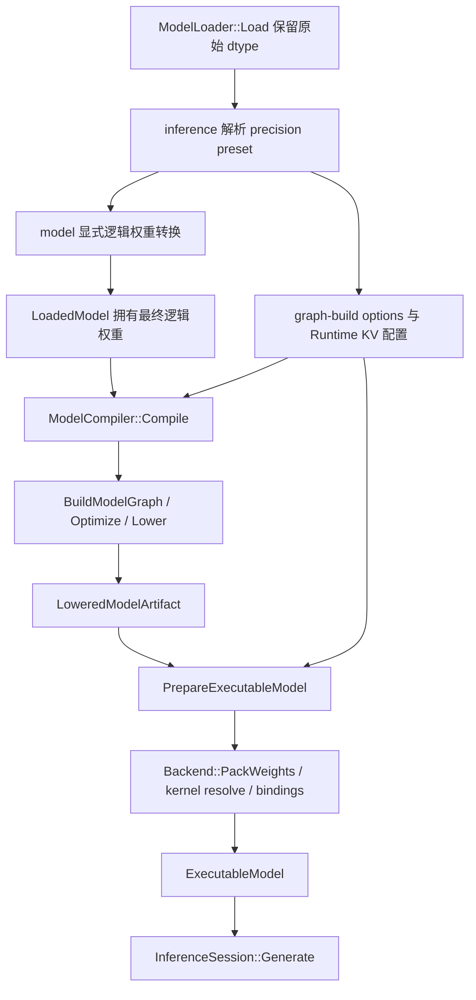

# FP16 / BF16 执行支持方案

- **状态**: In Progress
- **版本**: 1.1
- **日期**: 2026-10-29
- **产品边界**: [当前产品 PRD](../products/aethermind_prd.md)；CPU-only、单进程、同步、单请求、Token IDs I/O、Llama Dense、静态连续 KV
- **架构边界**: [AGENTS.md](../../AGENTS.md) §2.1
- **关联计划**: [06 系统能力路线图](06-system-capability-evolution-roadmap.md)、[07 模型准备入口](07-executable-model-preparation.md)、[08 KV/Attention 演进](08-kv-cache-and-attention-capability-evolution.md)、[09 模型家族扩展](09-qwen-and-moe-architecture-support.md)、[10 Runtime 组装入口](10-upper-level-runtime-assembly.md)
- **算子工作流**: [算子开发与优化工作流](../guides/operator-development-workflow.md)
- **关联模块**: dtypes / model / operators / graph / compiler / backend / execution / kv_cache / runtime / inference

本文仍是阶段化提案。P1 的显式 FP32 compatibility 已完成下述限定实现和 tiny checkpoint 验证；其当前接口、范围和证据见 [FP32 兼容推理指南](../guides/fp32-compatible-inference.md) 与 [P1 验证报告](../tests/fp32_compatibility_validation_2026-10-29.md)。P2–P4 仍为未来工作；未通过完整门禁前，不能据此声明 native 16-bit 推理、16-bit KV、16-bit activation 或性能收益。

## 1. 现状分析

### 1.1 问题与推荐路线

“支持 FP16/BF16”需要分别回答：checkpoint 能否读取、图上 dtype 是否正确、所有 kernel 能否 resolve、数值是否符合合同、运行内存与性能是否达到目标。当前 P1 已在限定 tiny checkpoint 上闭环完整生成链；这不代表 native 16-bit 执行、任意 checkpoint 或后续阶段已支持。

推荐顺序：

```text
P0 数值与 dtype 合同
  → P1 F16/BF16 checkpoint 显式转换为 FP32 的兼容执行
  → P2 权重保留 16-bit，activation / 累加 / KV / logits 使用 FP32
  → P3 独立引入 16-bit KV storage
  → P4 16-bit activation 与对应硬件路径
```

P1 建立可执行基线，不是低内存方案；P2 是首个保留 16-bit 权重存储的交付目标。P2 的转换/SIMD 优化可以在该阶段获得 correctness baseline 后开展，不要求等待 P4。P3/P4 不作为 P2 的前置。

### 1.2 已核对事实

| 已核对事实 | 源码依据 | 对方案的约束 |
|---|---|---|
| `DataType`、`Half`、`BFloat16` 与 F16/BF16 safetensors 读取已存在；validator 接受 F32/F16/BF16 权重 | [DataType](../../include/aethermind/dtypes/data_type.h)、[HF dtype 解析](../../src/model/formats/hf/hf_utils.cpp)、[HF validator](../../src/model/formats/hf/hf_model_validator.cpp) | 不重复建设类型枚举或文件格式入口；加载不等于可执行 |
| 多数 Llama 算子语义允许 reduced dtype；`Add` 白名单有 BF16、缺 F16 | [Linear 合同](../../include/aethermind/operators/ops/linear_op.h)、[Add 合同](../../include/aethermind/operators/ops/add_op.h) | 补齐 F16 Add 时同步 semantic inference、constant folding、CPU 注册及测试 |
| `BuildLlamaDense` 从 `weight_dtype_hint` 得出 activation/KV dtype；Embedding 输出实际跟随权重 dtype | [Llama builder](../../src/model/llama_dense_graph_builder.cpp)、[Embedding inference](../../src/operators/ops/embedding_op.cpp) | hint 缺失/auto 或与实际权重不同，可能导致 KV 与 activation 不一致；需要显式执行精度权威 |
| Linear/RMSNorm 语义分别校验 activation 与 weight，输出跟随 activation；Attention/KVUpdate 要求 activation 与 cache 同 dtype | [Linear inference](../../src/operators/ops/linear_op.cpp)、[RMSNorm inference](../../src/operators/ops/rmsnorm_op.cpp)、[Attention inference](../../src/operators/ops/attention_op.cpp)、[KVUpdate inference](../../src/operators/ops/kvcache_update_op.cpp) | W16/A32 有现成扩展基础；mixed KV 必须先扩展语义 |
| Llama 所需 CPU kernel 尚未形成 F16/BF16 完整执行链；例如 Linear 注册为 F32/F32，BF16 Add 是局部已有能力 | [Linear entry](../../src/backend/cpu/kernels/linear/linear_entry.cpp)、[Add entry](../../src/backend/cpu/kernels/add/add_entry.cpp) | 按算子与完整 production path 分别验收，不将局部支持推广为整模型支持 |
| `KernelSelector` 严格匹配 activation/weight dtype；`DeriveSelectorDTypes` 忽略 state，未独立表达 output dtype | [selector](../../include/aethermind/base/kernel_selector.h)、[dtype 派生](../../src/operators/operator_inference.cpp) | W16/A32 可复用；mixed KV 和后续 mixed output 才扩展匹配身份 |
| identity packing 保留源 dtype；现有 B-panel 只有 `kCpuBPanelF32Kc512Nr16`，packer/validator 限定 F32 | [CPU packing](../../src/backend/cpu/cpu_backend.cpp)、[recipe](../../include/aethermind/backend/packing_recipe.h)、[packed validation](../../src/backend/cpu/packed_weight_validation.cpp) | 16-bit B-panel 需要独立物理布局身份，不复用 F32 ID |
| `Half(float)` 使用 RNE，但将 subnormal 范围清零；BF16 转换使用 RNE 并 canonicalize NaN | [Half 转换](../../src/dtypes/half.cpp)、[BF16 转换](../../src/dtypes/bfloat16.cpp) | narrow conversion 的数值合同与现有兼容性必须先明确 |
| CPU capability 已检测 F16C、AVX512BF16、AMX_BF16 等，尚无对应完整 kernel 链；当前 SIMD 编译配置主要针对 FP32 AVX2/FMA | [CPU capability](../../include/aethermind/backend/cpu/cpu_capabilities.h)、[检测](../../src/backend/cpu/cpu_info.cpp)、[库 CMake](../../src/CMakeLists.txt) | feature detection 不是执行支持；新增 ISA 按 translation unit 隔离 |

### 1.3 范围与非目标

首批仅覆盖当前 Llama Dense 的完整推理链；其他模型家族按照 [09 号提案](09-qwen-and-moe-architecture-support.md) 分别验收，不因共享 dtype 获得自动支持。当前 loader 默认要求 linear 权重统一 dtype；P1 normalizer 在加载之后执行，不绕过或放宽该校验。Norm 与矩阵权重可以使用已批准的不同 dtype。

本提案不引入 GPU、服务化、并发请求、Paged KV、量化格式、自动精度搜索、通用 precision optimizer 或第二套 Graph IR。FP16/BF16 的浮点精度转换不承担 INT8/INT4 的 scale/zero-point/group 语义。

## 2. 目标架构

### 2.1 精度矩阵与不变量

下表区分已验收的 P1 范围与后续目标。W 表示矩阵权重存储，A 表示 activation；首批 residual 跟随 A。

| 模式 | Checkpoint 输入 | 执行矩阵权重 W | A / residual | KV storage | 累加 / logits | 状态 |
|---|---|---|---|---|---|---|
| FP32 兼容执行 | loader 已接受的 F32/F16/BF16 | 显式转换后的 F32 | F32 | F32 | F32 / F32 | P1 C++ O1/plain 限定验收通过 |
| FP16 权重执行 | uniform F16 linear weights | F16 | F32 | F32 | F32 / F32 | P2 待实施 |
| BF16 权重执行 | uniform BF16 linear weights | BF16 | F32 | F32 | F32 / F32 | P2 待实施 |
| 16-bit KV | 已验收的 P2 权重组合 | F16/BF16 | F32 | 显式选择 F16 或 BF16，K/V 同型 | F32 / F32 | P3 待实施 |
| 16-bit activation | 后续按算子签名批准 | 按 preset 决定 | 显式边界；首版保留 FP32 residual 作为候选 | 独立选择已验收组合 | 至少 F32 / F32 | P4 待设计与实施 |

P2 要求 Embedding、linear 和 lm_head 的实际权重 dtype 与所选 F16/BF16 preset 一致；即使 loader 接受某种 untied Embedding/linear 混合组合，首批 preset 也明确拒绝，不隐式转换。Norm 权重在 P1/P2 统一为 FP32：P2 仅对这些小权重做准备期 widening，避免首批额外增加 mixed-dtype Norm kernel；矩阵权重仍保留目标 16-bit 格式。Embedding 与 tied lm_head 使用同一份经验证的权重来源。

必须保持：

1. TensorSpec、实际 bytes、TensorView、packed logical dtype、selector 与 kernel 参数一致。修改 dtype 标签不能代替数据转换。
2. checkpoint 源 dtype 以各 tensor 的实际 metadata 为准；执行 activation/KV dtype 以经解析的 graph-build options 为准，`weight_dtype_hint` 只保留来源信息。
3. 不隐式进行 BF16→F16、F32→16 或 F16↔BF16 转换；首次 P2 不承诺任意 mixed linear dtype。额外转换必须成为明确策略并单独验收。
4. 累加精度是算子/kernel family 的固定数值合同，首批不开放任意 accumulator dtype 配置。
5. 不支持的 tuple 在编译或准备阶段失败，错误携带 op、端口、实际/要求 dtype、preset 和 phase。ISA fallback 只能替换实现，不能改变精度合同。
6. 相同 preset 的 Prefill/Decode 使用一致的权重与 KV 表示；阶段特化只能在同一数值合同下选择 kernel。

### 2.2 职责、数据结构与拟新增接口

下表的 P1 model/compiler/inference 接口已实现；operators、mixed-dtype backend 与后续 KV 扩展仍是提案。C++ API 不承诺冻结 binary ABI。

| 所在层 | 数据/接口方向 | 职责 |
|---|---|---|
| inference | `InferencePrecisionPreset` / `CpuModelPrepareOptions` 接入显式 C++ 准备入口 | P1 选择 O1/plain + compatibility，协调 Runtime CPU allocator、normalizer、FP32 graph options 与已有 Prepare；不实现转换算法或新 kernel |
| model | `ModelGraphBuildOptions` 与 `NormalizeLoadedModelWeightsToFp32` | 构图前完成真实逻辑权重转换；`BuildModelGraph` 继续是模型到 semantic graph 的唯一入口 |
| compiler | `ModelCompileOptions.graph_build` 传给 `BuildModelGraph` | 编排 Build→Optimize→Lower；不分配/转换权重，不访问 backend registry |
| operators | 拟扩展 `EmbeddingParams.output_dtype` 及其 inference/serde；后续按需增加 Cast | 定义 gather+widening、mixed KV、转换边界的可见语义，不查询 ISA |
| backend | 新增对应 dtype tuple 的 kernel、params builder、recipe/validator | 实现 weight widening、FP32 累加、物理 packing 与 ISA 选择 |
| execution | 既有 plan/binding/prepare 路径；P3 扩展 state dtype 身份校验 | 冻结 kernel/资源，校验 TensorSpec 与物理 binding；维持完整 plan 的 KV transaction |
| kv_cache / runtime | 使用解析后的 `kv_dtype`，沿用 layout/storage/allocator | 管理物理字节与布局，不解析 HF hint，不判断算子数值语义 |

不为本提案新增 owning Engine facade。P1 使用独立的 `LoadAndPrepareCpuExecutableModel` 入口，避免新增 aggregate options 重载使原 `{}` 调用歧义；直接 `ModelCompiler::Compile` / `LoadAndCompile` 仍是低层编译入口，不自动触发转换。低层调用方若绕过 normalizer，必须构造真实一致的 specs，未覆盖的 kernel tuple 在 prepare 时明确拒绝，不能静默取得兼容模式的承诺。

新增 Embedding 字段的缺省语义须保留既有“输出跟随权重”；W16/A32 preset 显式选 F32 输出。字段迁移覆盖 OpParams、graph builder、inference、序列化/反序列化、constant evaluator（如适用）、kernel 参数和测试。通用 Cast 延后到 P4 真正需要图上 dtype transition 时再引入。

### 2.3 控制与数据流



P1 转换全部非 F32 必需权重；P2 只执行合同要求的 Norm 等小权重转换，保留矩阵权重。转换完成后才构图，避免已冻结 TensorSpec 与实际存储不符。两种模式都只加载一次，不重新读取同一模型目录。

与 [10 号 Runtime 组装方案](10-upper-level-runtime-assembly.md) 集成时，先从已验证 config 和 preset 派生 KV dtype、capacity 及 RuntimeOptions；将 Runtime 放到最终地址，再通过其 allocator 完成需要的逻辑权重分配、Compile、Prepare、CreateSession、Generate。现有首版 FP32-only 入口合同在相应阶段验收后才扩展。

### 2.4 Ownership、分配与失败边界

```text
normalizer 生成新的 immutable RawStorage（拥有转换 buffer）
  → RawWeightView.storage
  → 新 LoadedModel 的 ResolvedModelWeights
  → LoweredModelArtifact.loaded_model
  → ExecutableModel.artifact_
       └─ immutable bindings 借用上述稳定 bytes 与自持 metadata
```

normalizer 创建新的 `LoadedModel`，不 `const_cast` 修改只读权重，不覆写 checkpoint mmap，也不改写原始 hint 伪装来源。无需给 ExecutableModel 增设平行的 converted-weight owner。沿用 [RawStorage/RawWeightView](../../include/aethermind/model/raw_weight.h)、[LoadedModel](../../include/aethermind/model/loaded_model.h) 和 [ExecutableModel](../../include/aethermind/inference/executable_model.h) 的生命周期路径。

- payload 经传入的 `Allocator&` 分配，以现有 Buffer/MemoryHandle 的正确释放合同封装进 source-private RawStorage 实现；不保存仅供分配调用的借用 allocator 引用，不更改 Allocator 接口。
- 每个输出 view 携带真实 dtype、shape、bytes 与 owner，并通过 `ValidateRawWeightView`；所有 shape×element-size、总字节与对齐计算检查溢出。
- 源数据不假定满足 SIMD alignment 或已构造为 `Half*`；使用满足 alignment、object lifetime 和 strict-aliasing 规则的读取，必要时经 `memcpy`/bit conversion。
- 按来源 storage、range 和逻辑 tensor identity 去重转换，保留 tied embedding/lm_head 的同源 alias；不能仅凭内容相同合并不同 tensor，也不能把同一权重转换两份。
- F32 来源可继续共享原 owner；不因兼容模式无条件再复制。RawStorage 只读性由封装与调用合同保证，`const Buffer` 本身不能证明没有其他可写 alias。
- 部分转换、metadata 或分配失败时 RAII 清理并返回原状态码及阶段上下文，不发布半成品模型；已存在的外部模型与 plan 不被替换。
- Runtime 地址稳定且长于模型/Session；model 长于所有借用权重的 prepared bindings。请求 workspace 仍由 Generate 分配，planner 只规划偏移。

### 2.5 Kernel、selector 与 packing

**P2：复用已有 act/weight selector。** Linear 使用 `{act=F32, weight=F16}` 或 `{act=F32, weight=BF16}`，输出 F32；Embedding 从显式 activation output 得出 act dtype。reference 读取 16-bit weight 并提升为 float，用 FP32 累加，直接写回 F32。不得用 reduced wrapper 的 `operator+=` 作为归约，也不在每个 token 展开整份 FP32 权重。

Prefill 可在已规划 scratch 中按 tile widening 并复用，Decode 可直接流式读取 16-bit weight；具体 blocking/threshold 属算子专项，须经 profiling 与 benchmark 决定。新增需求沿用 `WorkspaceRequirement`→plan→request allocation→binding，不在 kernel 中申请堆内存。

先验收 O1/plain；随后为 QKVLinear、GateUpLinear 等 fused consumer 补齐 mixed-dtype reference、identity packing 和绑定，再开放明确的 O2/packed preset。不能只增加 Linear 注册就宣称默认 O2/plain 可执行。

identity 布局可在合同允许时继续保存 16-bit 元素；如需新的 B-panel，新增包含 dtype、blocking、panel 顺序或 padding 特征的 `PackingLayout`，同步 byte formula、overflow、packer、descriptor、validator、artifact key 与 consumer。物理格式改变不得沿用 `kCpuBPanelF32Kc512Nr16`，也不预先照搬其 tile 参数。

**P3：最小扩展 state dtype。** 首批限定所有相关 K/V state ports 同 dtype，拟将 `state_dtype` 加入 KernelSelector；无 state 的 step 使用唯一的 undefined 表示，按严格相等匹配，不作为 wildcard。同步修改 dtype 派生、hash/equality/ToString、registry、lowering、untrusted plan 重校验与包含 selector 的 packing key。state dtype 来自真实 state specs，不借用 `weight_dtype` 字段。

KVUpdate 参数准备必须同时核对 state TensorSpec、selector、KV view/layout 与 binding dtype；保留现有 execution 校验。Attention 明确允许 `Q=F32, K/V=F16或BF16, output=F32`，KVUpdate 明确允许 `K/V activation=F32 → cache16`，在读写边界转换。

P4 如出现 input/output dtype 不同或同角色的多端口异型，需要按实际 schema port/role 扩展签名；单一 `result_dtype` 不能覆盖任意多输出异型情况。该合同在 P4 冻结并全链路迁移，P2 不提前建设通用端口签名系统。

### 2.6 数值与 ISA 合同

| 项目 | 推荐合同与限制 |
|---|---|
| Widening | F16/BF16 的有限值提升到 F32 精确表示，包括可表示的 subnormal；零符号保留；NaN 按已冻结的 bit-copy/quieting 规则处理 |
| Narrowing | 推荐 RNE + gradual underflow，明确 overflow→Inf、signed zero、q/sNaN 及 payload/canonicalization。现有 Half FTZ 改动须单列行为迁移；P1 的纯 widening 不依赖这项修订 |
| GEMM/归约 | P1/P2 固定 FP32 累加，reference 可用 FP64 oracle 检查；不得假定 wrapper 算术自然实现 FP32 accumulation |
| Norm/Attention | 平方和、dot、stable softmax 的 max/exp/sum 与 value accumulation 至少 F32；RoPE 保留其既有更高精度频率/角度合同，不能因 dtype 扩展缩窄 |
| Fusion | 先规定 logical op 边界的 rounding/cast placement；融合不能移除要求的 narrowing 或额外引入舍入。浮点运算顺序变化按数值门禁审查，不要求所有实现逐位一致 |
| 硬件转换 | F16C 是转换能力；BF16 可经 portable bit conversion 或向量 widening。优化实现遵守同一 subnormal/NaN 合同；不满足时修正边界或保留 fallback |
| Native BF16 | `VDPBF16PS` 乘数为 BF16、累加为 FP32；不能把 W16/A32 的 activation 偷转 BF16 以复用它。此类路径属于经过批准的 A16 模式 |
| Native FP16 | 有 FP16 算术指令不等于满足 FP32 累加；任何候选必须证明符合该 preset 的数值合同 |
| Dispatch/build | 独立 TU 与编译能力检查，使用实际 CPU/OS effective features，保留 scalar fallback；不全局添加高 ISA 或 fast-math 选项，不按 CPU 品牌猜测支持 |

FP16 与 BF16 的指数范围和有效精度不同，不能按“都是 16-bit”互换。ISA 的可用性、吞吐与 workload 共同决定选择；不预设 BF16 总比 FP16 快，也不预设 16-bit 总比 FP32 快。硬件机制来源见 §7。

## 3. 方案与备选

| 方案 | 收益与代价 | 裁决 |
|---|---|---|
| 先显式转 F32，再建设 W16/A32 | 先复用完整 CPU 基线；兼容路径启动/内存成本较高，不能作为最终低内存路径 | 推荐分阶段实施；两个模式分别验收 |
| 一次性把所有 tensor 改为 F16/BF16 | 表面配置统一，但叠加 Norm/Softmax、残差、KV、logits、fusion rounding 与 ISA 风险 | 延后至 P4 按边界推进 |
| Loader 隐式转换 | 调用简短，但混淆读取事实与执行策略，掩盖峰值内存和来源 dtype | 不采用，显式 model helper 由 inference 编排 |
| 只修改 hint/selector/spec | 无真实转换，导致 dtype 与 bytes 不一致，可能触发错误读取或错误数值 | 禁止 |
| 直接复用 BF16 dot 执行 A32/W16 | 可调用现有硬件指令，但会额外量化 activation | 不作为等价 fallback；单列 A16 preset |
| 预先建立通用 precision pass/任意 dtype 笛卡尔积 | 扩展空间大，但增加无消费者抽象与难以覆盖的组合 | 先固定 presets；Cast 和异型端口签名按真实需求引入 |
| 首批仅依赖外部低精度算子库 | 可减少 kernel 开发，但新增依赖、dispatch、布局与数值集成合同 | 当前不作为前置；后续若收益明确，仍经 Backend 契约接入 |

## 4. 实施步骤

P1 的限定实现与验收已完成；P0 中 graph options 和 widening 数值合同已随 P1 落地，F16 Add 与 narrowing 迁移留待实际 reduced-dtype consumer 需要时实施。P1 全程使用 F32 算子，不依赖这些未完成项。P2–P4 仍待实施；编号表示依赖，不承诺日期。每个算子依照 O0–O4 执行，微内核优化不是进入下一阶段的充分条件。

### 4.1 P0：冻结合同与补齐基础语义

1. 固定 §2.1 的首批 presets、source/activation/KV 权威与明确拒绝策略。
2. 引入 graph-build options，经 ModelCompileOptions 传到唯一构图入口；覆盖 hint 缺失、auto、与实际权重不同的情况，不改 checkpoint 来源 metadata。
3. 补齐 F16 Add 的 shared dtype contract、CPU reference 注册、constant folding 与相关测试；不把其他未实现 kernel 一并标为支持。
4. 写明转换 rounding、NaN/Inf、subnormal 及 Half FTZ 迁移范围；在任何新 narrowing/SIMD 路径开放前完成对应行为与测试迁移。

退出条件：语义与 dtype 身份一致，非法组合可诊断；F16 Add 的 producer/consumer/evaluator/CPU reference 同步。该阶段不承诺 F16/BF16 整模型执行。

### 4.2 P1：显式 FP32 兼容执行（限定验收通过）

1. model 实现独立 normalizer，基于每个真实 RawWeightView 转换；通过 RawStorage 拥有结果并去重 tied tensor。
2. inference 的显式模式串联 Load→Normalize→Compile→Prepare；低层直接 Compile 不偷偷触发转换。
3. FP32 graph/KV/logits 配置覆盖原始 hint，保留来源信息；复用真实 CpuBackend 和 O1/plain。
4. 在结果诊断中明确该模式已将执行权重展开为 F32；统计转换字节、保留 backing 与准备期内存。

退出条件：F16/BF16 tiny Llama checkpoint 分别完成 Prefill、至少两次 Decode 与 Generate，匹配从同一 checkpoint 解码得到的独立 FP32 reference；生命周期、tie alias 和失败清理通过。

### 4.3 P2：16-bit 权重、FP32 activation

1. Embedding 显式产生 F32 output；Norm 在准备期转为 F32，所有矩阵权重保留选定 F16/BF16。
2. 为 Linear/LM head 增加 A32/W16→A32 reference 与 exact selector 注册，先闭环 O1/plain；已有 FP32 RoPE、KV、Attention、residual 和 Argmax 继续消费真实 F32 activation。
3. 补齐 QKV/GateUp 等 fused weight consumer 的语义、reference、packing、参数准备与绑定，再单独验收 O2/packed。AddRmsNorm 等不改变 dtype 的 fusion 也需验证接入后的权重与数值合同。
4. 先测 registered/prepared baseline，再基于 profiling 引入 F16C/向量 widening、Decode GEMV 或 Prefill tile；新物理 B-panel 单列布局证据。

退出条件：两个 W16/A32 presets 均完成完整生成；实际持久矩阵存储为 16-bit，无隐藏整模型 F32 展开；plain/packed 支持范围分别记录，Decode 稳态分配合同通过。无 benchmark 证据前不宣称吞吐提升。

### 4.4 P3：独立 16-bit KV

1. 在 operators 冻结 FP32 activation 与 KV16 的读写转换、输出 alias 和数值合同；K/V 同型。
2. 迁移 state dtype selector 身份和全部派生/重校验/registry/key；KVCacheLayout 按实际元素字节、alignment/padding 规划容量。
3. KVUpdate 写入时 narrow，Attention 读取时 widen，保持 FP32 attention reduction；Runtime 配置与图 state 精度一致。
4. 复核完整 plan 成功后才 commit watermark；失败写入不发布，stale view、owner/generation 与现有单 reservation 合同保持。

退出条件：Prefill/Decode、capacity 边界、长上下文误差与真实 byte accounting 通过；不能仅凭 Manager 能分配两字节元素就声明 KV16 可执行。

### 4.5 P4：16-bit activation 与 native compute

1. 以 P2/P3 数值与 profiling 证据选择首个具体 A16 preset，逐端口定义 residual、Norm、RoPE、Attention、MLP 与 logits 的存储/输出 dtype。
2. 对真实 graph transition 增加 typed Cast，覆盖 inference/serde/evaluator/kernel；最终 logits 保持 F32，不能先窄化 logits 再 widening 冒充保留精度。
3. 对 mixed input/output/multi-output 签名迁移 selector 与 prepared 合同，重新审查所有 fusion 的舍入边界。
4. 验证 AVX512BF16、适用的 FP16 或 AArch64 路径；缺失 capability 时使用同合同的实现，不隐式改变 preset。AMX 等需要额外 OS/resource 合同的实现单独准入。

退出条件：该具体 preset 的完整算子、phase、ISA/fallback 与模型级证据通过后才标记支持；不泛化为所有 dtype 或平台组合。

## 5. 风险与依赖

| 风险/依赖 | 处理与准入条件 |
|---|---|
| P1 峰值内存与启动成本 | F32 转换权重、原 checkpoint backing 和 packed artifact 可能共存；统计实际 owner 存活与 RSS，不以文件映射大小直接推算驻留内存。资源不足可恢复失败 |
| 所有权/allocator lifetime | 转换产物自持 owner、正确释放 provenance、tie 去重与稳定 metadata；不借用 normalizer 临时 buffer，不向热路径传 allocator 引用 |
| 数值兼容 | Half FTZ→gradual underflow 是可观察行为变更，独立迁移；FP16/BF16 和不同 fusion/ISA 的误差分别验收 |
| 混合 checkpoint | 延续 loader 的 uniform-linear 默认合同；norm 单独处理。扩大接纳范围需先改验证政策及 fused composite 合同，不让 normalizer 成为绕过校验的入口 |
| 默认优化组合 | 按 O1/plain、O2/packed 明确验收，不把 precision 选项与任意 optimization level 自动组合；未 resolve 的 kernel 保留原始错误 |
| Selector/layout 漏迁移 | state/output 身份变化需覆盖 hash、equality、诊断、artifact key 与 plan 校验；新 16-bit panel 格式有独立 ID |
| KV 累积误差/失败发布 | 量化后的 K/V 在长上下文重复读取，需独立质量预算；维持全 plan transaction 与未提交区间不可读 |
| 并发 | 本提案不新增线程或仲裁；准备、Manager 变更和 Execute 继续外部串行化。涉及 shared ownership/同步实现时，补充相应 sanitizer/TSAN profile |
| 内存与性能推广 | W 从 4 bytes 改为 2 bytes 仅使该部分逻辑 payload 减半；KV、activation、workspace、padding、mmap 与 packed 副本分别测量，不承诺整进程内存或延迟减半 |
| 关联提案 | 08 负责 KV 生命周期/资源，本文补充精度执行合同；10 的入口在对应 dtype 验收后扩展；09 的模型家族/MoE 和专家布局需要独立接入证据，不构成本提案首批前置 |

## 6. 验收标准

### 6.1 数值与语义

- conversion 覆盖正负零、所有类别的 subnormal/normal、边界邻值、RNE ties、最大有限值、overflow、Inf、qNaN/sNaN；对 65,536 种 16-bit 输入做 widening 分类/有限值正确性检查，NaN 按声明合同验证。
- narrow 与 SIMD 路径对拍独立 reference，不能只调用同一个 Half/BFloat16 helper 生成 expected；P1 纯 widening 的测试不以尚未迁移的 narrow round-trip 为 oracle。
- 每个算子记录支持的 input/weight/output/state tuple、累加 dtype、stride/alias/tail/zero-size/overflow；合法 tuple 的 semantic inference、constant folding（如适用）与 kernel 数值一致。
- W16/A32 增加能区分“保留 A32”和“先将 A32 转 BF16/FP16”的反例，防止优化偷偷改变乘数精度。
- P4 fusion 与 Cast placement 单独验收；与 unfused reference 对拍时按照冻结的中间舍入规则解释差异。

### 6.2 所有权、绑定与失败

- 正确释放 normalizer 输入、局部 helper 和请求对象后，ExecutableModel/plan 仍有有效 bytes 与 metadata；最后一个 owner 销毁才释放转换存储，无泄漏或重复释放。
- tied embedding/lm_head 在转换后保留共享关系；相同内容的不同 tensor 不被误合并；partial failure/OOM 不发布半成品。
- dtype、bytes、alignment、recipe 或 state binding 故意不一致时在执行前失败；不能通过修改 selector 绕过 validation。
- P3 检查 graph state、selector、view/layout 与 binding 一致；完整 plan 失败不推进 watermark，epoch/owner/capacity 合同不回归。
- 用相关 ASAN/UBSAN profile 检查存储与转换；涉及同步/shared-owner 代码变化时补 TSAN，不以纯文档检查替代运行证据。

### 6.3 Production 与模型质量

- 使用真实 CpuBackend，覆盖 `Load → Normalize（按 preset）→ Compile → Prepare → CreateSession → Generate`，不以 fake backend 或手工绕开 binding 的单测代替。
- F16/BF16 分别覆盖 hint 缺失/auto/不一致、tied/untied lm_head、合法 Norm dtype、plain/packed、Prefill、多次 Decode、EOS 和容量失败。
- 比较基于同一 checkpoint 数据解码的 FP32/FP64 oracle；按算子、phase 与 sequence length 记录 max abs/rel error、logits/top-k、必要的模型质量指标，并在实现准入前固定误差预算。
- 不把低精度结果与原始高精度 checkpoint 的逐 token 完全一致作为通用要求；near-tie 按 top-1 margin/约定处理，固定 golden 可要求指定 token 序列。未经评审不临时放宽容差。
- 相同平台与相同 preset 的确定性，以及现有 Decode 稳态零分配合同必须有运行证据；不将其扩大为所有 Generate 初始化路径零分配。

### 6.4 性能、资源与发布状态

- 分别记录转换/packing/准备耗时、峰值与稳态 RSS、持久权重/packed/KV/activation/workspace 字节、Prefill TTFT 和 Decode tok/s。
- 覆盖 Prefill/Decode、hot/streaming、代表性维度与 context depth；同机同配置比较。默认 priority 提升需要 registered/prepared、production ExecutionStep 与端到端证据，microbenchmark 只作诊断。
- 证据按 [算子工作流](../guides/operator-development-workflow.md) 写入对应算子机器记录及 raw artifact，不在本提案填入未经验证的加速倍数或占位 benchmark 文件。
- 每个 preset、phase、layout、ISA/fallback 单独标记状态；只有实际通过相应门禁后，才同步更新模块设计、算子合同/API 文档、产品 capability 和行为变更记录。该 Draft 不修改 PRD 的已交付状态。

## 7. 一手资料

以下资料用于数值与指令机制，不作为 AetherMind 已实现或性能收益的证据：

- [Intel BF16 格式与 AVX512_BF16 指令说明](https://www.intel.com/content/www/us/en/developer/articles/technical/intel-deep-learning-boost-new-instruction-bfloat16.html)：BF16 指数/有效精度、BF16 乘数与 FP32 dot accumulation。
- [Intel AVX-512 FP16 技术指南](https://builders.intel.com/solutionslibrary/intel-avx-512-fp16-instruction-set-for-intel-xeon-processor-based-products-technology-guide)：FP16 转换与原生算术能力；具体指令数值需按合同验证。
- [GCC Half-Precision 文档](https://gcc.gnu.org/onlinedocs/gcc/Half-Precision.html)：语言类型支持与硬件代码生成是不同能力；中间精度及编译选项可能影响结果。

## 8. 变更记录

| 日期 | 版本 | 变更 |
|---|---|---|
| 2026-10-20 | 1.0 | 建立 Draft：FP32 兼容路径、W16/A32、独立 KV16 与 A16 阶段；明确职责、所有权、数值/ISA、selector/layout 迁移和验收门禁 |
| 2026-10-29 | 1.1 | P1 转为 In Progress：记录显式 F16/BF16→FP32 normalizer、FP32 graph policy 和 C++ O1/plain 编排；限定模型与 sanitizer 证据另记验证报告；P2–P4 仍为未来工作 |
