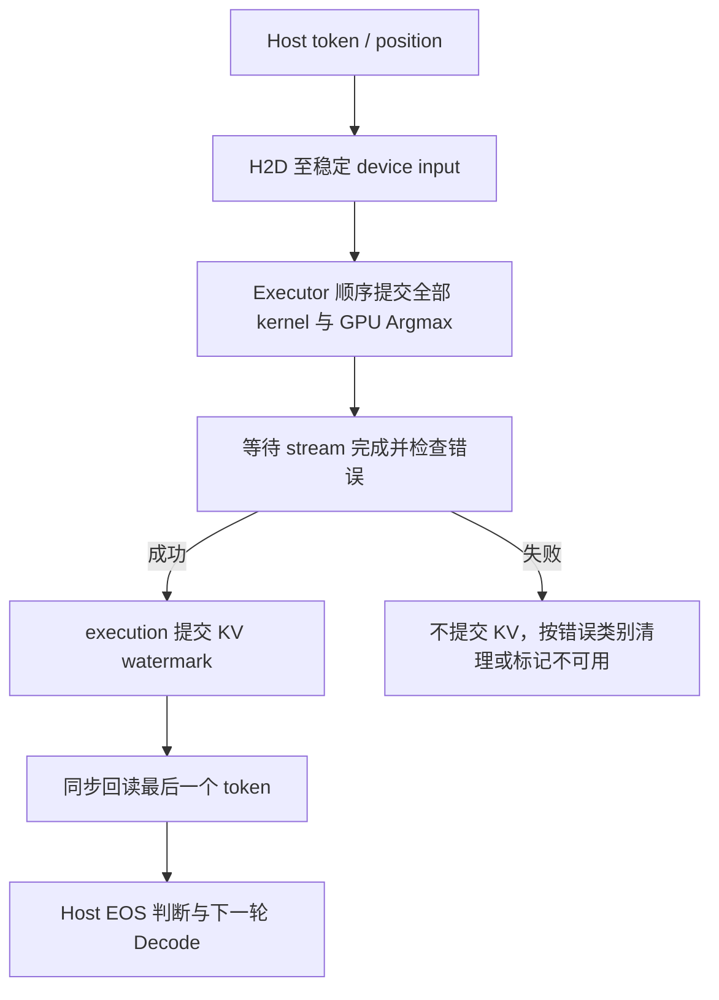

# CUDA 后端与执行支持方案

- **状态**: Draft
- **版本**: 1.1
- **日期**: 2026-10-21
- **最近更新**: 2026-11-05
- **当前产品合同**: [AetherMind PRD](../products/aethermind_prd.md)；当前仍为 CPU-only，本提案定义未来 CUDA 专项范围，不扩大当前已交付能力
- **架构边界**: [AGENTS.md](../../AGENTS.md) §2.1
- **关联提案**: [06 系统能力路线图](06-system-capability-evolution-roadmap.md)、[08 KV/Attention 演进](08-kv-cache-and-attention-capability-evolution.md)、[09 模型家族扩展](09-qwen-and-moe-architecture-support.md)、[10 Runtime 组装入口](10-upper-level-runtime-assembly.md)、[11 FP16/BF16 执行支持](11-fp16-bf16-execution-support.md)
- **算子工作流**: [算子开发与优化工作流](../guides/operator-development-workflow.md)
- **关联模块**: base / memory / backend / compiler / execution / kv_cache / runtime / inference

本文为待实施提案。基础事实在 2026-10-21 建立，2026-11-05 增量复核 compiler、binding 准备、CMake 与现有 CPU 产品入口，补充模型编译与工程构建方案；其他运行时事实不是新一轮完整验证结果。本轮仅编写文档，不实现 CUDA allocator、kernel、构建开关或公开 API，也未构建或运行 C++/GPU 测试及 benchmark。下文“拟新增/拟扩展”接口名称表示设计方向，不是已存在的符号或冻结的 ABI；所有 CUDA 验收条目均为未来门禁。

## 1. 现状分析

### 1.1 问题与推荐路线

CUDA 支持需要贯通设备身份、显存所有权、数据搬运、stream 执行、完成确认及模型级数值验证。新增 `CudaBackend` 或实现 `cudaMalloc` 无法单独形成可执行推理链。

推荐顺序：

```text
P0 设备、存储与执行完成合同
  → P1 可选 CUDA 构建及 allocator / stream / copy 基础设施
  → P2 单 GPU、FP32、O1/plain 的完整 Prefill / Decode / Generate
  → P3 分别验收 FP16 / BF16 执行 preset
  → P4 cuBLASLt / Attention / fusion 等有证据的性能优化
```

首版维持单进程、单请求、同步公开 API、Token IDs I/O、greedy generation 和静态连续 KV。模型权重、KV、activation 与 kernel workspace 位于同一目标 GPU；host 保留控制流、metadata 和输入输出 staging。完整模型须装入目标设备预算，容量不足时明确失败。

### 1.2 已核对事实

| 当前事实 | 源码依据 | 对方案的约束 |
|---|---|---|
| `DeviceType` 有 CUDA，`Device` 可表示 ordinal；`IsDeviceKindSupported` 目前只返回 CPU | [device.h](../../include/aethermind/base/device.h)、[device.cpp](../../src/base/device.cpp) | 枚举/解析不是执行 capability；区分编译支持、设备可用和 preset 可执行 |
| `CUDAAllocatorProvider` 仍直接 `AM_CHECK(false)` | [cuda_allocator.cpp](../../src/memory/cuda_allocator.cpp) | 需实现真实分配及可恢复的初始化/分配错误 |
| Runtime options 有 CUDA 开关，但默认 Backend factory 只注册 CPU；KV 初始化固定取 CPU allocator | [runtime_options.h](../../include/aethermind/runtime/runtime_options.h)、[runtime_builder.cpp](../../src/runtime/runtime_builder.cpp) | 配置、factory、KV 与实际设备必须一致 |
| Backend factories 和实例均按 `DeviceType` 保存；Allocator 实例已按 `Device` 缓存 | [backend_registry.h](../../include/aethermind/backend/backend_registry.h)、[allocator.h](../../include/aethermind/memory/allocator.h) | CUDA capability 与执行资源必须绑定具体 GPU |
| `Buffer/MemoryHandle` 已携带 device 和释放合同；`TensorView/MutableTensorView` 没有 device | [buffer.h](../../include/aethermind/memory/buffer.h)、[memory_handle.h](../../include/aethermind/memory/memory_handle.h)、[tensor_view.h](../../include/aethermind/base/tensor_view.h) | 复用既有 owner，补齐 view/binding 的 placement 信息 |
| `Stream` 是空接口；`LayerRunner` 构造的 `KernelContext.stream` 为 null | [stream.h](../../include/aethermind/backend/stream.h)、[layer_runner.cpp](../../src/execution/layer_runner.cpp) | 缺少 stream 来源、同步及错误传播合同 |
| 全部 kernel 同步返回成功后，`LayerRunner` 调用 `KVCacheSessionView::CommitAppend` 提交 KV watermark | [layer_runner.cpp](../../src/execution/layer_runner.cpp)、[kv_cache_session_view.h](../../include/aethermind/kv_cache/kv_cache_session_view.h) | CUDA enqueue 成功不能替代设备完成确认；公开 CommitAppend 只校验 session/range/capacity，LayerRunner 仍须先证明所有 layer 写完 |
| KV 是 Manager-owned K/V Buffer；binding 只有裸 pointer、dtype、geometry/stride | [kv_cache_state.h](../../include/aethermind/kv_cache/detail/kv_cache_state.h)、[kv_cache_binding.h](../../include/aethermind/base/kv_cache_binding.h) | 保留静态布局与提交权威，增加物理设备校验 |
| plain 权重和常量绑定直接借用 raw host bytes；现有 packing layout 为 CPU 格式 | [executable_model.cpp](../../src/inference/executable_model.cpp)、[packing_recipe.h](../../include/aethermind/backend/packing_recipe.h) | 上传、普通显存存储和 opaque packing 必须分开 |
| `InferenceSession` 固定 CPU allocator、host token/position 输入、host pointer 输出读取，并拒绝非 CPU plan | [inference_session.cpp](../../src/inference/inference_session.cpp) | 改造整条 I/O 链，不能只移除 CPU gate |
| `PrepareKernel` 不接收 concrete TensorViews；binding params builder 能看到 concrete views，但只允许小型、trivially destructible params | [backend.h](../../include/aethermind/backend/backend.h)、[kernel_types.h](../../include/aethermind/backend/kernel_types.h)、[execution_bindings.cpp](../../src/execution/execution_bindings.cpp) | cuBLASLt 的 shape specialization 和资源析构需要独立 owner |
| 当前 plan 冻结 workspace layout，Generate 分配请求 Buffer；CMake 未启用 CUDA language，也不收集 `.cu` | [plan builder](../../src/execution/execution_plan_builder.cpp)、[session](../../src/inference/inference_session.cpp)、[root CMake](../../CMakeLists.txt)、[src CMake](../../src/CMakeLists.txt) | 先复用规划/分配分离，构建和 specialization 按阶段扩展 |
| `ModelCompiler` 已串联 Build→Optimize→Lower，lowering 可传播 CUDA selector；已有传播测试源码，但默认优化管线仅按 opt_level/flags 选择 passes | [model compiler](../../src/compiler/model_compiler.cpp)、[pipeline](../../src/compiler/optimize_graph.cpp)、[lowering](../../src/compiler/graph_lowering.cpp)、[compiler tests](../../tests/unit/compiler/test_model_compiler.cpp) | 无需重写 IR；补齐 target-aware pipeline policy，传播测试不证明 CUDA 可执行 |
| binding 准备已拆分 `PlanExecutionBindings` 与 `MaterializeExecutionBindings`，前者规划具体 activation，后者分配并构造 params | [binding 接口](../../include/aethermind/execution/execution_bindings.h)、[binding 实现](../../src/execution/execution_bindings.cpp) | 在既有冷路径扩展 specialization，不将其误写成已有动态 workspace query |
| sanitizer 已按 target 应用但 compile options 尚未按语言过滤；AVX2/FMA 已限制于指定 CPU 源文件 | [sanitizer CMake](../../cmake/AetherMindSanitizers.cmake)、[CPU ISA CMake](../../cmake/AetherMindCpuIsa.cmake) | 复用现有隔离机制，补 CUDA 语言/链接阶段边界，不按旧全局 flags 假设重构 |
| 当前存在 CPU compile preset、独立 CLI、同步 CPU 准备入口与正式 C runtime adapter；逻辑 FP32 转换和 graph-build dtype options 已存在 | [CPU options](../../include/aethermind/inference/inference_options.h)、[准备入口](../../src/inference/executable_model.cpp)、[构图选项](../../include/aethermind/model/build_model_graph.h)、[C adapter](../../src/c_api_runtime.cpp)、[CLI CMake](../../apps/inference/CMakeLists.txt) | CUDA preset 单独准入；保护现有 CPU CLI/C ABI 合同，复用已实现精度基础 |

### 1.3 范围与非目标

P2 仅验收当前 Llama Dense 的 FP32 `O1/plain`，需要覆盖该 preset 实际产生的全部算子。`O2/packed`、其他模型家族及低精度分别准入，不因底层 CUDA 可运行而自动获得支持。

本提案不引入 CPU/GPU 自动分图、按层 offload、隐式 CPU fallback、多 GPU、NCCL、服务化、并发请求、调度器、Paged KV、Unified Memory 默认策略或公开异步 API。INT8/INT4 CUDA 执行需要量化格式与数值合同专项，不属于首批交付。CUDA Graphs 属 P4 的候选优化，不与当前 semantic ModelGraph 混为一种图。

## 2. 目标架构

### 2.1 不变量与 capability 边界

1. Runtime 创建时把 `cuda:-1` 解析一次为具体 ordinal，之后所有资源使用同一明确 `Device`；执行不重新依赖调用线程的 current device。
2. actual bytes、dtype、shape/stride、placement、packing recipe 与 kernel 请求一致；改变 dtype/device 标签不能代替转换/搬运。
3. CUDA preset 的全部计算算子在同一 GPU 上执行；缺少 kernel 在准备阶段失败，不隐式切换 CPU 或改变数值合同。
4. kernel 返回成功可表示本次工作成功入队；`Executor::Execute` 返回成功必须表示完整 plan 已完成且 KV 发布成功。
5. GPU 完成前不清理 activation/workspace/staging，不释放 KV reservation，不修改仍被读取的 host 输入。
6. Decode 稳态不做 registry lookup、packing、heuristic 查询或请求侧内存分配；所有缓存参数与 owner 地址稳定。
7. Runtime/registries/KV 仍要求外部串行化；公开 API 同步不意味着 CUDA kernel 的 host launch 同步。

| 目标能力 | 权重 / activation / KV | 累加与 logits | 阶段与状态 |
|---|---|---|---|
| CUDA FP32 baseline | F32 / F32 / F32 | F32 数值合同；RoPE 保留自身更高精度频率/角度合同；logits F32 | P2 待实施，O1/plain |
| CUDA FP16 preset | 显式 F16 执行组合；A/KV/边界在 P3 冻结 | 归约至少 F32、最终 logits F32，转换位置可见 | P3 待实施 |
| CUDA BF16 preset | 显式 BF16 执行组合；A/KV/边界在 P3 冻结 | 同上，独立于 FP16 验收 | P3 待实施 |
| CUDA fused/packed/graph replay | 继承一个已验收 preset，不自动扩大组合 | 不移除合同规定的 rounding/cast | P4 候选，未实施 |

P2 输入使用真实 F32 权重；F16/BF16 checkpoint 只有经 [11 号提案](11-fp16-bf16-execution-support.md) 已验收的显式逻辑转换后才能进入该模式，不在 loader 或 CUDA 上传中偷偷转换。P2 不以 11 的全部阶段完成为前置。

### 2.2 模块职责与拟新增接口

| 所在层 | 数据/接口方向 | 职责与限制 |
|---|---|---|
| base / memory | 拟为 dense/KV borrowed views 增加 `Device`；实现 CUDA allocator | placement 是纯数据，Buffer/MemoryHandle 继续拥有释放合同；无 CUDA SDK public 依赖 |
| backend | 拟新增 `CudaBackend`、`CudaBackendFactory`、`CudaCapabilities`；扩展现有 `PackedWeightView` 的设备信息 | resolve CUDA kernel、检测本 GPU eligibility、提供 packing；不执行整个 plan |
| backend | 拟新增窄接口 `DeviceExecutionResources` 及 CUDA 私有实现 | 聚合一个显式 stream、cuBLAS handle、transfer、同步与 poisoned 状态；不建立通用 queue/event/scheduler HAL |
| runtime | 拟增加具体 target Device 与上述资源 owner | 创建资源、配置一致性校验、按目标 allocator 初始化 KV；不依赖 execution/compiler/inference |
| compiler | 沿用 `GraphLoweringConfig` 的 selector；按需编排 target-aware pipeline | 不查询 CUDA registry；graph/operators 不承载 SM、stream、workspace 或库 handle |
| execution | 拟扩展 `ExecutionContext` 的设备执行资源借用，binding 校验与完成屏障 | 向 `KernelContext` 传窄借用，维护完整 plan 的 KV transaction |
| inference | 拟在 `ExecutableModel` 聚合 resident Buffer owners；改造请求 I/O 与资源选择 | 唯一 `ExecutableModel::Prepare` 编排上传/packing；Generate 编排 H2D/D2H，不实现 CUDA copy/kernel 算法 |

`Backend` 保持 `PrepareKernel / GetPackingRecipe / GetWeightPackingRequirements / PackWeights` 的准备期职责，不增加 `Backend::Execute`。设备执行资源由 Runtime 按明确 Device 拥有，ExecutionContext 借用；CUDA stream 与 cuBLAS handle 同 owner，创建时绑定一次，执行中不切换共享 handle 的 stream。初期一个 Runtime 对应一个执行目标与一条串行执行路径。

Backend factory 仍按 `DeviceType` 注册，拟将实例缓存改为按 `Device` 保存、factory 改为 `Create(Device)`，并贯通 Runtime、plan builder、权重准备和测试。`KernelSelector.device_type` 保留类型级匹配，具体 ordinal 记录在 Runtime、ExecutableModel、plan/binding 准备合同中；CudaBackend 的 capability snapshot 来自该 GPU。设备实例校验不依赖全局“最后选择的 GPU”。

CUDA eligibility 位于 backend：SM/数据类型能力、编译产物覆盖和所选库算法约束独立校验，不把 GPU 品牌或 SM ordinal 塞入通用 selector。首批具体 Toolkit/driver/host compiler/SM 矩阵在 P0 固定，有运行证据后发布；本文不猜测最低版本或指定未验证硬件。

### 2.3 Placement、allocation 与 transfer

- `TensorView/MutableTensorView` 从 Tensor 构造时继承真实 device；raw-parts 构造要求显式 placement，并迁移 producer、只读视图转换、tests/helpers 和文档，避免遗漏后默认为 CPU。view 继续不拥有数据或 metadata。
- `PackedWeightView` 从 artifact Buffer 取得设备；KV binding 从实际 K/V Buffer 取得设备。workspace arena/binding 需有可验证的设备归属，但不因此把 stream 或 Backend 放进 kv_cache/memory。
- 冷路径核对 plan target、全部 dense/packed/state bindings、allocator 和执行资源设备一致。CPU kernel 的入口也必须拒绝 CUDA storage；shape 校验仅读取 host metadata，不读取 tensor payload。
- placement metadata 是调用方契约，不是任意外部裸指针的物理证明。受管分配从 Buffer 传播真实来源；外部指针在接纳边界按需要核验，不在每个 kernel 用 pointer 查询代替合同。
- CUDA allocator 首版用准备/请求初始化期的常规分配与独立释放合同，`AllocationRequest` 的 bytes/alignment、zero-byte 和失败语义与现有 Allocator 一致。更强对齐若需 over-allocation，保留原始释放地址并检查算术溢出。
- `MemoryHandle` deleter 不捕获短生命周期 allocator；携带正确 ordinal 和必要的独立释放上下文，在正确 device 上释放并恢复调用线程设备状态。Buffer 可以独立于 allocator 存活，不能依靠隐藏 `this` 指针兑现该合同。
- 首批 transfer 支持经过 bounds 校验的连续 Buffer/range H2D、D2H 和 D2D；dtype/layout conversion 仍是独立语义或 backend packing。同步便利入口内部完成等待，异步入口明确要求 source/destination 活到同步完成。
- pinned host staging 由专用 owner 管理，按需要分配/复用；普通 host 输入可以显式同步搬运，不宣称 pageable memory copy 一定与计算重叠。初期不引入全局 MemoryKind 笛卡尔积或通用跨设备 Copy Graph。

设备选择只发生在 CUDA 实现边界，使用保存/恢复 current-device 的窄 guard；不向上层公开 `cudaStream_t` 或引入线程局部的隐式目标。未编译 CUDA、无可用设备、driver/目标不满足及 OOM 返回可诊断 Status；需要让 allocator provider 的创建路径能够传播初始化错误，不能继续通过 stub abort。

### 2.4 权重驻留、packing 与所有权

```text
Runtime（最终稳定地址，长于所有 model / session）
  ├─ allocator / backend registries
  ├─ DeviceExecutionResources：stream + library handles
  └─ KVCacheManager：目标 GPU 的 K/V Buffer + host session state

ExecutableModel
  ├─ LoweredModelArtifact → LoadedModel → host raw weights/backing
  ├─ resident plain weight / constant Buffers
  ├─ CUDA packed artifacts → 各自 Buffer
  └─ metadata / immutable bindings / phase plans

Generate 请求
  ├─ host staging + GPU token / position Buffers
  ├─ PreparedExecutionBindings：activation Buffers 与稳定 metadata/params
  ├─ GPU workspace Buffer → arena → 每步 borrowed slice
  └─ ExecutionContext：拥有 bindings，借用执行资源、workspace 与 KV view
```

ModelLoader 继续只读 HF、验证与 resolve，不上传显存。`ExecutableModel::Prepare` 按目标设备编排普通权重/常量上传和 `Backend::PackWeights`，CUDA 具体 transfer/packing 算法归 backend。准备成功返回前等待全部上传/转换完成，再发布 immutable model，首版不引入 readiness event 的跨 stream 生命周期。

上传保持 row-major 的 plain 权重仍为 `WeightFormat::kPlain`；不能只为显存所有权伪造 packed artifact。opaque 格式才走 recipe，新增 CUDA `PackingLayout` 必须描述不可变字节格式，贯通尺寸公式、alignment、validator、key 与 consumer，不复用 CPU B-panel ID。packed 数据由传入的目标 allocator 分配，host source 可读性与 device destination 可写性分别验证。

resident storage 按 source storage/range、逻辑身份、目标设备及真实表示去重；tied embedding/lm_head 保留共享，内容相同的独立权重不自动合并。CPU plain 可继续借用原 owner。11 号提案的逻辑 dtype 转换仍经 RawStorage→LoadedModel 保活，本文新增的是另一物理设备上的 resident storage，不建立第二套逻辑转换 owner。

上传失败不发布半成品，先处理已提交工作再销毁临时 owner；完整 bytes、padding 和峰值 owner 共存都纳入预算。host raw/backing 因现有 artifact 生命周期可能继续存活，不能直接承诺上传后 host 内存全部释放。

### 2.5 同步 API、stream 与 KV transaction

首版所有计算使用一条显式 stream，copy 与依赖 kernel 在同一顺序域内提交。通用执行函数仍返回 `Status`，无需为 CUDA 同时公开 future/coroutine/event API。



执行 invariant：

1. `ExecutionContext` 借用的设备资源贯通 `LayerRunner → KernelContext → CUDA launcher`，不使用 null/default stream 隐式执行。
2. CPU kernel 成功表示同步完成；CUDA launcher 成功表示入队和即时检查成功。所有步骤完成提交后，execution 等待 stream，检查异步错误，成功且所有 layer 写入完成后才调用 `KVCacheSessionView::CommitAppend`。
3. 当前 KV 的 `kWritten` 进度不能直接代表 CUDA completion；需明确 scheduled/enqueued 与 completed，最终完成屏障前不得发布 watermark。同 stream 保证 KVUpdate→Attention 顺序，Attention 可以读当前 transaction 的 local visible window。
4. `kv_append/kv_read`、TensorView metadata、attrs 和 params 都是 host 描述符。launcher 在调用期间读取并按值形成 device 参数；不得把 RunStep 栈地址、host span 或 KernelContext 指针交给 GPU 延迟读取。
5. device allocation、prepared owner、workspace 与异步 copy source/destination 保持到设备完成。失败时也不能先 `ClearContext`、释放 reservation 或覆盖输入 staging。
6. 即使 plan 没有 KV state，`Executor::Execute` 也须保证完成后返回；完成屏障不能只放在有 append 的分支。

首版在 Executor 完成后同步回读最后一个 Int64 token；GPU Argmax 的结果按现有 uint32 token 范围校验，host 不直接解引用 device pointer。Prefill 取最后 query row；Decode 保留稳定 input pointer，更新 token/position 内容并复用 bindings。公开输出 token 的生命周期独立于 device storage。

KV commit 覆盖完整计算 plan；后续 D2H 若失败，已经成功提交的 plan 不做虚假回滚，Generate 返回错误并清理本次 reservation。将 readback 与最终完成屏障合并是后续优化，必须明确是否纳入事务，不在 inference 私自移动 commit 权威。

### 2.6 失败类别与清理顺序

| 错误类别 | 处理合同 |
|---|---|
| 设备/配置/shape/layout 不支持，尚未入队 | 准备阶段返回 Status，不发布 model/context 或改动 watermark |
| allocation/初始化失败 | RAII 释放已取得资源，保留原错误；部分 transfer 已入队时先等待其不再使用临时存储 |
| 可恢复的 enqueue/执行错误 | 停止提交，drain 已提交工作，确认终止后释放借用资源；失败 plan 不推进 KV，当前请求结束 |
| drain 暴露严重 device fault | 转入 poisoned 路径，不继续按可恢复错误重试 |
| `cudaErrorIllegalAddress` 等严重错误 | Runtime/device execution resources 标记 poisoned，拒绝后续执行，best-effort 清理并上报需重启进程；不自动 `cudaDeviceReset`，不承诺 Session reset 可恢复 |

正常完成和可恢复失败时，先确认设备不再访问请求资源，再销毁 context/bindings、释放 KV reservation，最后销毁 staging/workspace/输入 Buffers。每条错误返回都受同一清理合同约束，包括第一个 launcher 已成功、后续 launcher 立即失败的情况。

显式完成/Close 路径传播执行与清理错误，析构只作 noexcept best-effort 兜底；保留最初错误及阶段上下文，避免清理错误覆盖根因。fatal fault 不通过自动结束用户进程处理，而是返回不可继续使用 CUDA 的状态，由应用决定进程重启。

### 2.7 静态 KV、workspace 与 binding specialization

KVCacheManager 继续按值拥有 storage/session state，target allocator 只在 Init 调用期间借用。Runtime 从明确 target Device 选择 allocator，K/V 同设备同 dtype；session generation、capacity、committed watermark 仍在 host。kv_cache 不创建 stream、不等待 GPU，也不引入 whole-plan transaction；完成与提交权威仍在 execution。

首版复用连续 `[layer][kv_head][token][head_dim]` 及显式 strides，CUDA kernel 依据 binding 的真实布局访问。layout 算术、alignment/padding 与容量检查沿用 checked 规则。只有 profiling 表明物理布局限制目标 workload，才新增布局身份和对应 producer/consumer；CUDA 本身不要求 Paged KV。

workspace 保持“规划→请求分配→绑定 slice”的所有权分离：

- P1/P2 使用当前 plan 固定 requirement/layout；请求在目标 GPU 分配 Buffer，arena 只返回满足 offset/alignment 的 borrowed range。host params 与 staging 不占用 device scratch。
- P4 引入 cuBLASLt 时，允许先在 plan 冻结显式 scratch budget 上界，cold specializer 只选择不超过上界的算法；不能让现有 params builder 计算需求后偷偷改变已经冻结的 offsets。
- cuBLASLt descriptor/algorithm 依赖 concrete shape/layout。拟新增 backend opaque RAII specialization owner，由 `PreparedExecutionBindings` 持有，POD params 只借用稳定地址；不把需析构资源塞进 `attrs` 或 512B arena，不仅靠增加 arena 上限解决。
- 若 [09 号提案 §3.6](09-qwen-and-moe-architecture-support.md#36-静态执行workspace-与资源预算) 的 shape-dependent workspace 合同先落地，则 CUDA 复用其 query→prepared layout→请求分配链路。最终布局只保留一个权威，不同时以 plan 和 prepared offsets 驱动执行；固定 budget 可以作为约束传给 specializer。
- specialization/heuristic 在 Prefill 的 concrete shape 或 Decode T=1 冷路径完成；Decode 循环不 query、不重建 descriptor、不分配。workspace Buffer 增长前先结束全部使用并清理旧 context，params 不缓存 workspace 基址。

当前 `PlanExecutionBindings` / `MaterializeExecutionBindings` 已提供 metadata planning 与 activation materialization 的两阶段落点；这不等于 09 的具体 shape-to-workspace query 已实现。CUDA 应在该链路接入需求查询、资源 owner 和验证，阶段间仍保持 plan identity 与稳定 metadata，不另建平行的 CudaBindingPlan 系统。详见 §2.10。

### 2.8 Kernel、精度与优化边界

P2 以 `O1/plain` 的真实 lowered op 集合为准，至少闭环 Embedding、Linear/lm_head、RMSNorm、RoPE、KVCacheUpdate、Attention、Add、Silu/ElementwiseMul 或实际 SiluMul、Argmax。Linear/MatMul 首先用传统 cuBLAS 或固定、可审计的实现；显式正确处理项目 row-major、transpose、leading dimension 和 dtype，不改变逻辑权重来迁就库默认布局。

首批 Attention 实现清晰的 causal/GQA baseline，验证其 scratch 上界与可支持 context；不能用仅适合 tiny fixture 的 score buffer 宣称支持全部长上下文。优化 Attention 可以使用连续 KV 的 streaming softmax，无需同步引入 paged storage。所有 kernel 覆盖实际 stride、tail、alias、zero-size、overflow 和错误数据合同。

FP32 baseline 禁止隐式 TF32/FP16/BF16 down-conversion 与全局 fast-math；固定 compute/math mode 并测试。Norm、Attention/Softmax 归约的稳定性、RoPE 的频率/角度与现有 [RoPE 合同](../operators/rope/RoPE算子契约.md) 一致；并行 reduction 不承诺与 CPU bit-identical。Argmax 的 tie-break、NaN/Inf 和非法 token 处理按项目合同逐项对齐。

P3 与 [11 号提案](11-fp16-bf16-execution-support.md) 共享 source dtype、graph-build precision 和转换策略，分别冻结可执行 CUDA tuple。CPU W16/A32 不能自动等同于 CUDA Tensor Core 路径；若采用 A16、KV16 或混合输出，明确 logical rounding/cast placement、typed 参数、selector/state 身份、kernel 及 fused consumer，保证最终 F32 logits 是真实数值路径而非先窄化再 widening。FP16/BF16、plain/packed、Prefill/Decode 按组合独立验收。

P4 根据 profiling 选择 cuBLASLt、Decode GEMV、GEMM epilogue、norm/elementwise fusion 或 Attention 优化。semantic rewrite 仍归 graph，target-aware composition 归 compiler，CUDA physical layout/packing/kernel 实现归 backend。开启 O2/packed 前，完整补齐实际 fused consumer 的 registry、recipe、binding 和数值测试，不默认接受任意 optimization/preset 组合。

CUDA Graphs 仅在稳定 pointer、capture-safe library/resource 行为、KV position 更新与错误/commit 合同明确后考虑；不以 capture 成功替代完整 replay 路径验证。

### 2.9 可选构建与公开 API

以下是拟实施的工程构建合同，不是当前已有开关或可运行命令。首版采用预编译 CUDA kernels；CMake 生成 CPU host code 和指定架构的 CUDA code，模型加载时复用这些产物。工程构建不读取 HF 模型，不调用 ModelCompiler，也不在 configure 时执行 GPU 计算。

#### 2.9.1 配置入口、支持范围与失败阶段

拟新增默认 OFF 的 `AETHERMIND_ENABLE_CUDA`，不提供 AUTO 模式，显式 ON 后缺少依赖不得静默退回 CPU。沿用 `CMAKE_CUDA_COMPILER`、`CMAKE_CUDA_HOST_COMPILER`、`CMAKE_CUDA_ARCHITECTURES`、`CUDAToolkit_ROOT` 等标准入口，不再复制一套项目专属编译器/架构变量。

| 配置/条件 | 期望行为 |
|---|---|
| CUDA OFF | 不启用 CUDA language、不查找 Toolkit、不创建 CUDA target；CPU library/CLI/tests 可在无 SDK、driver、GPU 的机器构建 |
| CUDA ON，未指定部署架构 | 要求调用方显式提供非空 `CMAKE_CUDA_ARCHITECTURES`；不把构建机 GPU 或 nvcc 默认架构当发布合同 |
| CUDA ON，编译器/Toolkit/必需库缺失或不兼容 | 在 configure/compile-link probe 阶段失败，报告所选工具链与缺失项；不自动下载、替换编译器或关闭 CUDA |
| CUDA ON，SDK 完整但没有 GPU | 显式架构下允许 compile/link 与产物检查；GPU 运行门禁另行执行，不把编译成功标为设备可用 |
| 已编译，运行时 driver/device/SM/preset 不满足 | Runtime/prepare 返回对应 Status；configure 不模拟这类运行期保证 |

首个受支持构建组合建议收敛为 Linux x86-64、NVIDIA NVCC、已验证的 GCC host compiler 与 Ninja；版本和 GPU/SM 列表由 P0 的实际 compile/link/run 证据冻结。Clang CUDA、Windows、AArch64、交叉编译及多配置 generator 分别准入，不因 CMake 可以识别就自动承诺。Windows 准入需验证 NVCC/MSVC/CRT、DLL 装载及现有导出接口，保持 MSVC 下 libbacktrace 默认关闭；现有 Linux CLI 集成测试不能作为 Windows GPU 验证替代。

#### 2.9.2 工具链初始化与依赖来源

配置顺序为：现有 `project(... LANGUAGES CXX C)` → CUDA option/架构校验 → 条件 `enable_language(CUDA)` → `find_package(CUDAToolkit REQUIRED)` → CUDA target。保持 CMake 3.28 基线，使用 first-class CUDA language 和 imported targets，不使用旧 `FindCUDA`、手写 `nvcc` custom command 或配置时 `nvidia-smi` 检测决定编译范围。

- 在第一次启用 CUDA 之前，通过 toolchain file、preset、`-DCMAKE_CUDA_COMPILER=...` 或 `CUDACXX` 选择 NVCC。`CUDACXX` 仅参与初次 compiler 选择，已有 cache 的 `CMAKE_CUDA_COMPILER` 优先。
- NVCC host compiler 在首次启用前由调用方通过 `CMAKE_CUDA_HOST_COMPILER` 或 `CUDAHOSTCXX` 选择；项目不强制把它改成 `CMAKE_CXX_COMPILER`。调用方保证 host ABI、标准库及 CRT 一致，配置日志记录实际选择。Visual Studio generator 对 host compiler 变量的行为按 CMake 官方限制单独验证。
- CUDA language 启用后不改写 host compiler。更换 compiler、Toolkit、host ABI 或 generator 使用新 build directory，不在已有 cache 中强行切换。
- `FindCUDAToolkit` 在启用 CUDA language 后查找；验证实际 compiler、Toolkit headers/imported libraries 属于批准的组合，必需 `CUDA::cudart`、P2 的 `CUDA::cublas` target 均存在；P4 再增加 `CUDA::cublasLt`。版本检查之外增加最小 C++20 host/device 编译和库符号链接检查，不 `try_run` GPU。
- Toolkit/driver 是外部部署依赖，不进入 `.deps/`，不复用 spdlog/GoogleTest/benchmark 的 FetchContent 源码缓存，也不自动安装驱动。离线构建要求调用方事先提供 SDK 和现有依赖源码。

机制依据：[CUDACXX](https://cmake.org/cmake/help/v3.28/envvar/CUDACXX.html)、[CUDA host compiler](https://cmake.org/cmake/help/v3.28/variable/CMAKE_LANG_HOST_COMPILER.html)、[CUDAHOSTCXX](https://cmake.org/cmake/help/v3.28/envvar/CUDAHOSTCXX.html)。

#### 2.9.3 Target、源码与符号所有权

推荐新增私有 `AetherMindCuda` OBJECT target，混合编译 CUDA host `.cpp` 与 device/launcher `.cu`，最终对象只进入现有 `AetherMind` shared library 一次。保持一个正式库产物，不新增运行期可卸载插件或对外静态 CUDA SDK。

```text
CXX host sources                          CUDA language sources
CudaBackend / factory / resource RAII     __global__ kernels / launch wrappers
registry descriptors / params builders    device helpers（首版在同一 TU 内闭合）
CUDA allocator implementation                       │
               └──────────── AetherMindCuda OBJECT ──┘
                                      │ objects
AetherMind core CXX/C ────────── AetherMind SHARED
                                      │ private CUDA library dependencies
                               cudart / cuBLAS
```

- graph/compiler/base 的公共 headers 保持 SDK-free；CUDA implementation headers 归私有实现。`.cpp` 调用 Runtime API/cuBLAS 可继续由 CXX compiler 编译，只有包含 device code/launch syntax 的 `.cu` 交给 NVCC。host params builder 不因目标是 CUDA 就统一改为 `.cu`。
- 当前 `src/CMakeLists.txt` 递归 glob 所有 `.cpp/.cc`。实施时从通用集合显式排除 CUDA host implementation、OFF stub 与未来 CUDA 专用子树，分别以清单加入，防止 OFF 时误编 SDK-dependent 文件、ON 时重复编译同一 TU。首版不为此重写所有 CPU 源文件管理。
- 当前 `CUDAAllocatorProvider::CreateAllocator` 符号会被 RuntimeBuilder 引用。真实实现与 SDK-free OFF stub 必须互斥选入并保持相同声明/ABI；不能只删 `cuda_allocator.cpp` 导致 provider vtable/函数未定义。OFF 的正常配置路径返回明确 unsupported；创建错误的可恢复接口迁移与 §2.3 一致，不保留意外 abort 作为产品拒绝路径。
- `AETHERMIND_HAS_CUDA=0/1` 如需用于内置 factory/provider 注册，作为实现私有构建事实分别定义在需要的 core/CUDA target；使用数值条件 `#if AETHERMIND_HAS_CUDA`，不能因 OFF 时宏仍存在而用 `#ifdef` 误启用。它不改变公共类型布局，也不代替运行期 capability 查询。
- OBJECT target 不反向链接 `AetherMind`；它通过 private include directories 看到项目契约，所引用的 core 符号在最终 shared link 解析，避免 target 环。

#### 2.9.4 编译与链接依赖必须分开落实

`AetherMindCuda` 需要 `CUDA::cudart`、实际使用的 cuBLAS 以及 host 源码所需的 `spdlog::spdlog` usage requirements；`AetherMind` 最终 shared link 同样必须得到 CUDA libraries。推荐显式保留两条边：OBJECT 的 PRIVATE 依赖用于自身编译，shared library 的 PRIVATE CUDA 依赖用于最终链接。

通过 `target_link_libraries(AetherMind PRIVATE AetherMindCuda ...)` 消费对象；不同时再注入 `$<TARGET_OBJECTS:AetherMindCuda>`。后者只提供对象，不自动带来相同 usage requirements，若改用它必须另行补齐完整依赖，且不能将同一注册 TU 链接两次。[CMake OBJECT 链接合同](https://cmake.org/cmake/help/v3.28/command/target_link_libraries.html#linking-object-libraries)

首版选 shared cudart；在 CUDA OBJECT 与最终 shared target 上一致设置 `CUDA_RUNTIME_LIBRARY=Shared`，最终 library 显式链接 `CUDA::cudart`，避免 NVCC 默认静态 runtime 与手工动态链接策略混用。CXX-only 的 SDK 调用不能仅靠该属性获得依赖，仍需 imported targets。shared runtime 选择应在生成命令和最终依赖中验证。[CUDA runtime 配置](https://cmake.org/cmake/help/v3.28/prop_tgt/CUDA_RUNTIME_LIBRARY.html)

`PRIVATE` 隔离的是 CMake 编译接口，不会消除动态依赖。CUDA ON 的 `libAetherMind.so`/DLL 会依赖批准的 cudart/cuBLAS 分发文件；CPU consumer 虽不需要 CUDA headers，也仍要满足该库的动态装载依赖。只有 CUDA OFF 产物承诺无 CUDA 动态依赖。安装/打包阶段记录 soname/DLL、运行时搜索路径与允许的重分发规则，不把开发机绝对 Toolkit 路径当部署路径，不在库内修改宿主 PATH/loader 全局配置。

#### 2.9.5 标准、架构与代码生成策略

`AetherMindCuda` 显式设置 `CXX_STANDARD=20`、`CXX_STANDARD_REQUIRED=ON`、`CXX_EXTENSIONS=OFF`、`CUDA_STANDARD=20`、`CUDA_STANDARD_REQUIRED=ON`、`CUDA_EXTENSIONS=OFF`、`POSITION_INDEPENDENT_CODE=ON`。`cxx_std_20` 不自动成为 CUDA language 的标准要求；禁止标准回退。维持项目普通 CXX 与 NVCC host code 的 ABI 一致。

`CUDA_ARCHITECTURES` 使用调用方显式列表，语义见 [CMake 架构配置](https://cmake.org/cmake/help/v3.28/prop_tgt/CUDA_ARCHITECTURES.html)：

- 发布矩阵为已验收 SM 生成明确的 `-real` SASS，并可按批准策略保留一个 `-virtual` PTX；PTX fallback 受 driver/JIT 兼容限制，不能扩大为任意未来 GPU 承诺。
- `native` 只用于有明确本机 GPU 的开发构建，不用于无 GPU CI、交叉编译或可分发 release；不默认 `all` 扩大构建时间与二进制体积。
- 参数为空、`OFF` 或不受所选 Toolkit 支持时明确失败；不强行传绕过 compiler/host compatibility 的选项。
- 模型 `KernelSelector.device_type`、设备 ordinal 与构建架构列表是三个不同身份，架构列表不进入 semantic graph。运行期 Backend 仍验证本 GPU 的真实 eligibility。
- 默认关闭 CUDA target 的 unity build 和跨目标 IPO，避免 host 注册 TU 合并、CPU ISA 或 LTO 假设泄漏；以后按编译/链接/运行证据单独开放。

#### 2.9.6 RDC、device link 与 kernel 注册

首版将 device helpers 与其 kernel 留在同一 `.cu`，`CUDA_SEPARABLE_COMPILATION=OFF`，不需要跨 TU device symbol resolution。host launcher 分布在不同 TU 并不等同于 device 函数跨 TU 引用。

若未来出现跨 TU device 调用，再引入 RDC 并增加两 TU 的实际 compile→device-link→shared-link→运行用例。CMake 3.28 明确 **OBJECT library 不支持自身 device link**；不得在 `AetherMindCuda` 上设置 `CUDA_RESOLVE_DEVICE_SYMBOLS=ON` 并声称完成链接。可以由最终 `AetherMind` shared target 解析，必要时调整为经验证的 STATIC/device-link 边界；选定结构必须在最低支持 CMake/generator 上验证，不能只看 nvcc 单文件成功。[separable compilation](https://cmake.org/cmake/help/v3.28/prop_tgt/CUDA_SEPARABLE_COMPILATION.html)、[device link 限制](https://cmake.org/cmake/help/v3.28/prop_tgt/CUDA_RESOLVE_DEVICE_SYMBOLS.html)

现有 `AM_REGISTER_KERNEL` 在 host 静态初始化注册全局 registry。CUDA 可复用其 `selector.device_type=kCUDA` 的结构隔离，硬件 eligibility 归 CudaBackend；无需为接入 CUDA 重写 registry。注册 TU 经 OBJECT 直接进入 shared link，避免静态归档按未引用符号抽取时丢失 initializer。若以后采用 STATIC target，必须用显式注册锚点或经验证的归档保留策略，不能依赖偶然符号引用。

CUDA 注册在 registry Freeze 前完成；不要在 CUDA factory 首次创建时再偷偷向已冻结的全局 registry 注册。项目的静态注册只写入描述符，不探测设备、创建 stream 或执行 CUDA allocation；NVCC 生成的初始化及外部库装载行为仍需在无 GPU 环境实测，不把“不主动初始化 GPU”扩大成“没有 CUDA 运行时依赖”。Release/section-GC/LTO 等批准配置分别验证 descriptor 存在、无重复注册、Resolve 命中正确 target。

#### 2.9.7 编译选项与 sanitizer 边界

当前 [sanitizer helper](../../cmake/AetherMindSanitizers.cmake) 已 target-scoped，[CPU ISA helper](../../cmake/AetherMindCpuIsa.cmake) 已按源文件附加 AVX2/FMA；这两项现状应保留，不能按旧全局 flags 基线重新设计。

- sanitizer helper 当前未区分 `COMPILE_LANGUAGE`。增加 CUDA target 前，把普通 `-fsanitize`、`-fno-omit-frame-pointer`、TSAN `-O1` 等编译选项限制到批准的 C/CXX 源码，且只给已有批准的 compiler 平台；最终 host link 保留正确 sanitizer runtime。
- 编译过滤可使用 `COMPILE_LANGUAGE` generator expressions；链接过滤另用 `HOST_LINK` / `DEVICE_LINK` 区分阶段。仅过滤 `.cu` 编译不代表 device-link 已安全，只有 host linker/driver 能正确识别的选项才能进入该阶段，具体命令须由合同测试核对。[CMake link options](https://cmake.org/cmake/help/v3.28/command/target_link_options.html#host-and-device-specific-link-options)
- 初期 `.cpp` host wrapper/RAII 使用相同 host sanitizer，`.cu` 不直接接受这些 host flags；NVCC 生成的 host launcher 部分未被同等 instrumentation，验收中明确这一覆盖缺口。若要经 `-Xcompiler` 扩大覆盖，单列工具链验证，不默认认为转发即可兼容。
- `aethermind_apply_sanitizer` 在启用的 host profile 下显式应用于 core、CUDA OBJECT 内的 CXX 源码及相应 executable；只在 `AetherMind` 上调用不会 instrument 另一个 OBJECT target。若未来最终 host/device link 由 NVCC 驱动，host link flags 也须按链接阶段分类并采用经验证的转发方式，不能把裸 `-fsanitize` 传给 device linker。
- CPU `-mavx2/-mfma/-fno-lto` 留在现有 CPU TU；CUDA launch 参数、`-lineinfo` 和 device debug 选项按 CUDA language/configuration 附加，不添加全局 CUDA flags。
- Release 默认不启用 `--use_fast_math` 或 device `-G`；数值模式由 preset 合同控制。需要的宏、warnings 与平台选项只应用于对应 target，不污染第三方源码。
- GPU 内存/同步验证使用 Compute Sanitizer；host TSAN/ASAN 不证明 device 安全。`CUDA ON + sanitizer` 未经批准的组合 configure 明确拒绝；该拒绝不是该组合已通过验证。P1 至少通过已批准 Linux host TSAN profile 以及独立 GPU sanitizer profile后，才宣称相应合同完成。

#### 2.9.8 拟议 CMake 骨架

下列仅说明 target/dependency 连接，涉及路径是拟新增实现清单，不能在当前仓库直接执行。正式实施须先完成源文件与 OFF stub、工具链/架构检查及上述 sanitizer policy，再把开关写入根 README 的实际构建配置。骨架不覆盖 P4 RDC 或 cuBLASLt。

```cmake
# Root: after project(... LANGUAGES CXX C), before CUDA targets.
option(AETHERMIND_ENABLE_CUDA "Build the built-in CUDA backend" OFF)
if(AETHERMIND_ENABLE_CUDA)
    if(NOT DEFINED CMAKE_CUDA_ARCHITECTURES OR
       "${CMAKE_CUDA_ARCHITECTURES}" STREQUAL "" OR
       "${CMAKE_CUDA_ARCHITECTURES}" STREQUAL "OFF")
        message(FATAL_ERROR "CUDA requires explicit deployment architectures")
    endif()
    enable_language(CUDA)
    if(NOT CMAKE_CUDA_COMPILER_ID STREQUAL "NVIDIA")
        message(FATAL_ERROR "The initial CUDA build profile requires NVCC")
    endif()
    find_package(CUDAToolkit REQUIRED)
endif()

# src/: explicit lists are excluded from the existing core SRC_FILES glob.
set(AETHERMIND_CUDA_HOST_SOURCES
    ${CMAKE_CURRENT_SOURCE_DIR}/backend/cuda/cuda_backend.cpp
    ${CMAKE_CURRENT_SOURCE_DIR}/backend/cuda/cuda_device_resources.cpp
    ${CMAKE_CURRENT_SOURCE_DIR}/backend/cuda/kernels/elementwise_entry.cpp
    ${CMAKE_CURRENT_SOURCE_DIR}/memory/cuda_allocator.cpp)
set(AETHERMIND_CUDA_STUB
    ${CMAKE_CURRENT_SOURCE_DIR}/memory/cuda_allocator_stub.cpp)
list(FILTER SRC_FILES EXCLUDE REGEX "/backend/cuda/")
list(REMOVE_ITEM SRC_FILES ${AETHERMIND_CUDA_HOST_SOURCES} ${AETHERMIND_CUDA_STUB})
# Create AetherMind SHARED from the remaining SRC_FILES as today.
if(AETHERMIND_ENABLE_CUDA)
    add_library(AetherMindCuda OBJECT
        ${AETHERMIND_CUDA_HOST_SOURCES}
        backend/cuda/kernels/elementwise.cu)
    target_include_directories(AetherMindCuda PRIVATE
        ${PROJECT_SOURCE_DIR}/include ${CMAKE_CURRENT_SOURCE_DIR})
    set_target_properties(AetherMindCuda PROPERTIES
        CXX_STANDARD 20 CXX_STANDARD_REQUIRED ON CXX_EXTENSIONS OFF
        CUDA_STANDARD 20 CUDA_STANDARD_REQUIRED ON CUDA_EXTENSIONS OFF
        CUDA_ARCHITECTURES "${CMAKE_CUDA_ARCHITECTURES}"
        CUDA_RUNTIME_LIBRARY Shared CUDA_SEPARABLE_COMPILATION OFF
        POSITION_INDEPENDENT_CODE ON UNITY_BUILD OFF
        INTERPROCEDURAL_OPTIMIZATION OFF)
    target_link_libraries(AetherMindCuda PRIVATE
        spdlog::spdlog CUDA::cudart CUDA::cublas)
    # Requires the language-filtered helper and approved host sanitizer profile.
    aethermind_apply_sanitizer(AetherMindCuda)
    target_link_libraries(AetherMind PRIVATE
        AetherMindCuda CUDA::cudart CUDA::cublas)
    set_target_properties(AetherMind PROPERTIES CUDA_RUNTIME_LIBRARY Shared)
    target_compile_definitions(AetherMind PRIVATE AETHERMIND_HAS_CUDA=1)
    target_compile_definitions(AetherMindCuda PRIVATE AETHERMIND_HAS_CUDA=1)
else()
    target_sources(AetherMind PRIVATE ${AETHERMIND_CUDA_STUB})
    target_compile_definitions(AetherMind PRIVATE AETHERMIND_HAS_CUDA=0)
endif()
```

实现时将 configure/probe/target helper 收敛到拟新增 `cmake/AetherMindCuda.cmake`；root 负责选项和启用顺序，`src/CMakeLists.txt` 负责源文件与 target 装配。`enable_language(CUDA)` 在负责配置的最高公共目录作用域执行，不藏在 helper function 内，符合 [CMake language 启用合同](https://cmake.org/cmake/help/v3.28/command/enable_language.html)。helper 不 `FORCE` 修改调用方 toolchain/cache，不把开发机绝对 Toolkit 路径输出到公共接口。

#### 2.9.9 Consumers、文件迁移与工作包

现有 `aethermind_infer` 继续只消费库公共接口；`BUILD_INFERENCE_TOOL`、`BUILD_TESTS` 和 `BUILD_BENCHMARKS` 各自独立。CUDA library-only build 不拉取测试依赖或要求 CLI；CUDA ON 不自动把当前 strict CPU CLI/C ABI 改成 CUDA 产品入口。需增加 device 参数时，经上层 admission/preset/API 专项准入，不让应用直接创建 cuBLAS handle。

公共 C/C++ consumer 只 include 现有 SDK-free 契约并链接 `AetherMind`；直接调用 CUDA 测试 helper 的 GPU 测试目标才显式依赖 CUDA targets。GPU test/benchmark 源文件必须条件加入，不能进入当前无条件 tests glob；GPU 必需验证与普通 CPU test 分组，所需 GPU/fixtures 缺失时显式失败，不用 skip 伪装 CUDA gate 通过。

| 工作包 | 主要文件 | 产物/退出条件 |
|---|---|---|
| B1 配置合同 | root CMake、拟新增 `cmake/AetherMindCuda.cmake`、根 README（实现后） | OFF/ON、toolchain/SDK/SM diagnostics 与 compiler/link probe；不自动下载 Toolkit |
| B2 源码/符号划分 | `src/CMakeLists.txt`、CUDA 实现清单、allocator OFF stub、Runtime factory/provider 分支 | 每个 TU 恰好进入一个 target；OFF 无未定义 provider/vtable；ON 注册完整 |
| B3 选项与链接 | sanitizer/ISA helpers、CUDA OBJECT 与 shared target | 标准/PIC/ABI、两层依赖、runtime 类型和语言 flags 在生成命令中成立 |
| B4 consumers/运行门禁 | apps/tests/benchmark 各 CMake、现有 `tests/cmake/` 风格的拟新增合同测试 | SDK-free consumer、独立 CLI、注册/link smoke、设备运行与 sanitizer 分层 |
| B5 发布配置 | 经批准的 toolchain/preset、安装/发行清单与版本记录 | 明确架构产物、动态依赖和最低实测组合，记录 cold/JIT 与 warm 行为 |

#### 2.9.10 构建与产物验收矩阵

| 场景 | 必须验证 | 不能据此推断 |
|---|---|---|
| OFF，无 SDK/driver/GPU | library-only、独立 CLI、C/C++ consumer、选定 CPU 聚焦测试；产物无 CUDA 依赖 | CUDA 构建或运行支持 |
| ON，缺 NVCC/Toolkit/必需 library | configure 明确失败；无静默 CPU fallback、无自动安装 | GPU capability |
| ON，SDK 完整，无 GPU，显式 SM | CMake 最低版本下 compile/link、标准/flags/SDK 来源、注册与依赖检查；不运行设备探测 | GPU kernel 或完整生成可执行 |
| ON，代表性批准 GPU | 真实 factory/registry/分配/copy/kernel 生产链；完整 P2 另按模型门禁 | 其他 SM、dtype 或 O2 组合 |
| Release，批准 architecture 列表 | 用工具检查 SASS/PTX 与动态库依赖，descriptor 未被裁剪；支持的 GPU 各跑 smoke | PTX 对任意未来 GPU 的兼容性 |
| 切换 OFF↔ON、新 build/增量构建 | stub/real 实现互斥、无重复 TU/注册、consumer 不读取旧 generated flags | 工具链可在同一 cache 任意切换 |
| host ASAN/UBSAN、TSAN | 已批准组合的 host 生命周期/同步检查与正确 sanitizer 链接；其余组合明确拒绝 | device race/memory 已覆盖 |
| GPU sanitizer | 独立 memcheck/initcheck/racecheck/synccheck 与错误回传；required GPU 资产完整 | host TSAN 或产品性能通过 |
| Windows/其他 generator/RDC（准入时） | ABI/CRT/DLL、platform diagnostics，或两 TU device-link+运行合同 | 首版 Linux 证据自动覆盖这些配置 |

构建合同测试分开 assert configure、host/device compile、host/device link、产物内容和实际运行阶段。保存 CMake/compiler/Toolkit 版本、架构列表、generated command/link line、artifact checksum 与设备运行环境；不只看最终 exit code 或打印 `HAS_CUDA=1`。

保留同步 C++ Session 和 Token IDs I/O；保护现有 CPU C runtime ABI v1.0 的已冻结合同；未来 CUDA 配置按实际接口的 version/size 和兼容策略演进，不把 CUDA SDK 类型暴露到 C ABI。C++ view/factory 变化需要同步 producer/consumer/tests/API 文档；CUDA OFF/ON 不能改变同一 public 类型的定义或布局。

### 2.10 模型编译管线与执行准备

#### 2.10.1 编译方式与当前数据流

首版选择 AOT 编译的 CUDA kernels，加模型编译时的 target/pipeline 决策与请求冷路径 specialization。模型加载阶段选择已有实现；`.cu → device code` 由工程构建中的 CUDA compiler 完成。`ModelCompiler` 的产物继续是 `LoweredModelArtifact`，不扩展为运行时 CUDA 源码生成器，不以引入 NVRTC、LLVM 或另一套 GPU IR 为前置。

```text
模型编译，一次 Load/Compile：
  LoadedModel + ModelCompileOptions
    → BuildModelGraph(graph_build)
    → compiler 根据目标策略组装 OptimizeModelGraph
    → LowerModelGraph(lowering)
    → immutable LoweredModelArtifact

模型执行准备，一次 ExecutableModel::Prepare：
  inference 编排目标设备权重驻留 / packing
    → ExecutionPlanBuilder
    → CudaBackend::PrepareKernel / descriptor eligibility
    → ExecutionPlan：host launcher、语义参数、固定资源要求

每请求 Prefill / Decode 冷准备：
  PlanExecutionBindings：具体 shape/stride、activation 规划
    → MaterializeExecutionBindings：device activation、稳定 bindings/params
    → 按需要扩展的 backend specialization owner / algorithm
    → 请求 workspace allocation/binding 与 ExecutionContext
    → Execute 复用，无逐 token 编译、查找或 descriptor 创建
```

上图按逻辑责任分阶段，不把原有 Prepare 的 recipe 查询、权重预算检查和实际 plan 构建顺序重新固定为另一套入口。固定 workspace 路径保持当前规划顺序；需要 shape-dependent scratch 时按 §2.7 与 09 的统一权威迁移。模型 Compile 成功只证明前端语义与 artifact 结构合法，Prepare 与具体 binding specialization 再证明目标设备/shape 可执行。

#### 2.10.2 CUDA preset 与目标身份

拟在 inference 的配置组装层提供 `CudaInferencePreset` / `MakeCudaCompileOptions`，对应既有 CPU preset 工厂，首批仅开放 FP32 O1/plain/both。其职责是生成一致的 `ModelCompileOptions`，不创建 Runtime、查询 GPU、上传权重或选择库算法；共享 graph-build precision 沿用现有 `ModelGraphBuildOptions`。

| 配置维度 | 首批策略 | 权威与边界 |
|---|---|---|
| target 类型 | `lowering.selector.device_type = kCUDA` | 复用既有字段，不再增加可能冲突的第二个 device_type |
| 具体设备 | 明确的 `cuda:N` | Runtime/model preparation 合同；compiler 不依赖线程 current device 或实际 GPU 可用性 |
| optimization | O1，ConstantFolding + DCE | compiler 组装 pipeline；CPU 默认 O2 不自动用于 CUDA |
| weight representation | plain，关闭 packed 请求 | 显存上传不改变 WeightFormat；后续 packed 与 recipe 独立准入 |
| dtype | 真实 F32 weights + F32 activation/KV | graph-build options 与实际 bytes 一致；selector 从 specs 派生 |
| phase | both 语义合同，按请求分别 specialize | 后续需要阶段专用实现时使用现有 ExecPhase |
| math / hardware eligibility | FP32 baseline 的固定数值合同 | backend 验证实际 SM/库/编译产物；不得隐式开启缩窄乘法模式 |

preset 是经验证组合的产品入口，不强制低层 `ModelCompiler::Compile` 只能产出这些组合。低层调用方可以构造其他结构合法的 lowered graph，但不能据此声称 CUDA 可执行，真实 kernel/layout/shape 检查仍在后续 Prepare。CPU 现有 presets 和 `ExecutableModel::Load` 保持显式 CPU 语义，新增 CUDA 组装不会把其默认 target 偷换。

#### 2.10.3 Target-aware pipeline composition

当前 `OptimizeModelGraph(graph, PassContext)` 未接收 lowering target。拟在 `ModelCompiler` 内解析有效编译策略，将既有 target、opt_level 和 pass flags 一致地传给 compiler-owned pipeline composition；接口可增加 compiler 私有 policy 参数，不把 `DeviceType`、Backend、SM 或 registry 放进 graph 的 `PassContext`。

- ConstantFolding、DCE 和各 fusion pass 的实现仍归 graph，保持 backend-independent 的语义与 alias/consumer 验证。
- 首版 CUDA preset 选择 O1。后续开启 QKV、GateUp、SiluMul、AddRmsNorm 等时，先证明该组合的 CUDA consumer、参数准备、物理表示和数值合同齐备，再更新允许的 preset/policy。
- 复用已有 `PassContext.enable_*`，首批以有限 policy 表达已批准组合。无需预先建立动态 kernel capability 数据库；compiler 不查询真实 registry。
- preset 入口只生成其批准的配置；如以后接收额外用户 override，必须明确优先级并拒绝矛盾组合，不能因缺 kernel 在 Execute 中临时拆 fusion 或切 CPU。
- 编译 pipeline 与运行 Backend 有不同的验证责任：前者决定允许生成的语义组合，后者检查当前构建/设备确实提供它。kernel 未注册或被裁剪时，准备失败须携带 op、phase、dtype/layout 与阶段上下文。

若未来需要硬件感知的 cost model，先由上层提供不可变纯数据策略，再评估哪些字段有真实消费者；本轮不把 CUDA properties 整体搬进 compiler，也不重复保存可从 selector/specs 得出的 dtype/target。

#### 2.10.4 Lowering、表示与 kernel resolution

沿用 `LoweredStepSpec` 的 schema-port-ordered input/output specs、OpParams、deferred constraints 和 state aliases。dtype 从真实 specs 派生，结构化 target request 继续使用 `KernelSelector`；kernel 指针、库 handle、显存地址及 workspace 基址不进入 compiler artifact。

当前一个 semantic node 对应一个 lowered step 可保留，一个 step 的 host launcher 可以调用多个 CUDA kernels 或 cuBLAS，不要求一条 step 对应一个 device launch。只有临时值必须进入跨 step 调度、全局 lifetime/reuse 或 layout conversion 需要显式数据流时，才评估扩展 implementation planning；不能仅因某算子有多次 launch 就重写 IR。

plain/packed 只表达 consumer 的表示合同。target lowering 不硬编码 CPU B-panel 或 CUDA tile；backend 通过 recipe 决定物理布局。constant folding 的新常量仍由 artifact 拥有，CUDA Prepare 显式上传；graph pass 不接触 device pointer。fusion 之后必须保留 residual flow、全部输出 consumer、layer/state identity 和 weight source binding。

`ExecutionPlanBuilder` 继续调用 Backend 并冻结 `ResolvedKernel`，其函数指针指向 host CUDA launcher。CudaBackend 按明确设备的 capabilities 筛选 descriptor，返回已验证的 metadata/固定 resource requirement；SM 和编译架构可用性不混入语义算子定义。现有 `KernelRegistry` 已按 selector 过滤设备类型，首版可复用；若以后同一 selector 存在多个 SM/feature 实现，再扩展 backend eligibility 和注册身份，不能借 CPU requirements 字段编码 GPU 能力。

#### 2.10.5 Concrete-shape specialization 与精度演进

`PlanExecutionBindings` 保留只读 metadata、解析 symbols、规划 activation 的职责；`MaterializeExecutionBindings` 分配目标 storage 并准备稳定 operands/params。cuBLASLt 引入时由 backend 回调形成需要析构的 opaque specialization，prepared bindings 拥有它，params 只持稳定借用。最终地址的 alignment/layout 校验在合法地址可用后完成，不能在 metadata planning 阶段伪造 payload pointer 或读取未来计算数据。

算法选择至少受真实 M/N/K、transpose/layout/stride、输入输出 dtype、对齐、设备和 scratch budget 约束；Prefill 使用实际 T，Decode 使用 T=1。固定 budget 模式先验证所选算法不超上界；采用 shape-query 时要求最终 layout 与请求分配来自同一权威。不可变 ExecutionPlan 不因一次请求的 T 被修改，bindings 与 specialization move 后仍须保持地址有效。

FP16/BF16 继续复用现有 graph-build dtype options 与显式 `ConvertRawModelWeightsToFp32` 等逻辑转换边界，CUDA 上传不代替转换。未来 A16/KV16/mixed output 同步迁移 typed params、inference/serde、selector/state 匹配与 fused consumer，明确 cast/rounding；CPU W16/A32 不自动成为 CUDA Tensor Core 路径。低精度、phase 和优化组合按 §2.8、11 号提案分别准入。

## 3. 方案与备选

| 方案 | 收益与代价 | 裁决 |
|---|---|---|
| 单 GPU、单 stream、同步 API、全模型驻留 | 复用当前执行/静态 KV，完成与资源生命周期可独立验证；需要足够显存 | 首版推荐 |
| 只新增 CUDA kernel/allocator，沿用无设备 view | 代码较少，但 host/device pointer 混用、KV 提前提交和失败释放风险无法封闭 | 不采用 |
| 首批 CPU/GPU 混合分图与按层 offload | 可能扩大可加载模型，但新增 placement、跨设备 copy、调度、数值与预算合同 | 独立需求驱动，非本提案前置 |
| 每个 kernel 都 synchronize | 易定位错误，但引入逐算子等待，掩盖真实异步生命周期问题 | 可作调试模式，默认完整 plan 边界等待 |
| 公开 async API、统一 event/queue HAL | 为并发扩展预留能力，但当前没有消费者与并发合同 | 后置，现有窄资源接口足够 |
| 首批引入 cuBLASLt/自研高性能 GEMM | 潜在性能空间大，同时增加 descriptor owner、shape specialization 与 workspace | P2 用 cuBLAS，P4 按证据升级 |
| 先 FP32 再低精度 | 分离设备正确性与精度变化，便于 CPU oracle 对照；FP32 内存较大 | 推荐，用 tiny 模型建立闭环 |
| 上传统一伪装成 packing | 可复用部分 owner，但混淆 dense layout 与 opaque recipe，绑错 consumer | 不采用，独立 resident plain storage |
| 默认 Unified Memory 或 stream-ordered allocator | 可简化特定访问/回收，但引入迁移或 stream lifetime，难以验证稳态流量 | 首版显式显存与 copy，需求触发后独立评估 |
| 复用现有 IR、有限 CUDA compile preset 与冷准备 | 复用 semantic/shape/binding 基础，按真实需求扩展 target policy 和 specialization | 首版推荐；具体工程构建见 §2.9 |
| 在 ModelCompiler 内生成 CUDA 源码、查 registry 或运行 heuristic | 将设备环境、库资源和符号 shape 混入前端，扩大依赖和生命周期责任 | 首版不采用，device code 构建与执行准备分别落在 CMake、backend/execution |

## 4. 实施步骤

所有工作包均待实施；顺序表示依赖，不承诺工期。算子工作依照 O0–O4，必须同时具备 reference、prepared production path 与可追溯证据。

### 4.1 P0：冻结设备、存储、完成与兼容合同

1. 固定首批 GPU/SM、Toolkit/driver/host compiler 和部署环境矩阵；定义 compiled/available/executable 的诊断与 unsupported 行为。
2. 冻结明确 target Device、Backend factory/instance key 迁移、view placement、CUDA CPU pointer 拒绝边界，列齐 Tensor/BoundValue/packed/KV/workspace producer 与 consumer。
3. 冻结 Runtime-owned 设备执行资源、Execute 完成屏障、错误分类与 request drain；定义 C++ 接口迁移范围，保留模块依赖方向。
4. 固定 FP32 O1/plain、静态 KV、同步 greedy I/O 与 reference 数值门禁，区分计划中的低精度/packed 支持；按 §2.10 冻结 compiler target/pipeline 与 prepare 边界，决定是否已采用 09 的 prepared workspace 权威。

退出条件：设计合同与支持/拒绝矩阵完整，拟改 producer/consumer/tests/docs 可追踪；后续基础接口迁移不得破坏 CPU 生成链。该阶段不宣称 CUDA 可执行。

### 4.2 P1：CUDA 基础设施与最小算子路径

1. 按 §2.9 增加可选 CUDA target、条件源码、依赖/架构与编译语言隔离，完成 CUDA OFF 和 CUDA ON build/link 门禁；注册真实 CUDA provider/backend/device resources，移除启用 CUDA 后仍走 stub abort 的路径。
2. 实现 allocator、独立 deleter/device guard、stream/handle RAII、transfer/staging 与 device propagation；错误经 Status 返回。
3. 迁移 ExecutionContext/KernelContext、binding 校验和完整 plan 完成屏障，覆盖无 KV plan；CPU 同步资源实现保持原语义。
4. 选简单 elementwise kernel，使用真实 registry→plan→prepared bindings→Executor 跑通 H2D、计算和 D2H，验证异步失败/清理而非仅直接 launch。

退出条件：CPU-only build/consumer 与现有聚焦测试通过，CUDA allocation/copy/placement/owner lifetime 和最小生产路径通过；host sanitizer/相关 TSAN 配置与 GPU memcheck 分别验证。尚不承诺整模型执行。

### 4.3 P2：单 GPU FP32 完整生成

1. inference 编排一次上传与 resident owners，处理 constants、tied weights 和准备失败；Runtime 用目标 allocator 分配静态 K/V。
2. backend 补齐选定 O1/plain 真实算子集合，Linear/lm_head 接 cuBLAS，数值与 row-major adapter 单独对拍，Attention 验证 bounded scratch。
3. Generate 增加稳定 GPU token/position 输入、请求 activation/workspace 和同步 token readback，移除已被设备合同替代的 CPU-only gate。
4. 接通 Prefill、多次 Decode、EOS/capacity 错误与完整 plan KV transaction；Decode 每步只更新输入与 session state，不重建 bindings 或分配。

退出条件：tiny Llama 真实 `Load → Compile → Prepare → CreateSession → Generate` 通过 CPU/HF oracle 对照；中途失败不发布 KV，资源生命周期和重复请求稳定；显存预算/支持 context 有实际数据。不得以几个 CUDA kernel 单测代替本门禁。

### 4.4 P3：独立 FP16 / BF16 presets

1. 沿 11 的精度权威明确每个 CUDA tuple 的 W/A/residual/KV/accumulation/logits，补齐实际转换边界和必要的 operator/selector/serde 迁移。
2. 实现完整必要 kernel 与常量/权重准备，核对硬件 eligibility、F32 归约、RoPE、NaN/Inf/subnormal 和 rounding，不隐式互换 F16/BF16。
3. 分别验证 FP16/BF16 Prefill/Decode、长上下文误差、golden generation、资源预算和稳态分配；fallback 只能选相同数值合同的 CUDA 实现。

退出条件：每个已开放 preset 的完整 production path 与数值预算通过，实际 bytes 与标签一致；未通过的组合仍明确拒绝，CPU W16/A32 或局部低精度 GEMM 不能作为 CUDA 准入证据。

### 4.5 P4：有证据的性能演进

1. 先测已注册/已准备路径，区分 Prefill GEMM、Decode GEMV、KV/Attention 带宽、launch/synchronization 和 I/O 开销。
2. 按瓶颈增加 cuBLASLt RAII specialization 与 bounded workspace、Attention/elementwise fusion、适用 packed 布局或 Decode 专用 kernel。
3. 单独准入 O2/packed 和 CUDA Graphs 候选，复核所有权、rounding/cast、position/KV 更新和失败行为；不以优化名目新增语义或产品范围。
4. 同机同配置记录 baseline/candidate、raw 数据和端到端结果后再修改默认 priority；无可重复收益可保持已有实现。

退出条件：正确性/资源门禁持续通过，prepared production path 与真实 Generate 均有可重复收益；不设无测量依据的固定加速倍数。

### 4.6 模型编译工作包追踪

以下均为待实施项，阶段沿用 P0–P4；工程构建的独立文件/工作包与门禁见 §2.9。

| 工作包 | 主要落点 | 责任与退出条件 |
|---|---|---|
| C1 CUDA compile preset | inference 新增 CUDA options；既有 `inference_options`、`ModelCompileOptions` | P0 定义、P2 接入；单一 target 来源、O1/plain/F32/both，CPU 默认不变，非法 preset 可诊断 |
| C2 目标相关 pipeline | `src/compiler/model_compiler.cpp`、`optimize_graph.cpp` 及对应 public contract（按需要） | P0 定义、P2 接入；compiler 根据既有 target/policy 选择 passes，graph 不引入 backend/device 依赖 |
| C3 lowering 与 artifact | `compiler/graph_lowering`、`lowered_graph`、既有 compiler tests | P1/P2；保持 dtype/spec、state alias/consumer 与 1:1 step 不变量，CUDA selector 传播有测试 |
| C4 CUDA resolve 与表示 | `execution_plan_builder`、`backend/cuda`、registry、recipe/validator | P1 最小路径、P2 完整 op 集；host launcher 冻结，plain upload 与 packed 分开，缺 kernel 在 prepare 失败 |
| C5 shape/resource specialization | `execution_bindings`、backend preparation callback、request workspace/context | P1/P2 复用既有固定资源路径，P4 接 Lt；owner 可析构、地址稳定、单一 scratch 权威，Decode 不重准备 |
| C6 精度/phase/fusion 演进 | graph-build options、operators、compiler policy、backend 与 inference | P3/P4；每个 dtype/phase/layout 组合完整迁移并验证，不以类型许可代替可执行支持 |

每个工作包都需覆盖 producer、consumer、untrusted-plan 校验（如适用）、tests/helpers 与 docs/API。共享配置 API 的修改在其原层扩展，不通过增加笼统 CompilationTarget/Policy 容器重复所有 selector 和 Runtime 字段。

## 5. 风险与依赖

| 风险/依赖 | 处理与准入条件 |
|---|---|
| 当前 PRD 仍 CPU-only | 本文为未来专项；真正发布 CUDA 时显式更新产品 capability、范围和验收，不能因 Draft 生效而宣称交付 |
| ordinal/current-device 漂移 | 边界规范化、所有资源记录同一 Device，guard 保存/恢复；覆盖调用线程外部改变 device 后的执行/释放 |
| 异步读写与 host lifetime | 缓冲区活到 completion，栈上 binding 只供 launcher 读取；drain 覆盖部分提交失败，不依赖 allocator/free 隐式同步 |
| KV 提前发布或错误恢复承诺 | 全 plan 完成后提交；fatal fault poison 并要求应用重启，真实 device fault 测试放独立进程 |
| 准备/请求峰值内存 | 分别统计 host raw/mmap、resident/packed、staging、activation、KV、workspace、库/driver reserve，不把显存 payload 等同于总占用 |
| cuBLASLt workspace 与 09 冲突 | 初期显式固定 budget；采用 shape-query 合同后 final layout 统一归 prepared bindings，不能两套 offset 并存 |
| target / optimization 组合漂移 | CUDA preset 与 compiler pipeline 使用同一 target/policy；低层结构合法不等于设备可执行，prepare 补齐 capability 验证 |
| 构建图、注册或二进制依赖遗漏 | OBJECT 与 final shared 的编译/链接边分开验证，OFF 符号完整，ON 运行时依赖明确；使用 §2.9 的 contract matrix |
| 精度与 CPU/HF 差异 | 不承诺跨设备 bit-identical；冻结 compute mode、rounding 和误差预算，near-tie 输出需按 margin 审查 |
| CPU 配置退化/ABI 漏迁移 | CUDA OFF 不依赖 SDK/动态库；view/factory 改动覆盖全部 producer/consumer/test/doc，C ABI 遵循实际发布状态 |
| 并发/外部 CUDA 使用者 | 当前单请求/外部串行化；资源不共享可变 stream handle，不自动 reset device，不将单 Runtime 合同扩大为进程任意并发安全 |
| 外部库隐含分配/延迟初始化 | 明确 warmup、固定 algorithm/resources，区分请求侧分配与库/driver 行为；有测量后才宣称完整零分配 |
| 关联提案 | 08 的 KV ownership、10 的对象组装、11 的精度边界复用；09 的 MoE/新家族不是首批前置，也不随 CUDA 自动准入 |

## 6. 验收标准

### 6.1 设备、存储与配置

- CUDA OFF：无 SDK/driver/GPU 环境可构建、链接 CPU consumer，既有 CPU 聚焦测试通过；产物无新增 CUDA 动态依赖。
- CUDA ON：明确验证批准的 Toolkit/driver/compiler/SM；缺 Toolkit 配置失败，无设备、错误 ordinal、driver 不兼容和缺 kernel 在各自正确阶段返回诊断。
- view/packed/KV/workspace 故意绑定 host pointer、错误设备或不匹配 dtype/layout 时执行前失败；原始外部 pointer 的接纳规则有测试，不只校验声明标签。
- allocator 覆盖 zero-byte、alignment、overflow、OOM、正确释放地址、allocator 先销毁而 Buffer 后释放、device guard 恢复和 partial initialization cleanup。
- H2D/D2H/D2D 覆盖 bounds、空 range、source/destination lifetime；pinned/pageable 行为不被混为相同异步保证。

### 6.2 完成、KV 与失败生命周期

- 使用可控延迟/失败的执行资源替身验证通用完成协议，再以真实 CUDA 验证同 stream 顺序和完成语义；不能仅用 fake backend 宣称 CUDA 可用。
- delay completion 时 watermark 不提前推进、请求资源不提前释放；完整成功后恰好提交一次。覆盖无 KV plan 的同步返回。
- 覆盖 KVUpdate 成功入队、后续 launcher 失败、最终 synchronize 失败、D2H 失败，以及 context 切换/请求结束；分别验证 watermark 和 reservation 合同。
- 保持 Append-only 事务范围、所有层更新、GQA/causal local visibility、stale generation/owner/capacity 边界；不以清零或物理复制作为逻辑 rollback 的替代。
- poisoned Runtime 拒绝后续执行，不能通过 Session reset 恢复；故障注入可在进程内验证状态机，真正非法地址等 fatal device fault 放独立进程，避免污染后续测试。
- 正常路径与可恢复失败均通过 GPU 内存/未初始化/同步检查；host metadata/RAII 通过相应 ASAN/UBSAN，涉及 host 共享/同步变更时至少验证 TSAN。TSAN 不作为 GPU race 检测替代。

### 6.3 数值、production path 与资源

- 各算子固定 shape/dtype/layout/alias/tail/zero-size/overflow、NaN/Inf/subnormal、Argmax tie-break 与 token 范围合同，对照独立 CPU/reference oracle；不能用同一 CUDA helper 生成 expected。
- FP32 与 CPU/HF 比较按算子、phase、sequence length 记录 abs/rel error、必要的 reduction oracle、logits/top-k 和 margin。固定误差预算后实施，不能为通过测试临时放宽；CPU/CUDA 并行计算不要求通用 bit-identical。
- tiny Llama 的真实 registry/prepare/binding/Executor/Generate 链覆盖 tied/untied 权重、Prefill、多次 Decode、EOS、capacity、重复请求与初始化失败，固定 golden 在批准环境验证。
- FP16/BF16 分别覆盖真实 bytes、转换位置、phase、KV 和融合，按具体 tuple 标注 capability；不以 loader 接受 dtype 或局部 GEMM 代替完整模型支持。
- Decode 循环证明没有新增请求侧 allocation、packing、descriptor/heuristic 查询；外部库/driver warmup 与不可归因分配单列，未观测部分不宣称零分配。
- 显存/host 峰值、KV 长度增长、不同 prompt 与请求结束均检查；不以 tiny 模型通过推断任意模型容量或长上下文可运行。

### 6.4 性能证据与发布

- 计时区分 GPU event 测得的 device 时间和包含 copy/synchronize/host control 的 wall time；不能用 launch 返回时间报告 GPU latency。
- 分别报告 Load、权重转换/上传/packing、cold/warm preparation、Prefill/TTFT、Decode tok/s、每 token latency、H2D/D2H 字节与频率、host/device 峰值内存和稳态分配。
- 覆盖代表性 prompt/context、Prefill/Decode 与 hot/streaming。记录 GPU/SM/显存、driver/Toolkit/库版本、host compiler/build、功耗/时钟等影响测量的配置，以及 commit、命令、完整 repetitions/raw artifact。
- 使用 profiler 验证瓶颈、隐式 copy/sync 与库分配；同 GPU 同配置交错 baseline/candidate，microbenchmark 仅诊断。没有 production 和端到端收益不提高默认 priority。
- 依照 [算子工作流](../guides/operator-development-workflow.md) 将证据写入对应算子机器记录和 raw artifact；本提案不创建占位 benchmark 文件，不把未来验收写成既有结果。
- 实施并通过对应门禁后，再更新模块设计、API/构建文档、产品 capability 和行为变更记录。Draft 状态不更改当前 PRD、现有 CPU preset 或公开 ABI 承诺。

### 6.5 模型编译与工程构建专项门禁

- compiler 测试覆盖 CUDA selector 的 device/phase/weight-format 传播、dtype 从真实 specs 派生、所有 schema ports/state aliases 和 artifact 不可变性；保留既有 `ModelCompiler.PropagatesLoweringTargetConfiguration` 的低层结构验证定位，不改称 GPU 集成测试。
- preset 测试证明首批 CUDA O1/plain 只生成批准的 semantic op 集，CPU O1/plain、O2/packed 行为不回归；未来开放 fusion 时逐项验证 consumer、residual/alias、recipe 与数值合同，缺实现于 Prepare 失败。
- 编译头文件与依赖检查证明 graph/operators 不引入 CUDA/device/runtime，compiler 不引入 backend registry/SDK。CUDA OFF 的 C++ consumer 可独立包含公共 headers，CUDA ON 不以宏改变公共类型布局。
- binding 规划与物化覆盖不同 Prefill T、Decode T=1、symbols/constraints、alignment、budget/OOM、move 后地址稳定与冷准备失败；执行期间不得修改 immutable plan 或缓存旧 workspace 基址。
- cuBLASLt owner 的销毁与错误路径单独验证，不以 512B POD arena 存储待析构资源；算法/descriptor 准备次数在 Decode 循环内为零，最终 scratch layout 只有一个权威。
- 工程实施以 §2.9.10 的 configure/compile/link/artifact/run 矩阵为门禁；构建脚本新增的合同测试按现有 `tests/cmake/` 模式组织。支持的最低 CMake/generator 至少验证 OFF consumer 与 ON 编译链接，GPU 数值/完成/失败另走真实硬件门禁。
- 本轮为文档增补，没有执行上述未来构建/GPU 门禁；文档链接、索引和空白检查只能证明文档本身，不证明拟议 CMake 骨架已可构建。

## 7. 一手资料

以下资料用于 CUDA/CMake 机制与接口约束，不作为 AetherMind 已实现或性能收益的证据；具体部署版本仍按 P0 的支持矩阵冻结。

- [CUDA 异步执行指南](https://docs.nvidia.com/cuda/cuda-programming-guide/02-basics/asynchronous-execution.html)：stream 顺序、同步、异步错误和 host transfer 的生命周期。
- [CUDA Runtime 错误定义](https://docs.nvidia.com/cuda/cuda-runtime-api/cuda_runtime_api/group__CUDART__TYPES.html)：包括 illegal address 在内的严重错误与进程恢复限制。
- [cuBLAS 官方文档](https://docs.nvidia.com/cuda/cublas/)：计算模式、矩阵布局、cuBLASLt descriptor/heuristic 与 workspace；推荐在冷路径查询并复用算法。
- [CMake 3.28 FindCUDAToolkit](https://cmake.org/cmake/help/v3.28/module/FindCUDAToolkit.html)、[CUDA_ARCHITECTURES](https://cmake.org/cmake/help/v3.28/prop_tgt/CUDA_ARCHITECTURES.html)：可选 Toolkit imported targets 与架构代码生成。
- [OBJECT library 链接](https://cmake.org/cmake/help/v3.28/command/target_link_libraries.html#linking-object-libraries)、[CUDA_RUNTIME_LIBRARY](https://cmake.org/cmake/help/v3.28/prop_tgt/CUDA_RUNTIME_LIBRARY.html)：对象/usage requirements、最终链接和 runtime 选择的边界。
- [CUDA_SEPARABLE_COMPILATION](https://cmake.org/cmake/help/v3.28/prop_tgt/CUDA_SEPARABLE_COMPILATION.html)、[CUDA_RESOLVE_DEVICE_SYMBOLS](https://cmake.org/cmake/help/v3.28/prop_tgt/CUDA_RESOLVE_DEVICE_SYMBOLS.html)：RDC 与 device-link；OBJECT target 不支持自身 device-link。
- [NVCC host compiler 选择](https://cmake.org/cmake/help/v3.28/variable/CMAKE_LANG_HOST_COMPILER.html)、[CUDA_STANDARD](https://cmake.org/cmake/help/v3.28/prop_tgt/CUDA_STANDARD.html)：初始化时机、host ABI 责任及禁止标准回退。
- [Compute Sanitizer](https://docs.nvidia.com/compute-sanitizer/ComputeSanitizer/index.html)：memcheck、initcheck、shared-memory racecheck 与 synccheck 的检测范围；不代替 host sanitizer 或完整并发正确性证明。

## 8. 变更记录

| 日期 | 版本 | 变更 |
|---|---|---|
| 2026-10-21 | 1.0 | 建立 Draft：单 GPU 同步执行、设备/显存/stream 合同、KV 完成提交、FP32→FP16/BF16→性能优化阶段及验收；明确与 09/11 的 workspace/精度边界 |
| 2026-11-05 | 1.1 | 增补 §2.10 模型编译/preset/target-aware pipeline 与冷准备、§2.9 工程构建详细设计及 C1–C6/B1–B5 工作包和专项门禁；复核当前 CMake/binding/CPU 产品入口，保留 Draft，未实施 CUDA |
