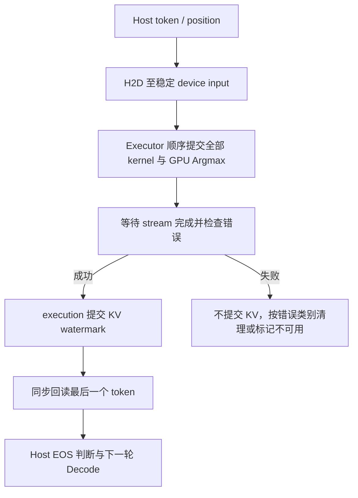

# CUDA 后端与执行支持方案

- **状态**: Draft
- **版本**: 1.0
- **日期**: 2026-10-21
- **当前产品合同**: [AetherMind PRD](../products/aethermind_prd.md)；当前仍为 CPU-only，本提案定义未来 CUDA 专项范围，不扩大当前已交付能力
- **架构边界**: [AGENTS.md](../../AGENTS.md) §2.1
- **关联提案**: [06 系统能力路线图](06-system-capability-evolution-roadmap.md)、[08 KV/Attention 演进](08-kv-cache-and-attention-capability-evolution.md)、[09 模型家族扩展](09-qwen-and-moe-architecture-support.md)、[10 Runtime 组装入口](10-upper-level-runtime-assembly.md)、[11 FP16/BF16 执行支持](11-fp16-bf16-execution-support.md)
- **算子工作流**: [算子开发与优化工作流](../guides/operator-development-workflow.md)
- **关联模块**: base / memory / backend / compiler / execution / kv_cache / runtime / inference

本文为待实施提案。源码事实按 2026-10-21 当前工作树静态核对；本次仅编写文档，不实现 CUDA allocator、kernel、构建开关或公开 API，也未构建或运行 C++/GPU 测试及 benchmark。下文“拟新增/拟扩展”接口名称表示设计方向，不是已存在的符号或冻结的 ABI；所有验收条目均为未来门禁。

## 1. 现状分析

### 1.1 问题与推荐路线

CUDA 支持需要贯通设备身份、显存所有权、数据搬运、stream 执行、完成确认及模型级数值验证。新增 `CudaBackend` 或实现 `cudaMalloc` 无法单独形成可执行推理链。

推荐顺序：

```text
P0 设备、存储与执行完成合同
  → P1 可选 CUDA 构建及 allocator / stream / copy 基础设施
  → P2 单 GPU、FP32、O1/plain 的完整 Prefill / Decode / Generate
  → P3 分别验收 FP16 / BF16 执行 preset
  → P4 cuBLASLt / Attention / fusion 等有证据的性能优化
```

首版维持单进程、单请求、同步公开 API、Token IDs I/O、greedy generation 和静态连续 KV。模型权重、KV、activation 与 kernel workspace 位于同一目标 GPU；host 保留控制流、metadata 和输入输出 staging。完整模型须装入目标设备预算，容量不足时明确失败。

### 1.2 已核对事实

| 当前事实 | 源码依据 | 对方案的约束 |
|---|---|---|
| `DeviceType` 有 CUDA，`Device` 可表示 ordinal；`IsDeviceKindSupported` 目前只返回 CPU | [device.h](../../include/aethermind/base/device.h)、[device.cpp](../../src/base/device.cpp) | 枚举/解析不是执行 capability；区分编译支持、设备可用和 preset 可执行 |
| `CUDAAllocatorProvider` 仍直接 `AM_CHECK(false)` | [cuda_allocator.cpp](../../src/memory/cuda_allocator.cpp) | 需实现真实分配及可恢复的初始化/分配错误 |
| Runtime options 有 CUDA 开关，但默认 Backend factory 只注册 CPU；KV 初始化固定取 CPU allocator | [runtime_options.h](../../include/aethermind/runtime/runtime_options.h)、[runtime_builder.cpp](../../src/runtime/runtime_builder.cpp) | 配置、factory、KV 与实际设备必须一致 |
| Backend factories 和实例均按 `DeviceType` 保存；Allocator 实例已按 `Device` 缓存 | [backend_registry.h](../../include/aethermind/backend/backend_registry.h)、[allocator.h](../../include/aethermind/memory/allocator.h) | CUDA capability 与执行资源必须绑定具体 GPU |
| `Buffer/MemoryHandle` 已携带 device 和释放合同；`TensorView/MutableTensorView` 没有 device | [buffer.h](../../include/aethermind/memory/buffer.h)、[memory_handle.h](../../include/aethermind/memory/memory_handle.h)、[tensor_view.h](../../include/aethermind/base/tensor_view.h) | 复用既有 owner，补齐 view/binding 的 placement 信息 |
| `Stream` 是空接口；`LayerRunner` 构造的 `KernelContext.stream` 为 null | [stream.h](../../include/aethermind/backend/stream.h)、[layer_runner.cpp](../../src/execution/layer_runner.cpp) | 缺少 stream 来源、同步及错误传播合同 |
| 全部 kernel 同步返回成功后，`LayerRunner` 立即提交 KV watermark | [layer_runner.cpp](../../src/execution/layer_runner.cpp)、[commit access](../../src/kv_cache/kv_cache_commit_access.h) | CUDA enqueue 成功不能替代设备完成确认 |
| KV 是 Manager-owned K/V Buffer；binding 只有裸 pointer、dtype、geometry/stride | [kv_cache_state.h](../../include/aethermind/kv_cache/detail/kv_cache_state.h)、[kv_cache_binding.h](../../include/aethermind/base/kv_cache_binding.h) | 保留静态布局与提交权威，增加物理设备校验 |
| plain 权重和常量绑定直接借用 raw host bytes；现有 packing layout 为 CPU 格式 | [executable_model.cpp](../../src/inference/executable_model.cpp)、[packing_recipe.h](../../include/aethermind/backend/packing_recipe.h) | 上传、普通显存存储和 opaque packing 必须分开 |
| `InferenceSession` 固定 CPU allocator、host token/position 输入、host pointer 输出读取，并拒绝非 CPU plan | [inference_session.cpp](../../src/inference/inference_session.cpp) | 改造整条 I/O 链，不能只移除 CPU gate |
| `PrepareKernel` 不接收 concrete TensorViews；binding params builder 能看到 concrete views，但只允许小型、trivially destructible params | [backend.h](../../include/aethermind/backend/backend.h)、[kernel_types.h](../../include/aethermind/backend/kernel_types.h)、[execution_bindings.cpp](../../src/execution/execution_bindings.cpp) | cuBLASLt 的 shape specialization 和资源析构需要独立 owner |
| 当前 plan 冻结 workspace layout，Generate 分配请求 Buffer；CMake 未启用 CUDA language，也不收集 `.cu` | [plan builder](../../src/execution/execution_plan_builder.cpp)、[session](../../src/inference/inference_session.cpp)、[root CMake](../../CMakeLists.txt)、[src CMake](../../src/CMakeLists.txt) | 先复用规划/分配分离，构建和 specialization 按阶段扩展 |

### 1.3 范围与非目标

P2 仅验收当前 Llama Dense 的 FP32 `O1/plain`，需要覆盖该 preset 实际产生的全部算子。`O2/packed`、其他模型家族及低精度分别准入，不因底层 CUDA 可运行而自动获得支持。

本提案不引入 CPU/GPU 自动分图、按层 offload、隐式 CPU fallback、多 GPU、NCCL、服务化、并发请求、调度器、Paged KV、Unified Memory 默认策略或公开异步 API。INT8/INT4 CUDA 执行需要量化格式与数值合同专项，不属于首批交付。CUDA Graphs 属 P4 的候选优化，不与当前 semantic ModelGraph 混为一种图。

## 2. 目标架构

### 2.1 不变量与 capability 边界

1. Runtime 创建时把 `cuda:-1` 解析一次为具体 ordinal，之后所有资源使用同一明确 `Device`；执行不重新依赖调用线程的 current device。
2. actual bytes、dtype、shape/stride、placement、packing recipe 与 kernel 请求一致；改变 dtype/device 标签不能代替转换/搬运。
3. CUDA preset 的全部计算算子在同一 GPU 上执行；缺少 kernel 在准备阶段失败，不隐式切换 CPU 或改变数值合同。
4. kernel 返回成功可表示本次工作成功入队；`Executor::Execute` 返回成功必须表示完整 plan 已完成且 KV 发布成功。
5. GPU 完成前不清理 activation/workspace/staging，不释放 KV reservation，不修改仍被读取的 host 输入。
6. Decode 稳态不做 registry lookup、packing、heuristic 查询或请求侧内存分配；所有缓存参数与 owner 地址稳定。
7. Runtime/registries/KV 仍要求外部串行化；公开 API 同步不意味着 CUDA kernel 的 host launch 同步。

| 目标能力 | 权重 / activation / KV | 累加与 logits | 阶段与状态 |
|---|---|---|---|
| CUDA FP32 baseline | F32 / F32 / F32 | F32 数值合同；RoPE 保留自身更高精度频率/角度合同；logits F32 | P2 待实施，O1/plain |
| CUDA FP16 preset | 显式 F16 执行组合；A/KV/边界在 P3 冻结 | 归约至少 F32、最终 logits F32，转换位置可见 | P3 待实施 |
| CUDA BF16 preset | 显式 BF16 执行组合；A/KV/边界在 P3 冻结 | 同上，独立于 FP16 验收 | P3 待实施 |
| CUDA fused/packed/graph replay | 继承一个已验收 preset，不自动扩大组合 | 不移除合同规定的 rounding/cast | P4 候选，未实施 |

P2 输入使用真实 F32 权重；F16/BF16 checkpoint 只有经 [11 号提案](11-fp16-bf16-execution-support.md) 已验收的显式逻辑转换后才能进入该模式，不在 loader 或 CUDA 上传中偷偷转换。P2 不以 11 的全部阶段完成为前置。

### 2.2 模块职责与拟新增接口

| 所在层 | 数据/接口方向 | 职责与限制 |
|---|---|---|
| base / memory | 拟为 dense/KV borrowed views 增加 `Device`；实现 CUDA allocator | placement 是纯数据，Buffer/MemoryHandle 继续拥有释放合同；无 CUDA SDK public 依赖 |
| backend | 拟新增 `CudaBackend`、`CudaBackendFactory`、`CudaCapabilities`；扩展现有 `PackedWeightView` 的设备信息 | resolve CUDA kernel、检测本 GPU eligibility、提供 packing；不执行整个 plan |
| backend | 拟新增窄接口 `DeviceExecutionResources` 及 CUDA 私有实现 | 聚合一个显式 stream、cuBLAS handle、transfer、同步与 poisoned 状态；不建立通用 queue/event/scheduler HAL |
| runtime | 拟增加具体 target Device 与上述资源 owner | 创建资源、配置一致性校验、按目标 allocator 初始化 KV；不依赖 execution/compiler/inference |
| compiler | 沿用 `GraphLoweringConfig` 的 selector；按需编排 target-aware pipeline | 不查询 CUDA registry；graph/operators 不承载 SM、stream、workspace 或库 handle |
| execution | 拟扩展 `ExecutionContext` 的设备执行资源借用，binding 校验与完成屏障 | 向 `KernelContext` 传窄借用，维护完整 plan 的 KV transaction |
| inference | 拟在 `ExecutableModel` 聚合 resident Buffer owners；改造请求 I/O 与资源选择 | 唯一 `PrepareExecutableModel` 编排上传/packing；Generate 编排 H2D/D2H，不实现 CUDA copy/kernel 算法 |

`Backend` 保持 `PrepareKernel / GetPackingRecipe / PackWeights` 的准备期职责，不增加 `Backend::Execute`。设备执行资源由 Runtime 按明确 Device 拥有，ExecutionContext 借用；CUDA stream 与 cuBLAS handle 同 owner，创建时绑定一次，执行中不切换共享 handle 的 stream。初期一个 Runtime 对应一个执行目标与一条串行执行路径。

Backend factory 仍按 `DeviceType` 注册，拟将实例缓存改为按 `Device` 保存、factory 改为 `Create(Device)`，并贯通 Runtime、plan builder、权重准备和测试。`KernelSelector.device_type` 保留类型级匹配，具体 ordinal 记录在 Runtime、ExecutableModel、plan/binding 准备合同中；CudaBackend 的 capability snapshot 来自该 GPU。设备实例校验不依赖全局“最后选择的 GPU”。

CUDA eligibility 位于 backend：SM/数据类型能力、编译产物覆盖和所选库算法约束独立校验，不把 GPU 品牌或 SM ordinal 塞入通用 selector。首批具体 Toolkit/driver/host compiler/SM 矩阵在 P0 固定，有运行证据后发布；本文不猜测最低版本或指定未验证硬件。

### 2.3 Placement、allocation 与 transfer

- `TensorView/MutableTensorView` 从 Tensor 构造时继承真实 device；raw-parts 构造要求显式 placement，并迁移 producer、只读视图转换、tests/helpers 和文档，避免遗漏后默认为 CPU。view 继续不拥有数据或 metadata。
- `PackedWeightView` 从 artifact Buffer 取得设备；KV binding 从实际 K/V Buffer 取得设备。workspace arena/binding 需有可验证的设备归属，但不因此把 stream 或 Backend 放进 kv_cache/memory。
- 冷路径核对 plan target、全部 dense/packed/state bindings、allocator 和执行资源设备一致。CPU kernel 的入口也必须拒绝 CUDA storage；shape 校验仅读取 host metadata，不读取 tensor payload。
- placement metadata 是调用方契约，不是任意外部裸指针的物理证明。受管分配从 Buffer 传播真实来源；外部指针在接纳边界按需要核验，不在每个 kernel 用 pointer 查询代替合同。
- CUDA allocator 首版用准备/请求初始化期的常规分配与独立释放合同，`AllocationRequest` 的 bytes/alignment、zero-byte 和失败语义与现有 Allocator 一致。更强对齐若需 over-allocation，保留原始释放地址并检查算术溢出。
- `MemoryHandle` deleter 不捕获短生命周期 allocator；携带正确 ordinal 和必要的独立释放上下文，在正确 device 上释放并恢复调用线程设备状态。Buffer 可以独立于 allocator 存活，不能依靠隐藏 `this` 指针兑现该合同。
- 首批 transfer 支持经过 bounds 校验的连续 Buffer/range H2D、D2H 和 D2D；dtype/layout conversion 仍是独立语义或 backend packing。同步便利入口内部完成等待，异步入口明确要求 source/destination 活到同步完成。
- pinned host staging 由专用 owner 管理，按需要分配/复用；普通 host 输入可以显式同步搬运，不宣称 pageable memory copy 一定与计算重叠。初期不引入全局 MemoryKind 笛卡尔积或通用跨设备 Copy Graph。

设备选择只发生在 CUDA 实现边界，使用保存/恢复 current-device 的窄 guard；不向上层公开 `cudaStream_t` 或引入线程局部的隐式目标。未编译 CUDA、无可用设备、driver/目标不满足及 OOM 返回可诊断 Status；需要让 allocator provider 的创建路径能够传播初始化错误，不能继续通过 stub abort。

### 2.4 权重驻留、packing 与所有权

```text
Runtime（最终稳定地址，长于所有 model / session）
  ├─ allocator / backend registries
  ├─ DeviceExecutionResources：stream + library handles
  └─ KVCacheManager：目标 GPU 的 K/V Buffer + host session state

ExecutableModel
  ├─ LoweredModelArtifact → LoadedModel → host raw weights/backing
  ├─ resident plain weight / constant Buffers
  ├─ CUDA packed artifacts → 各自 Buffer
  └─ metadata / immutable bindings / phase plans

Generate 请求
  ├─ host staging + GPU token / position Buffers
  ├─ PreparedExecutionBindings：activation Buffers 与稳定 metadata/params
  ├─ GPU workspace Buffer → arena → 每步 borrowed slice
  └─ ExecutionContext：拥有 bindings，借用执行资源、workspace 与 KV view
```

ModelLoader 继续只读 HF、验证与 resolve，不上传显存。`PrepareExecutableModel` 按目标设备编排普通权重/常量上传和 `Backend::PackWeights`，CUDA 具体 transfer/packing 算法归 backend。准备成功返回前等待全部上传/转换完成，再发布 immutable model，首版不引入 readiness event 的跨 stream 生命周期。

上传保持 row-major 的 plain 权重仍为 `WeightFormat::kPlain`；不能只为显存所有权伪造 packed artifact。opaque 格式才走 recipe，新增 CUDA `PackingLayout` 必须描述不可变字节格式，贯通尺寸公式、alignment、validator、key 与 consumer，不复用 CPU B-panel ID。packed 数据由传入的目标 allocator 分配，host source 可读性与 device destination 可写性分别验证。

resident storage 按 source storage/range、逻辑身份、目标设备及真实表示去重；tied embedding/lm_head 保留共享，内容相同的独立权重不自动合并。CPU plain 可继续借用原 owner。11 号提案的逻辑 dtype 转换仍经 RawStorage→LoadedModel 保活，本文新增的是另一物理设备上的 resident storage，不建立第二套逻辑转换 owner。

上传失败不发布半成品，先处理已提交工作再销毁临时 owner；完整 bytes、padding 和峰值 owner 共存都纳入预算。host raw/backing 因现有 artifact 生命周期可能继续存活，不能直接承诺上传后 host 内存全部释放。

### 2.5 同步 API、stream 与 KV transaction

首版所有计算使用一条显式 stream，copy 与依赖 kernel 在同一顺序域内提交。通用执行函数仍返回 `Status`，无需为 CUDA 同时公开 future/coroutine/event API。



执行 invariant：

1. `ExecutionContext` 借用的设备资源贯通 `LayerRunner → KernelContext → CUDA launcher`，不使用 null/default stream 隐式执行。
2. CPU kernel 成功表示同步完成；CUDA launcher 成功表示入队和即时检查成功。所有步骤完成提交后，execution 等待 stream，检查异步错误，成功后才调用 source-private commit access。
3. 当前 KV 的 `kWritten` 进度不能直接代表 CUDA completion；需明确 scheduled/enqueued 与 completed，最终完成屏障前不得发布 watermark。同 stream 保证 KVUpdate→Attention 顺序，Attention 可以读当前 transaction 的 local visible window。
4. `kv_append/kv_read`、TensorView metadata、attrs 和 params 都是 host 描述符。launcher 在调用期间读取并按值形成 device 参数；不得把 RunStep 栈地址、host span 或 KernelContext 指针交给 GPU 延迟读取。
5. device allocation、prepared owner、workspace 与异步 copy source/destination 保持到设备完成。失败时也不能先 `ClearContext`、释放 reservation 或覆盖输入 staging。
6. 即使 plan 没有 KV state，`Executor::Execute` 也须保证完成后返回；完成屏障不能只放在有 append 的分支。

首版在 Executor 完成后同步回读最后一个 Int64 token；GPU Argmax 的结果按现有 uint32 token 范围校验，host 不直接解引用 device pointer。Prefill 取最后 query row；Decode 保留稳定 input pointer，更新 token/position 内容并复用 bindings。公开输出 token 的生命周期独立于 device storage。

KV commit 覆盖完整计算 plan；后续 D2H 若失败，已经成功提交的 plan 不做虚假回滚，Generate 返回错误并清理本次 reservation。将 readback 与最终完成屏障合并是后续优化，必须明确是否纳入事务，不在 inference 私自移动 commit 权威。

### 2.6 失败类别与清理顺序

| 错误类别 | 处理合同 |
|---|---|
| 设备/配置/shape/layout 不支持，尚未入队 | 准备阶段返回 Status，不发布 model/context 或改动 watermark |
| allocation/初始化失败 | RAII 释放已取得资源，保留原错误；部分 transfer 已入队时先等待其不再使用临时存储 |
| 可恢复的 enqueue/执行错误 | 停止提交，drain 已提交工作，确认终止后释放借用资源；失败 plan 不推进 KV，当前请求结束 |
| drain 暴露严重 device fault | 转入 poisoned 路径，不继续按可恢复错误重试 |
| `cudaErrorIllegalAddress` 等严重错误 | Runtime/device execution resources 标记 poisoned，拒绝后续执行，best-effort 清理并上报需重启进程；不自动 `cudaDeviceReset`，不承诺 Session reset 可恢复 |

正常完成和可恢复失败时，先确认设备不再访问请求资源，再销毁 context/bindings、释放 KV reservation，最后销毁 staging/workspace/输入 Buffers。每条错误返回都受同一清理合同约束，包括第一个 launcher 已成功、后续 launcher 立即失败的情况。

显式完成/Close 路径传播执行与清理错误，析构只作 noexcept best-effort 兜底；保留最初错误及阶段上下文，避免清理错误覆盖根因。fatal fault 不通过自动结束用户进程处理，而是返回不可继续使用 CUDA 的状态，由应用决定进程重启。

### 2.7 静态 KV、workspace 与 binding specialization

KVCacheManager 继续按值拥有 storage/session state，target allocator 只在 Init 调用期间借用。Runtime 从明确 target Device 选择 allocator，K/V 同设备同 dtype；session generation、capacity、committed watermark 仍在 host。kv_cache 不创建 stream、不等待 GPU，也不引入 whole-plan transaction；完成与提交权威仍在 execution。

首版复用连续 `[layer][kv_head][token][head_dim]` 及显式 strides，CUDA kernel 依据 binding 的真实布局访问。layout 算术、alignment/padding 与容量检查沿用 checked 规则。只有 profiling 表明物理布局限制目标 workload，才新增布局身份和对应 producer/consumer；CUDA 本身不要求 Paged KV。

workspace 保持“规划→请求分配→绑定 slice”的所有权分离：

- P1/P2 使用当前 plan 固定 requirement/layout；请求在目标 GPU 分配 Buffer，arena 只返回满足 offset/alignment 的 borrowed range。host params 与 staging 不占用 device scratch。
- P4 引入 cuBLASLt 时，允许先在 plan 冻结显式 scratch budget 上界，cold specializer 只选择不超过上界的算法；不能让现有 params builder 计算需求后偷偷改变已经冻结的 offsets。
- cuBLASLt descriptor/algorithm 依赖 concrete shape/layout。拟新增 backend opaque RAII specialization owner，由 `PreparedExecutionBindings` 持有，POD params 只借用稳定地址；不把需析构资源塞进 `attrs` 或 512B arena，不仅靠增加 arena 上限解决。
- 若 [09 号提案 §3.6](09-qwen-and-moe-architecture-support.md#36-静态执行workspace-与资源预算) 的 shape-dependent workspace 合同先落地，则 CUDA 复用其 query→prepared layout→请求分配链路。最终布局只保留一个权威，不同时以 plan 和 prepared offsets 驱动执行；固定 budget 可以作为约束传给 specializer。
- specialization/heuristic 在 Prefill 的 concrete shape 或 Decode T=1 冷路径完成；Decode 循环不 query、不重建 descriptor、不分配。workspace Buffer 增长前先结束全部使用并清理旧 context，params 不缓存 workspace 基址。

### 2.8 Kernel、精度与优化边界

P2 以 `O1/plain` 的真实 lowered op 集合为准，至少闭环 Embedding、Linear/lm_head、RMSNorm、RoPE、KVCacheUpdate、Attention、Add、Silu/ElementwiseMul 或实际 SiluMul、Argmax。Linear/MatMul 首先用传统 cuBLAS 或固定、可审计的实现；显式正确处理项目 row-major、transpose、leading dimension 和 dtype，不改变逻辑权重来迁就库默认布局。

首批 Attention 实现清晰的 causal/GQA baseline，验证其 scratch 上界与可支持 context；不能用仅适合 tiny fixture 的 score buffer 宣称支持全部长上下文。优化 Attention 可以使用连续 KV 的 streaming softmax，无需同步引入 paged storage。所有 kernel 覆盖实际 stride、tail、alias、zero-size、overflow 和错误数据合同。

FP32 baseline 禁止隐式 TF32/FP16/BF16 down-conversion 与全局 fast-math；固定 compute/math mode 并测试。Norm、Attention/Softmax 归约的稳定性、RoPE 的频率/角度与现有 [RoPE 合同](../operators/rope/RoPE算子契约.md) 一致；并行 reduction 不承诺与 CPU bit-identical。Argmax 的 tie-break、NaN/Inf 和非法 token 处理按项目合同逐项对齐。

P3 与 [11 号提案](11-fp16-bf16-execution-support.md) 共享 source dtype、graph-build precision 和转换策略，分别冻结可执行 CUDA tuple。CPU W16/A32 不能自动等同于 CUDA Tensor Core 路径；若采用 A16、KV16 或混合输出，明确 logical rounding/cast placement、typed 参数、selector/state 身份、kernel 及 fused consumer，保证最终 F32 logits 是真实数值路径而非先窄化再 widening。FP16/BF16、plain/packed、Prefill/Decode 按组合独立验收。

P4 根据 profiling 选择 cuBLASLt、Decode GEMV、GEMM epilogue、norm/elementwise fusion 或 Attention 优化。semantic rewrite 仍归 graph，target-aware composition 归 compiler，CUDA physical layout/packing/kernel 实现归 backend。开启 O2/packed 前，完整补齐实际 fused consumer 的 registry、recipe、binding 和数值测试，不默认接受任意 optimization/preset 组合。

CUDA Graphs 仅在稳定 pointer、capture-safe library/resource 行为、KV position 更新与错误/commit 合同明确后考虑；不以 capture 成功替代完整 replay 路径验证。

### 2.9 可选构建与公开 API

拟新增默认 OFF 的 `AETHERMIND_ENABLE_CUDA`：开启时启用 CUDA language、`find_package(CUDAToolkit REQUIRED)`，条件编译 `.cu` 及 CUDA `.cpp`，按实际使用链接 `CUDA::cudart`、`CUDA::cublas`，P4 再接入 `CUDA::cublasLt`。目标代码可组织为独立 CUDA OBJECT target 并链接现有 shared library；首版不要求运行期可卸载插件。

当前递归 glob 会无条件收集 `.cpp`，实施时必须将 CUDA host sources 移出无条件集合并显式按选项加入，不能只条件添加 `.cu`。配置 `CUDA_ARCHITECTURES` 与受支持 C++20 toolchain，CUDA 专用 flags 限于 CUDA target；TSAN/host sanitizer、AVX2/FMA 和现有全局 C++ flags 不无条件传给 nvcc 或 device compilation。实际构建开关在落地后同步根 README 单一事实源。

CUDA OFF 时不要求 Toolkit、driver 或 GPU，CPU consumer 可单独编译/链接且不依赖 CUDA 动态库；CUDA ON 但 Toolkit 不可用时在配置阶段明确失败；已编译但运行时无设备/driver/SM 不兼容则由 Runtime 初始化报告。不能把这些状态折叠为 `IsDeviceKindSupported` 一个布尔承诺。

保留同步 C++ Session 和 Token IDs I/O；C ABI 扩展遵循最终实际发布接口的版本策略，不把 `cudaStream_t` 或 C++ CUDA wrapper 放入公开 C ABI。C++ view/factory 变化属于需迁移的接口变更，实施时完整更新调用方、tests/helpers 与 API 文档；本提案不把尚未交付的 C ABI 描述为既成接口。

## 3. 方案与备选

| 方案 | 收益与代价 | 裁决 |
|---|---|---|
| 单 GPU、单 stream、同步 API、全模型驻留 | 复用当前执行/静态 KV，完成与资源生命周期可独立验证；需要足够显存 | 首版推荐 |
| 只新增 CUDA kernel/allocator，沿用无设备 view | 代码较少，但 host/device pointer 混用、KV 提前提交和失败释放风险无法封闭 | 不采用 |
| 首批 CPU/GPU 混合分图与按层 offload | 可能扩大可加载模型，但新增 placement、跨设备 copy、调度、数值与预算合同 | 独立需求驱动，非本提案前置 |
| 每个 kernel 都 synchronize | 易定位错误，但引入逐算子等待，掩盖真实异步生命周期问题 | 可作调试模式，默认完整 plan 边界等待 |
| 公开 async API、统一 event/queue HAL | 为并发扩展预留能力，但当前没有消费者与并发合同 | 后置，现有窄资源接口足够 |
| 首批引入 cuBLASLt/自研高性能 GEMM | 潜在性能空间大，同时增加 descriptor owner、shape specialization 与 workspace | P2 用 cuBLAS，P4 按证据升级 |
| 先 FP32 再低精度 | 分离设备正确性与精度变化，便于 CPU oracle 对照；FP32 内存较大 | 推荐，用 tiny 模型建立闭环 |
| 上传统一伪装成 packing | 可复用部分 owner，但混淆 dense layout 与 opaque recipe，绑错 consumer | 不采用，独立 resident plain storage |
| 默认 Unified Memory 或 stream-ordered allocator | 可简化特定访问/回收，但引入迁移或 stream lifetime，难以验证稳态流量 | 首版显式显存与 copy，需求触发后独立评估 |

## 4. 实施步骤

所有工作包均待实施；顺序表示依赖，不承诺工期。算子工作依照 O0–O4，必须同时具备 reference、prepared production path 与可追溯证据。

### 4.1 P0：冻结设备、存储、完成与兼容合同

1. 固定首批 GPU/SM、Toolkit/driver/host compiler 和部署环境矩阵；定义 compiled/available/executable 的诊断与 unsupported 行为。
2. 冻结明确 target Device、Backend factory/instance key 迁移、view placement、CUDA CPU pointer 拒绝边界，列齐 Tensor/BoundValue/packed/KV/workspace producer 与 consumer。
3. 冻结 Runtime-owned 设备执行资源、Execute 完成屏障、错误分类与 request drain；定义 C++ 接口迁移范围，保留模块依赖方向。
4. 固定 FP32 O1/plain、静态 KV、同步 greedy I/O 与 reference 数值门禁，区分计划中的低精度/packed 支持；决定是否已采用 09 的 prepared workspace 权威。

退出条件：设计合同与支持/拒绝矩阵完整，拟改 producer/consumer/tests/docs 可追踪；后续基础接口迁移不得破坏 CPU 生成链。该阶段不宣称 CUDA 可执行。

### 4.2 P1：CUDA 基础设施与最小算子路径

1. 增加可选 CUDA target、编译语言隔离和 CUDA OFF 配置验证，注册真实 CUDA provider/backend/device resources；移除启用 CUDA 后仍走 stub abort 的路径。
2. 实现 allocator、独立 deleter/device guard、stream/handle RAII、transfer/staging 与 device propagation；错误经 Status 返回。
3. 迁移 ExecutionContext/KernelContext、binding 校验和完整 plan 完成屏障，覆盖无 KV plan；CPU 同步资源实现保持原语义。
4. 选简单 elementwise kernel，使用真实 registry→plan→prepared bindings→Executor 跑通 H2D、计算和 D2H，验证异步失败/清理而非仅直接 launch。

退出条件：CPU-only build/consumer 与现有聚焦测试通过，CUDA allocation/copy/placement/owner lifetime 和最小生产路径通过；host sanitizer/相关 TSAN 配置与 GPU memcheck 分别验证。尚不承诺整模型执行。

### 4.3 P2：单 GPU FP32 完整生成

1. inference 编排一次上传与 resident owners，处理 constants、tied weights 和准备失败；Runtime 用目标 allocator 分配静态 K/V。
2. backend 补齐选定 O1/plain 真实算子集合，Linear/lm_head 接 cuBLAS，数值与 row-major adapter 单独对拍，Attention 验证 bounded scratch。
3. Generate 增加稳定 GPU token/position 输入、请求 activation/workspace 和同步 token readback，移除已被设备合同替代的 CPU-only gate。
4. 接通 Prefill、多次 Decode、EOS/capacity 错误与完整 plan KV transaction；Decode 每步只更新输入与 session state，不重建 bindings 或分配。

退出条件：tiny Llama 真实 `Load → Compile → Prepare → CreateSession → Generate` 通过 CPU/HF oracle 对照；中途失败不发布 KV，资源生命周期和重复请求稳定；显存预算/支持 context 有实际数据。不得以几个 CUDA kernel 单测代替本门禁。

### 4.4 P3：独立 FP16 / BF16 presets

1. 沿 11 的精度权威明确每个 CUDA tuple 的 W/A/residual/KV/accumulation/logits，补齐实际转换边界和必要的 operator/selector/serde 迁移。
2. 实现完整必要 kernel 与常量/权重准备，核对硬件 eligibility、F32 归约、RoPE、NaN/Inf/subnormal 和 rounding，不隐式互换 F16/BF16。
3. 分别验证 FP16/BF16 Prefill/Decode、长上下文误差、golden generation、资源预算和稳态分配；fallback 只能选相同数值合同的 CUDA 实现。

退出条件：每个已开放 preset 的完整 production path 与数值预算通过，实际 bytes 与标签一致；未通过的组合仍明确拒绝，CPU W16/A32 或局部低精度 GEMM 不能作为 CUDA 准入证据。

### 4.5 P4：有证据的性能演进

1. 先测已注册/已准备路径，区分 Prefill GEMM、Decode GEMV、KV/Attention 带宽、launch/synchronization 和 I/O 开销。
2. 按瓶颈增加 cuBLASLt RAII specialization 与 bounded workspace、Attention/elementwise fusion、适用 packed 布局或 Decode 专用 kernel。
3. 单独准入 O2/packed 和 CUDA Graphs 候选，复核所有权、rounding/cast、position/KV 更新和失败行为；不以优化名目新增语义或产品范围。
4. 同机同配置记录 baseline/candidate、raw 数据和端到端结果后再修改默认 priority；无可重复收益可保持已有实现。

退出条件：正确性/资源门禁持续通过，prepared production path 与真实 Generate 均有可重复收益；不设无测量依据的固定加速倍数。

## 5. 风险与依赖

| 风险/依赖 | 处理与准入条件 |
|---|---|
| 当前 PRD 仍 CPU-only | 本文为未来专项；真正发布 CUDA 时显式更新产品 capability、范围和验收，不能因 Draft 生效而宣称交付 |
| ordinal/current-device 漂移 | 边界规范化、所有资源记录同一 Device，guard 保存/恢复；覆盖调用线程外部改变 device 后的执行/释放 |
| 异步读写与 host lifetime | 缓冲区活到 completion，栈上 binding 只供 launcher 读取；drain 覆盖部分提交失败，不依赖 allocator/free 隐式同步 |
| KV 提前发布或错误恢复承诺 | 全 plan 完成后提交；fatal fault poison 并要求应用重启，真实 device fault 测试放独立进程 |
| 准备/请求峰值内存 | 分别统计 host raw/mmap、resident/packed、staging、activation、KV、workspace、库/driver reserve，不把显存 payload 等同于总占用 |
| cuBLASLt workspace 与 09 冲突 | 初期显式固定 budget；采用 shape-query 合同后 final layout 统一归 prepared bindings，不能两套 offset 并存 |
| 精度与 CPU/HF 差异 | 不承诺跨设备 bit-identical；冻结 compute mode、rounding 和误差预算，near-tie 输出需按 margin 审查 |
| CPU 配置退化/ABI 漏迁移 | CUDA OFF 不依赖 SDK/动态库；view/factory 改动覆盖全部 producer/consumer/test/doc，C ABI 遵循实际发布状态 |
| 并发/外部 CUDA 使用者 | 当前单请求/外部串行化；资源不共享可变 stream handle，不自动 reset device，不将单 Runtime 合同扩大为进程任意并发安全 |
| 外部库隐含分配/延迟初始化 | 明确 warmup、固定 algorithm/resources，区分请求侧分配与库/driver 行为；有测量后才宣称完整零分配 |
| 关联提案 | 08 的 KV ownership、10 的对象组装、11 的精度边界复用；09 的 MoE/新家族不是首批前置，也不随 CUDA 自动准入 |

## 6. 验收标准

### 6.1 设备、存储与配置

- CUDA OFF：无 SDK/driver/GPU 环境可构建、链接 CPU consumer，既有 CPU 聚焦测试通过；产物无新增 CUDA 动态依赖。
- CUDA ON：明确验证批准的 Toolkit/driver/compiler/SM；缺 Toolkit 配置失败，无设备、错误 ordinal、driver 不兼容和缺 kernel 在各自正确阶段返回诊断。
- view/packed/KV/workspace 故意绑定 host pointer、错误设备或不匹配 dtype/layout 时执行前失败；原始外部 pointer 的接纳规则有测试，不只校验声明标签。
- allocator 覆盖 zero-byte、alignment、overflow、OOM、正确释放地址、allocator 先销毁而 Buffer 后释放、device guard 恢复和 partial initialization cleanup。
- H2D/D2H/D2D 覆盖 bounds、空 range、source/destination lifetime；pinned/pageable 行为不被混为相同异步保证。

### 6.2 完成、KV 与失败生命周期

- 使用可控延迟/失败的执行资源替身验证通用完成协议，再以真实 CUDA 验证同 stream 顺序和完成语义；不能仅用 fake backend 宣称 CUDA 可用。
- delay completion 时 watermark 不提前推进、请求资源不提前释放；完整成功后恰好提交一次。覆盖无 KV plan 的同步返回。
- 覆盖 KVUpdate 成功入队、后续 launcher 失败、最终 synchronize 失败、D2H 失败，以及 context 切换/请求结束；分别验证 watermark 和 reservation 合同。
- 保持 Append-only 事务范围、所有层更新、GQA/causal local visibility、stale generation/owner/capacity 边界；不以清零或物理复制作为逻辑 rollback 的替代。
- poisoned Runtime 拒绝后续执行，不能通过 Session reset 恢复；故障注入可在进程内验证状态机，真正非法地址等 fatal device fault 放独立进程，避免污染后续测试。
- 正常路径与可恢复失败均通过 GPU 内存/未初始化/同步检查；host metadata/RAII 通过相应 ASAN/UBSAN，涉及 host 共享/同步变更时至少验证 TSAN。TSAN 不作为 GPU race 检测替代。

### 6.3 数值、production path 与资源

- 各算子固定 shape/dtype/layout/alias/tail/zero-size/overflow、NaN/Inf/subnormal、Argmax tie-break 与 token 范围合同，对照独立 CPU/reference oracle；不能用同一 CUDA helper 生成 expected。
- FP32 与 CPU/HF 比较按算子、phase、sequence length 记录 abs/rel error、必要的 reduction oracle、logits/top-k 和 margin。固定误差预算后实施，不能为通过测试临时放宽；CPU/CUDA 并行计算不要求通用 bit-identical。
- tiny Llama 的真实 registry/prepare/binding/Executor/Generate 链覆盖 tied/untied 权重、Prefill、多次 Decode、EOS、capacity、重复请求与初始化失败，固定 golden 在批准环境验证。
- FP16/BF16 分别覆盖真实 bytes、转换位置、phase、KV 和融合，按具体 tuple 标注 capability；不以 loader 接受 dtype 或局部 GEMM 代替完整模型支持。
- Decode 循环证明没有新增请求侧 allocation、packing、descriptor/heuristic 查询；外部库/driver warmup 与不可归因分配单列，未观测部分不宣称零分配。
- 显存/host 峰值、KV 长度增长、不同 prompt 与请求结束均检查；不以 tiny 模型通过推断任意模型容量或长上下文可运行。

### 6.4 性能证据与发布

- 计时区分 GPU event 测得的 device 时间和包含 copy/synchronize/host control 的 wall time；不能用 launch 返回时间报告 GPU latency。
- 分别报告 Load、权重转换/上传/packing、cold/warm preparation、Prefill/TTFT、Decode tok/s、每 token latency、H2D/D2H 字节与频率、host/device 峰值内存和稳态分配。
- 覆盖代表性 prompt/context、Prefill/Decode 与 hot/streaming。记录 GPU/SM/显存、driver/Toolkit/库版本、host compiler/build、功耗/时钟等影响测量的配置，以及 commit、命令、完整 repetitions/raw artifact。
- 使用 profiler 验证瓶颈、隐式 copy/sync 与库分配；同 GPU 同配置交错 baseline/candidate，microbenchmark 仅诊断。没有 production 和端到端收益不提高默认 priority。
- 依照 [算子工作流](../guides/operator-development-workflow.md) 将证据写入对应算子机器记录和 raw artifact；本提案不创建占位 benchmark 文件，不把未来验收写成既有结果。
- 实施并通过对应门禁后，再更新模块设计、API/构建文档、产品 capability 和行为变更记录。Draft 状态不更改当前 PRD、现有 CPU preset 或公开 ABI 承诺。

## 7. 一手资料

以下资料用于 CUDA/CMake 机制与接口约束，不作为 AetherMind 已实现或性能收益的证据；具体部署版本仍按 P0 的支持矩阵冻结。

- [CUDA 异步执行指南](https://docs.nvidia.com/cuda/cuda-programming-guide/02-basics/asynchronous-execution.html)：stream 顺序、同步、异步错误和 host transfer 的生命周期。
- [CUDA Runtime 错误定义](https://docs.nvidia.com/cuda/cuda-runtime-api/cuda_runtime_api/group__CUDART__TYPES.html)：包括 illegal address 在内的严重错误与进程恢复限制。
- [cuBLAS 官方文档](https://docs.nvidia.com/cuda/cublas/)：计算模式、矩阵布局、cuBLASLt descriptor/heuristic 与 workspace；推荐在冷路径查询并复用算法。
- [CMake 3.28 FindCUDAToolkit](https://cmake.org/cmake/help/v3.28/module/FindCUDAToolkit.html)、[CUDA_ARCHITECTURES](https://cmake.org/cmake/help/v3.28/prop_tgt/CUDA_ARCHITECTURES.html)：可选 Toolkit imported targets 与架构代码生成。
- [Compute Sanitizer](https://docs.nvidia.com/compute-sanitizer/ComputeSanitizer/index.html)：memcheck、initcheck、shared-memory racecheck 与 synccheck 的检测范围；不代替 host sanitizer 或完整并发正确性证明。

## 8. 变更记录

| 日期 | 版本 | 变更 |
|---|---|---|
| 2026-10-21 | 1.0 | 建立 Draft：单 GPU 同步执行、设备/显存/stream 合同、KV 完成提交、FP32→FP16/BF16→性能优化阶段及验收；明确与 09/11 的 workspace/精度边界 |
