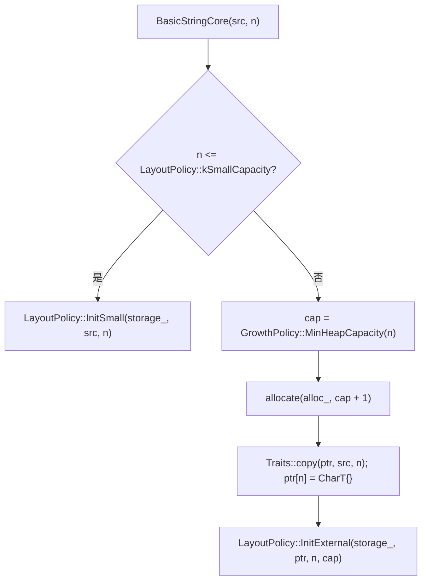

# amstring

`amstring` 是 `aethermind` 命名空间下的 SSO 字符串容器。活跃实现位于 `include/amstring/`，对外类型为 `BasicString<CharT, Traits, Allocator>`；本文只描述该实现。系统分层与依赖方向见 [architecture.md](../architecture.md)。

## 1. 职责与边界

### 1.1 分层职责

| 层 | 类型 | 职责 |
|---|---|---|
| 公共层 | `BasicString<CharT, Traits, Allocator>` | `std::basic_string` 风格接口、类型别名、迭代器、`find` 算法选择；不暴露 `LayoutPolicy` 或 `GrowthPolicy` 模板参数 |
| 核心层 | `BasicStringCore<CharT, Traits, Allocator, LayoutPolicy, GrowthPolicy>` | 唯一 owning storage manager：生命周期、分配/释放、`Small`/`External` 迁移、容量增长、异常安全、self-overlap |
| 布局层 | `GenericLayoutPolicy<CharT>`、`CharLayoutPolicy` | 只定义 24B `Storage` 布局、状态判别、`data/size/capacity` 解码、初始化与状态内 mutator |
| 容量层 | `DefaultGrowthPolicy` | `MinHeapCapacity`、`NextCapacity`；`Large` 增长与页对齐由 core 组合 |
| 字符层 | `Traits` / `CharAlgorithm<CharT, Traits>` | `copy`、`move`、`compare`、`length`、`find`、`assign`、`eq`、`lt` |
| 分配层 | `Allocator` + `std::allocator_traits` | 外部缓冲区分配与释放；统一按 `capacity + 1` 个 `CharT` 分配 |
| 配置 | `aethermind::config` | 最小堆容量、增长因子、`Large` 阈值、页大小、端序 |

`amstring` 是 header-only。`src/container/amstring.cpp` 只包含旧头文件，不定义符号；`src/container/string.cpp` 实现的是另一个独立 `String`（`ObjectRef` + `StringImpl`，带引用计数与 `COW`），不是 `BasicString`。

### 1.2 不得负责什么

- 不实现 allocator 后端；当前没有 `AMMallocAllocator` 类型，也不把 `ammalloc` 的页分配策略带入布局层。
- 不定义字符语义；`LayoutPolicy` 不依赖 `Traits`，core 不绕开 `Traits`。
- 不在公共 API 暴露 `LayoutPolicy`、`GrowthPolicy` 或 probe/tag 编码。
- 不引入 `Medium` / `Large` 布局状态；`Large` 只是 core 内基于 capacity 的动态谓词。
- 不做 COW、引用计数、写时复制或共享缓冲区；`External` 始终独占所有权。
- 不提供线程安全保证；同一对象需要外部同步，不同对象的并发访问互不影响。
- 不提供 `operator+`、比较运算符、`std::hash`、stream/formatter 或 tokenizer/IO。
- 不把 safe over-read、SIMD、branchless fast path 纳入首版布局契约。
- 不依赖 graph、compiler、execution、runtime、model、backend 等推理层模块；只依赖 `aethermind/base` 的检查/异常宏与 `utils/overflow_check.h`。

### 1.3 旧实现边界

[`include/container/amstring.h`](../../include/container/amstring.h) 中的 `AMStringCore<Char>` 是旧实现：使用 `isSmall` / `isMedium` / `isLarge` 三分类，`InitMedium` 未实现，包含 page-boundary safe over-read 的 `InitSmall` 分支。tests 与 benchmark 均不引用它，它不属于 `BasicString` 的接口契约；`CharLayoutPolicy` 仅借鉴其 24B、末字节 metadata 与 capacity tagging 思路。

## 2. 关键数据结构与所有权

### 2.1 模板组合

```text
BasicString<CharT, Traits = std::char_traits<CharT>, Allocator = std::allocator<CharT>>
  └─ BasicStringCore<CharT, Traits, Allocator,
                     DefaultLayoutPolicy<CharT>::type,
                     DefaultGrowthPolicy>
       ├─ LayoutPolicy::Storage storage_
       └─ [[no_unique_address]] Allocator alloc_
```

| 类型 | 定义位置 | 关键事实 |
|---|---|---|
| `BasicString` | `basic_string.hpp` | 只持有 `CoreType core_`；`CoreType = BasicStringCore<CharT, Traits, Allocator>`，固定使用默认布局与默认增长策略 |
| `BasicStringCore` | `core.hpp` | 第 4 个模板参数 `LayoutPolicy` 默认 `DefaultLayoutPolicy<CharT>::type`；第 5 个模板参数 `GrowthPolicy` 默认 `DefaultGrowthPolicy`；要求 `AmStringDecodedLayoutPolicy<LayoutPolicy, CharT>` |
| `DefaultLayoutPolicy<CharT>` | `layout_policy.hpp` | 主模板选 `GenericLayoutPolicy<CharT>`；`char` 特化选 `CharLayoutPolicy` |
| `GenericLayoutPolicy<CharT>` | `generic_layout_policy.hpp` | 支持 `char`、`char8_t`、`char16_t`、`char32_t`、`wchar_t`；多 `CharT` correctness baseline |
| `CharLayoutPolicy` | `char_layout_policy.hpp` | 只服务 `char`；2-bit category marker |
| `DefaultGrowthPolicy` | `growth_policy.hpp` | `kMinHeapCapacity = 32`，普通增长 `old + old/2`，下限 32 |

### 2.2 `Storage` 与 24B 布局

两种 policy 都使用同构的 24B union（64-bit 平台）：

| 成员 | 类型 | 含义 |
|---|---|---|
| `small` | `CharT[sizeof(ExternalRep)/sizeof(CharT)]` / `char[24]` | 内联字符区 |
| `external` | `ExternalRep{CharT* data; SizeType size; SizeType capacity_with_tag;}` | 堆缓冲区视图 |
| `raw` | `std::byte[sizeof(ExternalRep)]` | probe / 原始字节访问 |

不变量与常量：

- `sizeof(Storage) == sizeof(ExternalRep)`；测试断言 64-bit 下为 24。
- `Storage` 必须可 trivially copyable；core 的 `SwapStorage` 依赖整块 `memcpy` 交换。
- `GenericLayoutPolicy`：`kSmallSlots = 24 / sizeof(CharT)`，`kSmallCapacity = kSmallSlots - 1`；`char` 为 23，`char16_t` 为 11，`char32_t` 为 5，`wchar_t` 随其宽度为 11 或 5。
- `CharLayoutPolicy`：`kSmallSlots = 24`，`kSmallCapacity = 23`。
- `ExternalRep.data` 是借用指针：由 core 通过 allocator 分配并释放；布局层只读写，不拥有。

### 2.3 状态判别与容量编码

两种 policy 都只有 `Small` / `External` 两个合法 `Category`；`kInvalid` 只用于诊断、断言和 `CheckInvariants`。

| 项 | `GenericLayoutPolicy<CharT>` | `CharLayoutPolicy` |
|---|---|---|
| probe 位置 | `raw[kStorageBytes - sizeof(CharT)]`，即最后一个 `CharT` 槽位 | `raw[kStorageBytes - 1]`，即最后一个字节 |
| `Small` 编码 | `probe = kSmallCapacity - size`，probe ∈ `[0, kSmallCapacity]` | `SmallMeta = kSmallCapacity - size`，LE 直接存 `SmallMeta`，BE 左移 2 位 |
| `External` tag | `kExternalTag = kSmallCapacity + 1`，probe 等于该值 | 2-bit marker：LE `0x80`，BE `0x02` |
| `capacity_with_tag` | LE `(tag << kPayloadBits) | capacity`；BE `(capacity << kProbeBits) | tag` | LE `capacity | (0x80 << 56)`；BE `(capacity << 2) | 0x02` |
| capacity payload 位数 | `64 - sizeof(CharT) * 8`：`char` 56、`char16_t` 48、`char32_t` 32 | `64 - 2 = 62` |
| `max_external_capacity()` | `(1 << kPayloadBits) - 1`（`kPayloadBits == 0` 时为 0） | `(1 << 62) - 1` |
| category mask | 无独立 mask；probe 与 `kExternalTag` 比较 | LE `0xC0` / BE `0x03`；small meta mask LE `0x3F` / BE `0xFC` |

`CharLayoutPolicy` 的 LE 判别把 marker 与 size 合并为一次比较：`probe < 24` 即 `Small` 且 `size = 23 - probe`；否则检查 `(probe & 0xC0) == 0x80`。BE 先取 `probe & 0x03`，再校验 `size <= kSmallCapacity`。

### 2.4 所有权与生命周期

| 对象/资源 | 所有者 | 生命周期与规则 |
|---|---|---|
| `BasicStringCore::storage_` | `BasicStringCore` 按值持有 | 随对象构造/析构；`Storage` 本身不拥有堆内存 |
| `External` 缓冲区 | `BasicStringCore` | 通过 `std::allocator_traits<Allocator>` 分配 `capacity + 1` 个 `CharT`；析构、重分配、`shrink_to_fit` 降级或 `assign` 替换时用同一 allocator 释放 |
| `BasicStringCore::alloc_` | `BasicStringCore` 按值持有，`[[no_unique_address]]` | copy 使用 `select_on_container_copy_construction`；move/swap 遵循 `propagate_on_container_*` 与 `is_always_equal` |
| `BasicString::core_` | `BasicString` 按值持有 | 公共对象生命周期即 core 生命周期 |
| `LayoutPolicy` / `GrowthPolicy` | 无状态 | 全部为 static 函数/常量；不同 `Storage` 上可并发调用 |

拷贝语义是深拷贝，并保留源的 external capacity；move 构造在 `External` 状态下直接接管指针与 capacity，在 `Small` 状态下复制内联字符；两种 move 都把源对象 `InitEmpty` 为合法空串。move 赋值处理三类 allocator 情形：可传播、`is_always_equal`、不可传播但相等时窃取；不可传播且不等时用目标 allocator 重新分配，源对象释放自己的缓冲区并恢复为空串。

`swap` 在 allocator 可传播时交换 allocator 与原始 `Storage`；不可传播时要求 `alloc_ == other.alloc_`，否则 `AM_CHECK` 触发前置条件失败，不提供“分配回退”路径。

### 2.5 `Large` 语义

`Large` 不是 layout state，不持久化 tag，只由 core 计算：

```text
LargeCapacityThreshold() = ceil(kLargeThresholdBytes / sizeof(CharT)) - 1
IsLargeCapacity(capacity) = capacity >= LargeCapacityThreshold()
```

默认 `kLargeThresholdBytes = 4096`。它只影响：

- 增长因子：普通 `old + old/2`，Large `old + old/4`（增长量为 0 时取 1）。
- 页对齐：增长结果进入 Large 区间时按 `kPageSizeBytes = 4096` 向上取整。
- `shrink_to_fit`：当前容量或目标容量处于 Large 区间时使用页对齐的收缩容量。

### 2.6 必须保持的不变量

| 范围 | 不变量 |
|---|---|
| 全局 | `data() != nullptr`；`data()[size()] == CharT{}`；`size() <= capacity()`；`category()` 为合法 `Small`/`External`；moved-from 对象是合法空串 |
| `Small` | `capacity() == kSmallCapacity`；`data()` 指向 `storage_.small`；probe/metadata 可解码出 `size` |
| `External` | `external.data != nullptr`；`size <= UnpackCapacity(capacity_with_tag)`；`capacity` 按字符数计；`data()[size] == CharT{}` |
| 边界 | `size == kSmallCapacity` 时，`small[size]` 同时是 terminator 与 probe 槽；两种编码都必须使该字节同时满足 `CharT{}` 与 probe 值（`EncodeSmallSizeToProbe(kSmallCapacity) == 0`） |

`CheckInvariants` 通过 `AM_DCHECK` 检查上述条件；release 构建（`NDEBUG`）下不执行。

## 3. 接口与代码位置

### 3.1 代码位置

| 内容 | 头文件 / 实现 |
|---|---|
| 公共 `BasicString` | [`include/amstring/basic_string.hpp`](../../include/amstring/basic_string.hpp) |
| 前向声明与别名 `amstring` / `u8string` / `u16string` / `u32string` / `wstring` | [`include/amstring/string_fwd.hpp`](../../include/amstring/string_fwd.hpp)、[`include/amstring/string.hpp`](../../include/amstring/string.hpp) |
| `BasicStringCore` | [`include/amstring/core.hpp`](../../include/amstring/core.hpp) |
| layout concept、`DefaultLayoutPolicy` | [`include/amstring/layout_policy.hpp`](../../include/amstring/layout_policy.hpp) |
| `GenericLayoutPolicy` | [`include/amstring/generic_layout_policy.hpp`](../../include/amstring/generic_layout_policy.hpp) |
| `CharLayoutPolicy` | [`include/amstring/char_layout_policy.hpp`](../../include/amstring/char_layout_policy.hpp) |
| `DefaultGrowthPolicy` | [`include/amstring/growth_policy.hpp`](../../include/amstring/growth_policy.hpp) |
| `config` 常量 | [`include/amstring/config.hpp`](../../include/amstring/config.hpp) |
| allocator traits helper | [`include/amstring/allocator_support.hpp`](../../include/amstring/allocator_support.hpp) |
| `CharAlgorithm` | [`include/amstring/char_algorithms.hpp`](../../include/amstring/char_algorithms.hpp) |
| 公共数据不变量检查 | [`include/amstring/invariant.hpp`](../../include/amstring/invariant.hpp) |
| 旧 `AMStringCore` | [`include/container/amstring.h`](../../include/container/amstring.h)、[`src/container/amstring.cpp`](../../src/container/amstring.cpp) |

### 3.2 公共层接口

`BasicString` 提供：构造/赋值（默认、copy、move、`const CharT*`、`(const CharT*, size_type)`、`string_view`、`(size_type, CharT)`）、`data`、`c_str`、`size`、`length`、`capacity`、`empty`、`begin`/`end`/`cbegin`/`cend`、`operator[]`、`at`、`front`、`back`、`clear`、`reserve`、`resize`、`shrink_to_fit`、`push_back`、`pop_back`、`insert`、`erase`、`assign`、`append`、`replace`、`substr`、`find`、`operator+=`、`swap`、`get_allocator`。

位置与长度检查在公共层完成：`at` 抛 `std::out_of_range`；`insert`/`erase`/`replace`/`substr` 的 `pos` 越界由 `CheckPosition` 抛 `std::out_of_range`，`count` 按剩余长度截断（`npos` 表示到末尾）。

### 3.3 core 接口

只读：`data()`（const/non-const）、`c_str()`、`size()`、`capacity()`、`empty()`、`is_small()`、`is_external()`、`get_allocator()`。

修改：`clear()`、`reserve()`、`resize(n)`、`resize(n, ch)`、`shrink_to_fit()`、`assign`（指针+长度、`string_view`、`count+ch`）、`append`（指针+长度、`string_view`、`count+ch`）、`push_back`、`pop_back`、`replace_range`（指针源与 fill 两个重载）、`swap`、`CheckInvariants`。

`BasicStringCore` 不直接暴露 `SetSize`、`Reallocate`、`MoveStorageFrom` 等内部 helper。

### 3.4 layout policy 契约

`AmStringLayoutPolicy<Policy, CharT>` 要求 policy 提供：

- 类型：`ValueType`（必须等于 `CharT`）、`Storage`、`SizeType`（整型）、`Category`、`DecodedProbe`；常量 `kSmallCapacity`。
- 查询：`is_small`、`is_external`、`category`、`DecodeProbe`、`data`（const/non-const）、`size`、`capacity`、`max_external_capacity`。
- 初始化：`InitEmpty`、`InitSmall(storage, src, size)`、`InitExternal(storage, ptr, size, capacity)`。
- 状态内 mutator：`SetSmallSize`、`SetExternalSize`、`SetExternalCapacity`；`Set*` 不负责状态切换。
- 快速追加：`TryPushBackInplace(storage, ch)`；失败返回 `false`，由 core 进入扩容路径。
- 检查：`CheckInvariants`。

`AmStringDecodedLayoutPolicy` 额外要求接受 `DecodedProbe` 的重载：`is_small`、`is_external`、`data`、`size`、`capacity`、`TryPushBackInplace`。core 通过一次 `DecodeProbe` 复用判别结果，减少重复读 probe。

### 3.5 错误与异常语义

| 场景 | 语义 |
|---|---|
| `AM_CHECK` 失败 | 向 stderr 写 `Check failed: (...)` 并 `abort()`；用于前置条件、状态 mutator、null 源、容量不匹配、不可交换 allocator、`replace_range` 的 `pos`/`erased` 越界 |
| 容量溢出 / 超过 layout 上限 | `AM_THROW(out_of_range)` 构造 `aethermind::Error`，`kind()` 为 `"out_of_range"`，消息形如 `BasicStringCore::<operation> exceeds maximum encodable capacity` |
| allocator 分配失败 | `std::bad_alloc` 原样传播；`assign` 的失败路径保持原对象内容不变 |
| 公共层位置越界 | `std::out_of_range`（`BasicString::at`、`CheckPosition`） |
| `CheckInvariants` / `CheckDataInvariants` | `AM_DCHECK`；release 下不检查，debug 下失败即 abort |
| 字符操作异常 | `CharAlgorithm` 包装均声明 `noexcept`；不承诺支持会抛异常的 custom `Traits` |

`GenericLayoutPolicy::InitSmall` 只检查 `size <= kSmallCapacity`，不检查 `src != nullptr`；`CharLayoutPolicy::InitSmall` 额外检查 `size == 0 || src != nullptr`。公共/core 路径只在非零长度时传入有效源，因此该差异不影响正常调用，但直接使用 policy 时需注意。

## 4. 主流程/时序

### 4.1 构造与状态选择



`MinHeapCapacity(n) = max(n, 32)`。默认构造调用 `InitEmpty`，得到 `Small` 空串（`size = 0`，`capacity = kSmallCapacity`）。

### 4.2 扩容提交顺序

所有需要重分配的操作采用 allocate → copy → commit：

1. 计算新容量并校验 `max_external_capacity()` 与 `size_t` 加法溢出。
2. 用目标 allocator 分配 `new_cap + 1` 个 `CharT`。
3. 复制旧内容和新增内容；若源区间在旧缓冲区内部，先记录 offset，复制旧内容后按新基址重新定位。
4. 写 `new_ptr[new_size] = CharT{}`。
5. 释放旧 external 缓冲区，再 `InitExternal(storage_, new_ptr, new_size, new_cap)`。

分配失败时旧对象保持原状；`append` 的溢出检查在分配前完成，失败时内容和 size 均不变。

### 4.3 `append` / `push_back`

- `push_back` 先调用 `LayoutPolicy::TryPushBackInplace`：`Small` 未满或 `External` 未满时直接写字符、写 terminator、更新 size。
- 原地失败后：`Small` 分配 `MinHeapCapacity(kSmallCapacity + 1)`，复制 23 个字符并追加；`External` 走 `Reallocate(CheckedNextCapacity(cap, size + 1))`。
- `append` 计算 `new_size = size + n`，检查溢出；容量不足时用 `CheckedNextCapacity`：普通区间 `old + old/2`，Large 区间 `old + old/4`，结果进入 Large 区间再按页取整；容量足够时原地复制，源落在 `[data, data+size)` 内时使用 `Traits::move`。

### 4.4 `assign` 与 `replace_range`

`assign`：先检查目标长度不超过 layout 上限；若 `n <= capacity()`，在现有缓冲区内复制（源与目标重叠时用 `move`），写 terminator 并 `SetSize`；否则构造临时对象再 `swap`，因此 self-subrange 赋值安全。

`replace_range` 在 core 内按以下顺序分派：

| 条件 | 路径 |
|---|---|
| `erased == 0 && src_count == 0` | 直接返回 |
| `src_count == 0` | `EraseRangeFast`：`Traits::move` 尾部（含 terminator） |
| `src` 不在 `[data, data + old_size + 1)` 且 `src_count == erased` | `ReplaceSameSizeFast`：原地 `copy` |
| `src` 不在当前存储且 `src_count < erased` | `ReplaceShrinkFast`：复制新内容后左移尾部 |
| `src` 不在当前存储且 `new_size <= capacity()` | `ReplaceGrowInplaceFast`：先右移尾部，再复制新内容 |
| 其他（源重叠、需要扩容） | `ReplaceReallocateSlow` 或 `ReplaceFillReallocateSlow`：临时对象拼接后 `swap` |

fill 版本按“删除/等长/缩短/增长/扩容”分别处理，逻辑与指针版本一致，只是新增内容为 `count` 个 `ch`。

### 4.5 `reserve` / `resize` / `shrink_to_fit` / `clear`

- `reserve(n)`：只在 `n > capacity()` 时分配；使用精确 `n` 作为新容量，不套用增长因子或页对齐。
- `resize(n)`：`n < size` 时写 `data[n] = CharT{}` 并 `SetSize(n)`；`n > size` 时 `reserve(n)`，用 `CharT{}` 或指定字符填充新增区间，写 terminator 后 `SetSize(n)`。
- `shrink_to_fit()`：`Small` 或 `size == capacity` 时 no-op；`size <= kSmallCapacity` 时先把内容 `InitSmall` 到内联区，再按旧 capacity 释放 external 缓冲；否则按 `size` 或页对齐容量重分配，只有目标容量更小才执行。
- `clear()`：只把 size 置 0 并写 terminator；保留 external capacity，不释放缓冲区。

### 4.6 公共层 `find`

`find` 的顺序：

1. 空 needle：返回 `pos <= size ? pos : npos`。
2. 单字符：`Traits::find`。
3. `needle_size < 8` 或剩余长度 `< 128`：朴素扫描。
4. 其余：混合扫描；连续 16 个候选失败后切换到 two-way 算法。

`CharAlgorithm` 保证所有字符比较、复制和查找都走调用方提供的 `Traits`。

## 5. 关键取舍

| 选择 | 原因 | 被否方案 |
|---|---|---|
| 24B union + `Small`/`External` 两态 | 对象头紧凑，SSO 容量固定，热路径只读一个 probe/槽位 | 独立 discriminator 字段；`Medium`/`Large` 第三种布局状态 |
| probe slot / last-byte metadata | `Small` size 与状态合并在已存在的槽位中，不增加对象大小 | 额外 tag 字节；把 size 放在独立字段 |
| `Large` 作为 core 计算谓词 | 只影响增长、页对齐和 shrink，不改变布局或所有权 | 把 `Large` 持久化为 layout tag；引入 COW/refcount |
| `LayoutPolicy` 只作为 core 模板参数 | 公共 API 保持接近标准库；允许 `char` 与多 `CharT` 使用不同布局 | 在 `BasicString` 暴露 layout 模板参数；让用户直接依赖内部编码 |
| `DefaultLayoutPolicy<char>` 选 `CharLayoutPolicy` | `char` 可用 2-bit marker，换来 62-bit capacity payload 与更简单的判别 | 让 `char` 永远走 `GenericLayoutPolicy<char>`（56-bit payload） |
| `CharLayoutPolicy` 使用 2-bit marker | 状态判别只需 mask，剩余位保留 capacity；与旧 char 路径思路一致 | 要求整个 probe byte 等于固定 tag；增加独立 discriminator |
| core 把 `GrowthPolicy` 作为第 5 个模板参数 | 容量策略可在 core 层替换，默认 `DefaultGrowthPolicy`；与早期“仅内部 helper”的文档不同，以代码为准 | 只硬编码 1.5x/1.25x 增长；把增长策略藏成不可替换的私有函数 |
| 普通 1.5x、Large 1.25x + 页对齐 | 小对象快速达到可用容量，大对象减少内存冗余并贴合页分配 | 所有容量统一翻倍；所有容量统一精确分配 |
| allocator 统一走 `std::allocator_traits`，分配 `capacity + 1` | 支持有状态 allocator 与传播规则；terminator 始终有位置 | 写死 `new[]`/`delete[]`；把 terminator 放在容量外额外管理 |
| 不可传播且不等的 allocator 禁止 `swap` | 裸交换会导致用错误 allocator 释放缓冲区 | 为 `swap` 增加分配回退；允许错误的跨 allocator 释放 |
| 前置条件失败用 `AM_CHECK`，容量溢出用 `AM_THROW(out_of_range)` | 前者是编程错误，后者是可报告的长度上限问题 | 所有错误统一抛异常；所有错误统一 abort |
| 公共层 `at`/位置检查用 `std::out_of_range` | 与 `std::basic_string` 的公共语义一致 | 让公共层泄漏 `aethermind::Error` |
| 原始 `Storage` 用 `memcpy` 交换 | `Storage` trivially copyable，swap 不分配、不抛异常 | 逐字段交换；为 swap 引入临时堆对象 |
| `find` 朴素/混合/two-way 分层 | 短 needle 避免算法初始化开销，长 needle 避免最坏 O(N*M) | 所有情况都用朴素扫描；所有情况都用 Boyer-Moore/KMP |
| 活跃 policy 不启用 safe over-read / SIMD | 避免 sanitizer 与对象边界风险，先建立 correctness baseline | 无条件按页整块读取；在布局层直接写 SIMD fast path |
| 旧 `AMStringCore` 不纳入公共契约 | 三态分类、未完成 `InitMedium`、safe over-read 与当前两态架构不一致 | 直接复用旧 core 作为 `BasicString` 后端 |

## 6. 测试与验证入口

### 6.1 构建

```bash
cmake --build build --target aethermind_unit_tests -j
cmake --build build --target aethermind_benchmark -j
```

### 6.2 单元测试

| 文件 | 覆盖内容 |
|---|---|
| [`tests/unit/amstring/test_generic_layout_policy.cpp`](../../tests/unit/amstring/test_generic_layout_policy.cpp) | `GenericLayoutPolicy` 对五种 `CharT` 的常量、`InitEmpty`/`InitSmall`/`InitExternal`、`DecodeProbe`、`SetSmallSize`/`SetExternalSize`/`SetExternalCapacity`、`max_external_capacity`、invalid probe、`CheckInvariants` 死亡测试 |
| [`tests/unit/amstring/test_char_layout_policy.cpp`](../../tests/unit/amstring/test_char_layout_policy.cpp) | `CharLayoutPolicy` 的 24B/23-char 常量、2-bit marker、`PackCapacityWithTag`/`UnpackCapacity`/`UnpackTag`、size 往返、invalid marker、null 源死亡测试、invariant 死亡测试 |
| [`tests/unit/amstring/test_default_layout_policy.cpp`](../../tests/unit/amstring/test_default_layout_policy.cpp) | `DefaultLayoutPolicy` 对 `char` 与其它 `CharT` 的选择、concept 满足、core 默认使用 selector、`BasicString` 不暴露 layout 类型 |
| [`tests/unit/amstring/test_basic_string_core.cpp`](../../tests/unit/amstring/test_basic_string_core.cpp) | core 生命周期、深拷贝、move、moved-from 恢复、allocator 传播、`select_on_container_copy_construction`、`capacity + 1` 分配、`clear`/`reserve`/`resize`/`assign`/`append`/`replace_range`/`push_back`/`pop_back`/`shrink_to_fit`/`swap`、状态迁移矩阵、Large 增长与页对齐、溢出/上限异常、分配失败强保证、self-overlap |
| [`tests/unit/amstring/test_basic_string.cpp`](../../tests/unit/amstring/test_basic_string.cpp) | 公共 API 语义、五种 `CharT`、类型别名、迭代器、`insert`/`erase`/`replace`/`substr`/`find`、自定义 `Traits` 的 `find` 语义、`Small`/`External` 透明性 |
| [`tests/unit/amstring/test_basic_string_differential.cpp`](../../tests/unit/amstring/test_basic_string_differential.cpp) | 与 `std::basic_string<CharT>` 的差分测试：构造、assign/append、resize/reserve/shrink、push/pop/clear、insert/erase/replace、substr/find、随机操作序列 |

聚焦运行示例：

```bash
./build/tests/unit/aethermind_unit_tests \
  --gtest_filter='GenericLayoutPolicyTest.*:CharLayoutPolicyTest.*:DefaultLayoutPolicyTest.*:BasicStringCoreLifecycleTest.*:BasicStringSkeletonTest.*:BasicStringCustomTraitsTest.*:BasicStringDifferentialTest.*'
```

死亡测试匹配 `"Check failed"`；`CheckInvariants` 的死亡断言受 `#ifndef NDEBUG` 保护，与 release 下 `AM_DCHECK` 关闭一致。

### 6.3 基准

[`tests/benchmark/amstring/benchmark_amstring.cpp`](../../tests/benchmark/amstring/benchmark_amstring.cpp) 成对注册 `BM_AmString_*` 与 `BM_StdString_*`，覆盖 `Construct`、`Copy`、`AppendReserved`、`AppendGrow`、`Assign`、`ShrinkToFit`、`ReserveFromEmpty`、`GrowthStaircase`、`PushBackReserved`、`Insert`、`Replace`、`FindChar`、`FindSubstringClean`、`FindSubstringPartial`、`AppendLargePageBoundary`、`ShrinkToFitLargePage`；尺寸重点覆盖 22/23/24 的 SSO 边界。

```bash
./build/tests/benchmark/aethermind_benchmark --benchmark_filter='BM_(AmString|StdString)_'
```

[`tests/benchmark/amstring/benchmark_string.cpp`](../../tests/benchmark/amstring/benchmark_string.cpp) 只测 `std::string` 的创建/拷贝，不属于 `amstring` 验证；同目录出现是因为历史目录归类。
