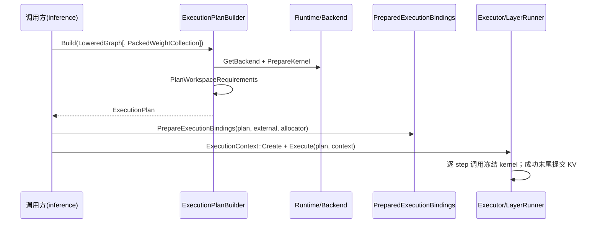

# execution 模块设计

> 本文描述已验证实现。分层与依赖方向见 [architecture.md](../architecture.md)，Runtime 资源装配见 [runtime 模块设计](runtime.md)，产品范围见 [product.md](../product.md)。

## 1. 职责与边界

execution 是**执行数据契约层**：把编译产物或手工节点元数据冻结为不可变 `ExecutionPlan`，在冷路径把 plan specialize 为 `PreparedExecutionBindings`，并以 `ExecutionContext` 聚合执行期资源，按步骤顺序调用已 resolve 的 kernel。

| 负责 | 说明 |
|---|---|
| plan 数据模型 | `ExecutionPlan` / `ExecutionStep` / `ExecutionValueDesc` / `StateAliasPlan` 及其结构校验 |
| plan 构建 | `ExecutionPlanBuilder` 消费 `LoweredGraph` 或不可信 `ExecutionPlanNodeSpec`，完成 kernel resolve、packed weight 绑定与 workspace 需求冻结 |
| 冷路径绑定 | `PrepareExecutionBindings`（= `PlanExecutionBindings` + `MaterializeExecutionBindings`）校验外部 tensor、分配 activation arena、构造 prepared kernel params |
| 执行期资源聚合 | `ExecutionContext::Create` 校验 plan/bindings/workspace/KV 视图一致性 |
| 顺序执行 | `Executor::Execute` → `LayerRunner::Run`：逐 step 绑定 workspace、组装 `KernelContext`、调用冻结的 `ResolvedKernel::fn` |
| KV append 事务 | 单次 plan 内逐层 append 状态跟踪，全部 layer 成功后才 `CommitAppend` |

**不得负责什么**：

| 不负责 | 实际归属 |
|---|---|
| Generate 状态机、Prefill/Decode 循环、Argmax、EOS/max-token 停止 | inference（`InferenceSession::Generate`） |
| 模型拓扑、层语义、图改写与 lowering | graph / compiler / model |
| KV 物理 layout、storage、session reservation、commit watermark 语义 | kv_cache（`KVCacheManager` / `KVCacheSessionView`） |
| kernel 实现、kernel 选择、权重打包布局 | backend |
| Runtime 装配、allocator/backend registry 生命周期 | runtime |
| WorkspaceArena 的分配策略与 Reset | 调用方/Session；execution 只借用 `WorkspaceArena*` |
| 权重重排与 materialization 算法 | model/backend；execution 只持有 `PackedWeight` 共享引用 |

边界规则：

- Public headers **不 include** compiler 头，只前向声明 `LoweredGraph`；实现可依赖 compiler artifact。
- 不依赖 graph；state alias 使用 step/port 坐标而非 `GraphValueId`。
- 不保存 `Runtime*`；plan 通过 `ResolvedKernel` 借用 backend-owned 稳定存储，因此 Runtime 必须比 plan 活得久。
- 不承担跨请求状态；execution 无 `SessionState`，也没有 `PrefillPath` / `DecodePath` 类型。

## 2. 关键数据结构与所有权

### 2.1 Plan 侧

| 类型 | 关键内容 | 所有权/不变量 |
|---|---|---|
| `ExecutionValueId` | `uint32_t index`，指向 plan 值表 | 值表下标，不是 `GraphValueId` |
| `ExecutionPlanBindingKey` | `uint64_t value` | 进程内非零唯一键，plan 与其 bindings 的匹配凭据 |
| `ExecutionValueKind` | `kModelInput` / `kActivation` / `kWeight` / `kConstant` / `kState` | 决定绑定方式 |
| `ExecutionKVCacheStateIdentity` | `decoder_layer_index` + `ExecutionKVCacheSlot{kKey,kValue}` | 仅 `kState` 值可携带；非 state 携带即拒绝 |
| `ExecutionStateBinding` | `variant<monostate, ExecutionKVCacheStateIdentity>` | `monostate` 只允许非 state 值 |
| `ExecutionValueDesc` | `TensorSpec spec`、kind、state_binding、name | 逻辑值的唯一 spec 来源 |
| `ExecutionStep` | `KernelSelector`、`ResolvedKernel`、`shared_ptr<const PackedWeight>`、`WorkspaceRequirement`、语义输入/输出 id、compact kernel 端口映射、`runtime_checks` | 构造后只读；`inputs`/`outputs` 保留 state 端口 |
| `StateAliasPlan` | `vector<ResolvedStateAlias{step_index,input_port,output_port}>` | 由 `ExecutionPlan::Create` 按 `step_index` 稳定排序后冻结；`ForStep` 二分查找 |
| `ExecutionPlan` | values、model_inputs/outputs、steps、binding_key、alias plan、`WorkspacePlanLayout` | 由 `Create` 一次性发布；只暴露 const 视图；比使用它的 `ExecutionContext` 和 `Execute` 活得久 |

`ExecutionStep` 只保留一份 tensor spec（在 `ExecutionPlan::values_` 中）；`kernel_input_ports` / `kernel_output_ports` 把 compact kernel 端口映射回语义 schema 端口。state 输出不产生 `TensorView`，`kPacked` 步的 weight 端口被投影出 kernel 输入。

### 2.2 绑定与执行侧

| 类型 | 关键内容 | 所有权/生命周期 |
|---|---|---|
| `ExternalTensorBindings` | `read_only` / `writable` 两组外部 binding | 借用调用方存储；state 不可出现在这里 |
| `BoundValue` | `variant<monostate, TensorView, MutableTensorView>` | 未绑定/只读/可写三分支；可写绑定通过 `ReadView()` 派生只读视图，不重复存储 |
| `StepTensorBinding` | 每步 compact `inputs` / `outputs` 缓存 | 供热路径直接读取 |
| `PreparedExecutionBindings` | activation storage、具体 shape/stride metadata、`BoundValue` 表、`StepTensorBinding` 表、prepared kernel params arena | **拥有** activation `Buffer` 与 params 存储；**借用**外部 tensor 数据指针；可 move，地址稳定 |
| `ExecutionBindingPlan` | plan key、values/steps 计数、activation offsets/bytes | 只做规划快照，不分配 activation、不构造 params；move-only |
| `ExecutionContext` | `WorkspaceArena*`、`KVCacheSessionView`、`PreparedExecutionBindings`、KV layer scratch | 拥有 bindings；借用 arena 与 KV view；`Clear()` 不 Reset arena、不释放 KV reservation |
| `KVAppendLayerState` | `kNotScheduled` / `kScheduled` / `kWritten` | 每次 `Execute` 前重置；仅表示本计划内写入，不等于已提交 |

生命周期链：

```text
Runtime > ExecutionPlan / ExecutableModel > PreparedExecutionBindings > ExecutionContext
                 外部 tensor backing 必须覆盖 PreparedExecutionBindings 与 Execute
                 WorkspaceArena 与 KVCacheSessionView 由 Session/调用方持有并保证存活
```

`ExecutionStep::packed_weights` 是 `shared_ptr<const PackedWeight>`，plan 自己持有引用，因此 `PackedWeightCollection` 销毁后 plan 仍可执行。`PreparedExecutionBindings` 借用 plan 的 metadata 与外部数据，但拥有 activation 与 params；移动 bindings 不会使缓存的 `TensorView` / params 指针失效。

## 3. 接口与代码位置

| 接口 | 语义要点 | 代码位置 |
|---|---|---|
| `ExecutionPlan::Create(values, model_inputs, model_outputs, steps, state_alias_plan, workspace_layout)` | 校验并冻结 plan；任一步失败返回首个错误，不发布部分 plan | [execution_plan.h](../../include/aethermind/execution/execution_plan.h) / [execution_plan.cpp](../../src/execution/execution_plan.cpp) |
| `ExecutionPlanBuilder::Build(Runtime&, const LoweredGraph&)` | trusted 路径：重校验 artifact、转换 state alias、resolve kernel、绑定 packed weights、规划 workspace | [execution_plan_builder.h](../../include/aethermind/execution/execution_plan_builder.h) / [execution_plan_builder.cpp](../../src/execution/execution_plan_builder.cpp) |
| `ExecutionPlanBuilder::Build(Runtime&, const vector<ExecutionPlanNodeSpec>&)` | untrusted 手工路径：无数据边、每节点独立 operands；拒绝含 state 端口的节点 | 同上 |
| `ExecutionPlanBuilder::PrepareKernelForNode(backend, node)` | 单节点 kernel resolve + workspace 断言校验 | 同上 |
| `ResolveStateAliasesForExecution(lowered)` | 把 compiler 的语义 state alias 转为 `StateAliasPlan`，execution 私有自由函数 | 同上 |
| `ComputeExternalReadRequirements(plan)` | 权威查询：哪些 value 必须由调用方提供 read-only 绑定 | [execution_bindings.h](../../include/aethermind/execution/execution_bindings.h) / [execution_bindings.cpp](../../src/execution/execution_bindings.cpp) |
| `PlanExecutionBindings(plan, external)` | 校验外部绑定、解析符号、规划 activation offsets；不分配 activation | 同上 |
| `MaterializeExecutionBindings(plan, binding_plan, allocator)` | 一次分配 activation arena、规划并填充 params arena、缓存 per-step views、执行 shape/constraint 校验 | 同上 |
| `PrepareExecutionBindings(plan, external, allocator)` | 上述两步的组合入口 | 同上 |
| `ExecutionContext::Create(plan, bindings, workspace_arena, kv_view)` | 冷路径校验 plan identity、workspace 需求、state 所需 KV 视图 | [execution_context.h](../../include/aethermind/execution/execution_context.h) / [execution_context.cpp](../../src/execution/execution_context.cpp) |
| `ExecutionContext::BindWorkspace(requirement)` | 校验对齐；零字节返回空 binding；否则委托 arena | 同上 |
| `ExecutionContext::ResetKVLayerTransactionScratch()` | 预分配 scratch 重置为 `kNotScheduled`，返回本次 `Execute` 专用 span | 同上 |
| `Executor::Execute(plan, context)` | 唯一公开执行入口，委托 `LayerRunner::Run` | [executor.h](../../include/aethermind/execution/executor.h) / [executor.cpp](../../src/execution/executor.cpp) |
| `LayerRunner::Run` / `RunStep` | 顺序执行、alias 校验、KV 事务、workspace 绑定、kernel 调用；execution 私有 | [layer_runner.h](../../src/execution/layer_runner.h) / [layer_runner.cpp](../../src/execution/layer_runner.cpp) |
| `InvokePreparedKernel(kernel, context)` | 只检查 params 契约并调用 `kernel.fn`；不修改 context、不分配 | [kernel_invoker.h](../../include/aethermind/execution/kernel_invoker.h) / [kernel_invoker.cpp](../../src/execution/kernel_invoker.cpp) |
| `BuildAndInvokeKernelForTesting` | 测试/诊断专用，逐次在栈上构造 params；生产路径禁用 | 同上 |
| `StateAliasPlan::ForStep` | 按 step 二分查询 alias 区间 | [state_alias_plan.h](../../include/aethermind/execution/state_alias_plan.h) / [state_alias_plan.cpp](../../src/execution/state_alias_plan.cpp) |

## 4. 主流程/时序



### 4.1 Plan 构建（冷路径）

trusted 路径（`LoweredGraph`）：

1. `ValidateLoweredGraph`（在 alias 解析与图准备两处各校验一次），拷贝 values、model inputs/outputs。
2. 每步 `PrepareNode`：查 operator schema、校验语义端口数量、`MakeCompactInputSpecs`、`DeriveSelectorDTypes` 并要求 `KernelSelector` 的 act/weight/state dtype 与 spec 一致。
3. `runtime_checks` 重映射：输入保持 inference 端口顺序（packed weight 有逻辑形状前提但不成为 kernel TensorView），输出映射到 compact kernel 输出端口。
4. `kPacked` 步从 `kWeight` 输入的 `WeightValue::binding` 与 `LoweredGraph::artifact_id()` 生成 `WeightArtifactKey`。
5. 组装：`Runtime::GetBackend(selector.device_type)` → `Backend::PrepareKernel(op_type, selector, op_params)`；校验返回的 `op_type`、workspace `offset == 0` 与合法对齐；若调用方给了 workspace 断言，比较 bytes/alignment/lifetime/reusable（offset 忽略）。
6. packed weight 解析：collection source id 必须与 artifact 一致；用 kernel 的 `expected_packing_recipe` 组成精确 key 调 `Find`；校验 storage 非空、op_type、logical dtype 与静态 shape。
7. 收集所有 `ResolvedKernel::workspace_requirement`，调用 `PlanWorkspaceRequirements` 写入 offsets 并得到 `WorkspacePlanLayout`；同步写回 step 与 kernel 的 requirement。
8. `ExecutionPlan::Create` 完成结构校验并冻结 `binding_key`、state alias 与 workspace layout。

untrusted 路径（`ExecutionPlanNodeSpec`）：

- 每个节点用 `InferOperator` 重算输出与 `runtime_checks`，要求调用方提供值完全一致；selector dtype 仍从 spec 派生并比对。
- 节点之间没有边：每个节点获得独立的外部输入与输出 value；activation 输出同时登记为 model output。
- 含 state 端口的节点被拒绝：手工 API 不暴露 state identity。
- `kPacked` 节点使用 `source_id = 0`，按 weight operand 的 value index 区分不同 artifact。

`ExecutionPlan::Create` 的关键校验：

| 对象 | 校验 |
|---|---|
| values | `kState` 必须有 state identity；非 state 不得携带 identity |
| model_inputs | id 合法、无重复、kind 为 `kModelInput`；所有 `kModelInput` 值必须被列出 |
| model_outputs | id 合法、无重复 |
| step kernel | op_type 非 `kUnknown`；`fn` 非空；`params_builder` 与 `params_size` 契约一致且不超过 `kMaxKernelParamsSize` |
| step workspace | alignment 为合法 2 的幂；step requirement 与 prepared kernel requirement 完全一致（含 offset） |
| schema/arity | schema 存在；语义输入/输出数量与 schema 端口数一致 |
| packed | packed 步恰好一个 weight 端口且 artifact 的 op/selector/recipe 匹配；plain 步不得携带 artifact |
| 端口投影 | `kernel_input_ports` / `kernel_output_ports` 与 schema（去掉 state 端口及 packed weight 端口）一致 |
| value kind | 每个输入/输出 id 的 kind 与 schema 端口 kind 匹配 |
| runtime checks | 只引用 inference 输入端口范围或 compact 输出端口范围，维度不越界 |
| 数据流 | activation 恰有一个生产者，且作为输入时必须由更早的 step 生产 |
| state alias | step/port 在范围内，输入与输出均为 `kState`；随后稳定排序 |

### 4.2 Plan I/O 合同

| 合同 | 内容 |
|---|---|
| 暴露面 | plan 只暴露 `values()`、`model_inputs()`、`model_outputs()`、`steps()`、`binding_key()`、state alias 与 workspace 汇总 |
| 外部输入 | `ExternalTensorBindings::read_only` 只允许 model input / constant / weight；state 与 activation 禁止 |
| 外部输出 | `ExternalTensorBindings::writable` 只允许 activation |
| 必需绑定 | `ComputeExternalReadRequirements`：model input 与 constant 恒为必需；weight 仅在被 kernel 端口消费时必需；packed-only weight 不需要；activation/state 从不需要 |
| 绑定形态 | `BoundValue` 统一表示“无 dense 视图 / 只读 / 可写”；state 只通过 `ExecutionContext` 的 KV view 生效 |
| 稳定性 | 外部数据地址与 layout 必须在 bindings 生命周期内稳定；输入 payload 值可变，但不得改地址/shape/stride |
| 兼容性 | `ExecutionPlanBindingKey` + step count 决定 bindings/context 是否可用于该 plan |
| 消费方 | inference 从 `model_inputs/model_outputs` 派生 phase I/O 角色；execution 不解释 token/position 语义 |

### 4.3 绑定准备与校验

`PlanExecutionBindings`：

1. 拒绝未初始化 plan（`binding_key == 0`）。
2. 校验 read-only/writable id 范围、重复、kind 限制；对每个外部 view 调 `ValidateConcreteShapeAgainstSpec`（dtype、rank、静态维度、共享 `ShapeSymbol` identity，符号值映射跨端口共享）。
3. 校验 packed weight 的逻辑 dtype 与静态 shape 与对应 value spec 一致。
4. 计算 activation：符号维度必须能从外部绑定解析；无 rank 或未约束维度拒绝；生成连续 strides 并做溢出检查；每个 activation 以 64 字节对齐分配 offset。
5. 产出 `ExecutionBindingPlan`，不分配 activation `Buffer`、不构造 kernel params。

`MaterializeExecutionBindings`：

1. 校验 `ExecutionBindingPlan::IsCompatible(plan)`；拒绝不同、空或 moved-from plan。
2. 通过 `Allocator::TryAllocate({nbytes, alignment = 64})` 一次分配 activation arena，并把各 activation 绑定为可写 `MutableTensorView`；子视图对齐只声明 64 字节，不夸大 allocator 的更强对齐。
3. 为所有带 `params_builder` 的 step 规划 params arena：每槽按 `alignof(std::max_align_t)` 对齐，arena 大小一次确定后不再 resize；无 builder 的 step 使用 `kNoKernelParams` 哨兵。
4. 按 `kernel_input_ports` / `kernel_output_ports` 缓存每步 compact views；输入必须是有效只读视图，输出必须是有效可写视图。
5. 对每步执行 `ValidateTensorBindingPremises`（防止 plan-time 已证明约束因绑定漂移而失效），再执行 `ValidateShapeConstraints`（runtime deferred checks）。
6. 每步调用一次 `params_builder`，传入 compact inputs/outputs、attrs 与 packed weight 视图；任一失败则整个 bindings 不发布。
7. 成功后发布 `PreparedExecutionBindings`；params 与 activation 由它拥有，跨 move 稳定，跨多次 `Execute` 复用。

### 4.4 执行

`ExecutionContext::Create`：

- bindings 必须与 plan 兼容；
- `plan.total_workspace_bytes() != 0` 时必须提供 `WorkspaceArena`；
- plan 含任意 `kState` 值时必须提供有效 `KVCacheSessionView`；
- 按 `view.num_layers()` 预分配 `KVAppendLayerState` scratch，Decode 前不再分配。

`LayerRunner::Run`：

1. 检查 bindings 存在且兼容。
2. `PrepareKVAppendTransaction` 扫描所有 `OpType::kKVCacheUpdate` 步：
   - 必须有 KV view；每层恰好一次 update，所有层的 update 必须齐全；
   - 同一 plan 内所有 update 的序列长度一致；
   - 初始 append（`view.awaiting_prefill()`）必须从 0 写入恰好 `prompt_len`；后续 append 必须恰好 1 token；
   - 范围必须在 `token_capacity()` 与 `max_tokens()` 内；
   - 预先为每层绑定 append range，得到本 plan 的 `visible_end`。
3. 按顺序执行每步：
   - `ValidateStateAliasesForStep`：alias 需要有效 KV view；输入/输出 spec 必须相同、state identity 必须相同；dtype、rank 3、静态 kv_heads/head_dim、静态 cache_len 必须与 view 几何一致。
   - `BindWorkspace(step.workspace_requirement)`；零字节需求返回空 binding，非法对齐在触达 arena 前拒绝。
   - `kKVCacheUpdate`：重验 state identity，绑定本层 append；成功后将该层标记 `kWritten`。
   - `kAttention`：必须恰好一个 rank-2 query 输入；本层 update 尚未完成时禁止读取本 plan 的未提交范围；读取 `[committed_begin, visible_end)`；有 append 时 query 长度必须等于 append 长度，纯读时不得超过可见范围，并设置 query 区间。
   - 组装 `KernelContext`：workspace arena/binding、packed weight storage 指针、prepared params、KV append/read binding、attrs；`InvokePreparedKernel` 直接调用冻结函数指针并返回 kernel status。
4. 全部 step 成功后，所有已调度 layer 必须为 `kWritten`，才调用 `KVCacheSessionView::CommitAppend(committed_begin, visible_end)`。

失败语义：

| 阶段 | 失败行为 |
|---|---|
| plan 构建 | 返回第一个校验/kernel 错误，不发布 plan |
| binding 规划 | 返回 `Status`；activation offsets 不改动调用方数据；元数据分配可能抛 `std::bad_alloc` |
| binding materialization | 分配或校验失败时不发布 bindings；不留下半构造对象 |
| `ExecutionContext::Create` | 不兼容 bindings 返回 `InvalidArgument`；缺 arena/KV view 返回 `FailedPrecondition` |
| `Execute` | 返回首个失败 step 的 status 并停止后续 step；已执行 step 不做回滚 |
| KV 提交 | 失败路径不调用 `CommitAppend`；已写入的物理字节不推进 committed watermark，因而不对外可见 |
| 错误码 | 未知/结构错误 `InvalidArgument`；上下文前置条件 `FailedPrecondition`；容量越界 `OutOfRange`；算术溢出 `Overflow`；budget/分配失败 `ResourceExhausted` |

执行前后置条件：`Execute` 为同步单线程；调用期间不得与 `KVCacheManager` 的 `Init` / `ReserveForSession` / `ResetSession` / `ReleaseSession` 交错，包括 kernel 重入。执行路径不做 backend/registry 查找、shape inference 或 kernel params 构造。

## 5. 关键取舍

| 选择 | 原因 | 被否方案 |
|---|---|---|
| 线性、不可变 `ExecutionPlan` + plan-build-time resolve 的函数指针 | 热路径零查找、零字符串/hash、无虚调用；kernel 与 packed weight 在构建期冻结 | 运行期 graph executor / dispatch table 动态派发；被否因为热路径成本与失败后置 |
| Generate 状态机留在 inference，execution 只执行 plan | execution 不感知 token、采样与停止条件；Prefill/Decode 复用同一 plan 数据结构 | 在 execution 内定义 `SessionState` / `PrefillPath` / `DecodePath`；当前代码不存在这些类型，源设计中该叙述已删除 |
| state alias 用 step/port 坐标表达 | public headers 不依赖 graph，也不需要 `GraphValueId` | 以 graph value id 为 alias 身份；被否因为会把 graph 类型泄漏到 execution 公共面 |
| state value 不进外部 tensor 绑定，由 `ExecutionContext` 持 KV view | KV 存储归 Runtime/KVCacheManager，state 是 must-alias 原地更新，不存在独立 dense tensor | 把 KV state 当作普通 external view；被否因为无法表达物理存储所有权与 alias 语义 |
| 绑定拆成 `PlanExecutionBindings` 与 `MaterializeExecutionBindings` | 允许先做预算/形状准入再分配；规划阶段零 activation 分配，失败可安全重试 | 一步完成“校验 + 分配”；被否因为预算检查需要与物理分配分离 |
| kernel params 在 bindings 构建期一次生成并冻结 | 每步调用不再运行 `params_builder`；params 地址跨 move 稳定 | 每次 `Execute` 调用 builder；仅保留 `BuildAndInvokeKernelForTesting` 作测试/诊断 |
| packed weight 用 `shared_ptr<const PackedWeight>` 存入 step | plan 在 collection 销毁后仍可执行，且多 step 可共享同一 artifact | 存裸指针或索引；被否因为生命周期不确定 |
| activation arena 统一 64 字节对齐，子视图只声明 64 字节 | 简化布局并避免对子视图错误宣称更强对齐 | 让子视图继承 allocator 的更强对齐；被否因为 offset 不一定满足更强对齐 |
| KV append 以 whole-plan 事务提交 | 所有层写完才发布 committed watermark，避免暴露部分层 | 每层写完后立即 commit；被否因为失败会留下不一致 KV |
| untrusted `ExecutionPlanNodeSpec` 必须经 `InferOperator` 重算 | 手工入口不可信，输出 spec / runtime checks 必须可证明 | 信任调用方元数据；被否因为会让 plan 携带未经证明的形状前提 |
| trusted artifact 仍需在 execution 边界重校验 | compiler 产物跨模块传递后按不可信输入处理 | 假定 LoweredGraph 永远有效；被否因为越界/损坏 artifact 会进入执行期 |
| workspace 只做规划与绑定，不拥有 arena | 分配策略归调用方/Session，execution 只消费 `WorkspaceArena` | 在 execution 内持有 workspace 分配器；被否因为会把资源生命周期与 plan 耦合 |

## 6. 测试与验证入口

| 测试文件 | 覆盖重点 |
|---|---|
| [test_execution_plan.cpp](../../tests/unit/execution/test_execution_plan.cpp) | plan 结构校验、runtime check 端口范围、activation 生产者顺序、state identity/alias 范围、alias 排序、binding dtype/rank/static-dim 漂移、prepared params 复用 |
| [test_execution_plan_immutability.cpp](../../tests/unit/execution/test_execution_plan_immutability.cpp) | steps/workspace offsets 冻结、packed weight 生命周期、plan 不含运行时绑定、Executor 不改 plan |
| [test_execution_plan_builder.cpp](../../tests/unit/execution/test_execution_plan_builder.cpp) | untrusted 元数据重算、selector dtype 校验、packed weight 查找与 source id 校验、workspace 断言、trusted artifact 校验 |
| [test_execution_bindings.cpp](../../tests/unit/execution/test_execution_bindings.cpp) | `ComputeExternalReadRequirements` 与 packed 例外、`BoundValue` 语义、activation 子视图对齐、params 构建失败 |
| [test_execution_binding_plan.cpp](../../tests/unit/execution/test_execution_binding_plan.cpp) | 规划阶段零分配、精确 arena、错误 plan 拒绝、重复/缺失外部绑定、可写输出不占 arena、失败可重试 |
| [test_execution_context.cpp](../../tests/unit/execution/test_execution_context.cpp) | workspace/KV 前置条件、零字节需求、BindWorkspace 委托与容量不足、Clear 不重置借用资源 |
| [test_executor_backend_path.cpp](../../tests/unit/execution/test_executor_backend_path.cpp) | 冻结 kernel + 缓存绑定执行、失败传播、runtime shape constraint 在准备期拒绝 |
| [test_kvcache_update_kernel.cpp](../../tests/unit/execution/test_kvcache_update_kernel.cpp) | Prefill/Decode append、逐层一次、缺失层不提交、alias 失败不提交、Attention 可见范围与 query 长度、几何不匹配、后置 step 失败不提交 |
| [test_kvcache_update_kv16_transaction.cpp](../../tests/unit/execution/test_kvcache_update_kv16_transaction.cpp) | KV16 下相同 append 事务语义 |
| [test_runtime_backend_integration.cpp](../../tests/unit/execution/test_runtime_backend_integration.cpp) | Runtime backend registry 与 plan 构建的集成边界 |
| [test_workspace_requirement_planning.cpp](../../tests/unit/execution/test_workspace_requirement_planning.cpp) | workspace 规划两遍流程、零字节 marker、overflow/对齐失败不修改 offsets |

```bash
./build/tests/unit/aethermind_unit_tests --gtest_filter=ExecutionPlan.*
./build/tests/unit/aethermind_unit_tests --gtest_filter=ExecutionPlanBuilder.*
./build/tests/unit/aethermind_unit_tests --gtest_filter=ExecutionBindingPlanning.*
./build/tests/unit/aethermind_unit_tests --gtest_filter=ExecutionContext.*
./build/tests/unit/aethermind_unit_tests --gtest_filter=KVCacheUpdateKernel.*
```

相关规范：binding/预算准入见 [resource-budgeting.md](../guides/resource-budgeting.md)，公共 API 错误语义见 [public-api.md](../api/public-api.md)。Phase I/O 角色合同（token/position 顺序）由 inference 的 `InferenceSession` 定义；execution 只保证 plan 的 `model_inputs` / `model_outputs` 合同。
