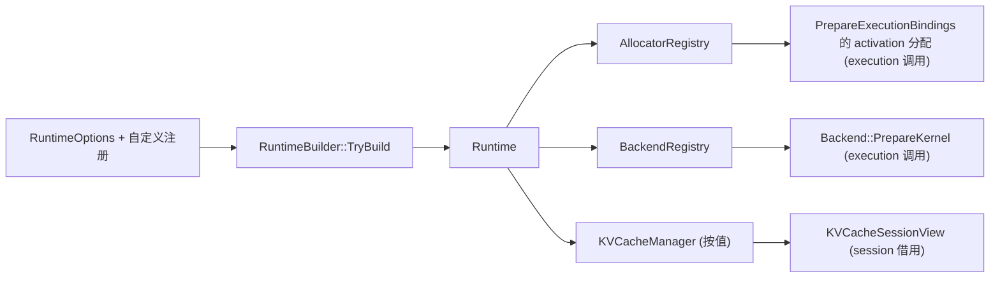

# runtime 模块设计

> 本文描述已验证实现。分层与依赖方向见 [architecture.md](../architecture.md)，execution 的 plan 与执行契约见 [execution 模块设计](execution.md)，产品范围见 [product.md](../product.md)。

## 1. 职责与边界

runtime 是**执行期运行时资源聚合层**：装配并长期拥有 allocator、backend 与 KV cache 资源，并提供 workspace 布局规划这一纯数据计算。它不参与模型语义、编译、plan 构建或逐 step 执行。

| 负责 | 说明 |
|---|---|
| Runtime 装配 | `RuntimeBuilder` 根据 `RuntimeOptions` 与自定义注册构建 `Runtime` |
| 资源所有权 | `Runtime` 按值拥有 `AllocatorRegistry`、`BackendRegistry`、`KVCacheManager`，并保存 workspace payload cap |
| 资源访问 | 按 device/device type 懒创建并缓存 `Allocator` / `Backend`；返回 Runtime-owned 借用指针 |
| KV 资源聚合 | 在 options 启用时规划 KV layout、检查物理字节上限、通过 allocator 初始化 `KVCacheManager`，并按其值持有 |
| workspace 规划 | `PlanWorkspaceRequirements` 把一串 `WorkspaceRequirement` 排成统一 offset 布局，返回 `WorkspacePlanLayout` |

**不得负责什么**：

| 不负责 | 实际归属 |
|---|---|
| `ExecutionPlan` / bindings / 执行编排 / `LayerRunner` | execution |
| kernel resolve、kernel 实现、权重打包 | backend（runtime 只持有 `BackendRegistry`） |
| 模型加载、图构建、编译 | model / graph / compiler |
| activation 分配、kernel params 构造、shape 约束求值 | execution 冷路径 |
| WorkspaceArena 的创建、Bind、Reset 与容量管理 | 调用方/Session；runtime 只计算布局 |
| KV reservation、commit、reset、release，以及 KV 读写 | kv_cache 的 `KVCacheManager` / `KVCacheSessionView`；runtime 只持有 Manager |
| 模型感知的 CPU defaults / FP32 KV geometry / feature policy 映射 | inference（`MakeCpuRuntimeOptions`）；runtime 不得反向依赖 |
| 线程安全与并发调度 | 无内部锁；调用方串行化 |

边界规则：

- 依赖方向为 runtime → kv_cache + base + backend（registry/factory 契约）+ memory；**不得依赖 execution/compiler/graph/model**。
- execution 可直接依赖 runtime（public header 使用 `runtime/workspace_planner.h` 与 `Runtime&`）。
- `Runtime` 必须先于所有通过其 backend resolve 的 `ExecutionPlan`、借用其 KV storage 的 session/view 构造，并比它们活得久；`ResolvedKernel::name` 借用 backend-owned 稳定存储。
- `Runtime` 可 move，但只能在资源被借用前；一旦 model/session/view 借用其地址，必须保持地址稳定。

## 2. 关键数据结构与所有权

### 2.1 Runtime

| 成员 | 类型 | 所有权/语义 |
|---|---|---|
| `allocator_registry_` | `AllocatorRegistry` | 按值拥有；providers 与懒创建的 allocator 实例 |
| `backend_registry_` | `BackendRegistry` | 按值拥有；factories 与懒创建的 backend 实例 |
| `kv_cache_manager_` | `KVCacheManager` | 按值拥有；未启用时保持默认未初始化状态 |
| `workspace_limit_bytes_` | `size_t` | 单请求 workspace payload 上限；0 表示无限 |

- 构造函数私有，`RuntimeBuilder` 是唯一 friend；`Runtime` 禁止复制、允许 move。
- `GetAllocator` / `GetBackend` / `GetKVCacheManager` 返回 **Runtime-owned 借用指针**；调用方不得延长其生命周期或在其失效后使用。
- `GetKVCacheManager()` 在 Manager 未初始化时返回 `nullptr`，因此“未启用 KV”与“启用但初始化失败”都不会暴露半初始化的 Manager。
- `workspace_limit_bytes_` 只是 Runtime 持有的部署策略值；Runtime 不分配 workspace，也不在内部执行该上限检查，由上层请求编排读取并校验。

### 2.2 注册表

| 类型 | 内容 | 生命周期/并发 |
|---|---|---|
| `AllocatorRegistry` | `providers_`（按 `DeviceType`）+ `instances_`（按 `Device` 的懒创建 allocator） | move-only；无锁；`SetProvider` 替换 provider 并丢弃其缓存实例，既有 `Buffer` 仍归原 `MemoryHandle` |
| `BackendRegistry` | `factories_`（按 `DeviceType`）+ `backends_`（懒创建并缓存） | move-only；无锁；`SetFactory` 替换 factory 并驱逐缓存 backend，下次查询重建 |

注册表本身不提供同步；Runtime 的“非线程安全”契约直接继承自这两个注册表与 `KVCacheManager`。

### 2.3 KV Cache 所有权

`KVCacheManager` 归 kv_cache 模块，runtime 只负责“何时、以什么几何与 allocator 初始化”：

- `KVCacheManager` 按值持有 `KVCacheStorage`（layout + K/V `Buffer`）与 `KVCacheSessionState`（generation、capacity、prompt_len、committed_tokens、Lifecycle）。
- `Init(Allocator&, ...)` 只在调用期间借用 allocator，不保存引用；产生的 `Buffer` 在 allocator 销毁后仍有效。
- `Runtime` 的地址与生命周期必须覆盖所有借用 Manager state 的 `KVCacheSessionView`；Manager 在 view 存在期间不得 move/assign。
- Manager 自身不做内部加锁，同一时刻只允许一个 session reservation；`Init` / `ReserveForSession` / `ResetSession` / `ReleaseSession` 必须与借用其 view 的 `Execute()` 串行化。
- runtime 不解释 KV layout、不执行 reserve/commit；这些属于 kv_cache 的公开合同。

### 2.4 Options 与 workspace 数据类型

| 类型 | 关键字段 | 说明 |
|---|---|---|
| `AllocatorRuntimeOptions` | `enable_cpu` / `enable_cuda` / `enable_cann` | 内置 CPU provider；CUDA/CANN provider 存在对应 allocator 实现 |
| `BackendRuntimeOptions` | `enable_cpu` / `enable_cuda` / `enable_cann` / `cpu_feature_policy` | 内置 CPU backend factory；CUDA/CANN **没有**内置 factory |
| `ExecutionRuntimeOptions` | `enable_default_stream` / `enable_graph_executor` | 仅兼容默认值；`enable_graph_executor=true` 被拒绝 |
| `WorkspaceRuntimeOptions` | `enable_workspace_manager` / `default_workspace_limit_bytes` | workspace manager 未实现；limit 存入 Runtime |
| `TracingRuntimeOptions` | `enable_profiling` / `enable_memory_profiling` | 两项都未实现，启用即拒绝 |
| `KVCacheRuntimeOptions` | `enable_manager`、`num_layers`、`num_kv_heads`、`max_tokens`、`head_dim`、`kv_dtype`、`alignment`（默认 64）、`max_bytes` | `max_bytes == 0` 表示无限；仅启用时规划/分配 |
| `WorkspacePlanLayout` | `total_bytes`、`required_alignment`（默认 1） | workspace 规划结果；用于分配 arena |
| `WorkspaceRequirement` | `bytes`、`alignment`、`lifetime`、`reusable`、`offset` | `offset` 是规划输出；定义在 base |
| `WorkspaceBinding` | `data`、`size` | 执行期借用的切片；定义在 base |

### 2.5 生命周期

```text
RuntimeBuilder::Build/TryBuild
  └─ Runtime (allocator registry, backend registry, KVCacheManager)
       ├─ Backend::PrepareKernel → ResolvedKernel (borrows backend-owned storage)
       │    └─ ExecutionPlan
       └─ KVCacheSessionView (borrows Manager state)
            └─ ExecutionContext / Execute
```

Runtime 必须比 plan、model、session 与所有 KV view 活得久；model 与 session 不拥有 Runtime。配置映射与预算归属见 [runtime-configuration.md](../guides/runtime-configuration.md) 与 [resource-budgeting.md](../guides/resource-budgeting.md)。

## 3. 接口与代码位置

| 接口 | 语义要点 | 代码位置 |
|---|---|---|
| `RuntimeBuilder::WithOptions(options)` | 替换后续 `Build`/`TryBuild` 使用的配置 | [runtime_builder.h](../../include/aethermind/runtime/runtime_builder.h) / [runtime_builder.cpp](../../src/runtime/runtime_builder.cpp) |
| `RegisterCustomAllocatorProvider(type, provider)` | 注册覆盖默认 provider；`kUndefined` 或空指针触发 `AM_CHECK` 中止；所有权转移给 builder | 同上 |
| `RegisterBackendFactory(type, factory)` | 注册覆盖默认 factory；前置条件同上 | 同上 |
| `Build()` | 失败即 `AM_CHECK` 中止；成功返回 Runtime | 同上 |
| `TryBuild()` | 返回 `StatusOr<Runtime>`；option 不支持、KV 初始化失败、分配失败以 Status 返回 | 同上 |
| `Runtime::GetAllocator(device)` | 懒创建并缓存；无 provider 时中止 | [runtime.h](../../include/aethermind/runtime/runtime.h) |
| `Runtime::TryGetAllocator(device)` | 同上但以 Status 报告缺失/非法 provider 结果 | 同上 |
| `Runtime::HasAllocatorProvider(type)` | 仅查询 provider 是否存在，不创建实例 | 同上 |
| `Runtime::GetBackend(type)` | 通过 factory 懒创建并缓存 backend | 同上 |
| `Runtime::workspace_limit_bytes()` | 返回请求 workspace payload cap，0 为无限 | 同上 |
| `Runtime::GetKVCacheManager()` | 返回 Runtime-owned Manager 借用指针；未初始化返回 `nullptr` | 同上 |
| `PlanWorkspaceRequirements(span<WorkspaceRequirement>)` | 两遍规划：先验证并计算总布局，再提交 offsets；不分配内存 | [workspace_planner.h](../../include/aethermind/runtime/workspace_planner.h) / [workspace_planner.cpp](../../src/runtime/workspace_planner.cpp) |
| `RuntimeOptions` / 子结构 | 装配配置的公共值类型 | [runtime_options.h](../../include/aethermind/runtime/runtime_options.h) |
| `WorkspaceArena` / `WorkspaceBinding` / `WorkspaceRequirement` | 执行期共享契约，定义在 base，runtime 与 execution 共同依赖 | [workspace_arena.h](../../include/aethermind/base/workspace_arena.h) / [workspace_types.h](../../include/aethermind/base/workspace_types.h) |

## 4. 主流程/时序

### 4.1 Runtime 构建

```text
RuntimeBuilder::TryBuild
  → ValidateOptions                    (不支持项 / GPU 无自定义 factory 先拒绝)
  → BuildAllocatorRegistry             (内置默认 → 转移 pending 自定义 provider)
  → BuildBackendRegistry               (内置 CPU factory → 转移 pending 自定义 factory)
  → TryBuildKVCacheManager(allocator_registry)
       → PlanKVCacheLayout → TotalBytes → max_bytes 检查
       → allocator_registry.TryGetAllocator(Device::CPU())
       → KVCacheManager::Init
  → Runtime{registries, manager, workspace_limit}
```

| 阶段 | 失败语义 |
|---|---|
| `ValidateOptions` | `Unimplemented`（如 graph executor、workspace manager、profiling、`enable_default_stream=false`、GPU backend 无自定义 factory）；此时**不转移**任何 pending 注册，配置修正后可重试 |
| registry 组装 | 默认项先写入，随后转移 pending 自定义项，因此自定义项覆盖同 device 默认项；转移采用 pop-before-set，避免 moved-from 条目留在 pending |
| KV 初始化 | `PlanKVCacheLayout` 的几何/对齐错误直接传播；`required_bytes > max_bytes` 返回 `ResourceExhausted`；allocator 缺失或 `Init` 失败原样传播 |
| 内存分配 | `TryBuild` 捕获 `std::bad_alloc` 并返回空消息的 `ResourceExhausted`，避免报告失败时再次分配 |
| `Build()` | 调用 `TryBuild`，失败时 `AM_CHECK` 中止 |
| 注册消费 | 成功构建后 pending 列表被消费；组装开始后的失败只保留尚未转移的条目，已移入被丢弃 registry 的注册不可恢复，重试将在缺少该条目下继续 |

### 4.2 资源访问（懒创建）

- `GetAllocator` / `TryGetAllocator`：首次查询时由 provider 创建 allocator 并缓存；同一 `Device` 后续查询返回同一实例。
- `GetBackend`：首次查询时由 factory 创建 backend 并缓存；同一 `DeviceType` 后续查询返回同一实例。无 factory 或创建失败返回错误。
- `SetProvider` / `SetFactory` 只发生在装配期；替换会驱逐对应缓存实例，因此不要让已借用实例跨替换存活。
- 这些查询不是线程安全的；调用方必须串行化 Runtime 上的所有装配、查询与执行期借用。

### 4.3 Workspace 规划

调用方（execution 的 `ExecutionPlanBuilder`）在 kernel resolve 后收集每步 `ResolvedKernel::workspace_requirement`，调用一次 `PlanWorkspaceRequirements`：

1. 第一遍：校验每个 `alignment` 为非零 2 的幂（对齐错误优先于 overflow），并计算 `required_alignment = max(alignment)` 与 `total_bytes`（按对齐后累加，带溢出检查）。
2. 第二遍：在验证通过后提交每个 requirement 的 `offset`；零字节 requirement 获得当前 `total_bytes` 作为位置标记但不推进总量，其 alignment 仍参与 `required_alignment`。
3. 成功返回 `WorkspacePlanLayout`；调用方用它分配 `WorkspaceArena`，并把 offsets 冻结进 plan。
4. 失败返回 `InvalidArgument`（非法对齐）、`Overflow`（offset/total 不可表示）或空消息 `ResourceExhausted`（诊断分配失败）；**失败时所有 offsets 保持不变**，不留下部分布局。

Runtime 不创建、不拥有、不 Reset `WorkspaceArena`；执行期每个 step 的绑定由 execution 的 `ExecutionContext::BindWorkspace` 向 arena 请求。workspace payload cap 由上层请求编排在分配前检查。

### 4.4 装配时序与依赖边界



Runtime 只提供资源与规划结果；kernel resolve、activation 分配与执行由 execution 发起，KV reservation 与 commit 由 inference/session 发起。

## 5. 关键取舍

| 选择 | 原因 | 被否方案 |
|---|---|---|
| Runtime 按值拥有 allocator/backend 注册表与 KVCacheManager | 资源生命周期与 Runtime 对齐，避免全局可变状态和静态析构顺序问题 | 全局 allocator/backend 单例；被否因为多 Runtime 隔离、测试清理与生命周期不可控。`KernelRegistry` 仍是 backend 模块的全局 singleton，不属于 Runtime 所有权 |
| backend/allocator 懒创建并缓存 | 未使用的 device 不付出创建成本；错误在真正需要时以 Status 暴露 | 构建时急切创建全部 device 资源；被否因为 CPU-only 产品会为未配置设备失败 |
| 自定义注册覆盖同 device 默认项 | 允许测试与嵌入方替换 provider/factory，同时保留开箱可用默认值 | 只允许追加、不允许覆盖；被否因为无法替换 CPU 默认实现 |
| 同时保留 `Build()` 与 `TryBuild()` | `Build()` 适合入口处快速失败，`TryBuild()` 适合可恢复的宿主/测试路径 | 只保留 abort 版本或只保留 Status 版本；前者不可测试失败路径，后者削弱默认入口的显式性 |
| KV plane 通过 Runtime 配置的 allocator 分配 | KV 与其余受管存储使用统一分配策略；Manager 不拥有 allocator | Manager 自建 allocator；被否因为破坏统一内存策略与 Runtime 预算边界 |
| KV `max_bytes` 在获取 allocator、分配 plane 之前检查 | 预算失败不产生大块分配，也不污染现有 Runtime | 先分配再检查；被否因为失败代价高且可能 OOM |
| workspace 规划做成无状态自由函数 | 只做布局算术，不持有资源；execution 可直接消费结果 | 引入 WorkspacePlanner/Manager 对象并由 Runtime 管理 arena；被否因为当前产品只需要一次静态规划，增加生命周期与所有权复杂度 |
| 两遍规划、全部验证后提交 offsets | 失败不留下部分布局，调用方可安全重试 | 单遍边算边写；被否因为中途失败会破坏调用方数据 |
| workspace manager 选项显式拒绝 | 未实现的能力不以静默 no-op 通过 | 接受选项但忽略；被否因为会制造“已启用”的错误预期 |
| CUDA/CANN backend 不提供内置 factory | 维持 CPU-only 产品边界；需要时由调用方显式注入 factory | 内置 GPU backend 默认开启；被否因为当前不承诺 GPU 后端 |
| Runtime 不内置锁 | 单请求同步模型下由调用方串行化，避免热路径锁开销 | 内部互斥；被否因为会增加每次查找/借用的成本，且无法覆盖 Execute 与 Manager 变更的跨对象顺序 |

## 6. 测试与验证入口

| 测试文件 | 覆盖重点 |
|---|---|
| [test_runtime_builder.cpp](../../tests/unit/runtime/test_runtime_builder.cpp) | 启用/禁用 KV 时 Manager 初始化、非法几何/对齐返回 Status、失败仍消费 pending 注册、`Build` 与 `TryBuild` 一致、OOM 后注册可复用 |
| [test_runtime_options_validation.cpp](../../tests/unit/runtime/test_runtime_options_validation.cpp) | 不支持选项在创建资源前拒绝且可重试、GPU flags 需要匹配自定义 factory、自定义 CPU allocator 可提供 KV |
| [test_runtime_resource_limits.cpp](../../tests/unit/runtime/test_runtime_resource_limits.cpp) | KV payload 上限在创建 allocator 前检查、几何/溢出失败、预算失败后可重试、workspace limit 不依赖 workspace manager 且跨 move 保持 |
| [test_runtime_backend_integration.cpp](../../tests/unit/execution/test_runtime_backend_integration.cpp) | backend registry 创建、CPU backend 缓存、自定义 factory 覆盖、默认无 KV Manager、按 options 构建 KV |
| [test_workspace_requirement_planning.cpp](../../tests/unit/execution/test_workspace_requirement_planning.cpp) | 对齐顺序布局、零字节 marker、空需求、精确容量、规划不分配、非法对齐/offset/字节溢出且 offsets 不变、bad_alloc 返回空 `ResourceExhausted` |

```bash
./build/tests/unit/aethermind_unit_tests --gtest_filter=RuntimeBuilderTryBuild.*
./build/tests/unit/aethermind_unit_tests --gtest_filter=RuntimeOptionsValidation.*
./build/tests/unit/aethermind_unit_tests --gtest_filter=RuntimeResourceLimits.*
./build/tests/unit/aethermind_unit_tests --gtest_filter=RuntimeBackendIntegration.*
./build/tests/unit/aethermind_unit_tests --gtest_filter=WorkspaceRequirementPlanning.*
```

配置映射与预算归属分别见 [runtime-configuration.md](../guides/runtime-configuration.md)、[resource-budgeting.md](../guides/resource-budgeting.md)；KV 存储与提交语义的权威描述在 kv_cache 模块文档与 [architecture.md](../architecture.md) 第五节。
